# @h-ai/storage API reference

<!-- translation: partial -->

[Chinese source](storage.md) · [Configuration](../configuration/storage.en.md) · [Data structures](../data/storage.en.md)

## Quick start

Initialize Storage and use the file API for object operations. Authorize the object key before issuing a signed URL. Use streaming for large downloads.

```ts
import type { FileMetadata, StorageConfigInput } from '@h-ai/storage'
import type { Buffer } from 'node:buffer'
import { storage } from '@h-ai/storage'

export async function storeImage(config: StorageConfigInput, imageBuffer: Uint8Array) {
  // 选择一个后端，检查初始化结果。
  const initialized = await storage.init(config)
  if (!initialized.success)
    throw new Error(initialized.error.message)

  let result: { metadata: FileMetadata, bytes: Buffer, downloadUrl?: string }
  let closed
  try {
    const key = 'uploads/image.png'
    // 用对象 key 写入 PNG 字节，成功时返回对象元数据。
    const uploaded = await storage.file.put(key, imageBuffer, { contentType: 'image/png' })
    if (!uploaded.success)
      throw new Error(uploaded.error.message)

    // 用同一 key 读取对象内容，成功时返回 Buffer。
    const downloaded = await storage.file.get(key)
    if (!downloaded.success)
      throw new Error(downloaded.error.message)

    result = { metadata: uploaded.data, bytes: downloaded.data }
    if (config.type === 's3') {
      // S3 可签发有效期为 3600 秒的下载 URL。
      const signed = await storage.presign.getUrl(key, { expiresIn: 3600 })
      if (!signed.success)
        throw new Error(signed.error.message)
      result.downloadUrl = signed.data
    }
  }
  finally {
    // 释放本次连接，失败时交由调用方处理。
    closed = await storage.close()
  }
  if (!closed.success)
    throw new Error(closed.error.message)
  return result
}
```

```ts
import { apiClient } from '@h-ai/api-client'
import { uploadWithPresignedUrl } from '@h-ai/storage/client'

export async function uploadImage(key: string, file: File) {
  // 用相同的 Content-Type 请求签名和上传。
  const contentType = file.type || 'application/octet-stream'
  const signed = await apiClient.storage.presignedUrls.createUpload({ key, contentType })
  if (!signed.success)
    throw new Error(signed.error.message)

  // 直接上传到对象存储，成功时返回服务端确认的对象 key。
  const uploaded = await uploadWithPresignedUrl(signed.data.url, file, { contentType })
  if (!uploaded.success)
    throw new Error(uploaded.error ?? 'Upload failed')
  return signed.data.key
}
```

<a id="api-reference"></a>

## Features

Each section lists individual interfaces, then follows the calls through a task. Parameters and defaults describe the arguments; call examples show the invocation, and returns describe the result or successful data as noted below. Check `success` on `HaiResult` before reading `data`. Detailed parameter defaults and advanced constraints remain linked to the Chinese reference.

Import the module as in the quick start. Except for lifecycle examples, run scenarios after initialization and before closure. The value helper checks HaiResult.success and preserves the original error. Use isolated test data and explicit cleanup.

```ts
import type { HaiResult } from '@h-ai/core'

function value<T>(result: HaiResult<T>): T {
  if (!result.success)
    throw new Error(result.error.message, { cause: result.error })
  return result.data
}
```

<a id="connection"></a>

### Connect and close: `storage`

Local directories and S3 use the same file API; the application owns startup and shutdown.

#### Interface list

| API | Purpose | Parameters and defaults | Return value or failure | Call example |
| --- | --- | --- | --- | --- |
| `storage.init` | Open the selected backend | `config` | `void` | `await storage.init(config)` |
| `storage.close` | Stop new operations and release the backend | None | `void` | `await storage.close()` |

#### Scenario: Connect and close

```ts
value(await storage.init({ type: 'local', root: './data/files-demo' }))
value(await storage.close()) // undefined; saved files remain on disk
```

The input is a development directory. Closing releases the instance but preserves files; reconnect before continuing.

The output is successful HaiResult.data unless shown as a distinct result. publicUrl returns synchronously.

Consume or cancel opened streams. After a failed bulk delete, inspect error.ext.deleteMany before retrying: a key with an unknown outcome may already be deleted.

<a id="download-authorization"></a>

[Detailed parameters and workflows](storage.md#connection)

<a id="files"></a>

### Read, write and copy files: `storage.file`

Identify files by object key. Read content, metadata or streams as needed; inspect per-item progress for batch deletion.

#### Interface list

| API | Purpose | Parameters and defaults | Return value or failure | Call example |
| --- | --- | --- | --- | --- |
| `storage.file.put` | Store file content and metadata | `key, data, options?` | `FileMetadata` | `await storage.file.put('report.txt', 'Hello')` |
| `storage.file.get` | Read all file bytes | `key, options?` | `Buffer` | `await storage.file.get('report.txt')` |
| `storage.file.getStream` | Read a file as a stream | `key, options?` | `AsyncIterable<Uint8Array>` | `await storage.file.getStream('report.txt')` |
| `storage.file.head` | Read file metadata | `key` | `FileMetadata` | `await storage.file.head('report.txt')` |
| `storage.file.exists` | Check file existence | `key` | `boolean` | `await storage.file.exists('report.txt')` |
| `storage.file.copy` | Copy to another object key | `sourceKey, destKey, options?` | `FileMetadata` | `await storage.file.copy('report.txt', 'backup/report.txt')` |
| `storage.file.delete` | Delete a file | `key` | `void` | `await storage.file.delete('report.txt')` |
| `storage.file.deleteMany` | Delete files and report per-key progress | `keys` | `StorageDeleteResult` | `await storage.file.deleteMany(['a.txt', 'b.txt'])` |

#### Scenario: Read, write and copy files

```ts
const saved = value(await storage.file.put('demo/report.txt', 'hello', { contentType: 'text/plain' }))
// saved describes key demo/report.txt, size 5 and backend timestamps
value(await storage.file.exists('demo/report.txt')) // true
const metadata = value(await storage.file.head('demo/report.txt')) // same key and size
value(await storage.file.get('demo/report.txt')).toString('utf8') // 'hello'
const stream = value(await storage.file.getStream('demo/report.txt'))
let byteCount = 0
for await (const bytes of stream)
  byteCount += bytes.byteLength
// byteCount === 5; stream iteration can throw on later I/O failure
value(await storage.file.copy('demo/report.txt', 'demo/copy.txt')) // metadata for the new key
value(await storage.file.delete('demo/report.txt')) // undefined
const deleted = value(await storage.file.deleteMany(['demo/copy.txt'])) // per-key deletion progress
value(await storage.file.exists('demo/copy.txt')) // false after confirmed deletion
```

UTF-8 hello is five bytes. Chunk boundaries vary, and stream iteration can fail after the initial result. Inspect confirmed batch deletions rather than assuming Promise completion means every key was removed.

[Detailed parameters and workflows](storage.md#files)

<a id="directories"></a>

### Browse and clean a prefix: `storage.dir`

Directories are object-key prefixes. List them in pages and authorize the full prefix before deletion.

#### Interface list

| API | Purpose | Parameters and defaults | Return value or failure | Call example |
| --- | --- | --- | --- | --- |
| `storage.dir.list` | Paginate objects under a prefix | `options?` | `ListResult` | `await storage.dir.list({ prefix: 'backup/' })` |
| `storage.dir.delete` | Delete objects under a prefix | `prefix` | `void` | `await storage.dir.delete('backup/')` |

`storage.dir.delete(prefix)` deletes objects page by page based on the literal start of each key. For example, `reports/draft-` matches `reports/draft-1.txt`, and `reports/` matches keys under that path. An empty prefix clears the objects in the container.

#### Scenario: Browse and clean a prefix

```ts
value(await storage.file.put('demo-prefix/a.txt', 'a'))
const page = value(await storage.dir.list({ prefix: 'demo-prefix/', maxKeys: 20 }))
// page contains metadata for demo-prefix/a.txt and backend pagination information
value(await storage.dir.delete('demo-prefix/')) // undefined
value(await storage.file.exists('demo-prefix/a.txt')) // false when no concurrent writer recreates it
```

The input targets demo-prefix/. Pages include metadata and continuation details. Prefix deletion is not atomic with concurrent uploads, which can recreate objects.

[Detailed parameters and workflows](storage.md#directories)

<a id="signed-urls"></a>

### Authorize direct transfers: `storage.presign`

S3 supports short-lived URLs for a specific object and operation. Authorize the user and object before signing.

#### Interface list

| API | Purpose | Parameters and defaults | Return value or failure | Call example |
| --- | --- | --- | --- | --- |
| `storage.presign.getUrl` | Sign a temporary download URL | `key, options?` (expires in 3600 seconds by default, range 1–604800) | `string` | `await storage.presign.getUrl('report.txt')` |
| `storage.presign.putUrl` | Sign a temporary upload URL | `key, options?` (expires in 3600 seconds by default; MIME type defaults to `application/octet-stream`) | `string` | `await storage.presign.putUrl('report.txt')` |
| `storage.presign.publicUrl` | Resolve a configured public URL | `key` | `string or null` | `storage.presign.publicUrl('report.txt')` |

#### Scenario: Authorize direct transfers

A signed URL separates authorization from the byte transfer. This requires initialized S3 storage and an application-authorized object key.



Returning a URL issues access credentials; it does not transfer a file. The browser then contacts storage, which checks the signature and expiry. Upload Content-Type must match the signed value. publicUrl only computes the configured public address.

```ts
// Requires initialized S3 storage and prior application authorization.
const uploadUrl = value(await storage.presign.putUrl('reports/demo.txt', { expiresIn: 300, contentType: 'text/plain' }))
const downloadUrl = value(await storage.presign.getUrl('reports/demo.txt', { expiresIn: 300 }))
const publicUrl = storage.presign.publicUrl('reports/demo.txt') // string or null
```

Inputs use one key and a 300-second lifetime. Hosts and signatures vary. Upload Content-Type must match the signed value. publicUrl only applies public-address rules; it neither checks permission nor makes an object public.

#### Scenario: Authorize a download

This integration guide was moved from the configuration handbook because it describes code arguments. The complete walkthrough is currently available in [Chinese](storage.md#download-authorization); this subsection is partially translated.

[Detailed parameters and workflows](storage.md#signed-urls)

<a id="checksums"></a>

### Check byte integrity: `storage.checksum`

Node computes digests for large in-memory inputs in a bounded Worker pool. Streams are read in chunks and honor the caller’s cancellation signal.

Checksums do not require storage initialization. Both sides must use the same algorithm and encoding.

#### Interface list

| API | Purpose | Parameters and defaults | Return value or failure | Call example |
| --- | --- | --- | --- | --- |
| `storage.checksum.generate` | Compute a content checksum | `data, options?` | `string` | `await storage.checksum.generate('Hello')` |
| `storage.checksum.verify` | Verify a content checksum | `data, expected, options?` | `boolean` | `await storage.checksum.verify('Hello', expected)` |

#### Scenario: Check byte integrity

```ts
const digest = value(await storage.checksum.generate('hello'))
value(await storage.checksum.verify('hello', digest)) // true
value(await storage.checksum.verify('changed', digest)) // false
```

The same hello bytes match; changed bytes return false. A digest is not an access credential, and an S3 ETag is not this content checksum.

[Detailed parameters and workflows](storage.md#checksums)

<a id="browser-files"></a>

### Upload, download and save in browsers: client helpers

These helpers consume server-authorized URLs or user-selected files. They do not initialize server Storage or grant business permissions.

#### Interface list

| API | Purpose | Parameters and defaults | Return value or failure | Call example |
| --- | --- | --- | --- | --- |
| `uploadWithPresignedUrl` | Upload bytes | `url, File/Blob/ArrayBuffer/string, options?` | `Promise<{ success: boolean; error?: string }>` | `await uploadWithPresignedUrl(url, file, { contentType: file.type })` |
| `downloadWithPresignedUrl` | Download a Blob | `url, options?` | `Promise<{ success: boolean; data?: Blob; error?: string }>` | `await downloadWithPresignedUrl(url)` |
| `downloadAndSave` | Download and save | `url, { filename?, ...options }?` | `Promise<{ success: boolean; data?: Blob; error?: string }>` | `await downloadAndSave(url, { filename: "report.txt" })` |
| `getFileExtension` | Read an extension | `File` | `string` | `getFileExtension(file)` |
| `getMimeType` | Resolve a MIME type | `extension: string` | `string` | `getMimeType("txt")` |
| `formatFileSize` | Format a byte count | `bytes: number` | `string` | `formatFileSize(1024)` |

#### Scenario: Upload a selected file and save a download

Both URLs come from successful signing responses; file comes from the file picker. Invoke this function on user action. Upload/download results use their own success/error shape, rather than HaiResult.

```ts
import { downloadAndSave, downloadWithPresignedUrl, formatFileSize, getFileExtension, getMimeType, uploadWithPresignedUrl } from '@h-ai/storage/client'

async function transfer(file: File, uploadUrl: string, downloadUrl: string) {
  const extension = getFileExtension(file)
  const contentType = file.type || getMimeType(extension)
  const displayedSize = formatFileSize(file.size) // 1024 bytes displays as 1 KB
  const uploaded = await uploadWithPresignedUrl(uploadUrl, file, { contentType })
  if (!uploaded.success)
    throw new Error(uploaded.error ?? 'Upload failed')
  const downloaded = await downloadWithPresignedUrl(downloadUrl)
  if (!downloaded.success || !downloaded.data)
    throw new Error(downloaded.error ?? 'Download failed')
  const saved = await downloadAndSave(downloadUrl, { filename: file.name })
  if (!saved.success)
    throw new Error(saved.error ?? 'Save failed')
  return { extension, displayedSize, blob: downloaded.data }
}
```
