# @h-ai/storage API リファレンス

<!-- translation: partial -->

[原文（中国語）](storage.md) · [設定](../configuration/storage.ja.md) · [データ構造](../data/storage.ja.md)

<a id="quick-start"></a>

## クイックスタート

<a id="module-dependencies"></a>

### 依存関係

| 依存先 | 用途 | 利用条件 | 初期化順序 |
| --- | --- | --- | --- |
| Node.js | ファイル、ディレクトリ、署名のサーバー API を実行 | `@h-ai/storage` のサーバー API を使う場合 | 起動時に `storage.init()` を呼び出し、成功後にファイルを操作 |
| `@h-ai/core` | ログ、エラー、結果型を提供 | Storage とともにインストール | Core を使う場合は設定を読み込んでから `storage.init()` に渡す |
| 書き込み可能なローカルディレクトリ | ファイルとメタデータを保存 | `type: 'local'` の場合 | アプリにディレクトリまたは親ディレクトリの読み書き権限を付けてから `root` を指定して初期化 |
| S3 互換ストレージ | オブジェクトを保存し、署名付き URL を発行 | `type: 's3'` の場合。AWS SDK は Storage とともにインストール | バケットと認証情報を用意して初期化。バケット作成権限を付けて `createBucket` を有効にすると、存在しないバケットを作成可能 |
| 署名 API とストレージの CORS | ブラウザーからオブジェクトストレージへ直接アップロード | ブラウザーで `@h-ai/storage/client` を使う場合 | ストレージの CORS を設定し、サーバーでキーへのアクセスを確認して URL を発行。ブラウザーでは `@h-ai/api-client` で取得した URL をアップロード関数に渡すことも可能 |

### 利用例

Storage を初期化してファイル API でオブジェクトを操作します。署名付き URL の発行前にキーへのアクセスを確認します。大きなダウンロードにはストリームを使います。

```ts

import type { Buffer } from 'node:buffer'
import { type FileMetadata, type StorageConfigInput, storage } from '@h-ai/storage'

export async function storeImage(config: StorageConfigInput, imageBuffer: Uint8Array) {
  // 呼び出し元の設定で接続します。成功時は data がなく、失敗時は error を確認します。
  const initialized = await storage.init(config)
  if (!initialized.success)
    throw new Error(initialized.error.message)

  let result: { metadata: FileMetadata, bytes: Buffer, downloadUrl?: string }
  let closed
  try {
    const key = 'uploads/image.png'
    // 指定キーに呼び出し元の PNG バイトを書きます。成功時はメタデータ、失敗時は error です。
    const uploaded = await storage.file.put(key, imageBuffer, { contentType: 'image/png' })
    if (!uploaded.success)
      throw new Error(uploaded.error.message)

    // 同じキーから PNG を読みます。成功時は Buffer、未検出や読取失敗はエラーです。
    const downloaded = await storage.file.get(key)
    if (!downloaded.success)
      throw new Error(downloaded.error.message)

    result = { metadata: uploaded.data, bytes: downloaded.data }
    if (config.type === 's3') {
      // 同じ S3 キーに 3600 秒のダウンロード URL を発行します。成功時は URL 文字列、失敗時は error です。
      const signed = await storage.presign.getUrl(key, { expiresIn: 3600 })
      if (!signed.success)
        throw new Error(signed.error.message)
      result.downloadUrl = signed.data
    }
  }
  finally {
    // 引数なしで接続を解放します。成功時の data は undefined、失敗は後続で判定します。
    closed = await storage.close()
  }
  if (!closed.success)
    throw new Error(closed.error.message)
  return result
}
```

ブラウザーの例では API Client を直接インポートします。フロントエンドのプロジェクトに両方のパッケージをインストールします。

```sh
pnpm add @h-ai/storage @h-ai/api-client
```

```ts
import { apiClient } from '@h-ai/api-client'
import { storage } from '@h-ai/storage/client'

export async function uploadImage(key: string, file: File) {
  // 用相同的 Content-Type 请求签名和上传。
  const contentType = file.type || 'application/octet-stream'
  // 設定済み API にキーと MIME 型を送ります。成功時はアップロード URL と確定済みキー、失敗時は error です。
  const signed = await apiClient.storage.presignedUrls.createUpload({ key, contentType })
  if (!signed.success)
    throw new Error(signed.error.message)

  // 直接上传到对象存储，成功时返回服务端确认的对象 key。
  // 署名済み URL に元のファイルと署名時の MIME 型で送信します。成功は受付済み、失敗時は error です。
  const uploaded = await storage.client.uploadWithPresignedUrl(signed.data.url, file, { contentType })
  if (!uploaded.success)
    throw new Error(uploaded.error ?? 'Upload failed')
  return signed.data.key
}
```

<a id="api-reference"></a>

## 機能

各節では個別のインターフェースを列挙し、その後に作業の流れを説明します。入力欄は呼び出し例、出力欄は成功時のデータです。`HaiResult` は `success` を確認してから `data` を読みます。引数の詳細な既定値と高度な制約は中国語の対応節を参照してください。

モジュールの import は入門例と同じです。サーバーのファイル、ディレクトリー、署名操作は初期化成功後、終了前に実行します。`storage.checksum` と `storage.client` は初期化不要です。HaiResult を返す呼び出しでは success を確認し、失敗時は元の結果を返して、成功時だけ data を読みます。関数宣言のない例はアプリの非同期業務関数内の断片です。独立したテストデータと明示した後片付けを使います。

<a id="connection"></a>

### 接続と終了：`storage`

ローカルと S3 は同じファイル API を使います。接続の開始・終了はアプリが管理します。

#### インターフェース一覧

| API | 用途 | 引数と既定値 | 戻り値・失敗 | 呼び出し例 |
| --- | --- | --- | --- | --- |
| `storage.init(config)` | 指定のストレージを開く | `config: StorageConfigInput` は必須。`type` に `local` または `s3` を指定。バックエンドの項目と既定値は[ストレージ設定](../configuration/storage.ja.md)を参照 | `void` | `await storage.init(config)` |
| `storage.close()` | 新規処理を止めてバックエンドを解放 | なし | `void` | `await storage.close()` |

#### 利用例：接続と終了

```ts
// アプリの非同期業務関数内の断片です。失敗結果は呼び出し元へ返します。
// ./data/files-demo をローカル保存先にします。成功後にファイルを利用でき、失敗は 元の失敗結果を返します。
const initResult = await storage.init({ type: 'local', root: './data/files-demo' })
if (!initResult.success)
  return initResult
// 引数なしでローカル接続を解放します。成功時の data はなく、ファイルは残ります。失敗は 元の失敗結果を返します。
const closeResult = await storage.close()
if (!closeResult.success)
  return closeResult
// saved files remain on disk
```

開発用ディレクトリを入力します。close はインスタンスを解放しますがファイルを削除しません。続行前に再初期化してください。

別の結果型である場合を除き、出力は成功時の HaiResult.data です。publicUrl は同期です。

取得したストリームは読み切るか中止します。一括削除失敗時は再試行の前に error.ext.deleteMany を確認してください。結果が不明でも削除済みの場合があります。

未翻訳：ストリーム整合性、一括削除の復旧、外部アップロードの手順。[中国語の該当節](storage.md#api-reference)を参照してください。

<a id="download-authorization"></a>

[引数と手順の詳細](storage.md#connection)

<a id="files"></a>

### ファイルの読み書きとコピー：`storage.file`

オブジェクトキーでファイルを指定します。本文・メタデータ・ストリームを使い分け、一括削除では各項目の進捗を確認します。

#### インターフェース一覧

| API | 用途 | 引数と既定値 | 戻り値・失敗 | 呼び出し例 |
| --- | --- | --- | --- | --- |
| `storage.file.put(key, data, options?)` | 内容とメタデータを保存 | `key: string` と `data: StorageData` は必須。文字列、Buffer、Uint8Array、非同期バイトストリームを渡せます。[`UploadOptions`](#storage-file-options) を参照してください。 | `FileMetadata` | `await storage.file.put('report.txt', 'Hello')` |
| `storage.file.get(key, options?)` | 指定範囲のバイトをメモリに取得 | `key: string` は必須。[`DownloadOptions`](#storage-file-options) を参照してください。 | `Buffer` | `await storage.file.get('report.txt')` |
| `storage.file.getStream(key, options?)` | ストリームで取得 | `key: string` は必須。[`DownloadOptions`](#storage-file-options) を参照してください。 | `AsyncIterable<Uint8Array>` | `await storage.file.getStream('report.txt')` |
| `storage.file.getStreamWithMetadata(key, options?)` | オブジェクト全体とメタデータを一度に開く | `key: string` は必須。任意の `options.signal` で読み取りを中断できます。 | `StorageFileRead`、またはオープン時のエラー | `await storage.file.getStreamWithMetadata('report.txt')` |
| `storage.file.head(key)` | メタデータを取得 | `key: string`、必須のオブジェクトキー | `FileMetadata` | `await storage.file.head('report.txt')` |
| `storage.file.exists(key)` | ファイルの存在確認 | `key: string`、必須のオブジェクトキー | `boolean` | `await storage.file.exists('report.txt')` |
| `storage.file.copy(sourceKey, destKey, options?)` | 別キーにコピー | `sourceKey: string` と `destKey: string` は必須のコピー元とコピー先キー。`options?: CopyOptions` の `contentType` と `metadata` は対応するコピー元の値を上書き。省略した項目はコピー元から継承 · [`CopyOptions`](#storage-file-options) | `FileMetadata` | `await storage.file.copy('report.txt', 'backup/report.txt')` |
| `storage.file.delete(key)` | ファイルを削除 | `key: string`、必須のオブジェクトキー | `void` | `await storage.file.delete('report.txt')` |
| `storage.file.deleteMany(keys)` | 一括削除し個別の進捗を報告 | `keys: string[]`、削除するオブジェクトキーの配列が必須 | `StorageDeleteResult` | `await storage.file.deleteMany(['a.txt', 'b.txt'])` |

<a id="storage-file-options"></a>

##### ファイルオプション

`key` はオブジェクトキー、`data` は書き込む内容です。オプションとその各項目は省略できます。読み取り時のオフセットは 0 から数えます。

`UploadOptions`

| 項目 | 型 | 動作 |
| --- | --- | --- |
| `contentType` | `string` | 省略可能。ローカルでは拡張子から推定し、S3 ではオブジェクトサービスが決めます。 |
| `metadata` | `Record<string, string>` | `storage.file.head(key)` で読み取れる文字列のメタデータです。 |
| `ifNoneMatch` | `"*"` | キーが存在しない場合だけ書き込みます。`{ ifNoneMatch: "*" }` で既存ファイルの上書きを避けます。 |
| `signal` | `AbortSignal` | アップロードを取り消します。 |
| `cacheControl` | `string` | S3 専用。`max-age=3600` などの `Cache-Control` を指定します。 |
| `contentDisposition` | `string` | S3 専用。`Content-Disposition` でダウンロード時のファイル名を提案できます。 |

読み取りとコピーのオプション

| 項目 | 型 | 動作 |
| --- | --- | --- |
| `DownloadOptions.rangeStart` | `number` | 開始バイトを含みます。省略時は先頭です。 |
| `DownloadOptions.rangeEnd` | `number` | 終了バイトを含みます。省略時は末尾までです。 |
| `DownloadOptions.signal` | `AbortSignal` | 読み取りを取り消します。`getStreamWithMetadata` にはこの項目だけを指定できます。 |
| `CopyOptions.contentType` | `string` | コピー先のメディアタイプ。省略時はコピー元から引き継ぎます。 |
| `CopyOptions.metadata` | `Record<string, string>` | コピー先のメタデータ。省略時はコピー元から引き継ぎます。 |

`metadata` はアプリ独自の文字列のキーと値です。アップロード後に `head` で確認できます。Local では `contentType` を省略すると拡張子から推定します。S3 では `cacheControl: "max-age=3600"` でキャッシュ指示、`contentDisposition: 'attachment; filename="report.txt"'` でダウンロード時のファイル名を設定できます。

Local は `.hai-storage-meta` ディレクトリーと、末尾が `.upload.tmp` のパス要素を予約します。`report.meta.json` は通常のオブジェクトキーとして使えます。メタデータの取得には、現在のファイルの識別情報に対応するレコードが必要です。[ローカルのメタデータ保存](../data/storage.ja.md)

#### 利用例：ファイルの読み書きとコピー

```ts
// アプリの非同期業務関数内の断片です。失敗結果は呼び出し元へ返します。
// レポートキーに hello をテキストとして保存します。成功時のサイズは 5 バイト、失敗は 元の失敗結果を返します。
const savedResult = await storage.file.put('demo/report.txt', 'hello', { contentType: 'text/plain' })
if (!savedResult.success)
  return savedResult
const saved = savedResult.data
// saved のキーは demo/report.txt、サイズは 5 バイトです。
// 保存直後のレポートを確認します。結果は true、失敗は 元の失敗結果を返します。
const existsResult = await storage.file.exists('demo/report.txt')
if (!existsResult.success)
  return existsResult
existsResult.data // true
// レポートキーのメタデータを読み、同じキーと 5 バイトのサイズを得ます。失敗は 元の失敗結果を返します。
const metadataResult = await storage.file.head('demo/report.txt')
if (!metadataResult.success)
  return metadataResult
const metadata = metadataResult.data // same key and size
// レポートキーから全バイトを読み、UTF-8 の hello に変換します。失敗は 元の失敗結果を返します。
const getResult = await storage.file.get('demo/report.txt')
if (!getResult.success)
  return getResult
getResult.data.toString('utf8') // 'hello'
// 0 始まりのオフセット 1〜3 にある 3 バイトを取得します。UTF-8 に変換すると ell です。取得に失敗したら失敗結果を返します。
const sample = await storage.file.get('demo/report.txt', { rangeStart: 1, rangeEnd: 3 })
if (!sample.success)
  return sample
sample.data.toString('utf8') // 'ell'
// レポートキーのバイトストリームを開きます。開始失敗時は元の失敗結果を返します。後続の I/O は反復時に例外になる場合があります。
const streamResult = await storage.file.getStream('demo/report.txt')
if (!streamResult.success)
  return streamResult
const stream = streamResult.data
let byteCount = 0
for await (const bytes of stream)
  byteCount += bytes.byteLength
// byteCount === 5; stream iteration can throw on later I/O failure
// レポートの本文と MIME タイプを一度に開きます。失敗は 元の失敗結果を返します。
const openedResult = await storage.file.getStreamWithMetadata('demo/report.txt')
if (!openedResult.success)
  return openedResult
const opened = openedResult.data
try {
  if (opened.metadata.contentType === 'text/plain') {
    // 合計 5 バイトを読み取ります。I/O の失敗は反復時に例外になります。
    for await (const bytes of opened.stream) void bytes.byteLength
  }
} finally {
  // MIME タイプの確認に失敗した場合も、ハンドルまたは接続を解放します。
  await opened.close()
}
// レポートを demo/copy.txt に複製し、新しいメタデータを返します。失敗は 元の失敗結果を返します。
const copyResult = await storage.file.copy('demo/report.txt', 'demo/copy.txt')
if (!copyResult.success)
  return copyResult
copyResult.data // metadata for the new key
// 元のレポートキーを削除します。成功時の data はなく、失敗は 元の失敗結果を返します。
const deleteResult = await storage.file.delete('demo/report.txt')
if (!deleteResult.success)
  return deleteResult
// コピーキーの配列を渡します。成功時は削除集計、部分失敗時は進捗付きエラーを 元の失敗結果を返します。
const deletedResult = await storage.file.deleteMany(['demo/copy.txt'])
if (!deletedResult.success)
  return deletedResult
const deleted = deletedResult.data // per-key deletion progress
// コピーキーの削除を確認します。再作成されていなければ false、失敗は 元の失敗結果を返します。
const existsResult2 = await storage.file.exists('demo/copy.txt')
if (!existsResult2.success)
  return existsResult2
existsResult2.data // false after confirmed deletion
```

UTF-8 の hello は 5 バイトです。ストリームの分割数は不定で、読み出し中に失敗することもあります。一括削除は完了した Promise だけでなく、各キーの確認結果を調べてください。

S3 の `file.put()` は、その書き込みのバイト数と指定したメタデータに加え、サービスが返した ETag を返します。コンテンツ型を省略した場合、結果は `application/octet-stream` です。`lastModified` はアプリが成功応答を受け取った時刻です。現在そのキーにあるオブジェクトとサービス上の更新日時は `file.head()` で取得します。

`file.getStreamWithMetadata()` はオブジェクト全体を開きます。S3 は一回の GET 応答からヘッダーと本文を取得します。Local は同じファイルハンドルから本文を読み、そのファイルに対応するメタデータを取得します。Local のオブジェクトには有効なレコードが必要です。未読や途中で停止したストリームは `close()` で解放できます。`signal` で読み取りを取り消すこともできます。

ダウンロードを中断する場合は、最初のチャンクを読み取る前でも、シグナルを中断するかイテレーターの `return()` を呼び出して接続を解放します。コピーで `contentType` または `metadata` の片方だけを指定すると、もう片方はコピー元から引き継がれます。S3 で上書き項目を指定すると、変更の適用前にコピー元の ETag を検証します。検証に失敗した場合は、コピー元を読み直してから再試行してください。

Local ストレージでは、`file.head()` と `file.copy()` がファイルの識別情報に対応するメタデータを必要とします。移行時はファイルの内容とメタデータを取得し、移行先に `file.put()` で書き込みます。[ローカルストレージのバックアップと復元](../data/storage.ja.md)

[引数と手順の詳細](storage.md#files)

<a id="key-validation"></a>

### オブジェクトキーと接頭辞の検証：`storage.getKeyIssue`

`@h-ai/storage/schemas` から `storage` をインポートし、元の入力を `storage.getKeyIssue()` で検証します。この入口はキーと接頭辞の Schema も提供し、Provider の読込や初期化は不要です。Node のルート、ブラウザー入口、`/client` でも同じメソッドを使えます。

#### インターフェース一覧

| API | 用途 | 引数と既定値 | 戻り値または失敗 | 呼出例 |
| --- | --- | --- | --- | --- |
| `storage.getKeyIssue(key, allowEmpty?)` | キーまたは一覧の接頭辞を検証 | 必須の `key: string` は元の入力です。`allowEmpty: boolean` の既定値は `false`。`true` は一覧の接頭辞として空文字列だけを許可し、空白のみの文字列は無効です。 | 有効なら `undefined`、無効なら `empty`、`tooLong`、`characters`、`segments`。業務エラーを throw しません。 | `storage.getKeyIssue('../private.txt')` |
| `StorageKeySchema.safeParse(key)` | 空でないキーを検証 | 必須の `key: string` は UTF-8 で最大 1024 バイト。絶対パス、バックスラッシュ、制御文字、ドットのパス区間を拒否します。 | Zod の検証結果。成功時の `data` は元のキー、失敗時は `error` を読みます。 | `StorageKeySchema.safeParse('reports/february.pdf')` |
| `StoragePrefixSchema.safeParse(prefix)` | 一覧の接頭辞を検証 | 必須の `prefix: string` は同じ構文に従い、空文字列やファイル名の一部を許可します。 | Zod の検証結果。接頭辞は正規化しません。 | `StoragePrefixSchema.safeParse('reports/fe')` |

#### 利用例：オブジェクトキーとディレクトリの接頭辞を検証

以下は範囲外のパス、空のキー、全件一覧の接頭辞、有効なレポートのパスを表します。

```ts
import { StorageKeySchema, StoragePrefixSchema, storage } from '@h-ai/storage/schemas'

// ドットのパス区間は無効です。'segments' を返すため、このキーを受け付けません。
const invalid = storage.getKeyIssue('../private.txt')
// オブジェクトキーは空にできません。'empty' を返します。
const empty = storage.getKeyIssue('')
// true は一覧用の空の接頭辞を許可し、undefined を返します。一覧権限は付与しません。
const prefixIssue = storage.getKeyIssue('', true)
// 有効なレポートのパスです。success は true、data は元のキーです。
const key = StorageKeySchema.safeParse('reports/february.pdf')
// 有効な部分接頭辞です。success は true、data は 'reports/fe' です。
const prefix = StoragePrefixSchema.safeParse('reports/fe')
```

`undefined` は共有の構文検証を通過したことを示します。アプリは操作権限とディレクトリの境界を引き続き確認し、LocalProvider は内部の予約名も拒否します。Schema の結果は Zod の形式であり、`HaiResult` ではありません。

<a id="directories"></a>

### 接頭辞による一覧と削除：`storage.dir`

ディレクトリはキーの接頭辞です。分割取得し、削除前に対象範囲全体の権限を確認します。

#### インターフェース一覧

| API | 用途 | 引数と既定値 | 戻り値・失敗 | 呼び出し例 |
| --- | --- | --- | --- | --- |
| `storage.dir.list(options?)` | プレフィックス内をページ取得 | 任意の `options: ListOptions` で範囲とページを指定します。[一覧フィールド](#storage-list-options)を参照。 | `ListResult` | `await storage.dir.list({ prefix: 'backup/' })` |
| `storage.dir.delete(prefix)` | プレフィックス内を削除 | `prefix: string` は必須。オブジェクトキーの先頭が一致するものを削除。空文字列はすべてのキーに一致 | `void` | `await storage.dir.delete('backup/')` |

<a id="storage-list-options"></a>

**ListOptions**

| フィールド | 型 | 必須と既定値 | 用途と適用条件 |
| --- | --- | --- | --- |
| `prefix` | `string` | `""` | この文字列で始まるオブジェクトキーを選びます。 |
| `delimiter` | `string` | 省略時はグループ化なし | prefix の後で最初に現れる区切り文字で commonPrefixes にまとめます。空文字列もグループ化しません。 |
| `maxKeys` | `number` | 既定 1000 | 1–1000 の整数。オブジェクトと共通プレフィックスを合わせて数えます。 |
| `continuationToken` | `string` | 最初のページでは省略 | 前ページの nextContinuationToken をそのまま指定。同じバックエンド、ルート、prefix、delimiter を使います。 |

`reports/summary.txt` と `reports/2026/jan.txt` がある場合、`{ prefix: "reports/", delimiter: "/" }` は概要ファイルを `files`、`["reports/2026/"]` を `commonPrefixes` に返します。

`storage.dir.delete(prefix)` はキーの文字列プレフィックスに一致するオブジェクトをページ単位で削除します。たとえば `reports/draft-` は `reports/draft-1.txt` に、`reports/` はそのパス配下のキーに一致します。空のプレフィックスはコンテナ内の全オブジェクトに一致します。

#### 利用例：接頭辞による一覧と削除

```ts
// アプリの非同期業務関数内の断片です。失敗結果は呼び出し元へ返します。
// 例のプレフィックスに 1 バイトを書きます。成功時はメタデータ、失敗は 元の失敗結果を返します。
const putResult = await storage.file.put('demo-prefix/a.txt', 'a')
if (!putResult.success)
  return putResult
putResult.data
// demo-prefix/ の最大 20 件を取得します。ページに a.txt が含まれ、失敗は 元の失敗結果を返します。
const pageResult = await storage.dir.list({ prefix: 'demo-prefix/', maxKeys: 20 })
if (!pageResult.success)
  return pageResult
const page = pageResult.data
// page contains metadata for demo-prefix/a.txt and backend pagination information
// このプレフィックス下のオブジェクトを削除します。成功時の data はなく、部分失敗は 元の失敗結果を返します。
const deleteResult = await storage.dir.delete('demo-prefix/')
if (!deleteResult.success)
  return deleteResult
// 元のキーで削除を確認します。再作成されていなければ false、照会失敗は 元の失敗結果を返します。
const existsResult = await storage.file.exists('demo-prefix/a.txt')
if (!existsResult.success)
  return existsResult
existsResult.data // false when no concurrent writer recreates it
```

demo-prefix/ に限定します。一覧はメタデータと継続情報を返します。並行アップロードとは同一トランザクションではないため、削除後に再作成される場合があります。

[引数と手順の詳細](storage.md#directories)

<a id="signed-urls"></a>

### 直接転送用 URL の発行：`storage.presign`

S3 の期限付き URL は特定のキーと操作に対応します。発行前に対象と操作の権限を確認します。

#### インターフェース一覧

| API | 用途 | 引数と既定値 | 戻り値・失敗 | 呼び出し例 |
| --- | --- | --- | --- | --- |
| `storage.presign.getUrl(key, options?)` | 期限付きダウンロード URL を発行 | 必須の `key: string` はオブジェクトキー。任意の `options: PresignOptions` は[署名オプション](#storage-presign-options)を参照。 | `string` | `await storage.presign.getUrl('report.txt')` |
| `storage.presign.putUrl(key, options?)` | 期限付きアップロード URL を発行 | 必須の `key: string` は送信先オブジェクトキー。任意の `options: PresignUploadOptions` は[署名オプション](#storage-presign-options)を参照。 | `string` | `await storage.presign.putUrl('report.txt')` |
| `storage.presign.publicUrl(key)` | 設定済み公開 URL を取得 | `key: string`、必須のオブジェクトキー | `string or null` | `storage.presign.publicUrl('report.txt')` |

<a id="storage-presign-options"></a>

**署名オプション**

| フィールド | 型 | 必須と既定値 | 用途と適用条件 |
| --- | --- | --- | --- |
| `expiresIn` | `number` | 既定 3600 秒 | PUT と GET の両方で使用。1–604800 の整数秒。 |
| `responseContentType` | `string` | 任意 | GET の署名専用。ダウンロード応答の Content-Type を上書きします。 |
| `responseContentDisposition` | `string` | 任意 | GET の署名専用。attachment と推奨ファイル名を指定できます。 |
| `contentType` | `string` | `application/octet-stream` | PUT の署名専用。実際の PUT は同じ Content-Type を送信します。 |

`responseContentType` と `responseContentDisposition` は `getUrl` で署名するダウンロード応答に適用されます。例の `putUrl` はアップロードの型を `text/plain` として署名するため、クライアントは同じ値を Content-Type として送信します。

#### 利用例：直接転送用 URL の発行

署名付き URL では認可とファイル転送を分けます。初期化済み S3 と、アプリで認可したオブジェクトキーが必要です。



URL を受け取ったブラウザーがオブジェクトストレージに接続し、署名と期限の検証後にファイルを転送します。PUT 署名には `Content-Type` ヘッダーが含まれます。アップロード時に署名時の値を送信してください。署名時に `contentType` を省略した場合は `application/octet-stream` を送信します。`publicUrl()` はキーをパスの区切りごとにエンコードして、設定済みの公開アドレスに追加します。

```ts
// アプリの非同期業務関数内の断片です。失敗結果は呼び出し元へ返します。
// Requires initialized S3 storage and prior application authorization.
// レポートキーと text/plain で 300 秒のアップロード URL を発行します。成功時は URL、失敗は 元の失敗結果を返します。
const uploadUrlResult = await storage.presign.putUrl('reports/demo.txt', { expiresIn: 300, contentType: 'text/plain' })
if (!uploadUrlResult.success)
  return uploadUrlResult
const uploadUrl = uploadUrlResult.data
// 同じレポートに 300 秒のダウンロード URL を発行します。成功時は URL、失敗は 元の失敗結果を返します。
const downloadUrlResult = await storage.presign.getUrl('reports/demo.txt', { expiresIn: 300 })
if (!downloadUrlResult.success)
  return downloadUrlResult
const downloadUrl = downloadUrlResult.data
// レポートキーと公開 URL 設定から URL を求めます。公開先がなければ null です。
const publicUrl = storage.presign.publicUrl('reports/demo.txt') // string or null
```

同じキーと 300 秒を入力します。ホスト名と署名は実環境によります。アップロードの Content-Type は署名時と合わせます。publicUrl は公開 URL の規則を適用するだけで、権限確認や公開設定の変更はしません。

#### 利用例：認可後のダウンロード URL 発行

コード引数を扱うため設定手冊から移動しました。完全な手順は現在[中国語](storage.md#download-authorization)にあり、この節は部分翻訳です。

[引数と手順の詳細](storage.md#signed-urls)

<a id="cancel-upload"></a>

#### アップロードのキャンセルと戻り値

`storage.client.uploadWithPresignedUrl()` に `abortController` を渡し、ユーザーがキャンセルしたら `abort()` を呼びます。`onProgress` を指定するとネイティブ XHR、省略すると fetch を使います。キャンセルはローカルのリクエストを止めますが、保存済みのリモートオブジェクトを取り消しません。

`signed.url` はアプリの認可 API から取得し、`signed.contentType` は署名時と同じ値にします。`controls` はページにあるキャンセルボタン、進捗バー、状態表示の要素です。

```ts
import { storage } from '@h-ai/storage/client'

export async function uploadFile(
  file: File,
  signed: { url: string, contentType: string },
  controls: { cancel: HTMLButtonElement, progress: HTMLProgressElement, status: HTMLElement },
) {
  const controller = new AbortController()
  const cancel = () => controller.abort()
  controls.cancel.type = 'button'
  controls.cancel.disabled = false
  controls.progress.max = 100
  controls.progress.value = 0
  controls.status.textContent = 'アップロード中'
  controls.cancel.addEventListener('click', cancel)

  try {
    const result = await storage.client.uploadWithPresignedUrl(signed.url, file, {
      contentType: signed.contentType,
      abortController: controller,
      onProgress: ({ percent }) => { controls.progress.value = percent },
    })
    if (!result.success) {
      // キャンセルもこの分岐に入り、error は現在の言語で失敗理由を返します。
      controls.status.textContent = result.error ?? 'アップロードに失敗しました'
      return result
    }
    controls.status.textContent = 'アップロード完了'
    return result
  }
  finally {
    controls.cancel.removeEventListener('click', cancel)
    controls.cancel.disabled = true
  }
}
```

アップロード中にキャンセルすると `success: false` と、現在の言語のキャンセルメッセージを持つ `error` が返ります。完了時は `success: true` です。ネットワーク障害も失敗になるため、すべての失敗をキャンセルと判断せず、`success` を確認して `error` を表示します。どの結果でもボタンのリスナーを解除します。キャンセル後も、オブジェクトがすでに保存されたかを業務サービスで確認してください。

<a id="checksums"></a>

### バイト列の整合性確認：`storage.checksum`

Node は大きなメモリー入力のダイジェストを容量制限付き Worker プールで計算します。ストリームを分割して読み込み、呼び出し側のキャンセルシグナルに従います。

チェックサムはストレージの初期化なしで使えます。両側で同じアルゴリズムと文字列表現を選びます。

#### インターフェース一覧

| API | 用途 | 引数と既定値 | 戻り値・失敗 | 呼び出し例 |
| --- | --- | --- | --- | --- |
| `storage.checksum.generate(data, options?)` | 内容のチェックサムを計算 | 必須の `data: StorageData` は対象の内容。任意の `options: ChecksumOptions` は[ダイジェストのオプション](#storage-checksum-options)を参照。 | `string` | `await storage.checksum.generate('Hello')` |
| `storage.checksum.verify(data, expected, options?)` | チェックサムを検証 | 内容の `data: StorageData` と期待値 `expected: string` が必須。[ダイジェストのオプション](#storage-checksum-options)で期待値を生成したときと同じ方式とエンコーディングを指定。 | `boolean` | `await storage.checksum.verify('Hello', expected)` |

<a id="storage-checksum-options"></a>

**ChecksumOptions**

| フィールド | 型 | 必須と既定値 | 用途と適用条件 |
| --- | --- | --- | --- |
| `algorithm` | `'sha256' \| 'sha384' \| 'sha512' \| 'sha1' \| 'md5'` | `sha256` | ダイジェストの方式。SHA-1 と MD5 は互換性のための整合性確認専用。 |
| `encoding` | `'hex' \| 'base64'` | `hex` | 生成と検証で同じエンコーディングを使います。hex 出力は小文字です。 |
| `signal` | `AbortSignal` | 任意 | ダイジェストの計算やストリーム読み取りを中止します。 |

`abc` の UTF-8 バイト列を `{ encoding: "base64" }` で処理すると、SHA-256 は `ungWv48Bz+pBQUDeXa4iI7ADYaOWF3qctBD/YfIAFa0=` になります。

#### 利用例：バイト列の整合性確認

```ts
// アプリの非同期業務関数内の断片です。失敗結果は呼び出し元へ返します。
// hello のバイト列から既定の SHA-256 ダイジェストを作ります。失敗は 元の失敗結果を返します。
const digestResult = await storage.checksum.generate('hello')
if (!digestResult.success)
  return digestResult
const digest = digestResult.data
// 同じバイト列と生成済みダイジェストを照合します。成功時は true、処理失敗は 元の失敗結果を返します。
const verifyResult = await storage.checksum.verify('hello', digest)
if (!verifyResult.success)
  return verifyResult
verifyResult.data // true
// 変更後のバイト列を元のダイジェストと照合します。成功時は false、処理失敗は 元の失敗結果を返します。
const verifyResult2 = await storage.checksum.verify('changed', digest)
if (!verifyResult2.success)
  return verifyResult2
verifyResult2.data // false
```

同じ hello のバイト列は true、変更後は false です。チェックサムは認証情報ではなく、S3 の ETag とも同一ではありません。

[引数と手順の詳細](storage.md#checksums)

<a id="browser-files"></a>

### ブラウザのアップロード・保存：`storage.client`

`storage.client` はサーバー認可済み URL や選択ファイルを扱い、`storage.init()` は不要です。業務上のアクセス権を付与する機能はありません。Node のルート入口、Browser 条件入口、`@h-ai/storage/client` は同じ `storage.client.xxx` で呼び出します。ブラウザー入口はサーバーのファイル、ディレクトリー、署名、ライフサイクル操作を提供しません。

`ClientOperations` は以下の六つのメソッドを定義します。アップロードは `ClientUploadOptions`、進捗コールバックは `UploadProgress`、ダウンロードと保存は `ClientDownloadOptions` を使います。これらの型は `@h-ai/storage/client` から import できます。

#### インターフェース一覧

| API | 用途 | 引数と既定値 | 戻り値・失敗 | 呼び出し例 |
| --- | --- | --- | --- | --- |
| `storage.client.uploadWithPresignedUrl(url, data, options?)` | バイトを送信 | 許可済みアップロード URL の `url: string` と送信する File、Blob、ArrayBuffer または文字列の `data` が必須。[転送オプション](#storage-browser-transfer-options)を参照。 | `Promise<{ success: boolean; error?: string }>` | `await storage.client.uploadWithPresignedUrl(url, file, { contentType: file.type })` |
| `storage.client.downloadWithPresignedUrl(url, options?)` | Blob を取得 | 許可済みダウンロード URL の `url: string` が必須。中止の指定は[転送オプション](#storage-browser-transfer-options)を参照。 | `Promise<{ success: boolean; data?: Blob; error?: string }>` | `await storage.client.downloadWithPresignedUrl(url)` |
| `storage.client.downloadAndSave(url, options?)` | ダウンロードして保存 | 許可済みダウンロード URL の `url: string` が必須。ファイル名と中止は[転送オプション](#storage-browser-transfer-options)を参照。 | `Promise<{ success: boolean; error?: string }>` | `await storage.client.downloadAndSave(url, { filename: "report.txt" })` |
| `storage.client.getFileExtension(file)` | 拡張子を取得 | 必須の `file: File` の `name` を使用 | `string` | `storage.client.getFileExtension(file)` |
| `storage.client.getMimeType(extension)` | MIME 型を取得 | `extension: string` txt などの拡張子。不明な値は application/octet-stream を返します | `string` | `storage.client.getMimeType("txt")` |
| `storage.client.formatFileSize(bytes)` | バイト数を整形 | `bytes: number` 表示するバイト数。例えばファイルの size | `string` | `storage.client.formatFileSize(1024)` |

<a id="storage-browser-transfer-options"></a>

**ブラウザー転送のオプション**

| フィールド | 型 | 必須と既定値 | 用途と適用条件 |
| --- | --- | --- | --- |
| `ClientUploadOptions.contentType` | `string` | 任意 | PUT の Content-Type を設定。署名に含まれる場合は同じ値を明示します。 |
| `ClientUploadOptions.onProgress` | `(progress: UploadProgress) => void` | 任意 | 指定時は XMLHttpRequest を使用。総量を計算できる場合に呼び出し、loaded と total はバイト、percent は割合です。 |
| `ClientUploadOptions.abortController / ClientDownloadOptions.abortController` | `AbortController` | 任意 | 転送を中止。開始前に中止済みならリクエストは送信しません。送信済みオブジェクトは取り消されません。 |
| `ClientDownloadOptions.filename` | `string` | 言語に応じたダウンロード名 | downloadAndSave 専用。ブラウザーが推奨するファイル名を指定します。 |

#### 利用例：選択ファイルの送信とダウンロード保存

二つの URL は署名 API の成功結果、file は選択されたファイルです。ユーザー操作で呼び出します。転送結果は HaiResult とは別の success/error 形式です。

```ts
import { storage } from '@h-ai/storage/client'

async function transfer(file: File, uploadUrl: string, downloadUrl: string) {
  // 呼び出し元のファイル名から拡張子を取得します。なければ空文字列です。
  const extension = storage.client.getFileExtension(file)
  // file.type が空なら拡張子から MIME 型を取得します。不明な場合は application/octet-stream です。
  const contentType = file.type || storage.client.getMimeType(extension)
  // バイト数を表示用文字列にします。例えば 1024 バイトは 1.00 KB です。
  const displayedSize = storage.client.formatFileSize(file.size)
  // 渡された URL に元のファイルと MIME 型でアップロードします。成功は完了、失敗時は error です。
  const uploaded = await storage.client.uploadWithPresignedUrl(uploadUrl, file, { contentType })
  if (!uploaded.success)
    throw new Error(uploaded.error ?? 'Upload failed')
  // 署名済みダウンロード URL から取得します。成功時の data は Blob、失敗時は error です。
  const downloaded = await storage.client.downloadWithPresignedUrl(downloadUrl)
  if (!downloaded.success || !downloaded.data)
    throw new Error(downloaded.error ?? 'Download failed')
  // 同じ URL と元のファイル名でブラウザーの保存を開始します。失敗時は error です。
  const saved = await storage.client.downloadAndSave(downloadUrl, { filename: file.name })
  if (!saved.success)
    throw new Error(saved.error ?? 'Save failed')
  return { extension, displayedSize, blob: downloaded.data }
}
```

<a id="http-contract-extensions"></a>

### 必要な HTTP 契約を有効にする

アプリケーションを経由するアップロードとダウンロードを登録できます。ファイルごとの上限は 5 MiB です。アップロードは新規オブジェクトを作成し、ダウンロードはホストが権限を確認した後に添付ファイルを返します。 [エンドポイントと項目](api-contract.ja.md#http-contract-extensions)
