# @h-ai/storage 功能说明

[English](storage.en.md) · [日本語](storage.ja.md)

在 Node.js 服务端用 `storage` 读写本地文件或 S3 兼容对象存储。浏览器要直接上传或下载 S3 对象时，先向应用服务端取得为指定对象和操作签名的临时 URL。

Node.js 进程中的文件操作从 `storage` 调用。浏览器用 `apiClient.storage` 向应用服务端申请签名地址，再从 `@h-ai/storage/client` 导入 `storage`，用 `storage.client` 上传、下载文件。

[模块 README](../../../packages/storage/README.md) · [配置清单](../configuration/storage.md) · [数据结构](../data/storage.md) · [存储接入](../development/data.md)

<a id="quick-start"></a>

## 最小接入示例

### Node.js 服务端

将已校验的 S3 或 local 配置和 PNG 字节传给 `storeImage`。本例管理一次完整的连接生命周期。常驻服务应在应用启动时初始化，并在停机时关闭。

```ts

import type { Buffer } from 'node:buffer'
import { type FileMetadata, type StorageConfigInput, storage } from '@h-ai/storage'

export async function storeImage(config: StorageConfigInput, imageBuffer: Uint8Array) {
  // 选择一个后端，检查初始化结果。
  // 使用调用方传入的后端配置。成功建立连接且无 data，连接失败读取 error。
  const initialized = await storage.init(config)
  if (!initialized.success)
    throw new Error(initialized.error.message)

  let result: { metadata: FileMetadata, bytes: Buffer, downloadUrl?: string }
  let closed
  try {
    const key = 'uploads/image.png'
    // 用对象 key 写入 PNG 字节，成功时返回对象元数据。
    // 将调用方 PNG 字节写到本例对象键，data 为元数据，写入失败读取 error。
    const uploaded = await storage.file.put(key, imageBuffer, { contentType: 'image/png' })
    if (!uploaded.success)
      throw new Error(uploaded.error.message)

    // 用同一 key 读取对象内容，成功时返回 Buffer。
    // 用刚写入的 key 读取 PNG，成功 data 为 Buffer，缺失或读取失败返回错误。
    const downloaded = await storage.file.get(key)
    if (!downloaded.success)
      throw new Error(downloaded.error.message)

    result = { metadata: uploaded.data, bytes: downloaded.data }
    if (config.type === 's3') {
      // S3 可签发有效期为 3600 秒的下载 URL。
      // 为同一 S3 键签发 3600 秒下载地址，data 为 URL 字符串，签发失败读取 error。
      const signed = await storage.presign.getUrl(key, { expiresIn: 3600 })
      if (!signed.success)
        throw new Error(signed.error.message)
      result.downloadUrl = signed.data
    }
  }
  finally {
    // 释放本次连接，失败时交由调用方处理。
    // 不传参数，释放本次连接。成功 data 为 undefined，失败由下方检测。
    closed = await storage.close()
  }
  if (!closed.success)
    throw new Error(closed.error.message)
  return result
}
```

### 浏览器客户端

浏览器通过已初始化的 `apiClient` 获取 S3 上传地址。将应用授权的对象 key 和用户选择的 `File` 传给 `uploadImage`。

```ts
import { apiClient } from '@h-ai/api-client'
import { storage } from '@h-ai/storage/client'

export async function uploadImage(key: string, file: File) {
  // 用相同的 Content-Type 请求签名和上传。
  const contentType = file.type || 'application/octet-stream'
  // 向已绑定的 API 提交对象键及 MIME 类型，成功 data 含上传地址和服务端确认的键，失败读取 error。
  const signed = await apiClient.storage.presignedUrls.createUpload({ key, contentType })
  if (!signed.success)
    throw new Error(signed.error.message)

  // 直接上传到对象存储，成功时返回服务端确认的对象 key。
  // 使用已签名 URL、原文件及签名时的 MIME 类型直传。成功表示响应已接受，失败读取 error。
  const uploaded = await storage.client.uploadWithPresignedUrl(signed.data.url, file, { contentType })
  if (!uploaded.success)
    throw new Error(uploaded.error ?? 'Upload failed')
  return signed.data.key
}
```

> 注意：`@h-ai/storage` 不内置 HTTP 路由；请在应用层自行实现签名 URL API。

<a id="api-reference"></a>

## 功能说明

下面的场景代码从本页最小接入中导入模块。服务端文件、目录和签名操作在初始化成功后、关闭前运行；`storage.checksum` 和 `storage.client` 无需初始化。返回 `HaiResult` 时先检查 `success`；失败分支返回原结果，成功分支再读取 `data`。未给出函数声明的场景是应用异步业务函数内的片段。各场景使用独立测试数据，不能把相邻片段当成无需清理的生产脚本。

<a id="connection"></a>

### 连接与关闭：`storage`

本地目录和 S3 对象使用同一文件 API；应用负责初始化与关闭连接。

#### 接口清单

| API | 用途 | 参数与默认值 | 返回值或失败 | 调用示例 |
| --- | --- | --- | --- | --- |
| `storage.init(config)` | 准备本地路径或 S3 存储客户端 | 必填 `config: StorageConfigInput`，用 `type` 选择 `local` 或 `s3`。后端字段与默认值见[存储配置](../configuration/storage.md) | `Promise<HaiResult<void>>` | `await storage.init({ type: 'local', root: './data/files' })` |
| `storage.close()` | 释放存储客户端；已保存的文件仍由原后端持有 | 无 | `Promise<HaiResult<void>>` | `await storage.close()` |

#### 场景：连接与关闭

```ts
// 以下为应用异步业务函数体片段；失败时返回原结果。
// 用 ./data/files-demo 目录初始化本地存储，成功可访问其对象文件，失败时返回原失败结果。
const initResult = await storage.init({ type: 'local', root: './data/files-demo' })
if (!initResult.success)
  return initResult
// 不传参数释放本地后端，成功无 data 且文件留在磁盘，失败时返回原失败结果。
const closeResult = await storage.close()
if (!closeResult.success)
  return closeResult
// 已保存的文件仍留在磁盘中，没有业务数据
```

输入为开发环境目录。close 释放实例但不会删除目录内文件，下一场景先重新初始化。

模块在健康检查通过后才允许业务读写。如果初始化失败，会尝试释放已经打开的资源。释放也失败时，返回的 `error.ext.cleanupPending` 为 `true`。

关闭会等待正在进行的初始化，多次同时关闭只执行一次清理。关闭期间 `isInitialized` 为 `false`，配置与读写操作暂停。关闭失败时，下次调用 `close()` 或 `init()` 会先重试释放原连接。检查 `await storage.close()` 的结果，再停止本模块依赖的其他服务。

```ts
// 无参数尝试关闭当前后端，成功释放资源，失败进入下方重试分支。
const closed = await storage.close()
if (!closed.success) {
  // 处理清理故障后有限重试；再次失败应向应用报告。
  // 无参数重试同一资源的清理，成功无 data，再次失败向调用方抛出。
  const retried = await storage.close()
  if (!retried.success)
    throw new Error(retried.error.message)
}
```

S3 普通请求客户端与禁用请求重试的批量删除客户端分别释放；一个失败不阻止另一个清理，已释放的客户端不会重复释放。

初始化成功后才能调用业务方法。应用代码在调用前准备实际的业务参数，校验输入和权限。收到 `HaiResult` 时先检查 `success`，成功时读 `data`，失败时读 `error`。成功结果为 `void` 时没有业务数据。返回 `null` 时表示没有找到值。

#### 生产后端要求

生产使用共享 S3 或兼容服务；local 只用于开发/明确测试。对象业务授权和读改写的条件提交由应用负责。 NODE_ENV 或 HAI_CORE_ENV 为 production 时在初始化发布成功前校验；仅 HAI_E2E=1/HAI_E2E_MOCK=1 明确测试可豁免。 [状态、并发和恢复边界](../../../.agents/instructions/distributed-state.md).

> 注意：`storage.config` 返回的是**脱敏配置快照**；S3 密钥类字段会被替换为 `[REDACTED]`，不能用于重新初始化。

<a id="files"></a>

<a id="api-概览"></a>

### 读写与复制文件：`storage.file`

以业务对象键定位文件；内容、元数据和流分别读取，批量删除要检查每项进度。

#### 接口清单

| API | 用途 | 参数与默认值 | 返回值或失败 | 调用示例 |
| --- | --- | --- | --- | --- |
| `storage.file.put(key, data, options?)` | 写入文件内容与元数据 | `key: string` 和 `data: StorageData` 必填，内容可为字符串、Buffer、Uint8Array 或异步字节流。`options` 可省略，见[`UploadOptions`](#storage-file-options)。 | `FileMetadata` | `await storage.file.put('report.txt', 'text', { contentType: 'text/plain' })` |
| `storage.file.get(key, options?)` | 将请求范围读入内存 | `key: string` 必填。`options` 可省略，见[`DownloadOptions`](#storage-file-options)。 | `Buffer<ArrayBufferLike>` | `await storage.file.get('report.txt')` |
| `storage.file.getStream(key, options?)` | 取得逐块读取的文件流 | `key: string` 必填。`options` 可省略，见[`DownloadOptions`](#storage-file-options)。 | `AsyncIterable<Uint8Array<ArrayBufferLike>>` | `await storage.file.getStream('report.txt')` |
| `storage.file.getStreamWithMetadata(key, options?)` | 同一次读取取得完整对象及其元数据 | `key: string` 必填，`options.signal` 可取消读取。 | `StorageFileRead` 或打开失败 | `await storage.file.getStreamWithMetadata('report.txt')` |
| `storage.file.head(key)` | 读取文件元数据 | `key: string`，必填对象键 | `FileMetadata` | `await storage.file.head('report.txt')` |
| `storage.file.exists(key)` | 检查文件是否存在 | `key: string`，必填对象键 | `boolean` | `await storage.file.exists('report.txt')` |
| `storage.file.copy(sourceKey, destKey, options?)` | 复制到另一个对象键 | `sourceKey: string` 和 `destKey: string` 分别为源和目标对象键，均必填。`options?: CopyOptions` 可用 `contentType` 和 `metadata` 覆盖对应源字段，省略的字段继承源值 · [`CopyOptions`](#storage-file-options) | `FileMetadata` | `await storage.file.copy('report.txt', 'archive/report.txt')` |
| `storage.file.delete(key)` | 删除指定文件 | `key: string`，必填对象键 | `void` | `await storage.file.delete('report.txt')` |
| `storage.file.deleteMany(keys)` | 批量删除并报告逐项进度 | `keys: string[]`，必须传入待删除的对象键数组 | `StorageDeleteResult` | `await storage.file.deleteMany(['report.txt', 'archive/report.txt'])` |

<a id="storage-file-options"></a>

##### 文件选项

`key` 是对象键，`data` 是要写入的内容。各选项对象及其字段均可省略。读取的字节偏移从 0 开始。

`UploadOptions`

| 字段 | 类型 | 省略行为与用途 |
| --- | --- | --- |
| `contentType` | `string` | 可省略。本地存储按扩展名推断，S3 由对象服务确定。 |
| `metadata` | `Record<string, string>` | 自定义元数据，可通过 `storage.file.head(key)` 读取。 |
| `ifNoneMatch` | `"*"` | 只在对象键不存在时写入。用 `{ ifNoneMatch: "*" }` 避免覆盖已有文件。 |
| `signal` | `AbortSignal` | 可取消上传。 |
| `cacheControl` | `string` | S3 专用，指定 `Cache-Control`，例如 `max-age=3600`。 |
| `contentDisposition` | `string` | S3 专用，指定 `Content-Disposition`，可建议下载文件名。 |

读取与复制选项

| 字段 | 类型 | 省略行为与用途 |
| --- | --- | --- |
| `DownloadOptions.rangeStart` | `number` | 起始字节，含端点。省略从文件开头读。 |
| `DownloadOptions.rangeEnd` | `number` | 末尾字节，含端点。省略读到文件末尾。 |
| `DownloadOptions.signal` | `AbortSignal` | 取消读取。`getStreamWithMetadata` 只接收这个选项。 |
| `CopyOptions.contentType` | `string` | 目标文件的内容类型，省略时继承源文件。 |
| `CopyOptions.metadata` | `Record<string, string>` | 目标文件的元数据，省略时继承源文件。 |

`metadata` 是应用自定义的字符串键值，写入后可用 `head` 读取。Local 省略 `contentType` 时按扩展名推断。S3 可用 `cacheControl: "max-age=3600"` 指定缓存指令，用 `contentDisposition: 'attachment; filename="report.txt"'` 指定下载时的文件名。

##### 文件流、条件写与批量删除的约束

`file.put()` 支持 Buffer、Uint8Array、字符串及 `AsyncIterable<Uint8Array>`（如 Node Readable）；流上传内部使用有界 S3 multipart。`getStream()` 返回字节流，支持 Range 与 `signal` 取消。初始失败返回 HaiResult，迭代期间的 I/O 或取消错误由消费方处理。放弃下载时，即使尚未读取第一块，也应取消 `signal` 或调用迭代器的 `return()` 释放连接。`get()` 返回完整 Buffer，适合小文件。

S3 `file.put()` 返回本次写入的字节数、提交的类型与自定义元数据，以及对象服务提供的 ETag。省略类型时，回执的 `contentType` 为 `application/octet-stream`，`lastModified` 是应用收到成功响应的时间。需要查询该键当前指向的对象及服务端时间时，调用 `file.head()`。

`file.getStreamWithMetadata()` 读取完整对象。S3 使用同一次 GET 的响应头和正文，Local 读取同一打开文件的代际记录和字节。本地对象须有有效的代际元数据。用 `close()` 释放未消费或提前停止的流，传入 `signal` 也可取消读取。

上传选项 `{ ifNoneMatch: '*' }` 通过标准 S3 条件写或本地原子发布拒绝覆盖，冲突返回 `ALREADY_EXISTS`；S3 服务不支持条件写时返回错误，不降级为覆盖。失败/取消会清理临时文件或未完成分片；取消不能撤销已经发布的对象。

Local 在内容文件旁的保留目录 `.hai-storage-meta/` 中准备与文件身份绑定的代际元数据，再以内容文件的原子发布作为提交点。元数据准备失败不会新增或覆盖内容；默认元数据也有空记录，不继承旧对象的类型或业务字段。发布后清理明确旧代际失败只记录诊断，不将已提交写入报告为失败；并发或崩溃可能留下尚未确认可回收的内部记录，不做推测性删除。`.meta.json`、`.upload.tmp` 后缀和 `.hai-storage-meta` 在每个路径段均保留，不能直接读写或删除。`file.head()` 和 `file.copy()` 需要有效的代际记录。迁移时请按数据参考导出内容和元数据，再通过 `file.put()` 写入目标后端。[本地备份与恢复](../data/storage.md)

复制时请传原始对象键。S3 `file.copy()` 会对源键按路径段编码。只设置 `contentType` 或 `metadata` 时，另一字段继承源值。S3 在应用覆盖项前校验源 ETag，检查失败时可在重新读取源对象后重试。

`file.deleteMany(keys)` 返回 `StorageDeleteResult`：成功时 `data` 为 `{ deletedKeys, failures: [] }`；任一删除项未确认完成时返回 `OPERATION_FAILED`，进度在 `error.ext?.deleteMany`（初始化等前置错误可能不带进度）。重复输入只处理一次，输出 key 不含配置 prefix。S3 每批最多 1000 项，逐项检查 `Deleted` 与 `Errors`；HTTP 200 不代表全部成功，遗漏/重复/未知回执标为 `unknown`。本地删除最多并发 32 项。

只对明确的 `InternalError / ServiceUnavailable / SlowDown / RequestTimeout` 项最多尝试三次；成功及权限失败项不重发。`DeleteObjects` 专用客户端禁用 SDK 请求重试；网络中断立即标为 `unknown`，未发送的后续批次标为 `notAttempted`，不盲目重放未知结果。`retryable` 只表示故障类别，调用方重试前仍须核对未知结果及并发写入。`dir.delete()` 传播删除失败；它不能阻止并发新增对象。S3 使用不带 VersionId 的删除，开启版本控制的桶可能创建删除标记，不保证清除历史版本。

`@h-ai/serv` / `@h-ai/api-client` 的 `storage.files.deleteMany` 使用同一成功结构并透传失败进度。

```ts
// 请求删除两个键，成功返回删除汇总，部分失败从 error.ext.deleteMany 读取已知进度。
const result = await storage.file.deleteMany(['a.txt', 'b.txt'])
if (!result.success) {
  const progress = result.error.ext?.deleteMany
  // 结合 outcome 与业务写入状态决定补偿；未知结果不能当作未执行。
  const knownFailures = progress?.failures.filter(item => item.outcome === 'failed' && item.retryable) ?? []
}
```

##### HTTP 输入约束

存储 key 按 UTF-8 最多 1024 字节，并拒绝绝对路径、反斜线、控制字符及点路径段；公开 HTTP 批量删除每次 1–1000 项。`@h-ai/storage/schemas` 提供浏览器安全的共同规则。预签名有效期为整数 1–604800 秒（Node 默认 3600，HTTP 默认 900）；HTTP 上传仅接受 key/contentType/expiresIn，不支持 contentLength/maxSize/metadata/checksum。无效输入返回 HTTP 400，typed client 映射 VALIDATION_FAILED。FileUpload 的大小/类型限制仅为前端体验，实际对象须由应用服务端复核。Node 流式读写/checksum/条件写等没有默认 HTTP 端点。完整映射与授权边界见 [存储 API 能力](#存储输入约束与跨端能力).

<a id="存储输入约束与跨端能力"></a>

##### 共享输入规则与授权边界

`@h-ai/storage/schemas` 是仅依赖 Zod 的浏览器安全入口；`api-contract` 与 `serv` 复用同一规则。Schema 只校验输入，服务端仍先认证、再按可信 session 授权每个资源，Local Provider 仍执行文件系统防逃逸。调用方不能把前缀校验或分页游标当成授权。

##### 对象键、分页与期限

- `StorageKeySchema`：非空、不是纯空白，UTF-8 最多 1024 **字节**；不允许开头 `/`、反斜线、控制字符，以及独立的 `.` / `..` 路径段。不截断、不归一化 key。
- `StoragePrefixSchema`：同样的路径和字节限制，另允许空字符串；允许部分文件名，`report` 不等于目录 `report/`。
- `StorageDeleteKeysSchema`：每个 HTTP 请求 1–1000 个键，按原始数组数量计数，重复项不能绕过上限。Node `file.deleteMany` 允许更大数组，S3 每批最多 1000、Local 并发最多 32；失败时检查 `error.ext.deleteMany` 的已完成/失败/未知/未尝试进度，不能盲目重放整个数组。
- 列表 `maxKeys`：整数 1–1000，`files` 与 `commonPrefixes` 共用预算。续页使用响应原样返回的 token，并保持相同 Provider/根目录/prefix/delimiter；不保证并发写入期间的快照。
- 签名有效期：整数 1–604800 秒，Node 默认 3600 秒，默认 HTTP procedures 使用 900 秒。HTTP 上传签名只接受 `key`、`contentType`、`expiresIn`；下载签名只接受 `key`、`expiresIn`。未知字段直接拒绝，包括未实现的 `contentLength` / `maxSize`，不静默丢弃或假装限制已生效。
- 输入校验在 HTTP 层返回 400；`apiClient` 返回 `HaiApiClientError.VALIDATION_FAILED`，`error.cause.status` 保留 400。合法输入的业务失败仍按 `HaiResult.success` 判断。

##### Node 与 HTTP 能力对应

| Node storage 能力                                  | api-contract / serv 默认端点            | apiClient / 浏览器消费                                | 边界                                                                                          |
| -------------------------------------------------- | --------------------------------------- | ----------------------------------------------------- | --------------------------------------------------------------------------------------------- |
| `presign.getUrl`                                   | `POST /storage/presigned-urls/download` | `storage.presignedUrls.createDownload`                | 仅 S3；Local 返回 `hai:storage:018`，不返回虚拟 URL                                           |
| `presign.putUrl`                                   | `POST /storage/presigned-urls/upload`   | `storage.presignedUrls.createUpload` 后直接 PUT 到 S3 | 仅内容类型与有效期；不是文件代理上传，也不提供上传大小/内容校验保证                           |
| `dir.list`                                         | `GET /storage/files`                    | `storage.files.list`                                  | 共享前缀约束与分页预算；逐次授权 prefix                                                       |
| `file.head`                                        | `POST /storage/files/metadata`          | `storage.files.getMetadata`                           | 返回元数据，不能把 ETag 当内容 checksum                                                       |
| `file.delete`                                      | `DELETE /storage/files`                 | `storage.files.delete`                                | 逐资源授权                                                                                    |
| `file.deleteMany`                                  | `POST /storage/files/delete-many`       | `storage.files.deleteMany`                            | HTTP 总量上限 1000，返回可确认的删除进度                                                      |
| `file.put/get/getStream/getStreamWithMetadata/copy/exists`、`dir.delete` | 无默认端点                              | 应用自行提供有界且鉴权的服务端流程                    | 流、Range、AbortSignal、metadata、cacheControl、条件写等 Node 选项不能直接作为预签名 API 入参 |
| `checksum.generate/verify`                         | 无默认端点                              | 应用选择明确的浏览器实现或服务端校验流程              | Node 无状态工具；不是上传接口自动校验                                                         |
| `presign.publicUrl`                                | 无默认端点                              | 应用按公开资源策略使用                                | 仅配置公开 S3 地址时有 URL；不是鉴权链接，Local 为 null                                       |

`FileUpload` / `ImageUpload` / `AvatarUpload` 的 `uploadHandler` 由应用实现。组件的 `maxSize`、`accept` 只负责前端选择体验，不能约束拿到签名后绕过组件的上传；服务端应在对象落库/回调或独立代理上传处验证实际大小、类型、内容和归属，再发布业务记录。不要把 Node `UploadOptions` 当成签名选项，也不要给组件编造不存在的框架上传端点。

#### 场景：读写与复制文件

```ts
// 以下为应用异步业务函数体片段；失败时返回原结果。
// 以纯文本类型保存 hello 到报告键，成功元数据的大小为 5 字节，写入失败时返回原失败结果。
const savedResult = await storage.file.put('demo/report.txt', 'hello', { contentType: 'text/plain' })
if (!savedResult.success)
  return savedResult
const saved = savedResult.data
// saved 包含对象键 demo/report.txt 和大小 5 字节。
// 检查刚写入的报告，data 为 true，后端查询失败时返回原失败结果。
const existsResult = await storage.file.exists('demo/report.txt')
if (!existsResult.success)
  return existsResult
existsResult.data // true
// 传报告键读取元数据，返回同一键及 5 字节等属性，缺失或后端失败时返回原失败结果。
const metadataResult = await storage.file.head('demo/report.txt')
if (!metadataResult.success)
  return metadataResult
const metadata = metadataResult.data // 与原报告相同的对象键和大小
// 传报告键获取完整字节，转 UTF-8 得 hello，读取失败时返回原失败结果。
const getResult = await storage.file.get('demo/report.txt')
if (!getResult.success)
  return getResult
getResult.data.toString('utf8') // 'hello'
// 按从 0 开始的字节偏移，读取报告中偏移 1 到 3 的三个字节，得到 UTF-8 的 ell。读取失败时返回原失败结果。
const sample = await storage.file.get('demo/report.txt', { rangeStart: 1, rangeEnd: 3 })
if (!sample.success)
  return sample
sample.data.toString('utf8') // 'ell'
// 按报告键打开字节流，打开失败时返回原失败结果，打开成功后读取错误可在遍历时抛出。
const streamResult = await storage.file.getStream('demo/report.txt')
if (!streamResult.success)
  return streamResult
const stream = streamResult.data
let byteCount = 0
for await (const bytes of stream)
  byteCount += bytes.byteLength
// byteCount 为 5；后续 I/O 失败仍可能在流遍历时抛出。
// 读取同一份报告的 MIME 和正文，打开失败时返回原失败结果。
const openedResult = await storage.file.getStreamWithMetadata('demo/report.txt')
if (!openedResult.success)
  return openedResult
const opened = openedResult.data
try {
  if (opened.metadata.contentType === 'text/plain') {
    // 实际读取的总字节数为 5，迭代期间可能发生 I/O 错误。
    for await (const bytes of opened.stream) void bytes.byteLength
  }
} finally {
  // 即使 MIME 检查未通过也释放文件句柄或连接。
  await opened.close()
}
// 将报告复制到 demo/copy.txt，成功返回新键的元数据，复制失败时返回原失败结果。
const copyResult = await storage.file.copy('demo/report.txt', 'demo/copy.txt')
if (!copyResult.success)
  return copyResult
copyResult.data // 新对象键的元数据
// 删除原报告键，成功无 data，删除失败时返回原失败结果。
const deleteResult = await storage.file.delete('demo/report.txt')
if (!deleteResult.success)
  return deleteResult
// 传仅含复制键的列表，成功返回逐键删除汇总，部分失败时返回带进度的原失败结果。
const deletedResult = await storage.file.deleteMany(['demo/copy.txt'])
if (!deletedResult.success)
  return deletedResult
const deleted = deletedResult.data // 逐个对象的删除结果及进度
// 核对删除后的复制键，未被重建时 data 为 false，查询失败时返回原失败结果。
const existsResult2 = await storage.file.exists('demo/copy.txt')
if (!existsResult2.success)
  return existsResult2
existsResult2.data // 删除确认完成后为 false
```

输入为 UTF-8 的 hello，共五个字节。流不能预设分几块返回，迭代中的 I/O 错误需要调用方处理；deleteMany 的成功结果仍要核对逐项确认，不能只判断 Promise 完成。

#### 场景：通过已授权的 HTTP 接口申请上传地址

公共 HTTP API 统一由 `@h-ai/api-contract` 提供，并由 `@h-ai/serv` 的 `serv.createStorageProcedures({ storage, authorize })` 绑定到本模块能力。

```ts
import { apiClient } from '@h-ai/api-client'

// 通过已授权的客户端为 avatar.png 申请直传地址，data 包含 URL 及对象键，失败读取 error。
const result = await apiClient.storage.presignedUrls.createUpload({ key: 'avatar.png' })
if (!result.success)
  throw new Error(result.error.message)
```

预签名只支持 S3。local 的 `getUrl()` / `putUrl()` 返回 `HaiStorageError.UNSUPPORTED_OPERATION`（`hai:storage:018`），`publicUrl()` 返回 `null`；不会返回虚拟 URL。serv 与 apiClient 保留该失败结果，调用方须先检查 `success` 再消费 URL。本地开发文件可由应用已有的鉴权上传/下载接口处理，本模块不内置 HTTP 文件路由或签名验证服务。

#### 场景：在提交删除请求前校验对象键

```ts
import { StorageDeleteFilesInputSchema } from '@h-ai/api-contract/storage'
import { StorageKeySchema } from '@h-ai/storage/schemas'

// 校验报告对象键，成功 data 为原字符串，无效键返回校验问题。
const key = StorageKeySchema.safeParse('users/u1/report.pdf')
if (key.success) {
  // 用上一步验证的键组装批量删除请求，成功返回校验后的输入，无效结构抛出校验错误。
  const input = StorageDeleteFilesInputSchema.parse({
    keys: [key.data]
  })
  // 把 input 交给已初始化的 client.storage.files.deleteMany；仍须检查返回值 success。
}
```

<a id="key-validation"></a>

### 校验对象键与前缀：`storage.getKeyIssue`

从 `@h-ai/storage/schemas` 导入 `storage`，通过 `storage.getKeyIssue()` 检查原始键。该入口也提供键与前缀的 Schema；不加载 Provider，无需初始化存储。Node 根入口、浏览器入口和 `/client` 同样提供此方法。

#### 接口清单

| API | 用途 | 参数与默认值 | 返回值或失败 | 调用示例 |
| --- | --- | --- | --- | --- |
| `storage.getKeyIssue(key, allowEmpty?)` | 检查对象键或列表前缀 | `key: string` 是待检查的原始输入；`allowEmpty: boolean` 默认 `false`，传 `true` 只允许空字符串作为列表前缀，纯空白仍无效。 | 合法返回 `undefined`；非法返回 `empty`、`tooLong`、`characters` 或 `segments`。不抛业务异常。 | `storage.getKeyIssue('../private.txt')` |
| `StorageKeySchema.safeParse(key)` | 校验非空对象键 | 必填 `key: string`，UTF-8 最多 1024 字节；拒绝绝对路径、反斜线、控制符及点路径段。 | Zod 校验结果；成功 `data` 为原始键，失败读取 `error`。 | `StorageKeySchema.safeParse('reports/february.pdf')` |
| `StoragePrefixSchema.safeParse(prefix)` | 校验列表前缀 | 必填 `prefix: string`，遵守同一语法，允许空字符串和部分文件名。 | Zod 校验结果；不归一化前缀。 | `StoragePrefixSchema.safeParse('reports/fe')` |

#### 场景：校验对象键与目录前缀

以下输入分别表示越界路径、空对象键、全量列表前缀和合法报告路径。

```ts
import { StorageKeySchema, StoragePrefixSchema, storage } from '@h-ai/storage/schemas'

// 点路径段无效，返回 'segments'，应用不应接受这个对象键。
const invalid = storage.getKeyIssue('../private.txt')
// 对象键必须非空，返回 'empty'。
const empty = storage.getKeyIssue('')
// true 允许以空前缀列出对象，返回 undefined；不授予列表权限。
const prefixIssue = storage.getKeyIssue('', true)
// 合法报告路径，success 为 true，data 保留原始键。
const key = StorageKeySchema.safeParse('reports/february.pdf')
// 合法的部分前缀，success 为 true，data 为 'reports/fe'。
const prefix = StoragePrefixSchema.safeParse('reports/fe')
```

`undefined` 表示通过共享语法校验。应用仍需核对操作权限和目录边界；LocalProvider 还会拒绝内部保留名称。Schema 结果属于 Zod，不是 `HaiResult`。

<a id="directories"></a>

### 按前缀浏览与清理：`storage.dir`

目录表示对象键前缀；分页列出其中的文件，删除前缀时应先确认授权和范围。

#### 接口清单

| API | 用途 | 参数与默认值 | 返回值或失败 | 调用示例 |
| --- | --- | --- | --- | --- |
| `storage.dir.list(options?)` | 分页列出前缀内的对象 | 可省略的 `options: ListOptions` 控制范围与续页。见[列表字段](#storage-list-options)。 | `ListResult` | `await storage.dir.list({ prefix: 'reports/', maxKeys: 20 })` |
| `storage.dir.delete(prefix)` | 删除指定前缀内的对象 | `prefix: string` 必填，匹配对象键的开头，空字符串会匹配全部对象 | `void` | `await storage.dir.delete('reports/')` |

<a id="storage-list-options"></a>

**ListOptions**

| 字段 | 类型 | 必填与默认 | 用途及生效条件 |
| --- | --- | --- | --- |
| `prefix` | `string` | `""` | 只保留以该字符串开头的对象键。 |
| `delimiter` | `string` | 省略时不折叠 | 从 prefix 之后首次出现的位置折叠为 commonPrefixes。空字符串也不折叠。 |
| `maxKeys` | `number` | 默认 1000 | 整数 1–1000，文件与公共前缀合计计数。 |
| `continuationToken` | `string` | 首页省略 | 续页原样传回 nextContinuationToken，保持后端、根目录、prefix 和 delimiter 相同。 |

若已有 `reports/summary.txt` 和 `reports/2026/jan.txt`，用 `{ prefix: "reports/", delimiter: "/" }` 会在 `files` 看到摘要文件，并在 `commonPrefixes` 看到 `["reports/2026/"]`。

`storage.dir.delete(prefix)` 按对象键的字符串前缀逐页删除。例如 `reports/draft-` 匹配 `reports/draft-1.txt`，`reports/` 匹配该目录样式的键。空前缀清空容器中的对象。

#### 场景：按前缀浏览与清理

```ts
// 以下为应用异步业务函数体片段；失败时返回原结果。
// 在示例前缀下写入 1 字节内容，成功返回元数据，失败时返回原失败结果。
const putResult = await storage.file.put('demo-prefix/a.txt', 'a')
if (!putResult.success)
  return putResult
putResult.data
// 按 demo-prefix/ 筛选最多 20 个对象，返回包含 a.txt 的分页结果，失败时返回原失败结果。
const pageResult = await storage.dir.list({ prefix: 'demo-prefix/', maxKeys: 20 })
if (!pageResult.success)
  return pageResult
const page = pageResult.data
// page 包含 demo-prefix/a.txt 的元数据及后端分页信息。
// 删除此前缀下对象，成功无 data，部分失败时返回原失败结果。
const deleteResult = await storage.dir.delete('demo-prefix/')
if (!deleteResult.success)
  return deleteResult
// 按原键核对清理，未发生重建时 data 为 false，查询失败时返回原失败结果。
const existsResult = await storage.file.exists('demo-prefix/a.txt')
if (!existsResult.success)
  return existsResult
existsResult.data // 没有并发写入者重建对象时为 false
```

输入限定 demo-prefix/。实际返回页包含文件元数据及续页信息；删除与并发写入不是同一个事务，其他请求仍可能重新创建对象。

<a id="signed-urls"></a>

### 授权直传与下载：`storage.presign`

仅 S3 支持指定对象的短期签名 URL；应用先核验用户对该对象和操作的权限，再签发。

#### 接口清单

| API | 用途 | 参数与默认值 | 返回值或失败 | 调用示例 |
| --- | --- | --- | --- | --- |
| `storage.presign.getUrl(key, options?)` | 签发短期下载地址 | `key: string` 为必填对象键。可省略的 `options: PresignOptions` 见[签名选项](#storage-presign-options)。 | `string` | `await storage.presign.getUrl('report.txt', { expiresIn: 300 })` |
| `storage.presign.putUrl(key, options?)` | 签发短期上传地址 | `key: string` 为必填目标对象键。可省略的 `options: PresignUploadOptions` 见[签名选项](#storage-presign-options)。 | `string` | `await storage.presign.putUrl('report.txt', { expiresIn: 300, contentType: 'text/plain' })` |
| `storage.presign.publicUrl(key)` | 读取公开地址规则 | `key: string`，必填对象键 | `string \| null` | `storage.presign.publicUrl('report.txt')` |

<a id="storage-presign-options"></a>

**签名选项**

| 字段 | 类型 | 必填与默认 | 用途及生效条件 |
| --- | --- | --- | --- |
| `expiresIn` | `number` | 默认 3600 秒 | 上传与下载均使用，范围为 1–604800 整数秒。 |
| `responseContentType` | `string` | 可省略 | 仅下载签名，覆盖下载响应的 Content-Type。 |
| `responseContentDisposition` | `string` | 可省略 | 仅下载签名，可以指定 attachment 与建议文件名。 |
| `contentType` | `string` | `application/octet-stream` | 仅上传签名。实际 PUT 须发送相同的 Content-Type。 |

`responseContentType` 和 `responseContentDisposition` 仅作用于 `getUrl` 所签发的下载响应。例中 `putUrl` 把 `text/plain` 绑定到上传请求，客户端应在 Content-Type 请求头中发送同一值。

#### 场景：授权直传与下载

签名 URL 把授权请求与文件内容传输分开。以下流程适用于已初始化的 S3 后端，应用先确定用户可操作的对象键。



API 返回 URL 后，浏览器连接对象存储，服务验证签名和期限后传输文件。PUT 签名绑定 `Content-Type` 请求头。上传时请显式发送签发时的值，签发时省略 `contentType` 则发送 `application/octet-stream`。`publicUrl()` 按路径段编码对象键，并附加到配置的公开地址。

```ts
// 以下为应用异步业务函数体片段；失败时返回原结果。
// Requires initialized S3 storage and prior application authorization.
// 用报告键和 text/plain 签发 300 秒的上传 URL，data 是地址字符串，签发失败时返回原失败结果。
const uploadUrlResult = await storage.presign.putUrl('reports/demo.txt', { expiresIn: 300, contentType: 'text/plain' })
if (!uploadUrlResult.success)
  return uploadUrlResult
const uploadUrl = uploadUrlResult.data
// 给相同报告键签发 300 秒下载 URL，data 是地址字符串，签发失败时返回原失败结果。
const downloadUrlResult = await storage.presign.getUrl('reports/demo.txt', { expiresIn: 300 })
if (!downloadUrlResult.success)
  return downloadUrlResult
const downloadUrl = downloadUrlResult.data
// 按报告键与公开地址配置求 URL。无公开访问地址时返回 null。
const publicUrl = storage.presign.publicUrl('reports/demo.txt') // string or null
```

输入为相同对象键、300 秒期限。输出 URL 的签名和主机取决于后端；上传时 Content-Type 必须与签发参数一致。publicUrl 只读取公开地址规则，不检查权限，也不会使私有文件变公开。

<a id="cancel-upload"></a>

#### 取消上传的结果

`storage.client.uploadWithPresignedUrl(url, data, { onProgress, abortController })` 使用原生 XHR 报告进度；不传 `onProgress` 时使用 fetch。预先取消不发送请求，准备阶段和进行中取消、外部 XHR abort、网络/超时及进度回调异常都只结算一次失败，并移除本次监听。完成后再取消不会操作旧 XHR。取消只终止本地请求，不能回滚远端已写入的对象；应用须先核对对象状态，再授权删除。

本例把页面上的取消按钮绑定到本次上传。`signed.url` 来自应用授权接口，`signed.contentType` 是申请该 URL 时使用的类型；`controls` 是页面已有的按钮、进度条和状态文字元素。

```ts
import { storage } from '@h-ai/storage/client'

export async function uploadFile(
  file: File,
  signed: { url: string, contentType: string },
  controls: { cancel: HTMLButtonElement, progress: HTMLProgressElement, status: HTMLElement },
) {
  const controller = new AbortController()
  const cancel = () => controller.abort()
  controls.cancel.type = 'button'
  controls.cancel.disabled = false
  controls.progress.max = 100
  controls.progress.value = 0
  controls.status.textContent = '上传中'
  controls.cancel.addEventListener('click', cancel)

  try {
    const result = await storage.client.uploadWithPresignedUrl(signed.url, file, {
      contentType: signed.contentType,
      abortController: controller,
      onProgress: ({ percent }) => { controls.progress.value = percent },
    })
    if (!result.success) {
      // 取消时也进入这里，error 是本地化的失败说明。
      controls.status.textContent = result.error ?? '上传失败'
      return result
    }
    controls.status.textContent = '上传完成'
    return result
  }
  finally {
    controls.cancel.removeEventListener('click', cancel)
    controls.cancel.disabled = true
  }
}
```

上传中点击取消后，Promise 返回 `success: false`，`error` 为当前语言的取消提示；正常上传完成返回 `success: true`。网络故障也返回失败，因此先检查 `success`，再展示 `error`，不要把所有失败都当成取消。无论结果如何，示例都会解除按钮监听。取消后仍需向业务服务核对对象是否已经写入。

<a id="download-authorization"></a>

#### 场景：在应用中授权下载

由框架部署自建存储时，没填 `bucket` 和 `region` 就分别使用 `hai` 和 `us-east-1`。应用直接调用 `storage.init()` 连接 S3 时，仍需提供这两项。`publicEndpoint` 没有自动猜测值，SSH Host 别名、HTTP 端口与用户实际访问的 HTTPS 地址可能不同，部署前应明确填写。

1. 先调用 `storage.init()` 并检查成功。应用的签名 API 应先核对登录身份、下载权限和文件归属，再生成地址。
2. 调用 `apiClient.storage.presignedUrls.createDownload({ key, expiresIn: 300 })`，确认 `result.success` 后使用 `result.data.url`。下载时浏览器直接请求这条 URL；下载字节不经过生成签名的 Serv 请求。
3. 需要浏览器保存大文件时，可把 URL 用作正常下载链接，并由 `responseContentDisposition` 声明文件名；不要为了下载再让应用 API 读取整个对象。现有 `storage.client.downloadWithPresignedUrl` 也直连存储，但它为了进度/Blob 保存会占用客户端内存，应按文件规模选择。
4. 失败时重新经过授权获取新链接。返回 URL 已含配置的代理目录，调用方不能再加网站目录、改域名、改桶名或删查询；GET 的签名也不能拿来发送 HEAD 请求。客户端取消只结束本次传输，不撤销已经授予的 URL 或远端上传。

签名默认值仍分入口：Node 省略有效期为 3600 秒，HTTP 为 900 秒，允许整数 1–604800 秒；300 秒是上例建议值。下载签名可以设置响应 `Content-Type`、`Content-Disposition`；上传签名默认 `Content-Type` 为 `application/octet-stream`。上传 URL 只授权 PUT，不保证文件大小或内容符合业务要求，应用须在存储完成后核验实际对象。

<a id="checksums"></a>

### 检查字节是否一致：`storage.checksum`

Node 将大块内存输入的摘要交给有界 Worker 池。流式输入继续逐块读取，并遵循调用方的取消信号。

校验工具不要求初始化存储；发送方与接收方必须使用相同算法和编码。

#### 接口清单

| API | 用途 | 参数与默认值 | 返回值或失败 | 调用示例 |
| --- | --- | --- | --- | --- |
| `storage.checksum.generate(data, options?)` | 计算内容校验和 | `data: StorageData` 是必填的内容。格式与取消设置见[校验和选项](#storage-checksum-options)。 | `string` | `await storage.checksum.generate('text')` |
| `storage.checksum.verify(data, expected, options?)` | 核对内容校验和 | `data: StorageData` 和 `expected: string` 必填。用[校验和选项](#storage-checksum-options)指定生成期望摘要时使用的算法和编码。 | `boolean` | `await storage.checksum.verify(bytes, expectedDigest)` |

<a id="storage-checksum-options"></a>

**ChecksumOptions**

| 字段 | 类型 | 必填与默认 | 用途及生效条件 |
| --- | --- | --- | --- |
| `algorithm` | `'sha256' \| 'sha384' \| 'sha512' \| 'sha1' \| 'md5'` | `sha256` | 选择计算算法。SHA-1 与 MD5 仅用于兼容性的完整性校验。 |
| `encoding` | `'hex' \| 'base64'` | `hex` | 生成和校验须使用同一种编码。hex 输出为小写。 |
| `signal` | `AbortSignal` | 可省略 | 取消摘要计算或流读取。 |

对 UTF-8 的 `abc` 用 `{ encoding: "base64" }` 生成 SHA-256 摘要，得到 `ungWv48Bz+pBQUDeXa4iI7ADYaOWF3qctBD/YfIAFa0=`。

##### 摘要算法与取消规则

`checksum` 是 Node 端无状态工具，无需初始化，按实际输入字节生成/校验，流输入仅消费一次。默认 SHA-256、小写 hex；可选 `algorithm: 'sha256' | 'sha384' | 'sha512' | 'sha1' | 'md5'`、`encoding: 'hex' | 'base64'` 和 `signal`。不匹配返回 `ok(false)`，非法格式/算法及读取失败返回错误。MD5/SHA-1 只用于兼容性完整性校验，不用于安全认证；ETag、S3 multipart 复合 checksum 不等同于完整文件摘要。此工具不强制 S3 兼容服务支持 AWS checksum 扩展。

取消计算会结束对下一块数据的等待，并请求关闭输入迭代器。本地 `getStream()` 读取目录时直接返回 `INVALID_PATH`，不将目录报告为可消费的文件流。

#### 场景：检查字节是否一致

```ts
// 以下为应用异步业务函数体片段；失败时返回原结果。
// 对 hello 的字节生成默认 SHA-256 摘要字符串，失败时返回原失败结果。
const digestResult = await storage.checksum.generate('hello')
if (!digestResult.success)
  return digestResult
const digest = digestResult.data
// 用同一字节及刚生成的摘要核对，成功 data 为 true，计算失败时返回原失败结果。
const verifyResult = await storage.checksum.verify('hello', digest)
if (!verifyResult.success)
  return verifyResult
verifyResult.data // true
// 将修改后的字节与原摘要比对，成功 data 为 false，计算失败时返回原失败结果。
const verifyResult2 = await storage.checksum.verify('changed', digest)
if (!verifyResult2.success)
  return verifyResult2
verifyResult2.data // false
```

同一份 hello 字节与摘要匹配，修改内容后为 false。摘要不是访问凭据，S3 的 ETag 也不等于这里的内容摘要。

<a id="browser-files"></a>

### 在浏览器上传、下载与保存：`storage.client`

`storage.client` 接收服务端已经授权的 URL 或用户选择的文件，无需调用 `storage.init()`，也不会自行申请业务权限。Node 根入口、Browser 条件入口和 `@h-ai/storage/client` 都使用相同的 `storage.client.xxx` 调用方式；浏览器入口不提供服务端的文件、目录、签名或生命周期操作。

`ClientOperations` 描述下面六个方法；上传选项为 `ClientUploadOptions`，进度回调接收 `UploadProgress`，下载和保存选项为 `ClientDownloadOptions`。这些类型可从 `@h-ai/storage/client` 导入。

#### 接口清单

| API | 用途 | 参数与默认值 | 返回值或失败 | 调用示例 |
| --- | --- | --- | --- | --- |
| `storage.client.uploadWithPresignedUrl(url, data, options?)` | 直传文件 | `url: string` 是已授权的上传 URL。`data` 是要发送的 File、Blob、ArrayBuffer 或字符串。两者必填。见[浏览器传输选项](#storage-browser-transfer-options)。 | `Promise<{ success: boolean; error?: string }>` | `await storage.client.uploadWithPresignedUrl(url, file, { contentType: file.type })` |
| `storage.client.downloadWithPresignedUrl(url, options?)` | 读取下载内容 | 必填 `url: string` 是已授权的下载 URL。可选取消信号见[浏览器传输选项](#storage-browser-transfer-options)。 | `Promise<{ success: boolean; data?: Blob; error?: string }>` | `await storage.client.downloadWithPresignedUrl(url)` |
| `storage.client.downloadAndSave(url, options?)` | 下载并触发保存 | 必填 `url: string` 是已授权的下载 URL。[浏览器传输选项](#storage-browser-transfer-options)可指定文件名与取消。 | `Promise<{ success: boolean; error?: string }>` | `await storage.client.downloadAndSave(url, { filename: "report.txt" })` |
| `storage.client.getFileExtension(file)` | 读取扩展名 | 必填 `file: File`，读取其 `name` | `string` | `storage.client.getFileExtension(file)` |
| `storage.client.getMimeType(extension)` | 按扩展名查类型 | `extension: string` 文件扩展名，如 txt。未知扩展名返回 application/octet-stream | `string` | `storage.client.getMimeType("txt")` |
| `storage.client.formatFileSize(bytes)` | 显示字节大小 | `bytes: number` 要显示的字节数，如文件的 size | `string` | `storage.client.formatFileSize(1024)` |

<a id="storage-browser-transfer-options"></a>

**浏览器传输选项**

| 字段 | 类型 | 必填与默认 | 用途及生效条件 |
| --- | --- | --- | --- |
| `ClientUploadOptions.contentType` | `string` | 可省略 | 设置 PUT 的 Content-Type。签名绑定此请求头时须显式发送同值。 |
| `ClientUploadOptions.onProgress` | `(progress: UploadProgress) => void` | 可省略 | 指定后用 XMLHttpRequest。只在总量可计算时回调。loaded、total 为字节，percent 为百分比。 |
| `ClientUploadOptions.abortController / ClientDownloadOptions.abortController` | `AbortController` | 可省略 | 取消当前传输。预取消不发请求，上传取消不回滚已写入的对象。 |
| `ClientDownloadOptions.filename` | `string` | 本地化的下载名 | 仅 downloadAndSave 使用，指定浏览器建议的保存文件名。 |

#### 场景：上传用户文件后下载保存

input 的两个 URL 来自上方签名接口的成功响应，file 来自文件选择器；该函数由用户操作触发。上传和下载工具返回自己的 success/error 结构，不是 HaiResult。

```ts
import { storage } from '@h-ai/storage/client'

async function transfer(file: File, uploadUrl: string, downloadUrl: string) {
  // 根据调用方文件名取扩展名，无扩展名时为空字符串。
  const extension = storage.client.getFileExtension(file)
  // file.type 缺失时用上一步扩展名取得 MIME 类型，未识别时退回 application/octet-stream。
  const contentType = file.type || storage.client.getMimeType(extension)
  // 传文件字节数生成可读字符串，例如 1024 字节显示为 1.00 KB。
  const displayedSize = storage.client.formatFileSize(file.size)
  // 用调用方传的直传 URL、原文件及 MIME 类型上传，成功表示上传完成，失败读取 error。
  const uploaded = await storage.client.uploadWithPresignedUrl(uploadUrl, file, { contentType })
  if (!uploaded.success)
    throw new Error(uploaded.error ?? 'Upload failed')
  // 用已签名下载地址取回内容，成功 data 为 Blob，失败读取 error。
  const downloaded = await storage.client.downloadWithPresignedUrl(downloadUrl)
  if (!downloaded.success || !downloaded.data)
    throw new Error(downloaded.error ?? 'Download failed')
  // 用同一下载地址和原文件名触发浏览器保存，成功表示已触发保存，失败读取 error。
  const saved = await storage.client.downloadAndSave(downloadUrl, { filename: file.name })
  if (!saved.success)
    throw new Error(saved.error ?? 'Save failed')
  return { extension, displayedSize, blob: downloaded.data }
}
```

## 错误处理

收到 `HaiResult<T>` 时先检查 `result.success`。成功时读取 `result.data`，失败时查看 `result.error`。记录故障时保留错误码和追踪编号，便于从日志找到对应请求。

```ts
import { HaiStorageError, storage } from '@h-ai/storage'

// 读取 image.png 的字节，成功 data 为 Buffer，模块未初始化时下方分支处理 NOT_INITIALIZED。
const result = await storage.file.get('image.png')
if (!result.success && result.error.code === HaiStorageError.NOT_INITIALIZED.code) {
  // 存储未初始化
}
```

常用错误码：

| 错误码                                  | code              | 说明                                          |
| --------------------------------------- | ----------------- | --------------------------------------------- |
| `HaiStorageError.NOT_INITIALIZED`       | `hai:storage:010` | 未初始化                                      |
| `HaiStorageError.CONNECTION_FAILED`     | `hai:storage:001` | 连接失败                                      |
| `HaiStorageError.OPERATION_FAILED`      | `hai:storage:002` | 操作失败                                      |
| `HaiStorageError.NOT_FOUND`             | `hai:storage:003` | 文件不存在                                    |
| `HaiStorageError.PERMISSION_DENIED`     | `hai:storage:005` | 权限不足                                      |
| `HaiStorageError.PRESIGN_FAILED`        | `hai:storage:013` | 预签名 URL 生成失败                           |
| `HaiStorageError.UNSUPPORTED_OPERATION` | `hai:storage:018` | 当前 Provider 不支持该操作（如 local 预签名） |
| `HaiStorageError.INVALID_LIST_OPTIONS`  | `hai:storage:019` | 本地列表参数或游标无效、游标查询范围不匹配    |
| `HaiStorageError.CONFIG_ERROR`          | `hai:storage:012` | 配置错误                                      |
