# @h-ai/tools API Reference

<a id="h-aitools-features"></a>

Tools pairs input validation with a business function. Define, register, and run tools directly in Node or in the browser. Node applications can also create artifacts using host file callbacks.

[Module README](../../../packages/tools/README.en.md) · [Configuration](../configuration/tools.en.md) · [Data ownership](../data/tools.en.md)

## Choose an entry point

- **Expose your own business operations.** Use `tools.define()` to give application pages or agents access to existing operations such as order and inventory lookups. [Order lookup example](#custom-tool-order) · [Quick start](#quick-start)
- **Create and read artifacts.** Import `tools` from `@h-ai/tools/server` and give `tools.createArtifactTools()` the host file callbacks. [Artifact example](#artifact-example)
- **Run ready-made job images.** Call container tools through the tool service, or run an image from a terminal or your own script. [Job images and how to call them](#job-images)

Browser code uses the `@h-ai/tools` root entry. Node applications can also use the artifact factory from `@h-ai/tools/server`.

<a id="services"></a>
<a id="service-example"></a>

### Queue jobs and keep receipts

Use `toolsRunner.createService()` from `@h-ai/tools-runner` to queue work, recover a job after disconnecting, or resume reading events. The service accepts tools you define and tools returned by the artifact factory. [Submit and recover tool jobs](tools-runner.en.md#quick-start)

<a id="job-tools"></a>
<a id="managed-job-example"></a>
<a id="从项目构建网页预览"></a>
<a id="web-preview"></a>
<a id="build-a-website-preview-from-a-project"></a>
<a id="从网址生成可编辑介绍视频"></a>
<a id="website-video"></a>
<a id="editable-introduction-videos-from-websites"></a>

To run fixed images on worker nodes, add tools from `toolsRunner.createJobTools()` to the same service and bind them to registered Runner environments. [Managed container jobs and examples](tools-runner.en.md#job-tools)

<a id="module-dependencies"></a>

## Dependencies

| Dependency | Purpose | When required | Setup order |
| --- | --- | --- | --- |
| `@h-ai/core`, `zod` | Shared results and input validation | Installed with Tools. Add any packages that your application imports directly. | For the root entry, define a tool or create a registry. |
| Host file access | Read and write authorized files | Required by the artifact factory | Supply the host callbacks, then create artifact tools |
| Podman or Docker | Run a fixed image directly | Required for standalone jobs. | Prepare the image and input files, then pass one JSON request. |

<a id="quick-start"></a>

## Minimal integration

Use the lightweight entry to add two numbers. Install the dependencies in a Node project and save the code as `sum-light.mts`. The example runs TypeScript directly on Node 26 within the framework's supported versions.

```sh
pnpm add @h-ai/tools zod@^4
node sum-light.mts
```

<!-- example: tools-light -->

```ts
import { tools } from '@h-ai/tools'
import { z } from 'zod'
import process from 'node:process'

const sum = tools.define({
  name: 'sum',
  description: 'Add two numbers',
  parameters: z.object({ a: z.number(), b: z.number() }),
  handler: ({ a, b }) => a + b,
})
const input = { a: 2, b: 3 }

// Validate and run sum directly. On success, data is the number 5.
const direct = await sum.execute(input)
if (!direct.success)
  throw new Error(direct.error.message)

// Register the same tool, then run it by name with a trusted identity.
const registry = tools.createRegistry({ authorize: ({ context }) => context.objectId === 'alice' })
const registered = registry.register(sum)
if (!registered.success)
  throw new Error(registered.error.message)
const named = await registry.execute('sum', input, { objectId: 'alice' })
if (!named.success)
  throw new Error(named.error.message)
process.stdout.write(`${direct.data}, ${named.data}\n`)
```

Standard output is `5, 5`. The first result comes from the direct call. The second goes through the registry, which authorizes `alice` and looks up the same tool by name. A server application should get the real `objectId` from authentication.

<a id="api-reference"></a>

## Features

<a id="definitions"></a>

### Define and execute a tool: `tools.define`

Use `tools.define()` when an agent needs to look up live orders, inventory, or other data from your application. The definition specifies the tool name, the arguments the model can supply, and the business function to run. Pages with a fixed action can call the existing application function directly.

#### Interface list

| API | Purpose | Parameters and defaults | Return value or failure | Call example |
| --- | --- | --- | --- | --- |
| `tools.define(options)` | Define a tool and validate its input at execution. The default timeout is `30000` ms. Invalid definitions throw `TypeError` | `options: DefineToolOptions<TInput, TOutput>` | `Tool<TInput, TOutput>` | `const tool = tools.define(definition)` |
| `tool.execute(input, options?)` | Validate and execute. Options can supply identity, authorization, an abort signal and a deadline | `input: unknown, options?: ToolExecutionOptions`. `input` follows this tool’s parameter schema. Omitted options use the execution defaults. | `Promise<HaiResult<TOutput>>` | `await tool.execute({ a: 2, b: 3 })` |
| `tool.toDefinition()` | Convert parameter rules to JSON Schema. Throws if conversion is unsupported | No arguments | `ToolDefinition` | `tool.toDefinition()` |

##### Lightweight tool contracts

`tool` and `registry` are returned instances, not independent package functions. Registries do not discover other tools. They accept instances made by `tools.define`, rejecting handwritten or copied objects.

Tool names contain 1–64 ASCII characters: start with a letter, followed by letters, digits, underscores or hyphens. Invalid names, default timeouts or handler combinations are definition errors and throw `TypeError`. Model parameters must convert to JSON Schema, usually an object Schema; unrepresentable types such as `z.date()` cannot be used directly.

`HaiToolsError` includes NOT_FOUND, ALREADY_REGISTERED, VALIDATION_FAILED, EXECUTION_FAILED, FORBIDDEN, TIMEOUT and CANCELLED under `hai:tools`. Input, authorization, timeout and cancellation failures return failed `HaiResult` values. `resultHandler` preserves existing business errors; model JSON parsing errors remain in the AI adapter.

<a id="call-options"></a>

##### Call arguments

`tools.define/createRegistry` are pure definitions and factories, with no module YAML, environment variables or `init/close`. Import server factories from `@h-ai/tools/server`. See the [dependencies](#module-dependencies) for each factory.

##### Definition and execution options

| Location | Field | Default and purpose |
| --- | --- | --- |
| Definition | `name/description/parameters` | Required; name has 1–64 ASCII characters, starts with a letter, then letters/digits/underscores/hyphens; Zod validates input |
| Definition | `handler` or `resultHandler` | Exactly one is required: plain data or an existing `HaiResult`, respectively |
| Definition | `title/examples` | Optional UI label and `{ label, input }[]` presets; no authorization effect |
| Definition | `timeoutMs` | Integer 0–2147483647 ms; default 30 seconds; 0 times out immediately |
| Registry | `authorize` | Optional. Applies to `registry.execute()` and `executeAll()`. `registry.get()` returns the original tool instance for trusted host composition. |
| Execution | `signal` | Cancellation signal forwarded to the handler |
| Execution | `objectId/sessionId` | Trusted identity/session, not unauthenticated model input |
| Execution | `deadline/timeoutMs` | Absolute deadline first, then call timeout, tool timeout, 30 seconds; includes validation, authorization and handler |
| Execution | `authorize` | Additional per-call check; must pass alongside registry authorization |
| Batch | `parallel` | Default false; enable only for operations that can run concurrently |

Zod validates input before authorization and execution. When two authorizers apply, both must pass in order. Cancellation or deadline expiry prevents the next authorizer from starting. Functions that have started should honor `signal`. For forms and catalogs, `toDefinition()` returns `name/description/inputSchema` and optional `title/examples`.



<a id="custom-tool-order"></a>

#### Scenario: Let a support assistant look up a shipment

A customer asks whether order SO-1001 has shipped. The assistant extracts the order number and calls `lookup_order_delivery`. The server supplies the user ID from the authenticated session, and the order lookup uses both IDs. The tool returns the shipment status, carrier, and tracking number so the assistant can answer with current data.

The demo uses one in-memory order and `alice` as the signed-in user. In your application, call your existing order service and pass `objectId` from authentication. Install `@h-ai/core`, `@h-ai/tools`, and `zod@^4`, save the code as `order-delivery.mts`, and run `node order-delivery.mts` with Node 26.

<!-- example: tools-order-delivery -->

```ts
import process from 'node:process'
import { core } from '@h-ai/core'
import { HaiToolsError, tools } from '@h-ai/tools'
import { z } from 'zod'

const order = { orderNo: 'SO-1001', customerId: 'alice', status: 'shipped', carrier: 'Example Parcel', trackingNumber: 'EX-2048' }

// Define the callable name and order number format. The handler checks ownership using the trusted identity.
const lookupDelivery = tools.define({
  name: 'lookup_order_delivery',
  description: 'Look up the shipment and tracking number for an order',
  parameters: z.object({ orderNo: z.string().regex(/^SO-\d{4}$/u) }),
  resultHandler: ({ orderNo }, { objectId }) => {
    if (order.orderNo !== orderNo || order.customerId !== objectId)
      return core.err(HaiToolsError.NOT_FOUND, 'Order not found')
    return core.ok({ status: order.status, carrier: order.carrier, trackingNumber: order.trackingNumber })
  },
})

const registry = tools.createRegistry()
// Register the tool to call it by name. A duplicate name returns an error.
const registered = registry.register(lookupDelivery)
if (!registered.success)
  throw new Error(registered.error.message)

// Simulate the model's order number and the server's authenticated user. Success contains shipment details.
const delivery = await registry.execute('lookup_order_delivery', { orderNo: 'SO-1001' }, { objectId: 'alice' })
if (!delivery.success)
  throw new Error(delivery.error.message)
process.stdout.write(`${JSON.stringify(delivery.data)}\n`)
```

The output is `{"status":"shipped","carrier":"Example Parcel","trackingNumber":"EX-2048"}`. Trying `objectId: 'bob'` returns an order-not-found error. To connect a model, pass the registry to `ai.tools.adapt(registry)`, give the definitions to the model, and execute the returned calls with the trusted identity. [Model call example](ai.en.md#model-tools)

<a id="registry"></a>

### Register, find and execute tools: `tools.createRegistry`

The registry contains explicitly registered tools. Host authorization controls execution rather than model-selected privileges.

#### Interface list

| API | Purpose | Parameters and defaults | Return value or failure | Call example |
| --- | --- | --- | --- | --- |
| `tools.createRegistry(options?)` | Create an empty registry. Without `authorize` it applies no registry-level authorization | `options?: ToolRegistryOptions`. Omission uses an empty options object. | `ToolRegistryOperations` | `const registry = tools.createRegistry()` |
| `registry.register(tool)` | Register a tool instance | `tool: Tool<TInput, TOutput>` | `HaiResult<void>` | `registry.register(tool)` |
| `registry.registerMany(tools)` | Add several tools. If any name is duplicate or any entry invalid, none are added | `tools: Tool[]` | `HaiResult<void>` | `registry.registerMany([tool])` |
| `registry.replace(tool)` | Replace an existing tool with the same name. The name must already exist | `tool: Tool<TInput, TOutput>` | `HaiResult<void>` | `registry.replace(updatedTool)` |
| `registry.unregister(name)` | Remove by name. Returns `true` only if the name existed | `name: string` | `boolean` | `registry.unregister('sum')` |
| `registry.get(name)` | Read a tool by name | `name: string` | `Tool / undefined` | `registry.get('sum')` |
| `registry.has(name)` | Check whether a name is registered | `name: string` | `boolean` | `registry.has('sum')` |
| `registry.getNames()` | List the registered names | No arguments | `string[]` | `registry.getNames()` |
| `registry.getDefinitions()` | List registered definitions. Throws if a parameter schema cannot be converted | No arguments | `ToolDefinition[]` | `registry.getDefinitions()` |
| `registry.execute(name, input, options?)` | Run a registered tool. When both registry and call define authorization, both must allow it | `name: string, input: unknown, options?: ToolExecutionOptions`. `input` follows the registered tool’s schema. Omitted options use the execution defaults. | `Promise<HaiResult<unknown>>` | `await registry.execute('sum', { a: 2, b: 3 })` |
| `registry.executeAll(calls, options?)` | By default runs in order and stops at the first failure. With `parallel: true`, a failure does not undo already started calls | `calls: ToolInvocation[], options?: ToolExecutionOptions & { parallel?: boolean }`. Runs in sequence by default. Set `parallel: true` for concurrent execution. | `Promise<HaiResult<unknown[]>>` | `await registry.executeAll([{ name: 'sum', input: { a: 2, b: 3 } }])` |
| `registry.clear()` | Remove all registrations. Calls already running are not cancelled | No arguments | `void` | `registry.clear()` |
| `registry.size` | Read the number of registered tools (property) | None | `number` | `registry.size` |

#### Scenario: Register, find and execute tools

Add the function below to the quick start's `sum-light.mts`. If you call `await manageSum()`, a successful result has `totals: [5, 5]`, `removed: true`, and `remaining: 0`. The function creates its own local registry and uses the same `sum` tool.

```ts
async function manageSum() {
  // Use tools and sum from the quick start to register a batch atomically.
  const registry = tools.createRegistry()
  const registered = registry.registerMany([sum])
  if (!registered.success)
    return registered

  // Read the one registration, then run two sums in order.
  const before = {
    hasSum: registry.has('sum'),
    size: registry.size,
    names: registry.getNames(),
    sameInstance: registry.get('sum') === sum,
    definitions: registry.getDefinitions().map(definition => definition.name),
  }
  const results = await registry.executeAll([
    { name: 'sum', input: { a: 2, b: 3 } },
    { name: 'sum', input: { a: 1, b: 4 } },
  ])
  if (!results.success)
    return results

  // Replace the entry explicitly, remove it, and clear this registry.
  const replaced = registry.replace(sum)
  if (!replaced.success)
    return replaced
  const removed = registry.unregister('sum')
  registry.clear()
  return { before, totals: results.data, removed, remaining: registry.size }
}
```

To expose a tool to a model, pass the same registry to `ai.tools.adapt(registry)`. A service can also connect to a native agent through the broker. See the [AI tool adapter and MCP reference](ai.en.md).

<a id="artifact-jobs"></a>

### Create and read artifacts

In the Agent workspace, users can save a project note in their file library or turn monthly sales figures into a table and chart they can reopen. An artifact is a saved item like these. The application calls `tools.createArtifactTools({ context, files })` on the server to connect the tools to its file library. The `files` callbacks check access, save content, and read it back. Application pages and agents call these tools through the application service. [Agent workspace integration](../development/agent.md)

The host's `files` callbacks determine where files are stored. The examples on this page keep files in memory until the process exits. The Agent workspace uses `@h-ai/storage` and defaults to writing bytes to `./data/uploads` relative to the service's working directory. With a production configuration that selects `s3`, it writes bytes to the configured S3-compatible bucket. [Storage locations and file IDs](../data/tools.en.md#artifact-storage)

`artifact_create` saves one piece of existing content. Pass the body for Markdown or HTML, or a JSON string for a table or chart. `artifact_read` retrieves one body by file ID. `data_analyze` takes already parsed `rows`, and the files are its **outputs**. If sales data comes from Excel, the application first parses the worksheet into rows. The tool returns statistics and calls `files.publish` to create two JSON files, one for the table data and one for the chart configuration. Users can open each file separately from their library.

The factory returns the built-in tools in `set.tools`. `registry.registerMany(set.tools)` registers them by `tool.name`, so `registry.execute('artifact_create', input)` can look up and call the tool. A successful creation returns a file reference with an ID such as `artifact-1` and the title. A page can use that ID to open the file. Call `artifact_read` when your code needs the content again, for example when an agent wants to continue working on the saved note.

#### Interface list

| API | Purpose | Parameters and defaults | Return value or failure | Call example |
| --- | --- | --- | --- | --- |
| `tools.createArtifactTools(options)` | Obtain artifact and analysis tools for the current principal | `options: ArtifactToolOptions`. Supply the authenticated `context` and the host's `files` callbacks. `maxArtifactBytes` is optional | `ToolSet` containing tools and groups. Validation and file access errors occur when a tool runs | `tools.createArtifactTools({ context, files })` |

##### Host options and file callbacks

| Field or callback | Input and behavior |
| --- | --- |
| `context` | Required `ToolServiceContext`. Bind `scope` from authentication and pass the request signal if available |
| `files.read(context, { id })` | Required. Check access to `id` and return the file as `HaiResult<ToolArtifact>` with its bytes in `data: Uint8Array` |
| `files.publish(context, { name, kind, mediaType, data, id? })` | Required. Check publication permission and return `HaiResult<ToolArtifactReference>` after storing the bytes. Honor the supplied ID when present and verify matching content on retries |
| `files.save(context, { id, baseVersion, content })` | Optional. Check ownership and the base version before writing. Return the new reference, or a failure if the version changed. Provide this callback to include `artifact_save` |

| Tool | Input | Successful data |
| --- | --- | --- |
| `artifact_create` | A trimmed `title` of 1–160 characters, `kind`, and string `content` bounded by `maxArtifactBytes`. Kinds are `markdown`, `html`, `table` and `chart`. Table and chart text must represent JSON objects | An artifact reference with `id`, `title`, `kind`, numeric `version`, and `mediaType` |
| `artifact_read` | The artifact `id` of 1–200 characters and optional `cursor`. Supports UTF-8 Markdown, HTML, plain text and JSON | `{ id, version?, content, nextCursor? }` with decoded text |
| `artifact_save` | `id`, positive integer `baseVersion`, and replacement `content` | The saved artifact reference |
| `data_analyze` | `title`, 1–2,000 `rows` with up to 50 distinct columns, and the `x` and `y` column names. The `y` column holds numbers. Choose `bar`, `line`, `area`, `pie`, or `scatter` for `chartType`, which defaults to `bar` | `{ statistics, artifacts }` containing count, sum, mean, minimum and maximum and the table and chart references |

See the [artifact data contract](../data/tools.en.md#artifact-access) for storage ownership and reference fields.

`createArtifactTools()` constructs the tools. `artifact_create`, `artifact_read`, and `artifact_save` each handle one file per call. With a direct registry, use `registry.executeAll()` to run one call per file in sequence. A failed call returns an error for the batch. Files saved earlier remain available. With Tools Runner, submit a separate task for each new file so it has its own execution ID and artifact ID. A single `data_analyze` call produces two fixed outputs from the same data.

<a id="artifact-byte-limit"></a>

`maxArtifactBytes` limits artifact bodies in UTF-8 bytes. It defaults to 1,048,576. Pass a positive integer such as `tools.createArtifactTools({ context, files, maxArtifactBytes: 256 * 1024 })` to set the same bound for creating, editing, and reading. Tools Runner also applies a 512 KiB JSON budget to each result. When a read returns `nextCursor`, call again with the same `id` and `cursor: nextCursor`, and join the `content` values in order until a response omits `nextCursor`. Every call rechecks authorization. If the file version or content changes during pagination, start again from the first page.

<a id="artifact-setup"></a>

##### Set up the registry for the artifact examples

In a Node 26 project, install the dependencies and save the code as `artifact-setup.mts`. Each of the following scenarios imports this registry and runs independently. The demo uses `demo/alice` as the authenticated user and stores files in an in-memory `Map`. In an application, connect these two file callbacks to your file library and permission checks.

```sh
pnpm add @h-ai/core @h-ai/tools
```

<!-- example: tools-artifact-setup -->

```ts
import type { ToolArtifact, ToolArtifactAccess, ToolServiceContext } from '@h-ai/tools/server'
import { core } from '@h-ai/core'
import { HaiToolsError } from '@h-ai/tools'
import { tools } from '@h-ai/tools/server'

// Simulate an authenticated demo/alice principal. Keep file bytes in memory for this run.
const owner = { tenantId: 'demo', userId: 'alice' }
const stored = new Map<string, ToolArtifact>()
function owns({ scope }: ToolServiceContext) {
  return scope.tenantId === owner.tenantId && scope.userId === owner.userId
}

const files: ToolArtifactAccess = {
  async read(context, { id }) {
    if (!owns(context))
      return core.err(HaiToolsError.FORBIDDEN, 'Artifact access denied')
    const file = stored.get(id)
    return file ? core.ok(file) : core.err(HaiToolsError.NOT_FOUND, 'Artifact not found')
  },
  async publish(context, { id = `artifact-${stored.size + 1}`, name, kind, mediaType, data }) {
    if (!owns(context))
      return core.err(HaiToolsError.FORBIDDEN, 'Artifact access denied')
    const version = 1
    stored.set(id, { id, name, kind, mediaType, data, version })
    return core.ok({ id, title: name, kind, mediaType, version })
  },
}

// Bind the authenticated principal and file callbacks to the built-in tools. Without save, the set omits artifact_save.
const set = tools.createArtifactTools({ context: { scope: owner }, files })
// Register the definitions and handlers in set.tools as a batch. Report any registration error.
export const registry = tools.createRegistry()
const registered = registry.registerMany(set.tools)
if (!registered.success)
  throw new Error(registered.error.message)
```

<a id="artifact-example"></a>

#### Scenario: Save a project note and open it later

In the Agent tool workspace, choose **Create artifact** and use the **Markdown note** preset to fill in the title and body. Run the tool and click the note's title in the result to open it. When a caller needs the note text in code, it passes the file ID from the creation result to `artifact_read`.

After setting up the registry, save the code as `artifact-example.mts` in the same directory and run `node artifact-example.mts`. [Shared registry setup](#artifact-setup)

<!-- example: tools-artifact -->

```ts
import process from 'node:process'
import { registry } from './artifact-setup.mts'

// Read the actual call names from the registry, then call artifact_create by name.
process.stdout.write(`tools: ${registry.getDefinitions().map(tool => tool.name).join(', ')}\n`)

// Pass the existing Markdown to files.publish. Success returns the file ID, title, and version.
const created = await registry.execute('artifact_create', {
  title: 'Project notes',
  kind: 'markdown',
  content: '# Project notes\n',
})
if (!created.success)
  throw new Error(created.error.message)
if (!created.data || typeof created.data !== 'object' || !('id' in created.data) || typeof created.data.id !== 'string')
  throw new TypeError('Expected an artifact reference')

// Reopen the saved note by passing its ID through to files.read.
// A missing file or denied access returns an error.
const loaded = await registry.execute('artifact_read', { id: created.data.id })
if (!loaded.success)
  throw new Error(loaded.error.message)
if (!loaded.data || typeof loaded.data !== 'object' || !('content' in loaded.data) || typeof loaded.data.content !== 'string')
  throw new TypeError('Expected artifact text')

// Print the host-generated reference and the text retrieved by ID.
process.stdout.write(`${JSON.stringify({ reference: created.data, content: loaded.data.content })}\n`)
```

The first line lists the three names available after registration. The JSON on the second line contains the host's reference, the initial version, and the original Markdown retrieved by ID.

```text
tools: artifact_create, artifact_read, data_analyze
```

```json
{
  "reference": {
    "id": "artifact-1",
    "title": "Project notes",
    "kind": "markdown",
    "mediaType": "text/markdown",
    "version": 1
  },
  "content": "# Project notes\n"
}
```

<a id="artifact-batch-example"></a>

#### Scenario: Save and reopen a meeting agenda and action items

A meeting assistant using a registry directly has drafted an agenda and action items. It saves them as two files and reads each back by its own ID. Set up the shared registry, save this code as `artifact-batch.mts`, and run `node artifact-batch.mts` with Node 26. [Shared registry setup](#artifact-setup)

<!-- example: tools-artifact-batch -->

```ts
import process from 'node:process'
import { registry } from './artifact-setup.mts'

// Save the two bodies separately. Each successful call returns one file reference.
const created = await registry.executeAll([
  { name: 'artifact_create', input: { title: 'Meeting agenda', kind: 'markdown', content: '# Meeting agenda' } },
  { name: 'artifact_create', input: { title: 'Action items', kind: 'markdown', content: '# Action items' } },
])
if (!created.success)
  throw new Error(created.error.message)
const reads = created.data.map((file) => {
  if (!file || typeof file !== 'object' || !('id' in file) || typeof file.id !== 'string')
    throw new TypeError('Expected an artifact reference')
  return { name: 'artifact_read', input: { id: file.id } }
})

// Read both files by ID. If both calls succeed, the results follow the order of the requests.
const loaded = await registry.executeAll(reads)
if (!loaded.success)
  throw new Error(loaded.error.message)
process.stdout.write(`${JSON.stringify(loaded.data)}\n`)
```

The output contains `# Meeting agenda` from `artifact-1` followed by `# Action items` from `artifact-2`.

<a id="analysis-example"></a>

#### Scenario: Produce a table and chart from sales rows

In the Agent tool workspace, choose **Analyze data** and use the **Monthly sales** preset to enter two rows. After the run, the statistics appear in the result. The two file IDs point to the saved table data and chart configuration so users can reopen them later. In `rows`, `month` is the horizontal axis and `sales` supplies the values.

After setting up the registry, save the code as `analysis-example.mts` in the same directory and run `node analysis-example.mts`. [Shared registry setup](#artifact-setup)

<!-- example: tools-analysis -->

```ts
import process from 'node:process'
import { registry } from './artifact-setup.mts'

// Chart the January and February sales. Success returns statistics and two references.
// Invalid input or a publication failure returns an error.
const analyzed = await registry.execute('data_analyze', {
  title: 'Monthly sales',
  rows: [{ month: 'Jan', sales: 10 }, { month: 'Feb', sales: 20 }],
  x: 'month',
  y: 'sales',
  chartType: 'bar',
})
if (!analyzed.success)
  throw new Error(analyzed.error.message)
process.stdout.write(JSON.stringify(analyzed.data) + '\n')
```

The two sales values are 10 and 20, so `statistics` reports a sum of 30 and a mean of 15. The `artifacts` array contains references to `Monthly sales.table.json` and `Monthly sales.chart.json`. The first file holds the table columns and source rows. The second holds the data and axes for a bar chart. The application reads that configuration to render the chart when the user opens it.

<a id="standalone-jobs"></a>
<a id="run-a-standalone-image-job"></a>
<a id="job-images"></a>

### Job images and how to call them

`packages/tools/jobs` provides seven images. Applications can call the tools below through `@h-ai/tools-runner`. Shell scripts can send a JSON request directly to `hai-tool` inside each image. [Job inputs, outputs, and terminal commands in Chinese](../../../packages/tools/jobs/README.md#job-operations)

| Image | Use and result | Tool service name |
| --- | --- | --- |
| [`documents`](../../../packages/tools/jobs/documents/README.md) | Extract searchable text from Word files or PDFs with a text layer. Generate a DOCX, XLSX, or PPTX from structured report content | `documents_extract`, `documents_generate` |
| [`office`](../../../packages/tools/jobs/office/README.md) | Convert an Office file to PDF for online preview. Recalculate formulas in an XLSX or ODS file and save the result in the same format | `office_convert`, `office_recalculate` |
| [`ocr`](../../../packages/tools/jobs/ocr/README.md) | Turn text in a scan or photograph into searchable text | `ocr_recognize` |
| [`browser`](../../../packages/tools/jobs/browser/README.md) | Save a PNG screenshot of an HTTPS page allowed by the controlled proxy | `browser_navigate` |
| [`preview_build`](../../../packages/tools/jobs/preview_build/README.md) | Build a supported web project ZIP into self-contained HTML for an in-app preview | `preview_build` |
| [`web_capture`](../../../packages/tools/jobs/web_capture/README.md) | Capture an HTTPS page allowed by the controlled proxy and return its text and a ZIP containing screenshots and assets | `web_capture` |
| [`video_render`](../../../packages/tools/jobs/video_render/README.md) | Render a self-contained HTML animation project ZIP as an MP4 for download or embedding | `video_render` |

To create an editable intro video from a URL, the AI tool `website_video` combines `web_capture` and `video_render`, generating the script, storyboard, and narration between the two jobs. [Website-to-video setup](tools-runner.en.md#website-video)

#### Call a job through the tool service

The deployment binds the images to Runner environments. In `toolsRunner.createService()`, the `createTools` callback returns the tools and environment bindings from `toolsRunner.createJobTools()`. The `enabled` option selects the tools to expose. The worker supplies the Runner execution context needed to start the container. [Environment bindings and complete setup](tools-runner.en.md#job-tools)

For example, an approval application with `office_convert` enabled can call the server-side TypeScript API after an upload. `service` is the configured tool service, `fileId` identifies the saved upload, and the server builds `context` from the authenticated identity.

```ts
// Submit the PDF conversion and wait for its result. Authorization, validation, and conversion failures return errors.
const converted = await service.invoke({
  name: 'office_convert',
  input: { fileId },
}, context)
if (!converted.success)
  throw new Error(converted.error.message)
```

On success, `converted.data` includes the PDF reference in `artifacts`. The application uses its own file access API to retrieve the PDF by ID. To return a receipt first, use `service.submit()`, then call `service.inspect()` for the job status and result. [Submit and wait APIs](tools-runner.en.md#services)

<a id="process-office-documents-with-job-images"></a>

#### Scenario: Extract text from a Word contract

A purchasing system needs contract text so staff can search by delivery date or an agent can summarize the payment terms. `documents.extract` extracts Word text for indexing or summarization. Before importing older contracts, run the image in a terminal or script and save the results from one contract as a `.txt` file for inspection. After an upload, the application can pass the file ID to `documents_extract` through the tool service and use the returned `text`. [Terminal extraction command in Chinese](../../../packages/tools/jobs/README.md#extract-contract-text) · [Managed document job example](tools-runner.en.md#managed-job-example)
