# @h-ai/tools API リファレンス

<a id="h-aitools-機能説明"></a>

Tools は入力検証と業務関数を一つのツールにまとめます。Node.js またはブラウザーでツールを定義、登録、直接実行できます。Node.js ではホストのファイル操作を使って成果物を作成できます。

[モジュール README](../../../packages/tools/README.ja.md) · [設定](../configuration/tools.ja.md) · [データの保存先](../data/tools.ja.md)

## 入口を選ぶ

- **アプリ固有の業務機能を公開する。** `tools.define()` で、注文や在庫の照会など既存の機能を画面やエージェントから使えるようにします。[注文を照会する例](#custom-tool-order) · [最小例](#quick-start)
- **成果物を作成して読み取る。** `@h-ai/tools/server` の `tools.createArtifactTools()` にホストのファイル操作を渡します。 [成果物の利用例](#artifact-example)
- **用意済みのジョブイメージを実行する。** アプリのツールサービスからコンテナーツールを呼び出すか、ターミナルや独自スクリプトから直接実行できます。[ジョブイメージの用途と呼び出し方](#job-images)

ブラウザーでは `@h-ai/tools` のルート入口を使用します。Node.js では `@h-ai/tools/server` の成果物ファクトリーも使えます。

<a id="services"></a>
<a id="service-example"></a>

### ジョブをキューに入れて受領情報を保存する

ジョブをキューに入れ、切断後に検索したりイベントの取得を再開したりするには、`@h-ai/tools-runner` の `toolsRunner.createService()` を使います。自分で定義したツールも、成果物ファクトリーが返したツールも、このサービスに渡せます。 [ツールジョブの投入と再取得](tools-runner.ja.md#quick-start)

<a id="job-tools"></a>
<a id="managed-job-example"></a>
<a id="从项目构建网页预览"></a>
<a id="web-preview"></a>
<a id="プロジェクトから-web-プレビューを構築"></a>
<a id="从网址生成可编辑介绍视频"></a>
<a id="website-video"></a>
<a id="web-サイトから編集可能な紹介動画を作成"></a>

実行ノードで固定イメージを起動する場合は、`toolsRunner.createJobTools()` が返したツールを同じサービスに加え、登録済みの Runner 環境に対応付けます。 [管理対象のコンテナージョブと利用例](tools-runner.ja.md#job-tools)

<a id="module-dependencies"></a>

## 依存関係

| 依存先 | 用途 | 利用条件 | 初期化順序 |
| --- | --- | --- | --- |
| `@h-ai/core`、`zod` | 共通の結果型と入力検証 | Tools と一緒に入ります。アプリから直接 import する依存関係は個別に追加してください。 | ルート入口ではツールを定義するか、レジストリを作ります。 |
| ホストのファイル操作 | 許可されたファイルの読み書き | 成果物ファクトリーを使う場合 | ホストの操作を渡して成果物ツールを作成 |
| Podman または Docker | 固定イメージを直接実行 | 独立ジョブを使う場合に必要です。 | イメージと入力を準備し、JSON リクエストを送ります。 |

<a id="quick-start"></a>

## 最小構成

2 つの数を足すには軽量入口を使います。Node プロジェクトに依存関係を追加し、次のコードを `sum-light.mts` として保存します。フレームワークがサポートする Node 26 では TypeScript を直接実行できます。

```sh
pnpm add @h-ai/tools zod@^4
node sum-light.mts
```

<!-- example: tools-light -->

```ts
import { tools } from '@h-ai/tools'
import { z } from 'zod'
import process from 'node:process'

const sum = tools.define({
  name: 'sum',
  description: 'Add two numbers',
  parameters: z.object({ a: z.number(), b: z.number() }),
  handler: ({ a, b }) => a + b,
})
const input = { a: 2, b: 3 }

// sum の入力を検証し、直接呼び出す。成功時の data は 5。
const direct = await sum.execute(input)
if (!direct.success)
  throw new Error(direct.error.message)

// 同じツールを登録し、信頼できる呼び出し元を指定して名前で実行する。
const registry = tools.createRegistry({ authorize: ({ context }) => context.objectId === 'alice' })
const registered = registry.register(sum)
if (!registered.success)
  throw new Error(registered.error.message)
const named = await registry.execute('sum', input, { objectId: 'alice' })
if (!named.success)
  throw new Error(named.error.message)
process.stdout.write(`${direct.data}, ${named.data}\n`)
```

標準出力は `5, 5` です。最初の値は直接実行の結果です。2 番目は、レジストリが `alice` を認可して同じツールを名前で呼び出した結果です。サーバーアプリでは認証結果から実際の `objectId` を取得してください。

<a id="api-reference"></a>

## 機能

<a id="definitions"></a>

### 単一ツールの定義と実行：`tools.define`

エージェントがアプリの注文や在庫の最新情報を照会するには、既存の業務関数を `tools.define()` でツールにします。ツール名、モデルが渡せる引数、実際に実行する関数を定義します。画面の操作が固定されている場合は、既存の業務関数を直接呼び出せます。

#### インターフェース一覧

| API | 用途 | 引数と既定値 | 戻り値・失敗 | 呼び出し例 |
| --- | --- | --- | --- | --- |
| `tools.define(options)` | ツールを定義し、実行時に入力を検証する。既定のタイムアウトは `30000` ms。定義が無効なら `TypeError` | `options: DefineToolOptions<TInput, TOutput>` | `Tool<TInput, TOutput>` | `const tool = tools.define(definition)` |
| `tool.execute(input, options?)` | 入力を検証して実行する。利用者、認可、キャンセル信号、期限も指定できる | `input: unknown, options?: ToolExecutionOptions`。`input` はツールのパラメータースキーマに従います。オプションを省略すると既定の実行設定を使います。 | `Promise<HaiResult<TOutput>>` | `await tool.execute({ a: 2, b: 3 })` |
| `tool.toDefinition()` | 入力の規則を JSON Schema に変換する。変換できないときは例外 | 引数なし | `ToolDefinition` | `tool.toDefinition()` |

<a id="call-options"></a>

##### 呼び出し引数

[機能説明](tools.ja.md) · [データの帰属](../data/tools.ja.md)

`tools.define/createRegistry` は純粋な定義・ファクトリーで、モジュール YAML・環境変数・`init/close` はありません。サーバー用のファクトリーは `@h-ai/tools/server` からインポートします。各ファクトリーの前提条件は [依存関係](#module-dependencies) を参照してください。

##### 定義と実行のオプション

| 場所 | フィールド | 既定値と用途 |
| --- | --- | --- |
| 定義 | `name/description/parameters` | 必須。名前は ASCII 1～64 文字、先頭は英字、以降は英数字・アンダースコア・ハイフン。Zod で入力を検証 |
| 定義 | `handler` または `resultHandler` | 片方だけ必須。通常データ、または既存の `HaiResult` を返す |
| 定義 | `title/examples` | 任意の表示名と `{ label, input }[]` プリセット。権限は変わらない |
| 定義 | `timeoutMs` | 整数 0～2147483647 ミリ秒。省略時 30 秒、0 は即時期限切れ |
| 登録器 | `authorize` | 任意。`registry.execute()` と `executeAll()` に適用します。`registry.get()` は信頼できるホストでの組み立てに使う元のツールインスタンスを返します。 |
| 実行 | `signal` | 処理関数へ渡すキャンセルシグナル |
| 実行 | `objectId/sessionId` | 信頼済みの本人・セッション。未認証のモデル入力から取得しない |
| 実行 | `deadline/timeoutMs` | 絶対期限、呼び出し別、ツール、30 秒の順。検証・認可・処理を含む |
| 実行 | `authorize` | 呼び出し別の追加認可。登録器の認可と両方必要 |
| 一括実行 | `parallel` | 既定 false。並列可能な操作だけ有効にする |

不正な名前・既定タイムアウト・処理関数の組み合わせは定義時に `TypeError` を送出します。業務実行は `HaiResult` を返します。登録器は `tools.define` が作成したツールだけを受け付けます。モデル用パラメーターは JSON Schema に変換可能なものを使い、通常はオブジェクトにします。

Zod が入力を検証してから認可と実行に進みます。認可が二段階の場合は順に両方を通す必要があります。中止や期限切れの後は次の認可を呼び出しません。開始済みの関数は `signal` に従います。フォームやカタログには `toDefinition()` が返す `name/description/inputSchema` と任意の `title/examples` を使えます。



<a id="custom-tool-order"></a>

#### 利用例：問い合わせ対応アシスタントが配送状況を照会する

利用者が「注文 SO-1001 は発送されましたか」と尋ねると、アシスタントは注文番号を取り出して `lookup_order_delivery` を呼び出します。サーバーは認証済みセッションからユーザー ID を渡し、注文番号とユーザー ID の両方で照会します。アシスタントは結果に含まれる発送状況、配送会社、追跡番号を使って回答できます。

デモではメモリー上の注文 1 件とログイン済みユーザー `alice` を使います。アプリに組み込むときは、既存の注文サービスを呼び出し、認証結果から `objectId` を渡します。`@h-ai/core`、`@h-ai/tools`、`zod@^4` をインストールし、コードを `order-delivery.mts` に保存して Node 26 で `node order-delivery.mts` を実行します。

<!-- example: tools-order-delivery -->

```ts
import process from 'node:process'
import { core } from '@h-ai/core'
import { HaiToolsError, tools } from '@h-ai/tools'
import { z } from 'zod'

const order = { orderNo: 'SO-1001', customerId: 'alice', status: 'shipped', carrier: 'Example Parcel', trackingNumber: 'EX-2048' }

// ツール名と注文番号の形式を定義する。処理関数はサーバー側の認証情報で注文の所有者を確認する。
const lookupDelivery = tools.define({
  name: 'lookup_order_delivery',
  description: 'Look up the shipment and tracking number for an order',
  parameters: z.object({ orderNo: z.string().regex(/^SO-\d{4}$/u) }),
  resultHandler: ({ orderNo }, { objectId }) => {
    if (order.orderNo !== orderNo || order.customerId !== objectId)
      return core.err(HaiToolsError.NOT_FOUND, 'Order not found')
    return core.ok({ status: order.status, carrier: order.carrier, trackingNumber: order.trackingNumber })
  },
})

const registry = tools.createRegistry()
// 名前で呼び出せるように登録する。同名のツールがある場合はエラーが返る。
const registered = registry.register(lookupDelivery)
if (!registered.success)
  throw new Error(registered.error.message)

// モデルが渡す注文番号とサーバーが認証したユーザーを再現する。成功時は配送情報が返る。
const delivery = await registry.execute('lookup_order_delivery', { orderNo: 'SO-1001' }, { objectId: 'alice' })
if (!delivery.success)
  throw new Error(delivery.error.message)
process.stdout.write(`${JSON.stringify(delivery.data)}\n`)
```

`{"status":"shipped","carrier":"Example Parcel","trackingNumber":"EX-2048"}` が出力されます。`objectId: 'bob'` に変更すると注文が見つからないというエラーが返ります。モデルに接続するには、レジストリを `ai.tools.adapt(registry)` に渡してツール定義をモデルに提供し、モデルから返った呼び出しを認証済みユーザーの情報で実行します。[モデルからの呼び出し例](ai.ja.md#model-tools)

<a id="registry"></a>

### 登録・検索・一括実行：`tools.createRegistry`

ホストが明示したツールだけを登録し、実行権限をモデルでなく authorize で制御します。

#### インターフェース一覧

| API | 用途 | 引数と既定値 | 戻り値・失敗 | 呼び出し例 |
| --- | --- | --- | --- | --- |
| `tools.createRegistry(options?)` | `authorize` を省略すると、登録先独自の認可条件を適用しない空の登録先を作る | `options?: ToolRegistryOptions`。省略時は空のオプションです。 | `ToolRegistryOperations` | `const registry = tools.createRegistry()` |
| `registry.register(tool)` | ツールのインスタンスを登録 | `tool: Tool<TInput, TOutput>` | `HaiResult<void>` | `registry.register(tool)` |
| `registry.registerMany(tools)` | 複数のツールを登録する。重複や無効な項目が一つでもあれば、どれも登録しない | `tools: Tool[]` | `HaiResult<void>` | `registry.registerMany([tool])` |
| `registry.replace(tool)` | 既存のツールを同名の新しい定義で置き換える。登録済みの名前が必要 | `tool: Tool<TInput, TOutput>` | `HaiResult<void>` | `registry.replace(updatedTool)` |
| `registry.unregister(name)` | 指定した名前を削除する。登録済みの場合だけ `true` | `name: string` | `boolean` | `registry.unregister('sum')` |
| `registry.get(name)` | 名前でツールを取得 | `name: string` | `Tool / undefined` | `registry.get('sum')` |
| `registry.has(name)` | 名前が登録済みか確認する | `name: string` | `boolean` | `registry.has('sum')` |
| `registry.getNames()` | 登録された名前を一覧にする | 引数なし | `string[]` | `registry.getNames()` |
| `registry.getDefinitions()` | 登録済みツールの定義を返す。入力を JSON Schema に変換できないときは例外 | 引数なし | `ToolDefinition[]` | `registry.getDefinitions()` |
| `registry.execute(name, input, options?)` | 登録済みツールを実行する。登録先と呼び出しの両方に認可条件があれば、両方を満たす必要がある | `name: string, input: unknown, options?: ToolExecutionOptions`。`input` は登録済みツールのスキーマに従います。オプションを省略すると既定の実行設定を使います。 | `Promise<HaiResult<unknown>>` | `await registry.execute('sum', { a: 2, b: 3 })` |
| `registry.executeAll(calls, options?)` | 既定では順に実行して最初の失敗で停止する。`parallel: true` では、失敗しても実行を開始した処理は取り消されない | `calls: ToolInvocation[], options?: ToolExecutionOptions & { parallel?: boolean }`。既定では順番に実行し、`parallel: true` で並行実行します。 | `Promise<HaiResult<unknown[]>>` | `await registry.executeAll([{ name: 'sum', input: { a: 2, b: 3 } }])` |
| `registry.clear()` | 登録内容を消去する。進行中の呼び出しはキャンセルしない | 引数なし | `void` | `registry.clear()` |
| `registry.size` | 登録済みの件数を取得する（プロパティ） | なし | `number` | `registry.size` |

#### 利用例：登録・検索・一括実行

次の関数を最小構成の `sum-light.mts` に追加します。`await manageSum()` の成功結果には `totals: [5, 5]`、`removed: true`、`remaining: 0` が含まれます。関数は独自のローカルレジストリを作り、同じ `sum` ツールを使います。

```ts
async function manageSum() {
  // 最小構成の tools と sum を使い、一括登録する。
  const registry = tools.createRegistry()
  const registered = registry.registerMany([sum])
  if (!registered.success)
    return registered

  // 登録された一件を取得し、二つの足し算を順番に実行する。
  const before = {
    hasSum: registry.has('sum'),
    size: registry.size,
    names: registry.getNames(),
    sameInstance: registry.get('sum') === sum,
    definitions: registry.getDefinitions().map(definition => definition.name),
  }
  const results = await registry.executeAll([
    { name: 'sum', input: { a: 2, b: 3 } },
    { name: 'sum', input: { a: 1, b: 4 } },
  ])
  if (!results.success)
    return results

  // 登録を明示的に置き換えて解除し、レジストリを空にする。
  const replaced = registry.replace(sum)
  if (!replaced.success)
    return replaced
  const removed = registry.unregister('sum')
  registry.clear()
  return { before, totals: results.data, removed, remaining: registry.size }
}
```

ツールをモデルから呼び出すには、同じレジストリを `ai.tools.adapt(registry)` に渡します。サービスはブローカー経由でネイティブエージェントにも接続できます。[AI ツールアダプターと MCP](ai.ja.md) を参照してください。

<a id="artifact-jobs"></a>

### 成果物の作成、読み取り、分析

Agent ワークスペースでは、プロジェクトのメモをファイル一覧に保存したり、月別の売上データから表とグラフを作って後で開いたりできます。ここでいう「成果物」は、このように保存されたコンテンツです。アプリはサーバー側で `tools.createArtifactTools({ context, files })` を呼び出して、ツールをファイルライブラリに接続します。`files` コールバックで権限を確認し、内容を保存・読み取りします。アプリの画面とエージェントはアプリのサービスを通じてツールを呼び出します。[Agent ワークスペースの連携](../development/agent.md)

ファイルの保存先は、ホストが実装する `files` コールバックで決まります。このページの利用例は、プロセスが終了するまでファイルをメモリーに保持します。Agent ワークスペースは `@h-ai/storage` を利用し、既定ではサービスの作業ディレクトリにある `./data/uploads` にファイル本体を書き込みます。本番設定で `s3` を選ぶと、構成済みの S3 互換バケットに書き込みます。[保存先とファイル ID](../data/tools.ja.md#artifact-storage)

`artifact_create` は既存のコンテンツを 1 件保存します。Markdown と HTML は本文を、表とグラフは JSON 文字列を渡します。`artifact_read` はファイル ID で本文を 1 件読み取ります。`data_analyze` は解析済みのデータ行 `rows` を受け取り、ファイルはその**出力**です。売上が Excel にある場合は、アプリがシートを先にデータ行へ変換します。ツールは集計値を返し、`files.publish` で表データとグラフ設定を 2 つの JSON ファイルとして保存します。利用者はファイル一覧から個別に開けます。

ファクトリーは組み込みツールを `set.tools` に返します。`registry.registerMany(set.tools)` が `tool.name` で登録するため、`registry.execute('artifact_create', input)` で名前を指定して実行できます。作成に成功すると、タイトルと `artifact-1` のようなファイル ID を含む参照が返ります。画面はこの ID でファイルを開けます。エージェントが保存済みのメモを引き続き使うなど、コードから本文を再取得する場合に `artifact_read` を呼びます。

#### インターフェース一覧

| API | 用途 | 引数と既定値 | 戻り値・失敗 | 呼び出し例 |
| --- | --- | --- | --- | --- |
| `tools.createArtifactTools(options)` | 成果物と分析のツールを用意 | `options: ArtifactToolOptions`。`context` と `files` が必須 | `ToolSet` | `tools.createArtifactTools({ context, files })` |
| `registry.execute('artifact_create', input)` | ファイル本文を保存 | `{ title, kind, content }`。すべて必須 | `HaiResult` の成功値は `ToolArtifactReference`。検証や公開に失敗するとエラー | `await registry.execute('artifact_create', { title: 'Project notes', kind: 'markdown', content: '# Project notes' })` |
| `registry.execute('artifact_read', input)` | 保存したテキストを ID で取得 | `{ id }`。作成時の参照の ID | `HaiResult` の成功値は `{ id, content, version? }`。権限、ファイル形式、デコードのエラーを返す | `await registry.execute('artifact_read', { id })` |
| `registry.execute('artifact_save', input)` | 指定した版を更新 | `{ id, baseVersion, content }`。すべて必須。ホストが `files.save` を提供する場合に有効 | `HaiResult` の成功値は新しい `ToolArtifactReference`。版の競合や権限エラーはホストが返す | `await registry.execute('artifact_save', { id, baseVersion: 1, content })` |
| `registry.execute('data_analyze', input)` | データ行の集計と表・グラフの保存 | `{ title, rows, x, y, chartType? }`。`chartType` の既定値は `bar` | `HaiResult` の成功値は `{ statistics, artifacts }`。列が不足する場合や公開に失敗した場合はエラー | `await registry.execute('data_analyze', { title, rows, x: 'month', y: 'sales' })` |

##### ホストのファイル操作

| 項目 | 引数 | 成功値とホストの責任 |
| --- | --- | --- |
| `context: ToolServiceContext` | 認証済みの `scope: { tenantId, userId }`。セッション ID や中止シグナルは任意 | 認証済みの主体をホストから渡す。実行用コンテキストは Runner の実行ノードが設定する |
| `files.read` | `context`、`{ id }` | 必須。主体の読み取り権限を確認し、`data: Uint8Array` を含む `ToolArtifact` を返す |
| `files.publish` | `context`、`{ name, kind, mediaType, data, id? }` | 必須。書き込みを認可してバイト列を保存し、`{ id, title, kind, mediaType, version }` を返す |
| `files.save` | `context`、`{ id, baseVersion, content }` | 任意。主体、版、最終書き込み条件を確認し、更新した参照を返す |

`artifact_create` の `kind` は `markdown`、`html`、`table`、`chart` です。表とグラフの本文は JSON オブジェクトを表す文字列です。`artifact_read` で読み取れるのは最大 1 MiB の UTF-8 Markdown、HTML、プレーンテキスト、JSON です。`data_analyze` には 1～2000 行を渡します。各行に `x` 列と有限の数値をもつ `y` 列が必要です。使えるグラフは `bar`、`line`、`area`、`pie`、`scatter` です。

`createArtifactTools()` はツールを用意します。`artifact_create`、`artifact_read`、`artifact_save` を実行すると、1 回の呼び出しでファイル 1 件を処理します。レジストリを直接使う場合は、ファイルごとの呼び出しを `registry.executeAll()` で順番に実行できます。途中で失敗すると一括処理はエラーを返し、それまでに保存したファイルは残ります。Tools Runner では、新しいファイルごとにジョブを送信すると実行 ID と成果物 ID が別々になります。`data_analyze` は 1 回の呼び出しで同じデータから 2 種類の出力を作ります。

<a id="artifact-setup"></a>

##### 成果物の利用例に共通するレジストリを用意する

Node 26 のプロジェクトに依存関係を追加し、次のコードを `artifact-setup.mts` として保存します。以下の利用例はこのレジストリを読み込み、それぞれ独立して実行できます。デモでは認証済みユーザーを `demo/alice` とし、ファイルをメモリー内の `Map` に保存します。アプリに組み込むときは、2 つのファイルコールバックをファイルライブラリと権限チェックに接続します。

```sh
pnpm add @h-ai/core @h-ai/tools
```

<!-- example: tools-artifact-setup -->

```ts
import type { ToolArtifact, ToolArtifactAccess, ToolServiceContext } from '@h-ai/tools/server'
import { core } from '@h-ai/core'
import { HaiToolsError } from '@h-ai/tools'
import { tools } from '@h-ai/tools/server'

// demo/alice を認証済みの主体として扱う。ファイルはこの実行中だけメモリーに保存する。
const owner = { tenantId: 'demo', userId: 'alice' }
const stored = new Map<string, ToolArtifact>()
function owns({ scope }: ToolServiceContext) {
  return scope.tenantId === owner.tenantId && scope.userId === owner.userId
}

const files: ToolArtifactAccess = {
  async read(context, { id }) {
    if (!owns(context))
      return core.err(HaiToolsError.FORBIDDEN, 'Artifact access denied')
    const file = stored.get(id)
    return file ? core.ok(file) : core.err(HaiToolsError.NOT_FOUND, 'Artifact not found')
  },
  async publish(context, { id = `artifact-${stored.size + 1}`, name, kind, mediaType, data }) {
    if (!owns(context))
      return core.err(HaiToolsError.FORBIDDEN, 'Artifact access denied')
    const version = 1
    stored.set(id, { id, name, kind, mediaType, data, version })
    return core.ok({ id, title: name, kind, mediaType, version })
  },
}

// 認証済みの主体とファイル操作を組み込みツールに結び付ける。save がないため artifact_save は含まれない。
const set = tools.createArtifactTools({ context: { scope: owner }, files })
// set.tools の定義と処理を一括登録する。登録の失敗はエラーとして扱う。
export const registry = tools.createRegistry()
const registered = registry.registerMany(set.tools)
if (!registered.success)
  throw new Error(registered.error.message)
```

<a id="artifact-example"></a>

#### 利用例：プロジェクトのメモを保存して後から開く

Agent のツールワークスペースで「成果物を作成」を選び、「Markdown ノート」のプリセットでタイトルと本文を入力します。実行後、結果に出たメモのタイトルをクリックすると開けます。コードで本文が必要な場合は、作成結果のファイル ID を `artifact_read` に渡します。

共通のレジストリを用意し、コードを同じディレクトリに `artifact-example.mts` として保存して `node artifact-example.mts` を実行します。[共通のレジストリの準備](#artifact-setup)

<!-- example: tools-artifact -->

```ts
import process from 'node:process'
import { registry } from './artifact-setup.mts'

// レジストリから呼び出し名を取り出し、その中の artifact_create を名前で実行する。
process.stdout.write(`tools: ${registry.getDefinitions().map(tool => tool.name).join(', ')}\n`)

// 用意した Markdown を files.publish に渡す。成功すると ID、タイトル、バージョンが返る。
const created = await registry.execute('artifact_create', {
  title: 'Project notes',
  kind: 'markdown',
  content: '# Project notes\n',
})
if (!created.success)
  throw new Error(created.error.message)
if (!created.data || typeof created.data !== 'object' || !('id' in created.data) || typeof created.data.id !== 'string')
  throw new TypeError('Expected an artifact reference')

// 同じ id を使い、files.read から保存済みのメモを読み直す。
// ファイルが見つからない場合や読み取り権限がない場合はエラーが返る。
const loaded = await registry.execute('artifact_read', { id: created.data.id })
if (!loaded.success)
  throw new Error(loaded.error.message)
if (!loaded.data || typeof loaded.data !== 'object' || !('content' in loaded.data) || typeof loaded.data.content !== 'string')
  throw new TypeError('Expected artifact text')

// 参照と、読み取った Markdown 本文を標準出力に表示する。
process.stdout.write(`${JSON.stringify({ reference: created.data, content: loaded.data.content })}\n`)
```

最初の行には、登録後に呼び出せる 3 つの名前が表示されます。次の JSON には、ホストが発行した参照と初期バージョン、その ID で取得した本文が含まれます。

```text
tools: artifact_create, artifact_read, data_analyze
```

```json
{"reference":{"id":"artifact-1","title":"Project notes","kind":"markdown","mediaType":"text/markdown","version":1},"content":"# Project notes\n"}
```

<a id="artifact-batch-example"></a>

#### 利用例：会議の議題とアクション項目を保存して読み直す

レジストリを直接使う会議アシスタントが、作成済みの議題とアクション項目を別々のファイルに保存し、それぞれの ID で読み直します。共通のレジストリを用意し、コードを `artifact-batch.mts` として保存して Node 26 で `node artifact-batch.mts` を実行します。[共通のレジストリの準備](#artifact-setup)

<!-- example: tools-artifact-batch -->

```ts
import process from 'node:process'
import { registry } from './artifact-setup.mts'

// 2 つの本文を別々に保存する。各呼び出しが成功するとファイル参照が 1 件返る。
const created = await registry.executeAll([
  { name: 'artifact_create', input: { title: 'Meeting agenda', kind: 'markdown', content: '# Meeting agenda' } },
  { name: 'artifact_create', input: { title: 'Action items', kind: 'markdown', content: '# Action items' } },
])
if (!created.success)
  throw new Error(created.error.message)
const reads = created.data.map((file) => {
  if (!file || typeof file !== 'object' || !('id' in file) || typeof file.id !== 'string')
    throw new TypeError('Expected an artifact reference')
  return { name: 'artifact_read', input: { id: file.id } }
})

// 2 つのファイルを ID で読み取る。両方が成功すると呼び出し順に結果が返る。
const loaded = await registry.executeAll(reads)
if (!loaded.success)
  throw new Error(loaded.error.message)
process.stdout.write(`${JSON.stringify(loaded.data)}\n`)
```

`artifact-1` の `# Meeting agenda`、`artifact-2` の `# Action items` の順に出力されます。

<a id="analysis-example"></a>

#### 利用例：月別売上データから表とグラフを作る

Agent のツールワークスペースで「データ分析」を選び、「月別売上」のプリセットで 2 行のデータを入力します。実行結果には集計値が表示されます。2 つのファイル ID は保存した表データとグラフ設定を指すため、実行後も個別に開けます。`rows` の `month` は横軸、`sales` は値です。

共通のレジストリを用意し、コードを同じディレクトリに `analysis-example.mts` として保存して `node analysis-example.mts` を実行します。[共通のレジストリの準備](#artifact-setup)

<!-- example: tools-analysis -->

```ts
import process from 'node:process'
import { registry } from './artifact-setup.mts'

// 1 月と 2 月の売上を集計する。成功すると集計値と表・グラフへの参照が返る。
// 入力の検証やファイルの保存に失敗した場合はエラーが返る。
const analysis = await registry.execute('data_analyze', {
  title: 'Monthly sales',
  rows: [{ month: 'Jan', sales: 10 }, { month: 'Feb', sales: 20 }],
  x: 'month',
  y: 'sales',
  chartType: 'bar',
})
if (!analysis.success)
  throw new Error(analysis.error.message)
process.stdout.write(`${JSON.stringify(analysis.data)}\n`)
```

売上は 10 と 20 なので、`statistics` に合計 30 と平均 15 が表示されます。`artifacts` には `Monthly sales.table.json` と `Monthly sales.chart.json` の参照が入ります。前者には表の列と元の行が、後者には棒グラフのデータと軸の設定が入ります。ユーザーがグラフを開くと、アプリがその設定を使って描画します。

<a id="standalone-jobs"></a>
<a id="イメージジョブを直接実行する"></a>
<a id="job-images"></a>

### ジョブイメージの用途と呼び出し方

`packages/tools/jobs` には 7 種類のイメージがあります。アプリは `@h-ai/tools-runner` から以下のツールを呼び出せます。シェルスクリプトからは、イメージ内の `hai-tool` に JSON リクエストを直接送れます。[ジョブの入力、出力、実行コマンド（中国語）](../../../packages/tools/jobs/README.md#job-operations)

| イメージ | 用途と結果 | ツールサービスでの名前 |
| --- | --- | --- |
| [`documents`](../../../packages/tools/jobs/documents/README.md) | Word やテキスト層のある PDF から検索用の本文を抽出します。構造化されたレポートから DOCX、XLSX、PPTX を作成できます | `documents_extract`、`documents_generate` |
| [`office`](../../../packages/tools/jobs/office/README.md) | Office ファイルをオンライン表示用の PDF に変換します。XLSX または ODS の数式を再計算し、同じ形式で保存できます | `office_convert`、`office_recalculate` |
| [`ocr`](../../../packages/tools/jobs/ocr/README.md) | スキャン画像や写真の文字を検索可能なテキストに変換します | `ocr_recognize` |
| [`browser`](../../../packages/tools/jobs/browser/README.md) | 管理プロキシがアクセスを許可した HTTPS ページのスクリーンショットを PNG で保存します | `browser_navigate` |
| [`preview_build`](../../../packages/tools/jobs/preview_build/README.md) | 対応する Web プロジェクトの ZIP を、アプリでプレビューできる自己完結型の HTML に変換します | `preview_build` |
| [`web_capture`](../../../packages/tools/jobs/web_capture/README.md) | 管理プロキシがアクセスを許可した HTTPS ページから、本文と、スクリーンショットや素材を含む ZIP を取得します | `web_capture` |
| [`video_render`](../../../packages/tools/jobs/video_render/README.md) | 自己完結型の HTML アニメーションプロジェクト ZIP を、ダウンロードや埋め込みに使える MP4 に変換します | `video_render` |

URL から編集可能な紹介動画を作る場合は、AI ツールの `website_video` が `web_capture` と `video_render` を組み合わせ、途中で原稿、絵コンテ、ナレーションを作成します。[Web サイトから動画を作る設定](tools-runner.ja.md#website-video)

#### ツールサービスからジョブを呼び出す

デプロイ時に各イメージを Runner 環境に割り当てます。`toolsRunner.createService()` の `createTools` コールバックで `toolsRunner.createJobTools()` が返すツールと環境の割り当てを渡し、`enabled` で公開するツールを選びます。実行ノードは、コンテナーの起動に必要な Runner 実行コンテキストを提供します。[環境の割り当てと接続例](tools-runner.ja.md#job-tools)

例として、承認アプリで `office_convert` を有効にすると、ファイルのアップロード後にサーバー側の TypeScript API を呼び出せます。`service` は構成済みのツールサービス、`fileId` は保存したアップロードファイルの ID です。`context` はサーバーが認証結果から組み立てます。

```ts
// PDF 変換を投入して結果を待つ。認可、入力検証、変換に失敗するとエラーを返す。
const converted = await service.invoke({
  name: 'office_convert',
  input: { fileId },
}, context)
if (!converted.success)
  throw new Error(converted.error.message)
```

成功すると、`converted.data` の `artifacts` に PDF の参照が入ります。アプリは自身のファイルアクセス API で ID を指定して PDF を取得します。受領情報を先に返す場合は `service.submit()` を使い、その後 `service.inspect()` でジョブの状態と結果を確認します。[投入と結果待ちの API](tools-runner.ja.md#services)

<a id="ジョブイメージで-office-文書を処理する"></a>

#### 利用例：Word 契約書から本文を抽出する

購買システムで納期を検索したり、エージェントに支払条件を要約させたりするには契約書の本文が必要です。`documents.extract` で Word 本文を抽出し、検索登録や要約に使います。過去の契約書を取り込む前に、ターミナルやスクリプトからイメージを起動し、1 件分の `.txt` を保存して抽出結果を確認できます。アプリでは、アップロード後にファイル ID をツールサービスの `documents_extract` に渡し、返された `text` を使って後続処理を行います。[ターミナルで抽出するコマンド（中国語）](../../../packages/tools/jobs/README.md#extract-contract-text) · [管理対象の文書抽出例](tools-runner.ja.md#managed-job-example)
