# @h-ai/tools 功能说明

Tools 把输入规则和业务函数绑定成一个可调用的工具。在 Node 或浏览器定义、注册和直接执行工具，在 Node 还可通过宿主文件接口生成产物。

[模块 README](../../../packages/tools/README.md) · [配置](../configuration/tools.md) · [数据归属](../data/tools.md)

## 选择入口

- **接入自己的业务能力。** 用 `tools.define()` 把查订单、查库存等已有业务函数提供给页面或智能体。 [查订单物流](#custom-tool-order) · [最小示例](#quick-start)
- **读写产物。** 从 `@h-ai/tools/server` 导入 `tools`，用 `tools.createArtifactTools()` 配合宿主文件回调。 [产物示例](#artifact-example)
- **运行现成的作业镜像。** 应用通过工具服务调用容器工具，终端或自有脚本也可直接运行镜像。 [镜像能力与调用入口](#job-images)

浏览器使用 `@h-ai/tools` 根入口。在 Node 还可通过 `@h-ai/tools/server` 创建产物工具。

<a id="services"></a>
<a id="service-example"></a>

### 排队并保存回执

需要排队、断线后查回任务或续读事件时，使用 `@h-ai/tools-runner` 的 `toolsRunner.createService()`。直接定义的工具和产物工厂返回的工具都能交给这个服务。 [提交和恢复工具任务](tools-runner.md#quick-start)

<a id="job-tools"></a>
<a id="managed-job-example"></a>
<a id="从项目构建网页预览"></a>
<a id="web-preview"></a>
<a id="从网址生成可编辑介绍视频"></a>
<a id="website-video"></a>

如果还需要由执行节点调用固定镜像，在同一个服务中加入 `toolsRunner.createJobTools()`，把工具绑定到已登记的 Runner 环境。 [受管容器作业与示例](tools-runner.md#job-tools)

<a id="module-dependencies"></a>

## 依赖

| 依赖 | 用途 | 何时需要 | 接入顺序 |
| --- | --- | --- | --- |
| `@h-ai/core`、`zod` | 统一结果和参数校验 | 随 Tools 安装。示例直接导入的包在应用中显式安装。 | 使用根入口时直接定义工具，或创建注册器。 |
| 宿主文件接口 | 读写已授权文件 | 使用产物工厂时需要 | 由宿主提供读写回调，再创建产物工具 |
| Podman 或 Docker | 直接运行固定镜像 | 使用独立作业时需要。 | 先准备镜像和输入文件，再提交一条 JSON 请求。 |

<a id="quick-start"></a>

## 最小接入

短时求和使用轻量入口。在 Node 项目中安装依赖，把代码保存为 `sum-light.mts`。示例使用框架支持的 Node 26 直接运行 TypeScript。

```sh
pnpm add @h-ai/tools zod@^4
node sum-light.mts
```

<!-- example: tools-light -->

```ts
import { tools } from '@h-ai/tools'
import { z } from 'zod'
import process from 'node:process'

const sum = tools.define({
  name: 'sum',
  description: 'Add two numbers',
  parameters: z.object({ a: z.number(), b: z.number() }),
  handler: ({ a, b }) => a + b,
})
const input = { a: 2, b: 3 }

// 直接校验并执行 sum。成功结果 data 是数字 5。
const direct = await sum.execute(input)
if (!direct.success)
  throw new Error(direct.error.message)

// 登记同一个工具，由注册器按名称和可信身份执行。
const registry = tools.createRegistry({ authorize: ({ context }) => context.objectId === 'alice' })
const registered = registry.register(sum)
if (!registered.success)
  throw new Error(registered.error.message)
const named = await registry.execute('sum', input, { objectId: 'alice' })
if (!named.success)
  throw new Error(named.error.message)
process.stdout.write(`${direct.data}, ${named.data}\n`)
```

标准输出为 `5, 5`。第一个结果来自直接执行；第二个结果经过注册器对 `alice` 的授权，再按名字找到同一个工具。服务端应用应从认证结果取得真实的 `objectId`。

<a id="api-reference"></a>

## 功能说明

<a id="definitions"></a>

### 定义并执行单个工具：`tools.define`

应用要让智能体查实时订单、库存或其他自己的业务数据时，用 `tools.define()` 把已有业务函数封装成工具。定义指定工具名、模型可传的参数和实际处理函数，调用时才执行业务操作。页面通过普通业务接口即可完成固定操作时，可以直接调用原有函数。

#### 接口清单

| API | 用途 | 参数与默认值 | 返回值或失败 | 调用示例 |
| --- | --- | --- | --- | --- |
| `tools.define(options)` | 定义工具并约束输入。默认超时 `30000` 毫秒，定义无效时抛出 `TypeError` | `options: DefineToolOptions<TInput, TOutput>` | `Tool<TInput, TOutput>` | `const tool = tools.define(definition)` |
| `tool.execute(input, options?)` | 校验输入后执行；可另外传身份、授权、取消信号和期限 | `input: unknown, options?: ToolExecutionOptions`。`input` 须符合本工具的参数 Schema。省略选项时使用默认执行设置 | `Promise<HaiResult<TOutput>>` | `await tool.execute({ a: 2, b: 3 })` |
| `tool.toDefinition()` | 把参数规则转为 JSON Schema。不能转换时会抛出异常 | 无参数 | `ToolDefinition` | `tool.toDefinition()` |

##### 工具定义与执行边界

`tool` 和 `registry` 是工厂返回的实例，不是包级独立函数。注册器不隐式发现其他工具，只接受 `tools.define` 创建的实例，拒绝手写或复制的对象。

工具名使用 1～64 个 ASCII 字符，以字母开头，其余为字母、数字、下划线或连字符。无效名称、默认超时或处理函数组合属于开发配置错误，定义时抛出 `TypeError`。供模型使用的参数须能转换成 JSON Schema，通常使用对象 Schema；`z.date()` 等不可表达类型不能直接用作模型参数。

错误常量 `HaiToolsError` 包含 NOT_FOUND、ALREADY_REGISTERED、VALIDATION_FAILED、EXECUTION_FAILED、FORBIDDEN、TIMEOUT、CANCELLED，使用 `hai:tools` 命名空间。参数、授权、超时和取消返回失败 `HaiResult`；`resultHandler` 保留已有业务错误，模型 JSON 解析错误仍由 AI 适配层处理。

<a id="call-options"></a>

##### 调用参数

`tools.define/createRegistry` 是纯定义与工厂，无模块级 YAML、环境变量或 `init/close`。服务端工厂从 `@h-ai/tools/server` 导入，各工厂的前置条件见[依赖](#module-dependencies)。

##### 定义与执行选项

| 配置位置 | 字段 | 默认和作用 |
| --- | --- | --- |
| 工具定义 | `name/description/parameters` | 必填；名称为 1～64 个 ASCII 字符，以字母开头，其余为字母、数字、下划线或连字符；参数使用 Zod 校验 |
| 工具定义 | `handler` 或 `resultHandler` | 必须且只能选一个；前者返回普通数据，后者返回已有 `HaiResult` |
| 工具定义 | `title/examples` | 可选界面名称和 `{ label, input }[]` 表单预设；不影响权限 |
| 工具定义 | `timeoutMs` | 整数 0～2147483647 毫秒；省略为 30 秒；0 立即超时 |
| 注册器 | `authorize` | 可选。约束 `registry.execute()` 和 `executeAll()`。`registry.get()` 返回供可信宿主装配的原始工具实例。 |
| 执行选项 | `signal` | 取消信号，继续透传给处理函数 |
| 执行选项 | `objectId/sessionId` | 可信主体和会话，不能取自未经认证的模型输入 |
| 执行选项 | `deadline/timeoutMs` | 绝对截止时间优先，之后为单次超时、工具超时、30 秒；覆盖校验、授权和处理函数 |
| 执行选项 | `authorize` | 单次额外授权，与注册器授权共同生效 |
| 批量执行 | `parallel` | 默认 false；只对可并行的调用启用 |

输入先经 Zod 校验，再交给授权回调和处理函数。多个授权回调必须依次通过，取消或达到期限后不会启动后续回调。已启动的函数应响应 `signal`。需要表单或目录时调用 `toDefinition()`，返回 `name/description/inputSchema` 和可选 `title/examples`。



<a id="custom-tool-order"></a>

#### 场景：让客服助手查询订单物流

用户问「订单 SO-1001 发货了吗？」助手从问题中提取订单号，调用 `lookup_order_delivery`。服务端从登录会话取得用户 ID，订单查询按订单号和用户 ID 限定范围。查询返回发货状态、承运商和运单号，助手用这些实时信息回答。

示例用内存中的一条订单和固定的登录用户 `alice` 演示。应用接入时，把查询部分换成已有的订单服务，并从认证结果传入 `objectId`。安装 `@h-ai/core`、`@h-ai/tools` 和 `zod@^4` 后，将代码保存为 `order-delivery.mts`，用 Node 26 执行 `node order-delivery.mts`。

<!-- example: tools-order-delivery -->

```ts
import process from 'node:process'
import { core } from '@h-ai/core'
import { HaiToolsError, tools } from '@h-ai/tools'
import { z } from 'zod'

const order = { orderNo: 'SO-1001', customerId: 'alice', status: 'shipped', carrier: 'Example Parcel', trackingNumber: 'EX-2048' }

// 声明可调用的名称与订单号格式。处理器用服务端身份检查订单归属。
const lookupDelivery = tools.define({
  name: 'lookup_order_delivery',
  description: 'Look up the shipment and tracking number for an order',
  parameters: z.object({ orderNo: z.string().regex(/^SO-\d{4}$/u) }),
  resultHandler: ({ orderNo }, { objectId }) => {
    if (order.orderNo !== orderNo || order.customerId !== objectId)
      return core.err(HaiToolsError.NOT_FOUND, 'Order not found')
    return core.ok({ status: order.status, carrier: order.carrier, trackingNumber: order.trackingNumber })
  },
})

const registry = tools.createRegistry()
// 注册后才能按名称调用，名称冲突时返回错误。
const registered = registry.register(lookupDelivery)
if (!registered.success)
  throw new Error(registered.error.message)

// 参数模拟模型提供的订单号，objectId 模拟服务端认证的用户。成功结果只含物流信息。
const delivery = await registry.execute('lookup_order_delivery', { orderNo: 'SO-1001' }, { objectId: 'alice' })
if (!delivery.success)
  throw new Error(delivery.error.message)
process.stdout.write(`${JSON.stringify(delivery.data)}\n`)
```

成功输出 `{"status":"shipped","carrier":"Example Parcel","trackingNumber":"EX-2048"}`。换成 `objectId: 'bob'` 会返回未找到。要接入模型，将注册器交给 `ai.tools.adapt(registry)`，把工具定义提供给模型，再以可信用户身份执行模型返回的调用。 [模型调用示例](ai.md#model-tools)

<a id="registry"></a>

### 登记、查找与批量执行：`tools.createRegistry`

注册器只包含宿主显式登记的工具；通过 authorize 控制调用，而非让模型自行决定可执行范围。

#### 接口清单

| API | 用途 | 参数与默认值 | 返回值或失败 | 调用示例 |
| --- | --- | --- | --- | --- |
| `tools.createRegistry(options?)` | 创建空的工具注册器。未提供 `authorize` 时注册器不额外检查权限 | `options?: ToolRegistryOptions`。省略时使用空选项 | `ToolRegistryOperations` | `const registry = tools.createRegistry()` |
| `registry.register(tool)` | 登记一个工具实例 | `tool: Tool<TInput, TOutput>` | `HaiResult<void>` | `registry.register(tool)` |
| `registry.registerMany(tools)` | 批量登记。任一项无效或重名，整批都不添加 | `tools: Tool[]` | `HaiResult<void>` | `registry.registerMany([tool])` |
| `registry.replace(tool)` | 用新定义替换同名工具。该名称必须已存在 | `tool: Tool<TInput, TOutput>` | `HaiResult<void>` | `registry.replace(updatedTool)` |
| `registry.unregister(name)` | 移除指定名称。只有原来存在才返回 `true` | `name: string` | `boolean` | `registry.unregister('sum')` |
| `registry.get(name)` | 按工具名取得实例 | `name: string` | `Tool / undefined` | `registry.get('sum')` |
| `registry.has(name)` | 检查指定名称是否已注册 | `name: string` | `boolean` | `registry.has('sum')` |
| `registry.getNames()` | 读取所有已注册工具的名称 | 无参数 | `string[]` | `registry.getNames()` |
| `registry.getDefinitions()` | 读取所有已注册工具的定义。参数规则无法转换时会抛出异常 | 无参数 | `ToolDefinition[]` | `registry.getDefinitions()` |
| `registry.execute(name, input, options?)` | 执行已注册工具。注册器和单次调用都设置授权时，两者都要通过 | `name: string, input: unknown, options?: ToolExecutionOptions`。`input` 须符合已登记工具的参数 Schema。省略选项时使用默认执行设置 | `Promise<HaiResult<unknown>>` | `await registry.execute('sum', { a: 2, b: 3 })` |
| `registry.executeAll(calls, options?)` | 默认顺序执行，遇到失败即停。设置 `parallel: true` 时已启动的调用不会因此回退 | `calls: ToolInvocation[], options?: ToolExecutionOptions & { parallel?: boolean }`。默认按顺序执行，`parallel: true` 时并发执行 | `Promise<HaiResult<unknown[]>>` | `await registry.executeAll([{ name: 'sum', input: { a: 2, b: 3 } }])` |
| `registry.clear()` | 清空登记，之后不能按名称执行。已开始的调用不会取消 | 无参数 | `void` | `registry.clear()` |
| `registry.size` | 读取已注册的工具数（属性） | 无 | `number` | `registry.size` |

#### 场景：登记、查找与批量执行

将下面的函数放进最小接入的 `sum-light.mts`。调用 `await manageSum()` 时，成功结果的 `totals` 为 `[5, 5]`，`removed` 为 `true`，`remaining` 为 0。函数创建自己的本地演示注册器，示例中的 `sum` 仍是同一个工具。

```ts
async function manageSum() {
  // 使用最小接入中的 tools 和 sum，原子登记一个批次。
  const registry = tools.createRegistry()
  const registered = registry.registerMany([sum])
  if (!registered.success)
    return registered

  // 读取当前这一条登记，再顺序执行两次求和。
  const before = {
    hasSum: registry.has('sum'),
    size: registry.size,
    names: registry.getNames(),
    sameInstance: registry.get('sum') === sum,
    definitions: registry.getDefinitions().map(definition => definition.name),
  }
  const results = await registry.executeAll([
    { name: 'sum', input: { a: 2, b: 3 } },
    { name: 'sum', input: { a: 1, b: 4 } },
  ])
  if (!results.success)
    return results

  // 演示显式替换、移除，再清空本注册器。
  const replaced = registry.replace(sum)
  if (!replaced.success)
    return replaced
  const removed = registry.unregister('sum')
  registry.clear()
  return { before, totals: results.data, removed, remaining: registry.size }
}
```

需要将工具提供给模型时，把同一个注册器传给 `ai.tools.adapt(registry)`。已有的服务也可通过 Broker 接入原生智能体。参见 [AI 工具适配与 MCP](ai.md)。

<a id="artifact-jobs"></a>

### 保存和读取应用文件：`tools.createArtifactTools`

在 Agent 工作台，用户可以把项目笔记存进文件库，也可以输入每月销量，生成之后能在工作台打开的表格和图表。这里的「产物」指的就是这类已保存的内容。应用在服务端用 `tools.createArtifactTools({ context, files })` 把文件库接给工具，通过 `files` 回调检查权限、保存内容并提供读取。应用页面和智能体通过应用服务调用这些工具。 [Agent 工作台接入](../development/agent.md)

文件的保存位置由宿主实现的 `files` 回调决定。本页示例把文件放在进程内存里，退出进程后就会丢失。Agent 工作台使用 `@h-ai/storage`，默认将字节写入服务启动目录下的 `./data/uploads`。加载采用 `s3` 的生产配置时，字节写入配置的 S3 兼容桶。 [保存位置与文件标识](../data/tools.md#artifact-storage)

`artifact_create` 保存一份已有内容。Markdown 和 HTML 直接传正文，表格和图表传对应的 JSON 字符串。`artifact_read` 按一个文件 ID 取回一份正文。`data_analyze` 的输入是已经解析好的数据行 `rows`，文件是它的**输出**。例如，销量来自 Excel 时，应用先把工作表解析成数据行，再交给工具。工具返回统计值，并通过 `files.publish` 创建表格数据和图表配置两份 JSON 文件，让用户能在文件库里分别打开。

工厂返回的 `set.tools` 包含这些内置工具。`registry.registerMany(set.tools)` 按 `tool.name` 登记，随后可用 `registry.execute('artifact_create', input)` 调用。创建成功返回的是文件引用，例如 `id: 'artifact-1'` 和标题。页面可以用这个 ID 打开文件。需要在代码里再次取得正文时，例如让智能体接着处理这份笔记，再调用 `artifact_read`。

#### 接口清单

| API | 用途 | 参数与默认值 | 返回值或失败 | 调用示例 |
| --- | --- | --- | --- | --- |
| `tools.createArtifactTools(options)` | 创建文件读写和数据分析工具 | `options: ArtifactToolOptions`，必填 `context: ToolServiceContext` 和 `files: ToolArtifactAccess`，可选 `maxArtifactBytes` | `ToolSet`。`tools` 中包含可以登记和执行的工具 | `tools.createArtifactTools({ context, files })` |
| `registry.execute('artifact_create', input)` | 保存正文 | `title`、`kind`、`content` 必填。`kind` 为 `markdown`、`html`、`table` 或 `chart`；表格与图表的正文是 JSON 对象字符串 | 成功返回 `ToolArtifactReference`，参数校验或宿主保存失败时返回错误 | `await registry.execute('artifact_create', { title: 'Notes', kind: 'markdown', content: '# Notes' })` |
| `registry.execute('artifact_read', { id })` | 按 ID 读回正文 | `id` 必填，可选 `cursor`。支持 UTF-8 Markdown、HTML、纯文本或 JSON | 成功返回 `{ id, content, version?, nextCursor? }`。权限、游标、格式或解码失败时返回错误 | `await registry.execute('artifact_read', { id })` |
| `registry.execute('artifact_save', input)` | 按基础版本保存编辑 | `id`、正整数 `baseVersion`、替换后的 `content` 必填。宿主提供 `files.save` 时才定义本工具 | 成功返回更新后的 `ToolArtifactReference`。权限或版本冲突由宿主返回错误 | `await registry.execute('artifact_save', { id, baseVersion: 1, content })` |
| `registry.execute('data_analyze', input)` | 汇总数据并发布表格和图表 | `title`、1–2000 行 `rows`、列名 `x` 和 `y` 必填。`y` 列为有限数字。`chartType` 可选 `bar`、`line`、`area`、`pie` 或 `scatter`，默认 `bar` | 成功返回 `{ statistics, artifacts }`。数据校验或发布失败时返回错误 | `await registry.execute('data_analyze', { title, rows, x: 'month', y: 'sales' })` |

##### 宿主文件回调

| 回调 | 收到什么 | 返回什么 |
| --- | --- | --- |
| `files.read(context, { id })` | 可信主体及要读取的文件 ID | 必填。复核权限后返回包含 `data: Uint8Array` 的文件。文件不存在或读取被拒绝时返回失败 |
| `files.publish(context, input)` | 可信主体、`name`、`kind`、`mediaType`、字节 `data` 及可选目标 `id` | 必填。成功保存后返回产物引用。受管任务可传入稳定 ID，重试时由宿主复核内容一致性 |
| `files.save(context, { id, baseVersion, content })` | 文件 ID、编辑所基于的版本及新文本 | 可选。核对归属、权限与版本后返回新引用。省略时工具集合不包含 `artifact_save` |

`createArtifactTools()` 只构造工具。执行 `artifact_create`、`artifact_read` 或 `artifact_save` 时，每次各处理一个文件。多份文件各传一次调用，直接使用注册器时可用 `registry.executeAll()` 顺序执行。任何一项失败时，本批返回错误，之前已保存的文件仍在。接入 Tools Runner 时，每份新文件单独提交一条任务，让它取得独立的执行 ID 和产物 ID。一次 `data_analyze` 则为同一份数据生成固定的两种结果。

宿主的 `context.signal` 和单次执行的 `signal` 任一取消都会中止工具调用。工具在进入每个文件回调前检查取消，并把合并后的信号交给宿主。

<a id="artifact-byte-limit"></a>

`maxArtifactBytes` 是产物正文的 UTF-8 字节上限，默认为 1,048,576 字节。应用可传入自己的正整数值，如 `tools.createArtifactTools({ context, files, maxArtifactBytes: 256 * 1024 })`，创建、编辑和读取使用同一个上限。Tools Runner 的单条结果另受 512 KiB JSON 预算限制。读到 `nextCursor` 时，用同一 `id` 和 `cursor: nextCursor` 继续读取，依次拼接 `content`，直到返回值省略 `nextCursor`。每次调用重新授权。期间文件内容或版本改变时，重新从第一页读取。

<a id="artifact-setup"></a>

##### 准备产物示例共用的注册器

在 Node 26 示例项目中安装依赖，把下面的代码保存为 `artifact-setup.mts`。下方各场景都导入这里的注册器，各自独立运行。示例让 `demo/alice` 充当认证后的用户，文件放在进程内的 `Map`。应用接入时，把这两个文件回调接到自己的文件库和权限检查。

```sh
pnpm add @h-ai/core @h-ai/tools
```

<!-- example: tools-artifact-setup -->

```ts
import type { ToolArtifact, ToolArtifactAccess, ToolServiceContext } from '@h-ai/tools/server'
import { core } from '@h-ai/core'
import { HaiToolsError } from '@h-ai/tools'
import { tools } from '@h-ai/tools/server'

// 用固定的 demo/alice 模拟认证后的主体。文件字节只保存在本次运行的内存中。
const owner = { tenantId: 'demo', userId: 'alice' }
const stored = new Map<string, ToolArtifact>()
function owns({ scope }: ToolServiceContext) {
  return scope.tenantId === owner.tenantId && scope.userId === owner.userId
}

const files: ToolArtifactAccess = {
  async read(context, { id }) {
    if (!owns(context))
      return core.err(HaiToolsError.FORBIDDEN, 'Artifact access denied')
    const file = stored.get(id)
    return file ? core.ok(file) : core.err(HaiToolsError.NOT_FOUND, 'Artifact not found')
  },
  async publish(context, { id = `artifact-${stored.size + 1}`, name, kind, mediaType, data }) {
    if (!owns(context))
      return core.err(HaiToolsError.FORBIDDEN, 'Artifact access denied')
    const version = 1
    stored.set(id, { id, name, kind, mediaType, data, version })
    return core.ok({ id, title: name, kind, mediaType, version })
  },
}

// 绑定已认证的主体和文件接口，取得内置工具。这里未提供 save，因此没有 artifact_save。
const set = tools.createArtifactTools({ context: { scope: owner }, files })
// 成批登记 set.tools 中的定义和处理器。注册失败时读取原错误。
export const registry = tools.createRegistry()
const registered = registry.registerMany(set.tools)
if (!registered.success)
  throw new Error(registered.error.message)
```

<a id="artifact-example"></a>

#### 场景：保存项目笔记，稍后再打开

在 Agent 的工具工作台，选择「创建成果」，用「Markdown 笔记」预设填入标题和正文。运行后，点击结果中的笔记标题，就能在工作台打开。在代码里需要直接拿到笔记正文时，把创建结果里的文件 ID 传给 `artifact_read`。

准备共用注册器后，把代码保存为同目录的 `artifact-example.mts`，执行 `node artifact-example.mts`。 [共用注册器准备](#artifact-setup)

<!-- example: tools-artifact -->

```ts
import process from 'node:process'
import { registry } from './artifact-setup.mts'

// 从注册器读取真实调用名，再按其中的 artifact_create 执行。
process.stdout.write(`tools: ${registry.getDefinitions().map(tool => tool.name).join(', ')}\n`)

// 把已有的 Markdown 正文交给 files.publish。成功得到文件 ID、标题和版本。
const created = await registry.execute('artifact_create', {
  title: 'Project notes',
  kind: 'markdown',
  content: '# Project notes\n',
})
if (!created.success)
  throw new Error(created.error.message)
if (!created.data || typeof created.data !== 'object' || !('id' in created.data) || typeof created.data.id !== 'string')
  throw new TypeError('Expected an artifact reference')

// 模拟稍后再次打开笔记。以同一个 id 通过 files.read 读取正文。
// 查不到文件或当前用户无权读取时，返回失败。
const loaded = await registry.execute('artifact_read', { id: created.data.id })
if (!loaded.success)
  throw new Error(loaded.error.message)
if (!loaded.data || typeof loaded.data !== 'object' || !('content' in loaded.data) || typeof loaded.data.content !== 'string')
  throw new TypeError('Expected artifact text')

// 标准输出显示宿主生成的引用及读回的正文。
process.stdout.write(`${JSON.stringify({ reference: created.data, content: loaded.data.content })}\n`)
```

第一行展示注册后可以调用的三个名称。第二行 JSON 显示宿主返回的 ID、初始版本和用该 ID 读回的正文。

```text
tools: artifact_create, artifact_read, data_analyze
```

```json
{"reference":{"id":"artifact-1","title":"Project notes","kind":"markdown","mediaType":"text/markdown","version":1},"content":"# Project notes\n"}
```

<a id="artifact-batch-example"></a>

#### 场景：保存并读回会议议程和行动项

直接用注册器的会议助手已经生成了议程和行动项正文，需要保存成两份文件，并按各自的 ID 读回。准备共用注册器后，将代码保存为 `artifact-batch.mts`，用 Node 26 执行 `node artifact-batch.mts`。 [共用注册器准备](#artifact-setup)

<!-- example: tools-artifact-batch -->

```ts
import process from 'node:process'
import { registry } from './artifact-setup.mts'

// 分别保存两份正文，每个调用成功返回一份文件引用。
const created = await registry.executeAll([
  { name: 'artifact_create', input: { title: 'Meeting agenda', kind: 'markdown', content: '# Meeting agenda' } },
  { name: 'artifact_create', input: { title: 'Action items', kind: 'markdown', content: '# Action items' } },
])
if (!created.success)
  throw new Error(created.error.message)
const reads = created.data.map((file) => {
  if (!file || typeof file !== 'object' || !('id' in file) || typeof file.id !== 'string')
    throw new TypeError('Expected an artifact reference')
  return { name: 'artifact_read', input: { id: file.id } }
})

// 按两个文件 ID 逐份读取。两个调用都成功时，结果数组与请求顺序一致。
const loaded = await registry.executeAll(reads)
if (!loaded.success)
  throw new Error(loaded.error.message)
process.stdout.write(`${JSON.stringify(loaded.data)}\n`)
```

输出按顺序包含 `artifact-1` 的 `# Meeting agenda` 和 `artifact-2` 的 `# Action items`。

<a id="analysis-example"></a>

#### 场景：从两行销售数据得到统计、表格和图表

在 Agent 的工具工作台，选择「数据分析」，可用「月度销量」预设填入两行销量。运行后，统计值直接显示在执行结果里。两个文件的 ID 指向刚保存的表格数据和图表配置，供用户在这次运行结束后分别打开。`rows` 里的 `month` 是横轴，`sales` 是数值列。

准备共用注册器后，把代码保存为同目录的 `analysis-example.mts`，执行 `node analysis-example.mts`。 [共用注册器准备](#artifact-setup)

<!-- example: tools-analysis -->

```ts
import process from 'node:process'
import { registry } from './artifact-setup.mts'

// 以 month 为横轴、以 sales 为纵轴生成柱状图。成功返回统计和表、图引用，校验或发布失败则返回错误。
const report = await registry.execute('data_analyze', {
  title: 'Monthly sales',
  rows: [{ month: 'Jan', sales: 10 }, { month: 'Feb', sales: 20 }],
  x: 'month',
  y: 'sales',
  chartType: 'bar',
})
if (!report.success)
  throw new Error(report.error.message)
process.stdout.write(`${JSON.stringify(report.data)}\n`)
```

两行销量分别为 10 和 20，返回的 `statistics` 包含总和 30 和均值 15。`artifacts` 包含 `Monthly sales.table.json` 和 `Monthly sales.chart.json` 两个文件的引用。前者保存表格的列与原始数据行，后者保存绘制柱状图要用的数据与横纵轴。应用在打开图表时读取该配置并绘制。

<a id="standalone-jobs"></a>
<a id="直接运行镜像作业"></a>
<a id="job-images"></a>

### 作业镜像的能力与调用入口

`packages/tools/jobs` 提供七种镜像。应用可以通过 `@h-ai/tools-runner` 调用下表中的工具，终端脚本也可以把 JSON 请求直接交给镜像里的 `hai-tool`。 [各镜像的输入、输出与运行命令](../../../packages/tools/jobs/README.md#job-operations)

| 镜像 | 业务用途和结果 | 工具服务中的名称 |
| --- | --- | --- |
| [`documents`](../../../packages/tools/jobs/documents/README.md) | 从 Word 或带文字层的 PDF 提取正文供检索。用结构化报告生成 DOCX、XLSX 或 PPTX | `documents_extract`、`documents_generate` |
| [`office`](../../../packages/tools/jobs/office/README.md) | 将 Office 文件转成 PDF 供在线预览。重新计算 XLSX 或 ODS 的公式并保存同格式的结果 | `office_convert`、`office_recalculate` |
| [`ocr`](../../../packages/tools/jobs/ocr/README.md) | 将扫描图片或拍摄的文字转成可检索的文本 | `ocr_recognize` |
| [`browser`](../../../packages/tools/jobs/browser/README.md) | 将受控代理允许访问的 HTTPS 页面截成 PNG，供查看或留档 | `browser_navigate` |
| [`preview_build`](../../../packages/tools/jobs/preview_build/README.md) | 将支持的网页项目 ZIP 编译成自包含 HTML，供应用内预览 | `preview_build` |
| [`web_capture`](../../../packages/tools/jobs/web_capture/README.md) | 采集受控代理允许访问的 HTTPS 页面，返回正文及含截图和素材的 ZIP | `web_capture` |
| [`video_render`](../../../packages/tools/jobs/video_render/README.md) | 将自包含 HTML 动画工程 ZIP 渲染成 MP4，供下载或嵌入 | `video_render` |

给一个网址生成可编辑介绍视频时，AI 层的 `website_video` 会组合 `web_capture` 和 `video_render`，并在中间生成脚本、分镜和配音。 [网址转视频接入](tools-runner.md#website-video)

#### 应用通过工具服务调用

部署方把镜像绑定到 Runner 环境。应用在 `toolsRunner.createService()` 的 `createTools` 回调中返回 `toolsRunner.createJobTools()` 提供的工具及环境绑定，并通过 `enabled` 启用所需工具。执行节点提供启动容器所需的 Runner 执行上下文。 [环境绑定和完整接入示例](tools-runner.md#job-tools)

例如，审批应用已启用 `office_convert`，可以在上传后直接调用服务端 TypeScript API。这里的 `service` 是已配置的工具服务，`fileId` 是应用保存上传文件后得到的 ID，`context` 由服务端根据认证结果构造。

```ts
// 提交 PDF 转换并等待结果。授权、输入校验和转换失败都会返回错误。
const converted = await service.invoke({
  name: 'office_convert',
  input: { fileId },
}, context)
if (!converted.success)
  throw new Error(converted.error.message)
```

成功时，`converted.data` 的 `artifacts` 含 PDF 文件引用，应用通过自己的文件访问接口按 ID 取回文件。需要先返回任务回执时，用 `service.submit()` 提交，再用 `service.inspect()` 查询状态和结果。 [提交与等待的接口](tools-runner.md#services)

<a id="用作业镜像处理办公文档"></a>

#### 场景：从 Word 合同提取正文

采购系统要让员工按交付日期检索合同，或让智能体整理付款条款。`documents.extract` 提取 Word 正文，应用再拿这些文字建立索引或生成摘要。导入旧合同前，可以在终端或脚本里直接运行镜像，把一份合同转成 `.txt` 验证结果。应用收到上传后，可以把文件 ID 交给工具服务的 `documents_extract`，用返回的 `text` 继续处理。 [终端提取命令](../../../packages/tools/jobs/README.md#extract-contract-text) · [应用任务示例](tools-runner.md#managed-job-example)
