# @h-ai/ui API Reference

<!-- translation: partial -->

[简体中文](ui.md) · [日本語](ui.ja.md) · [Configuration](../configuration/ui.en.md) · [Data structures](../data/ui.en.md)

[Browse every component, example and screenshot](#component-catalog) · [Configuration entry](../configuration/ui.en.md#configuration-fields) · [Browser storage](../data/ui.en.md#browser-storage)

<a id="module-dependencies"></a>

## Dependencies

| Dependency | Purpose | When required | Setup order |
| --- | --- | --- | --- |
| `svelte` | Compile and render Svelte 5 components | Required for UI components | Import the components in a Svelte 5 project. Svelte mounts them |
| `tailwindcss` 4, `daisyui` 5 | Generate component styles and themes | When using the supplied styles | Configure the CSS entry and component scanning before building. See the [styles example](#styles) |
| `@tailwindcss/vite` | Process Tailwind CSS in a Vite build | When using Tailwind's Vite integration | Register the plugin in the Vite configuration before building |
| `@h-ai/core` | Supply built-in messages and result types | Installed with UI | Import the components directly |

## Quick start

### Example

Import components through the public UI entry points. Keep authorization and persistence in the application. Supply controlled values and callbacks for interactive scenes.

Put this in a Svelte 5 page, such as `+page.svelte`.

```svelte
<script lang='ts'>
  import { Button, Card, Input } from '@h-ai/ui'

  let name = $state('')
  let submittedName = $state('')
</script>

<!-- Render a titled card containing the name controls and their preview. -->
<Card title='Preview a greeting'>
  <label for='greeting-name'>Name</label>
  <!-- Bind the text input to name and pair it with the matching label. Typing updates name. -->
  <Input id='greeting-name' bind:value={name} />
  <!-- Disable preview for blank names. Clicking when enabled trims name and shows the greeting. -->
  <Button variant='primary' disabled={!name.trim()} onclick={() => { submittedName = name.trim() }}>
    Preview
  </Button>
  <p role='status'>
    {#if submittedName}Hello, {submittedName}.{/if}
  </p>
</Card>
```

`bind:value` writes the text input to `name`. Type `Ada` and select **Preview** to see “Hello, Ada.”. This example updates only the page state.

With the auto-import plugin configured, a component used in a template can be imported automatically:

```svelte
<!-- The configured preprocessor supplies Button. This renders the primary Preview action. -->
<Button variant='primary'>Preview</Button>
```

```ts
import { Card } from '@h-ai/ui/components/compounds/index'
import { Button } from '@h-ai/ui/components/primitives/index'
import { THEMES, ui } from '@h-ai/ui/theme'
```

<a id="api-reference"></a>

## Features

UI has no init/close lifecycle. Svelte owns component mounting. Each task lists interfaces and example inputs/results; callbacks, authorization and persistence belong to the host. Advanced walkthroughs remain partially translated and link to the corresponding Chinese section.

<a id="styles"></a>

### Integrate styles and imports: `ui.autoImport`

Load styles during the app build; the preprocessor imports actual template components.

#### Interface list

| API | Purpose | Parameters and defaults | Return value or failure | Call example |
| --- | --- | --- | --- | --- |
| `ui.autoImport()` | Add imports for components used in Svelte templates | No arguments. Register the returned preprocessor with Svelte to handle markup and file names. | `PreprocessorGroup; synchronous { code }` | `ui.autoImport()` |

#### Scenario: Configure styles and component imports

Enable component imports in the Svelte build and load shared styles in application CSS. The preprocessor adds imports during compilation. Follow the [style and theme setup](../configuration/ui.en.md#style-configuration) for the CSS entry and package scan path.

```js
import { vitePreprocess } from '@sveltejs/vite-plugin-svelte'
import { ui } from '@h-ai/ui/auto-import'

export default {
  // Install the Hai UI preprocessor before Vite's Svelte preprocessor. It supplies imports for Hai components in templates.
  preprocess: [ui.autoImport(), vitePreprocess()],
}
```

<a id="detailed-workflow"></a>

<a id="forms"></a>

### Enter and submit data: form components

Keep field values in page state and update them through bindings. The application handles validated submissions.

#### Interface list

| API | Purpose | Parameters and defaults | Return value or failure | Call example |
| --- | --- | --- | --- | --- |
| [`<Button>`](#component-button) | click increments count | `variant` selects the visual style or state. `size` sets the component size. `loading` shows a pending state. `disabled` disables user interaction. `outline` uses the outlined style. `circle` renders a circular button. | click increments count | `<Button onclick={() => count += 1}>Add</Button>` |
| [`<IconButton>`](#component-iconbutton) | Icon button | `label` supplies the accessible name. `icon` accepts safe inline SVG or a snippet. Children can also render the icon. | Displays a labeled icon action | `<IconButton label='Refresh'><span class='icon-[tabler--refresh] size-5'></span></IconButton>` |
| [`<BareButton>`](#component-barebutton) | Native button with accessible name | `class` adds CSS classes. `ariaLabel` sets the accessible name. `role` sets the accessibility role. `tabindex` controls keyboard focus order. | Native button with accessible name | `<BareButton ariaLabel='Save'>Save</BareButton>` |
| [`<Input>`](#component-input) | Input updates name | `type` selects the input or display type. `value` supplies the current value and can be bound when supported. `size` sets the component size. `error` supplies an error message or state. `validationMessage` sets the text shown after validation fails. | Input updates name | `<Input bind:value={name} />` |
| [`<BareInput>`](#component-bareinput) | Input updates name | `type` selects the input or display type. `class` adds CSS classes. `accept` limits file types offered by the picker. `multiple` allows multiple selections. | Input updates name | `<BareInput type='text' bind:value={name} />` |
| [`<Textarea>`](#component-textarea) | Multiline input updates notes | `value` supplies the current value and can be bound when supported. `rows` sets the initial visible line count. `size` sets the component size. `autoResize` adjusts height to the entered text. `error` supplies an error message or state. | Multiline input updates notes | `<Textarea bind:value={notes} rows={3} />` |
| [`<Select>`](#component-select) | Selection updates status | `options` supplies the choices available to the user. `value` supplies the current value and can be bound when supported. `placeholder` sets the hint shown before input or selection. `size` sets the component size. `clearable` adds a control to clear the current value. `filterable` lets users filter choices by typing. [choice fields](#choice-options). Use the arrow keys to move through choices, Enter to select, and Escape to collapse the list. Typing spaces works in the filter. | Selection updates status | `<Select options={[{ value: 'open', label: 'Open' }]} bind:value={status} />` |
| [`<Checkbox>`](#component-checkbox) | Toggle updates enabled | `checked` sets whether the control is checked. `label` sets the displayed label. `size` sets the component size. `indeterminate` displays a partially checked state. | Toggle updates enabled | `<Checkbox bind:checked={enabled} label='Enabled' />` |
| [`<Switch>`](#component-switch) | Toggle updates enabled | `checked` sets whether the control is checked. `label` sets the displayed label. `size` sets the component size. | Toggle updates enabled | `<Switch bind:checked={enabled} label='Enabled' />` |
| [`<Radio>`](#component-radio) | Selection updates status | `options` supplies the choices available to the user. `value` supplies the current value and can be bound when supported. `direction` sets horizontal or vertical layout. `size` sets the component size. [choice fields](#choice-options). | Selection updates status | `<Radio options={[{ value: 'open', label: 'Open' }]} bind:value={status} />` |
| [`<ToggleCheckbox>`](#component-togglecheckbox) | Checked state updates enabled | `checked` sets whether the control is checked. `name` sets the name used for identification or grouping. `onchange` runs when the value changes. | Checked state updates enabled | `<ToggleCheckbox bind:checked={enabled} name='enabled' />` |
| [`<ToggleInput>`](#component-toggleinput) | Checked state updates enabled | `checked` sets whether the control is checked. `name` sets the name used for identification or grouping. | Checked state updates enabled | `<ToggleInput bind:checked={enabled} name='enabled' />` |
| [`<ToggleRadio>`](#component-toggleradio) | Selected radio control | `checked` sets whether the control is checked. `name` sets the name used for identification or grouping. `onchange` runs when the value changes. | Selected radio control | `<ToggleRadio name='choice' checked />` |
| [`<Range>`](#component-range) | Dragging updates score | `value` supplies the current value and can be bound when supported. `min` sets the minimum allowed value. `max` sets the upper limit. `step` sets the interval between adjacent values. | Dragging updates score | `<Range min={0} max={100} bind:value={score} />` |
| [`<Rating>`](#component-rating) | Rating updates score | `value` supplies the current value and can be bound when supported. `max` sets the upper limit. | Rating updates score | `<Rating max={5} bind:value={score} />` |
| [`<Badge>`](#component-badge) | Badge showing New | `variant` selects the visual style or state. `size` sets the component size. `outline` uses the outlined style. | Badge showing New | `<Badge variant='info'>New</Badge>` |
| [`<Avatar>`](#component-avatar) | Name-based avatar fallback | `src` supplies the image URL. `name` supplies a name for initials when no image is available. `size` sets the component size. `shape` sets the shape. | Name-based avatar fallback | `<Avatar name='Ada' />` |
| [`<Tag>`](#component-tag) | Rendered tag | `text` supplies display text. `variant` selects the visual style or state. `size` sets the component size. `closable` shows a close control. | Rendered tag | `<Tag text='Release' />` |
| [`<Spinner>`](#component-spinner) | Loading indicator | `size` sets the component size. `variant` selects the visual style or state. | Loading indicator | `<Spinner size='sm' />` |
| [`<Progress>`](#component-progress) | 30% progress | `value` supplies the current value. `max` sets the upper limit. `variant` selects the visual style or state. `striped` applies stripes. `animated` animates the progress indicator. | 30% progress | `<Progress value={3} max={10} />` |
| [`<Form>`](#component-form) | Valid submission calls save | `columns` sets the number of columns or supplies column definitions. `labelPosition` places labels relative to fields. `labelWidth` sets the label column width. `loading` shows a pending state. `disabled` disables user interaction. `onsubmit` runs on form submission. | Valid submission calls save | `<Form onsubmit={save}><Input bind:value={name} /></Form>` |
| [`<FormField>`](#component-formfield) | Label associated with input | `label` sets the displayed label. `for` associates the label with the input ID. `colSpan` sets the number of columns spanned by the field. `labelPosition` places labels relative to fields. `error` supplies an error message or state. `hint` supplies help text for the field. `required` marks the field as required. | Label associated with input | `<FormField label='Name' for='name'><Input id='name' bind:value={name} /></FormField>` |
| [`<FormLayout>`](#component-formlayout) | Two columns collapse on small screens | `columns` sets the number of columns or supplies column definitions. `labelPosition` places labels relative to fields. `labelWidth` sets the label column width. | Two columns collapse on small screens | `<FormLayout columns={2}><FormField label='Name'><Input bind:value={name} /></FormField></FormLayout>` |
| [`<TagInput>`](#component-taginput) | Editing updates tags | `tags` supplies the current tags. `maxTags` limits the number of tags. `allowDuplicates` allows duplicate tags. `size` sets the component size. | Editing updates tags | `<TagInput bind:tags={tags} maxTags={5} />` |
| [`<Combobox>`](#component-combobox) | Search and update selected value | `options` supplies the choices available to the user. `value` supplies the current value and can be bound when supported. `multiple` allows multiple selections. `placeholder` sets the hint shown before input or selection. `size` sets the component size. | Search and update selected value | `<Combobox options={[{ value: 'open', label: 'Open' }]} bind:value={status} />` |
| [`<Calendar>`](#component-calendar) | Selection updates DateValue | `value` supplies the current value and can be bound when supported. `minValue` sets the earliest selectable date. `maxValue` sets the latest selectable date. | Selection updates DateValue | `<Calendar bind:value={date} />` |
| [`<DatePicker>`](#component-datepicker) | Calendar popup updates date | `value` supplies the current value and can be bound when supported. `minValue` sets the earliest selectable date. `maxValue` sets the latest selectable date. `error` supplies an error message or state. `size` sets the component size. `ariaLabel` supplies an accessible name for the date control. | Calendar popup updates date | `<DatePicker bind:value={date} />` |
| [`<ScheduleInput>`](#component-scheduleinput) | Edit a scheduled time | `config` supplies the time zone, precision, and cron flag. Bind `value` and `valid` for the current result and validation. `name` sets the submitted field. `id` links the visible control. `required` and `disabled` control form behavior. | ISO string with a UTC offset or five-field cron | `<ScheduleInput name='scheduled_at' bind:value={schedule} required />` |
| [`<CronExpressionBuilder>`](#component-cronexpressionbuilder) | Edit five-field cron and manual expressions | `value` binds the expression. `presets` lists common expressions. `labels` and `weekdayOptions` set display text. `error` and `describedBy` connect host validation. | Retains expressions that need manual editing | `<CronExpressionBuilder bind:value={cron} />` |
| `ui.normalizeScheduleInputConfig(value)` | Recognize schedule schema metadata | `value` is the `x-hai-input` value. It needs `kind: 'schedule'`, a valid IANA `timezone`, and `precision: 'minute'`. `allowCron` is optional. | Normalized `ScheduleInputConfig` or `undefined` for invalid input | `ui.normalizeScheduleInputConfig(rawMetadata)` |
| `ui.createDefaultCronBuilderState()` | Create the default editor state | No arguments. | `CronBuilderState` for 10:00 daily | `ui.createDefaultCronBuilderState()` |
| `ui.cronExpressionToBuilderState(expression)` | Parse an expression into editor state | `expression` supplies the cron string. | `CronBuilderState`, retaining complex or invalid entries in manual mode | `ui.cronExpressionToBuilderState('0 10 * * *')` |
| `ui.cronBuilderStateToExpression(state)` | Serialize the editor state | `state` supplies the current `CronBuilderState`. | Five cron fields in visual mode, entered text in manual mode | `ui.cronBuilderStateToExpression(state)` |
| `ui.isCronExpressionValid(expression)` | Check cron syntax | `expression` supplies the string to validate. The host can also require five fields. | `boolean` | `ui.isCronExpressionValid('0 10 * * *')` |
| `CRON_BUILDER_WEEKDAY_ORDER` | Read the editor weekday order | No arguments. | Numeric strings in Monday-to-Sunday order, with `'0'` for Sunday | `[...CRON_BUILDER_WEEKDAY_ORDER]` |

<a id="choice-options"></a>

#### Choice fields

| Field | Type | Default | Purpose and when it applies |
| --- | --- | --- | --- |
| `value` | `T` | Required | Value written to the binding when this choice is selected. |
| `label` | `string` | Required | Choice label displayed to the user. |
| `disabled` | `boolean` | Unset (selectable) | Set `true` to prevent selection. |

```svelte
<script lang="ts">
  import { Select } from '@h-ai/ui'

  let status = $state('draft')
  const options = [
    { value: 'draft', label: 'Draft' },
    { value: 'done', label: 'Done' },
    { value: 'archived', label: 'Archived', disabled: true },
  ]
</script>

<Select {options} bind:value={status} />
<output>{status}</output>
```

Selecting Done displays `done`. Archived is disabled and leaves `status` unchanged.

#### Scenario: Select the same date in two controls

Keep field values in page state and update them through bindings. The application handles validated submissions. For extended examples, see the [Chinese walkthrough](ui.md#forms).

```svelte
<script lang='ts'>
  import { Calendar, DatePicker } from '@h-ai/ui'
  import { CalendarDate } from '@internationalized/date'
  let date = $state(new CalendarDate(2026, 11, 17))
</script>
<!-- Display the initial November 17 date in the calendar. Selection updates the shared bound date. -->
<Calendar bind:value={date} />
<!-- Bind the picker to the same date. Picking a day updates both controls. -->
<DatePicker bind:value={date} />
```

<a id="schedule-input"></a>

#### Scenario: Choose a time or edit cron

Read the `x-hai-input` metadata from the host schema and normalize it before passing it to the control. The default component uses Beijing time and minute precision. Omitted `allowCron` becomes `false`. This example enables date-time and five-field cron in Los Angeles time.

```svelte
<script lang='ts'>
  import { Form, FormField, ScheduleInput, ui } from '@h-ai/ui'

  let schedule = $state('')
  let result = $state('')
  const rawMetadata = {
    kind: 'schedule', timezone: 'America/Los_Angeles', precision: 'minute', allowCron: true,
  }
  // Parse the schema metadata. Invalid zones or precision return undefined.
  const config = ui.normalizeScheduleInputConfig(rawMetadata)
</script>
{#if config}
  <!-- Use the named form field to receive the selected schedule string. -->
  <Form onsubmit={fields => { result = String(fields.scheduled_at) }}>
    <!-- Associate the label with the mode's visible input. -->
    <FormField label='Scheduled time' for='when' required>
      <!-- A valid date-time includes an offset. Cron mode writes a five-field expression. -->
      <ScheduleInput id='when' name='scheduled_at' {config} bind:value={schedule} required />
    </FormField>
    <button type='submit'>Save</button>
  </Form>
  <output>{result}</output>
{/if}
```

Choosing July 22, 2030 at 10:05 submits `2030-07-22T10:05:00-07:00`. A minute skipped during the spring clock change needs a different time. A repeated minute defaults to the earlier occurrence, and a valid offset from a stored value is preserved. Submitting an expired time returns focus to the visible control. The host determines how cron expressions run.

Node consumers can import the normalizer and type from `@h-ai/ui/components/compounds/schedule-input`. This entry does not load Svelte.

<a id="overlays"></a>

### Open dialogs and menus: overlay components

Control dialogs, drawers and confirmation with open state; attach menus and hints to page controls.

#### Interface list

| API | Purpose | Parameters and defaults | Return value or failure | Call example |
| --- | --- | --- | --- | --- |
| [`<Modal>`](#component-modal) | Open and close update open | `open` controls whether it is open. `title` sets the title. `size` sets the component size. `radius` sets the corner radius. `bodyOverflow` controls how overflowing content is handled. `showClose` toggles the close button. | Open and close update open | `<Modal bind:open={open} title='Details'>Order 42</Modal>` |
| [`<Drawer>`](#component-drawer) | Drawer with bound open state | `open` controls whether it is open. `position` sets placement. `title` sets the title. `size` sets the component size. `width` sets the displayed width. `resizable` allows resizing the drawer by dragging. `widthStorageKey` sets the storage key for remembering drawer width. | Drawer with bound open state | `<Drawer bind:open={open} title='Details'>Order 42</Drawer>` |
| [`<Confirm>`](#component-confirm) | Confirmation calls confirm | `open` controls whether it is open. `title` sets the title. `message` supplies the message body. `variant` selects the visual style or state. `onconfirm` runs when the user confirms. `onconfirm` can return or resolve to `false` to keep the dialog open for another attempt. | Confirmation calls confirm | `<Confirm bind:open={open} message='Continue?' onconfirm={confirm} />` |
| [`<Popover>`](#component-popover) | Click opens; Escape closes | `open` controls whether it is open. `position` sets placement. `trigger` chooses the trigger content or interaction. `offset` sets the gap between the overlay and its trigger. `portal` moves the overlay outside clipping containers. | Click opens; Escape closes | `<Popover>{#snippet triggerContent()}<Button>Open</Button>{/snippet}Details</Popover>` |
| [`<Dropdown>`](#component-dropdown) | Action menu | `items` supplies the items in display order. `trigger` chooses the trigger content or interaction. `triggerClass` adds CSS classes to the trigger. `position` sets placement. | Action menu | `<Dropdown items={menuItems}><Button>Actions</Button></Dropdown>` |
| [`<Tooltip>`](#component-tooltip) | Help on hover or focus | `content` supplies the body or snippet to render. `position` sets placement. `delay` sets the delay before the hint appears. `portal` moves the overlay outside clipping containers. | Help on hover or focus | `<Tooltip content='Save order'><Button>Save</Button></Tooltip>` |

#### Scenario: Open and close order details

Control dialogs, drawers and confirmation with open state; attach menus and hints to page controls. For extended examples, see the [Chinese walkthrough](ui.md#overlays).

```svelte
<script lang='ts'>
  import { Button, Modal } from '@h-ai/ui'
  let open = $state(false)
</script>
<!-- Open the details dialog when the button is clicked. -->
<Button onclick={() => open = true}>Details</Button>
<!-- Display Order 42 when open is true. Dismissing the dialog updates the bound state. -->
<Modal bind:open title='Details'>Order 42</Modal>
```

<a id="tables"></a>

### Display records and navigation: data components

Pass loaded records and column definitions. Application callbacks load data when the user changes pages, sort order or tabs.

#### Interface list

| API | Purpose | Parameters and defaults | Return value or failure | Call example |
| --- | --- | --- | --- | --- |
| [`<Card>`](#component-card) | Title and content | `title` sets the title. `bordered` toggles the border. `shadow` sets the shadow. `padding` sets the inner spacing. | Title and content | `<Card title='Order'>Order 42</Card>` |
| [`<JsonViewer>`](#component-jsonviewer) | Expandable JSON | `value` supplies the current value and can be bound when supported. `defaultExpandedDepth` sets the initially expanded JSON depth. `maxScalarLength` limits the scalar preview length. `showCopy` toggles the copy button. `onCopy` handles the copy action. | Expandable JSON | `<JsonViewer value={{ status: 'pending' }} />` |
| [`<DataTable>`](#component-datatable) | Rows rendered by columns; host loads data | `data` provides the data to display. `columns` defines display and sorting for each column. `keyField` chooses the field that uniquely identifies a row. `loading` shows a pending state. `sortKey` sets the active sort column. `sortDir` sets the active sort direction. `onsort` receives the requested sorting change. `cell` customizes table cell content. `onrowclick` receives the row the user clicked. [field table](#datatable-options) | Rows rendered by columns; host loads data | `<DataTable data={rows} {columns} keyField='id' />` |
| [`<Accordion>`](#component-accordion) | Expand and collapse supplied content | `items` supplies the items in display order. | Expand and collapse supplied content | `<Accordion items={accordionItems} />` |
| [`<Timeline>`](#component-timeline) | Timeline in supplied order | `items` supplies the items in display order. | Timeline in supplied order | `<Timeline items={timelineItems} />` |
| [`<Tabs>`](#component-tabs) | Tab selection updates activeTab | `items` supplies the items in display order. `active` selects the active item. `type` selects the input or display type. `size` sets the component size. `lazy` defers rendering a pane until it is first opened. `onactivate` runs the first time a tab is activated. | Tab selection updates activeTab | `<Tabs items={tabItems} bind:active={activeTab} />` |
| [`<Pagination>`](#component-pagination) | Three pages; navigation updates page | `page` sets the current page, starting at 1. `total` supplies the total number of matching records. `pageSize` sets the number of records per page. `showTotal` shows the total record count. `showJumper` shows the page jump input. `showSizeChanger` shows the page size selector. `showPageInfo` shows page information. `showFirstLast` shows first and last page buttons. [field table](#pagination-options) | Three pages; navigation updates page | `<Pagination total={42} pageSize={20} bind:page />` |
| [`<Breadcrumb>`](#component-breadcrumb) | Hierarchy and links | `items` supplies the items in display order. | Hierarchy and links | `<Breadcrumb items={[{ label: 'Orders', href: '/orders' }, { label: '42' }]} />` |
| [`<Steps>`](#component-steps) | Current step indicator | `items` supplies the items in display order. `current` identifies the current step. `direction` sets horizontal or vertical layout. `clickable` lets users click a step. | Current step indicator | `<Steps items={stepItems} current={1} />` |
| [`<Skeleton>`](#component-skeleton) | Three placeholders | `variant` selects the visual style or state. `width` sets the displayed width. `height` sets the height. `count` sets how many items are rendered. | Three placeholders | `<Skeleton count={3} />` |
| [`<Empty>`](#component-empty) | Empty state | `title` sets the title. `description` supplies explanatory text. `icon` sets the displayed icon. | Empty state | `<Empty title='No orders' />` |
| [`<Result>`](#component-result) | Result state | `status` selects the outcome or status to display. `title` sets the title. `description` supplies explanatory text. | Result state | `<Result status='success' title='Saved' />` |
| [`<PageHeader>`](#component-pageheader) | Page heading and actions | `title` sets the title. `description` supplies explanatory text. `actions` supplies available actions or action content. | Page heading and actions | `<PageHeader title='Orders' description='Current orders' />` |

<a id="datatable-options"></a>

#### Data table columns and sorting

Numeric fields with a camel-case `At` or snake-case `_at` suffix are shown as millisecond timestamps. Other numeric values are shown as received. Use the column's `render` callback for custom formatting.

| Field | Type | Default | Purpose and when it applies |
| --- | --- | --- | --- |
| `columns[].key` | `keyof T` / `string` | Required | Selects the field used for display and sorting. |
| `columns[].label` | `string` | Required | Text displayed in the column heading. |
| `columns[].width` | `string` | Automatic | Sets a CSS width such as `8rem`. |
| `columns[].align` | `left` / `center` / `right` | Inherited table styles | Sets horizontal cell alignment. |
| `columns[].sortable` | `boolean` | Off | Enables sorting via the column heading. Without `onsort`, only the current `data` is sorted. |
| `columns[].render` | `(item: T) => string` | Field value | Receives the row and formats cell text. A `cell` snippet takes over rendering when supplied. |
| `columns[].onclick` | `(item: T) => void` | Unset | Receives the corresponding row when its cell in this column is clicked. |
| `sortKey / sortDir` | `string` / `asc` / `desc` / `null` | Unsorted | Control the active sorting when `onsort` is supplied. |
| `onsort` | `(key, dir) => void` | Table sorts the current data | When supplied, the host receives sort requests and passes in the updated rows. The table leaves their order intact. |

<a id="pagination-options"></a>

#### Pagination control fields

| Field | Type | Default | Purpose and when it applies |
| --- | --- | --- | --- |
| `page / total` | `number` | Supplied by the caller | Current page and total matching rows. Page numbers start at 1. |
| `pageSize` | `number` | `10` | Used to calculate the number of pages. |
| `showTotal / showPageInfo / showFirstLast` | `boolean` | `true` | Show the total row count, page information, and first/last buttons respectively. |
| `showJumper / showSizeChanger` | `boolean` | `false` | Show the page jump input and the page size selector respectively. |
| `pageSizeOptions` | `number[]` | `[10, 20, 50, 100]` | Supplies choices only when the page size selector is displayed. |
| `labels` | `PaginationProps["labels"]` | Current component translations | Overrides pager text. The `total` label uses `{count}`, `pageSize` uses `{size}`, and `pageInfo` uses `{page}` and `{total}`. |

```svelte
<script lang="ts">
  import { DataTable, Pagination } from '@h-ai/ui'

  let page = $state(1)
  const data = [{ id: 'b2', name: 'Bex' }, { id: 'a1', name: 'Ada' }]
  const columns = [{ key: 'name', label: 'Name', sortable: true }]
</script>

<DataTable {data} {columns} keyField="id" />
<Pagination bind:page total={42} pageSize={10} showJumper />
<output>{page}</output>
```

The table starts with Bex, Ada. Clicking Name once reorders it to Ada, Bex. There are five pages and jumping to page 3 displays `3`.

#### Scenario: Display records and handle pagination

Pass loaded records and column definitions. Application callbacks load data when the user changes pages, sort order or tabs. For extended examples, see the [Chinese walkthrough](ui.md#tables).

```svelte
<script lang='ts'>
  import { Button, Input, Modal } from '@h-ai/ui'
  let username = $state('')
  let open = $state(false)
</script>
<!-- Forward the supplied test and analytics attributes. Clicking Save opens the bound dialog. -->
<Button data-testid='save-button' data-analytics-id='settings.save' onclick={() => { open = true }}>保存</Button>
<!-- Render the identified input and sync edits to username. -->
<Input data-testid='username-input' bind:value={username} />
<!-- Use the bound open state to show confirmation for the entered username, with the given test ID. -->
<Modal data-testid='confirm-modal' bind:open>确认保存 {username}？</Modal>
```

<a id="mobile"></a>

### Handle mobile interaction: mobile components

Use mobile components to connect navigation, action sheets, refresh gestures and paginated lists to the application.

#### Interface list

| API | Purpose | Parameters and defaults | Return value or failure | Call example |
| --- | --- | --- | --- | --- |
| [`<ActionSheet>`](#component-actionsheet) | Bottom action sheet | `open` controls visibility. `items` supplies actions, `onselect` receives the ID, and `onclose` asks the host to close it. | Reports the action to the host | `<ActionSheet {open} {items} onselect={runAction} onclose={() => { open = false }} />` |
| [`<AppBar>`](#component-appbar) | Top app bar | `title` sets the heading. Use `leading` for a back action and `trailing` for actions on the opposite side. `fixed` and `safeArea` default to true. | Displays the title and host actions | `<AppBar title='Orders'>{#snippet leading()}<a href='/'>Back</a>{/snippet}</AppBar>` |
| [`<BottomNav>`](#component-bottomnav) | Navigation controls | `items` supplies the items in display order. `active` selects the active item. `centered` centers the navigation. `maxWidth` sets the maximum width. | Navigation controls | `<BottomNav items={navItems} active='home' />` |
| [`<InfiniteScroll>`](#component-infinitescroll) | Load more items near the end of a list | `hasMore` defaults to `true` and indicates another page. `threshold` defaults to 100 px. `onloadmore` loads the next page asynchronously. `noMoreText` sets the end message. | Calls `loadMore` when the page or list scrolls near the end, with one request in flight | `<InfiniteScroll {hasMore} onloadmore={loadMore}>Orders</InfiniteScroll>` |
| [`<PullRefresh>`](#component-pullrefresh) | Refresh with a pull gesture | `threshold` sets the gesture threshold. `onrefresh` runs the asynchronous refresh. The component manages the pending state. | On failure, shows an error and resets the indicator so the user can retry | `<PullRefresh onrefresh={refresh}>Orders</PullRefresh>` |
| [`<SafeArea>`](#component-safearea) | Safe-area container | `position` selects the sides and defaults to `all`. Import the mobile stylesheet. | Reserves device insets | `<SafeArea position='all'>Orders</SafeArea>` |
| [`<SwipeCell>`](#component-swipecell) | Swipe actions | `actions` supplies the actions on the right. `onaction` receives the selected ID. | Swiping left reveals actions | `<SwipeCell actions={swipeActions} onaction={selectAction}>Order 42</SwipeCell>` |

#### Scenario: Handle mobile navigation, refresh and loading

The application supplies entries for navigation, action sheets and swipe actions. Its `loadMore` callback appends the next page and sets `hasMore` to `false` after the last page. Its `refresh` callback reloads the first page. Loading can be triggered by scrolling either the page or a self-contained list.

<a id="workspace"></a>

### Organize workspaces and settings: layouts

Arrange headings, actions and content in a workspace while retaining query fields in page state.

#### Interface list

| API | Purpose | Parameters and defaults | Return value or failure | Call example |
| --- | --- | --- | --- | --- |
| [`<SettingsModal>`](#component-settingsmodal) | Settings modal | `open` controls whether it is open. `onclose` handles the close event. | Settings modal | `<SettingsModal bind:open={open} />` |
| [`<SettingsLayout>`](#component-settingslayout) | Settings navigation and content | `title` sets the title. `description` supplies explanatory text. `sections` supplies the settings sections. `active` selects the active item. `onselect` receives the selected item. | Settings navigation and content | `<SettingsLayout title='Settings' sections={sections} active='profile'>Profile</SettingsLayout>` |
| [`<WorkspaceLayout>`](#component-workspacelayout) | Workspaces | `title` sets the title. `leading` supplies the leading content snippet. | Content fills available height | `<WorkspaceLayout title='Orders'>Orders</WorkspaceLayout>` |
| [`<FilterBar>`](#component-filterbar) | Collapsible filters | `activeCount` shows how many filters are active. `onreset` handles reset. `expanded` controls whether filters are expanded. | Collapse retains input values | `<FilterBar activeCount={0}>Filters</FilterBar>` |
| [`<TableToolbar>`](#component-tabletoolbar) | Table query toolbar | `searchValue` sets the current search text. `onsearch` receives search input or the submitted query. `onclearfilters` handles clearing the filters. | Submission notifies host | `<TableToolbar bind:searchValue={search} onsearch={query} />` |

#### Scenario: Combine filters and records in a workspace

Arrange headings, actions and content in a workspace while retaining query fields in page state. For extended examples, see the [Chinese walkthrough](ui.md#workspace).

```svelte
<script lang='ts'>
  import { Button, FilterBar, Input, Select, WorkspaceLayout } from '@h-ai/ui'

  let search = $state('')
  let status = $state('')
</script>

<div class='flex h-dvh min-h-0'>
  <!-- Render the translated workspace title and its filter toolbar. -->
  <WorkspaceLayout title={m.page_title()}>
    <!-- Show the active status count and call the app's clearFilters when reset is requested. -->
    <FilterBar activeCount={status ? 1 : 0} onreset={clearFilters}>
      <!-- Put the small search input in the leading slot and update search as the user types. -->
      {#snippet leading()}<Input size='sm' bind:value={search} placeholder={m.search()} />{/snippet}
      <!-- Put the small search button in the actions slot and invoke loadRows on click. -->
      {#snippet actions()}<Button size='sm' onclick={loadRows}>{m.search()}</Button>{/snippet}
      <!-- Offer the app's status choices and write the selected value to status. -->
      <div class='w-40'><Select size='sm' bind:value={status} options={statusOptions} /></div>
    </FilterBar>
  </WorkspaceLayout>
</div>
```

<a id="notifications"></a>

### Report operation results: `toast`, `messageBox`

Send results, errors and confirmation to shared hosts; use returned IDs to remove individual notifications.

#### Interface list

| API | Purpose | Parameters and defaults | Return value or failure | Call example |
| --- | --- | --- | --- | --- |
| `ui.useToastFeedback(message, variant?)` | Show a reactive error or status in the shared toast host | `message` provides a localized message or no value. Optional `variant` defaults to `error`. | `void; source-owned toast lifecycle` | `ui.useToastFeedback(() => ui.errorMessage(error))` |
| `ui.notifySuccess(message, duration?)` | Report a successful operation | `message` is the localized text to display. `duration` is the time before automatic dismissal in milliseconds. It defaults to 3000. Use 0 to keep it visible. | `toast ID string` | `ui.notifySuccess(m.saved())` |
| `ui.notifyInfo(message, duration?)` | Show an informational result | `message` is the localized text to display. `duration` is the time before automatic dismissal in milliseconds. It defaults to 3000. Use 0 to keep it visible. | `toast ID string` | `ui.notifyInfo(m.loading())` |
| `ui.notifyWarning(message, duration?)` | Show a warning the user can act on | `message` is the localized warning. `duration` is the time before dismissal in milliseconds. It defaults to 5000. Use 0 to keep it visible. | `toast ID string` | `ui.notifyWarning(m.warning())` |
| `ui.notifyError(error, fallback?, duration?)` | Show a safe error message | `error` supplies the failure from which to extract a safe message and trace ID. `fallback` is localized text for failures without a displayable message. `duration` defaults to 5000 ms. Use 0 to keep it visible. | `toast ID string; internal exception text hidden` | `ui.notifyError(error, m.retry())` |
| `ui.errorMessage(error, fallback?)` | Extract a message safe to show to the user | `error` is the failure to read for a safe display message. `fallback` is localized text to use when no displayable message is available. | `safe localized string` | `ui.errorMessage(error, m.retry())` |
| `ui.toast.add(props)` | Add a notification | `props` sets the text, style, duration, position and dismiss controls. See [notification fields](#toast-options). | `string item ID` | `ui.toast.add({ message: m.saved(), variant: "success" })` |
| `ui.toast.success(message, duration?)` | Report success | `message` is the localized text to display. `duration` is the time before automatic dismissal in milliseconds. It defaults to 3000. Use 0 to keep it visible. | `string item ID` | `ui.toast.success(m.result())` |
| `ui.toast.info(message, duration?)` | Show information | `message` is the localized text to display. `duration` is the time before automatic dismissal in milliseconds. It defaults to 3000. Use 0 to keep it visible. | `string item ID` | `ui.toast.info(m.result())` |
| `ui.toast.warning(message, duration?)` | Show a warning | `message` is the localized text to display. `duration` is the time before automatic dismissal in milliseconds. It defaults to 3000. Use 0 to keep it visible. | `string item ID` | `ui.toast.warning(m.result())` |
| `ui.toast.error(message, duration?)` | Show a safe error | `message` is the localized text to display. `duration` is the time before automatic dismissal in milliseconds. It defaults to 3000. Use 0 to keep it visible. | `string item ID` | `ui.toast.error(m.result())` |
| `ui.toast.remove(id)` | Remove one notification by ID | `id` is the identifier returned when the notification was created. It selects the notification to act on. | `void` | `ui.toast.remove(id)` |
| `ui.toast.clear()` | Clear all notifications | No arguments. | `void` | `ui.toast.clear()` |
| `ui.message.add(options)` | Add a notification | `options` is localized text or an object specifying text, style, duration and dismiss controls. See [message fields](#message-options). | `string item ID` | `ui.message.add({ message: m.saved(), type: "success" })` |
| `ui.message.success(message, duration?)` | Report success | `message` is the localized text to display. `duration` is the time before automatic dismissal in milliseconds. It defaults to 3000. Use 0 to keep it visible. | `string item ID` | `ui.message.success(m.result())` |
| `ui.message.info(message, duration?)` | Show information | `message` is the localized text to display. `duration` is the time before automatic dismissal in milliseconds. It defaults to 3000. Use 0 to keep it visible. | `string item ID` | `ui.message.info(m.result())` |
| `ui.message.warning(message, duration?)` | Show a warning | `message` is the localized text to display. `duration` is the time before automatic dismissal in milliseconds. It defaults to 3000. Use 0 to keep it visible. | `string item ID` | `ui.message.warning(m.result())` |
| `ui.message.error(message, duration?)` | Show a safe error | `message` is the localized text to display. `duration` is the time before automatic dismissal in milliseconds. It defaults to 3000. Use 0 to keep it visible. | `string item ID` | `ui.message.error(m.result())` |
| `ui.message.remove(id)` | Remove one notification by ID | `id` is the identifier returned when the notification was created. It selects the notification to act on. | `void` | `ui.message.remove(id)` |
| `ui.message.clear()` | Clear all notifications | No arguments. | `void` | `ui.message.clear()` |
| `ui.toast.pause(id)` | Pause automatic dismissal | `id` is the identifier returned when the notification was created. It selects the notification to act on. | `void` | `ui.toast.pause(id)` |
| `ui.toast.resume(id)` | Resume automatic dismissal | `id` is the identifier returned when the notification was created. It selects the notification to act on. | `void` | `ui.toast.resume(id)` |
| `ui.messageBox.confirm(options)` | Wait for confirmation or cancellation | `options` is localized text or an object configuring the title, buttons and closing behavior. See [dialog fields](#message-box-options). | `Promise<boolean>; host handles confirmation/cancellation` | `ui.messageBox.confirm({ message: m.confirm() })` |
| `ui.messageBox.alert(options)` | Wait for acknowledgement | `options` is localized text or an object configuring the title, buttons and closing behavior. See [dialog fields](#message-box-options). | `Promise<boolean>; host handles confirmation/cancellation` | `ui.messageBox.alert({ message: m.confirm() })` |
| [`<Alert>`](#component-alert) | Persistent message | `variant` accepts `info` or `success`. Set the heading with `title` and enable dismissal with `dismissible`. | Shows a persistent message beside content | `<Alert variant='success' title='Payment received' />` |
| [`<ToastContainer>`](#component-toastcontainer) | Global toast queue | Mount once in the root layout. `toast` and `message` push into its shared queue. | Global toast queue | `<ToastContainer />` |
| [`<ErrorPage>`](#component-errorpage) | 503 state and home navigation | `status` selects the outcome or status to display. `code` sets the error or tracking code to display. `title` sets the title. `description` supplies explanatory text. `homeUrl` sets the home link destination. `onhome` handles the home action. `onback` handles the back action. | 503 state and home navigation | `<ErrorPage status={503} homeUrl='/' />` |

<a id="toast-options"></a>

##### Toast fields

| Field | Type | Default | Purpose and when it applies |
| --- | --- | --- | --- |
| `message` | `string` | Required | Localized text displayed in the toast. |
| `variant` | `Variant` | `info` | Sets the toast’s visual style. |
| `duration` | `number` | `3000` ms | Starts when the toast becomes visible. Zero disables automatic dismissal. |
| `position` | `top-right` / `top-center` / `top-left` / `bottom-right` / `bottom-center` / `bottom-left` | `bottom-right` | Chooses one of six placements. All placements share a queue. |
| `dismissible` | `boolean` | `true` | Controls the manual dismiss button. |
| `traceId` | `string` | Unset | A valid public trace ID enables the disclosure that shows it on demand. |

<a id="message-options"></a>

##### Message fields

| Field | Type | Default | Purpose and when it applies |
| --- | --- | --- | --- |
| `message` | `string` | Required | Localized message to display. A direct string supplies this field. |
| `type` | `info` / `success` / `warning` / `error` | `info` | Sets this message’s appearance in the shared queue. |
| `duration` | `number` | `3000` ms | Time before automatic dismissal in milliseconds. Use 0 to disable automatic dismissal. |
| `closable` | `boolean` | `true` | Shows or hides the manual dismiss button. |

<a id="message-box-options"></a>

##### Message box fields

| Field | Type | Default | Purpose and when it applies |
| --- | --- | --- | --- |
| `message` | `string` | Required | Dialog body. A direct string supplies this field. HTML markup is displayed literally. |
| `title` | `string` | Localized title | Overrides the title. |
| `type` | `confirm` / `alert` | Set by the method | Overrides the mode selected by the method. `showCancel` controls whether the cancel button is visible. |
| `iconType` | `info` / `success` / `warning` / `error` | `warning` for confirm, `info` for alert | Overrides the icon next to the message. |
| `confirmText` | `string` | Localized confirm label | Overrides the confirm label. |
| `cancelText` | `string` | Localized cancel label | Applies when the cancel button is visible. |
| `confirmVariant` | `default` / `primary` / `warning` / `error` | `primary` | Styles the confirm button. |
| `showCancel` | `boolean` | `true` for confirm, `false` for alert | Toggles the cancel button. |
| `closeOnClickModal` | `boolean` | `true` | Allows clicking the backdrop to initiate closing. |
| `showClose` | `boolean` | `true` | Shows the close button in the top corner. |
| `beforeClose` | `MessageBoxOptions["beforeClose"]` | Unset | Receives the action and an instance that can set loading state. Returning or resolving to `false` keeps the dialog open. |

#### Scenario: Show results and manage notification lifetime

Send results, errors and confirmation to shared hosts; use returned IDs to remove individual notifications. For extended examples, see the [Chinese walkthrough](ui.md#notifications).

```svelte
<script>
  import { ToastContainer, ui } from '@h-ai/ui'

  function notify() {
    // Queue the supplied message as a success toast.
    ui.toast.success('操作成功')
    // Queue the supplied message using the error style.
    ui.toast.error('操作失败')
    // Queue the supplied caution message as a warning.
    ui.toast.warning('请注意')
    // Queue the info message with a 5,000 ms lifetime.
    ui.toast.info('提示信息', 5000) // 自定义持续时间
  }
</script>

<button onclick={notify}>通知</button>
<!-- Mount the view that renders the four notifications queued by notify. -->
<ToastContainer />
```

#### Scenario: Keep a warning visible until it is dismissed

```ts
import { ui } from '@h-ai/ui/toast'

ui.toast.add({ message: '2 items still need review', variant: 'warning', duration: 0, position: 'top-right' })
```

The warning appears in the top right and stays until dismissed.

#### Scenario: Show a brief message after saving

```ts
import { ui } from '@h-ai/ui'

const id = ui.message.add({ message: 'Saved 2 records', type: 'success', duration: 2000 })
```

The call returns a notification ID. The success message disappears after two seconds.

#### Scenario: Ask the user to confirm

Mount `MessageBoxContainer` in the root layout before running this example.

```ts
import { ui } from '@h-ai/ui'

const accepted = await ui.messageBox.confirm({
  message: 'Submit 2 drafts?',
  closeOnClickModal: false,
})
```

Clicking the backdrop leaves the dialog open. Confirm resolves `accepted` to `true`; Cancel resolves it to `false`.

<a id="auth"></a>

### Connect sign-in and permission UI: auth components

Forms collect credentials and call host authentication actions. Public policy controls available choices; the server verifies access.

#### Interface list

| API | Purpose | Parameters and defaults | Return value or failure | Call example |
| --- | --- | --- | --- | --- |
| `ui.matchPermission(required, userPermissions)` | Check permission for frontend presentation | `required` is the permission the UI action needs. `userPermissions` lists the permission keys granted to the current user. | `boolean; not server authorization` | `ui.matchPermission("orders:read", ["orders:*"])` |
| `ui.setPermissionContext(getPermissions)` | Provide current permissions to descendant components | `getPermissions` returns the current permission keys. Register it during component initialization. | `void` | `ui.setPermissionContext(() => user.permissions)` |
| `ui.usePermission()` | Read the current permission context | `none; component initialization only` | `PermissionContext with hasPerm/hasAnyPerm/hasAllPerms` | `ui.usePermission()` |
| `ui.createSensitiveActions(options)` | Request proof for one sensitive operation | `options` provides the `reauthenticate` callback for step-up verification and an optional `publicConfig` callback for reading public policy. | `SensitiveActions: configure/authorize/submit/cancel` | `ui.createSensitiveActions(actions)` |
| `ui.createSessionRecovery()` | Coordinate signing the same user back in | `none; configure public config and current user afterward` | `SessionRecovery controller` | `ui.createSessionRecovery()` |
| [`<AuthPanel>`](#component-authpanel) | Policy-driven authentication actions | `config` sets public policy for sign-in methods and entry points. `actions` implements sign-in, registration, recovery and other authentication requests. `loginHeader` customizes the top of the sign-in form. `registerHeader` customizes the top of the registration form. `loginFields` inserts extra sign-in fields. `loginFooter` customizes the sign-in form footer. `registerFields` inserts extra registration fields. `registerFooter` customizes the registration form footer. | Policy-driven authentication actions | `<AuthPanel {config} {actions} />` |
| [`<AuthShell>`](#component-authshell) | Authentication layout | `variant` selects the visual style or state. `title` sets the title. `subtitle` sets the subtitle. `brandTitle` sets the brand heading. `brandText` sets the brand description. `illustration` supplies the illustration. `description` supplies explanatory text. `highlights` supplies the highlighted points. | Authentication layout | `<AuthShell title='Sign in'>Account form</AuthShell>` |
| [`<LoginForm>`](#component-loginform) | Login fields passed to login | `loading` shows a pending state. `errors` supplies server validation errors by field. `showForgotPassword` toggles the forgot-password entry. `onsubmit` runs on form submission. | Login fields passed to login | `<LoginForm onsubmit={login} />` |
| [`<RegisterForm>`](#component-registerform) | Registration fields passed to register | `loading` shows a pending state. `errors` supplies server validation errors by field. `fields` selects the fields to display or collect. `onsubmit` runs on form submission. | Registration fields passed to register | `<RegisterForm onsubmit={register} />` |
| [`<ForgotPasswordForm>`](#component-forgotpasswordform) | Password recovery submission | `mode` selects the component mode. `loading` shows a pending state. `errors` supplies server validation errors by field. `onsubmit` runs on form submission. | Password recovery submission | `<ForgotPasswordForm onsubmit={sendReset} />` |
| [`<ResetPasswordForm>`](#component-resetpasswordform) | Password reset submission | `loading` shows a pending state. `errors` supplies server validation errors by field. `showCode` toggles the verification code input. `onsubmit` runs on form submission. | Password reset submission | `<ResetPasswordForm onsubmit={resetPassword} />` |
| [`<ChangePasswordForm>`](#component-changepasswordform) | Password change submission | `loading` shows a pending state. `errors` supplies server validation errors by field. `requireOldPassword` decides whether the old password is required. `onsubmit` runs on form submission. | Password change submission | `<ChangePasswordForm onsubmit={changePassword} />` |
| [`<PasswordInput>`](#component-passwordinput) | Updates password and displays strength | `value` supplies the current value and can be bound when supported. `showToggle` toggles the password visibility control. `showStrength` toggles the strength indicator. `minLength` sets the minimum length used for password checks. | Updates password and displays strength | `<PasswordInput bind:value={password} showStrength />` |
| [`<ReauthenticationDialog>`](#component-reauthenticationdialog) | Reauthentication submit/cancel callbacks | `open` controls whether it is open. `loading` shows a pending state. `error` supplies an error message or state. `onsubmit` runs on form submission. `onclose` handles the close event. | Reauthentication submit/cancel callbacks | `<ReauthenticationDialog open={confirmation.open} onsubmit={confirmation.submit} onclose={confirmation.cancel} />` |
| [`<PermGuard>`](#component-permguard) | Permission-based visibility; server still authorizes | `permissions` lists the permission keys to check before showing content. `mode` chooses whether all or any requested permissions are required. `fallback` supplies fallback content. | Permission-based visibility; server still authorizes | `<PermGuard permissions='orders:read'>Orders</PermGuard>` |
| [`<UserProfile>`](#component-userprofile) | Only true completes editing | `user` supplies the user profile to show or edit. `editable` enables editing. `fields` selects the fields to display or collect. `avatarAccept` limits the allowed avatar file types. `avatarHint` sets help text for avatar input. `onsubmit` runs on form submission. | Only true completes editing | `<UserProfile {user} editable onsubmit={saveProfile} />` |
| [`<SessionRecoveryDialog>`](#component-sessionrecoverydialog) | Recover original user session or cancel | `recovery` supplies the session recovery controller and state. `actions` supplies available actions or action content. | Recover original user session or cancel | `<SessionRecoveryDialog {recovery} {actions} />` |
| [`<SensitiveOperationsForm>`](#component-sensitiveoperationsform) | Sensitive-operation policy submission | `operations` supplies the sensitive operations to configure. `onsubmit` runs on form submission. `ondone` handles completion. | Sensitive-operation policy submission | `<SensitiveOperationsForm {operations} onsubmit={saveOperations} />` |

#### Scenario: Connect public policy and authentication actions

Forms collect credentials and call host authentication actions. Public policy controls available choices; the server verifies access. For extended examples, see the [Chinese walkthrough](ui.md#auth).

```svelte
<!-- actions 为 Kit/API client 的标准认证动作；policy 为 IAM 公开再认证策略。 -->
<script lang='ts'>
  import { type SensitiveActionsOptions, ReauthenticationDialog, ui } from '@h-ai/ui'

  const { actions, policy }: { actions: SensitiveActionsOptions, policy: { enabled: boolean, operations: string[] } } = $props()
  // Create a reauthentication controller using the application's auth actions. It tracks the pending challenge and result.
  const confirmation = ui.createSensitiveActions(actions)
  $effect(() => {
    // Configure which operations require confirmation using the supplied IAM policy.
    confirmation.configure(policy)
    // Cancel the pending confirmation on effect cleanup, resolving the pending authorizer without a credential.
    return () => confirmation.cancel()
  })
// 业务动作 await confirmation.authorize(operation)；null 时中止该动作。
</script>
<!-- Show the challenge, loading state, and last error from the controller. Submit forwards the entered password and close cancels the request. -->
<ReauthenticationDialog
  open={confirmation.open}
  loading={confirmation.loading}
  error={confirmation.error}
  onsubmit={password => /* Send the entered password to the controller. Success resolves the operation credential, and failure updates the dialog error. */ confirmation.submit(password)}
  onclose={() => /* Cancel the pending request and resolve it without a credential. */ confirmation.cancel()}
/>
```

<a id="uploads"></a>

### Select and upload files: storage components

Call uploadHandler after selection; image controls update their URL on success. The application owns file storage.

#### Interface list

| API | Purpose | Parameters and defaults | Return value or failure | Call example |
| --- | --- | --- | --- | --- |
| [`<FileUpload>`](#component-fileupload) | Selected files passed to upload | `accept` limits file types offered by the picker. `maxSize` limits each file’s size. `maxFiles` limits the number of selectable files. `multiple` allows multiple selections. `uploadHandler` performs the host upload and returns the result used to update the UI. | Selected files passed to upload | `<FileUpload accept='.txt' uploadHandler={upload} />` |
| [`<ImageUpload>`](#component-imageupload) | Successful upload updates image URL | `value` supplies the current value and can be bound when supported. `accept` limits file types offered by the picker. `maxSize` limits each file’s size. `aspectRatio` sets the preview or crop aspect ratio. `uploadHandler` performs the host upload and returns the result used to update the UI. | Successful upload updates image URL | `<ImageUpload bind:value={imageUrl} uploadHandler={uploadImage} />` |
| [`<AvatarUpload>`](#component-avatarupload) | Successful upload updates avatar URL | `value` supplies the current value and can be bound when supported. `size` sets the component size. `maxSize` limits each file’s size. `fallback` supplies fallback content. `uploadHandler` performs the host upload and returns the result used to update the UI. | Successful upload updates avatar URL | `<AvatarUpload bind:value={imageUrl} uploadHandler={uploadImage} />` |
| [`<FileList>`](#component-filelist) | Displays supplied files | `files` supplies the files to display. `layout` selects the file layout. `showDelete` shows the delete control. `showDownload` shows the download control. `onpreview(file)` can take over the built-in preview. | Displays supplied files | `<FileList files={files} />` |

#### Scenario: Choose files and call an upload service

Call uploadHandler after selection; image controls update their URL on success. The application owns file storage. For extended examples, see the [Chinese walkthrough](ui.md#uploads).

A failed transfer can be retried. Size or type validation failures prevent retry. Clearing the list, removing a file or unmounting discards the corresponding queued uploads and signals cancellation to active handlers. Image and avatar controls accept results only from the current, uncanceled request.

<a id="file-preview"></a>

#### Scenario: Preview an authorized PDF

Pass an authorized file record with `type: 'application/pdf'` and its URL to `FileList`. The built-in preview supports same-origin HTTP(S), cross-origin URLs readable through CORS, and same-origin Blob URLs. The response must declare `application/pdf` and contain a valid PDF header. The maximum file size is 20 MiB. Use a URL that serves the file directly. The viewer paints pages on a canvas and releases the request and renderer when closed. If loading or rendering fails, select Retry preview. Use `onpreview(file)` to hand the file to an application-managed preview when needed.

<a id="crypto"></a>

### Display encryption results: crypto components

Display real computed results; these components do not own keys or verify signatures.

#### Interface list

| API | Purpose | Parameters and defaults | Return value or failure | Call example |
| --- | --- | --- | --- | --- |
| [`<EncryptedInput>`](#component-encryptedinput) | Updates current ciphertext only on success | `value` supplies the current value and can be bound when supported. `encryptedValue` supplies the encrypted result to show. `algorithm` supplies the algorithm name shown by the UI. `showEncrypted` toggles the encrypted value display. | Updates current ciphertext only on success | `<EncryptedInput bind:value={plain} bind:encryptedValue={cipher} onencrypt={encrypt} />` |
| [`<HashDisplay>`](#component-hashdisplay) | Displays an existing digest | `value` supplies the current value and can be bound when supported. `algorithm` supplies the algorithm name shown by the UI. `copyable` enables the copy action. `truncate` controls truncation of long values. | Displays an existing digest | `<HashDisplay value={digest} algorithm='SM3' />` |
| [`<SignatureDisplay>`](#component-signaturedisplay) | Displays supplied signature and verified state | `signature` supplies the signature to display. `publicKey` supplies the public key to display. `algorithm` supplies the algorithm name shown by the UI. `verified` shows the verification result supplied by the host. | Displays supplied signature and verified state | `<SignatureDisplay {signature} {publicKey} verified />` |

#### Scenario: Display ciphertext, digests and verification

Display computed ciphertext, digests and verification results; provide EncryptedInput encryption through onencrypt. For extended examples, see the [Chinese walkthrough](ui.md#crypto).

<a id="documents"></a>

### Read, edit and download documents: AI content

A Web Worker parses and highlights long Markdown documents in the browser. Streaming updates are coalesced. Multi-page PDF export captures the DOM first, then uses a Worker to find page breaks and encode page PNGs when OffscreenCanvas is available.

Pass text, Markdown, tables or document data to viewers and connect editing, downloads and citation actions.

#### Interface list

| API | Purpose | Parameters and defaults | Return value or failure | Call example |
| --- | --- | --- | --- | --- |
| `ui.parseMarkdown(content, options?)` | Convert Markdown to safe display HTML | `content: string` is the Markdown source. See [parse options](#markdown-parse-options) for optional `options: MarkdownParseOptions`. | `HTML string; raw HTML escaped or allowlisted` | `ui.parseMarkdown("# Hello", { allowHtmlTags: false })` |
| `ui.renderMarkdownDocument(content, options?)` | Parse content with outline and code-block metadata | `content: string` is the Markdown source. See [parse options](#markdown-parse-options) for optional `options: MarkdownDocumentParseOptions`. | `MarkdownRenderResult with outline/codeBlocks/blocks` | `ui.renderMarkdownDocument("# Report", { allowHtmlTags: false })` |
| `ui.isLanguageSupported(lang)` | Check whether syntax highlighting supports a language | `lang` is the language identifier to check, such as `typescript`. | `boolean` | `ui.isLanguageSupported("typescript")` |
| `ui.highlightCode(text, lang)` | Escape and highlight source code for display | `text` is the original code. `lang` selects its highlighting rules. | `escaped/highlighted HTML string` | `ui.highlightCode("const total = 1", "typescript")` |
| `ui.resolveDocumentMarkdownContent(value, kind?, language?)` | Prepare document content as Markdown | `value` is the source content. `kind` defaults to `markdown`; `code` wraps the source in a fence. `language` labels that fence in code mode. | `Markdown string with a safe fence length` | `ui.resolveDocumentMarkdownContent("const x = 1", "code", "ts")` |
| `ui.resolveDocumentDownloadActions(actions?)` | Resolve configured document download choices | `actions` selects the download menu entries. Omit it or pass an empty array for Word, PDF and Markdown. See [download fields](#document-download-options). | `AiDocumentResolvedDownloadAction[]` | `ui.resolveDocumentDownloadActions([{ id: "markdown", label: "Markdown" }])` |
| `ui.downloadAiDocument(request)` | Download a document using the selected action | `request` specifies the download action, content, file name and source format. See [download fields](#document-download-options). | `Promise<void>; browser failure rejects, SSR does nothing` | `ui.downloadAiDocument({ actionId: "markdown", content: "# Report", filename: "report.md" })` |
| [`<MarkdownRenderer>`](#component-markdownrenderer) | Safe Markdown rendering | `content` supplies the body or snippet to render. `fontSize` sets the text size in the reading area. `allowHtmlTags` selects which HTML tags can be retained. `showCopyButton` toggles the copy control. `enableHighlight` toggles syntax highlighting. | Safe Markdown rendering | `<MarkdownRenderer content='# Hello' allowHtmlTags={false} />` |
| [`<AiDocumentDownloadMenu>`](#component-aidocumentdownloadmenu) | Selection invokes download action | `actions` supplies available actions or action content. `ondownload` handles the requested download. [download fields](#document-download-options). | Selection invokes download action | `<AiDocumentDownloadMenu {actions} ondownload={download} />` |
| [`<AiDocumentEditor>`](#component-aidocumenteditor) | Editing updates markdown | `content` supplies the body or snippet to render. `fontSize` sets the text size in the reading area. `allowHtmlTags` selects which HTML tags can be retained. `showRunButton` toggles the Run button. `showCodePreviewToggle` shows the control for switching code and preview. `allowUnsafeCodePreview` explicitly enables code preview for trusted content. `remoteImages` controls network image requests. `onrewrite` can receive a verified source range. | Editing updates markdown | `<AiDocumentEditor bind:content={markdown} showToolbar />` |
| [`<AiTableEditor>`](#component-aitableeditor) | Display and edit table cells | `tableData` supplies `table_columns` and `table_rows` and takes precedence over `content`. `editable` enables edits. `ontablechange` receives changes with `nextData`. `ondownloadtable` receives CSV and a suggested filename. | Displays cells and reports edits and downloads to the host | `<AiTableEditor {tableData} editable ontablechange={updateTable} />` |

<a id="document-download-options"></a>

#### Download menu and export fields

| Field | Type | Default | Purpose and when it applies |
| --- | --- | --- | --- |
| `actions[].id` | `string` | Required | Selects a built-in action (`word`, `pdf`, `markdown`) or a host-defined menu action. |
| `actions[].label` | `string` | Built-in name or ID | Overrides the menu label. |
| `actions[].badgeLabel` | `string` | Built-in abbreviation or uppercased first four ID characters | Overrides the compact badge label. |
| `request.actionId` | `string` | Required | Chooses the built-in exporter for a direct download. |
| `request.content` | `string` | Required | Supplies Markdown, document text or raw code for the file. |
| `request.title` | `string` | Unset | Supplies export metadata and a name when no filename is given. |
| `request.filename` | `string` | Unset | Overrides the title-derived file name. |
| `request.sourceKind` | `MarkdownSourceKind` | `markdown` | Pass `code` for raw code. It is wrapped in a Markdown fence before export. |
| `request.codeLanguage` | `string` | Unset | Labels the fence when `sourceKind: "code"`. |

```ts
import { ui } from '@h-ai/ui'

const menu = ui.resolveDocumentDownloadActions([{ id: 'raw', label: 'Source' }])
// [{ id: 'raw', label: 'Source', badgeLabel: 'RAW' }]

const markdown = ui.resolveDocumentMarkdownContent('const count = 42', 'code', 'typescript')
// '```typescript\nconst count = 42\n```'
```

The custom action creates one menu entry with a `RAW` badge. Raw code becomes a language-tagged Markdown code block before export.

##### Markdown parse options

Both parsers accept optional `options`. Override only the fields you need.

| Field | Default | Effect |
| --- | --- | --- |
| `enableHighlight` | `true` | Highlight code blocks. |
| `showCopyButton` | `true` | Show the copy button on code blocks. |
| `breaks` | `true` | Render ordinary line breaks as `<br>`. Use `false` for Markdown paragraph rules. |
| `allowHtmlTags` | `false` | When enabled, only allowlisted raw HTML is rendered. |
| `showRunButton` | `false` | Document mode only. Shows a run entry point. The host authorizes execution. |
| `showCodePreviewToggle` | `false` | Document mode only. Add a code/preview toggle. |
| `codeViewCodeLabel / codeViewPreviewLabel` | `Code / Preview` | Document mode only. Labels for the two views when the toggle is enabled. |
| `codePreviewHint` | `''` | Document mode only. Optional text alongside the language label. |

#### Scenario: Parse and preview document content

Pass text, Markdown, tables or document data to viewers and connect editing, downloads and citation actions. For extended examples, see the [Chinese walkthrough](ui.md#documents).

```ts
import { ui } from '@h-ai/ui'
// Parse the supplied heading as HTML. Raw HTML input is escaped with this option.
const html = ui.parseMarkdown('# Hello', { allowHtmlTags: false }) // heading HTML
// Parse the heading into a Markdown document result with an outline and blocks.
const document = ui.renderMarkdownDocument('# Hello') // outline and parsed blocks
// Check support for the TypeScript grammar. It returns true here.
ui.isLanguageSupported('typescript') // true
// Highlight the supplied TypeScript statement and return its safe HTML.
ui.highlightCode('const total = 1', 'typescript') // highlighted HTML
// Convert the supplied code to a TypeScript fenced Markdown block.
ui.resolveDocumentMarkdownContent('const total = 1', 'code', 'typescript') // fenced Markdown
// Resolve the supplied Markdown option into the enabled download actions.
const actions = ui.resolveDocumentDownloadActions([{ id: 'markdown', label: 'Markdown' }])
// Export # Hello through the Markdown browser download action as hello.md. Browser or export failures reject.
await ui.downloadAiDocument({ actionId: 'markdown', content: '# Hello', filename: 'hello.md' }) // browser download
```

<a id="edit-sales-table"></a>

#### Scenario: Edit a sales table

Start with a sales column and one record. Change the first row from 42 to 43. The `ontablechange` callback receives the full updated table, which the host can pass to its save service.

```svelte
<script lang='ts'>
  import { AiTableEditor, type AiTableData, type AiTableEditorChangePayload } from '@h-ai/ui'

  let tableData = $state<AiTableData>({
    table_columns: [{ key: 'sales', label: 'Sales', type: 'number' }],
    table_rows: [{ row_id: 'row-1', sales: 42 }],
  })

  function updateTable({ nextData }: AiTableEditorChangePayload) {
    tableData = nextData
  }
</script>

<AiTableEditor {tableData} editable ontablechange={updateTable} />
```

<a id="private-document-media"></a>

#### Scenario: Restrict images and identify Markdown source selections

Set `remoteImages={false}` on private documents to keep the rich text layout and display alternative text for images that require a request. Inline data images may still render. HTML run previews and Mermaid show source. Network images are allowed by default.

```svelte
<!-- Keep formatting for private Markdown. A remote image is replaced by its alternative text. -->
<AiDocumentEditor content={markdown} remoteImages={false} onrewrite={handleRewrite} />
```

The rewrite callback receives a `sourceRange` when the selection can be verified against the current `content` prop. Its offsets are half-open UTF-16 positions. The second word in `**repeat** / **repeat**` maps to `[15, 21)` with text `repeat`. Recheck the current revision and source slice before editing.

<a id="tool-workspaces"></a>

### Run tools and edit artifacts: workspaces

The host supplies tool catalogs, submission callbacks and accessible artifacts; the workspace displays progress and results.

While a save is pending, the user can apply an existing rewrite. The response advances the saved version and any newer edits remain in the draft. Manual status checks pause while cancellation is pending. If the run is still active once cancellation settles, the user can check its status or request cancellation again.

#### Interface list

| API | Purpose | Parameters and defaults | Return value or failure | Call example |
| --- | --- | --- | --- | --- |
| [`<ArtifactWorkspace>`](#component-artifactworkspace) | Artifact editor | `artifacts` supplies the workspace artifacts. `onread` loads the selected artifact. `onsave` saves the edited content. | Save increments version; conflicts retain draft | `<ArtifactWorkspace artifacts={[report]} onread={readArtifact} onsave={saveArtifact} />` |
| [`<ToolWorkspace>`](#component-toolworkspace) | Tool runner | `tools` supplies the tools available in the workspace. `onrun` submits a tool run. `onstatus` looks up state and progress by run receipt ID. `oncancel` requests cancellation of a running task. | Example input 2 and 3 produces total=5 | `<ToolWorkspace tools={catalog} onrun={run} />` |

#### Scenario: Run tools and continue editing artifacts

The host supplies tool catalogs, submission callbacks and accessible artifacts; the workspace displays progress and results. For extended examples, see the [Chinese walkthrough](ui.md#tool-workspaces).

```svelte
<script lang="ts">
  import { ArtifactWorkspace, type ArtifactDocument, type ArtifactSaveRequest, type ArtifactSaveResponse } from '@h-ai/ui/components/scenes/tools/index'

  let report: ArtifactDocument = {
    id: 'report', title: '报告', kind: 'markdown', version: 1,
    content: '# 简介\n\n产品介绍。', editable: true,
  }
  async function readArtifact() { return report }
  async function saveArtifact(request: ArtifactSaveRequest): Promise<ArtifactSaveResponse> {
    if (request.baseVersion !== report.version)
      return { status: 'conflict', currentVersion: report.version }
    report = { ...report, version: report.version + 1, content: request.content }
    return { status: 'saved', document: report }
  }
</script>

<!-- Open the supplied editable report. Reading returns its current snapshot. Saving updates the version or reports a conflict when the base version is stale. -->
<ArtifactWorkspace artifacts={[report]} onread={readArtifact} onsave={saveArtifact} />
```

<a id="charts"></a>

### Display metrics and charts: chart components

Charts consume supplied data and fields; metric cards display computed values without querying business services.

#### Interface list

| API | Purpose | Parameters and defaults | Return value or failure | Call example |
| --- | --- | --- | --- | --- |
| [`<Chart>`](#component-chart) | Chart | `type` selects the input or display type. `preset` chooses chart defaults that explicit props can override. `data` supplies records to plot. `x` sets the horizontal accessor. `y` sets the vertical accessor. | Grouped bars | `<Chart preset='grouped-bar' {data} x='month' y={['revenue', 'cost']} />` |
| [`<DashboardGrid>`](#component-dashboardgrid) | Dashboard grid | `columns` sets the number of columns or supplies column definitions. `label` sets the accessible grid name. `children` supplies the main content. | Two columns, responsive collapse | `<DashboardGrid columns={2} label='Metrics'><MetricCard title='Orders' value={42} /></DashboardGrid>` |
| [`<MetricCard>`](#component-metriccard) | Metric card | `title` sets the title. `value` displays the host-calculated metric. `unit` adds a unit to the metric. `trend` supplies the percentage change. | Shows 42 and +12.8% | `<MetricCard title='Orders' value={42} trend={12.8} />` |
| [`<ReportCard>`](#component-reportcard) | Report card | `title` sets the title. `loading` shows a pending state. `children` supplies the main content. | Title and content region | `<ReportCard title='Revenue'>Chart content</ReportCard>` |

#### Scenario: Display records as charts and metrics

Charts consume supplied data and fields; metric cards display computed values without querying business services. For extended examples, see the [Chinese walkthrough](ui.md#charts).

```svelte
<script lang='ts'>
  import { Chart, DashboardGrid, MetricCard, ReportCard } from '@h-ai/ui/components/scenes/charts/index'

  const data = [
    { month: 'Jan', revenue: 42, cost: 24 },
    { month: 'Feb', revenue: 58, cost: 31 },
  ]
</script>

<!-- Lay out the metric cards in a labelled four-column grid. -->
<DashboardGrid label='Key metrics' columns={4}>
  <!-- Show the supplied revenue value, CNY unit, and positive 12.8 trend. -->
  <MetricCard title='Revenue' value='128,430' unit='CNY' trend={12.8} trendTone='success' trendLabel='vs previous month' />
</DashboardGrid>
<!-- Group the chart under the Revenue and cost report heading. -->
<ReportCard title='Revenue and cost'>
  <!-- Render the Jan and Feb revenue and cost values side by side using the grouped-bar preset. -->
  <Chart preset='grouped-bar' {data} x='month' y={['revenue', 'cost']} />
</ReportCard>
```

<a id="crud"></a>

### Build query and edit workflows: `CrudPage`

Resource definitions connect list, create, update and delete callbacks; controllers manage loading, navigation and editing.

#### Interface list

| API | Purpose | Parameters and defaults | Return value or failure | Call example |
| --- | --- | --- | --- | --- |
| `ui.defineCrud(resource)` | Connect fields and CRUD callbacks in one resource | `resource` defines the resource name, fields and callbacks for page queries and writes. [field table](#crud-resource-options) | `CrudDef for CrudPage` | `ui.defineCrud(resourceDefinition)` |
| `ui.createCrudController(crud, options?)` | Manage record loading, navigation and query state | `crud` is the definition returned by `ui.defineCrud`. `options` configures initial loading, retention of old data and URL syncing. See [controller fields](#crud-controller-options). | `controller data/nav/loading/loaded/error/load/reload` | `ui.createCrudController(crud, { autoLoad: false })` |
| `ui.mapPaginated(result, map)` | Map page items while retaining pagination metadata | `result` is the original page. `map` receives each item and its index and transforms only `items`. | `PaginatedResult<R> retaining total/page/pageSize` | `ui.mapPaginated(page, item => ({ ...item, selected: false }))` |
| `ui.createBrowserNavAdapter()` | Connect CRUD state to browser navigation | No arguments. | `NavAdapter` | `ui.createBrowserNavAdapter()` |
| [`<CrudPage>`](#component-crudpage) | List, forms and resource callbacks | `crud` passes the resource definition from `ui.defineCrud`. `data` provides the data to display. `permissions` supplies permission information used by the UI. `form` configures the container and size for create/edit forms. `pagination` configures controls and information in the pager. `density` sets the density of rows and controls. `detailColumns` limits which columns open details when clicked. `showHeader` toggles the page header. `toolbarLeading` supplies leading toolbar content. `toolbarActions` supplies additional toolbar actions. `card` configures the card list layout. `tableCell` customizes a cell using its row and column key. `onrowclick` receives the row the user clicked. `sortableColumns` selects the sortable columns. `nav` supplies the list navigation adapter. `loading` shows a pending state. `loaded` distinguishes an initial load from a completed load. `error` supplies an error message or state. `onRetry` handles retry after a failed load. `keepPreviousData` controls whether old data stays visible during refresh. | List, forms and resource callbacks | `<CrudPage {crud} data={controller.data} nav={controller.nav} />` |
| [`<CrudFilterBar>`](#component-crudfilterbar) | Submits query criteria | `filterFields` sets which fields can be filtered. `searchValue` sets the current search text. `onsearch` receives search input or the submitted query. `onfilterchange` receives filter changes. `onreset` handles reset. | Submits query criteria | `<CrudFilterBar filterFields={filters} onsearch={search} />` |
| [`<CrudDetailPanel>`](#component-cruddetailpanel) | Displays selected record | `open` controls whether it is open. `item` supplies the record to display. `fields` selects the fields to display or collect. `variant` selects the visual style or state. `drawerWidth` sets the width in drawer mode. `modalSize` sets the size in modal mode. | Displays selected record | `<CrudDetailPanel bind:open={open} item={selected} fields={fields} />` |
| [`<CrudEditPanel>`](#component-crudeditpanel) | Submits declared writable fields | `open` controls whether it is open. `fields` selects the fields to display or collect. `variant` selects the visual style or state. `drawerWidth` sets the width in drawer mode. `modalSize` sets the size in modal mode. `onsubmit` runs on form submission. | Submits declared writable fields | `<CrudEditPanel bind:open={open} fields={fields} onsubmit={save} />` |
| [`<CrudDeleteConfirm>`](#component-cruddeleteconfirm) | Confirmation calls remove | `open` controls whether it is open. `loading` shows a pending state. `onconfirm` runs when the user confirms. Returning `false` keeps the confirmation open. | Confirmation calls remove | `<CrudDeleteConfirm bind:open={open} onconfirm={remove} />` |

<a id="crud-resource-options"></a>

#### Resource definition fields

| Field | Type | Default | Purpose and when it applies |
| --- | --- | --- | --- |
| `name / label` | `string` / `CrudText` | Required | Identify the resource and set the page title. |
| `keyField` | `string` | `id` | Selects the field used to identify rows, details and write targets. |
| `fields` | `CrudFieldDef[]` | Required | Defines fields for display, filtering and editing. For example, `id` is the record key, `label` is displayed, and `type` selects the input type. |
| `defaultPageSize` | `number` | `10` | Sets the page size for the initial query. |
| `searchable` | `boolean` | `true` | Toggles the text search control. |
| `searchPlaceholder` | `CrudText` | Current component translation | Overrides the search placeholder when the field is shown. |
| `api.list` | `CrudApi["list"]` | Required | Receives the criteria and an optional cancellation signal. Returns `items`, `total`, `page` and `pageSize`. |
| `api.get / create / update / remove` | `CrudApi` | Unset | Supply the corresponding callback when the page needs to read one record, create, update or delete. |

The controller example below uses `name: "jobs"` and an `api.list` that returns the single job `j1`.

<a id="crud-controller-options"></a>

#### List controller options

| Field | Type | Default | Purpose and when it applies |
| --- | --- | --- | --- |
| `autoLoad` | `boolean` | `true` | Runs the query when the controller is created. Use `false` for a lazy tab and call `load()` when it opens. |
| `keepPreviousData` | `boolean` | `true` | Keeps the current list during reload and when a request fails. Set `false` to clear it when a reload starts. |
| `syncUrl` | `boolean` | `true` | Syncs the controller’s query parameters to the browser address bar and preserves the path and fragment. |

```ts
import { ui } from '@h-ai/ui'

const crud = ui.defineCrud<{ id: string }>({
  name: 'jobs',
  label: 'Jobs',
  fields: [{ id: 'id', label: 'ID', type: 'text' }],
  api: {
    list: async () => ({ items: [{ id: 'j1' }], total: 1, page: 1, pageSize: 20 }),
  },
})
const controller = ui.createCrudController(crud, { autoLoad: false, syncUrl: false })
await controller.load()
```

Creation does not query. After `load()`, `controller.data.items` is `[{ id: "j1" }]` and the browser URL is unchanged.

#### Scenario: Build list and edit screens from a resource

This follows CrudPage with createCrudController. The component displays state while the controller calls the application-provided data service.

The client controller sends both date-range bounds to the query and restores filters and sorting after success. With no resource page size configured, the initial client query uses 10 rows. Choosing 20 uses 20 for the request and the paginator. A delete check belongs to the pending confirmation. The user can dismiss the dialog while the check is pending, which discards its result. A delete request failure leaves the dialog open for retry.


Editing filters alone does not query; submit with Search/Enter. Paging and sorting use committed filters. Only the latest response can update the controller. Initial failure shows retry; refresh failure retains old data by default. Empty state requires loaded and total=0.

Resource definitions connect list, create, update and delete callbacks; controllers manage loading, navigation and editing. For extended examples, see the [Chinese walkthrough](ui.md#crud).

```svelte
<script lang='ts'>
  import { CrudPage, ui } from '@h-ai/ui'

  // Define the users CRUD resource and its name field. The example list callback supplies one Ada record.
  const crud = ui.defineCrud({
    name: 'users', label: 'Users',
    fields: [{ id: 'name', label: 'Name', type: 'text' }],
    api: {
      list: async () => ({ items: [{ id: 'u1', name: 'Ada' }], total: 1, page: 1, pageSize: 10 }),
    },
  })
  // Create the controller for that resource without synchronizing filters to the URL. It exposes data, loading and error state, and reload.
  const controller = ui.createCrudController(crud, { syncUrl: false })
</script>
<!-- Show the users resource and the controller's current results. A load error is shown with the supplied retry action. -->
<CrudPage
  {crud} data={controller.data} nav={controller.nav}
  loading={controller.loading} loaded={controller.loaded}
  error={controller.error} onRetry={controller.reload}
/>
```

The demo list callback returns one Ada record; it does not make an HTTP request or persist changes. createCrudController loads by default; use autoLoad: false and call load when a lazy tab first opens.

<a id="code"></a>

### Browse source code: `CodeWorkspace`

Display source with a file list and lazy read callback. The host controls file access and writes.

#### Interface list

| API | Purpose | Parameters and defaults | Return value or failure | Call example |
| --- | --- | --- | --- | --- |
| [`<CodeWorkspace>`](#component-codeworkspace) | Read-only source workspace | `source` supplies the file tree, on-demand reads and optional paginated search. | Open README.md to display # Hello | `<CodeWorkspace {source} />` |

#### Scenario: Browse files and inspect code

Display source with a file list and lazy read callback. The host controls file access and writes. For extended examples, see the [Chinese walkthrough](ui.md#code).

```svelte
<script lang='ts'>
  import type { CodeWorkspaceSource } from '@h-ai/ui/components/scenes/code/index'
  import { CodeWorkspace } from '@h-ai/ui/components/scenes/code/index'

  const source: CodeWorkspaceSource = {
    listChildren: () => [
      { kind: 'file', id: 'readme', name: 'README.md' },
    ],
    readFile: () => ({ text: '# Hello', language: 'markdown' }),
  }
</script>

<!-- Load the tree through the supplied source. Opening README.md reads its Markdown text into the workspace. -->
<CodeWorkspace {source} />
```

<a id="guide"></a>

### Provide tours and help: `ui.createGuide`

Define tour steps, targets and articles; the controller starts, advances and ends tours and records completion.

#### Interface list

| API | Purpose | Parameters and defaults | Return value or failure | Call example |
| --- | --- | --- | --- | --- |
| `ui.createGuide(options)` | Create a tour and help controller | Required `options: GuideOptions` configures tours, navigation and progress storage. See [call arguments](#call-options). | `GuideController; no init/close` | `ui.createGuide({ tours: [], persistence: "memory" })` |
| `ui.resolveGuideText(text?)` | Resolve static or deferred guide text | Optional `text` is display text or a callback that reads the translation for the current locale. | `string` | `ui.resolveGuideText(() => m.help())` |
| [`<GuideHost>`](#component-guidehost) | Tour and help UI | `guide` supplies the guide controller. `locale` sets the displayed language. `scope` sets the page or workspace in which tours are eligible. `autoStart` lets eligible tours start automatically. | Tour and help UI | `<GuideHost {guide} locale='en-US' scope='demo-user' />` |
| [`<HelpCenter>`](#component-helpcenter) | Search and read help | `articles` supplies the help articles. `tours` supplies the available tours. `locale` sets the displayed language. `selectedId` selects the current help entry. `onstart` handles starting a tour. | Search and read help | `<HelpCenter articles={articles} tours={tours} locale='en-US' />` |

#### Scenario: Start a tour and open help articles

Define tour steps, targets and articles; the controller starts, advances and ends tours and records completion. For extended examples, see the [Chinese walkthrough](ui.md#guide).

```svelte
<script lang='ts'>
  import { GuideHost, ui } from '@h-ai/ui/guide'

  // Create a guide for the users route with a named anchor and help article, using the supplied navigation adapter and persistence key.
  const guide = ui.createGuide({
    nav,
    persistKey: 'my-app-guide',
    tours: [
      {
        id: 'users',
        version: 1,
        route: '/users',
        title: () => m.guide_users_title(),
        description: () => m.guide_users_description(),
        steps: [
          {
            target: 'users-create',
            title: () => m.guide_create_title(),
            description: () => m.guide_create_description(),
          },
        ],
      },
    ],
    articles: [
      {
        id: 'users-help',
        title: () => m.guide_users_title(),
        content: () => m.guide_users_markdown(),
        tourId: 'users',
      },
    ],
  })
</script>

<!-- Mount the guide for the active locale and user. Starting the users tour targets the configured route and step. -->
<GuideHost {guide} {locale} scope={user.id} autoStart='users' />
<!-- Open the guide's help panel when this button is clicked. -->
<Button onclick={() => guide.openHelp()}>{m.help()}</Button>
<!-- Use the users tour anchor on the existing create button. A click still calls the app's createUser handler. -->
<Button data-guide='users-create' onclick={createUser}>{m.create_user()}</Button>
```

<a id="theme"></a>

### Switch themes: `@h-ai/ui/theme`

Apply a trusted default before first paint, then let theme controls read and update browser preferences.

#### Interface list

| API | Purpose | Parameters and defaults | Return value or failure | Call example |
| --- | --- | --- | --- | --- |
| `ui.getThemeInfo(themeId)` | Find metadata for a supported theme | `themeId` selects the theme whose properties or light/dark classification are queried. | `ThemeInfo or undefined` | `ui.getThemeInfo("light")` |
| `ui.isDarkTheme(themeId)` | Check whether a theme uses dark colors | `themeId` selects the theme whose properties or light/dark classification are queried. | `boolean` | `ui.isDarkTheme("dark")` |
| `ui.normalizeThemeId(themeId, fallbackThemeId?)` | Select a supported theme or the fallback | `themeId` is the candidate from settings or external input. `fallbackThemeId` is used for an invalid candidate and defaults to `light`. | `supported theme ID` | `ui.normalizeThemeId("unknown", "light")` |
| `ui.normalizeHexColor(value)` | Normalize a supported hex color | `value` is the candidate hex color from theme settings. It may be null or undefined. | `six-digit lowercase hex string or null` | `ui.normalizeHexColor("#5765F0")` |
| `ui.resolveThemeTone(themeId)` | Read a theme’s light or dark tone | `themeId` selects the theme whose properties or light/dark classification are queried. | `light or dark` | `ui.resolveThemeTone("light")` |
| `ui.createThemeBootstrapScript(options)` | Apply the trusted theme before first paint | Pass required `options: ThemeBootstrapScriptOptions` from the trusted host configuration. See [call arguments](#call-options). | `script string for the application HTML shell` | `ui.createThemeBootstrapScript({ storageKey: "theme", defaultThemeId: "light" })` |
| `ui.getThemeInitScript()` | Get the default initial theme script | No arguments. | `script string` | `ui.getThemeInitScript()` |
| `ui.applyTheme(theme, persist?)` | Apply a theme and optionally save the preference | `theme` selects the theme applied to the page. `persist` defaults to `true` and saves the choice for later visits. | `void; updates DOM/browser preference` | `ui.applyTheme("dark")` |
| `ui.getCurrentTheme()` | Read the theme currently applied to the page | No arguments. | `theme ID string` | `ui.getCurrentTheme()` |
| `ui.getSavedTheme(fallbackTheme?)` | Read the saved theme preference | `fallbackTheme` is the theme returned when no valid preference can be read. It defaults to `light`. | `theme ID string` | `ui.getSavedTheme("light")` |
| [`<ThemeColorPicker>`](#component-themecolorpicker) | Updates chosen color | `value` supplies the current value and can be bound when supported. `presets` supplies color choices the user can pick. `onchange` runs when the value changes. | Updates chosen color | `<ThemeColorPicker bind:value={color} />` |
| [`<ThemeSelector>`](#component-themeselector) | Selects a theme | `themeIds` restricts the displayed theme IDs. | Optionally limits the built-in choices | `<ThemeSelector />` |
| [`<ThemeToggle>`](#component-themetoggle) | Light and dark toggle | `currentTheme` supplies the active theme and `onchange` gives the host the next theme ID to apply. | Toggles light and dark themes | `<ThemeToggle currentTheme={theme} onchange={setTheme} />` |

#### Scenario: Read preferences and change theme

Apply a trusted default before first paint, then let theme controls read and update browser preferences. For extended examples, see the [Chinese walkthrough](ui.md#theme).

The shared `@h-ai/ui/styles/theme.css` includes `liquid-glass`, a light theme with translucent surfaces. Dialogs and drawers soften the layer beneath them, and menus soften the area they cover. Foreground content stays sharp, with refraction at the edges. Highlights follow the mouse over controls and stay still with reduced motion enabled. Choose “Liquid glass” in the theme selector to keep using it after a reload. CLI projects with a UI offer Liquid glass by default. If a Fullstack project explicitly sets `fullstack.theme.themes`, include `liquid-glass` in that list to make it selectable. Pass `themeIds` to `ThemeSelector` to limit the built-in choices. Omit the prop to show every built-in theme.

```ts
import { THEME_GROUPS, THEMES, ui } from '@h-ai/ui/theme'
```

<a id="locale"></a>

### Switch locales and isolate requests: `@h-ai/ui/i18n`

Keep browser locale in page state and select server locale per request to prevent cross-user changes.

#### Interface list

| API | Purpose | Parameters and defaults | Return value or failure | Call example |
| --- | --- | --- | --- | --- |
| `ui.createLocaleStore(options?)` | Manage the browser page’s current language | Optional `options` chooses the default locale, supported locales, browser detection and storage key. See [call arguments](#call-options). | `locale store with current/set/isSupported` | `ui.createLocaleStore({ defaultLocale: "zh-CN", detectBrowser: false })` |
| `ui.getGlobalLocale()` | Read the locale for the current context | No arguments. | `locale string from current context` | `ui.getGlobalLocale()` |
| `ui.setGlobalLocale(locale)` | Set the UI locale in the browser | `locale` is the language tag used for built-in UI messages. | `void`. No effect during SSR | `ui.setGlobalLocale("en-US")` |
| `ui.detectBrowserLocale(supportedLocales?)` | Choose a supported browser language | `supportedLocales` limits acceptable browser languages. It defaults to the framework list. | `supported locale or null` | `ui.detectBrowserLocale()` |
| `ui.isLocaleSupported(locale, supportedLocales?)` | Check whether a locale is enabled | `locale` is the language to check. `supportedLocales` restricts matching and defaults to the framework list. | `boolean` | `ui.isLocaleSupported("ja-JP")` |
| `ui.resolveLocale(locale, supportedLocales?, defaultLocale?)` | Resolve a supported locale or fallback | `locale` is the candidate. `supportedLocales` lists allowed languages. `defaultLocale` is tried when the candidate fails to match and defaults to the framework locale. | `supported locale` | `ui.resolveLocale("en")` |
| `ui.interpolate(template, params?)` | Insert named values into a message template | `template` contains the placeholders. `params` supplies the replacements by key. Omit it to keep the original template. | `string` | `ui.interpolate("Hello {name}", { name: "Ada" })` |
| [`<LanguageSwitch>`](#component-languageswitch) | Language switcher | `currentLanguage` supplies the current locale. `onchange` receives the selection for the host to apply. | Reports the selected language | `<LanguageSwitch currentLanguage={locale} onchange={changeLocale} />` |

#### Scenario: Choose a page language and interpolate text

On the server, wrap the render in `core.i18n.runWithLocale(locale, render)`. The callback and its asynchronous work share that request's locale. Use `core.i18n.setGlobalLocale(locale)` during process startup to set the default, or inside the request context to update that request. The UI setter is for browser use.

```svelte
<script>
  import { ui } from '@h-ai/ui/i18n'
  import { setLocale } from '#lib/paraglide/runtime.js'

  // Create a reactive language store with browser and framework defaults.
  const localeStore = ui.createLocaleStore()

  function changeLocale(code) {
    // Update the UI store and the framework locale with the chosen supported code.
    localeStore.set(code) // 更新 UI store + 同步到 @h-ai/core
    // Apply the same selected code to the app's Paraglide runtime.
    setLocale(code) // 同步到 Paraglide（应用层）
  }
</script>

<select value={localeStore.current} onchange={e => changeLocale(e.currentTarget.value)}>
  {#each localeStore.supported as locale (locale.code)}
    <option value={locale.code}>{locale.label}</option>
  {/each}
</select>
```

<a id="feedback"></a>

### Submit, view, and handle feedback

The host supplies authenticated feedback actions. Users explicitly choose the files to send. The list loads the author or staff view, and the detail view uses the same contract for messages and files.

#### Interface list

| Component | Purpose | Example |
| --- | --- | --- |
| [`<FeedbackDetail>`](#component-feedbackdetail) | Supply a report ID and authorized actions for the conversation, replies, and files. Use `canProcess` to allow status changes and requests. | `<FeedbackDetail {id} {actions} />` |
| [`<FeedbackForm>`](#component-feedbackform) | Render fields and file selection in a page. The host sends the input through `onsubmit`. | `<FeedbackForm onsubmit={submitFeedback} />` |
| [`<FeedbackList>`](#component-feedbacklist) | Supply the author or staff list through `actions.list` and the detail actions. Set `initialId` to open a specific report. | `<FeedbackList {actions} />` |
| [`<FeedbackModal>`](#component-feedbackmodal) | Open the submission dialog with `open` and connect `onsubmit` to the host’s submission function. | `<FeedbackModal bind:open={open} onsubmit={submitFeedback} />` |

[@h-ai/feedback](feedback.en.md#feedback-steps)

<a id="utilities"></a>

### Handle classes, platform and clipboard: UI utilities

Compose class names, create UI IDs and select platform styles. Clipboard and portal operations require browser capabilities.

#### Interface list

| API | Purpose | Parameters and defaults | Return value or failure | Call example |
| --- | --- | --- | --- | --- |
| `ui.registerClipboardHostWriter(writer)` | Connect or remove a WebView clipboard writer | `writer` receives text and asynchronously reports whether the host wrote it. Pass `null` to unregister it. | `void` | `ui.registerClipboardHostWriter(null)` |
| `ui.writeTextToClipboard(text)` | Copy text and report whether writing succeeded | `text` is the literal string to copy to the clipboard. | `Promise<boolean>; true only when write succeeds` | `ui.writeTextToClipboard("trace-001")` |
| `ui.cn(...classes)` | Combine conditional class names | `classes` is the list of class names to join in order. Falsy values are skipped. | `string` | `ui.cn("flex", active && "text-primary")` |
| `ui.getDataAttributes(props)` | Forward only data-* attributes | `props` is the component property record to extract `data-*` attributes from. | `ForwardedDataAttributes` | `ui.getDataAttributes({ "data-testid": "save" })` |
| `ui.generateId(prefix?)` | Create an identifier for a UI element | `prefix` labels the generated DOM ID. Omitting it uses the UI library’s default prefix. | `string` | `ui.generateId("field")` |
| `ui.portal(node, target?)` | Move a mounted node to its target container | `node` is the DOM element to move. `target` is a destination element or selector and defaults to `document.body`. | `Svelte action result with cleanup` | `ui.portal(node, document.body)` |
| `ui.detectPlatform()` | Detect the current platform | No arguments. | `Platform` | `ui.detectPlatform()` |
| `ui.isMobile()` | Check whether the platform is mobile | No arguments. | `boolean` | `ui.isMobile()` |
| `ui.isNativeApp()` | Check whether the page runs in a native shell | No arguments. | `boolean` | `ui.isNativeApp()` |
| `ui.usePlatform()` | Read reactive platform information | `none; component initialization` | `{ current, isMobile, isApp }` | `ui.usePlatform()` |
| `ui.getVariantClass(variant, prefix?)` | Map a variant to a component class | `variant` chooses the style. `prefix` selects the class prefix and defaults to `btn`. | `string class name` | `ui.getVariantClass("primary", "btn")` |
| `ui.getSizeClass(size, prefix?)` | Map a size to a component class | `size` chooses the component size. `prefix` selects the class prefix and defaults to `btn`. | `string class name` | `ui.getSizeClass("sm", "btn")` |
| `ui.getInputSizeClass(size)` | Get input size classes | `size` is the component size to turn into a CSS class. | `string class name` | `ui.getInputSizeClass("sm")` |
| `ui.getBadgeVariantClass(variant)` | Get badge color classes | `variant` is the visual state to turn into a CSS class. | `string class name` | `ui.getBadgeVariantClass("info")` |
| `ui.getBadgeSizeClass(size)` | Get badge size classes | `size` is the component size to turn into a CSS class. | `string class name` | `ui.getBadgeSizeClass("sm")` |
| `ui.getAlertVariantClass(variant)` | Get alert color classes | `variant` is the visual state to turn into a CSS class. | `string class name` | `ui.getAlertVariantClass("info")` |
| `ui.getProgressVariantClass(variant)` | Get progress color classes | `variant` is the visual state to turn into a CSS class. | `string class name` | `ui.getProgressVariantClass("primary")` |

#### Scenario: Compose styles and copy a diagnostic ID

Compose class names, create UI IDs and select platform styles. Clipboard and portal operations require browser capabilities. For extended examples, see the [Chinese walkthrough](ui.md#utilities).

```ts
import { ui } from '@h-ai/ui'
// Combine the given class with the falsy conditional. The result is flex.
ui.cn('flex', false && 'hidden') // 'flex'
// Keep the data-testid attribute from this object and discard the unrelated property.
ui.getDataAttributes({ 'data-testid': 'save', secret: 'ignored' }) // only data-testid
// Combine the primary variant and btn prefix into btn-primary.
ui.getVariantClass('primary', 'btn') // 'btn-primary'
// Generate a unique field identifier with the requested prefix.
const id = ui.generateId('field') // generated field identifier
// Copy the supplied trace ID. true means the browser copied it and false means it could not.
const copied = await ui.writeTextToClipboard('trace-001') // true if copied; false on failure
```

<a id="component-catalog"></a>

## Component gallery

Find components by task. Each entry has a purpose, a Svelte example and a screenshot of the current component. Import components from `@h-ai/ui` unless the example shows another public entry. Each example explains which data and callbacks the host supplies. The screenshots use English sample data. Open one to see it at full size.

[Basic controls](#components-primitives) · [Forms, dates and schedules](#components-forms) · [Overlays, menus and notifications](#components-overlays) · [Lists, navigation and status](#components-lists) · [Mobile interactions](#components-mobile) · [Themes, locales and workspace layouts](#components-layouts) · [Authentication and permissions](#components-auth) · [Files and cryptographic results](#components-files) · [CRUD, charts and error pages](#components-business) · [AI content and tool workspaces](#components-workspaces) · [Feedback and help](#components-support)

<a id="components-primitives"></a>

### Basic controls

[Avatar](#component-avatar) · [Badge](#component-badge) · [BareButton](#component-barebutton) · [BareInput](#component-bareinput) · [Button](#component-button) · [Checkbox](#component-checkbox) · [IconButton](#component-iconbutton) · [Input](#component-input) · [Progress](#component-progress) · [Radio](#component-radio) · [Range](#component-range) · [Rating](#component-rating) · [Select](#component-select) · [Spinner](#component-spinner) · [Switch](#component-switch) · [Tag](#component-tag) · [Textarea](#component-textarea) · [ToggleCheckbox](#component-togglecheckbox) · [ToggleInput](#component-toggleinput) · [ToggleRadio](#component-toggleradio)

<a id="component-avatar"></a>

#### Avatar

Show a user avatar. Supply src and alt for a photo, or name to display initials.


```svelte
<script lang='ts'>
  import { Avatar } from '@h-ai/ui'
</script>

<Avatar name='Ada Lovelace' size='lg' />
```

<a id="component-badge"></a>

#### Badge

Display a short status. variant sets its semantic color and outline draws an outline.


```svelte
<script lang='ts'>
  import { Badge } from '@h-ai/ui'
</script>

<Badge variant='success'>Published</Badge>
```

<a id="component-barebutton"></a>

#### BareButton

Keep native button interaction and supply the appearance with class. The default type is button. Set it to submit for a form action.


```svelte
<script lang='ts'>
  import { BareButton } from '@h-ai/ui'

  let expanded = $state(false)
</script>

<BareButton class='font-medium text-primary underline' onclick={() => { expanded = !expanded }}>
  {expanded ? 'Hide details' : 'Show details'}
</BareButton>
```

<a id="component-bareinput"></a>

#### BareInput

Style a native input yourself. Pair a label with its id and read text with bind:value.


```svelte
<script lang='ts'>
  import { BareInput } from '@h-ai/ui'

  let filter = $state('Ada')
</script>

<label for='filter' class='mb-1 block text-sm'>Filter by name</label>
<BareInput id='filter' class='rounded-md border border-base-300 px-3 py-2' bind:value={filter} />
```

<a id="component-button"></a>

#### Button

Present an action. Handle clicks with onclick or set type to submit in a form. loading shows that the action is pending.


```svelte
<script lang='ts'>
  import { Button } from '@h-ai/ui'

  let saved = $state(false)
</script>

<Button variant='primary' onclick={() => { saved = true }}>{saved ? 'Saved' : 'Save changes'}</Button>
```

<a id="component-checkbox"></a>

#### Checkbox

Represent an independent yes-or-no choice. Keep its value with bind:checked and use indeterminate for partial selection.

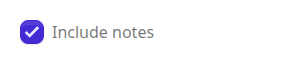

```svelte
<script lang='ts'>
  import { Checkbox } from '@h-ai/ui'

  let includeNotes = $state(true)
</script>

<Checkbox bind:checked={includeNotes} label='Include notes' />
```

<a id="component-iconbutton"></a>

#### IconButton

Present an icon-only action. Render the icon as child content, supply an accessible label, and add tooltip text when useful.


```svelte
<script lang='ts'>
  import { IconButton } from '@h-ai/ui'
</script>

<IconButton label='Refresh' tooltip='Refresh' variant='primary'>
  <span class='icon-[tabler--refresh] size-5' aria-hidden='true'></span>
</IconButton>
```

<a id="component-input"></a>

#### Input

Collect a single line of text. Bind value, pair id with a label, and use type for native input constraints.


```svelte
<script lang='ts'>
  import { Input } from '@h-ai/ui'

  let email = $state('ada@example.com')
</script>

<label for='email' class='mb-1 block text-sm'>Email address</label>
<Input id='email' type='email' name='email' bind:value={email} required />
```

<a id="component-progress"></a>

#### Progress

Show how much work has finished. value is measured against max, and showLabel displays the percentage.

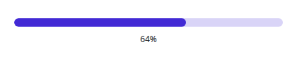

```svelte
<script lang='ts'>
  import { Progress } from '@h-ai/ui'
</script>

<Progress value={16} max={25} showLabel variant='primary' class='w-full' />
```

<a id="component-radio"></a>

#### Radio

Choose one item from a list. Provide values and labels in options, then read the selection with bind:value.


```svelte
<script lang='ts'>
  import { Radio } from '@h-ai/ui'

  let delivery = $state('standard')
</script>

<Radio name='delivery' options={[{ value: 'standard', label: 'Standard' }, { value: 'express', label: 'Express' }]} bind:value={delivery} />
```

<a id="component-range"></a>

#### Range

Pick a number in a bounded range. Set min, max and step, then bind value. Explicitly import Range to distinguish it from the browser global.


```svelte
<script lang='ts'>
  import { Range } from '@h-ai/ui'

  let volume = $state(60)
</script>

<p class='mb-2 text-sm'>Volume: {volume}%</p>
<Range min={0} max={100} step={10} bind:value={volume} showSteps variant='primary' />
```

<a id="component-rating"></a>

#### Rating

Show or collect a star rating. Bind value to receive selections, or use readonly for display only.


```svelte
<script lang='ts'>
  import { Rating } from '@h-ai/ui'

  let rating = $state(4)
</script>

<Rating bind:value={rating} max={5} />
```

<a id="component-select"></a>

#### Select

Select one item from a dropdown. Supply options, enable filterable to search by typing, and use arrow keys and Enter to select.

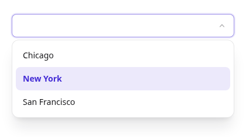

```svelte
<script lang='ts'>
  import { Select } from '@h-ai/ui'

  let office = $state('ny')
</script>

<Select options={[{ value: 'ch' , label: 'Chicago' }, { value: 'ny', label: 'New York' }, { value: 'sf', label: 'San Francisco' }]} bind:value={office} filterable />
```

<a id="component-spinner"></a>

#### Spinner

Indicate a pending operation. Put a short message in a nearby status region and remove the indicator when the work finishes.


```svelte
<script lang='ts'>
  import { Spinner } from '@h-ai/ui'
</script>

<div role='status' class='flex items-center gap-3 text-sm'>
  <Spinner size='md' variant='primary' />
  Loading records…
</div>
```

<a id="component-switch"></a>

#### Switch

Display and change a boolean preference. Use bind:checked to retain the current setting.


```svelte
<script lang='ts'>
  import { Switch } from '@h-ai/ui'

  let notifications = $state(true)
</script>

<Switch bind:checked={notifications} label='Desktop notifications' />
```

<a id="component-tag"></a>

#### Tag

Show a category or a removable filter. Enable closable and update host state in onclose.

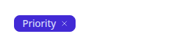

```svelte
<script lang='ts'>
  import { Tag } from '@h-ai/ui'

  let tagged = $state(true)
</script>

{#if tagged}
  <Tag text='Priority' variant='primary' closable onclose={() => { tagged = false }} />
{/if}
```

<a id="component-textarea"></a>

#### Textarea

Collect multiline text. rows sets the initial height and autoResize expands it as content grows.


```svelte
<script lang='ts'>
  import { Textarea } from '@h-ai/ui'

  let note = $state('Leave the package at the front desk.')
</script>

<label for='notes' class='mb-1 block text-sm'>Delivery notes</label>
<Textarea id='notes' rows={3} bind:value={note} autoResize />
```

<a id="component-togglecheckbox"></a>

#### ToggleCheckbox

Place a native checkbox in your own layout. Associate a label with id and bind checked.


```svelte
<script lang='ts'>
  import { ToggleCheckbox } from '@h-ai/ui'

  let checked = $state(true)
</script>

<label for='notes-toggle' class='flex items-center gap-2 text-sm'>
  <ToggleCheckbox id='notes-toggle' class='checkbox checkbox-primary checkbox-sm' bind:checked={checked} />
  Include archived notes
</label>
```

<a id="component-toggleinput"></a>

#### ToggleInput

Provide native checkbox state inside a custom structure. Read bind:checked and use it to control the surrounding content.


```svelte
<script lang='ts'>
  import { ToggleInput } from '@h-ai/ui'

  let expanded = $state(true)
</script>

<label for='summary-toggle' class='flex items-center gap-2 text-sm'>
  <ToggleInput id='summary-toggle' class='toggle toggle-primary toggle-sm' bind:checked={expanded} />
  Show summary
</label>
{#if expanded}<p class='mt-3 text-sm'>3 records ready to review</p>{/if}
```

<a id="component-toggleradio"></a>

#### ToggleRadio

Use native radio inputs in your own layout. Give each option a label and share the same name within a group.

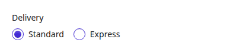

```svelte
<script lang='ts'>
  import { ToggleRadio } from '@h-ai/ui'
</script>

<fieldset class='flex items-center gap-4 text-sm'>
  <legend class='mb-2'>Delivery</legend>
  <label class='flex items-center gap-2'><ToggleRadio name='service' class='radio radio-primary radio-sm' checked /> Standard</label>
  <label class='flex items-center gap-2'><ToggleRadio name='service' class='radio radio-primary radio-sm' /> Express</label>
</fieldset>
```


<a id="components-forms"></a>

### Forms, dates and schedules

[Calendar](#component-calendar) · [Combobox](#component-combobox) · [CronExpressionBuilder](#component-cronexpressionbuilder) · [DatePicker](#component-datepicker) · [Form](#component-form) · [FormField](#component-formfield) · [FormLayout](#component-formlayout) · [ScheduleInput](#component-scheduleinput) · [TagInput](#component-taginput)

<a id="component-calendar"></a>

#### Calendar

Show an interactive month calendar with an earliest delivery date. Create the dates with `@internationalized/date`; selecting a day updates `delivery`.


```svelte
<script lang='ts'>
  import { Calendar } from '@h-ai/ui'
  import type { DateValue } from '@internationalized/date'
  import { CalendarDate } from '@internationalized/date'

  let delivery = $state<DateValue | undefined>(new CalendarDate(2032, 6, 15))
  const earliest = new CalendarDate(2032, 6, 10)
</script>

<Calendar bind:value={delivery} minValue={earliest} class='max-w-72' />
<p class='mt-3 text-sm'>Delivery: {delivery?.toString() ?? 'Choose a date'}</p>
```

<a id="component-combobox"></a>

#### Combobox

Search a list and pick one or more matching options. With `multiple` enabled, `carriers` holds the array of selected IDs.

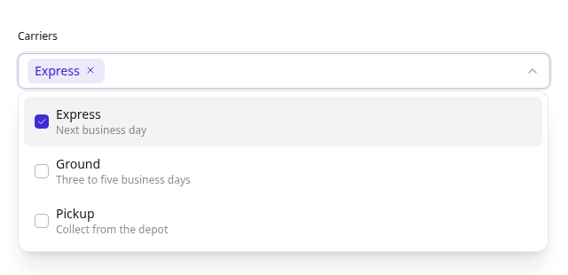

```svelte
<script lang='ts'>
  import { Combobox } from '@h-ai/ui'

  const options = [
    { value: 'express', label: 'Express', description: 'Next business day' },
    { value: 'ground', label: 'Ground', description: 'Three to five business days' },
    { value: 'pickup', label: 'Pickup', description: 'Collect from the depot' },
  ]
  let carriers = $state<string[]>(['express'])
</script>

<Combobox {options} multiple bind:value={carriers}
  label='Carriers' placeholder='Find a carrier' data-testid='demo-combobox' />
```

<a id="component-cronexpressionbuilder"></a>

#### CronExpressionBuilder

Edit a recurring schedule in the mode panel or as text. Focus the input to open presets and select one to write its Cron string to `expression`.


```svelte
<script lang='ts'>
  import { CronExpressionBuilder } from '@h-ai/ui'

  let expression = $state('0 10 * * *')
  const presets = [
    { label: 'Every day at 10:00', expression: '0 10 * * *' },
    { label: 'Every Monday at 09:00', expression: '0 9 * * 1' },
  ]
</script>

<CronExpressionBuilder bind:value={expression} presets={presets} />
```

<a id="component-datepicker"></a>

#### DatePicker

Choose a date in a form. Use a date value from `@internationalized/date` and pick a day in the popup calendar to update `delivery`.

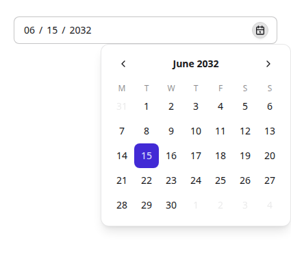

```svelte
<script lang='ts'>
  import { DatePicker } from '@h-ai/ui'
  import type { DateValue } from '@internationalized/date'
  import { CalendarDate } from '@internationalized/date'

  let delivery = $state<DateValue | undefined>(new CalendarDate(2032, 6, 15))
</script>

<DatePicker bind:value={delivery} ariaLabel='Delivery date' data-testid='demo-date-picker' />
```

<a id="component-form"></a>

#### Form

Group form controls and collect the named fields. After browser validation passes, `onsubmit` receives the name.


```svelte
<script lang='ts'>
  import { Form, Button, FormField, Input } from '@h-ai/ui'

  let saved = $state('')
</script>

<Form onsubmit={data => { saved = String(data.recipient) }}>
  <FormField label='Recipient' required>
    <Input name='recipient' value='Ada Lovelace' required />
  </FormField>
  <Button type='submit' variant='primary'>Save recipient</Button>
</Form>
{#if saved}<p class='mt-3 text-sm text-success'>Saved: {saved}</p>{/if}
```

<a id="component-formfield"></a>

#### FormField

Give an input an associated label and hint. The field's `required` shows the marker, and the input's `required` enables native validation.

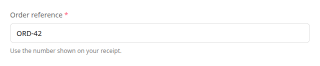

```svelte
<script lang='ts'>
  import { FormField, Input } from '@h-ai/ui'
</script>

<FormField label='Order reference' hint='Use the number shown on your receipt.' required>
  <Input name='reference' value='ORD-42' required />
</FormField>
```

<a id="component-formlayout"></a>

#### FormLayout

Lay out two form fields side by side in a wide container. The layout falls back to one column in narrow containers, and each field keeps its own `name`.


```svelte
<script lang='ts'>
  import { FormLayout, FormField, Input } from '@h-ai/ui'
</script>

<FormLayout columns={2}>
  <FormField label='First name'><Input name='given' value='Ada' /></FormField>
  <FormField label='Last name'><Input name='family' value='Lovelace' /></FormField>
</FormLayout>
```

<a id="component-scheduleinput"></a>

#### ScheduleInput

Capture a date and time for a scheduled task. The default zone is Beijing time; a future selection yields a minute-precision string with its offset and updates `valid` for submission.

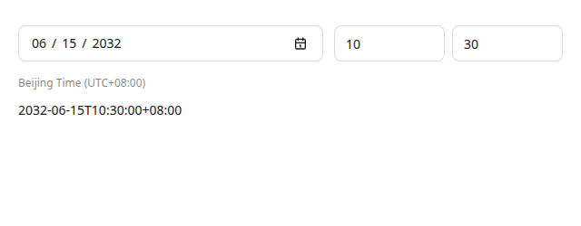

```svelte
<script lang='ts'>
  import { ScheduleInput } from '@h-ai/ui'

  let schedule = $state('2032-06-15T10:30:00+08:00')
  let valid = $state(false)
</script>

<ScheduleInput name='dispatchAt' required bind:value={schedule} bind:valid />
<p class='mt-2 text-sm'>{valid ? schedule : 'Choose a future time'}</p>
```

<a id="component-taginput"></a>

#### TagInput

Edit order labels. Press Enter to add typed text, or use a tag's remove button to delete it. Both actions update `tags`.

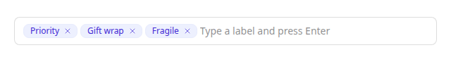

```svelte
<script lang='ts'>
  import { TagInput } from '@h-ai/ui'

  let tags = $state(['Priority', 'Gift wrap', 'Fragile'])
</script>

<TagInput bind:tags maxTags={5} placeholder='Type a label and press Enter' />
```


<a id="components-overlays"></a>

### Overlays, menus and notifications

[ActionSheet](#component-actionsheet) · [Alert](#component-alert) · [Confirm](#component-confirm) · [Drawer](#component-drawer) · [Dropdown](#component-dropdown) · [MessageBoxContainer](#component-messageboxcontainer) · [MessageBoxDialog](#component-messageboxdialog) · [MessageContainer](#component-messagecontainer) · [Modal](#component-modal) · [Popover](#component-popover) · [ToastContainer](#component-toastcontainer) · [Tooltip](#component-tooltip)

<a id="component-actionsheet"></a>

#### ActionSheet

Show order actions along the bottom of a phone screen. `onselect` receives the chosen ID, and the host sets `open` to `false` through `onclose`.


```svelte
<script lang='ts'>
  import { ActionSheet, Button } from '@h-ai/ui'

  let open = $state(false)
  let selected = $state('')
  const items = [
    { id: 'copy', label: 'Copy order number' },
    { id: 'receipt', label: 'Download receipt' },
    { id: 'archive', label: 'Archive order', destructive: true },
  ]
</script>

<Button onclick={() => open = true}>Order actions</Button>
<ActionSheet {open} title='Order actions' {items}
  onselect={id => selected = id} onclose={() => open = false} />
{#if selected}<p>Selected action: {selected}</p>{/if}
```

<a id="component-alert"></a>

#### Alert

Show a persistent information or success message beside the relevant content. Use `variant='success'` to confirm payment and `dismissible` to let the user close it.


```svelte
<script lang='ts'>
  import { Alert } from '@h-ai/ui'
</script>

<Alert variant='success' title='Payment received' dismissible>Order #42 is ready to be packed.</Alert>
```

<a id="component-confirm"></a>

#### Confirm

Ask for confirmation before a destructive operation. Returning `false` keeps the dialog open for retry; a successful confirmation closes it.

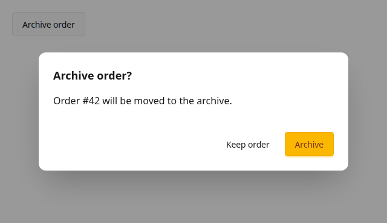

```svelte
<script lang='ts'>
  import { Confirm, Button } from '@h-ai/ui'

  let open = $state(false)
  let archived = $state(false)
</script>

<Button onclick={() => open = true}>Archive order</Button>
<Confirm bind:open title='Archive order?' message='Order #42 will be moved to the archive.'
  variant='warning' confirmText='Archive' cancelText='Keep order'
  onconfirm={() => { archived = true }} />
{#if archived}<p>Order #42 is archived.</p>{/if}
```

<a id="component-drawer"></a>

#### Drawer

Show order details alongside a list. Bind `open` for visibility and use `position='right'` to slide the panel in from the right.

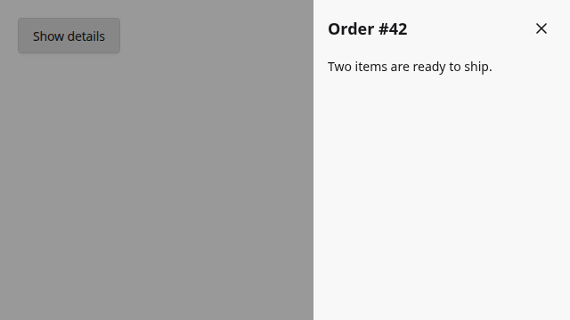

```svelte
<script lang='ts'>
  import { Drawer, Button } from '@h-ai/ui'

  let open = $state(false)
</script>

<Button onclick={() => open = true}>Show details</Button>
<Drawer bind:open position='right' title='Order #42' width='18rem'>
  <p>Two items are ready to ship.</p>
</Drawer>
```

<a id="component-dropdown"></a>

#### Dropdown

Put secondary actions in a menu. After the menu opens, selecting an action passes its `key` to `onselect`.


```svelte
<script lang='ts'>
  import { Dropdown } from '@h-ai/ui'

  const items = [
    { key: 'duplicate', label: 'Duplicate order' },
    { key: 'export', label: 'Export order details' },
    { key: 'archive', label: 'Archive order', disabled: true },
  ]
  let action = $state('')
</script>

<Dropdown {items} triggerClass='btn btn-outline' data-testid='demo-dropdown'
  onselect={key => action = key}>More actions</Dropdown>
{#if action}<p>Selected: {action}</p>{/if}
```

<a id="component-messageboxcontainer"></a>

#### MessageBoxContainer

Mount once in the app layout to show dialogs created by `ui.messageBox.confirm`. Await the boolean result to distinguish confirmation from dismissal.

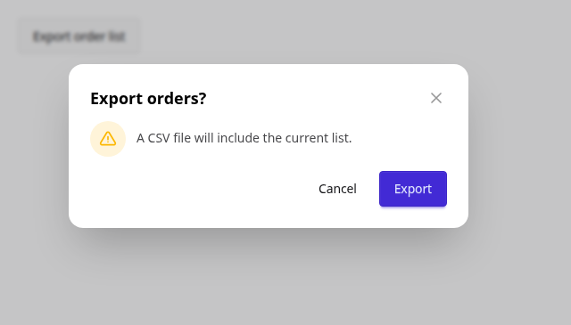

```svelte
<script lang='ts'>
  import { MessageBoxContainer, Button, ui } from '@h-ai/ui'

  let accepted = $state(false)
  async function confirmExport() {
    accepted = await ui.messageBox.confirm({
      title: 'Export orders?',
      message: 'A CSV file will include the current list.',
      confirmText: 'Export',
      cancelText: 'Cancel',
    })
  }
</script>

<MessageBoxContainer />
<Button onclick={confirmExport}>Export order list</Button>
{#if accepted}<p>Export confirmed.</p>{/if}
```

<a id="component-messageboxdialog"></a>

#### MessageBoxDialog

Render one imperative dialog in a custom host. Create an item with `ui.messageBox.alert` and pass the queued `item` to the component.

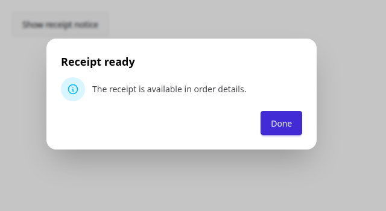

```svelte
<script lang='ts'>
  import { MessageBoxDialog, Button, ui } from '@h-ai/ui'

  const item = $derived(ui.messageBox.items[0])
  function showReceipt() {
    void ui.messageBox.alert({
      title: 'Receipt ready',
      message: 'The receipt is available in order details.',
      confirmText: 'Done',
      showClose: false,
    })
  }
</script>

<Button onclick={showReceipt}>Show receipt notice</Button>
{#if item}
  <MessageBoxDialog {item} />
{/if}
```

<a id="component-messagecontainer"></a>

#### MessageContainer

Provide a global display host for `ui.message`. Mount it once in the app layout, then send a short message from the order action.


```svelte
<script lang='ts'>
  import { MessageContainer, Button, ui } from '@h-ai/ui'
</script>

<MessageContainer />
<Button onclick={() => ui.message.success('Order saved', 3500)}>Save order</Button>
```

<a id="component-modal"></a>

#### Modal

Open a details modal over the current page. Bind `open` to keep the host in sync when the close button dismisses it.


```svelte
<script lang='ts'>
  import { Modal, Button } from '@h-ai/ui'

  let open = $state(false)
</script>

<Button onclick={() => open = true}>Show order details</Button>
<Modal bind:open title='Order #42' size='sm'>
  <p>Your order is packed and waiting for the carrier.</p>
  {#snippet footer()}
    <Button variant='primary' onclick={() => open = false}>Done</Button>
  {/snippet}
</Modal>
```

<a id="component-popover"></a>

#### Popover

Show a short explanation next to its trigger. Click the button to open it, and press Escape to close it and return focus.

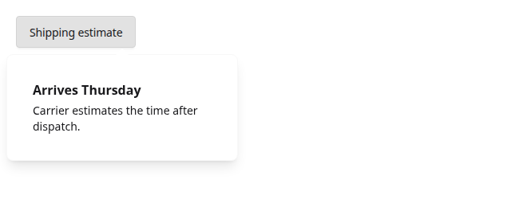

```svelte
<script lang='ts'>
  import { Popover, Button } from '@h-ai/ui'
</script>

<Popover position='bottom' trigger='click'>
  {#snippet triggerContent()}
    <Button data-testid='demo-popover-trigger'>Shipping estimate</Button>
  {/snippet}
  <div class='w-64 p-4'>
    <strong>Arrives Thursday</strong>
    <p class='mt-1 text-sm'>Carrier estimates the time after dispatch.</p>
  </div>
</Popover>
```

<a id="component-toastcontainer"></a>

#### ToastContainer

Mount once in the root layout to display messages queued by `ui.toast`. Trigger the success message after saving completes. It floats above the content.


```svelte
<script lang='ts'>
  import { ToastContainer, Button, ui } from '@h-ai/ui'
</script>

<ToastContainer />
<Button onclick={() => ui.toast.success('Order #42 saved', 3500)}>Save order</Button>
```

<a id="component-tooltip"></a>

#### Tooltip

Give a button a short hint on hover or keyboard focus. Set `portal` when a scrolling ancestor would clip the hint.

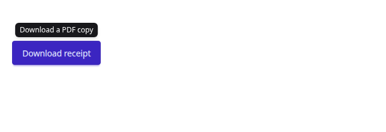

```svelte
<script lang='ts'>
  import { Tooltip, Button } from '@h-ai/ui'
</script>

<div class='pt-12'>
  <Tooltip content='Download a PDF copy' position='top' portal data-testid='demo-tooltip'>
    <Button variant='primary'>Download receipt</Button>
  </Tooltip>
</div>
```


<a id="components-lists"></a>

### Lists, navigation and status

[Accordion](#component-accordion) · [Breadcrumb](#component-breadcrumb) · [Card](#component-card) · [DataTable](#component-datatable) · [Empty](#component-empty) · [FilterBar](#component-filterbar) · [JsonViewer](#component-jsonviewer) · [PageHeader](#component-pageheader) · [Pagination](#component-pagination) · [Result](#component-result) · [Skeleton](#component-skeleton) · [Steps](#component-steps) · [TableToolbar](#component-tabletoolbar) · [Tabs](#component-tabs) · [Timeline](#component-timeline)

<a id="component-accordion"></a>

#### Accordion

Group shipping and returns information into panels. Clicking a heading updates `value` with the expanded item ID.

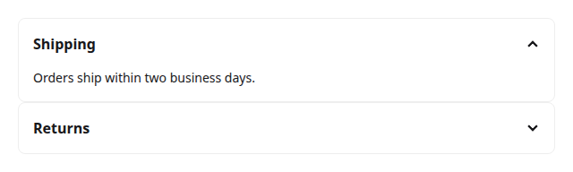

```svelte
<script lang='ts'>
  import { Accordion } from '@h-ai/ui'

  const items = [
    { id: 'shipping', title: 'Shipping', content: 'Orders ship within two business days.' },
    { id: 'returns', title: 'Returns', content: 'You can return unused items within 30 days.' },
  ]
  let value = $state<string | string[]>('shipping')
</script>

<Accordion {items} bind:value variant='bordered' />
```

<a id="component-breadcrumb"></a>

#### Breadcrumb

Show an order's location in the site. Earlier items with an `href` act as links, and the last item identifies the current page.


```svelte
<script lang='ts'>
  import { Breadcrumb } from '@h-ai/ui'
</script>

<Breadcrumb items={[
  { label: 'Home', href: '/' },
  { label: 'Orders', href: '/orders' },
  { label: 'Order #42' },
]} />
```

<a id="component-card"></a>

#### Card

Group order details in a card. Use `title` for the heading, the body for the summary, and the footer for a details link.


```svelte
<script lang='ts'>
  import { Card } from '@h-ai/ui'
</script>

<Card title='Order #42' bordered padding='md'>
  <p>Two items · Awaiting dispatch</p>
  {#snippet footer()}
    <a class='link link-primary' href='/orders/42'>View order</a>
  {/snippet}
</Card>
```

<a id="component-datatable"></a>

#### DataTable

Display records in columns. Specify a unique `id` for each row and click a sortable heading to reorder the supplied data.


```svelte
<script lang='ts'>
  import { DataTable } from '@h-ai/ui'

  const data = [
    { id: 'ORD-42', customer: 'Ada Lovelace', status: 'Packed' },
    { id: 'ORD-43', customer: 'Grace Hopper', status: 'In transit' },
    { id: 'ORD-44', customer: 'Katherine Johnson', status: 'Delivered' },
  ]
  const columns = [
    { key: 'id', label: 'Order' },
    { key: 'customer', label: 'Customer', sortable: true },
    { key: 'status', label: 'Status' },
  ]
</script>

<DataTable {data} {columns} keyField='id' />
```

<a id="component-empty"></a>

#### Empty

Explain an empty order list and use the `action` snippet to offer a way to create the first order.

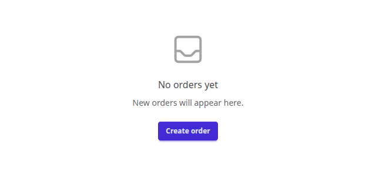

```svelte
<script lang='ts'>
  import { Empty } from '@h-ai/ui'
</script>

<Empty title='No orders yet' description='New orders will appear here.' icon='inbox'>
  {#snippet action()}
    <a class='btn btn-primary btn-sm' href='/orders/new'>Create order</a>
  {/snippet}
</Empty>
```

<a id="component-filterbar"></a>

#### FilterBar

Keep search visible while grouping optional filters in a collapsible panel. The status contributes to `activeCount`, and Reset clears it.

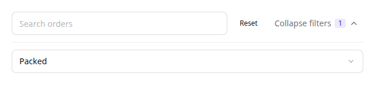

```svelte
<script lang='ts'>
  import { FilterBar, Input, Select } from '@h-ai/ui'

  let expanded = $state(true)
  let status = $state('packed')
  const statuses = [{ value: 'packed', label: 'Packed' }, { value: 'shipped', label: 'Shipped' }]
</script>

<FilterBar bind:expanded activeCount={status ? 1 : 0} onreset={() => status = ''}>
  {#snippet leading()}<Input placeholder='Search orders' />{/snippet}
  <Select options={statuses} bind:value={status} />
</FilterBar>
```

<a id="component-jsonviewer"></a>

#### JsonViewer

Inspect structured data as an expandable tree. An initial depth of 2 exposes the order details, and Copy copies the complete JSON.

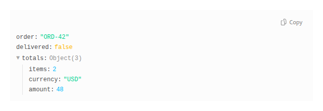

```svelte
<script lang='ts'>
  import { JsonViewer } from '@h-ai/ui'
</script>

<JsonViewer defaultExpandedDepth={2} value={{
  order: 'ORD-42',
  delivered: false,
  totals: { items: 2, currency: 'USD', amount: 48 },
}} />
```

<a id="component-pageheader"></a>

#### PageHeader

Organize the list page with a title and description. Put the create-order link in the `actions` snippet.


```svelte
<script lang='ts'>
  import { PageHeader } from '@h-ai/ui'
</script>

<PageHeader title='Orders' description='Review orders waiting to be shipped.'>
  {#snippet actions()}
    <a class='btn btn-primary btn-sm' href='/orders/new'>Create order</a>
  {/snippet}
</PageHeader>
```

<a id="component-pagination"></a>

#### Pagination

Compute pages from the total records and page size. Using Next or the jump field updates the one-based `page` value for the host's data request.


```svelte
<script lang='ts'>
  import { Pagination } from '@h-ai/ui'

  let page = $state(2)
</script>

<Pagination bind:page total={42} pageSize={10} showJumper />
```

<a id="component-result"></a>

#### Result

Confirm that a submission succeeded and offer the next step. `status='success'` displays the success icon, and the `actions` snippet supplies a return link.


```svelte
<script lang='ts'>
  import { Result } from '@h-ai/ui'
</script>

<Result status='success' title='Order placed' description='We sent your confirmation by email.'>
  {#snippet actions()}
    <a class='btn btn-primary btn-sm' href='/orders'>Back to orders</a>
  {/snippet}
</Result>
```

<a id="component-skeleton"></a>

#### Skeleton

Reserve space for a heading and text while the order summary loads. The host replaces the skeletons when data arrives.


```svelte
<script lang='ts'>
  import { Skeleton } from '@h-ai/ui'
</script>

<div class='space-y-3 rounded-lg border border-base-300 p-4'
  role='status' aria-label='Loading order summary'>
  <Skeleton variant='title' width='55%' />
  <Skeleton variant='text' count={3} />
</div>
```

<a id="component-steps"></a>

#### Steps

Show checkout progress. `current=1` starts at the second step, and `onchange` receives the zero-based index of a clicked step.


```svelte
<script lang='ts'>
  import { Steps } from '@h-ai/ui'

  let current = $state(1)
  const items = [{ title: 'Cart' }, { title: 'Delivery' }, { title: 'Review' }]
</script>

<Steps {items} {current} clickable onchange={index => current = index} />
```

<a id="component-tabletoolbar"></a>

#### TableToolbar

Group table search and collapsible filters in one toolbar. Changes to `searchValue` stay in the draft until Enter or the search button calls `onsearch`.


```svelte
<script lang='ts'>
  import { TableToolbar } from '@h-ai/ui'

  let searchValue = $state('ORD-42')
  let filterValues = $state<Record<string, unknown>>({ status: 'packed' })
  let query = $state('')
  const filterFields = [{
    id: 'status', label: 'Status', type: 'select',
    options: [{ value: 'packed', label: 'Packed' }, { value: 'shipped', label: 'Shipped' }],
  }]
  function submitQuery(text: string) {
    query = `${text} / ${String(filterValues.status ?? 'all')}`
  }
</script>

<TableToolbar bind:searchValue bind:filterValues expanded
  searchPlaceholder='Search orders' searchLabel='Search'
  {filterFields} onsearch={submitQuery} />
{#if query}<p class='mt-3 text-sm'>Query: {query}</p>{/if}
```

<a id="component-tabs"></a>

#### Tabs

Separate order details and shipping into tabs. Selecting a tab updates `active`, which the content snippet uses to show the matching panel.


```svelte
<script lang='ts'>
  import { Tabs } from '@h-ai/ui'

  let active = $state('shipping')
  const items = [{ key: 'details', label: 'Details' }, { key: 'shipping', label: 'Shipping' }]
</script>

<Tabs {items} bind:active type='line'>
  {#snippet children({ active: current })}
    {#if current === 'details'}
      <p>Order #42 · Two items</p>
    {:else}
      <p>Carrier pickup is planned for Thursday.</p>
    {/if}
  {/snippet}
</Tabs>
```

<a id="component-timeline"></a>

#### Timeline

Show order events in sequence. Mark completed milestones with `completed` and describe what comes next on pending items.


```svelte
<script lang='ts'>
  import { Timeline } from '@h-ai/ui'
</script>

<Timeline items={[
  { id: 'placed', title: 'Order placed', time: 'Jun 14', completed: true },
  { id: 'packed', title: 'Packed', time: 'Jun 15', completed: true },
  { id: 'dispatch', title: 'Dispatch', description: 'Waiting for the carrier' },
]} boxed />
```


<a id="components-mobile"></a>

### Mobile interactions

[AppBar](#component-appbar) · [BottomNav](#component-bottomnav) · [InfiniteScroll](#component-infinitescroll) · [PullRefresh](#component-pullrefresh) · [SafeArea](#component-safearea) · [SwipeCell](#component-swipecell)

<a id="component-appbar"></a>

#### AppBar

Place a page title and back link at the top of a phone screen. Supply the `leading` snippet and set `fixed={false}` to keep the bar in the page flow.


```svelte
<script lang='ts'>
  import { AppBar } from '@h-ai/ui'
</script>

<AppBar title='Order #42' fixed={false}>
  {#snippet leading()}
    <a class='btn btn-ghost btn-sm' href='/orders'>← Orders</a>
  {/snippet}
</AppBar>
```

<a id="component-bottomnav"></a>

#### BottomNav

Provide fixed bottom navigation on a phone. `active` highlights the current section, and `onchange` passes the chosen item ID back to the host.


```svelte
<script lang='ts'>
  import { BottomNav } from '@h-ai/ui'

  let active = $state('orders')
  const items = [
    { id: 'home', label: 'Home', iconClass: 'icon-[tabler--home]' },
    { id: 'orders', label: 'Orders', iconClass: 'icon-[tabler--shopping-bag]', badge: 2 },
    { id: 'account', label: 'Account', iconClass: 'icon-[tabler--user]' },
  ]
</script>

<p class='text-lg font-semibold'>You are in {active}.</p>
<BottomNav {items} {active} onchange={id => active = id} />
```

<a id="component-infinitescroll"></a>

#### InfiniteScroll

Load another page as the page or list scroll nears the end. Here the callback appends one in-memory record, then sets `hasMore` to `false` to show that all orders are loaded.

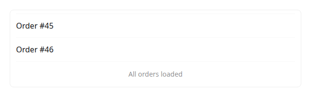

```svelte
<script lang='ts'>
  import { InfiniteScroll } from '@h-ai/ui'

  let orders = $state([41, 42, 43, 44, 45])
  let hasMore = $state(true)
  async function loadMore() {
    orders = [...orders, 46]
    hasMore = false
  }
</script>

<InfiniteScroll {hasMore} onloadmore={loadMore} noMoreText='All orders loaded'
  class='h-40 rounded-lg border border-base-300 px-3' data-testid='orders-scroll'>
  {#each orders as order (order)}
    <p class='border-b border-base-200 py-3'>Order #{order}</p>
  {/each}
</InfiniteScroll>
```

<a id="component-pullrefresh"></a>

#### PullRefresh

Releasing a pull beyond the threshold runs the asynchronous `onrefresh` callback. This example replaces the in-memory orders, and the indicator closes when the refresh finishes.

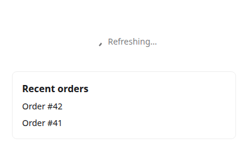

```svelte
<script lang='ts'>
  import { PullRefresh } from '@h-ai/ui'

  let orders = $state([42, 41])
  async function refreshList() {
    orders = [43, 42, 41]
  }
</script>

<PullRefresh onrefresh={refreshList} data-testid='demo-refresh'>
  <div class='rounded-lg border border-base-300 p-4'>
    <strong>Recent orders</strong>
    {#each orders as order (order)}
      <p class='mt-2 text-sm'>Order #{order}</p>
    {/each}
  </div>
</PullRefresh>
```

<a id="component-safearea"></a>

#### SafeArea

Protect content from a phone's cutouts and gesture area. Import the mobile stylesheet and use `position='all'` for insets on four sides. The preview simulates those insets.

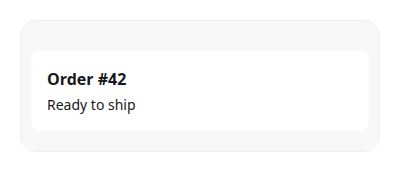

```svelte
<script lang='ts'>
  import { SafeArea } from '@h-ai/ui'
  import '@h-ai/ui/styles/mobile.css'
</script>

<SafeArea position='all' class='bg-base-200'>
  <div class='rounded-lg bg-base-100 p-4'>
    <strong>Order #42</strong>
    <p class='mt-1 text-sm'>Ready to ship</p>
  </div>
</SafeArea>
```

<a id="component-swipecell"></a>

#### SwipeCell

Swipe an order row left on a touch device to reveal actions on the right. Tapping Archive sends `archive` to `onaction` and closes the action area.


```svelte
<script lang='ts'>
  import { SwipeCell } from '@h-ai/ui'

  let action = $state('')
  const actions = [{ id: 'archive', label: 'Archive', variant: 'warning' as const, width: 96 }]
</script>

<SwipeCell {actions} onaction={id => action = id} data-testid='demo-swipe'
  class='rounded-lg border border-base-300'>
  <div class='flex items-center gap-4 bg-base-100 p-4'>
    <span class='grid w-20 shrink-0 place-items-center' aria-hidden='true'>
      <span class='icon-[tabler--box] size-6'></span>
    </span>
    <div>
      <strong>Order #42</strong>
      <p class='text-sm'>Ready for dispatch</p>
    </div>
  </div>
</SwipeCell>
{#if action}<p class='mt-3'>Selected: {action}</p>{/if}
```


<a id="components-layouts"></a>

### Themes, locales and workspace layouts

[LanguageSwitch](#component-languageswitch) · [SettingsLayout](#component-settingslayout) · [SettingsModal](#component-settingsmodal) · [ThemeColorPicker](#component-themecolorpicker) · [ThemeSelector](#component-themeselector) · [ThemeToggle](#component-themetoggle) · [WorkspaceLayout](#component-workspacelayout)

<a id="component-languageswitch"></a>

#### LanguageSwitch

Offer application languages in a toolbar. The host supplies `locale` and applies the selected language in `setLocale`, for example by updating its locale state.

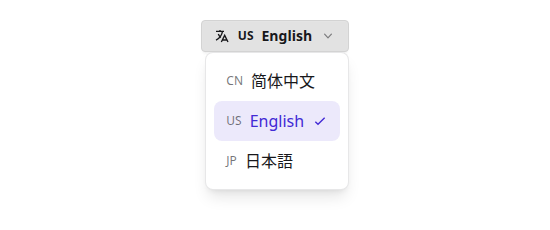

```svelte
<LanguageSwitch currentLanguage={locale} onchange={setLocale} />
```

<a id="component-settingslayout"></a>

#### SettingsLayout

Arrange a settings page with a title, section navigation, and content. Supply the host’s `sections`, update `activeSection` through `setSection`, and render the active section in the body.

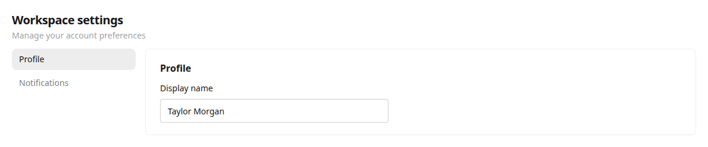

```svelte
<SettingsLayout title='Workspace settings' {sections} active={activeSection}
  onselect={setSection}>
  <p>{activeSection === 'profile' ? 'Edit your profile.' : 'Manage notifications.'}</p>
</SettingsLayout>
```

<a id="component-settingsmodal"></a>

#### SettingsModal

Put language and theme controls in one dialog. Bind the host’s `settingsOpen` state and apply choices through `setLocale` and `setTheme`.

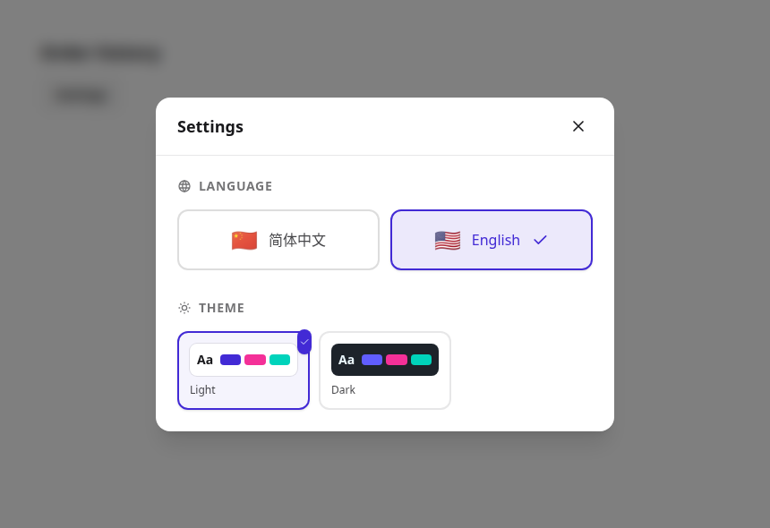

```svelte
<SettingsModal bind:open={settingsOpen} currentLanguage={locale} currentTheme={theme}
  themes={[{ value: 'light', label: 'Light' }, { value: 'dark', label: 'Dark' }]}
  onlanguagechange={setLocale} onthemechange={setTheme} />
```

<a id="component-themecolorpicker"></a>

#### ThemeColorPicker

Let users choose a preset or custom color. `accent` holds the current hex value, and the host applies the normalized color received by `setAccent`.

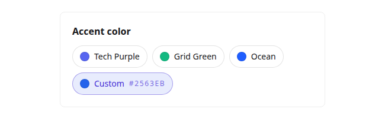

```svelte
<ThemeColorPicker value={accent} onchange={setAccent} />
```

<a id="component-themeselector"></a>

#### ThemeSelector

Offer a shortlist of built-in themes with color previews. Pass the host’s current `theme` and apply the selected ID through `setTheme`.


```svelte
<ThemeSelector currentTheme={theme} themeIds={['light', 'dark', 'corporate']}
  showPreview onchange={setTheme} />
```

<a id="component-themetoggle"></a>

#### ThemeToggle

Switch between light and dark from a toolbar. The icon reflects the next action for the host’s `theme`, and `setTheme` applies the choice.


```svelte
<ThemeToggle currentTheme={theme} lightTheme='light' darkTheme='dark' onchange={setTheme} />
```

<a id="component-workspacelayout"></a>

#### WorkspaceLayout

Use this layout in a container with a bounded height to keep the title and action bar visible while the body scrolls. Use the `actions` and `footer` snippets for page controls and status.


```svelte
<WorkspaceLayout title='Inventory'>
  {#snippet actions()}<button type='button'>Export</button>{/snippet}
  <p>Review stock totals by warehouse.</p>
  {#snippet footer()}Last updated today{/snippet}
</WorkspaceLayout>
```


<a id="components-auth"></a>

### Authentication and permissions

[AuthPanel](#component-authpanel) · [AuthShell](#component-authshell) · [ChangePasswordForm](#component-changepasswordform) · [ForgotPasswordForm](#component-forgotpasswordform) · [LoginForm](#component-loginform) · [PasswordInput](#component-passwordinput) · [PermGuard](#component-permguard) · [ReauthenticationDialog](#component-reauthenticationdialog) · [RegisterForm](#component-registerform) · [ResetPasswordForm](#component-resetpasswordform) · [SensitiveOperationsForm](#component-sensitiveoperationsform) · [SessionRecoveryDialog](#component-sessionrecoverydialog) · [UserProfile](#component-userprofile)

<a id="component-authpanel"></a>

#### AuthPanel

Switch between sign-in, registration, and recovery using `publicConfig` from the IAM public endpoint and `actions` created by Kit or the API client.


```svelte
<AuthPanel config={publicConfig} {actions} initialMode='login' />
```

<a id="component-authshell"></a>

#### AuthShell

Wrap an authentication form in a branded split layout or centered card, with `submitLogin` supplied by the app to handle sign-in.


```svelte
<AuthShell variant='split' brandTitle='Atlas' title='Sign in'>
  <LoginForm onsubmit={submitLogin} />
</AuthShell>
```

<a id="component-changepasswordform"></a>

#### ChangePasswordForm

Collect the current password, replacement, and confirmation for the app’s `changePassword` handler to validate and save.

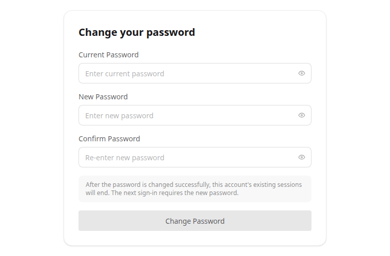

```svelte
<ChangePasswordForm requireOldPassword minPasswordLength={12}
  onsubmit={changePassword} />
```

<a id="component-forgotpasswordform"></a>

#### ForgotPasswordForm

Collect an email address or phone number and pass it to the app’s `requestReset` handler.


```svelte
<ForgotPasswordForm mode='email' showTitle onsubmit={requestReset} />
```

<a id="component-loginform"></a>

#### LoginForm

Show the sign-in fields for `methods` and pass entries to the app’s `submitLogin`, with a send callback required when using one-time codes.

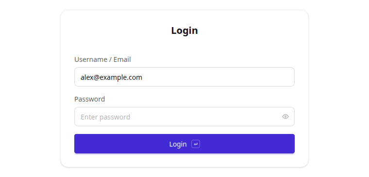

```svelte
<LoginForm methods={['password']} onsubmit={submitLogin} />
```

<a id="component-passwordinput"></a>

#### PasswordInput

Enter a password with optional visibility and strength controls, binding `password` to state created with `$state` in the app.

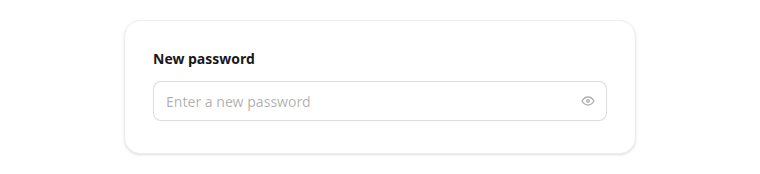

```svelte
<PasswordInput bind:value={password} autocomplete='new-password'
  showToggle showStrength minLength={12} />
```

<a id="component-permguard"></a>

#### PermGuard

Render authorized content or `fallback` from permissions supplied by the layout through `ui.setPermissionContext`, while the server still enforces authorization.


```svelte
<PermGuard permission='reports:read'>
  {#snippet fallback()}<p>Report access is required.</p>{/snippet}
  <p>Quarterly report is available.</p>
</PermGuard>
```

<a id="component-reauthenticationdialog"></a>

#### ReauthenticationDialog

Use the app’s `open` state to prompt for the current password before a sensitive action, with `verifyPassword` verifying it on the server and `closeDialog` dismissing the prompt.

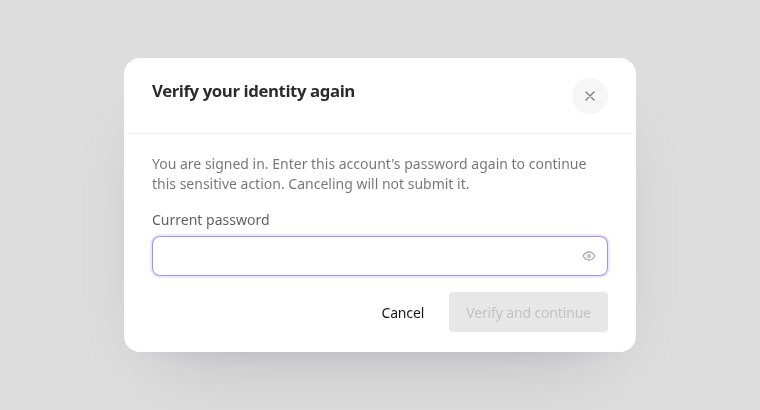

```svelte
<ReauthenticationDialog {open} onsubmit={verifyPassword} onclose={closeDialog} />
```

<a id="component-registerform"></a>

#### RegisterForm

Collect registration fields and check password confirmation, then pass the data to the app’s `submitRegistration` handler.

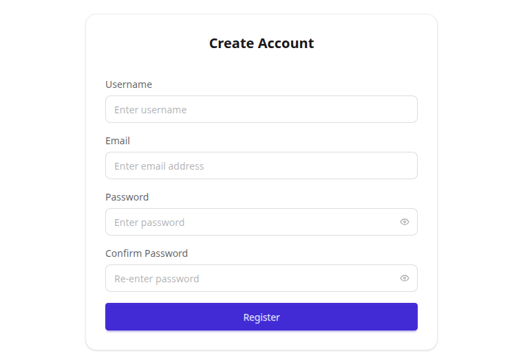

```svelte
<RegisterForm fields={['username', 'email', 'password']}
  requireConfirmPassword onsubmit={submitRegistration} />
```

<a id="component-resetpasswordform"></a>

#### ResetPasswordForm

Collect and confirm the new password, optionally with a code, and let the app’s `confirmReset` verify the token or code and reset the password.

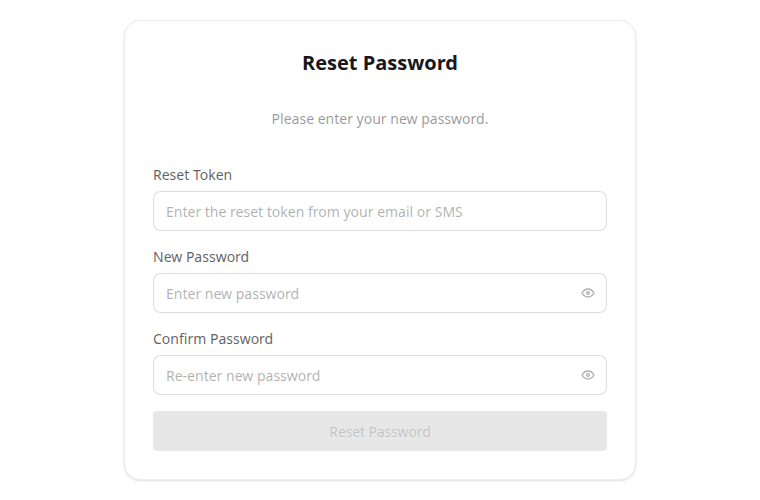

```svelte
<ResetPasswordForm showCode minPasswordLength={12} onsubmit={confirmReset} />
```

<a id="component-sensitiveoperationsform"></a>

#### SensitiveOperationsForm

Edit one sensitive operation ID per line, then pass the deduplicated list to the app’s `savePolicy` and call `closeEditor` only after success.

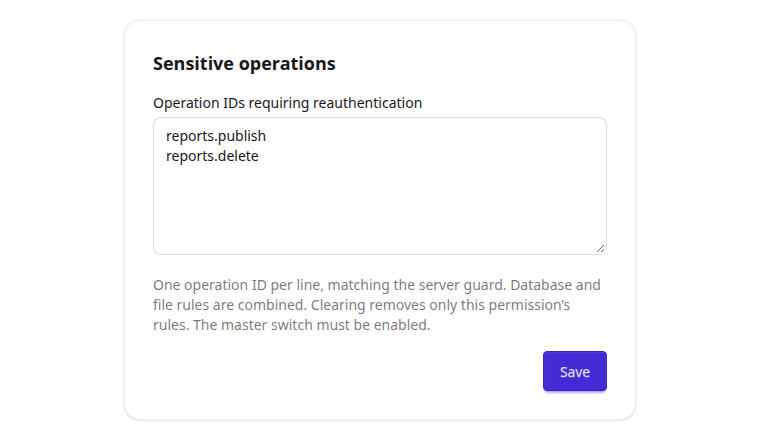

```svelte
<SensitiveOperationsForm operations={['reports.publish', 'reports.delete']}
  onsubmit={savePolicy} ondone={closeEditor} />
```

<a id="component-sessionrecoverydialog"></a>

#### SessionRecoveryDialog

Ask the original account to sign in again without leaving the current page, using `recovery` created with `ui.createSessionRecovery()` and configured with the current user, and `actions` from the app’s auth client.

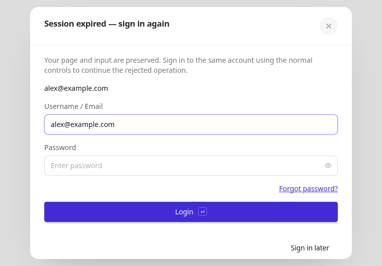

```svelte
<SessionRecoveryDialog {recovery} {actions} />
```

<a id="component-userprofile"></a>

#### UserProfile

View or edit profile data loaded by the app as `account`, leaving edit mode only when `saveProfile` returns `true`.


```svelte
<UserProfile user={account} editable fields={['displayName', 'email', 'bio']}
  onsubmit={saveProfile} />
```


<a id="components-files"></a>

### Files and cryptographic results

[AvatarUpload](#component-avatarupload) · [FileList](#component-filelist) · [FileUpload](#component-fileupload) · [ImageUpload](#component-imageupload) · [EncryptedInput](#component-encryptedinput) · [HashDisplay](#component-hashdisplay) · [SignatureDisplay](#component-signaturedisplay)

<a id="component-avatarupload"></a>

#### AvatarUpload

Choose an avatar and preview it, binding `avatarUrl` in the app and supplying `uploadAvatar` to save the file and return `{ url }`.

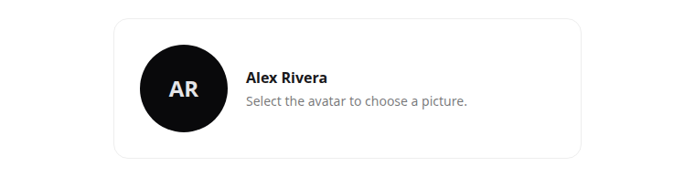

```svelte
<AvatarUpload bind:value={avatarUrl} fallback='AR' size='lg'
  uploadHandler={uploadAvatar} />
```

<a id="component-filelist"></a>

#### FileList

Show a file list and preview actions, with the sample URL pointing to a PDF the user is authorized to read.


```svelte
<FileList files={[{
  id: 'q3', name: 'Q3 report.pdf', size: 48200,
  type: 'application/pdf', url: '/reports/q3.pdf',
}]} showDownload={false} showDelete={false} />
```

<a id="component-fileupload"></a>

#### FileUpload

Select files within type, size, and count limits, with `uploadReport` supplied by the app to accept a file and abort signal and return its upload result.

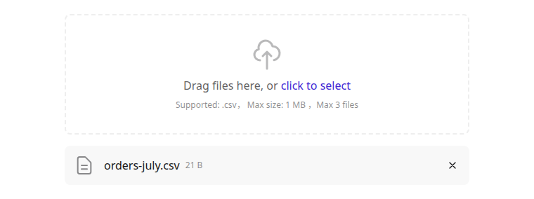

```svelte
<FileUpload accept='.csv' multiple maxFiles={3} maxSize={1048576}
  uploadHandler={uploadReport} />
```

<a id="component-imageupload"></a>

#### ImageUpload

Choose and preview an image, binding `coverUrl` in the app and replacing the local preview with `{ url }` returned by `uploadCover`.

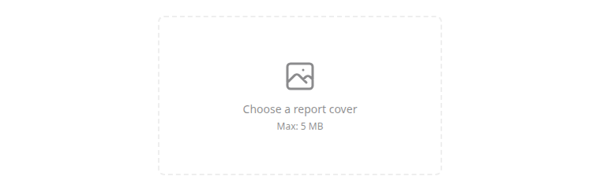

```svelte
<ImageUpload bind:value={coverUrl} accept='image/*' aspectRatio='16 / 9'
  width='320px' uploadHandler={uploadCover} />
```

<a id="component-encryptedinput"></a>

#### EncryptedInput

Enter sensitive text and display the ciphertext returned by the app’s `encrypt` callback, binding both `text` and `ciphertext` to app state.


```svelte
<EncryptedInput algorithm='SM4' bind:value={text}
  bind:encryptedValue={ciphertext} onencrypt={encrypt} showEncrypted />
```

<a id="component-hashdisplay"></a>

#### HashDisplay

Display a copyable SM3 digest already computed by the app as `digest`.

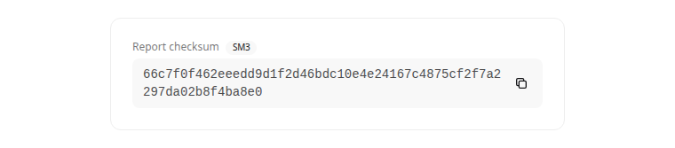

```svelte
<HashDisplay value={digest} algorithm='SM3' label='Report checksum'
  copyable truncate truncateLength={24} />
```

<a id="component-signaturedisplay"></a>

#### SignatureDisplay

Display a signature, optional public key, and verification status using `signature` and `verified` from the app’s signing and verification workflow.

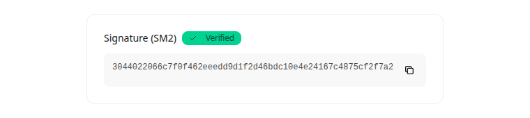

```svelte
<SignatureDisplay {signature} {verified} algorithm='SM2' copyable />
```


<a id="components-business"></a>

### CRUD, charts and error pages

[CrudDeleteConfirm](#component-cruddeleteconfirm) · [CrudDetailPanel](#component-cruddetailpanel) · [CrudEditPanel](#component-crudeditpanel) · [CrudFilterBar](#component-crudfilterbar) · [CrudPage](#component-crudpage) · [Chart](#component-chart) · [DashboardGrid](#component-dashboardgrid) · [MetricCard](#component-metriccard) · [ReportCard](#component-reportcard) · [ErrorPage](#component-errorpage)

<a id="component-cruddeleteconfirm"></a>

#### CrudDeleteConfirm

Confirm the target before deleting it, binding `open` in the app and supplying `removeRecord` to delete or return `false` to keep the dialog open.

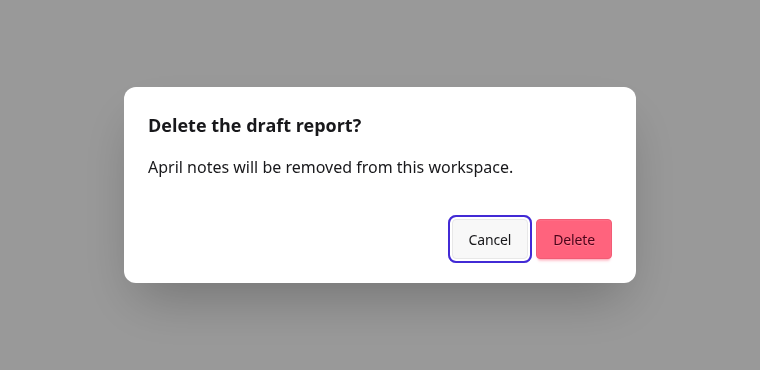

```svelte
<CrudDeleteConfirm bind:open title='Delete draft?'
  message='This permanently deletes the draft.' onconfirm={removeRecord} />
```

<a id="component-cruddetailpanel"></a>

#### CrudDetailPanel

Show a read-only view of `report` using `detailFields` from the selected record’s resource definition.

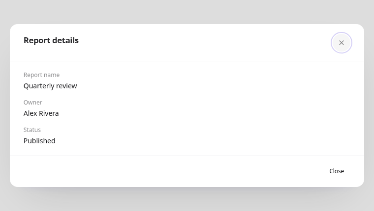

```svelte
<CrudDetailPanel open variant='modal' title='Report details'
  item={report} fields={detailFields} />
```

<a id="component-crudeditpanel"></a>

#### CrudEditPanel

Render the resource’s `editFields` and pass writable values in the app’s `draft` to `saveReport`.

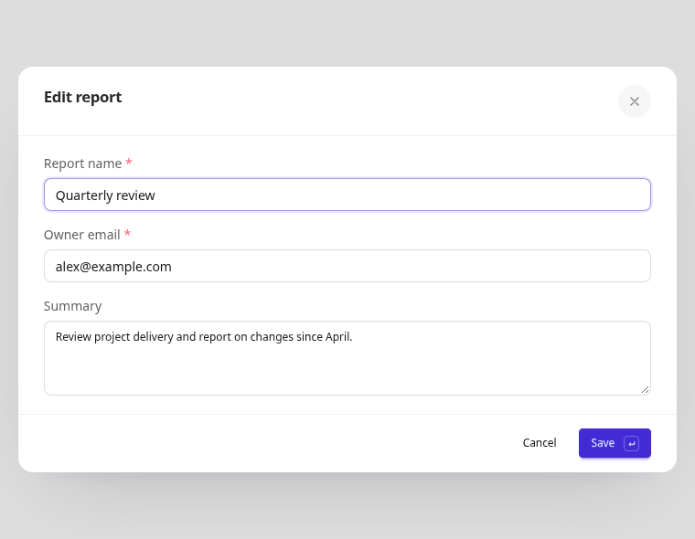

```svelte
<CrudEditPanel open variant='modal' mode='edit' title='Edit report'
  fields={editFields} bind:formData={draft} onsubmit={saveReport} />
```

<a id="component-crudfilterbar"></a>

#### CrudFilterBar

Collect a search term and draft filters, then let the app’s `runQuery` read the submitted term and bound `filters` state.


```svelte
<CrudFilterBar bind:filterValues={filters}
  filterFields={[{ id: 'owner', label: 'Owner', type: 'text' }]}
  onsearch={runQuery} />
```

<a id="component-crudpage"></a>

#### CrudPage

Render a resource list and its create, edit, and delete flows from `crud` defined by `ui.defineCrud`, with the `controller` from `ui.createCrudController(crud)` handling queries and pagination.


```svelte
<CrudPage {crud} data={controller.data} nav={controller.nav}
  loading={controller.loading} loaded={controller.loaded}
  error={controller.error} onRetry={controller.reload} />
```

<a id="component-chart"></a>

#### Chart

Map data fields to the `x` and `y` axes, supplying `monthlyOrders` as the app’s array of `{ month, orders }` records.


```svelte
<Chart type='bar' title='Orders by month' data={monthlyOrders}
  x='month' y='orders' size='sm' />
```

<a id="component-dashboardgrid"></a>

#### DashboardGrid

Arrange metric and report cards in a responsive grid, with `columns` setting the wide-container layout and narrow containers collapsing to one column.


```svelte
<DashboardGrid label='Operations metrics' columns={3}>
  <MetricCard title='Orders' value={82} />
  <MetricCard title='Backlog' value={13} />
  <MetricCard title='On time' value='96%' />
</DashboardGrid>
```

<a id="component-metriccard"></a>

#### MetricCard

Show a key metric and its trend, displaying `trend={12.8}` as `+12.8%` with color chosen for its business meaning.

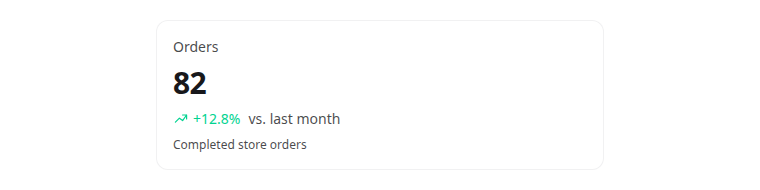

```svelte
<MetricCard title='Orders' value={82} trend={12.8}
  trendLabel='vs. last month' trendTone='success' />
```

<a id="component-reportcard"></a>

#### ReportCard

Provide a heading and loading or empty states for the app’s chart snippet `orderChart`.


```svelte
<ReportCard title='Order activity' description='First half of the year'>
  {@render orderChart()}
</ReportCard>
```

<a id="component-errorpage"></a>

#### ErrorPage

Show an error preset for the route status and provide a recovery link through `homeUrl`.

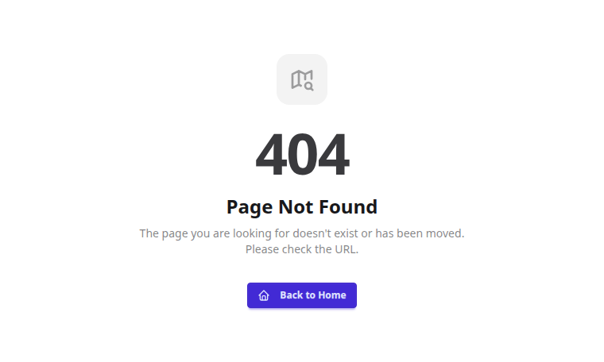

```svelte
<ErrorPage status={404} homeUrl='/reports' showBack={false} />
```


<a id="components-workspaces"></a>

### AI content and tool workspaces

[AiDocumentDownloadMenu](#component-aidocumentdownloadmenu) · [AiDocumentEditor](#component-aidocumenteditor) · [AiMindMapEditor](#component-aimindmapeditor) · [AiTableEditor](#component-aitableeditor) · [MarkdownRenderer](#component-markdownrenderer) · [ArtifactWorkspace](#component-artifactworkspace) · [CodeWorkspace](#component-codeworkspace) · [ToolWorkspace](#component-toolworkspace)

<a id="component-aidocumentdownloadmenu"></a>

#### AiDocumentDownloadMenu

Offer Word, PDF, and Markdown exports from the same Markdown document. Pass the content and title, then open the menu to choose a format.


```svelte
<AiDocumentDownloadMenu content={'# Weekly review'} title='Weekly review'
  showLabel showChevron iconOnly={false} />
```

<a id="component-aidocumenteditor"></a>

#### AiDocumentEditor

Read a Markdown document with an outline and use the toolbar to copy or download it. The host supplies `markdown` and sets `remoteImages={false}` to block network images for private documents.


```svelte
<AiDocumentEditor content={markdown} title='Weekly review' sourceKind='document'
  showOutline showToolbar remoteImages={false} />
```

<a id="component-aimindmapeditor"></a>

#### AiMindMapEditor

View and edit a `mind/v1` mind map. Pass the validated `mindMap` and its `artifactId`, then use the host’s `saveDraft` callback to store edits. Changing the ID clears the previous artifact’s edit history.

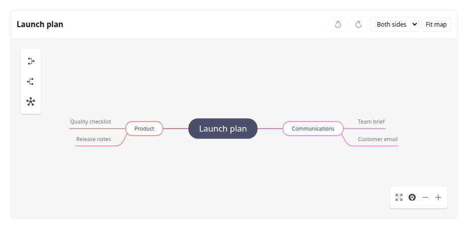

```svelte
<AiMindMapEditor data={mindMap} artifactKey={artifactId} title='Launch plan'
  onchange={({ data }) => saveDraft(data)} />
```

<a id="component-aitableeditor"></a>

#### AiTableEditor

Edit a structured table and receive updated snapshots. The host supplies `tableData` with `table_columns` and `table_rows`, then saves `nextData` from cell and row changes through `saveDraft`.


```svelte
<AiTableEditor {tableData} title='Weekly orders' editable
  ontablechange={({ nextData }) => saveDraft(nextData)} />
```

<a id="component-markdownrenderer"></a>

#### MarkdownRenderer

Display Markdown in messages, comments, or help pages. This example renders a heading, bold text, and a list as read-only content.

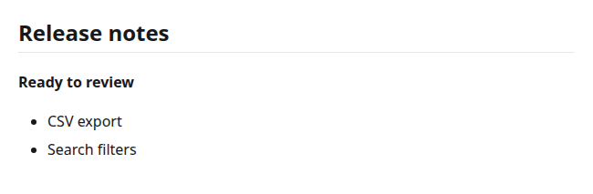

```svelte
<MarkdownRenderer content={'## Release notes\n\n**Ready to review**\n\n- CSV export\n- Search filters'} />
```

<a id="component-artifactworkspace"></a>

#### ArtifactWorkspace

Preview and edit a selected artifact. Supply the artifact list and the host’s `readArtifact` and `saveArtifact` handlers, then use `baseVersion` to detect save conflicts and preserve an unsaved draft.

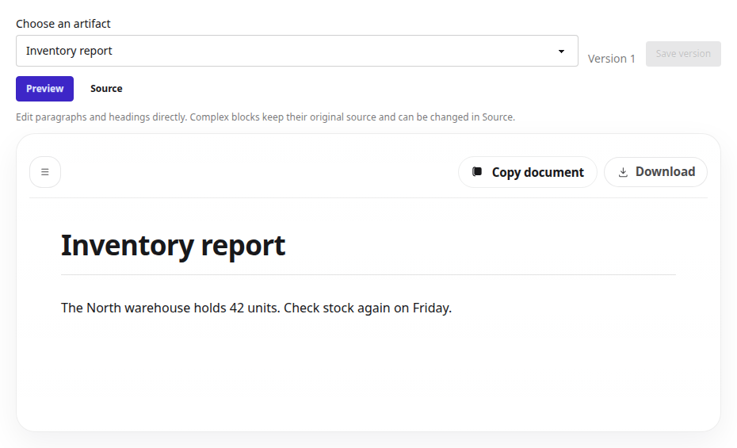

```svelte
<ArtifactWorkspace {artifacts} onread={readArtifact} onsave={saveArtifact} />
```

<a id="component-codeworkspace"></a>

#### CodeWorkspace

Browse read-only source through a host-provided `source`. Implement `listChildren` and `readFile` to load the tree and files, and pass the `readme` file node as the initial tab.

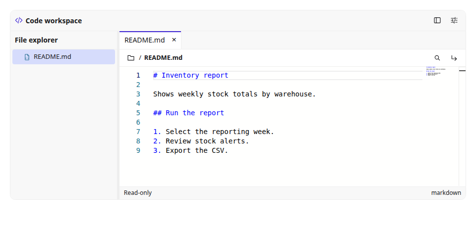

```svelte
<CodeWorkspace {source} initialFile={readme} height='24rem' />
```

<a id="component-toolworkspace"></a>

#### ToolWorkspace

Render the host’s `tools` catalog as a tool picker and parameter form. `runTool` receives the selected tool, validated input, and the submission’s idempotency key, then returns a run receipt for display.

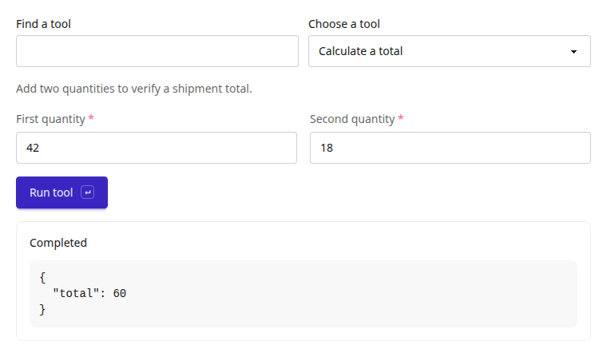

```svelte
<ToolWorkspace {tools} onrun={runTool} />
```


<a id="components-support"></a>

### Feedback and help

[FeedbackDetail](#component-feedbackdetail) · [FeedbackForm](#component-feedbackform) · [FeedbackList](#component-feedbacklist) · [FeedbackModal](#component-feedbackmodal) · [GuideHost](#component-guidehost) · [HelpCenter](#component-helpcenter)

<a id="component-feedbackdetail"></a>

#### FeedbackDetail

Supply a report ID and authorized actions for the conversation, replies, and files. Use `canProcess` to allow status changes and requests.

```svelte
<FeedbackDetail {id} {actions} />
```

<a id="component-feedbackform"></a>

#### FeedbackForm

Render fields and file selection in a page. The host sends the input through `onsubmit`.

```svelte
<FeedbackForm onsubmit={submitFeedback} />
```

<a id="component-feedbacklist"></a>

#### FeedbackList

Supply the author or staff list through `actions.list` and the detail actions. Set `initialId` to open a specific report.

```svelte
<FeedbackList {actions} />
```

<a id="component-feedbackmodal"></a>

#### FeedbackModal

Open the submission dialog with `open` and connect `onsubmit` to the host’s submission function.

```svelte
<FeedbackModal bind:open={open} onsubmit={submitFeedback} />
```

<a id="component-guidehost"></a>

#### GuideHost

Mount the app’s `guide` from `ui.createGuide` to offer the `autoStart` tour to eligible users, using step targets that match their `data-guide` attributes.


```svelte
<GuideHost {guide} locale='en-US' scope='atlas-user' autoStart='reports' />
<button type='button' data-guide='create-report'>New report</button>
```

<a id="component-helpcenter"></a>

#### HelpCenter

Search and read the app’s Markdown help entries in `articles`, using `onstart` to launch linked tours when provided.


```svelte
<HelpCenter articles={[{
  id: 'reports', title: 'Create a report',
  content: 'Choose **New report** and enter a title.',
}]} selectedId='reports' locale='en-US' />
```

<a id="call-options"></a>

## Call arguments

| Option | Default or requirements |
| --- | --- |
| `createLocaleStore: defaultLocale, supportedLocales` | Defaults to `zh-CN` and the built-in language list. Each supported locale has a `code` and `label`. |
| `createLocaleStore: detectBrowser, persistKey` | Defaults to `true` and `hai-locale`. Set detection to `false` to skip browser preferences. |
| `createGuide: tours, articles, nav` | Pass the required `tours` array. Help `articles` and a `nav` adapter are optional. |
| `createGuide: persistence, persistKey, waitTimeout` | Defaults to `cookie`, `hai-guide`, and 3000 milliseconds per step target. Use `memory` for progress that resets on reload. |
| `createThemeBootstrapScript: storageKey, defaultThemeId, defaultThemeColor` | Pass `storageKey`; the fallback theme is `light`. An omitted color skips setting the initial custom color. |
| `createThemeBootstrapScript: colorCssVar, toneDatasetKey, locale` | Optional output keys for the CSS color and light/dark attribute. For locale bootstrap, supply `key`, `defaultValue`, and `supportedValues`. |

<a id="form-layout-guide"></a>

## Form layout

Details remain in the [Chinese guide](ui.md#form-layout-guide).

<a id="theme-locale-guide"></a>

## Theme and locale guide

Details remain in the [Chinese guide](ui.md#theme-locale-guide).
