# @h-ai/ui API reference

<!-- translation: partial -->

[Chinese source](ui.md) · [Configuration](../configuration/ui.en.md) · [Data structures](../data/ui.en.md)

## Quick start

Import components through the public UI entry points. Keep authorization and persistence in the application. Supply controlled values and callbacks for interactive scenes.

Put this in a Svelte 5 page, such as `+page.svelte`.

```svelte
<script lang='ts'>
  import { Button, Card, Input } from '@h-ai/ui'

  let name = $state('')
  let submittedName = $state('')
</script>

<!-- Render a titled card containing the name controls and their preview. -->
<Card title='Preview a greeting'>
  <label for='greeting-name'>Name</label>
  <!-- Bind the text input to name and pair it with the matching label. Typing updates name. -->
  <Input id='greeting-name' bind:value={name} />
  <!-- Disable preview for blank names. Clicking when enabled trims name and shows the greeting. -->
  <Button variant='primary' disabled={!name.trim()} onclick={() => { submittedName = name.trim() }}>
    Preview
  </Button>
  <p role='status'>
    {#if submittedName}Hello, {submittedName}.{/if}
  </p>
</Card>
```

`bind:value` writes the text input to `name`. Type `Ada` and select **Preview** to see “Hello, Ada.”. This example updates only the page state.

With the auto-import plugin configured, a component used in a template can be imported automatically:

```svelte
<!-- The configured preprocessor supplies Button. This renders the primary Preview action. -->
<Button variant='primary'>Preview</Button>
```

```ts
import { Card } from '@h-ai/ui/components/compounds/index'
import { Button } from '@h-ai/ui/components/primitives/index'
import { getThemeInfo, THEMES } from '@h-ai/ui/theme'
```

<a id="api-reference"></a>

## Features

UI has no init/close lifecycle. Svelte owns component mounting. Each task lists interfaces and example inputs/results; callbacks, authorization and persistence belong to the host. Advanced walkthroughs remain partially translated and link to the corresponding Chinese section.

<a id="styles"></a>

### Integrate styles and imports: `autoImportHaiUi`

Load styles during the app build; the preprocessor imports actual template components.

#### Interface list

| API | Purpose | Parameters and defaults | Return value or failure | Call example |
| --- | --- | --- | --- | --- |
| `autoImportHaiUi` | Add imports for components used in Svelte templates | `preprocessed Svelte source and filename through markup` | `PreprocessorGroup; synchronous { code }` | `autoImportHaiUi()` |

#### Scenario: Configure styles and component imports

Enable component imports in the Svelte build and load shared styles in application CSS. The preprocessor adds imports during compilation. For extended examples, see the [Chinese walkthrough](ui.md#styles).

```js
import { vitePreprocess } from '@sveltejs/vite-plugin-svelte'
import { autoImportHaiUi } from '@h-ai/ui/auto-import'

export default {
  // Install the Hai UI preprocessor before Vite's Svelte preprocessor. It supplies imports for Hai components in templates.
  preprocess: [autoImportHaiUi(), vitePreprocess()],
}
```

<a id="forms"></a>

### Enter and submit data: form components

Keep field values in page state and update them through bindings. The application handles validated submissions.

#### Interface list

| API | Purpose | Parameters and defaults | Return value or failure | Call example |
| --- | --- | --- | --- | --- |
| `Button` | click increments count | `variant`, `size`, `loading`, `disabled`, `outline`, `circle` | click increments count | `<Button onclick={() => count += 1}>Add</Button>` |
| `IconButton` | Icon button and tooltip | `icon: trusted SVG string \| Snippet`, `variant`, `size`, `tooltip`, `loading` | Icon button and tooltip | `<IconButton icon='<svg viewBox="0 0 24 24"></svg>' tooltip='Save' />` |
| `BareButton` | Native button with accessible name | `class`, `ariaLabel`, `role`, `tabindex` | Native button with accessible name | `<BareButton ariaLabel='Save'>Save</BareButton>` |
| `Input` | Input updates name | `type`, `value`, `size`, `error`, `validationMessage` | Input updates name | `<Input bind:value={name} />` |
| `BareInput` | Input updates name | `type`, `class`, `accept`, `multiple` | Input updates name | `<BareInput type='text' bind:value={name} />` |
| `Textarea` | Multiline input updates notes | `value`, `rows`, `size`, `autoResize`, `error` | Multiline input updates notes | `<Textarea bind:value={notes} rows={3} />` |
| `Select` | Selection updates status | `options`, `value`, `placeholder`, `size`, `clearable`, `filterable` | Selection updates status | `<Select options={[{ value: 'open', label: 'Open' }]} bind:value={status} />` |
| `Checkbox` | Toggle updates enabled | `checked`, `label`, `size`, `indeterminate` | Toggle updates enabled | `<Checkbox bind:checked={enabled} label='Enabled' />` |
| `Switch` | Toggle updates enabled | `checked`, `label`, `size` | Toggle updates enabled | `<Switch bind:checked={enabled} label='Enabled' />` |
| `Radio` | Selection updates status | `options`, `value`, `direction`, `size` | Selection updates status | `<Radio options={[{ value: 'open', label: 'Open' }]} bind:value={status} />` |
| `ToggleCheckbox` | Checked state updates enabled | `checked`, `name`, `onchange` | Checked state updates enabled | `<ToggleCheckbox bind:checked={enabled} name='enabled' />` |
| `ToggleInput` | Checked state updates enabled | `checked`, `name` | Checked state updates enabled | `<ToggleInput bind:checked={enabled} name='enabled' />` |
| `ToggleRadio` | Selected radio control | `checked`, `name`, `onchange` | Selected radio control | `<ToggleRadio name='choice' checked />` |
| `Range` | Dragging updates score | `value`, `min`, `max`, `step` | Dragging updates score | `<Range min={0} max={100} bind:value={score} />` |
| `Rating` | Rating updates score | `value`, `max` | Rating updates score | `<Rating max={5} bind:value={score} />` |
| `Badge` | Badge showing New | `variant`, `size`, `outline` | Badge showing New | `<Badge variant='info'>New</Badge>` |
| `Avatar` | Name-based avatar fallback | `src`, `name`, `size`, `shape`, `ring` | Name-based avatar fallback | `<Avatar name='Ada' />` |
| `Tag` | Rendered tag | `text`, `variant`, `size`, `closable` | Rendered tag | `<Tag text='Release' />` |
| `Spinner` | Loading indicator | `size`, `variant` | Loading indicator | `<Spinner size='sm' />` |
| `Progress` | 30% progress | `value`, `max`, `variant`, `striped`, `animated` | 30% progress | `<Progress value={3} max={10} />` |
| `Form` | Valid submission calls save | `columns`, `labelPosition`, `labelWidth`, `loading`, `disabled`, `onsubmit` | Valid submission calls save | `<Form onsubmit={save}><Input bind:value={name} /></Form>` |
| `FormField` | Label associated with input | `label`, `for`, `colSpan`, `labelPosition`, `error`, `hint`, `required` | Label associated with input | `<FormField label='Name' for='name'><Input id='name' bind:value={name} /></FormField>` |
| `FormLayout` | Two columns collapse on small screens | `columns`, `labelPosition`, `labelWidth` | Two columns collapse on small screens | `<FormLayout columns={2}><FormField label='Name'><Input bind:value={name} /></FormField></FormLayout>` |
| `TagInput` | Editing updates tags | `tags`, `maxTags`, `allowDuplicates`, `size` | Editing updates tags | `<TagInput bind:tags={tags} maxTags={5} />` |
| `Combobox` | Search and update selected value | `options`, `value`, `multiple`, `placeholder`, `size` | Search and update selected value | `<Combobox options={[{ value: 'open', label: 'Open' }]} bind:value={status} />` |
| `Calendar` | Selection updates DateValue | `value: DateValue`, `minValue`, `maxValue` | Selection updates DateValue | `<Calendar bind:value={date} />` |
| `DatePicker` | Calendar popup updates date | `value: DateValue`, `minValue`, `maxValue`, `error`, `size` | Calendar popup updates date | `<DatePicker bind:value={date} />` |

#### Scenario: Select the same date in two controls

Keep field values in page state and update them through bindings. The application handles validated submissions. For extended examples, see the [Chinese walkthrough](ui.md#forms).

```svelte
<script lang='ts'>
  import { Calendar, DatePicker } from '@h-ai/ui'
  import { CalendarDate } from '@internationalized/date'
  let date = $state(new CalendarDate(2026, 11, 17))
</script>
<!-- Display the initial November 17 date in the calendar. Selection updates the shared bound date. -->
<Calendar bind:value={date} />
<!-- Bind the picker to the same date. Picking a day updates both controls. -->
<DatePicker bind:value={date} />
```

<a id="overlays"></a>

### Open dialogs and menus: overlay components

Control dialogs, drawers and confirmation with open state; attach menus and hints to page controls.

#### Interface list

| API | Purpose | Parameters and defaults | Return value or failure | Call example |
| --- | --- | --- | --- | --- |
| `Modal` | Open and close update open | `open`, `title`, `size`, `radius`, `bodyOverflow`, `showClose` | Open and close update open | `<Modal bind:open={open} title='Details'>Order 42</Modal>` |
| `Drawer` | Drawer with bound open state | `open`, `position`, `title`, `size`, `width`, `resizable`, `widthStorageKey` | Drawer with bound open state | `<Drawer bind:open={open} title='Details'>Order 42</Drawer>` |
| `Confirm` | Confirmation calls confirm | `open`, `title`, `message`, `variant`, `onconfirm` | Confirmation calls confirm | `<Confirm bind:open={open} message='Continue?' onconfirm={confirm} />` |
| `Popover` | Click opens; Escape closes | `open`, `position`, `trigger`, `offset`, `portal` | Click opens; Escape closes | `<Popover>{#snippet trigger()}<Button>Open</Button>{/snippet}Details</Popover>` |
| `Dropdown` | Action menu | `items`, `trigger`, `triggerClass`, `position` | Action menu | `<Dropdown items={menuItems}><Button>Actions</Button></Dropdown>` |
| `Tooltip` | Help on hover or focus | `content`, `position`, `delay`, `portal`（裁剪容器内使用） | Help on hover or focus | `<Tooltip content='Save order'><Button>Save</Button></Tooltip>` |

#### Scenario: Open and close order details

Control dialogs, drawers and confirmation with open state; attach menus and hints to page controls. For extended examples, see the [Chinese walkthrough](ui.md#overlays).

```svelte
<script lang='ts'>
  import { Button, Modal } from '@h-ai/ui'
  let open = $state(false)
</script>
<!-- Open the details dialog when the button is clicked. -->
<Button onclick={() => open = true}>Details</Button>
<!-- Display Order 42 when open is true. Dismissing the dialog updates the bound state. -->
<Modal bind:open title='Details'>Order 42</Modal>
```

<a id="tables"></a>

### Display records and navigation: data components

Pass loaded records and column definitions. Application callbacks load data when the user changes pages, sort order or tabs.

#### Interface list

| API | Purpose | Parameters and defaults | Return value or failure | Call example |
| --- | --- | --- | --- | --- |
| `Card` | Title and content | `title`, `bordered`, `shadow`, `padding` | Title and content | `<Card title='Order'>Order 42</Card>` |
| `JsonViewer` | Expandable JSON | `value`, `defaultExpandedDepth`, `maxScalarLength`, `showCopy`, `onCopy`；循环引用自动替换为占位符 | Expandable JSON | `<JsonViewer value={{ status: 'pending' }} />` |
| `DataTable` | Rows rendered by columns; host loads data | `data`, `columns`, `keyField`, `loading`, `sortKey`, `sortDir`, `onsort`，`cell` 单元格插槽、`onrowclick`（列 `sortable` 可排序） | Rows rendered by columns; host loads data | `<DataTable data={rows} {columns} keyField='id' />` |
| `Accordion` | Expand and collapse supplied content | `items: AccordionItem[]` | Expand and collapse supplied content | `<Accordion items={accordionItems} />` |
| `Timeline` | Timeline in supplied order | `items: TimelineItem[]` | Timeline in supplied order | `<Timeline items={timelineItems} />` |
| `Tabs` | Tab selection updates activeTab | `items`, `active`, `type`, `size`, `lazy`, `onactivate` | Tab selection updates activeTab | `<Tabs items={tabItems} bind:active={activeTab} />` |
| `Pagination` | Three pages; navigation updates page | `page`, `total`, `pageSize`, `showTotal`, `showJumper`, `showSizeChanger`, `showPageInfo`, `showFirstLast` | Three pages; navigation updates page | `<Pagination total={42} pageSize={20} bind:page />` |
| `Breadcrumb` | Hierarchy and links | `items`, `separator` | Hierarchy and links | `<Breadcrumb items={[{ label: 'Orders', href: '/orders' }, { label: '42' }]} />` |
| `Steps` | Current step indicator | `items`, `current`, `direction`, `clickable` | Current step indicator | `<Steps items={stepItems} current={1} />` |
| `Skeleton` | Three placeholders | `variant`, `width`, `height`, `count` | Three placeholders | `<Skeleton count={3} />` |
| `Empty` | Empty state | `title`, `description`, `icon` | Empty state | `<Empty title='No orders' />` |
| `Result` | Result state | `status`, `title`, `description` | Result state | `<Result status='success' title='Saved' />` |
| `PageHeader` | Page heading and actions | `title`, `description`，支持 `actions` 插槽 | Page heading and actions | `<PageHeader title='Orders' description='Current orders' />` |

#### Scenario: Display records and handle pagination

Pass loaded records and column definitions. Application callbacks load data when the user changes pages, sort order or tabs. For extended examples, see the [Chinese walkthrough](ui.md#tables).

```svelte
<script lang='ts'>
  import { Button, Input, Modal } from '@h-ai/ui'
  let username = $state('')
  let open = $state(false)
</script>
<!-- Forward the supplied test and analytics attributes. Clicking Save opens the bound dialog. -->
<Button data-testid='save-button' data-analytics-id='settings.save' onclick={() => { open = true }}>保存</Button>
<!-- Render the identified input and sync edits to username. -->
<Input data-testid='username-input' bind:value={username} />
<!-- Use the bound open state to show confirmation for the entered username, with the given test ID. -->
<Modal data-testid='confirm-modal' bind:open>确认保存 {username}？</Modal>
```

<a id="mobile"></a>

### Handle mobile interaction: mobile components

Provide mobile navigation, action sheets and refresh gestures. Application callbacks perform the requests.

#### Interface list

| API | Purpose | Parameters and defaults | Return value or failure | Call example |
| --- | --- | --- | --- | --- |
| `ActionSheet` | Selection calls selectAction | `open`, `title`, `items`, `cancelText`, `onselect` | Selection calls selectAction | `<ActionSheet bind:open={open} items={sheetItems} onselect={selectAction} />` |
| `AppBar` | Title and back navigation | `title`, `backHref`, `onback`, `fixed`, `safeArea` | Title and back navigation | `<AppBar title='Orders' backHref='/orders' />` |
| `BottomNav` | Navigation controls | `items`, `active`, `centered`, `maxWidth` | Navigation controls | `<BottomNav items={navItems} active='home' />` |
| `InfiniteScroll` | Boundary calls loadMore | `loading`, `finished`, `threshold`, `onload` | Boundary calls loadMore | `<InfiniteScroll loading={loading} finished={finished} onload={loadMore} />` |
| `PullRefresh` | Pull gesture calls refresh | `refreshing`, `threshold`, `onrefresh` | Pull gesture calls refresh | `<PullRefresh refreshing={loading} onrefresh={refresh}>Orders</PullRefresh>` |
| `SafeArea` | Safe-area padding | `top`, `bottom`, `left`, `right` | Safe-area padding | `<SafeArea top bottom>Orders</SafeArea>` |
| `SwipeCell` | Swipe reveals actions and reports selection | `leftActions`, `rightActions`, `threshold`, `onaction` | Swipe reveals actions and reports selection | `<SwipeCell rightActions={swipeActions} onaction={selectAction}>Order 42</SwipeCell>` |

#### Scenario: Handle mobile navigation, refresh and loading

Provide mobile navigation, action sheets and refresh gestures. Application callbacks perform the requests. For extended examples, see the [Chinese walkthrough](ui.md#mobile).

<a id="workspace"></a>

### Organize workspaces and settings: layouts

Arrange headings, actions and content in a workspace while retaining query fields in page state.

#### Interface list

| API | Purpose | Parameters and defaults | Return value or failure | Call example |
| --- | --- | --- | --- | --- |
| `SettingsModal` | Settings modal | `open`, `onclose` | Settings modal | `<SettingsModal bind:open={open} />` |
| `SettingsLayout` | Settings navigation and content | `title`, `description`, `sections`, `active`, `onselect` | Settings navigation and content | `<SettingsLayout title='Settings' sections={sections} active='profile'>Profile</SettingsLayout>` |
| `WorkspaceLayout` | Workspaces | `title`, `leading/actions/footer` snippets | Content fills available height | `<WorkspaceLayout title='Orders'>Orders</WorkspaceLayout>` |
| `FilterBar` | Collapsible filters | `activeCount`, `onreset`, `expanded` | Collapse retains input values | `<FilterBar activeCount={0}>Filters</FilterBar>` |
| `TableToolbar` | Table query toolbar | `searchValue`, `onsearch`, `onclearfilters` | Submission notifies host | `<TableToolbar bind:searchValue={search} onsearch={query} />` |

#### Scenario: Combine filters and records in a workspace

Arrange headings, actions and content in a workspace while retaining query fields in page state. For extended examples, see the [Chinese walkthrough](ui.md#workspace).

```svelte
<script lang='ts'>
  import { Button, FilterBar, Input, Select, WorkspaceLayout } from '@h-ai/ui'

  let search = $state('')
  let status = $state('')
</script>

<div class='flex h-dvh min-h-0'>
  <!-- Render the translated workspace title and its filter toolbar. -->
  <WorkspaceLayout title={m.page_title()}>
    <!-- Show the active status count and call the app's clearFilters when reset is requested. -->
    <FilterBar activeCount={status ? 1 : 0} onreset={clearFilters}>
      <!-- Put the small search input in the leading slot and update search as the user types. -->
      {#snippet leading()}<Input size='sm' bind:value={search} placeholder={m.search()} />{/snippet}
      <!-- Put the small search button in the actions slot and invoke loadRows on click. -->
      {#snippet actions()}<Button size='sm' onclick={loadRows}>{m.search()}</Button>{/snippet}
      <!-- Offer the app's status choices and write the selected value to status. -->
      <div class='w-40'><Select size='sm' bind:value={status} options={statusOptions} /></div>
    </FilterBar>
  </WorkspaceLayout>
</div>
```

<a id="notifications"></a>

### Report operation results: `toast`, `messageBox`

Send results, errors and confirmation to shared hosts; use returned IDs to remove individual notifications.

#### Interface list

| API | Purpose | Parameters and defaults | Return value or failure | Call example |
| --- | --- | --- | --- | --- |
| `useToastFeedback` | Show a reactive error or status in the shared toast host | `() => safely localized message, variant?` | `void; source-owned toast lifecycle` | `useToastFeedback(() => errorMessage(error))` |
| `notifySuccess` | Report a successful operation | `localized message, duration?` | `toast ID string` | `notifySuccess(m.saved())` |
| `notifyInfo` | Show an informational result | `localized message, duration?` | `toast ID string` | `notifyInfo(m.loading())` |
| `notifyWarning` | Show a warning the user can act on | `localized message, duration?` | `toast ID string` | `notifyWarning(m.warning())` |
| `notifyError` | Show a safe error message | `unknown error, safe fallback?, duration?` | `toast ID string; internal exception text hidden` | `notifyError(error, m.retry())` |
| `errorMessage` | Extract a message safe to show to the user | `unknown error, safe fallback?` | `safe localized string` | `errorMessage(error, m.retry())` |
| `toast.add` | Add a notification | `localized options/message` | `string item ID` | `toast.add({ message: m.saved(), variant: "success" })` |
| `toast.success` | Report success | `localized safe message, duration?` | `string item ID` | `toast.success(m.result())` |
| `toast.info` | Show information | `localized safe message, duration?` | `string item ID` | `toast.info(m.result())` |
| `toast.warning` | Show a warning | `localized safe message, duration?` | `string item ID` | `toast.warning(m.result())` |
| `toast.error` | Show a safe error | `localized safe message, duration?` | `string item ID` | `toast.error(m.result())` |
| `toast.remove` | Remove one notification by ID | `item ID` | `void` | `toast.remove(id)` |
| `toast.clear` | Clear all notifications | `none` | `void` | `toast.clear()` |
| `message.add` | Add a notification | `localized options/message` | `string item ID` | `message.add({ message: m.saved(), type: "success" })` |
| `message.success` | Report success | `localized safe message, duration?` | `string item ID` | `message.success(m.result())` |
| `message.info` | Show information | `localized safe message, duration?` | `string item ID` | `message.info(m.result())` |
| `message.warning` | Show a warning | `localized safe message, duration?` | `string item ID` | `message.warning(m.result())` |
| `message.error` | Show a safe error | `localized safe message, duration?` | `string item ID` | `message.error(m.result())` |
| `message.remove` | Remove one notification by ID | `item ID` | `void` | `message.remove(id)` |
| `message.clear` | Clear all notifications | `none` | `void` | `message.clear()` |
| `toast.pause` | Pause automatic dismissal | `toast ID` | `void` | `toast.pause(id)` |
| `toast.resume` | Resume automatic dismissal | `toast ID` | `void` | `toast.resume(id)` |
| `messageBox.confirm` | Wait for confirmation or cancellation | `localized string or MessageBoxOptions` | `Promise<boolean>; host handles confirmation/cancellation` | `messageBox.confirm({ message: m.confirm() })` |
| `messageBox.alert` | Wait for acknowledgement | `localized string or MessageBoxOptions` | `Promise<boolean>; host handles confirmation/cancellation` | `messageBox.alert({ message: m.confirm() })` |
| `Alert` | Persistent informational state | `variant`, `title`, `dismissible` | Persistent informational state | `<Alert variant='info' title='Saved' />` |
| `ToastContainer` | Global toast queue | Mount once with `toast` | Global toast queue | `<ToastContainer />` |
| `ErrorPage` | 503 state and home navigation | `status`, `code`, `title`, `description`, `homeUrl`, `onhome`, `onback` | 503 state and home navigation | `<ErrorPage status={503} homeUrl='/' />` |

#### Scenario: Show results and manage notification lifetime

Send results, errors and confirmation to shared hosts; use returned IDs to remove individual notifications. For extended examples, see the [Chinese walkthrough](ui.md#notifications).

```svelte
<script>
  import { toast, ToastContainer } from '@h-ai/ui'

  function notify() {
    // Queue the supplied message as a success toast.
    toast.success('操作成功')
    // Queue the supplied message using the error style.
    toast.error('操作失败')
    // Queue the supplied caution message as a warning.
    toast.warning('请注意')
    // Queue the info message with a 5,000 ms lifetime.
    toast.info('提示信息', 5000) // 自定义持续时间
  }
</script>

<button onclick={notify}>通知</button>
<!-- Mount the view that renders the four notifications queued by notify. -->
<ToastContainer />
```

<a id="auth"></a>

### Connect sign-in and permission UI: auth components

Forms collect credentials and call host authentication actions. Public policy controls available choices; the server verifies access.

#### Interface list

| API | Purpose | Parameters and defaults | Return value or failure | Call example |
| --- | --- | --- | --- | --- |
| `matchPermission` | Check permission for frontend presentation | `required permission, userPermissions[]` | `boolean; not server authorization` | `matchPermission("orders:read", ["orders:*"])` |
| `setPermissionContext` | Provide current permissions to descendant components | `() => current permissions; component initialization only` | `void` | `setPermissionContext(() => user.permissions)` |
| `usePermission` | Read the current permission context | `none; component initialization only` | `PermissionContext with hasPerm/hasAnyPerm/hasAllPerms` | `usePermission()` |
| `createSensitiveActions` | Request proof for one sensitive operation | `standard auth actions providing reauthenticate/publicConfig?` | `SensitiveActions: configure/authorize/submit/cancel` | `createSensitiveActions(actions)` |
| `createSessionRecovery` | Coordinate signing the same user back in | `none; configure public config and current user afterward` | `SessionRecovery controller` | `createSessionRecovery()` |
| `AuthPanel` | Policy-driven authentication actions | `config`, `actions`, `loginHeader/loginFields/loginFooter`, `registerHeader/registerFields/registerFooter` | Policy-driven authentication actions | `<AuthPanel {config} {actions} />` |
| `AuthShell` | Authentication layout | `variant`, `title`, `subtitle`, `brandTitle`, `brandText`, `illustration`, `description`, `highlights` | Authentication layout | `<AuthShell title='Sign in'>Account form</AuthShell>` |
| `LoginForm` | Login fields passed to login | `loading`, `errors`, `showForgotPassword`, `onsubmit` | Login fields passed to login | `<LoginForm onsubmit={login} />` |
| `RegisterForm` | Registration fields passed to register | `loading`, `errors`, `fields`, `onsubmit` | Registration fields passed to register | `<RegisterForm onsubmit={register} />` |
| `ForgotPasswordForm` | Password recovery submission | `mode`, `loading`, `errors`, `onsubmit` | Password recovery submission | `<ForgotPasswordForm onsubmit={sendReset} />` |
| `ResetPasswordForm` | Password reset submission | `loading`, `errors`, `showCode`, `onsubmit` | Password reset submission | `<ResetPasswordForm onsubmit={resetPassword} />` |
| `ChangePasswordForm` | Password change submission | `loading`, `errors`, `requireOldPassword`, `onsubmit` | Password change submission | `<ChangePasswordForm onsubmit={changePassword} />` |
| `PasswordInput` | Updates password and displays strength | `value`, `showToggle`, `showStrength`, `minLength` | Updates password and displays strength | `<PasswordInput bind:value={password} showStrength />` |
| `ReauthenticationDialog` | Reauthentication submit/cancel callbacks | `open`, `loading`, `error`, `onsubmit`, `onclose` | Reauthentication submit/cancel callbacks | `<ReauthenticationDialog open={confirmation.open} onsubmit={confirmation.submit} onclose={confirmation.cancel} />` |
| `PermGuard` | Permission-based visibility; server still authorizes | `permissions`, `mode`, `fallback` | Permission-based visibility; server still authorizes | `<PermGuard permissions='orders:read'>Orders</PermGuard>` |
| `UserProfile` | Only true completes editing | `user`, `editable`, `fields`, `avatarAccept`, `avatarHint`, `onsubmit` | Only true completes editing | `<UserProfile {user} editable onsubmit={saveProfile} />` |
| `SessionRecoveryDialog` | Recover original user session or cancel | `recovery`, `actions` | Recover original user session or cancel | `<SessionRecoveryDialog {recovery} {actions} />` |
| `SensitiveOperationsForm` | Sensitive-operation policy submission | `operations`, `onsubmit`, `ondone` | Sensitive-operation policy submission | `<SensitiveOperationsForm {operations} onsubmit={saveOperations} />` |

#### Scenario: Connect public policy and authentication actions

Forms collect credentials and call host authentication actions. Public policy controls available choices; the server verifies access. For extended examples, see the [Chinese walkthrough](ui.md#auth).

```svelte
<!-- actions 为 Kit/API client 的标准认证动作；policy 为 IAM 公开再认证策略。 -->
<script lang='ts'>
  import type { SensitiveActionsOptions } from '@h-ai/ui'
  import { createSensitiveActions, ReauthenticationDialog } from '@h-ai/ui'

  const { actions, policy }: { actions: SensitiveActionsOptions, policy: { enabled: boolean, operations: string[] } } = $props()
  // Create a reauthentication controller using the application's auth actions. It tracks the pending challenge and result.
  const confirmation = createSensitiveActions(actions)
  $effect(() => {
    // Configure which operations require confirmation using the supplied IAM policy.
    confirmation.configure(policy)
    // Cancel the pending confirmation on effect cleanup, resolving the pending authorizer without a credential.
    return () => confirmation.cancel()
  })
// 业务动作 await confirmation.authorize(operation)；null 时中止该动作。
</script>
<!-- Show the challenge, loading state, and last error from the controller. Submit forwards the entered password and close cancels the request. -->
<ReauthenticationDialog
  open={confirmation.open}
  loading={confirmation.loading}
  error={confirmation.error}
  onsubmit={password => /* Send the entered password to the controller. Success resolves the operation credential, and failure updates the dialog error. */ confirmation.submit(password)}
  onclose={() => /* Cancel the pending request and resolve it without a credential. */ confirmation.cancel()}
/>
```

<a id="uploads"></a>

### Select and upload files: storage components

Call uploadHandler after selection; image controls update their URL on success. The application owns file storage.

#### Interface list

| API | Purpose | Parameters and defaults | Return value or failure | Call example |
| --- | --- | --- | --- | --- |
| `FileUpload` | Selected files passed to upload | `accept`, `maxSize`, `maxFiles`, `multiple`, `uploadHandler` | Selected files passed to upload | `<FileUpload accept='.txt' uploadHandler={upload} />` |
| `ImageUpload` | Successful upload updates image URL | `value`, `accept`, `maxSize`, `aspectRatio`, `uploadHandler` | Successful upload updates image URL | `<ImageUpload bind:value={imageUrl} uploadHandler={uploadImage} />` |
| `AvatarUpload` | Successful upload updates avatar URL | `value`, `size`, `maxSize`, `fallback`, `uploadHandler` | Successful upload updates avatar URL | `<AvatarUpload bind:value={imageUrl} uploadHandler={uploadImage} />` |
| `FileList` | Displays supplied files | `files`, `layout`, `showDelete`, `showDownload` | Displays supplied files | `<FileList files={files} />` |

#### Scenario: Choose files and call an upload service

Call uploadHandler after selection; image controls update their URL on success. The application owns file storage. For extended examples, see the [Chinese walkthrough](ui.md#uploads).

<a id="crypto"></a>

### Display encryption results: crypto components

Display real computed results; these components do not own keys or verify signatures.

#### Interface list

| API | Purpose | Parameters and defaults | Return value or failure | Call example |
| --- | --- | --- | --- | --- |
| `EncryptedInput` | Updates current ciphertext only on success | `value`, `encryptedValue`, `algorithm`, `showEncrypted` | Updates current ciphertext only on success | `<EncryptedInput bind:value={plain} bind:encryptedValue={cipher} onencrypt={encrypt} />` |
| `HashDisplay` | Displays an existing digest | `value`, `algorithm`, `copyable`, `truncate` | Displays an existing digest | `<HashDisplay value={digest} algorithm='SM3' />` |
| `SignatureDisplay` | Displays supplied signature and verified state | `signature`, `publicKey`, `algorithm`, `verified` | Displays supplied signature and verified state | `<SignatureDisplay {signature} {publicKey} verified />` |

#### Scenario: Display ciphertext, digests and verification

Display computed ciphertext, digests and verification results; provide EncryptedInput encryption through onencrypt. For extended examples, see the [Chinese walkthrough](ui.md#crypto).

<a id="documents"></a>

### Read, edit and download documents: AI content

A Web Worker parses and highlights long Markdown documents in the browser. Streaming updates are coalesced. Multi-page PDF export captures the DOM first, then uses a Worker to find page breaks and encode page PNGs when OffscreenCanvas is available.

Pass text, Markdown, tables or document data to viewers and connect editing, downloads and citation actions.

#### Interface list

| API | Purpose | Parameters and defaults | Return value or failure | Call example |
| --- | --- | --- | --- | --- |
| `parseMarkdown` | Convert Markdown to safe display HTML | `Markdown source, MarkdownParseOptions?` | `HTML string; raw HTML escaped or allowlisted` | `parseMarkdown("# Hello", { allowHtmlTags: false })` |
| `renderMarkdownDocument` | Parse content with outline and code-block metadata | `Markdown source, MarkdownDocumentParseOptions?` | `MarkdownRenderResult with outline/codeBlocks/blocks` | `renderMarkdownDocument("# Report", { allowHtmlTags: false })` |
| `isLanguageSupported` | Check whether syntax highlighting supports a language | `language name` | `boolean` | `isLanguageSupported("typescript")` |
| `highlightCode` | Escape and highlight source code for display | `code text, supported language` | `escaped/highlighted HTML string` | `highlightCode("const total = 1", "typescript")` |
| `resolveDocumentMarkdownContent` | Prepare document content as Markdown | `text, sourceKind?, language?` | `Markdown string with a safe fence length` | `resolveDocumentMarkdownContent("const x = 1", "code", "ts")` |
| `resolveDocumentDownloadActions` | Resolve configured document download choices | `MarkdownToolbarDownloadAction[]?` | `AiDocumentResolvedDownloadAction[]` | `resolveDocumentDownloadActions([{ id: "markdown", label: "Markdown" }])` |
| `downloadAiDocument` | Download a document using the selected action | `AiDocumentDownloadRequest` | `Promise<void>; browser failure rejects, SSR does nothing` | `downloadAiDocument({ actionId: "markdown", content: "# Report", filename: "report.md" })` |
| `MarkdownRenderer` | Safe Markdown rendering | `content`, `fontSize`, `allowHtmlTags`, `showCopyButton`, `enableHighlight` | Safe Markdown rendering | `<MarkdownRenderer content='# Hello' allowHtmlTags={false} />` |
| `AiDocumentDownloadMenu` | Selection invokes download action | `actions`, `ondownload` | Selection invokes download action | `<AiDocumentDownloadMenu {actions} ondownload={download} />` |
| `AiDocumentEditor` | Editing updates markdown | `content`, `fontSize`, `allowHtmlTags`, `showRunButton`, `showCodePreviewToggle`, `allowUnsafeCodePreview` | Editing updates markdown | `<AiDocumentEditor bind:content={markdown} showToolbar />` |
| `AiTableEditor` | Displays cells and reports edits | `columns`, `rows`, `editable`, `ondownload` | Displays cells and reports edits | `<AiTableEditor {columns} {rows} editable />` |

#### Scenario: Parse and preview document content

Pass text, Markdown, tables or document data to viewers and connect editing, downloads and citation actions. For extended examples, see the [Chinese walkthrough](ui.md#documents).

```ts
import { parseMarkdown, renderMarkdownDocument, isLanguageSupported, highlightCode, resolveDocumentMarkdownContent, resolveDocumentDownloadActions, downloadAiDocument } from '@h-ai/ui'
// Parse the supplied heading as HTML. Raw HTML input is escaped with this option.
const html = parseMarkdown('# Hello', { allowHtmlTags: false }) // heading HTML
// Parse the heading into a Markdown document result with an outline and blocks.
const document = renderMarkdownDocument('# Hello') // outline and parsed blocks
// Check support for the TypeScript grammar. It returns true here.
isLanguageSupported('typescript') // true
// Highlight the supplied TypeScript statement and return its safe HTML.
highlightCode('const total = 1', 'typescript') // highlighted HTML
// Convert the supplied code to a TypeScript fenced Markdown block.
resolveDocumentMarkdownContent('const total = 1', 'code', 'typescript') // fenced Markdown
// Resolve the supplied Markdown option into the enabled download actions.
const actions = resolveDocumentDownloadActions([{ id: 'markdown', label: 'Markdown' }])
// Export # Hello through the Markdown browser download action as hello.md. Browser or export failures reject.
await downloadAiDocument({ actionId: 'markdown', content: '# Hello', filename: 'hello.md' }) // browser download
```

<a id="tool-workspaces"></a>

### Run tools and edit artifacts: workspaces

The host supplies tool catalogs, submission callbacks and accessible artifacts; the workspace displays progress and results.

#### Interface list

| API | Purpose | Parameters and defaults | Return value or failure | Call example |
| --- | --- | --- | --- | --- |
| `ArtifactWorkspace` | Artifact editor | `artifacts`, `onread`, `onsave?` | Save increments version; conflicts retain draft | `<ArtifactWorkspace artifacts={[report]} onread={readArtifact} onsave={saveArtifact} />` |
| `ToolWorkspace` | Tool runner | `tools`, `onrun`, `onstatus?`, `oncancel?` | Example input 2 and 3 produces total=5 | `<ToolWorkspace tools={catalog} onrun={run} />` |

#### Scenario: Run tools and continue editing artifacts

The host supplies tool catalogs, submission callbacks and accessible artifacts; the workspace displays progress and results. For extended examples, see the [Chinese walkthrough](ui.md#tool-workspaces).

```svelte
<script lang="ts">
  import { ArtifactWorkspace, type ArtifactDocument, type ArtifactSaveRequest, type ArtifactSaveResponse } from '@h-ai/ui/components/scenes/tools/index'

  let report: ArtifactDocument = {
    id: 'report', title: '报告', kind: 'markdown', version: 1,
    content: '# 简介\n\n产品介绍。', editable: true,
  }
  async function readArtifact() { return report }
  async function saveArtifact(request: ArtifactSaveRequest): Promise<ArtifactSaveResponse> {
    if (request.baseVersion !== report.version)
      return { status: 'conflict', currentVersion: report.version }
    report = { ...report, version: report.version + 1, content: request.content }
    return { status: 'saved', document: report }
  }
</script>

<!-- Open the supplied editable report. Reading returns its current snapshot. Saving updates the version or reports a conflict when the base version is stale. -->
<ArtifactWorkspace artifacts={[report]} onread={readArtifact} onsave={saveArtifact} />
```

<a id="charts"></a>

### Display metrics and charts: chart components

Charts consume supplied data and fields; metric cards display computed values without querying business services.

#### Interface list

| API | Purpose | Parameters and defaults | Return value or failure | Call example |
| --- | --- | --- | --- | --- |
| `Chart` | Chart | `type?`, `preset?`, `data`, `x`, `y` | Grouped bars | `<Chart preset='grouped-bar' {data} x='month' y={['revenue', 'cost']} />` |
| `DashboardGrid` | Dashboard grid | `columns`, `label`, children | Two columns, responsive collapse | `<DashboardGrid columns={2} label='Metrics'><MetricCard title='Orders' value={42} /></DashboardGrid>` |
| `MetricCard` | Metric card | `title`, `value`, `unit?`, `trend?` | Shows 42 and +12.8% | `<MetricCard title='Orders' value={42} trend={12.8} />` |
| `ReportCard` | Report card | `title`, `loading?`, children | Title and content region | `<ReportCard title='Revenue'>Chart content</ReportCard>` |

#### Scenario: Display records as charts and metrics

Charts consume supplied data and fields; metric cards display computed values without querying business services. For extended examples, see the [Chinese walkthrough](ui.md#charts).

```svelte
<script lang='ts'>
  import { Chart, DashboardGrid, MetricCard, ReportCard } from '@h-ai/ui/components/scenes/charts/index'

  const data = [
    { month: 'Jan', revenue: 42, cost: 24 },
    { month: 'Feb', revenue: 58, cost: 31 },
  ]
</script>

<!-- Lay out the metric cards in a labelled four-column grid. -->
<DashboardGrid label='Key metrics' columns={4}>
  <!-- Show the supplied revenue value, CNY unit, and positive 12.8 trend. -->
  <MetricCard title='Revenue' value='128,430' unit='CNY' trend={12.8} trendTone='success' trendLabel='vs previous month' />
</DashboardGrid>
<!-- Group the chart under the Revenue and cost report heading. -->
<ReportCard title='Revenue and cost'>
  <!-- Render the Jan and Feb revenue and cost values side by side using the grouped-bar preset. -->
  <Chart preset='grouped-bar' {data} x='month' y={['revenue', 'cost']} />
</ReportCard>
```

<a id="crud"></a>

### Build query and edit workflows: `CrudPage`

Resource definitions connect list, create, update and delete callbacks; controllers manage loading, navigation and editing.

#### Interface list

| API | Purpose | Parameters and defaults | Return value or failure | Call example |
| --- | --- | --- | --- | --- |
| `defineCrud` | Connect fields and CRUD callbacks in one resource | `CrudResource with fields/API callbacks` | `CrudDef for CrudPage` | `defineCrud(resourceDefinition)` |
| `createCrudController` | Manage record loading, navigation and query state | `CrudDef, { autoLoad? }?` | `controller data/nav/loading/loaded/error/load/reload` | `createCrudController(crud, { autoLoad: false })` |
| `mapPaginated` | Map page items while retaining pagination metadata | `PaginatedResult<T>, (item,index) => R` | `PaginatedResult<R> retaining total/page/pageSize` | `mapPaginated(page, item => ({ ...item, selected: false }))` |
| `createBrowserNavAdapter` | Connect CRUD state to browser navigation | `none` | `NavAdapter` | `createBrowserNavAdapter()` |
| `CrudPage` | List, forms and resource callbacks | `crud`, `data`, `permissions`, `form`, `pagination`, `density`, `detailColumns`, `showHeader`, `toolbarLeading`, `toolbarActions`, `card`, `tableCell`, `onrowclick`, `sortableColumns`, `nav`, `loading`, `loaded`, `error`, `onRetry`, `keepPreviousData` | List, forms and resource callbacks | `<CrudPage {crud} data={controller.data} nav={controller.nav} />` |
| `CrudFilterBar` | Submits query criteria | `filterFields`, `searchValue`, `onsearch`, `onfilterchange`, `onreset` | Submits query criteria | `<CrudFilterBar filterFields={filters} onsearch={search} />` |
| `CrudDetailPanel` | Displays selected record | `open`, `item`, `fields`, `variant`, `drawerWidth`, `modalSize` | Displays selected record | `<CrudDetailPanel bind:open={open} item={selected} fields={fields} />` |
| `CrudEditPanel` | Submits declared writable fields | `open`, `fields`, `variant`, `drawerWidth`, `modalSize`, `onsubmit` | Submits declared writable fields | `<CrudEditPanel bind:open={open} fields={fields} onsubmit={save} />` |
| `CrudDeleteConfirm` | Confirmation calls remove | `open`, `loading`, `onconfirm` | Confirmation calls remove | `<CrudDeleteConfirm bind:open={open} onconfirm={remove} />` |

#### Scenario: Build list and edit screens from a resource

This follows CrudPage with createCrudController. The component displays state while the controller calls the application-provided data service.



Editing filters alone does not query; submit with Search/Enter. Paging and sorting use committed filters. Only the latest response can update the controller. Initial failure shows retry; refresh failure retains old data by default. Empty state requires loaded and total=0.

Resource definitions connect list, create, update and delete callbacks; controllers manage loading, navigation and editing. For extended examples, see the [Chinese walkthrough](ui.md#crud).

```svelte
<script lang='ts'>
  import { createCrudController, CrudPage, defineCrud } from '@h-ai/ui'

  // Define the users CRUD resource and its name field. The example list callback supplies one Ada record.
  const crud = defineCrud({
    name: 'users', label: 'Users',
    fields: [{ id: 'name', label: 'Name', type: 'text' }],
    api: {
      list: async () => ({ items: [{ id: 'u1', name: 'Ada' }], total: 1, page: 1, pageSize: 10 }),
    },
  })
  // Create the controller for that resource without synchronizing filters to the URL. It exposes data, loading and error state, and reload.
  const controller = createCrudController(crud, { syncUrl: false })
</script>
<!-- Show the users resource and the controller's current results. A load error is shown with the supplied retry action. -->
<CrudPage
  {crud} data={controller.data} nav={controller.nav}
  loading={controller.loading} loaded={controller.loaded}
  error={controller.error} onRetry={controller.reload}
/>
```

The demo list callback returns one Ada record; it does not make an HTTP request or persist changes. createCrudController loads by default; use autoLoad: false and call load when a lazy tab first opens.

<a id="code"></a>

### Browse source code: `CodeWorkspace`

Display source with a file list and lazy read callback. The host controls file access and writes.

#### Interface list

| API | Purpose | Parameters and defaults | Return value or failure | Call example |
| --- | --- | --- | --- | --- |
| `CodeWorkspace` | Source workspace | `source: CodeWorkspaceSource` | Open README.md to display # Hello | `<CodeWorkspace {source} />` |

#### Scenario: Browse files and inspect code

Display source with a file list and lazy read callback. The host controls file access and writes. For extended examples, see the [Chinese walkthrough](ui.md#code).

```svelte
<script lang='ts'>
  import type { CodeWorkspaceSource } from '@h-ai/ui/components/scenes/code/index'
  import { CodeWorkspace } from '@h-ai/ui/components/scenes/code/index'

  const source: CodeWorkspaceSource = {
    listChildren: () => [
      { kind: 'file', id: 'readme', name: 'README.md' },
    ],
    readFile: () => ({ text: '# Hello', language: 'markdown' }),
  }
</script>

<!-- Load the tree through the supplied source. Opening README.md reads its Markdown text into the workspace. -->
<CodeWorkspace {source} />
```

<a id="guide"></a>

### Provide tours and help: `createGuide`

Define tour steps, targets and articles; the controller starts, advances and ends tours and records completion.

#### Interface list

| API | Purpose | Parameters and defaults | Return value or failure | Call example |
| --- | --- | --- | --- | --- |
| `createGuide` | Create a tour and help controller | `GuideOptions: tours, articles?, nav?, persistence?, persistKey?` | `GuideController; no init/close` | `createGuide({ tours: [], persistence: "memory" })` |
| `resolveGuideText` | Resolve static or deferred guide text | `string or translation callback?` | `string` | `resolveGuideText(() => m.help())` |
| `GuideHost` | Tour and help UI | `guide`, `locale`, `scope`, `autoStart` | Tour and help UI | `<GuideHost {guide} locale='en-US' scope='demo-user' />` |
| `HelpCenter` | Search and read help | `articles`, `tours`, `locale`, `selectedId`, `onstart` | Search and read help | `<HelpCenter articles={articles} tours={tours} locale='en-US' />` |

#### Scenario: Start a tour and open help articles

Define tour steps, targets and articles; the controller starts, advances and ends tours and records completion. For extended examples, see the [Chinese walkthrough](ui.md#guide).

```svelte
<script lang='ts'>
  import { createGuide, GuideHost } from '@h-ai/ui/guide'

  // Create a guide for the users route with a named anchor and help article, using the supplied navigation adapter and persistence key.
  const guide = createGuide({
    nav,
    persistKey: 'my-app-guide',
    tours: [
      {
        id: 'users',
        version: 1,
        route: '/users',
        title: () => m.guide_users_title(),
        description: () => m.guide_users_description(),
        steps: [
          {
            target: 'users-create',
            title: () => m.guide_create_title(),
            description: () => m.guide_create_description(),
          },
        ],
      },
    ],
    articles: [
      {
        id: 'users-help',
        title: () => m.guide_users_title(),
        content: () => m.guide_users_markdown(),
        tourId: 'users',
      },
    ],
  })
</script>

<!-- Mount the guide for the active locale and user. Starting the users tour targets the configured route and step. -->
<GuideHost {guide} {locale} scope={user.id} autoStart='users' />
<!-- Open the guide's help panel when this button is clicked. -->
<Button onclick={() => guide.openHelp()}>{m.help()}</Button>
<!-- Use the users tour anchor on the existing create button. A click still calls the app's createUser handler. -->
<Button data-guide='users-create' onclick={createUser}>{m.create_user()}</Button>
```

<a id="theme"></a>

### Switch themes: `@h-ai/ui/theme`

Apply a trusted default before first paint, then let theme controls read and update browser preferences.

#### Interface list

| API | Purpose | Parameters and defaults | Return value or failure | Call example |
| --- | --- | --- | --- | --- |
| `getThemeInfo` | Find metadata for a supported theme | `theme ID` | `ThemeInfo or undefined` | `getThemeInfo("light")` |
| `isDarkTheme` | Check whether a theme uses dark colors | `theme ID` | `boolean` | `isDarkTheme("dark")` |
| `normalizeThemeId` | Select a supported theme or the fallback | `candidate theme ID, fallback?` | `supported theme ID` | `normalizeThemeId("unknown", "light")` |
| `normalizeHexColor` | Normalize a supported hex color | `string or null/undefined` | `six-digit lowercase hex string or null` | `normalizeHexColor("#5765F0")` |
| `resolveThemeTone` | Read a theme’s light or dark tone | `theme ID` | `light or dark` | `resolveThemeTone("light")` |
| `createThemeBootstrapScript` | Apply the trusted theme before first paint | `ThemeBootstrapScriptOptions from trusted host config` | `script string for the application HTML shell` | `createThemeBootstrapScript({ storageKey: "theme", defaultThemeId: "light" })` |
| `getThemeInitScript` | Get the default initial theme script | `none` | `script string` | `getThemeInitScript()` |
| `applyTheme` | Apply a theme and optionally save the preference | `theme ID, persist? (default true)` | `void; updates DOM/browser preference` | `applyTheme("dark")` |
| `getCurrentTheme` | Read the theme currently applied to the page | `none` | `theme ID string` | `getCurrentTheme()` |
| `getSavedTheme` | Read the saved theme preference | `fallback theme ID?` | `theme ID string` | `getSavedTheme("light")` |
| `ThemeColorPicker` | Updates chosen color | `value`, `presets`, `onchange` | Updates chosen color | `<ThemeColorPicker bind:value={color} />` |
| `ThemeSelector` | Selects a theme | No props | Selects a theme | `<ThemeSelector />` |
| `ThemeToggle` | Toggles light/dark theme | No props | Toggles light/dark theme | `<ThemeToggle />` |

#### Scenario: Read preferences and change theme

Apply a trusted default before first paint, then let theme controls read and update browser preferences. For extended examples, see the [Chinese walkthrough](ui.md#theme).

```ts
import {
  applyTheme, // 应用主题（自动持久化到 localStorage）
  createThemeBootstrapScript, // 生成可注入 app.html 的首屏主题恢复脚本
  getCurrentTheme, // 获取当前主题
  getSavedTheme, // 读取安全缓存，可传入应用配置的默认主题
  getThemeInitScript, // 返回可注入到 HTML shell 的防闪烁脚本文本
  isDarkTheme, // 检查是否暗色主题
  normalizeHexColor, // 归一化 #RGB / #RRGGBB 主题色
  normalizeThemeId, // 校验主题 ID 并自动回退
  THEME_GROUPS, // 按亮色/暗色分组
  THEMES, // ThemeInfo[] — 18 个主题元数据
} from '@h-ai/ui/theme'
```

<a id="locale"></a>

### Switch locales and isolate requests: `@h-ai/ui/i18n`

Keep browser locale in page state and select server locale per request to prevent cross-user changes.

#### Interface list

| API | Purpose | Parameters and defaults | Return value or failure | Call example |
| --- | --- | --- | --- | --- |
| `createLocaleStore` | Manage the browser page’s current language | `{ defaultLocale?, supportedLocales?, detectBrowser?, persistKey? }` | `locale store with current/set/isSupported` | `createLocaleStore({ defaultLocale: "zh-CN", detectBrowser: false })` |
| `getGlobalLocale` | Read the locale for the current context | `none` | `locale string from current context` | `getGlobalLocale()` |
| `setGlobalLocale` | Set the current request or page locale | `locale` | `void; use request context for SSR` | `setGlobalLocale("en-US")` |
| `detectBrowserLocale` | Choose a supported browser language | `supportedLocales?` | `supported locale or null` | `detectBrowserLocale()` |
| `isLocaleSupported` | Check whether a locale is enabled | `locale, supportedLocales?` | `boolean` | `isLocaleSupported("ja-JP")` |
| `resolveLocale` | Resolve a supported locale or fallback | `locale, supportedLocales?, fallback?` | `supported locale` | `resolveLocale("en")` |
| `interpolate` | Insert named values into a message template | `template string, InterpolationParams` | `string` | `interpolate("Hello {name}", { name: "Ada" })` |
| `LanguageSwitch` | Changes global UI locale | No props | Changes global UI locale | `<LanguageSwitch />` |

#### Scenario: Choose a page language and interpolate text

Keep browser locale in page state and select server locale per request to prevent cross-user changes. For extended examples, see the [Chinese walkthrough](ui.md#locale).

```svelte
<script>
  import { createLocaleStore } from '@h-ai/ui/i18n'
  import { setLocale } from '#lib/paraglide/runtime.js'

  // Create a reactive language store with browser and framework defaults.
  const localeStore = createLocaleStore()

  function changeLocale(code) {
    // Update the UI store and the framework locale with the chosen supported code.
    localeStore.set(code) // 更新 UI store + 同步到 @h-ai/core
    // Apply the same selected code to the app's Paraglide runtime.
    setLocale(code) // 同步到 Paraglide（应用层）
  }
</script>

<select value={localeStore.current} onchange={e => changeLocale(e.currentTarget.value)}>
  {#each localeStore.supported as locale (locale.code)}
    <option value={locale.code}>{locale.label}</option>
  {/each}
</select>
```

<a id="feedback"></a>

### Display feedback and evidence: feedback components

The host supplies sanitized evidence and authorized callbacks; components report user actions.

#### Interface list

| API | Purpose | Parameters and defaults | Return value or failure | Call example |
| --- | --- | --- | --- | --- |
| `FeedbackModal` | Submit to host; retain input on failure | `open`, `onsubmit` | Submit to host; retain input on failure | `<FeedbackModal bind:open={open} onsubmit={submitFeedback} />` |
| `FeedbackForm` | Submission data and attachment changes | `attachments`, `evidenceSummary`, `onsubmit`, `onfileschange` | Submission data and attachment changes | `<FeedbackForm attachments={attachments} onsubmit={submitFeedback} />` |
| `FeedbackList` | Query/action callbacks; no internal requests | `data`, `query`, `permissions`, `onquerychange`, `onstatus` | Query/action callbacks; no internal requests | `<FeedbackList data={feedbackRows} onquerychange={queryFeedback} />` |
| `FeedbackDetail` | Report and authorized evidence | `report`, `evidence`, `attachments`, `history`, `webhook`, `onretry`, `onexport` | Report and authorized evidence | `<FeedbackDetail report={report} />` |
| `FeedbackScreenshot` | Annotation callback | `attachment`, `onannotate` | Annotation callback | `<FeedbackScreenshot attachment={attachment} onannotate={annotate} />` |

#### Scenario: Display evidence and submit feedback

Forms display captured evidence and report file, annotation and submit actions; list and detail views consume authorized data. For extended examples, see the [Chinese walkthrough](ui.md#feedback).

<a id="utilities"></a>

### Handle classes, platform and clipboard: UI utilities

Compose class names, create UI IDs and select platform styles. Clipboard and portal operations require browser capabilities.

#### Interface list

| API | Purpose | Parameters and defaults | Return value or failure | Call example |
| --- | --- | --- | --- | --- |
| `registerClipboardHostWriter` | Connect or remove a WebView clipboard writer | `async text => boolean or null to unregister` | `void` | `registerClipboardHostWriter(null)` |
| `writeTextToClipboard` | Copy text and report whether writing succeeded | `text: string` | `Promise<boolean>; true only when write succeeds` | `writeTextToClipboard("trace-001")` |
| `cn` | Combine conditional class names | `...string\|boolean\|null\|undefined values` | `string` | `cn("flex", active && "text-primary")` |
| `getDataAttributes` | Forward only data-* attributes | `props record` | `ForwardedDataAttributes` | `getDataAttributes({ "data-testid": "save" })` |
| `generateId` | Create an identifier for a UI element | `prefix?; not a security token generator` | `string` | `generateId("field")` |
| `portal` | Move a mounted node to its target container | `HTMLElement, target HTMLElement or selector?` | `Svelte action result with cleanup` | `portal(node, document.body)` |
| `detectPlatform` | Detect the current platform | `none` | `Platform` | `detectPlatform()` |
| `isMobile` | Check whether the platform is mobile | `none` | `boolean` | `isMobile()` |
| `isNativeApp` | Check whether the page runs in a native shell | `none` | `boolean` | `isNativeApp()` |
| `usePlatform` | Read reactive platform information | `none; component initialization` | `{ current, isMobile, isApp }` | `usePlatform()` |
| `getVariantClass` | Map a variant to a component class | `Variant, prefix?` | `string class name` | `getVariantClass("primary", "btn")` |
| `getSizeClass` | Map a size to a component class | `Size, prefix?` | `string class name` | `getSizeClass("sm", "btn")` |
| `getInputSizeClass` | Get input size classes | `Size` | `string class name` | `getInputSizeClass("sm")` |
| `getBadgeVariantClass` | Get badge color classes | `Variant` | `string class name` | `getBadgeVariantClass("info")` |
| `getBadgeSizeClass` | Get badge size classes | `Size` | `string class name` | `getBadgeSizeClass("sm")` |
| `getAlertVariantClass` | Get alert color classes | `Variant` | `string class name` | `getAlertVariantClass("info")` |
| `getProgressVariantClass` | Get progress color classes | `Variant` | `string class name` | `getProgressVariantClass("primary")` |

#### Scenario: Compose styles and copy a diagnostic ID

Compose class names, create UI IDs and select platform styles. Clipboard and portal operations require browser capabilities. For extended examples, see the [Chinese walkthrough](ui.md#utilities).

```ts
import { cn, generateId, getDataAttributes, getVariantClass, writeTextToClipboard } from '@h-ai/ui'
// Combine the given class with the falsy conditional. The result is flex.
cn('flex', false && 'hidden') // 'flex'
// Keep the data-testid attribute from this object and discard the unrelated property.
getDataAttributes({ 'data-testid': 'save', secret: 'ignored' }) // only data-testid
// Combine the primary variant and btn prefix into btn-primary.
getVariantClass('primary', 'btn') // 'btn-primary'
// Generate a unique field identifier with the requested prefix.
const id = generateId('field') // generated field identifier
// Copy the supplied trace ID. true means the browser copied it and false means it could not.
const copied = await writeTextToClipboard('trace-001') // true if copied; false on failure
```

<a id="call-options"></a>

## Call arguments

Details remain in the [Chinese guide](ui.md#call-options).

<a id="form-layout-guide"></a>

## Form layout

Details remain in the [Chinese guide](ui.md#form-layout-guide).

## Toast options

Details remain in the [Chinese guide](ui.md#toast-options).

<a id="theme-locale-guide"></a>

## Theme and locale guide

Details remain in the [Chinese guide](ui.md#theme-locale-guide).
