# @h-ai/ui API リファレンス

<!-- translation: partial -->

[简体中文](ui.md) · [English](ui.en.md) · [設定](../configuration/ui.ja.md) · [データ構造](../data/ui.ja.md)

[全コンポーネントの用途・利用例・スクリーンショット](#component-catalog) · [設定の読み込み](../configuration/ui.ja.md#configuration-fields) · [ブラウザーの保存領域](../data/ui.ja.md#browser-storage)

<a id="module-dependencies"></a>

## 依存関係

| 依存先 | 用途 | 利用条件 | 初期化順序 |
| --- | --- | --- | --- |
| `svelte` | Svelte 5 コンポーネントをコンパイルして描画 | UI コンポーネントの利用時に必須 | Svelte 5 プロジェクトでコンポーネントをインポート。マウントは Svelte が担当 |
| `tailwindcss` 4、`daisyui` 5 | コンポーネントのスタイルとテーマを生成 | 標準スタイルを使う場合 | ビルド前に [スタイルの導入例](#styles) に沿って CSS エントリーとコンポーネントのスキャンを設定 |
| `@tailwindcss/vite` | Vite のビルドで Tailwind CSS を処理 | Tailwind の Vite 統合を使う場合 | ビルド前に Vite の設定にプラグインを登録 |
| `@h-ai/core` | 組み込みメッセージと結果型を提供 | UI とともにインストール | コンポーネントをそのままインポート可能 |

<a id="quick-start"></a>

## クイックスタート

### 利用例

公開された UI エントリーポイントからコンポーネントをインポートします。認可と永続化はアプリ側に置きます。画面部品には制御する値とコールバックを渡します。

次のコードを Svelte 5 のページ（例: `+page.svelte`）に書きます。

```svelte
<script lang='ts'>
  import { Button, Card, Input } from '@h-ai/ui'

  let name = $state('')
  let submittedName = $state('')
</script>

<!-- Render a titled card containing the name controls and their preview. -->
<Card title='挨拶をプレビュー'>
  <label for='greeting-name'>名前</label>
  <!-- Bind the text input to name and pair it with the matching label. Typing updates name. -->
  <Input id='greeting-name' bind:value={name} />
  <!-- Disable preview for blank names. Clicking when enabled trims name and shows the greeting. -->
  <Button variant='primary' disabled={!name.trim()} onclick={() => { submittedName = name.trim() }}>
    プレビュー
  </Button>
  <p role='status'>
    {#if submittedName}こんにちは、{submittedName}さん。{/if}
  </p>
</Card>
```

`bind:value` は入力欄の文字列を `name` に入れます。`Ada` と入力して「プレビュー」を押すと「こんにちは、Adaさん。」と表示されます。この例ではページの状態だけを更新します。

自動インポートを設定すると、テンプレートで使うコンポーネントの import を省略できます。

```svelte
<!-- The configured preprocessor supplies Button. This renders the primary preview action. -->
<Button variant='primary'>プレビュー</Button>
```

```ts
import { Card } from '@h-ai/ui/components/compounds/index'
import { Button } from '@h-ai/ui/components/primitives/index'
import { THEMES, ui } from '@h-ai/ui/theme'
```

<a id="api-reference"></a>

## 機能

UI に init/close はありません。Svelte がマウントを管理します。各機能で入出力と例を示し、認可と保存はホストが担当します。詳細手順の未訳部分は対応する中国語節へリンクします。

<a id="styles"></a>

### スタイルと自動インポート：`ui.autoImport`

ビルド時にスタイルを読み、自動インポートは実際のテンプレート部品を対象にします。

#### インターフェース一覧

| API | 用途 | 引数と既定値 | 戻り値・失敗 | 呼び出し例 |
| --- | --- | --- | --- | --- |
| `ui.autoImport()` | テンプレートで使う部品のインポートを追加 | 引数なし。返されたプリプロセッサーを Svelte に登録し、マークアップとファイル名を処理します。 | `PreprocessorGroup; synchronous { code }` | `ui.autoImport()` |

#### 利用例：スタイルと部品のインポートを設定する

Svelte のビルド設定で自動インポートを有効にし、アプリの CSS に共通スタイルを読み込みます。プリプロセッサはコンパイル時にインポートを追加します。CSS の読み込みとスキャン対象は[スタイルとテーマの設定](../configuration/ui.ja.md#style-configuration)を参照してください。

```js
import { vitePreprocess } from '@sveltejs/vite-plugin-svelte'
import { ui } from '@h-ai/ui/auto-import'

export default {
  // Install the Hai UI preprocessor before Vite's Svelte preprocessor. It supplies imports for Hai components in templates.
  preprocess: [ui.autoImport(), vitePreprocess()],
}
```

<a id="detailed-workflow"></a>

<a id="forms"></a>

### 入力と送信：フォーム部品

値をページの状態に保存し、バインディングで更新します。検証後の送信はアプリのコールバックが処理します。

#### インターフェース一覧

| API | 用途 | 引数と既定値 | 戻り値・失敗 | 呼び出し例 |
| --- | --- | --- | --- | --- |
| [`<Button>`](#component-button) | クリックで count が1増加 | `variant` は外観や状態を選択。`size` はコンポーネントのサイズ。`loading` は処理中の状態を表示。`disabled` は利用者による操作を無効化。`outline` は枠線付きの表示。`circle` は円形ボタンを表示。 | クリックで count が1増加 | `<Button onclick={() => count += 1}>Add</Button>` |
| [`<IconButton>`](#component-iconbutton) | アイコンボタン | `label` はアクセシブルな名前です。`icon` は安全なインライン SVG またはスニペットを受け取ります。子要素でも描画できます。 | 名前付きのアイコン操作を表示 | `<IconButton label='Refresh'><span class='icon-[tabler--refresh] size-5'></span></IconButton>` |
| [`<BareButton>`](#component-barebutton) | 名前付きボタン | `class` はCSS クラスを追加。`ariaLabel` は支援技術向けの名前。`role` はアクセシビリティ上の役割。`tabindex` はキーボードフォーカスの順序。 | 名前付きボタン | `<BareButton ariaLabel='Save'>Save</BareButton>` |
| [`<Input>`](#component-input) | 入力で name を更新 | `type` は入力または表示の種類。`value` は現在値を指定。対応時は双方向バインド可。`size` はコンポーネントのサイズ。`error` はエラーメッセージやエラー状態。`validationMessage` は入力検証に失敗したときの文言。 | 入力で name を更新 | `<Input bind:value={name} />` |
| [`<BareInput>`](#component-bareinput) | 入力で name を更新 | `type` は入力または表示の種類。`class` はCSS クラスを追加。`accept` はファイル選択で許可する種類。`multiple` は複数選択を許可。 | 入力で name を更新 | `<BareInput type='text' bind:value={name} />` |
| [`<Textarea>`](#component-textarea) | 複数行入力で notes を更新 | `value` は現在値を指定。対応時は双方向バインド可。`rows` は最初に表示する行数。`size` はコンポーネントのサイズ。`autoResize` は入力に合わせて高さを調整。`error` はエラーメッセージやエラー状態。 | 複数行入力で notes を更新 | `<Textarea bind:value={notes} rows={3} />` |
| [`<Select>`](#component-select) | 選択で status を更新 | `options` は利用者が選べる候補。`value` は現在値を指定。対応時は双方向バインド可。`placeholder` は入力や選択がない場合のヒント。`size` はコンポーネントのサイズ。`clearable` は現在値を消す操作を表示。`filterable` は入力した文字で候補を絞る。[選択肢のフィールド](#choice-options)。 上下の矢印キーで候補を移動し、Enter で決定、Escape で閉じます。絞り込みの入力にはスペースも使用できます。 | 選択で status を更新 | `<Select options={[{ value: 'open', label: 'Open' }]} bind:value={status} />` |
| [`<Checkbox>`](#component-checkbox) | 選択で enabled を更新 | `checked` は選択状態。`label` は表示するラベル。`size` はコンポーネントのサイズ。`indeterminate` は一部選択の状態を表示。 | 選択で enabled を更新 | `<Checkbox bind:checked={enabled} label='Enabled' />` |
| [`<Switch>`](#component-switch) | 切替で enabled を更新 | `checked` は選択状態。`label` は表示するラベル。`size` はコンポーネントのサイズ。 | 切替で enabled を更新 | `<Switch bind:checked={enabled} label='Enabled' />` |
| [`<Radio>`](#component-radio) | 選択で status を更新 | `options` は利用者が選べる候補。`value` は現在値を指定。対応時は双方向バインド可。`direction` は横並びか縦並びかを指定。`size` はコンポーネントのサイズ。[選択肢のフィールド](#choice-options)。 | 選択で status を更新 | `<Radio options={[{ value: 'open', label: 'Open' }]} bind:value={status} />` |
| [`<ToggleCheckbox>`](#component-togglecheckbox) | チェック状態を enabled に反映 | `checked` は選択状態。`name` は識別やグループ化に使う名前。`onchange` は値の変更時に呼び出す。 | チェック状態を enabled に反映 | `<ToggleCheckbox bind:checked={enabled} name='enabled' />` |
| [`<ToggleInput>`](#component-toggleinput) | チェック状態を enabled に反映 | `checked` は選択状態。`name` は識別やグループ化に使う名前。 | チェック状態を enabled に反映 | `<ToggleInput bind:checked={enabled} name='enabled' />` |
| [`<ToggleRadio>`](#component-toggleradio) | 選択済みラジオ | `checked` は選択状態。`name` は識別やグループ化に使う名前。`onchange` は値の変更時に呼び出す。 | 選択済みラジオ | `<ToggleRadio name='choice' checked />` |
| [`<Range>`](#component-range) | ドラッグで score を更新 | `value` は現在値を指定。対応時は双方向バインド可。`min` は許可する最小値。`max` は上限。`step` は隣り合う値の間隔。 | ドラッグで score を更新 | `<Range min={0} max={100} bind:value={score} />` |
| [`<Rating>`](#component-rating) | 評価で score を更新 | `value` は現在値を指定。対応時は双方向バインド可。`max` は上限。 | 評価で score を更新 | `<Rating max={5} bind:value={score} />` |
| [`<Badge>`](#component-badge) | New のバッジ | `variant` は外観や状態を選択。`size` はコンポーネントのサイズ。`outline` は枠線付きの表示。 | New のバッジ | `<Badge variant='info'>New</Badge>` |
| [`<Avatar>`](#component-avatar) | 名前のアバター | `src` は画像 URL。`name` は画像がないときに使うイニシャルの元になる名前。`size` はコンポーネントのサイズ。`shape` は形状。 | 名前のアバター | `<Avatar name='Ada' />` |
| [`<Tag>`](#component-tag) | タグ表示 | `text` は表示する文言。`variant` は外観や状態を選択。`size` はコンポーネントのサイズ。`closable` は閉じる操作を表示。 | タグ表示 | `<Tag text='Release' />` |
| [`<Spinner>`](#component-spinner) | 読み込み表示 | `size` はコンポーネントのサイズ。`variant` は外観や状態を選択。 | 読み込み表示 | `<Spinner size='sm' />` |
| [`<Progress>`](#component-progress) | 進捗30% | `value` は現在値を指定。`max` は上限。`variant` は外観や状態を選択。`striped` は縞模様を表示。`animated` は進捗表示にアニメーションを付ける。 | 進捗30% | `<Progress value={3} max={10} />` |
| [`<Form>`](#component-form) | 検証後 save を呼出 | `columns` は列数または列定義。`labelPosition` は入力欄に対するラベルの位置。`labelWidth` はラベル欄の幅。`loading` は処理中の状態を表示。`disabled` は利用者による操作を無効化。`onsubmit` はフォームの送信時に呼び出す。 | 検証後 save を呼出 | `<Form onsubmit={save}><Input bind:value={name} /></Form>` |
| [`<FormField>`](#component-formfield) | ラベルと入力を関連付け | `label` は表示するラベル。`for` はラベルと入力欄の ID を関連付ける。`colSpan` はフィールドが占める列数。`labelPosition` は入力欄に対するラベルの位置。`error` はエラーメッセージやエラー状態。`hint` は入力欄の補足説明。`required` は必須項目として表示。 | ラベルと入力を関連付け | `<FormField label='Name' for='name'><Input id='name' bind:value={name} /></FormField>` |
| [`<FormLayout>`](#component-formlayout) | 2列から狭い画面で1列へ | `columns` は列数または列定義。`labelPosition` は入力欄に対するラベルの位置。`labelWidth` はラベル欄の幅。 | 2列から狭い画面で1列へ | `<FormLayout columns={2}><FormField label='Name'><Input bind:value={name} /></FormField></FormLayout>` |
| [`<TagInput>`](#component-taginput) | 編集で tags を更新 | `tags` は現在のタグ一覧。`maxTags` はタグの件数上限。`allowDuplicates` は同じタグの重複を許可。`size` はコンポーネントのサイズ。 | 編集で tags を更新 | `<TagInput bind:tags={tags} maxTags={5} />` |
| [`<Combobox>`](#component-combobox) | 検索して選択値を更新 | `options` は利用者が選べる候補。`value` は現在値を指定。対応時は双方向バインド可。`multiple` は複数選択を許可。`placeholder` は入力や選択がない場合のヒント。`size` はコンポーネントのサイズ。 | 検索して選択値を更新 | `<Combobox options={[{ value: 'open', label: 'Open' }]} bind:value={status} />` |
| [`<Calendar>`](#component-calendar) | 選択で DateValue を更新 | `value` は現在値を指定。対応時は双方向バインド可。`minValue` は選択可能な最も早い日。`maxValue` は選択可能な最も遅い日。 | 選択で DateValue を更新 | `<Calendar bind:value={date} />` |
| [`<DatePicker>`](#component-datepicker) | ポップアップで日付を更新 | `value` は現在値を指定。対応時は双方向バインド可。`minValue` は選択可能な最も早い日。`maxValue` は選択可能な最も遅い日。`error` はエラーメッセージやエラー状態。`size` はコンポーネントのサイズ。 `ariaLabel` は日付入力のアクセシブルな名前を指定します。 | ポップアップで日付を更新 | `<DatePicker bind:value={date} />` |
| [`<ScheduleInput>`](#component-scheduleinput) | 実行日時を編集 | `config` はタイムゾーン、精度、Cron の使用可否を指定します。`value` と `valid` は値と検証状態を双方向でバインドできます。`name` は送信フィールド名、`id` は表示中のコントロールに対応します。 | UTC オフセット付きの ISO 文字列または5フィールドの Cron | `<ScheduleInput name='scheduled_at' bind:value={schedule} required />` |
| [`<CronExpressionBuilder>`](#component-cronexpressionbuilder) | Cron と手入力式を編集 | `value` は式、`presets` は定型式です。`labels` と `weekdayOptions` は表示、`error` と `describedBy` は検証の文言を指定します。 | 手動で調整する式は入力を保持 | `<CronExpressionBuilder bind:value={cron} />` |
| `ui.normalizeScheduleInputConfig(value)` | 調度スキーマを判定 | `value` は `x-hai-input` の値です。`kind: 'schedule'`、有効な IANA `timezone`、`precision: 'minute'` を指定します。`allowCron` は省略できます。 | 正規化した `ScheduleInputConfig`。無効な値は `undefined` | `ui.normalizeScheduleInputConfig(rawMetadata)` |
| `ui.createDefaultCronBuilderState()` | 初期状態を生成 | 引数なし。 | 毎日 10:00 の `CronBuilderState` | `ui.createDefaultCronBuilderState()` |
| `ui.cronExpressionToBuilderState(expression)` | 編集状態へ変換 | `expression` に Cron 文字列を渡します。 | `CronBuilderState`。複雑または無効な値は手入力状態に保持 | `ui.cronExpressionToBuilderState('0 10 * * *')` |
| `ui.cronBuilderStateToExpression(state)` | 編集状態を式へ変換 | `state` に現在の `CronBuilderState` を渡します。 | ビジュアルモードは5フィールド、手入力モードは入力したテキスト | `ui.cronBuilderStateToExpression(state)` |
| `ui.isCronExpressionValid(expression)` | Cron 構文を検証 | `expression` に検証する文字列を渡します。ホストはフィールド数を制限できます。 | `boolean` | `ui.isCronExpressionValid('0 10 * * *')` |
| `CRON_BUILDER_WEEKDAY_ORDER` | 曜日の並びを取得 | 引数なし。 | 月曜から日曜の数字文字列。日曜は `'0'` | `[...CRON_BUILDER_WEEKDAY_ORDER]` |

<a id="choice-options"></a>

#### 選択肢のフィールド

| フィールド | 型 | 既定値 | 用途と適用条件 |
| --- | --- | --- | --- |
| `value` | `T` | 必須 | 選択したときにバインドに書き込む値。 |
| `label` | `string` | 必須 | 利用者に表示する選択肢の名前。 |
| `disabled` | `boolean` | 未設定（選択可） | `true` でこの項目を選択できなくします。 |

```svelte
<script lang="ts">
  import { Select } from '@h-ai/ui'

  let status = $state('draft')
  const options = [
    { value: 'draft', label: 'Draft' },
    { value: 'done', label: 'Done' },
    { value: 'archived', label: 'Archived', disabled: true },
  ]
</script>

<Select {options} bind:value={status} />
<output>{status}</output>
```

Done を選ぶと `done` が表示されます。Archived は選択不可で、`status` は変化しません。

#### 利用例：二つの入力で同じ日付を選ぶ

値をページの状態に保存し、バインディングで更新します。検証後の送信はアプリのコールバックが処理します。 詳細は[中国語の手順](ui.md#forms)を参照してください。

```svelte
<script lang='ts'>
  import { Calendar, DatePicker } from '@h-ai/ui'
  import { CalendarDate } from '@internationalized/date'
  let date = $state(new CalendarDate(2026, 11, 17))
</script>
<!-- Display the initial November 17 date in the calendar. Selection updates the shared bound date. -->
<Calendar bind:value={date} />
<!-- Bind the picker to the same date. Picking a day updates both controls. -->
<DatePicker bind:value={date} />
```

<a id="schedule-input"></a>

#### シナリオ：実行日時を選択して Cron を編集する

ホストのスキーマから `x-hai-input` を取得し、正規化した設定をコントロールへ渡します。コンポーネントの既定値は北京時間と分精度です。`allowCron` を省略すると `false` になります。この例ではロサンゼルス時間の日時と5フィールドの Cron を選べます。

```svelte
<script lang='ts'>
  import { Form, FormField, ScheduleInput, ui } from '@h-ai/ui'

  let schedule = $state('')
  let result = $state('')
  const rawMetadata = {
    kind: 'schedule', timezone: 'America/Los_Angeles', precision: 'minute', allowCron: true,
  }
  // Parse the schema metadata. Invalid zones or precision return undefined.
  const config = ui.normalizeScheduleInputConfig(rawMetadata)
</script>
{#if config}
  <!-- Use the named form field to receive the selected schedule string. -->
  <Form onsubmit={fields => { result = String(fields.scheduled_at) }}>
    <!-- Associate the label with the mode's visible input. -->
    <FormField label='Scheduled time' for='when' required>
      <!-- A valid date-time includes an offset. Cron mode writes a five-field expression. -->
      <ScheduleInput id='when' name='scheduled_at' {config} bind:value={schedule} required />
    </FormField>
    <button type='submit'>Save</button>
  </Form>
  <output>{result}</output>
{/if}
```

2030年7月22日10:05を選ぶと、`2030-07-22T10:05:00-07:00` が送信されます。夏時間で存在しない分は修正が必要です。重複する分は早い方を選び、既存値の有効なオフセットは保持します。期限切れの時刻を送信すると表示中の入力へフォーカスが戻ります。Cron の実行方法はホストが決めます。

Node のスキーマ処理では、正規化関数と型を `@h-ai/ui/components/compounds/schedule-input` から取得できます。この入口は Svelte を読み込みません。

<a id="overlays"></a>

### ダイアログとメニュー：オーバーレイ

open 状態でダイアログ、ドロワー、確認操作を制御し、ページのボタンにメニューやヒントを付けます。

#### インターフェース一覧

| API | 用途 | 引数と既定値 | 戻り値・失敗 | 呼び出し例 |
| --- | --- | --- | --- | --- |
| [`<Modal>`](#component-modal) | 開閉で open を更新 | `open` は開閉状態。`title` はタイトル。`size` はコンポーネントのサイズ。`radius` は角の丸み。`bodyOverflow` はコンテンツがはみ出した場合の動作。`showClose` は閉じるボタンの表示を切り替え。 | 開閉で open を更新 | `<Modal bind:open={open} title='Details'>Order 42</Modal>` |
| [`<Drawer>`](#component-drawer) | 開閉をバインドしたドロワー | `open` は開閉状態。`position` は表示位置。`title` はタイトル。`size` はコンポーネントのサイズ。`width` は表示幅。`resizable` はドラッグによるドロワーの幅変更を許可。`widthStorageKey` はドロワーの幅を保存するキー。 | 開閉をバインドしたドロワー | `<Drawer bind:open={open} title='Details'>Order 42</Drawer>` |
| [`<Confirm>`](#component-confirm) | 確認で confirm を呼出 | `open` は開閉状態。`title` はタイトル。`message` は利用者に表示する本文。`variant` は外観や状態を選択。`onconfirm` は利用者が確認したときに呼び出す。 `onconfirm` が `false` を返すか、非同期に `false` に解決するとダイアログを開いたままにします。 | 確認で confirm を呼出 | `<Confirm bind:open={open} message='Continue?' onconfirm={confirm} />` |
| [`<Popover>`](#component-popover) | クリックで開き Escape で閉じる | `open` は開閉状態。`position` は表示位置。`trigger` は起点となる内容または操作。`offset` はオーバーレイと起点の間隔。`portal` はオーバーレイをクリッピングの外に配置。 | クリックで開き Escape で閉じる | `<Popover>{#snippet triggerContent()}<Button>Open</Button>{/snippet}Details</Popover>` |
| [`<Dropdown>`](#component-dropdown) | 操作メニュー | `items` は表示順の項目一覧。`trigger` は起点となる内容または操作。`triggerClass` は起点となるコントロールに CSS クラスを追加。`position` は表示位置。 | 操作メニュー | `<Dropdown items={menuItems}><Button>Actions</Button></Dropdown>` |
| [`<Tooltip>`](#component-tooltip) | ホバー・フォーカスで説明 | `content` は表示する本文またはスニペット。`position` は表示位置。`delay` はヒントの表示まで待つ時間。`portal` はオーバーレイをクリッピングの外に配置。 | ホバー・フォーカスで説明 | `<Tooltip content='Save order'><Button>Save</Button></Tooltip>` |

#### 利用例：注文詳細を開いて閉じる

open 状態でダイアログ、ドロワー、確認操作を制御し、ページのボタンにメニューやヒントを付けます。 詳細は[中国語の手順](ui.md#overlays)を参照してください。

```svelte
<script lang='ts'>
  import { Button, Modal } from '@h-ai/ui'
  let open = $state(false)
</script>
<!-- Open the details dialog when the button is clicked. -->
<Button onclick={() => open = true}>Details</Button>
<!-- Display Order 42 when open is true. Dismissing the dialog updates the bound state. -->
<Modal bind:open title='Details'>Order 42</Modal>
```

<a id="tables"></a>

### データ表示と移動：表示部品

読み込み済みの記録と列定義を渡します。ページ、並び順、タブの変更時はアプリのコールバックが必要なデータを読み込みます。

#### インターフェース一覧

| API | 用途 | 引数と既定値 | 戻り値・失敗 | 呼び出し例 |
| --- | --- | --- | --- | --- |
| [`<Card>`](#component-card) | 見出しと内容 | `title` はタイトル。`bordered` は枠線の表示を切り替え。`shadow` は影。`padding` はコンテンツの内側の余白。 | 見出しと内容 | `<Card title='Order'>Order 42</Card>` |
| [`<JsonViewer>`](#component-jsonviewer) | 展開可能な JSON | `value` は現在値を指定。対応時は双方向バインド可。`defaultExpandedDepth` はJSON ツリーを最初に展開する深さ。`maxScalarLength` は個々のスカラー値のプレビュー長を制限。`showCopy` はコピーのボタンを切り替え。`onCopy` はコピー操作を処理。 | 展開可能な JSON | `<JsonViewer value={{ status: 'pending' }} />` |
| [`<DataTable>`](#component-datatable) | 列に従い rows を表示 | `data` は表示するデータ。`columns` は列ごとの表示方法と並べ替えを定義。`keyField` は各行の一意キーとなるフィールド。`loading` は処理中の状態を表示。`sortKey` は現在の並べ替え列。`sortDir` は現在の並べ替え方向。`onsort` は利用者が指定した並べ替えの変更を受け取る。`cell` はセルの表示内容を変更。`onrowclick` は利用者がクリックした行を受け取る。 [フィールド表](#datatable-options) | 列に従い rows を表示 | `<DataTable data={rows} {columns} keyField='id' />` |
| [`<Accordion>`](#component-accordion) | 指定内容を開閉 | `items` は表示順の項目一覧。 | 指定内容を開閉 | `<Accordion items={accordionItems} />` |
| [`<Timeline>`](#component-timeline) | 指定順のタイムライン | `items` は表示順の項目一覧。 | 指定順のタイムライン | `<Timeline items={timelineItems} />` |
| [`<Tabs>`](#component-tabs) | タブ選択で activeTab を更新 | `items` は表示順の項目一覧。`active` は現在選択中の項目。`type` は入力または表示の種類。`size` はコンポーネントのサイズ。`lazy` は初めて開くまで内容の描画を遅延。`onactivate` はタブが初めて有効になったときに呼び出す。 | タブ選択で activeTab を更新 | `<Tabs items={tabItems} bind:active={activeTab} />` |
| [`<Pagination>`](#component-pagination) | 全3ページ、page を更新 | `page` は1 から始まる現在のページ番号。`total` は該当するレコードの総件数。`pageSize` はページごとの件数。`showTotal` はレコードの総件数を表示。`showJumper` はページ移動用の入力欄を表示。`showSizeChanger` はページサイズの選択欄を表示。`showPageInfo` はページ情報を表示。`showFirstLast` は先頭・最終ページのボタンを表示。 [フィールド表](#pagination-options) | 全3ページ、page を更新 | `<Pagination total={42} pageSize={20} bind:page />` |
| [`<Breadcrumb>`](#component-breadcrumb) | 階層とリンク | `items` は表示順の項目一覧。 | 階層とリンク | `<Breadcrumb items={[{ label: 'Orders', href: '/orders' }, { label: '42' }]} />` |
| [`<Steps>`](#component-steps) | 現在ステップを表示 | `items` は表示順の項目一覧。`current` は現在のステップ。`direction` は横並びか縦並びかを指定。`clickable` はステップのクリックを許可。 | 現在ステップを表示 | `<Steps items={stepItems} current={1} />` |
| [`<Skeleton>`](#component-skeleton) | 3項目のプレースホルダー | `variant` は外観や状態を選択。`width` は表示幅。`height` は高さ。`count` は描画する数。 | 3項目のプレースホルダー | `<Skeleton count={3} />` |
| [`<Empty>`](#component-empty) | 空状態 | `title` はタイトル。`description` は補足説明。`icon` は表示するアイコン。 | 空状態 | `<Empty title='No orders' />` |
| [`<Result>`](#component-result) | 結果表示 | `status` は表示する結果や状態。`title` はタイトル。`description` は補足説明。 | 結果表示 | `<Result status='success' title='Saved' />` |
| [`<PageHeader>`](#component-pageheader) | ページ見出しと操作 | `title` はタイトル。`description` は補足説明。`actions` は利用可能な操作、または操作欄の内容。 | ページ見出しと操作 | `<PageHeader title='Orders' description='Current orders' />` |

<a id="datatable-options"></a>

#### データテーブルの列と並べ替え

キーが `At` または `_at` で終わる数値は、時刻を表すミリ秒値として表示します。その他の数値は受け取った値を表示します。独自の書式には列の `render` を使います。

| フィールド | 型 | 既定値 | 用途と適用条件 |
| --- | --- | --- | --- |
| `columns[].key` | `keyof T` / `string` | 必須 | 表示と並べ替えに使うフィールド。 |
| `columns[].label` | `string` | 必須 | 列見出しに表示する文言。 |
| `columns[].width` | `string` | 自動 | `8rem` などの CSS 幅を指定。 |
| `columns[].align` | `left` / `center` / `right` | テーブルのスタイルを継承 | セルの水平方向の配置。 |
| `columns[].sortable` | `boolean` | 無効 | 列見出しのクリックで並べ替えを有効にします。`onsort` がなければ現在の `data` だけを並べ替えます。 |
| `columns[].render` | `(item: T) => string` | フィールドの値 | 行全体を受け取りセルの文言を整形します。`cell` スニペットがある場合はそちらで描画します。 |
| `columns[].onclick` | `(item: T) => void` | 未設定 | この列のセルをクリックすると対象行を受け取ります。 |
| `sortKey / sortDir` | `string` / `asc` / `desc` / `null` | 未設定 | `onsort` がある場合に現在の並べ替えを制御します。 |
| `onsort` | `(key, dir) => void` | コンポーネントが現在のデータを並べ替え | 指定するとホストが並べ替え要求を受け取り、新しいデータを渡します。コンポーネントはその順序を保持します。 |

<a id="pagination-options"></a>

#### ページ移動欄のフィールド

| フィールド | 型 | 既定値 | 用途と適用条件 |
| --- | --- | --- | --- |
| `page / total` | `number` | 呼び出し元が指定 | 現在のページ番号と該当する全件数。ページ番号は 1 から始まります。 |
| `pageSize` | `number` | `10` | ページ数の計算に使います。 |
| `showTotal / showPageInfo / showFirstLast` | `boolean` | `true` | 総件数、ページ情報、先頭・最終ページボタンをそれぞれ表示します。 |
| `showJumper / showSizeChanger` | `boolean` | `false` | ページ移動用の入力欄とページサイズセレクターをそれぞれ表示します。 |
| `pageSizeOptions` | `number[]` | `[10, 20, 50, 100]` | ページサイズセレクターが表示される場合だけ選択肢に使います。 |
| `labels` | `PaginationProps["labels"]` | 現在のコンポーネントの翻訳 | ページ移動欄の文言を上書きします。`total` に `{count}`、`pageSize` に `{size}`、`pageInfo` に `{page}` と `{total}` を使えます。 |

```svelte
<script lang="ts">
  import { DataTable, Pagination } from '@h-ai/ui'

  let page = $state(1)
  const data = [{ id: 'b2', name: 'Bex' }, { id: 'a1', name: 'Ada' }]
  const columns = [{ key: 'name', label: 'Name', sortable: true }]
</script>

<DataTable {data} {columns} keyField="id" />
<Pagination bind:page total={42} pageSize={10} showJumper />
<output>{page}</output>
```

表の初期表示は Bex、Ada です。Name を一度クリックすると Ada、Bex の順になります。全 5 ページで、3 ページ目に移動すると `3` が表示されます。

#### 利用例：記録を表示してページを切り替える

読み込み済みの記録と列定義を渡します。ページ、並び順、タブの変更時はアプリのコールバックが必要なデータを読み込みます。 詳細は[中国語の手順](ui.md#tables)を参照してください。

```svelte
<script lang='ts'>
  import { Button, Input, Modal } from '@h-ai/ui'
  let username = $state('')
  let open = $state(false)
</script>
<!-- Forward the supplied test and analytics attributes. Clicking Save opens the bound dialog. -->
<Button data-testid='save-button' data-analytics-id='settings.save' onclick={() => { open = true }}>保存</Button>
<!-- Render the identified input and sync edits to username. -->
<Input data-testid='username-input' bind:value={username} />
<!-- Use the bound open state to show confirmation for the entered username, with the given test ID. -->
<Modal data-testid='confirm-modal' bind:open>确认保存 {username}？</Modal>
```

<a id="mobile"></a>

### モバイル操作：モバイル部品

移動、操作シート、更新ジェスチャー、ページ分割された一覧をモバイル画面に組み込みます。

#### インターフェース一覧

| API | 用途 | 引数と既定値 | 戻り値・失敗 | 呼び出し例 |
| --- | --- | --- | --- | --- |
| [`<ActionSheet>`](#component-actionsheet) | 下部の操作シート | `open` は表示状態、`items` は操作、`onselect` は ID を受け取る処理です。`onclose` はホストに閉じるよう通知します。 | 選択をホストに通知 | `<ActionSheet {open} {items} onselect={runAction} onclose={() => { open = false }} />` |
| [`<AppBar>`](#component-appbar) | 上部のアプリバー | `title` はタイトルです。`leading` で戻る操作、`trailing` で反対側の操作を渡します。`fixed` と `safeArea` は既定で有効です。 | タイトルとホストの操作を表示 | `<AppBar title='Orders'>{#snippet leading()}<a href='/'>Back</a>{/snippet}</AppBar>` |
| [`<BottomNav>`](#component-bottomnav) | ナビゲーション | `items` は表示順の項目一覧。`active` は現在選択中の項目。`centered` はナビゲーションを中央に配置。`maxWidth` は最大幅。 | ナビゲーション | `<BottomNav items={navItems} active='home' />` |
| [`<InfiniteScroll>`](#component-infinitescroll) | 一覧の末尾付近で追加取得 | `hasMore` は次ページの有無で、既定値は `true`。`threshold` は発火距離で、既定値は 100 px。`onloadmore` は次ページを非同期で取得し、`noMoreText` は末尾の文言を指定します。 | ページまたは一覧を末尾付近までスクロールすると `loadMore` を呼び、取得中の重複呼び出しを防ぎます | `<InfiniteScroll {hasMore} onloadmore={loadMore}>注文一覧</InfiniteScroll>` |
| [`<PullRefresh>`](#component-pullrefresh) | プル操作で更新 | `threshold` は操作のしきい値、`onrefresh` は非同期の更新処理です。更新中の状態はコンポーネントが管理します。 | 失敗時はエラーを通知して表示を元に戻し、再試行できます | `<PullRefresh onrefresh={refresh}>注文</PullRefresh>` |
| [`<SafeArea>`](#component-safearea) | セーフエリア | `position` で方向を指定します。既定値は `all` です。モバイル用 CSS が必要です。 | 端末の余白を確保 | `<SafeArea position='all'>Orders</SafeArea>` |
| [`<SwipeCell>`](#component-swipecell) | スワイプ操作 | `actions` は右側の操作一覧、`onaction` は選択した ID を受け取ります。 | 左にスワイプすると操作を表示 | `<SwipeCell actions={swipeActions} onaction={selectAction}>Order 42</SwipeCell>` |

#### 利用例：モバイルの移動・更新・読み込みを処理する

移動、操作シート、スワイプ操作の項目はアプリが提供します。`loadMore` は次ページを一覧に追加し、最終ページを取得したら `hasMore` を `false` にします。`refresh` は最初のページを取得し直します。ページ全体と独立した一覧のどちらでも、末尾付近で追加取得が始まります。

<a id="workspace"></a>

### ワークスペースと設定：レイアウト

見出し、操作、内容をワークスペースに配置し、検索条件はページの状態として保持します。

#### インターフェース一覧

| API | 用途 | 引数と既定値 | 戻り値・失敗 | 呼び出し例 |
| --- | --- | --- | --- | --- |
| [`<SettingsModal>`](#component-settingsmodal) | 設定ダイアログ | `open` は開閉状態。`onclose` は閉じる操作を処理。 | 設定ダイアログ | `<SettingsModal bind:open={open} />` |
| [`<SettingsLayout>`](#component-settingslayout) | 設定ナビと内容 | `title` はタイトル。`description` は補足説明。`sections` は設定のセクション一覧。`active` は現在選択中の項目。`onselect` は選択した項目を受け取る。 | 設定ナビと内容 | `<SettingsLayout title='Settings' sections={sections} active='profile'>Profile</SettingsLayout>` |
| [`<WorkspaceLayout>`](#component-workspacelayout) | ワークスペース | `title` はタイトル。`leading` は先頭に表示するスニペット。 | 内容が残り高さを使用 | `<WorkspaceLayout title='Orders'>Orders</WorkspaceLayout>` |
| [`<FilterBar>`](#component-filterbar) | 折り畳みフィルター | `activeCount` は適用中のフィルター数を表示。`onreset` は条件のリセットを処理。`expanded` はフィルター欄の展開状態。 | 折畳みで入力値を保持 | `<FilterBar activeCount={0}>Filters</FilterBar>` |
| [`<TableToolbar>`](#component-tabletoolbar) | 一覧検索バー | `searchValue` は現在の検索文字列。`onsearch` は入力された検索文字列や検索操作を受け取る。`onclearfilters` はフィルターの一括解除を処理。 | 送信時ホストへ通知 | `<TableToolbar bind:searchValue={search} onsearch={query} />` |

#### 利用例：絞り込みと一覧をワークスペースに配置する

見出し、操作、内容をワークスペースに配置し、検索条件はページの状態として保持します。 詳細は[中国語の手順](ui.md#workspace)を参照してください。

```svelte
<script lang='ts'>
  import { Button, FilterBar, Input, Select, WorkspaceLayout } from '@h-ai/ui'

  let search = $state('')
  let status = $state('')
</script>

<div class='flex h-dvh min-h-0'>
  <!-- Render the translated workspace title and its filter toolbar. -->
  <WorkspaceLayout title={m.page_title()}>
    <!-- Show the active status count and call the app's clearFilters when reset is requested. -->
    <FilterBar activeCount={status ? 1 : 0} onreset={clearFilters}>
      <!-- Put the small search input in the leading slot and update search as the user types. -->
      {#snippet leading()}<Input size='sm' bind:value={search} placeholder={m.search()} />{/snippet}
      <!-- Put the small search button in the actions slot and invoke loadRows on click. -->
      {#snippet actions()}<Button size='sm' onclick={loadRows}>{m.search()}</Button>{/snippet}
      <!-- Offer the app's status choices and write the selected value to status. -->
      <div class='w-40'><Select size='sm' bind:value={status} options={statusOptions} /></div>
    </FilterBar>
  </WorkspaceLayout>
</div>
```

<a id="notifications"></a>

### 操作結果の通知：`toast`、`messageBox`

操作結果、エラー、確認を共通の表示領域に渡します。返された ID で個別の通知を削除できます。

#### インターフェース一覧

| API | 用途 | 引数と既定値 | 戻り値・失敗 | 呼び出し例 |
| --- | --- | --- | --- | --- |
| `ui.useToastFeedback(message, variant?)` | 状態の変化を共通通知領域に表示 | `message` は翻訳済みの文言または空値を返す関数です。`variant` の既定値は `error`。 | `void; source-owned toast lifecycle` | `ui.useToastFeedback(() => ui.errorMessage(error))` |
| `ui.notifySuccess(message, duration?)` | 成功した操作を通知 | `message` は表示する翻訳済み本文です。`duration` は自動で閉じるまでのミリ秒数で、既定は 3000、0 なら表示を保持します。 | `toast ID string` | `ui.notifySuccess(m.saved())` |
| `ui.notifyInfo(message, duration?)` | 情報を通知 | `message` は表示する翻訳済み本文です。`duration` は自動で閉じるまでのミリ秒数で、既定は 3000、0 なら表示を保持します。 | `toast ID string` | `ui.notifyInfo(m.loading())` |
| `ui.notifyWarning(message, duration?)` | 対応が必要な注意を通知 | `message` は翻訳済みの警告です。`duration` は閉じるまでのミリ秒数で、既定は 5000、0 なら表示を保持します。 | `toast ID string` | `ui.notifyWarning(m.warning())` |
| `ui.notifyError(error, fallback?, duration?)` | 安全なエラーメッセージを表示 | `error` から表示可能な文言と追跡 ID を抽出します。`fallback` は表示可能な文言がない場合の翻訳済みテキストです。`duration` の既定は 5000 ms で、0 なら表示を保持します。 | `toast ID string; internal exception text hidden` | `ui.notifyError(error, m.retry())` |
| `ui.errorMessage(error, fallback?)` | 利用者に表示できるメッセージを取得 | `error` は表示できる文言を取り出すエラー、`fallback` は取り出せない場合の翻訳済みテキストです。 | `safe localized string` | `ui.errorMessage(error, m.retry())` |
| `ui.toast.add(props)` | 通知を追加 | `props` は本文、種類、表示時間、位置、閉じ方を指定します。[通知のフィールド](#toast-options)を参照。 | `string item ID` | `ui.toast.add({ message: m.saved(), variant: "success" })` |
| `ui.toast.success(message, duration?)` | 成功を通知 | `message` は表示する翻訳済み本文です。`duration` は自動で閉じるまでのミリ秒数で、既定は 3000、0 なら表示を保持します。 | `string item ID` | `ui.toast.success(m.result())` |
| `ui.toast.info(message, duration?)` | 情報を通知 | `message` は表示する翻訳済み本文です。`duration` は自動で閉じるまでのミリ秒数で、既定は 3000、0 なら表示を保持します。 | `string item ID` | `ui.toast.info(m.result())` |
| `ui.toast.warning(message, duration?)` | 注意を通知 | `message` は表示する翻訳済み本文です。`duration` は自動で閉じるまでのミリ秒数で、既定は 3000、0 なら表示を保持します。 | `string item ID` | `ui.toast.warning(m.result())` |
| `ui.toast.error(message, duration?)` | 安全なエラーを通知 | `message` は表示する翻訳済み本文です。`duration` は自動で閉じるまでのミリ秒数で、既定は 3000、0 なら表示を保持します。 | `string item ID` | `ui.toast.error(m.result())` |
| `ui.toast.remove(id)` | ID で通知を削除 | `id` は通知の作成時に返る識別子で、操作対象の通知を指定します。 | `void` | `ui.toast.remove(id)` |
| `ui.toast.clear()` | すべての通知を削除 | 引数はありません。 | `void` | `ui.toast.clear()` |
| `ui.message.add(options)` | 通知を追加 | `options` は翻訳済み本文、または本文、種類、表示時間、閉じ方を指定するオブジェクトです。[メッセージのフィールド](#message-options)を参照。 | `string item ID` | `ui.message.add({ message: m.saved(), type: "success" })` |
| `ui.message.success(message, duration?)` | 成功を通知 | `message` は表示する翻訳済み本文です。`duration` は自動で閉じるまでのミリ秒数で、既定は 3000、0 なら表示を保持します。 | `string item ID` | `ui.message.success(m.result())` |
| `ui.message.info(message, duration?)` | 情報を通知 | `message` は表示する翻訳済み本文です。`duration` は自動で閉じるまでのミリ秒数で、既定は 3000、0 なら表示を保持します。 | `string item ID` | `ui.message.info(m.result())` |
| `ui.message.warning(message, duration?)` | 注意を通知 | `message` は表示する翻訳済み本文です。`duration` は自動で閉じるまでのミリ秒数で、既定は 3000、0 なら表示を保持します。 | `string item ID` | `ui.message.warning(m.result())` |
| `ui.message.error(message, duration?)` | 安全なエラーを通知 | `message` は表示する翻訳済み本文です。`duration` は自動で閉じるまでのミリ秒数で、既定は 3000、0 なら表示を保持します。 | `string item ID` | `ui.message.error(m.result())` |
| `ui.message.remove(id)` | ID で通知を削除 | `id` は通知の作成時に返る識別子で、操作対象の通知を指定します。 | `void` | `ui.message.remove(id)` |
| `ui.message.clear()` | すべての通知を削除 | 引数はありません。 | `void` | `ui.message.clear()` |
| `ui.toast.pause(id)` | 自動消去を一時停止 | `id` は通知の作成時に返る識別子で、操作対象の通知を指定します。 | `void` | `ui.toast.pause(id)` |
| `ui.toast.resume(id)` | 自動消去を再開 | `id` は通知の作成時に返る識別子で、操作対象の通知を指定します。 | `void` | `ui.toast.resume(id)` |
| `ui.messageBox.confirm(options)` | 確認またはキャンセルを待つ | `options` は翻訳済み本文、またはタイトル、ボタン、閉じ方を設定するオブジェクトです。[ダイアログのフィールド](#message-box-options)を参照。 | `Promise<boolean>; host handles confirmation/cancellation` | `ui.messageBox.confirm({ message: m.confirm() })` |
| `ui.messageBox.alert(options)` | 確認操作を待つ | `options` は翻訳済み本文、またはタイトル、ボタン、閉じ方を設定するオブジェクトです。[ダイアログのフィールド](#message-box-options)を参照。 | `Promise<boolean>; host handles confirmation/cancellation` | `ui.messageBox.alert({ message: m.confirm() })` |
| [`<Alert>`](#component-alert) | 持続する案内 | `variant` は `info` または `success` です。`title` で見出し、`dismissible` で閉じる操作を指定します。 | 関連する内容の横に表示 | `<Alert variant='success' title='Payment received' />` |
| [`<ToastContainer>`](#component-toastcontainer) | 通知キュー表示 | ルートレイアウトに一度だけ配置します。`toast` と `message` は共通のキューに通知を追加します。 | 通知キュー表示 | `<ToastContainer />` |
| [`<ErrorPage>`](#component-errorpage) | 503 状態と戻るリンク | `status` は表示する結果や状態。`code` は表示するエラーコードや追跡コード。`title` はタイトル。`description` は補足説明。`homeUrl` はホームへのリンク先。`onhome` はホームに戻る操作を処理。`onback` は戻る操作を処理。 | 503 状態と戻るリンク | `<ErrorPage status={503} homeUrl='/' />` |

<a id="toast-options"></a>

##### 通知の設定

| フィールド | 型 | 既定値 | 用途と適用条件 |
| --- | --- | --- | --- |
| `message` | `string` | 必須 | 通知に表示する翻訳済み本文。 |
| `variant` | `Variant` | `info` | 通知の見た目を指定します。 |
| `duration` | `number` | `3000` ms | 表示時から計測します。0 は自動で閉じません。 |
| `position` | `top-right` / `top-center` / `top-left` / `bottom-right` / `bottom-center` / `bottom-left` | `bottom-right` | 通知の位置を上下・左中右の組み合わせから選びます。キューは共通です。 |
| `dismissible` | `boolean` | `true` | 手動で閉じるボタンの表示を切り替えます。 |
| `traceId` | `string` | 未設定 | 公開可能な追跡 ID があると、利用者が展開して ID を確認できます。 |

<a id="message-options"></a>

##### メッセージのフィールド

| フィールド | 型 | 既定値 | 用途と適用条件 |
| --- | --- | --- | --- |
| `message` | `string` | 必須 | 表示する翻訳済みメッセージ。文字列を直接渡すと本文になります。 |
| `type` | `info` / `success` / `warning` / `error` | `info` | 共通キュー内のこのメッセージの見た目を選びます。 |
| `duration` | `number` | `3000` ms | 自動で閉じるまでのミリ秒数。0 は自動で閉じません。 |
| `closable` | `boolean` | `true` | 手動で閉じるボタンの表示を切り替えます。 |

<a id="message-box-options"></a>

##### 確認ダイアログのフィールド

| フィールド | 型 | 既定値 | 用途と適用条件 |
| --- | --- | --- | --- |
| `message` | `string` | 必須 | ダイアログ本文。文字列を直接渡すと本文になり、HTML タグも文字として表示します。 |
| `title` | `string` | 現在の言語のタイトル | タイトルを上書きします。 |
| `type` | `confirm` / `alert` | メソッドで設定 | メソッドで選んだモードを上書きします。キャンセルボタンの表示は `showCancel` で指定します。 |
| `iconType` | `info` / `success` / `warning` / `error` | 確認は `warning`、通知は `info` | 本文の横に表示するアイコンを上書きします。 |
| `confirmText` | `string` | 現在の言語の確認ラベル | 確認ボタンのラベルを上書きします。 |
| `cancelText` | `string` | 現在の言語のキャンセルラベル | キャンセルボタンが表示される場合に使います。 |
| `confirmVariant` | `default` / `primary` / `warning` / `error` | `primary` | 確認ボタンの見た目を指定します。 |
| `showCancel` | `boolean` | 確認は `true`、通知は `false` | キャンセルボタンの表示を切り替えます。 |
| `closeOnClickModal` | `boolean` | `true` | 背景のクリックで閉じる操作を開始するか指定します。 |
| `showClose` | `boolean` | `true` | 右上の閉じるボタンを表示するか指定します。 |
| `beforeClose` | `MessageBoxOptions["beforeClose"]` | 未設定 | 確認・キャンセル・閉じる操作と、読み込み状態を変更できるインスタンスを受け取ります。`false` を返すか非同期に解決すると表示を継続します。 |

#### 利用例：操作結果を表示して通知を管理する

操作結果、エラー、確認を共通の表示領域に渡します。返された ID で個別の通知を削除できます。 詳細は[中国語の手順](ui.md#notifications)を参照してください。

```svelte
<script>
  import { ToastContainer, ui } from '@h-ai/ui'

  function notify() {
    // Queue the supplied message as a success toast.
    ui.toast.success('操作成功')
    // Queue the supplied message using the error style.
    ui.toast.error('操作失败')
    // Queue the supplied caution message as a warning.
    ui.toast.warning('请注意')
    // Queue the info message with a 5,000 ms lifetime.
    ui.toast.info('提示信息', 5000) // 自定义持续时间
  }
</script>

<button onclick={notify}>通知</button>
<!-- Mount the view that renders the four notifications queued by notify. -->
<ToastContainer />
```

#### 利用例：警告を閉じるまで表示する

```ts
import { ui } from '@h-ai/ui/toast'

ui.toast.add({ message: '未確認の項目が 2 件あります', variant: 'warning', duration: 0, position: 'top-right' })
```

右上に警告が表示され、手動で閉じるまで残ります。

#### 利用例：保存後に短い通知を表示する

```ts
import { ui } from '@h-ai/ui'

const id = ui.message.add({ message: '2 件を保存しました', type: 'success', duration: 2000 })
```

通知 ID が返り、成功メッセージが 2 秒で消えます。

#### 利用例：利用者に確認する

例の実行前に、ルートレイアウトに `MessageBoxContainer` を配置します。

```ts
import { ui } from '@h-ai/ui'

const accepted = await ui.messageBox.confirm({
  message: '下書き 2 件を送信しますか？',
  closeOnClickModal: false,
})
```

背景をクリックしても開いたままです。確認を押すと `accepted` は `true`、キャンセルでは `false` になります。

<a id="auth"></a>

### ログインと権限 UI：認証部品

フォームは資格情報を集め、ホストの認証処理を呼び出します。公開ポリシーで選択肢を表示し、サーバーで認証します。

#### インターフェース一覧

| API | 用途 | 引数と既定値 | 戻り値・失敗 | 呼び出し例 |
| --- | --- | --- | --- | --- |
| `ui.matchPermission(required, userPermissions)` | 表示用の権限を照合 | `required` は画面操作に必要な権限、`userPermissions` は現在の利用者に付与された権限キーの一覧です。 | `boolean; not server authorization` | `ui.matchPermission("orders:read", ["orders:*"])` |
| `ui.setPermissionContext(getPermissions)` | 子部品に現在の権限を提供 | `getPermissions` は現在の権限キーを返す関数です。コンポーネントの初期化時に設定します。 | `void` | `ui.setPermissionContext(() => user.permissions)` |
| `ui.usePermission()` | 現在の権限コンテキストを取得 | `none; component initialization only` | `PermissionContext with hasPerm/hasAnyPerm/hasAllPerms` | `ui.usePermission()` |
| `ui.createSensitiveActions(options)` | 指定した重要操作の再認証を要求 | `options` には追加認証を行う `reauthenticate` と、公開ポリシーを読み取る任意の `publicConfig` を渡します。 | `SensitiveActions: configure/authorize/submit/cancel` | `ui.createSensitiveActions(actions)` |
| `ui.createSessionRecovery()` | 同じ利用者の再ログインを管理 | `none; configure public config and current user afterward` | `SessionRecovery controller` | `ui.createSessionRecovery()` |
| [`<AuthPanel>`](#component-authpanel) | 認証方針に従い actions を呼出 | `config` は認証方式や入口の公開ポリシー。`actions` はホスト側でログイン・登録・回復などの認証リクエストを実装。`loginHeader` はログインフォームの上部を変更。`registerHeader` は登録フォームの上部を変更。`loginFields` はログインフォームに追加の入力欄を挿入。`loginFooter` はログインフォームの下部を変更。`registerFields` は登録フォームに追加の入力欄を挿入。`registerFooter` は登録フォームの下部を変更。 | 認証方針に従い actions を呼出 | `<AuthPanel {config} {actions} />` |
| [`<AuthShell>`](#component-authshell) | 認証レイアウト | `variant` は外観や状態を選択。`title` はタイトル。`subtitle` はサブタイトル。`brandTitle` はブランドの見出し。`brandText` はブランドの説明。`illustration` はイラストの内容。`description` は補足説明。`highlights` は強調表示する情報。 | 認証レイアウト | `<AuthShell title='Sign in'>Account form</AuthShell>` |
| [`<LoginForm>`](#component-loginform) | ログイン項目を login へ | `loading` は処理中の状態を表示。`errors` はサーバーの検証エラーをフィールド別に指定。`showForgotPassword` はパスワードを忘れた場合のリンクを切り替え。`onsubmit` はフォームの送信時に呼び出す。 | ログイン項目を login へ | `<LoginForm onsubmit={login} />` |
| [`<RegisterForm>`](#component-registerform) | 登録項目を register へ | `loading` は処理中の状態を表示。`errors` はサーバーの検証エラーをフィールド別に指定。`fields` は表示・入力するフィールドを指定。`onsubmit` はフォームの送信時に呼び出す。 | 登録項目を register へ | `<RegisterForm onsubmit={register} />` |
| [`<ForgotPasswordForm>`](#component-forgotpasswordform) | パスワード回復要求 | `mode` はコンポーネントのモード。`loading` は処理中の状態を表示。`errors` はサーバーの検証エラーをフィールド別に指定。`onsubmit` はフォームの送信時に呼び出す。 | パスワード回復要求 | `<ForgotPasswordForm onsubmit={sendReset} />` |
| [`<ResetPasswordForm>`](#component-resetpasswordform) | パスワード再設定要求 | `loading` は処理中の状態を表示。`errors` はサーバーの検証エラーをフィールド別に指定。`showCode` は確認コード入力欄を切り替え。`onsubmit` はフォームの送信時に呼び出す。 | パスワード再設定要求 | `<ResetPasswordForm onsubmit={resetPassword} />` |
| [`<ChangePasswordForm>`](#component-changepasswordform) | パスワード変更要求 | `loading` は処理中の状態を表示。`errors` はサーバーの検証エラーをフィールド別に指定。`requireOldPassword` は現在のパスワードが必要か指定。`onsubmit` はフォームの送信時に呼び出す。 | パスワード変更要求 | `<ChangePasswordForm onsubmit={changePassword} />` |
| [`<PasswordInput>`](#component-passwordinput) | password と強度を更新 | `value` は現在値を指定。対応時は双方向バインド可。`showToggle` はパスワード表示切り替え用ボタンを表示。`showStrength` はパスワード強度の表示を切り替え。`minLength` はパスワード検証に使う最小文字数。 | password と強度を更新 | `<PasswordInput bind:value={password} showStrength />` |
| [`<ReauthenticationDialog>`](#component-reauthenticationdialog) | 再認証の送信・取消 | `open` は開閉状態。`loading` は処理中の状態を表示。`error` はエラーメッセージやエラー状態。`onsubmit` はフォームの送信時に呼び出す。`onclose` は閉じる操作を処理。 | 再認証の送信・取消 | `<ReauthenticationDialog open={confirmation.open} onsubmit={confirmation.submit} onclose={confirmation.cancel} />` |
| [`<PermGuard>`](#component-permguard) | 権限に応じた表示、サーバー認可は別途 | `permissions` は内容の表示に必要な権限キー。`mode` はすべての権限が必要か、いずれかでよいかを選択。`fallback` は代替表示の内容。 | 権限に応じた表示、サーバー認可は別途 | `<PermGuard permissions='orders:read'>Orders</PermGuard>` |
| [`<UserProfile>`](#component-userprofile) | true のときだけ編集完了 | `user` は表示または編集する利用者情報。`editable` は編集を許可。`fields` は表示・入力するフィールドを指定。`avatarAccept` は選択できるアバターファイルの種類。`avatarHint` はアバター入力欄の補足説明。`onsubmit` はフォームの送信時に呼び出す。 | true のときだけ編集完了 | `<UserProfile {user} editable onsubmit={saveProfile} />` |
| [`<SessionRecoveryDialog>`](#component-sessionrecoverydialog) | 元のユーザーの再ログイン・取消 | `recovery` はセッション復旧コントローラーと状態。`actions` は利用可能な操作、または操作欄の内容。 | 元のユーザーの再ログイン・取消 | `<SessionRecoveryDialog {recovery} {actions} />` |
| [`<SensitiveOperationsForm>`](#component-sensitiveoperationsform) | 機密操作ルールを送信 | `operations` は設定する機密操作の識別子。`onsubmit` はフォームの送信時に呼び出す。`ondone` は操作の完了を処理。 | 機密操作ルールを送信 | `<SensitiveOperationsForm {operations} onsubmit={saveOperations} />` |

#### 利用例：公開ポリシーと認証処理をページに接続する

フォームは資格情報を集め、ホストの認証処理を呼び出します。公開ポリシーで選択肢を表示し、サーバーで認証します。 詳細は[中国語の手順](ui.md#auth)を参照してください。

```svelte
<!-- actions 为 Kit/API client 的标准认证动作；policy 为 IAM 公开再认证策略。 -->
<script lang='ts'>
  import { type SensitiveActionsOptions, ReauthenticationDialog, ui } from '@h-ai/ui'

  const { actions, policy }: { actions: SensitiveActionsOptions, policy: { enabled: boolean, operations: string[] } } = $props()
  // Create a reauthentication controller using the application's auth actions. It tracks the pending challenge and result.
  const confirmation = ui.createSensitiveActions(actions)
  $effect(() => {
    // Configure which operations require confirmation using the supplied IAM policy.
    confirmation.configure(policy)
    // Cancel the pending confirmation on effect cleanup, resolving the pending authorizer without a credential.
    return () => confirmation.cancel()
  })
// 业务动作 await confirmation.authorize(operation)；null 时中止该动作。
</script>
<!-- Show the challenge, loading state, and last error from the controller. Submit forwards the entered password and close cancels the request. -->
<ReauthenticationDialog
  open={confirmation.open}
  loading={confirmation.loading}
  error={confirmation.error}
  onsubmit={password => /* Send the entered password to the controller. Success resolves the operation credential, and failure updates the dialog error. */ confirmation.submit(password)}
  onclose={() => /* Cancel the pending request and resolve it without a credential. */ confirmation.cancel()}
/>
```

<a id="uploads"></a>

### ファイル選択とアップロード：ストレージ部品

ファイル選択後に uploadHandler を呼び、画像部品は成功時に URL を更新します。保存先はアプリが管理します。

#### インターフェース一覧

| API | 用途 | 引数と既定値 | 戻り値・失敗 | 呼び出し例 |
| --- | --- | --- | --- | --- |
| [`<FileUpload>`](#component-fileupload) | 選択ファイルを upload へ | `accept` はファイル選択で許可する種類。`maxSize` はファイル 1 件のサイズ上限。`maxFiles` は選べるファイルの件数上限。`multiple` は複数選択を許可。`uploadHandler` はホスト側で実際にアップロードし、表示更新用の結果を返す。 | 選択ファイルを upload へ | `<FileUpload accept='.txt' uploadHandler={upload} />` |
| [`<ImageUpload>`](#component-imageupload) | 成功後画像 URL を更新 | `value` は現在値を指定。対応時は双方向バインド可。`accept` はファイル選択で許可する種類。`maxSize` はファイル 1 件のサイズ上限。`aspectRatio` はプレビューや切り抜き領域の縦横比。`uploadHandler` はホスト側で実際にアップロードし、表示更新用の結果を返す。 | 成功後画像 URL を更新 | `<ImageUpload bind:value={imageUrl} uploadHandler={uploadImage} />` |
| [`<AvatarUpload>`](#component-avatarupload) | 成功後アバター URL を更新 | `value` は現在値を指定。対応時は双方向バインド可。`size` はコンポーネントのサイズ。`maxSize` はファイル 1 件のサイズ上限。`fallback` は代替表示の内容。`uploadHandler` はホスト側で実際にアップロードし、表示更新用の結果を返す。 | 成功後アバター URL を更新 | `<AvatarUpload bind:value={imageUrl} uploadHandler={uploadImage} />` |
| [`<FileList>`](#component-filelist) | 指定ファイルを表示 | `files` は表示するファイル一覧。`layout` はファイルの並べ方。`showDelete` は削除ボタンを表示。`showDownload` はダウンロードボタンを表示。 `onpreview(file)` で組み込みプレビューを差し替えられます。 | 指定ファイルを表示 | `<FileList files={files} />` |

#### 利用例：ファイルを選んでアップロード処理に渡す

ファイル選択後に uploadHandler を呼び、画像部品は成功時に URL を更新します。保存先はアプリが管理します。 詳細は[中国語の手順](ui.md#uploads)を参照してください。

転送に失敗したファイルは再試行できます。サイズや種類の検証に失敗したファイルは再試行できません。一覧の消去、ファイルの削除、コンポーネントのアンマウントで該当する待機中の項目を取り除き、処理中のアップロードに取消シグナルを送ります。画像とアバターは、取り消されていない最新リクエストの結果を反映します。

<a id="file-preview"></a>

#### 利用例：閲覧権限のある PDF をプレビューする

`FileList` に `type: 'application/pdf'` とファイル URL を含む認可済みのレコードを渡します。組み込みプレビューは同一オリジンの HTTP(S)、CORS で読み取れる URL、同一オリジンの Blob URL に対応します。応答には `application/pdf` と有効な PDF ヘッダーが必要です。ファイルの上限は 20 MiB です。ファイルを直接返す URL を指定します。ページを順にキャンバスに描画し、閉じると取得処理と描画リソースを解放します。取得や描画に失敗した場合はプレビューを再試行できます。アプリ独自のプレビューで表示する場合は `onpreview(file)` を使います。

<a id="crypto"></a>

### 暗号化結果の表示：暗号部品

実際の計算結果を表示し、部品は鍵を保持せず署名検証もしません。

#### インターフェース一覧

| API | 用途 | 引数と既定値 | 戻り値・失敗 | 呼び出し例 |
| --- | --- | --- | --- | --- |
| [`<EncryptedInput>`](#component-encryptedinput) | 成功時だけ現在入力の暗号文を更新 | `value` は現在値を指定。対応時は双方向バインド可。`encryptedValue` は表示する暗号化結果。`algorithm` は画面に表示するアルゴリズム名。`showEncrypted` は暗号化した値の表示を切り替え。 | 成功時だけ現在入力の暗号文を更新 | `<EncryptedInput bind:value={plain} bind:encryptedValue={cipher} onencrypt={encrypt} />` |
| [`<HashDisplay>`](#component-hashdisplay) | 既存のダイジェストを表示 | `value` は現在値を指定。対応時は双方向バインド可。`algorithm` は画面に表示するアルゴリズム名。`copyable` はコピー操作を有効化。`truncate` は長い値の省略表示。 | 既存のダイジェストを表示 | `<HashDisplay value={digest} algorithm='SM3' />` |
| [`<SignatureDisplay>`](#component-signaturedisplay) | 署名と指定した検証状態を表示 | `signature` は表示する署名。`publicKey` は表示する公開鍵。`algorithm` は画面に表示するアルゴリズム名。`verified` はホストから渡された検証結果を表示。 | 署名と指定した検証状態を表示 | `<SignatureDisplay {signature} {publicKey} verified />` |

#### 利用例：実際の暗号文・要約・検証結果を表示する

アプリが計算した暗号文、要約、検証結果を表示します。EncryptedInput の暗号化処理は onencrypt で渡します。 詳細は[中国語の手順](ui.md#crypto)を参照してください。

<a id="documents"></a>

### 文書の閲覧・編集・保存：AI コンテンツ

ブラウザーでは長い Markdown の解析と強調表示を Web Worker に渡し、ストリーミング更新をまとめます。複数ページ PDF は DOM を撮影し、OffscreenCanvas を利用できる場合は Worker が改ページ位置を調べて各ページの PNG を作ります。

テキスト、Markdown、表、文書データを表示し、必要に応じて編集、ダウンロード、引用操作に接続します。

#### インターフェース一覧

| API | 用途 | 引数と既定値 | 戻り値・失敗 | 呼び出し例 |
| --- | --- | --- | --- | --- |
| `ui.parseMarkdown(content, options?)` | Markdown を表示用の安全な HTML に変換 | `content: string` は Markdown 原文です。省略可能な `options: MarkdownParseOptions` は[解析オプション](#markdown-parse-options)を参照。 | `HTML string; raw HTML escaped or allowlisted` | `ui.parseMarkdown("# Hello", { allowHtmlTags: false })` |
| `ui.renderMarkdownDocument(content, options?)` | 本文・見出し・コード情報を解析 | `content: string` は Markdown 原文です。省略可能な `options: MarkdownDocumentParseOptions` は[解析オプション](#markdown-parse-options)を参照。 | `MarkdownRenderResult with outline/codeBlocks/blocks` | `ui.renderMarkdownDocument("# Report", { allowHtmlTags: false })` |
| `ui.isLanguageSupported(lang)` | 構文強調が対応する言語か確認 | `lang` は `typescript` など、確認する言語 ID です。 | `boolean` | `ui.isLanguageSupported("typescript")` |
| `ui.highlightCode(text, lang)` | ソースをエスケープして構文を強調 | `text` はコードの原文、`lang` は強調表示に使う言語規則です。 | `escaped/highlighted HTML string` | `ui.highlightCode("const total = 1", "typescript")` |
| `ui.resolveDocumentMarkdownContent(value, kind?, language?)` | 文書内容を Markdown に整形 | `value` は元の本文です。`kind` の既定は `markdown` で、`code` のときにフェンスで囲み、`language` を言語ラベルに使います。 | `Markdown string with a safe fence length` | `ui.resolveDocumentMarkdownContent("const x = 1", "code", "ts")` |
| `ui.resolveDocumentDownloadActions(actions?)` | 文書のダウンロード選択肢を解決 | `actions` はダウンロードメニューに表示する項目です。省略か空配列の場合は Word、PDF、Markdown を表示します。[ダウンロードのフィールド](#document-download-options)を参照。 | `AiDocumentResolvedDownloadAction[]` | `ui.resolveDocumentDownloadActions([{ id: "markdown", label: "Markdown" }])` |
| `ui.downloadAiDocument(request)` | 選択した形式で文書をダウンロード | `request` はダウンロード操作、本文、ファイル名、元データの形式を指定します。[ダウンロードのフィールド](#document-download-options)を参照。 | `Promise<void>; browser failure rejects, SSR does nothing` | `ui.downloadAiDocument({ actionId: "markdown", content: "# Report", filename: "report.md" })` |
| [`<MarkdownRenderer>`](#component-markdownrenderer) | 安全な Markdown 表示 | `content` は表示する本文またはスニペット。`fontSize` は本文の文字サイズ。`allowHtmlTags` は保持を許可する HTML タグ。`showCopyButton` はコピー操作用のボタンを切り替え。`enableHighlight` は構文強調表示を切り替え。 | 安全な Markdown 表示 | `<MarkdownRenderer content='# Hello' allowHtmlTags={false} />` |
| [`<AiDocumentDownloadMenu>`](#component-aidocumentdownloadmenu) | 選択でダウンロードを呼出 | `actions` は利用可能な操作、または操作欄の内容。`ondownload` は選択したダウンロードを処理。[ダウンロードのフィールド](#document-download-options)。 | 選択でダウンロードを呼出 | `<AiDocumentDownloadMenu {actions} ondownload={download} />` |
| [`<AiDocumentEditor>`](#component-aidocumenteditor) | 編集で markdown を更新 | `content` は表示する本文またはスニペット。`fontSize` は本文の文字サイズ。`allowHtmlTags` は保持を許可する HTML タグ。`showRunButton` は実行ボタンを切り替え。`showCodePreviewToggle` はコードとプレビューの切り替えボタンを表示。`allowUnsafeCodePreview` は信頼できる内容のコードプレビューを明示的に許可。 `remoteImages` で外部画像への通信を制御し、`onrewrite` で検証済みの原文範囲を受け取れます。 | 編集で markdown を更新 | `<AiDocumentEditor bind:content={markdown} showToolbar />` |
| [`<AiTableEditor>`](#component-aitableeditor) | 表のセルを表示・編集 | `tableData` に `table_columns` と `table_rows` を渡すと `content` より優先されます。`editable` は編集を許可し、`ontablechange` は `nextData` を含む変更、`ondownloadtable` は CSV と推奨ファイル名を受け取ります。 | セルを表示し、編集やダウンロードをホストに通知 | `<AiTableEditor {tableData} editable ontablechange={updateTable} />` |

<a id="document-download-options"></a>

#### ダウンロードメニューと出力のフィールド

| フィールド | 型 | 既定値 | 用途と適用条件 |
| --- | --- | --- | --- |
| `actions[].id` | `string` | 必須 | 組み込みの `word`、`pdf`、`markdown`、またはホスト独自の操作を選びます。 |
| `actions[].label` | `string` | 組み込み名または ID | メニューの表示名を上書きします。 |
| `actions[].badgeLabel` | `string` | 組み込み略称または ID 先頭 4 文字を大文字化 | 短いバッジラベルを上書きします。 |
| `request.actionId` | `string` | 必須 | 直接ダウンロードに使う組み込みエクスポーターを選びます。 |
| `request.content` | `string` | 必須 | ファイルに書き込む Markdown、文書本文、またはコードです。 |
| `request.title` | `string` | 未設定 | ファイル名を省略した場合の名前や、出力メタデータに使います。 |
| `request.filename` | `string` | 未設定 | タイトルから生成されるファイル名を上書きします。 |
| `request.sourceKind` | `MarkdownSourceKind` | `markdown` | 元データがコードなら `code` を指定します。出力前に Markdown のフェンスで囲みます。 |
| `request.codeLanguage` | `string` | 未設定 | `sourceKind: "code"` の場合にフェンスの言語ラベルになります。 |

```ts
import { ui } from '@h-ai/ui'

const menu = ui.resolveDocumentDownloadActions([{ id: 'raw', label: 'Source' }])
// [{ id: 'raw', label: 'Source', badgeLabel: 'RAW' }]

const markdown = ui.resolveDocumentMarkdownContent('const count = 42', 'code', 'typescript')
// '```typescript\nconst count = 42\n```'
```

独自の操作は `RAW` バッジ付きの 1 項目になり、コードは出力前に言語付きの Markdown コードブロックになります。

<a id="markdown-parse-options"></a>

##### Markdown の解析オプション

どちらのパーサーも `options` を省略でき、必要な項目だけ変更できます。

| 項目 | 既定値 | 動作 |
| --- | --- | --- |
| `enableHighlight` | `true` | コードブロックを強調表示します。 |
| `showCopyButton` | `true` | コードブロックにコピーボタンを表示します。 |
| `breaks` | `true` | 通常の改行に `<br>` を使います。`false` で Markdown の段落規則に従います。 |
| `allowHtmlTags` | `false` | 有効時も許可リスト内の生 HTML のみを表示します。 |
| `showRunButton` | `false` | 文書モードのみ。実行用の入口を表示します。実行はホストが許可します。 |
| `showCodePreviewToggle` | `false` | 文書モードのみ。コードとプレビューの切り替えを表示します。 |
| `codeViewCodeLabel / codeViewPreviewLabel` | `Code / Preview` | 文書モードのみ。切り替えが有効な場合の 2 つのラベルです。 |
| `codePreviewHint` | `''` | 文書モードのみ。言語ラベル横の任意のテキストです。 |

#### 利用例：文書を解析してプレビューする

テキスト、Markdown、表、文書データを表示し、必要に応じて編集、ダウンロード、引用操作に接続します。 詳細は[中国語の手順](ui.md#documents)を参照してください。

```ts
import { ui } from '@h-ai/ui'
// Parse the supplied heading as HTML. Raw HTML input is escaped with this option.
const html = ui.parseMarkdown('# Hello', { allowHtmlTags: false }) // heading HTML
// Parse the heading into a Markdown document result with an outline and blocks.
const document = ui.renderMarkdownDocument('# Hello') // outline and parsed blocks
// Check support for the TypeScript grammar. It returns true here.
ui.isLanguageSupported('typescript') // true
// Highlight the supplied TypeScript statement and return its safe HTML.
ui.highlightCode('const total = 1', 'typescript') // highlighted HTML
// Convert the supplied code to a TypeScript fenced Markdown block.
ui.resolveDocumentMarkdownContent('const total = 1', 'code', 'typescript') // fenced Markdown
// Resolve the supplied Markdown option into the enabled download actions.
const actions = ui.resolveDocumentDownloadActions([{ id: 'markdown', label: 'Markdown' }])
// Export # Hello through the Markdown browser download action as hello.md. Browser or export failures reject.
await ui.downloadAiDocument({ actionId: 'markdown', content: '# Hello', filename: 'hello.md' }) // browser download
```

<a id="edit-sales-table"></a>

#### 利用例：販売数を編集する

販売数の列と1件のレコードを渡します。最初の行の販売数を42から43に変更すると、`ontablechange` に更新後の表全体が渡されます。ホストはそのデータを保存サービスに渡せます。

```svelte
<script lang='ts'>
  import { AiTableEditor, type AiTableData, type AiTableEditorChangePayload } from '@h-ai/ui'

  let tableData = $state<AiTableData>({
    table_columns: [{ key: 'sales', label: '販売数', type: 'number' }],
    table_rows: [{ row_id: 'row-1', sales: 42 }],
  })

  function updateTable({ nextData }: AiTableEditorChangePayload) {
    tableData = nextData
  }
</script>

<AiTableEditor {tableData} editable ontablechange={updateTable} />
```

<a id="private-document-media"></a>

#### 利用例：画像を制限して Markdown 原文の範囲を取得する

非公開文書で `remoteImages={false}` を指定すると本文のレイアウトを保ち、通信が必要な画像を代替テキストで表示します。インラインデータ画像は表示でき、HTML 実行プレビューと Mermaid はソース表示になります。既定値ではネットワーク画像を許可します。

```svelte
<!-- 非公開 Markdown のレイアウトを保ち、通信が必要な画像は代替テキストに置き換えます。 -->
<AiDocumentEditor content={markdown} remoteImages={false} onrewrite={handleRewrite} />
```

書き換えコールバックの `sourceRange` は現在の `content` で確認できる選択範囲です。UTF-16 の開始位置と終了位置、および元テキストを含みます。`**同じ** / **同じ**` の二つ目の語は `[11, 13)` です。アプリは書き換え前に版と元の文字列を再確認します。

<a id="tool-workspaces"></a>

### ツール実行と成果物編集：ワークスペース

ホストがツール一覧、送信処理、アクセス可能な成果物を渡し、ワークスペースが進行状況と結果を表示します。

保存の応答を待つ間にも、取得済みの書き換え案を適用できます。応答で保存済みバージョンが進み、その間の変更は未保存の下書きとして残ります。取消リクエストの処理中は手動の再照会を一時停止します。処理後も実行中なら、再照会や再度の取消ができます。

#### インターフェース一覧

| API | 用途 | 引数と既定値 | 戻り値・失敗 | 呼び出し例 |
| --- | --- | --- | --- | --- |
| [`<ArtifactWorkspace>`](#component-artifactworkspace) | 成果物編集 | `artifacts` はワークスペースの成果物一覧。`onread` は選択した成果物の内容を読み込む。`onsave` は編集した内容を保存。 | 保存で版更新、競合時草稿保持 | `<ArtifactWorkspace artifacts={[report]} onread={readArtifact} onsave={saveArtifact} />` |
| [`<ToolWorkspace>`](#component-toolworkspace) | ツール実行 | `tools` はワークスペースで実行できるツール。`onrun` はツール実行を依頼。`onstatus` は実行受付 ID で現在の状態と進捗を取得。`oncancel` は実行中タスクの取り消しを要求。 | 2 と3 の入力で total=5 | `<ToolWorkspace tools={catalog} onrun={run} />` |

#### 利用例：ツールを実行して成果物を編集する

ホストがツール一覧、送信処理、アクセス可能な成果物を渡し、ワークスペースが進行状況と結果を表示します。 詳細は[中国語の手順](ui.md#tool-workspaces)を参照してください。

```svelte
<script lang="ts">
  import { ArtifactWorkspace, type ArtifactDocument, type ArtifactSaveRequest, type ArtifactSaveResponse } from '@h-ai/ui/components/scenes/tools/index'

  let report: ArtifactDocument = {
    id: 'report', title: '报告', kind: 'markdown', version: 1,
    content: '# 简介\n\n产品介绍。', editable: true,
  }
  async function readArtifact() { return report }
  async function saveArtifact(request: ArtifactSaveRequest): Promise<ArtifactSaveResponse> {
    if (request.baseVersion !== report.version)
      return { status: 'conflict', currentVersion: report.version }
    report = { ...report, version: report.version + 1, content: request.content }
    return { status: 'saved', document: report }
  }
</script>

<!-- Open the supplied editable report. Reading returns its current snapshot. Saving updates the version or reports a conflict when the base version is stale. -->
<ArtifactWorkspace artifacts={[report]} onread={readArtifact} onsave={saveArtifact} />
```

<a id="charts"></a>

### 指標とグラフの表示：チャート

グラフにはデータと項目を渡し、指標カードには計算済みの値を渡します。部品が業務サービスを検索することはありません。

#### インターフェース一覧

| API | 用途 | 引数と既定値 | 戻り値・失敗 | 呼び出し例 |
| --- | --- | --- | --- | --- |
| [`<Chart>`](#component-chart) | グラフ | `type` は入力または表示の種類。`preset` はグラフの既定設定。明示プロパティを優先。`data` は描画するレコード。`x` は横軸の値の取得方法。`y` は縦軸の値の取得方法。 | グループ棒グラフ | `<Chart preset='grouped-bar' {data} x='month' y={['revenue', 'cost']} />` |
| [`<DashboardGrid>`](#component-dashboardgrid) | ダッシュボードグリッド | `columns` は列数または列定義。`label` はグリッドのアクセシブルな名前。`children` は本体のコンテンツ。 | 2列、狭い画面で縮小 | `<DashboardGrid columns={2} label='Metrics'><MetricCard title='Orders' value={42} /></DashboardGrid>` |
| [`<MetricCard>`](#component-metriccard) | 指標カード | `title` はタイトル。`value` はホスト側で計算した指標値。`unit` は指標の単位を追加。`trend` は変化量をパーセントで指定。 | 42 と+12.8% を表示 | `<MetricCard title='Orders' value={42} trend={12.8} />` |
| [`<ReportCard>`](#component-reportcard) | レポートカード | `title` はタイトル。`loading` は処理中の状態を表示。`children` は本体のコンテンツ。 | 見出しと内容 | `<ReportCard title='Revenue'>Chart content</ReportCard>` |

#### 利用例：業務データをグラフと指標で表示する

グラフにはデータと項目を渡し、指標カードには計算済みの値を渡します。部品が業務サービスを検索することはありません。 詳細は[中国語の手順](ui.md#charts)を参照してください。

```svelte
<script lang='ts'>
  import { Chart, DashboardGrid, MetricCard, ReportCard } from '@h-ai/ui/components/scenes/charts/index'

  const data = [
    { month: 'Jan', revenue: 42, cost: 24 },
    { month: 'Feb', revenue: 58, cost: 31 },
  ]
</script>

<!-- Lay out the metric cards in a labelled four-column grid. -->
<DashboardGrid label='Key metrics' columns={4}>
  <!-- Show the supplied revenue value, CNY unit, and positive 12.8 trend. -->
  <MetricCard title='Revenue' value='128,430' unit='CNY' trend={12.8} trendTone='success' trendLabel='vs previous month' />
</DashboardGrid>
<!-- Group the chart under the Revenue and cost report heading. -->
<ReportCard title='Revenue and cost'>
  <!-- Render the Jan and Feb revenue and cost values side by side using the grouped-bar preset. -->
  <Chart preset='grouped-bar' {data} x='month' y={['revenue', 'cost']} />
</ReportCard>
```

<a id="crud"></a>

### 照会と編集フロー：`CrudPage`

リソース定義で検索、作成、更新、削除を接続し、コントローラーで読み込み、移動、編集状態を管理します。

#### インターフェース一覧

| API | 用途 | 引数と既定値 | 戻り値・失敗 | 呼び出し例 |
| --- | --- | --- | --- | --- |
| `ui.defineCrud(resource)` | フィールドと CRUD 処理をリソースとして定義 | `resource` にはリソース名、フィールド、画面での検索・書き込み用コールバックを定義します。 [フィールド表](#crud-resource-options) | `CrudDef for CrudPage` | `ui.defineCrud(resourceDefinition)` |
| `ui.createCrudController(crud, options?)` | 記録の読み込み・移動・検索状態を管理 | `crud` は `ui.defineCrud` の戻り値です。`options` は初回読み込み、既存データの保持、URL の同期を設定します。[コントローラーのフィールド](#crud-controller-options)を参照。 | `controller data/nav/loading/loaded/error/load/reload` | `ui.createCrudController(crud, { autoLoad: false })` |
| `ui.mapPaginated(result, map)` | ページ情報を保って各要素を変換 | `result` は元のページです。`map` は各項目とその位置を受け取り、`items` を変換します。 | `PaginatedResult<R> retaining total/page/pageSize` | `ui.mapPaginated(page, item => ({ ...item, selected: false }))` |
| `ui.createBrowserNavAdapter()` | CRUD の状態をブラウザー移動に接続 | 引数はありません。 | `NavAdapter` | `ui.createBrowserNavAdapter()` |
| [`<CrudPage>`](#component-crudpage) | 一覧・フォームとリソース操作 | `crud` は`ui.defineCrud` が返したリソース定義。`data` は表示するデータ。`permissions` は画面上の操作可否を決める権限情報。`form` は新規・編集フォームの容器やサイズ。`pagination` はページ移動欄の操作と表示情報。`density` は一覧の行や操作欄の密度。`detailColumns` はクリックで詳細を開ける列を限定。`showHeader` はページ見出しの表示を切り替え。`toolbarLeading` はツールバーの先頭に置く内容。`toolbarActions` はツールバーに追加する操作。`card` はカード形式の一覧表示を設定。`tableCell` は行と列キーを受け取りセルを描画。`onrowclick` は利用者がクリックした行を受け取る。`sortableColumns` は並べ替え可能な列を指定。`nav` は一覧のナビゲーションアダプター。`loading` は処理中の状態を表示。`loaded` は初回読み込み前と読み込み済みを区別。`error` はエラーメッセージやエラー状態。`onRetry` は読み込み失敗後の再試行を処理。`keepPreviousData` は更新中に既存データを表示し続けるか指定。 | 一覧・フォームとリソース操作 | `<CrudPage {crud} data={controller.data} nav={controller.nav} />` |
| [`<CrudFilterBar>`](#component-crudfilterbar) | 検索条件を送信 | `filterFields` は絞り込み対象のフィールド。`searchValue` は現在の検索文字列。`onsearch` は入力された検索文字列や検索操作を受け取る。`onfilterchange` は絞り込み条件の変更を受け取る。`onreset` は条件のリセットを処理。 | 検索条件を送信 | `<CrudFilterBar filterFields={filters} onsearch={search} />` |
| [`<CrudDetailPanel>`](#component-cruddetailpanel) | 指定レコードの詳細 | `open` は開閉状態。`item` は詳細を表示するレコード。`fields` は表示・入力するフィールドを指定。`variant` は外観や状態を選択。`drawerWidth` はドロワーモードでの幅。`modalSize` はダイアログモードでのサイズ。 | 指定レコードの詳細 | `<CrudDetailPanel bind:open={open} item={selected} fields={fields} />` |
| [`<CrudEditPanel>`](#component-crudeditpanel) | 宣言した書込項目を送信 | `open` は開閉状態。`fields` は表示・入力するフィールドを指定。`variant` は外観や状態を選択。`drawerWidth` はドロワーモードでの幅。`modalSize` はダイアログモードでのサイズ。`onsubmit` はフォームの送信時に呼び出す。 | 宣言した書込項目を送信 | `<CrudEditPanel bind:open={open} fields={fields} onsubmit={save} />` |
| [`<CrudDeleteConfirm>`](#component-cruddeleteconfirm) | 確認で remove を呼出 | `open` は開閉状態。`loading` は処理中の状態を表示。`onconfirm` は利用者が確認したときに呼び出す。 `onconfirm` が `false` を返す場合、ダイアログは開いたままです。 | 確認で remove を呼出 | `<CrudDeleteConfirm bind:open={open} onconfirm={remove} />` |

<a id="crud-resource-options"></a>

#### リソース定義のフィールド

| フィールド | 型 | 既定値 | 用途と適用条件 |
| --- | --- | --- | --- |
| `name / label` | `string` / `CrudText` | 必須 | 業務リソースの識別名と画面タイトル。 |
| `keyField` | `string` | `id` | 一覧の行、詳細、書き込み対象を識別するフィールド。 |
| `fields` | `CrudFieldDef[]` | 必須 | 表示・絞り込み・編集用のフィールドを定義します。`id` はレコードのキー、`label` は表示名、`type` は入力の種類です。 |
| `defaultPageSize` | `number` | `10` | 初回検索のページサイズ。 |
| `searchable` | `boolean` | `true` | テキスト検索欄の表示を切り替えます。 |
| `searchPlaceholder` | `CrudText` | 現在のコンポーネントの翻訳 | 検索欄を表示する場合のプレースホルダーを上書きします。 |
| `api.list` | `CrudApi["list"]` | 必須 | 検索条件と任意のキャンセルシグナルを受け取り、`items`、`total`、`page`、`pageSize` を返します。 |
| `api.get / create / update / remove` | `CrudApi` | 未設定 | 単件取得、作成、更新、削除が必要な場合は対応するコールバックを指定します。 |

下のコントローラー例では `name: "jobs"` と、ジョブ `j1` だけを返す `api.list` を指定します。

<a id="crud-controller-options"></a>

#### 一覧コントローラーのオプション

| フィールド | 型 | 既定値 | 用途と適用条件 |
| --- | --- | --- | --- |
| `autoLoad` | `boolean` | `true` | コントローラーの作成直後に検索します。遅延タブでは `false` を指定し、開いたときに `load()` を呼びます。 |
| `keepPreviousData` | `boolean` | `true` | 再取得中や失敗時に一覧を保持します。`false` なら再取得の開始時に空にします。 |
| `syncUrl` | `boolean` | `true` | 検索パラメーターをブラウザーのアドレスバーと同期し、パスとフラグメントは保持します。 |

```ts
import { ui } from '@h-ai/ui'

const crud = ui.defineCrud<{ id: string }>({
  name: 'jobs',
  label: 'Jobs',
  fields: [{ id: 'id', label: 'ID', type: 'text' }],
  api: {
    list: async () => ({ items: [{ id: 'j1' }], total: 1, page: 1, pageSize: 20 }),
  },
})
const controller = ui.createCrudController(crud, { autoLoad: false, syncUrl: false })
await controller.load()
```

作成時に検索しません。`load()` 後の `controller.data.items` は `[{ id: "j1" }]` で、ブラウザーの URL は変わりません。

#### 利用例：リソース定義から一覧・編集画面を作る

CrudPage と createCrudController の検索です。コンポーネントが状態を表示し、controller がアプリのデータサービスを呼びます。

クライアントコントローラーは日付範囲の両端を検索に渡し、取得後に絞り込みと並べ替えを画面に反映します。リソースのページサイズを省略すると、最初の取得は10件です。20件を選択すると、取得とページ表示の両方に20件を使います。削除前チェックはその確認操作に対して行われ、待機中に取り消すと結果を破棄します。削除リクエストが失敗した場合、確認ダイアログから再試行できます。


条件の編集中は検索せず、検索／Enter で確定します。ページ・並べ替えは確定済み条件を使い、最新の応答だけを反映します。初回失敗は再試行を表示し、更新失敗では既存データを保持します。空表示は loaded かつ total=0 の時だけです。

リソース定義で検索、作成、更新、削除を接続し、コントローラーで読み込み、移動、編集状態を管理します。 詳細は[中国語の手順](ui.md#crud)を参照してください。

```svelte
<script lang='ts'>
  import { CrudPage, ui } from '@h-ai/ui'

  // Define the users CRUD resource and its name field. The example list callback supplies one Ada record.
  const crud = ui.defineCrud({
    name: 'users', label: 'Users',
    fields: [{ id: 'name', label: 'Name', type: 'text' }],
    api: {
      list: async () => ({ items: [{ id: 'u1', name: 'Ada' }], total: 1, page: 1, pageSize: 10 }),
    },
  })
  // Create the controller for that resource without synchronizing filters to the URL. It exposes data, loading and error state, and reload.
  const controller = ui.createCrudController(crud, { syncUrl: false })
</script>
<!-- Show the users resource and the controller's current results. A load error is shown with the supplied retry action. -->
<CrudPage
  {crud} data={controller.data} nav={controller.nav}
  loading={controller.loading} loaded={controller.loaded}
  error={controller.error} onRetry={controller.reload}
/>
```

デモの list は Ada を1件返し、HTTP 通信や永続化は行いません。createCrudController は既定で読み込みを開始します。遅延タブでは autoLoad: false にし、初めて開くときに load を呼びます。

<a id="code"></a>

### ソースコードの閲覧：`CodeWorkspace`

ファイル一覧と必要時の読み込み処理でコードを表示します。アクセス権と書き込みはホストが管理します。

#### インターフェース一覧

| API | 用途 | 引数と既定値 | 戻り値・失敗 | 呼び出し例 |
| --- | --- | --- | --- | --- |
| [`<CodeWorkspace>`](#component-codeworkspace) | 読み取り専用のソースワークスペース | `source` はファイルツリー、必要に応じた読み込み、オプションのページ分割検索を提供します。 | README.md で # Hello を表示 | `<CodeWorkspace {source} />` |

#### 利用例：ファイルとコードを閲覧する

ファイル一覧と必要時の読み込み処理でコードを表示します。アクセス権と書き込みはホストが管理します。 詳細は[中国語の手順](ui.md#code)を参照してください。

```svelte
<script lang='ts'>
  import type { CodeWorkspaceSource } from '@h-ai/ui/components/scenes/code/index'
  import { CodeWorkspace } from '@h-ai/ui/components/scenes/code/index'

  const source: CodeWorkspaceSource = {
    listChildren: () => [
      { kind: 'file', id: 'readme', name: 'README.md' },
    ],
    readFile: () => ({ text: '# Hello', language: 'markdown' }),
  }
</script>

<!-- Load the tree through the supplied source. Opening README.md reads its Markdown text into the workspace. -->
<CodeWorkspace {source} />
```

<a id="guide"></a>

### ガイドとヘルプ：`ui.createGuide`

手順、対象、記事をアプリで定義し、コントローラーで開始、次の手順、終了、完了記録を管理します。

#### インターフェース一覧

| API | 用途 | 引数と既定値 | 戻り値・失敗 | 呼び出し例 |
| --- | --- | --- | --- | --- |
| `ui.createGuide(options)` | 導覧とヘルプのコントローラーを作成 | 必須の `options: GuideOptions` でツアー、ナビゲーション、進捗保存を設定します。[呼び出し引数](#call-options)を参照。 | `GuideController; no init/close` | `ui.createGuide({ tours: [], persistence: "memory" })` |
| `ui.resolveGuideText(text?)` | 固定値または遅延翻訳の案内文を取得 | 任意の `text` は表示する文字列、または現在の言語の翻訳を取得する関数です。 | `string` | `ui.resolveGuideText(() => m.help())` |
| [`<GuideHost>`](#component-guidehost) | ガイドとヘルプ画面 | `guide` はガイドのコントローラーを指定。`locale` は表示する言語。`scope` はツアーの対象ページまたはワークスペースを限定。`autoStart` は条件に合うツアーの自動開始を許可。 | ガイドとヘルプ画面 | `<GuideHost {guide} locale='en-US' scope='demo-user' />` |
| [`<HelpCenter>`](#component-helpcenter) | ヘルプの検索と閲覧 | `articles` はヘルプ記事の一覧。`tours` は利用可能なツアーの一覧。`locale` は表示する言語。`selectedId` は現在表示するヘルプ項目。`onstart` はツアーの開始操作を処理。 | ヘルプの検索と閲覧 | `<HelpCenter articles={articles} tours={tours} locale='en-US' />` |

#### 利用例：ガイドを開始してヘルプ記事を開く

手順、対象、記事をアプリで定義し、コントローラーで開始、次の手順、終了、完了記録を管理します。 詳細は[中国語の手順](ui.md#guide)を参照してください。

```svelte
<script lang='ts'>
  import { GuideHost, ui } from '@h-ai/ui/guide'

  // Create a guide for the users route with a named anchor and help article, using the supplied navigation adapter and persistence key.
  const guide = ui.createGuide({
    nav,
    persistKey: 'my-app-guide',
    tours: [
      {
        id: 'users',
        version: 1,
        route: '/users',
        title: () => m.guide_users_title(),
        description: () => m.guide_users_description(),
        steps: [
          {
            target: 'users-create',
            title: () => m.guide_create_title(),
            description: () => m.guide_create_description(),
          },
        ],
      },
    ],
    articles: [
      {
        id: 'users-help',
        title: () => m.guide_users_title(),
        content: () => m.guide_users_markdown(),
        tourId: 'users',
      },
    ],
  })
</script>

<!-- Mount the guide for the active locale and user. Starting the users tour targets the configured route and step. -->
<GuideHost {guide} {locale} scope={user.id} autoStart='users' />
<!-- Open the guide's help panel when this button is clicked. -->
<Button onclick={() => guide.openHelp()}>{m.help()}</Button>
<!-- Use the users tour anchor on the existing create button. A click still calls the app's createUser handler. -->
<Button data-guide='users-create' onclick={createUser}>{m.create_user()}</Button>
```

<a id="theme"></a>

### テーマ切替：`@h-ai/ui/theme`

最初の表示前に信頼済みの既定テーマを適用し、ページの選択部品で設定を読み取り、更新します。

#### インターフェース一覧

| API | 用途 | 引数と既定値 | 戻り値・失敗 | 呼び出し例 |
| --- | --- | --- | --- | --- |
| `ui.getThemeInfo(themeId)` | 対応テーマの情報を取得 | `themeId` は属性やライト・ダークの分類を取得するテーマを指定します。 | `ThemeInfo or undefined` | `ui.getThemeInfo("light")` |
| `ui.isDarkTheme(themeId)` | ダーク配色のテーマか確認 | `themeId` は属性やライト・ダークの分類を取得するテーマを指定します。 | `boolean` | `ui.isDarkTheme("dark")` |
| `ui.normalizeThemeId(themeId, fallbackThemeId?)` | 対応テーマまたは代替テーマを選択 | `themeId` は設定などから読み取った候補です。無効なときは `fallbackThemeId` を使い、既定は `light` です。 | `supported theme ID` | `ui.normalizeThemeId("unknown", "light")` |
| `ui.normalizeHexColor(value)` | 対応する16進色を正規化 | `value` はテーマ設定から取得した 16 進色の候補で、null や undefined も指定できます。 | `six-digit lowercase hex string or null` | `ui.normalizeHexColor("#5765F0")` |
| `ui.resolveThemeTone(themeId)` | テーマの明暗を取得 | `themeId` は属性やライト・ダークの分類を取得するテーマを指定します。 | `light or dark` | `ui.resolveThemeTone("light")` |
| `ui.createThemeBootstrapScript(options)` | 初回表示前に信頼済みテーマを適用 | 必須の `options: ThemeBootstrapScriptOptions` は信頼できるホストの設定から渡します。[呼び出し引数](#call-options)を参照。 | `script string for the application HTML shell` | `ui.createThemeBootstrapScript({ storageKey: "theme", defaultThemeId: "light" })` |
| `ui.getThemeInitScript()` | 既定テーマ初期化スクリプトを取得 | 引数はありません。 | `script string` | `ui.getThemeInitScript()` |
| `ui.applyTheme(theme, persist?)` | テーマを適用し、必要に応じて設定を保存 | `theme` はページに適用するテーマです。`persist` の既定は `true` で、次回の訪問に備えて選択を保存します。 | `void; updates DOM/browser preference` | `ui.applyTheme("dark")` |
| `ui.getCurrentTheme()` | ページに適用中のテーマを取得 | 引数はありません。 | `theme ID string` | `ui.getCurrentTheme()` |
| `ui.getSavedTheme(fallbackTheme?)` | 保存されたテーマ設定を取得 | `fallbackTheme` は有効な設定を読み取れない場合に返すテーマで、既定は `light` です。 | `theme ID string` | `ui.getSavedTheme("light")` |
| [`<ThemeColorPicker>`](#component-themecolorpicker) | 選択色を更新 | `value` は現在値を指定。対応時は双方向バインド可。`presets` は利用者が選べる色の一覧。`onchange` は値の変更時に呼び出す。 | 選択色を更新 | `<ThemeColorPicker bind:value={color} />` |
| [`<ThemeSelector>`](#component-themeselector) | テーマを選択 | `themeIds` は表示するテーマ ID を限定。 | 組み込みテーマの候補を指定できる | `<ThemeSelector />` |
| [`<ThemeToggle>`](#component-themetoggle) | 明暗テーマの切替 | `currentTheme` は現在のテーマ、`onchange` は次のテーマ ID を受け取ります。反映はホストが行います。 | 明暗のテーマを切り替え | `<ThemeToggle currentTheme={theme} onchange={setTheme} />` |

#### 利用例：設定を読み込んでテーマを切り替える

最初の表示前に信頼済みの既定テーマを適用し、ページの選択部品で設定を読み取り、更新します。 詳細は[中国語の手順](ui.md#theme)を参照してください。

共有スタイルの `@h-ai/ui/styles/theme.css` には、半透明の面を使った明るいテーマ `liquid-glass` が含まれます。ダイアログやドロワーは背後のレイヤーをぼかし、メニューは重なる領域だけをぼかします。前面のコンテンツはくっきりと表示され、縁では光が屈折します。コントロールのハイライトはマウスに追従し、モーションを減らす設定では静止します。テーマセレクターで「リキッドガラス」を選ぶと、再読み込み後も選択が維持されます。UI のある CLI プロジェクトでは、標準でリキッドガラスを選べます。Fullstack プロジェクトで `fullstack.theme.themes` を明示的に設定する場合は、一覧に `liquid-glass` を追加してください。`ThemeSelector` の `themeIds` で組み込みテーマの候補を絞り込めます。省略するとすべての組み込みテーマを表示します。

```ts
import { THEME_GROUPS, THEMES, ui } from '@h-ai/ui/theme'
```

<a id="locale"></a>

### 言語切替とリクエスト分離：`@h-ai/ui/i18n`

ブラウザーではページの言語を保持し、サーバーではリクエストごとに言語を設定して他の利用者と混在させません。

#### インターフェース一覧

| API | 用途 | 引数と既定値 | 戻り値・失敗 | 呼び出し例 |
| --- | --- | --- | --- | --- |
| `ui.createLocaleStore(options?)` | ブラウザーページの言語を管理 | `options` は省略可能です。既定の言語、対応言語、ブラウザーでの判定、保存キーを指定できます。[呼び出し引数](#call-options)を参照。 | `locale store with current/set/isSupported` | `ui.createLocaleStore({ defaultLocale: "zh-CN", detectBrowser: false })` |
| `ui.getGlobalLocale()` | 現在のコンテキストの言語を取得 | 引数はありません。 | `locale string from current context` | `ui.getGlobalLocale()` |
| `ui.setGlobalLocale(locale)` | ブラウザーの UI 言語を設定 | `locale` は内蔵 UI メッセージに適用する言語タグです。 | `void`。SSR では処理を行いません | `ui.setGlobalLocale("en-US")` |
| `ui.detectBrowserLocale(supportedLocales?)` | ブラウザーから対応言語を選択 | `supportedLocales` は受け付けるブラウザー言語の一覧で、省略するとフレームワークの対応一覧を使います。 | `supported locale or null` | `ui.detectBrowserLocale()` |
| `ui.isLocaleSupported(locale, supportedLocales?)` | 有効な言語か確認 | `locale` は確認する言語です。`supportedLocales` は照合対象を限定し、既定ではフレームワークの対応一覧を使います。 | `boolean` | `ui.isLocaleSupported("ja-JP")` |
| `ui.resolveLocale(locale, supportedLocales?, defaultLocale?)` | 対応言語または代替言語を取得 | `locale` は候補、`supportedLocales` は許可される言語一覧です。`defaultLocale` は候補が一致しない場合に優先し、省略時はフレームワークの既定言語を使います。 | `supported locale` | `ui.resolveLocale("en")` |
| `ui.interpolate(template, params?)` | メッセージ中の名前付き変数を置換 | `template` はプレースホルダーを含む文字列です。`params` はキー別の置換値を指定し、省略時は元の文字列を返します。 | `string` | `ui.interpolate("Hello {name}", { name: "Ada" })` |
| [`<LanguageSwitch>`](#component-languageswitch) | 言語切替 | `currentLanguage` は現在の言語です。`onchange` で選択を受け取り、ホストが翻訳に反映します。 | 選んだ言語をホストに通知 | `<LanguageSwitch currentLanguage={locale} onchange={changeLocale} />` |

#### 利用例：ページの言語を選んで文言を整える

サーバーでは `core.i18n.runWithLocale(locale, render)` で描画を囲みます。コールバックとその非同期処理で同じリクエストの言語を使います。`core.i18n.setGlobalLocale(locale)` は起動時にはプロセスの既定値を、リクエスト内ではそのリクエストの言語を設定します。UI の設定関数はブラウザーで使います。

```svelte
<script>
  import { ui } from '@h-ai/ui/i18n'
  import { setLocale } from '#lib/paraglide/runtime.js'

  // Create a reactive language store with browser and framework defaults.
  const localeStore = ui.createLocaleStore()

  function changeLocale(code) {
    // Update the UI store and the framework locale with the chosen supported code.
    localeStore.set(code) // 更新 UI store + 同步到 @h-ai/core
    // Apply the same selected code to the app's Paraglide runtime.
    setLocale(code) // 同步到 Paraglide（应用层）
  }
</script>

<select value={localeStore.current} onchange={e => changeLocale(e.currentTarget.value)}>
  {#each localeStore.supported as locale (locale.code)}
    <option value={locale.code}>{locale.label}</option>
  {/each}
</select>
```

<a id="feedback"></a>

### フィードバックの提出、参照、処理

ホストから認証済みの操作を渡します。利用者は送信するファイルを自分で選びます。一覧では自分の問題票または管理対象を表示し、詳細で会話や添付を開きます。

#### インターフェース一覧

| 部品 | 用途 | 呼び出し例 |
| --- | --- | --- |
| [`<FeedbackDetail>`](#component-feedbackdetail) | 問題票の ID と認証済みの操作を渡して、会話、返信、添付を扱います。`canProcess` で状態変更と資料の依頼を有効にします。 | `<FeedbackDetail {id} {actions} />` |
| [`<FeedbackForm>`](#component-feedbackform) | ページ内に本文と添付の入力欄を表示します。`onsubmit` で入力を送信します。 | `<FeedbackForm onsubmit={submitFeedback} />` |
| [`<FeedbackList>`](#component-feedbacklist) | `actions.list` と詳細に必要な操作を渡します。`initialId` で特定の問題票を開けます。 | `<FeedbackList {actions} />` |
| [`<FeedbackModal>`](#component-feedbackmodal) | `open` で最初の投稿を開き、`onsubmit` で送信します。ログイン中のアカウントの `captureKey` を渡すと資料を収集します。 | `<FeedbackModal bind:open={open} captureKey={user.id} onsubmit={submitFeedback} />` |

[@h-ai/feedback](feedback.ja.md#feedback-steps)

<a id="utilities"></a>

### クラス・端末・クリップボード：UI ツール

クラス名、画面用 ID、端末別スタイルを作ります。クリップボードと portal は対応するブラウザー機能を使います。

#### インターフェース一覧

| API | 用途 | 引数と既定値 | 戻り値・失敗 | 呼び出し例 |
| --- | --- | --- | --- | --- |
| `ui.registerClipboardHostWriter(writer)` | WebView のコピー処理を登録・解除 | `writer` は文字列を受け取り、ホストでの書き込み成功を非同期で返します。`null` で登録を解除します。 | `void` | `ui.registerClipboardHostWriter(null)` |
| `ui.writeTextToClipboard(text)` | テキストをコピーし成否を返す | `text` はクリップボードに書き込む文字列です。 | `Promise<boolean>; true only when write succeeds` | `ui.writeTextToClipboard("trace-001")` |
| `ui.cn(...classes)` | 条件付きのクラス名を結合 | `classes` は順に連結する可変個のクラス名です。偽値は無視します。 | `string` | `ui.cn("flex", active && "text-primary")` |
| `ui.getDataAttributes(props)` | data-* 属性だけを引き継ぐ | `props` は `data-*` 属性の抽出元となるコンポーネント属性です。 | `ForwardedDataAttributes` | `ui.getDataAttributes({ "data-testid": "save" })` |
| `ui.generateId(prefix?)` | 画面要素用の識別子を作成 | `prefix` は生成する DOM ID の接頭辞です。省略時は UI ライブラリの既定値を使います。 | `string` | `ui.generateId("field")` |
| `ui.portal(node, target?)` | マウント済みノードを指定先へ移動 | `node` は移動する DOM 要素です。`target` は移動先の要素またはセレクターで、既定は `document.body` です。 | `Svelte action result with cleanup` | `ui.portal(node, document.body)` |
| `ui.detectPlatform()` | 現在の端末種別を検出 | 引数はありません。 | `Platform` | `ui.detectPlatform()` |
| `ui.isMobile()` | モバイル端末か確認 | 引数はありません。 | `boolean` | `ui.isMobile()` |
| `ui.isNativeApp()` | ネイティブアプリ内で動作しているか確認 | 引数はありません。 | `boolean` | `ui.isNativeApp()` |
| `ui.usePlatform()` | 端末情報をリアクティブに取得 | `none; component initialization` | `{ current, isMobile, isApp }` | `ui.usePlatform()` |
| `ui.getVariantClass(variant, prefix?)` | 表示種別を部品のクラス名へ変換 | `variant` は外観の種類、`prefix` はクラスの接頭辞で、既定は `btn` です。 | `string class name` | `ui.getVariantClass("primary", "btn")` |
| `ui.getSizeClass(size, prefix?)` | サイズを部品のクラス名へ変換 | `size` はコンポーネントのサイズ、`prefix` はクラスの接頭辞で、既定は `btn` です。 | `string class name` | `ui.getSizeClass("sm", "btn")` |
| `ui.getInputSizeClass(size)` | 入力部品のサイズクラスを取得 | `size` は CSS クラスに変換するコンポーネントのサイズです。 | `string class name` | `ui.getInputSizeClass("sm")` |
| `ui.getBadgeVariantClass(variant)` | バッジの配色クラスを取得 | `variant` は CSS クラスに変換する表示状態です。 | `string class name` | `ui.getBadgeVariantClass("info")` |
| `ui.getBadgeSizeClass(size)` | バッジのサイズクラスを取得 | `size` は CSS クラスに変換するコンポーネントのサイズです。 | `string class name` | `ui.getBadgeSizeClass("sm")` |
| `ui.getAlertVariantClass(variant)` | 通知の配色クラスを取得 | `variant` は CSS クラスに変換する表示状態です。 | `string class name` | `ui.getAlertVariantClass("info")` |
| `ui.getProgressVariantClass(variant)` | 進捗表示の配色クラスを取得 | `variant` は CSS クラスに変換する表示状態です。 | `string class name` | `ui.getProgressVariantClass("primary")` |

#### 利用例：スタイルを組み立てて診断番号をコピーする

クラス名、画面用 ID、端末別スタイルを作ります。クリップボードと portal は対応するブラウザー機能を使います。 詳細は[中国語の手順](ui.md#utilities)を参照してください。

```ts
import { ui } from '@h-ai/ui'
// Combine the given class with the falsy conditional. The result is flex.
ui.cn('flex', false && 'hidden') // 'flex'
// Keep the data-testid attribute from this object and discard the unrelated property.
ui.getDataAttributes({ 'data-testid': 'save', secret: 'ignored' }) // only data-testid
// Combine the primary variant and btn prefix into btn-primary.
ui.getVariantClass('primary', 'btn') // 'btn-primary'
// Generate a unique field identifier with the requested prefix.
const id = ui.generateId('field') // generated field identifier
// Copy the supplied trace ID. true means the browser copied it and false means it could not.
const copied = await ui.writeTextToClipboard('trace-001') // true if copied; false on failure
```

<a id="component-catalog"></a>

## コンポーネント図鑑

用途ごとにコンポーネントを探せます。各項目には説明、Svelte の利用例、現行コンポーネントを撮影した画像があります。別の公開入口を指定した例を除き、`@h-ai/ui` からインポートします。ホストが渡すデータとコールバックは各項目で説明します。画像は英語のサンプルで、クリックすると原寸で開きます。

[基本コントロール](#components-primitives) · [フォーム・日付・スケジュール](#components-forms) · [オーバーレイ・メニュー・通知](#components-overlays) · [一覧・ナビゲーション・状態表示](#components-lists) · [モバイル操作](#components-mobile) · [テーマ・言語・ワークスペース](#components-layouts) · [認証と権限](#components-auth) · [ファイルと暗号化の結果](#components-files) · [CRUD・グラフ・エラーページ](#components-business) · [AI コンテンツとツールワークスペース](#components-workspaces) · [フィードバックとヘルプ](#components-support)

<a id="components-primitives"></a>

### 基本コントロール

[Avatar](#component-avatar) · [Badge](#component-badge) · [BareButton](#component-barebutton) · [BareInput](#component-bareinput) · [Button](#component-button) · [Checkbox](#component-checkbox) · [IconButton](#component-iconbutton) · [Input](#component-input) · [Progress](#component-progress) · [Radio](#component-radio) · [Range](#component-range) · [Rating](#component-rating) · [Select](#component-select) · [Spinner](#component-spinner) · [Switch](#component-switch) · [Tag](#component-tag) · [Textarea](#component-textarea) · [ToggleCheckbox](#component-togglecheckbox) · [ToggleInput](#component-toggleinput) · [ToggleRadio](#component-toggleradio)

<a id="component-avatar"></a>

#### Avatar

ユーザーのアバターを表示します。画像には src と alt を渡し、name のみの場合はイニシャルを表示します。


```svelte
<script lang='ts'>
  import { Avatar } from '@h-ai/ui'
</script>

<Avatar name='Ada Lovelace' size='lg' />
```

<a id="component-badge"></a>

#### Badge

短い状態ラベルを表示します。variant で意味に合わせた色を選び、outline で枠線表示に切り替えます。

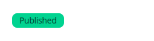

```svelte
<script lang='ts'>
  import { Badge } from '@h-ai/ui'
</script>

<Badge variant='success'>Published</Badge>
```

<a id="component-barebutton"></a>

#### BareButton

標準ボタンの操作を使い、見た目を class で指定します。type の既定値は button で、フォーム送信には submit を指定します。


```svelte
<script lang='ts'>
  import { BareButton } from '@h-ai/ui'

  let expanded = $state(false)
</script>

<BareButton class='font-medium text-primary underline' onclick={() => { expanded = !expanded }}>
  {expanded ? 'Hide details' : 'Show details'}
</BareButton>
```

<a id="component-bareinput"></a>

#### BareInput

標準入力欄の見た目を自分で指定します。label を id に対応させ、bind:value で本文を読み取ります。

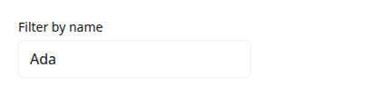

```svelte
<script lang='ts'>
  import { BareInput } from '@h-ai/ui'

  let filter = $state('Ada')
</script>

<label for='filter' class='mb-1 block text-sm'>Filter by name</label>
<BareInput id='filter' class='rounded-md border border-base-300 px-3 py-2' bind:value={filter} />
```

<a id="component-button"></a>

#### Button

操作を実行するボタンです。通常のクリックは onclick で扱い、フォーム送信には type=submit を指定します。loading で処理中を表示します。


```svelte
<script lang='ts'>
  import { Button } from '@h-ai/ui'

  let saved = $state(false)
</script>

<Button variant='primary' onclick={() => { saved = true }}>{saved ? 'Saved' : 'Save changes'}</Button>
```

<a id="component-checkbox"></a>

#### Checkbox

独立した選択状態を表示します。bind:checked で状態を保持し、部分的な選択には indeterminate を使います。

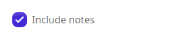

```svelte
<script lang='ts'>
  import { Checkbox } from '@h-ai/ui'

  let includeNotes = $state(true)
</script>

<Checkbox bind:checked={includeNotes} label='Include notes' />
```

<a id="component-iconbutton"></a>

#### IconButton

アイコンだけで操作を表示します。アイコンを子要素で渡し、label でアクセシブルな名前を指定します。必要に応じて tooltip を追加します。


```svelte
<script lang='ts'>
  import { IconButton } from '@h-ai/ui'
</script>

<IconButton label='Refresh' tooltip='Refresh' variant='primary'>
  <span class='icon-[tabler--refresh] size-5' aria-hidden='true'></span>
</IconButton>
```

<a id="component-input"></a>

#### Input

1行の文字を入力します。value をバインドし、id と label を対応させます。type で標準の入力制約を指定できます。

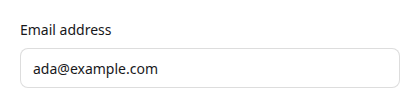

```svelte
<script lang='ts'>
  import { Input } from '@h-ai/ui'

  let email = $state('ada@example.com')
</script>

<label for='email' class='mb-1 block text-sm'>Email address</label>
<Input id='email' type='email' name='email' bind:value={email} required />
```

<a id="component-progress"></a>

#### Progress

作業の進捗を表示します。value は max に対する値で、showLabel を指定すると割合を表示します。

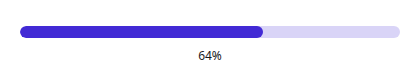

```svelte
<script lang='ts'>
  import { Progress } from '@h-ai/ui'
</script>

<Progress value={16} max={25} showLabel variant='primary' class='w-full' />
```

<a id="component-radio"></a>

#### Radio

一覧から1件を選択します。options に value と label を設定し、bind:value で選択値を取得します。

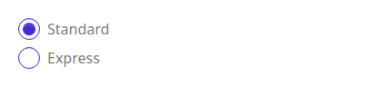

```svelte
<script lang='ts'>
  import { Radio } from '@h-ai/ui'

  let delivery = $state('standard')
</script>

<Radio name='delivery' options={[{ value: 'standard', label: 'Standard' }, { value: 'express', label: 'Express' }]} bind:value={delivery} />
```

<a id="component-range"></a>

#### Range

指定範囲の数値をスライダーで選びます。min、max、step と value を指定します。同名のブラウザー API と区別するため Range を明示的にインポートします。

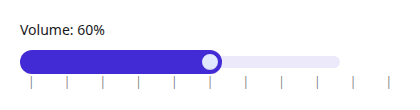

```svelte
<script lang='ts'>
  import { Range } from '@h-ai/ui'

  let volume = $state(60)
</script>

<p class='mb-2 text-sm'>Volume: {volume}%</p>
<Range min={0} max={100} step={10} bind:value={volume} showSteps variant='primary' />
```

<a id="component-rating"></a>

#### Rating

星で評価を表示、入力します。value をバインドして選択値を受け取り、参照専用の表示には readonly を使います。


```svelte
<script lang='ts'>
  import { Rating } from '@h-ai/ui'

  let rating = $state(4)
</script>

<Rating bind:value={rating} max={5} />
```

<a id="component-select"></a>

#### Select

ドロップダウンから1件を選択します。options を渡し、filterable で文字入力による絞り込みを有効にします。矢印キーと Enter で選択できます。

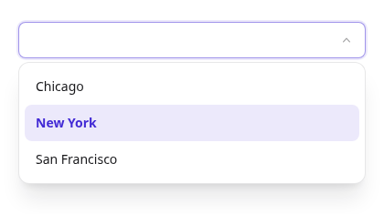

```svelte
<script lang='ts'>
  import { Select } from '@h-ai/ui'

  let office = $state('ny')
</script>

<Select options={[{ value: 'ch' , label: 'Chicago' }, { value: 'ny', label: 'New York' }, { value: 'sf', label: 'San Francisco' }]} bind:value={office} filterable />
```

<a id="component-spinner"></a>

#### Spinner

処理中に動作インジケーターを表示します。近くのステータス領域に短い説明を置き、処理完了時に取り除きます。


```svelte
<script lang='ts'>
  import { Spinner } from '@h-ai/ui'
</script>

<div role='status' class='flex items-center gap-3 text-sm'>
  <Spinner size='md' variant='primary' />
  Loading records…
</div>
```

<a id="component-switch"></a>

#### Switch

すぐに反映する真偽値の設定を表示、変更します。bind:checked で現在値を保持します。


```svelte
<script lang='ts'>
  import { Switch } from '@h-ai/ui'

  let notifications = $state(true)
</script>

<Switch bind:checked={notifications} label='Desktop notifications' />
```

<a id="component-tag"></a>

#### Tag

カテゴリーや取り除ける絞り込み条件を表示します。closable で削除ボタンを表示し、onclose でホストの状態を更新します。

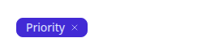

```svelte
<script lang='ts'>
  import { Tag } from '@h-ai/ui'

  let tagged = $state(true)
</script>

{#if tagged}
  <Tag text='Priority' variant='primary' closable onclose={() => { tagged = false }} />
{/if}
```

<a id="component-textarea"></a>

#### Textarea

複数行の文を入力します。rows で初期行数を指定し、autoResize で内容に応じて高さを調整します。

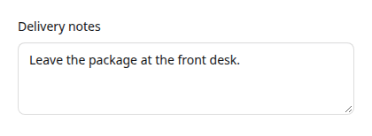

```svelte
<script lang='ts'>
  import { Textarea } from '@h-ai/ui'

  let note = $state('Leave the package at the front desk.')
</script>

<label for='notes' class='mb-1 block text-sm'>Delivery notes</label>
<Textarea id='notes' rows={3} bind:value={note} autoResize />
```

<a id="component-togglecheckbox"></a>

#### ToggleCheckbox

独自レイアウトに標準チェックボックスを配置します。label を id に対応させ、checked をバインドします。

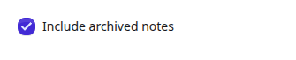

```svelte
<script lang='ts'>
  import { ToggleCheckbox } from '@h-ai/ui'

  let checked = $state(true)
</script>

<label for='notes-toggle' class='flex items-center gap-2 text-sm'>
  <ToggleCheckbox id='notes-toggle' class='checkbox checkbox-primary checkbox-sm' bind:checked={checked} />
  Include archived notes
</label>
```

<a id="component-toggleinput"></a>

#### ToggleInput

独自の構造内で標準チェックボックスの状態を提供します。bind:checked を読み取り、周囲の表示を切り替えます。

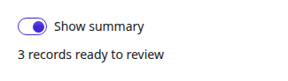

```svelte
<script lang='ts'>
  import { ToggleInput } from '@h-ai/ui'

  let expanded = $state(true)
</script>

<label for='summary-toggle' class='flex items-center gap-2 text-sm'>
  <ToggleInput id='summary-toggle' class='toggle toggle-primary toggle-sm' bind:checked={expanded} />
  Show summary
</label>
{#if expanded}<p class='mt-3 text-sm'>3 records ready to review</p>{/if}
```

<a id="component-toggleradio"></a>

#### ToggleRadio

独自レイアウトに標準ラジオ入力を配置します。同じグループでは name を共有し、それぞれにラベルを付けます。

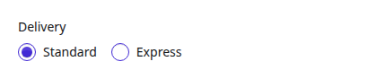

```svelte
<script lang='ts'>
  import { ToggleRadio } from '@h-ai/ui'
</script>

<fieldset class='flex items-center gap-4 text-sm'>
  <legend class='mb-2'>Delivery</legend>
  <label class='flex items-center gap-2'><ToggleRadio name='service' class='radio radio-primary radio-sm' checked /> Standard</label>
  <label class='flex items-center gap-2'><ToggleRadio name='service' class='radio radio-primary radio-sm' /> Express</label>
</fieldset>
```


<a id="components-forms"></a>

### フォーム・日付・スケジュール

[Calendar](#component-calendar) · [Combobox](#component-combobox) · [CronExpressionBuilder](#component-cronexpressionbuilder) · [DatePicker](#component-datepicker) · [Form](#component-form) · [FormField](#component-formfield) · [FormLayout](#component-formlayout) · [ScheduleInput](#component-scheduleinput) · [TagInput](#component-taginput)

<a id="component-calendar"></a>

#### Calendar

選択可能な月間カレンダーを表示し、`minValue` で最短の配送日を指定します。日付は `@internationalized/date` で作成し、選択すると `delivery` が更新されます。

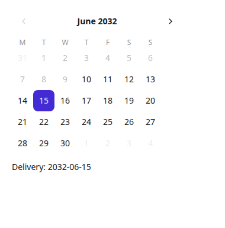

```svelte
<script lang='ts'>
  import { Calendar } from '@h-ai/ui'
  import type { DateValue } from '@internationalized/date'
  import { CalendarDate } from '@internationalized/date'

  let delivery = $state<DateValue | undefined>(new CalendarDate(2032, 6, 15))
  const earliest = new CalendarDate(2032, 6, 10)
</script>

<Calendar bind:value={delivery} minValue={earliest} class='max-w-72' />
<p class='mt-3 text-sm'>Delivery: {delivery?.toString() ?? 'Choose a date'}</p>
```

<a id="component-combobox"></a>

#### Combobox

候補を検索して選択します。`multiple` を有効にすると、選択した配送業者の ID 配列が `carriers` に入ります。

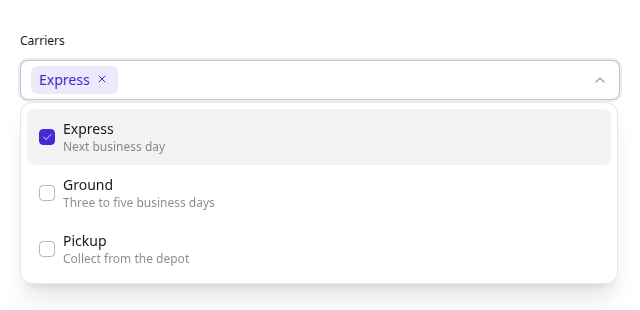

```svelte
<script lang='ts'>
  import { Combobox } from '@h-ai/ui'

  const options = [
    { value: 'express', label: 'Express', description: 'Next business day' },
    { value: 'ground', label: 'Ground', description: 'Three to five business days' },
    { value: 'pickup', label: 'Pickup', description: 'Collect from the depot' },
  ]
  let carriers = $state<string[]>(['express'])
</script>

<Combobox {options} multiple bind:value={carriers}
  label='Carriers' placeholder='Find a carrier' data-testid='demo-combobox' />
```

<a id="component-cronexpressionbuilder"></a>

#### CronExpressionBuilder

モードパネルまたはテキストで定期実行を設定します。入力欄をフォーカスしてプリセットを選ぶと、対応する Cron 文字列が `expression` に入ります。

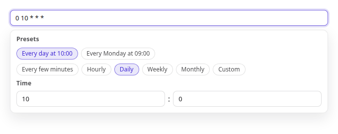

```svelte
<script lang='ts'>
  import { CronExpressionBuilder } from '@h-ai/ui'

  let expression = $state('0 10 * * *')
  const presets = [
    { label: 'Every day at 10:00', expression: '0 10 * * *' },
    { label: 'Every Monday at 09:00', expression: '0 9 * * 1' },
  ]
</script>

<CronExpressionBuilder bind:value={expression} presets={presets} />
```

<a id="component-datepicker"></a>

#### DatePicker

フォームで日付を選びます。`@internationalized/date` の日付値を使い、ポップアップカレンダーで日付を選ぶと `delivery` が更新されます。

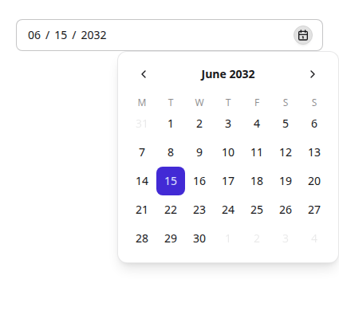

```svelte
<script lang='ts'>
  import { DatePicker } from '@h-ai/ui'
  import type { DateValue } from '@internationalized/date'
  import { CalendarDate } from '@internationalized/date'

  let delivery = $state<DateValue | undefined>(new CalendarDate(2032, 6, 15))
</script>

<DatePicker bind:value={delivery} ariaLabel='Delivery date' data-testid='demo-date-picker' />
```

<a id="component-form"></a>

#### Form

フォームの入力欄をまとめ、`name` のある値を収集します。ブラウザーの検証を通過すると、`onsubmit` が名前を受け取ります。

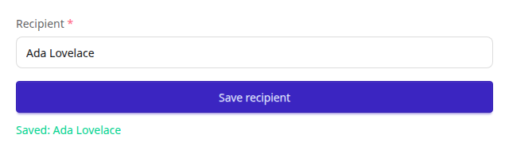

```svelte
<script lang='ts'>
  import { Form, Button, FormField, Input } from '@h-ai/ui'

  let saved = $state('')
</script>

<Form onsubmit={data => { saved = String(data.recipient) }}>
  <FormField label='Recipient' required>
    <Input name='recipient' value='Ada Lovelace' required />
  </FormField>
  <Button type='submit' variant='primary'>Save recipient</Button>
</Form>
{#if saved}<p class='mt-3 text-sm text-success'>Saved: {saved}</p>{/if}
```

<a id="component-formfield"></a>

#### FormField

入力欄に関連付けられたラベルと補足を付けます。フィールドの `required` は必須マークを表示し、`Input` の `required` はブラウザーの検証を有効にします。

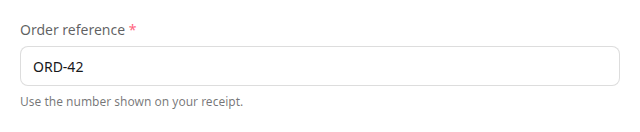

```svelte
<script lang='ts'>
  import { FormField, Input } from '@h-ai/ui'
</script>

<FormField label='Order reference' hint='Use the number shown on your receipt.' required>
  <Input name='reference' value='ORD-42' required />
</FormField>
```

<a id="component-formlayout"></a>

#### FormLayout

広いコンテナーでは入力欄を 2 列に、狭いコンテナーでは 1 列に並べます。各フィールドはそれぞれの `name` で識別されます。

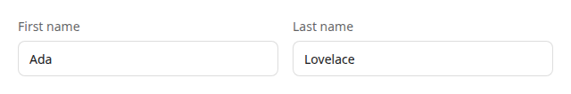

```svelte
<script lang='ts'>
  import { FormLayout, FormField, Input } from '@h-ai/ui'
</script>

<FormLayout columns={2}>
  <FormField label='First name'><Input name='given' value='Ada' /></FormField>
  <FormField label='Last name'><Input name='family' value='Lovelace' /></FormField>
</FormLayout>
```

<a id="component-scheduleinput"></a>

#### ScheduleInput

タスクの実行日時を入力します。既定のタイムゾーンは北京時間で、将来の日時を選ぶとオフセット付きの分精度の文字列が得られ、`valid` が送信可否を示します。

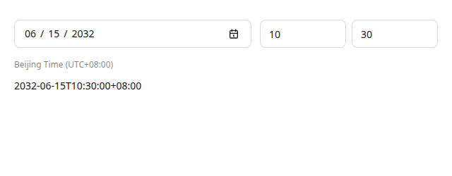

```svelte
<script lang='ts'>
  import { ScheduleInput } from '@h-ai/ui'

  let schedule = $state('2032-06-15T10:30:00+08:00')
  let valid = $state(false)
</script>

<ScheduleInput name='dispatchAt' required bind:value={schedule} bind:valid />
<p class='mt-2 text-sm'>{valid ? schedule : 'Choose a future time'}</p>
```

<a id="component-taginput"></a>

#### TagInput

注文のタグを編集します。入力して Enter を押すと追加し、タグの削除ボタンを押すと取り除きます。操作は `tags` に反映されます。

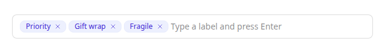

```svelte
<script lang='ts'>
  import { TagInput } from '@h-ai/ui'

  let tags = $state(['Priority', 'Gift wrap', 'Fragile'])
</script>

<TagInput bind:tags maxTags={5} placeholder='Type a label and press Enter' />
```


<a id="components-overlays"></a>

### オーバーレイ・メニュー・通知

[ActionSheet](#component-actionsheet) · [Alert](#component-alert) · [Confirm](#component-confirm) · [Drawer](#component-drawer) · [Dropdown](#component-dropdown) · [MessageBoxContainer](#component-messageboxcontainer) · [MessageBoxDialog](#component-messageboxdialog) · [MessageContainer](#component-messagecontainer) · [Modal](#component-modal) · [Popover](#component-popover) · [ToastContainer](#component-toastcontainer) · [Tooltip](#component-tooltip)

<a id="component-actionsheet"></a>

#### ActionSheet

スマートフォンの画面下部に注文の操作を表示します。項目を押すと `onselect` が ID を受け取り、親が `onclose` で `open` を `false` にします。

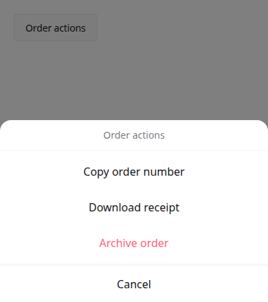

```svelte
<script lang='ts'>
  import { ActionSheet, Button } from '@h-ai/ui'

  let open = $state(false)
  let selected = $state('')
  const items = [
    { id: 'copy', label: 'Copy order number' },
    { id: 'receipt', label: 'Download receipt' },
    { id: 'archive', label: 'Archive order', destructive: true },
  ]
</script>

<Button onclick={() => open = true}>Order actions</Button>
<ActionSheet {open} title='Order actions' {items}
  onselect={id => selected = id} onclose={() => open = false} />
{#if selected}<p>Selected action: {selected}</p>{/if}
```

<a id="component-alert"></a>

#### Alert

関連する内容の近くに案内や成功メッセージを表示します。`variant='success'` で支払いの完了を示し、`dismissible` で閉じられるようにします。

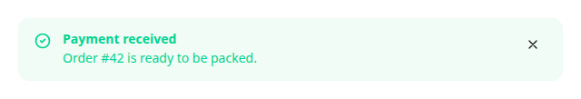

```svelte
<script lang='ts'>
  import { Alert } from '@h-ai/ui'
</script>

<Alert variant='success' title='Payment received' dismissible>Order #42 is ready to be packed.</Alert>
```

<a id="component-confirm"></a>

#### Confirm

破壊的な操作の前に確認を求めます。コールバックが `false` を返すとダイアログが開いたままになり、成功すると閉じます。

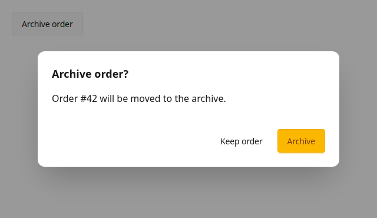

```svelte
<script lang='ts'>
  import { Confirm, Button } from '@h-ai/ui'

  let open = $state(false)
  let archived = $state(false)
</script>

<Button onclick={() => open = true}>Archive order</Button>
<Confirm bind:open title='Archive order?' message='Order #42 will be moved to the archive.'
  variant='warning' confirmText='Archive' cancelText='Keep order'
  onconfirm={() => { archived = true }} />
{#if archived}<p>Order #42 is archived.</p>{/if}
```

<a id="component-drawer"></a>

#### Drawer

一覧の横に注文の詳細を表示します。`open` をバインドして表示を制御し、`position='right'` で右側から開きます。

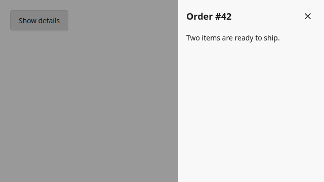

```svelte
<script lang='ts'>
  import { Drawer, Button } from '@h-ai/ui'

  let open = $state(false)
</script>

<Button onclick={() => open = true}>Show details</Button>
<Drawer bind:open position='right' title='Order #42' width='18rem'>
  <p>Two items are ready to ship.</p>
</Drawer>
```

<a id="component-dropdown"></a>

#### Dropdown

副次的な操作をメニューにまとめます。メニューを開いて操作を選ぶと、`onselect` が項目の `key` を受け取ります。

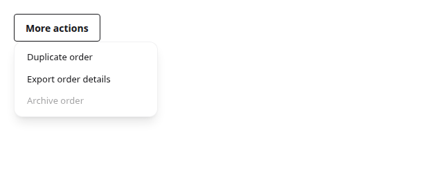

```svelte
<script lang='ts'>
  import { Dropdown } from '@h-ai/ui'

  const items = [
    { key: 'duplicate', label: 'Duplicate order' },
    { key: 'export', label: 'Export order details' },
    { key: 'archive', label: 'Archive order', disabled: true },
  ]
  let action = $state('')
</script>

<Dropdown {items} triggerClass='btn btn-outline' data-testid='demo-dropdown'
  onselect={key => action = key}>More actions</Dropdown>
{#if action}<p>Selected: {action}</p>{/if}
```

<a id="component-messageboxcontainer"></a>

#### MessageBoxContainer

アプリのレイアウトに 1 回配置すると、`ui.messageBox.confirm` が作成したダイアログが表示されます。戻り値の真偽値で確認と取り消しを区別できます。

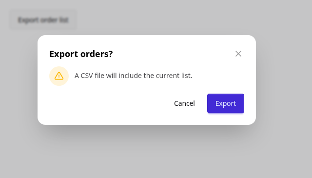

```svelte
<script lang='ts'>
  import { MessageBoxContainer, Button, ui } from '@h-ai/ui'

  let accepted = $state(false)
  async function confirmExport() {
    accepted = await ui.messageBox.confirm({
      title: 'Export orders?',
      message: 'A CSV file will include the current list.',
      confirmText: 'Export',
      cancelText: 'Cancel',
    })
  }
</script>

<MessageBoxContainer />
<Button onclick={confirmExport}>Export order list</Button>
{#if accepted}<p>Export confirmed.</p>{/if}
```

<a id="component-messageboxdialog"></a>

#### MessageBoxDialog

独自の表示領域で命令型ダイアログを 1 件描画します。`ui.messageBox.alert` で項目を作り、キューの `item` を対象のコンポーネントに渡します。

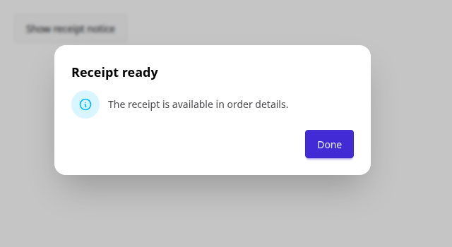

```svelte
<script lang='ts'>
  import { MessageBoxDialog, Button, ui } from '@h-ai/ui'

  const item = $derived(ui.messageBox.items[0])
  function showReceipt() {
    void ui.messageBox.alert({
      title: 'Receipt ready',
      message: 'The receipt is available in order details.',
      confirmText: 'Done',
      showClose: false,
    })
  }
</script>

<Button onclick={showReceipt}>Show receipt notice</Button>
{#if item}
  <MessageBoxDialog {item} />
{/if}
```

<a id="component-messagecontainer"></a>

#### MessageContainer

`ui.message` の表示先を用意します。アプリのレイアウトに 1 回配置し、注文の操作から短いメッセージを送信します。

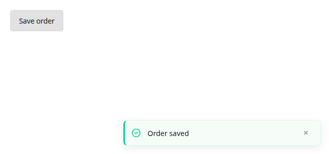

```svelte
<script lang='ts'>
  import { MessageContainer, Button, ui } from '@h-ai/ui'
</script>

<MessageContainer />
<Button onclick={() => ui.message.success('Order saved', 3500)}>Save order</Button>
```

<a id="component-modal"></a>

#### Modal

現在のページの上に詳細ダイアログを開きます。`bind:open` で状態を同期し、閉じるボタンでバインド値が `false` になります。

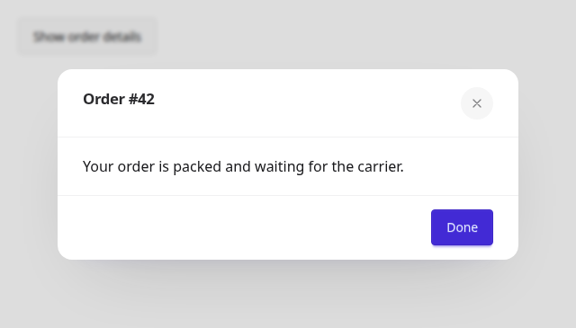

```svelte
<script lang='ts'>
  import { Modal, Button } from '@h-ai/ui'

  let open = $state(false)
</script>

<Button onclick={() => open = true}>Show order details</Button>
<Modal bind:open title='Order #42' size='sm'>
  <p>Your order is packed and waiting for the carrier.</p>
  {#snippet footer()}
    <Button variant='primary' onclick={() => open = false}>Done</Button>
  {/snippet}
</Modal>
```

<a id="component-popover"></a>

#### Popover

トリガーの近くに短い補足を表示します。ボタンを押して開き、Escape で閉じるとフォーカスがトリガーに戻ります。

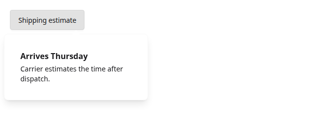

```svelte
<script lang='ts'>
  import { Popover, Button } from '@h-ai/ui'
</script>

<Popover position='bottom' trigger='click'>
  {#snippet triggerContent()}
    <Button data-testid='demo-popover-trigger'>Shipping estimate</Button>
  {/snippet}
  <div class='w-64 p-4'>
    <strong>Arrives Thursday</strong>
    <p class='mt-1 text-sm'>Carrier estimates the time after dispatch.</p>
  </div>
</Popover>
```

<a id="component-toastcontainer"></a>

#### ToastContainer

ルートレイアウトに 1 回配置し、`ui.toast` のキューに入った通知を表示します。保存の完了後に成功メッセージを出すと、本文の上に重なって表示されます。

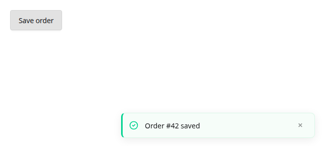

```svelte
<script lang='ts'>
  import { ToastContainer, Button, ui } from '@h-ai/ui'
</script>

<ToastContainer />
<Button onclick={() => ui.toast.success('Order #42 saved', 3500)}>Save order</Button>
```

<a id="component-tooltip"></a>

#### Tooltip

ボタンに短い補足を付け、ホバーまたはキーボードフォーカスで表示します。スクロール領域で表示が切れる場合は `portal` を指定します。

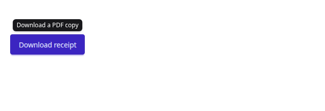

```svelte
<script lang='ts'>
  import { Tooltip, Button } from '@h-ai/ui'
</script>

<div class='pt-12'>
  <Tooltip content='Download a PDF copy' position='top' portal data-testid='demo-tooltip'>
    <Button variant='primary'>Download receipt</Button>
  </Tooltip>
</div>
```


<a id="components-lists"></a>

### 一覧・ナビゲーション・状態表示

[Accordion](#component-accordion) · [Breadcrumb](#component-breadcrumb) · [Card](#component-card) · [DataTable](#component-datatable) · [Empty](#component-empty) · [FilterBar](#component-filterbar) · [JsonViewer](#component-jsonviewer) · [PageHeader](#component-pageheader) · [Pagination](#component-pagination) · [Result](#component-result) · [Skeleton](#component-skeleton) · [Steps](#component-steps) · [TableToolbar](#component-tabletoolbar) · [Tabs](#component-tabs) · [Timeline](#component-timeline)

<a id="component-accordion"></a>

#### Accordion

配送案内と返品案内を折りたたみ可能な項目に分けます。見出しを押すと、展開した項目の ID が `value` に入ります。

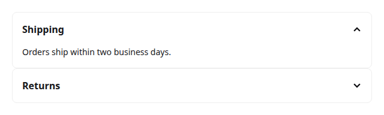

```svelte
<script lang='ts'>
  import { Accordion } from '@h-ai/ui'

  const items = [
    { id: 'shipping', title: 'Shipping', content: 'Orders ship within two business days.' },
    { id: 'returns', title: 'Returns', content: 'You can return unused items within 30 days.' },
  ]
  let value = $state<string | string[]>('shipping')
</script>

<Accordion {items} bind:value variant='bordered' />
```

<a id="component-breadcrumb"></a>

#### Breadcrumb

注文ページの場所を階層で示します。`href` のある上位項目をリンクにし、末尾に現在のページを表示します。


```svelte
<script lang='ts'>
  import { Breadcrumb } from '@h-ai/ui'
</script>

<Breadcrumb items={[
  { label: 'Home', href: '/' },
  { label: 'Orders', href: '/orders' },
  { label: 'Order #42' },
]} />
```

<a id="component-card"></a>

#### Card

注文情報をカードにまとめます。`title` に見出し、本文に概要、フッターに詳細リンクを置きます。

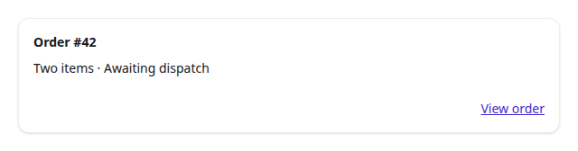

```svelte
<script lang='ts'>
  import { Card } from '@h-ai/ui'
</script>

<Card title='Order #42' bordered padding='md'>
  <p>Two items · Awaiting dispatch</p>
  {#snippet footer()}
    <a class='link link-primary' href='/orders/42'>View order</a>
  {/snippet}
</Card>
```

<a id="component-datatable"></a>

#### DataTable

レコードを列に分けて表示します。各行を一意の `id` で識別し、ソート可能な見出しを押すと渡したデータが並び替わります。

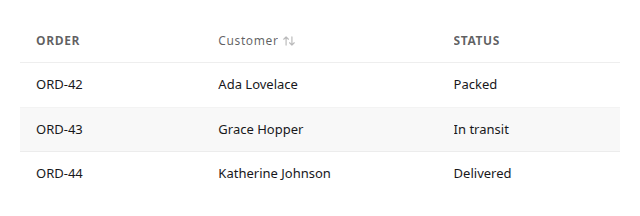

```svelte
<script lang='ts'>
  import { DataTable } from '@h-ai/ui'

  const data = [
    { id: 'ORD-42', customer: 'Ada Lovelace', status: 'Packed' },
    { id: 'ORD-43', customer: 'Grace Hopper', status: 'In transit' },
    { id: 'ORD-44', customer: 'Katherine Johnson', status: 'Delivered' },
  ]
  const columns = [
    { key: 'id', label: 'Order' },
    { key: 'customer', label: 'Customer', sortable: true },
    { key: 'status', label: 'Status' },
  ]
</script>

<DataTable {data} {columns} keyField='id' />
```

<a id="component-empty"></a>

#### Empty

注文が 0 件であることを伝え、`action` スニペットで最初の注文を作成する導線を置きます。

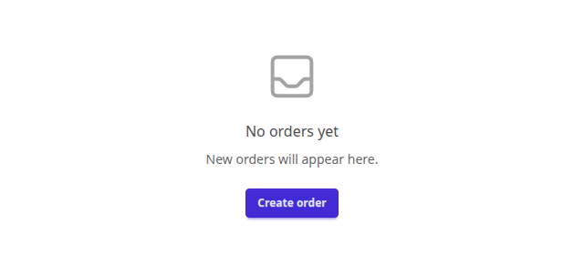

```svelte
<script lang='ts'>
  import { Empty } from '@h-ai/ui'
</script>

<Empty title='No orders yet' description='New orders will appear here.' icon='inbox'>
  {#snippet action()}
    <a class='btn btn-primary btn-sm' href='/orders/new'>Create order</a>
  {/snippet}
</Empty>
```

<a id="component-filterbar"></a>

#### FilterBar

検索を常に表示し、任意の絞り込み条件を開閉可能な領域に入れます。ステータスが設定されていると `activeCount` は 1 になり、リセットで解除されます。

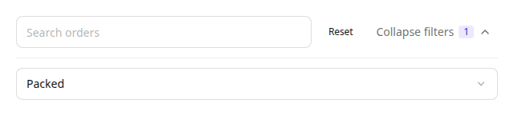

```svelte
<script lang='ts'>
  import { FilterBar, Input, Select } from '@h-ai/ui'

  let expanded = $state(true)
  let status = $state('packed')
  const statuses = [{ value: 'packed', label: 'Packed' }, { value: 'shipped', label: 'Shipped' }]
</script>

<FilterBar bind:expanded activeCount={status ? 1 : 0} onreset={() => status = ''}>
  {#snippet leading()}<Input placeholder='Search orders' />{/snippet}
  <Select options={statuses} bind:value={status} />
</FilterBar>
```

<a id="component-jsonviewer"></a>

#### JsonViewer

構造化データを展開できるツリーで確認します。初期深さを 2 にすると注文の内訳が見え、コピーボタンで JSON 全体をコピーできます。

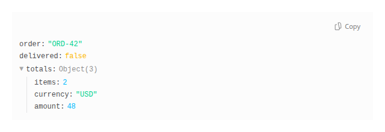

```svelte
<script lang='ts'>
  import { JsonViewer } from '@h-ai/ui'
</script>

<JsonViewer defaultExpandedDepth={2} value={{
  order: 'ORD-42',
  delivered: false,
  totals: { items: 2, currency: 'USD', amount: 48 },
}} />
```

<a id="component-pageheader"></a>

#### PageHeader

一覧ページにタイトルと説明を表示し、注文を作成するリンクを `actions` スニペットに置きます。

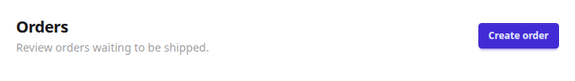

```svelte
<script lang='ts'>
  import { PageHeader } from '@h-ai/ui'
</script>

<PageHeader title='Orders' description='Review orders waiting to be shipped.'>
  {#snippet actions()}
    <a class='btn btn-primary btn-sm' href='/orders/new'>Create order</a>
  {/snippet}
</PageHeader>
```

<a id="component-pagination"></a>

#### Pagination

総件数と 1 ページあたりの件数からページを計算します。次へ進むか移動先を指定すると、取得対象の 1 始まりの `page` が更新されます。

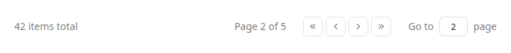

```svelte
<script lang='ts'>
  import { Pagination } from '@h-ai/ui'

  let page = $state(2)
</script>

<Pagination bind:page total={42} pageSize={10} showJumper />
```

<a id="component-result"></a>

#### Result

送信が完了したことと次の手順を示します。`status='success'` で成功アイコンを表示し、`actions` スニペットに戻るリンクを置きます。

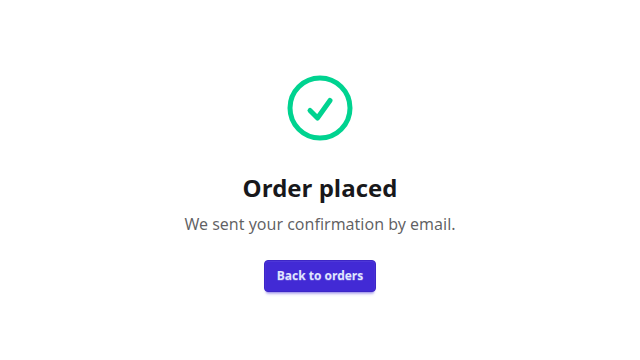

```svelte
<script lang='ts'>
  import { Result } from '@h-ai/ui'
</script>

<Result status='success' title='Order placed' description='We sent your confirmation by email.'>
  {#snippet actions()}
    <a class='btn btn-primary btn-sm' href='/orders'>Back to orders</a>
  {/snippet}
</Result>
```

<a id="component-skeleton"></a>

#### Skeleton

注文概要の読み込み中に見出しと本文の領域を確保します。データを受け取ったら、親がスケルトンを実際の内容に差し替えます。

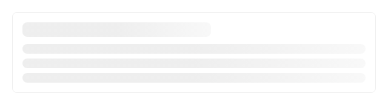

```svelte
<script lang='ts'>
  import { Skeleton } from '@h-ai/ui'
</script>

<div class='space-y-3 rounded-lg border border-base-300 p-4'
  role='status' aria-label='Loading order summary'>
  <Skeleton variant='title' width='55%' />
  <Skeleton variant='text' count={3} />
</div>
```

<a id="component-steps"></a>

#### Steps

購入手続きの進み具合を示します。`current=1` は 2 番目の手順を示し、他の手順を押すと `onchange` が 0 始まりの番号を受け取ります。

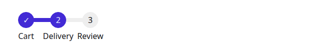

```svelte
<script lang='ts'>
  import { Steps } from '@h-ai/ui'

  let current = $state(1)
  const items = [{ title: 'Cart' }, { title: 'Delivery' }, { title: 'Review' }]
</script>

<Steps {items} {current} clickable onchange={index => current = index} />
```

<a id="component-tabletoolbar"></a>

#### TableToolbar

表の検索と開閉可能な絞り込みをまとめます。`searchValue` の変更は下書きに反映され、Enter または検索ボタンを押すと `onsearch` が呼ばれます。

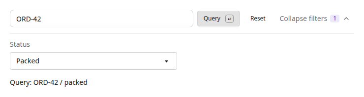

```svelte
<script lang='ts'>
  import { TableToolbar } from '@h-ai/ui'

  let searchValue = $state('ORD-42')
  let filterValues = $state<Record<string, unknown>>({ status: 'packed' })
  let query = $state('')
  const filterFields = [{
    id: 'status', label: 'Status', type: 'select',
    options: [{ value: 'packed', label: 'Packed' }, { value: 'shipped', label: 'Shipped' }],
  }]
  function submitQuery(text: string) {
    query = `${text} / ${String(filterValues.status ?? 'all')}`
  }
</script>

<TableToolbar bind:searchValue bind:filterValues expanded
  searchPlaceholder='Search orders' searchLabel='Search'
  {filterFields} onsearch={submitQuery} />
{#if query}<p class='mt-3 text-sm'>Query: {query}</p>{/if}
```

<a id="component-tabs"></a>

#### Tabs

注文の詳細と配送情報をタブに分けます。タブを選ぶと `active` が更新され、コンテンツスニペットが対応する内容を表示します。

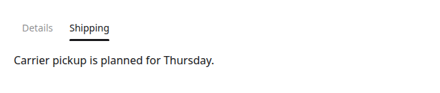

```svelte
<script lang='ts'>
  import { Tabs } from '@h-ai/ui'

  let active = $state('shipping')
  const items = [{ key: 'details', label: 'Details' }, { key: 'shipping', label: 'Shipping' }]
</script>

<Tabs {items} bind:active type='line'>
  {#snippet children({ active: current })}
    {#if current === 'details'}
      <p>Order #42 · Two items</p>
    {:else}
      <p>Carrier pickup is planned for Thursday.</p>
    {/if}
  {/snippet}
</Tabs>
```

<a id="component-timeline"></a>

#### Timeline

注文の出来事を順番に表示します。`completed` で完了した項目を示し、未完了の項目には次の予定を記載できます。

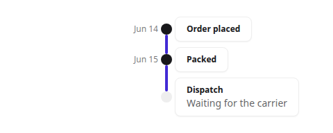

```svelte
<script lang='ts'>
  import { Timeline } from '@h-ai/ui'
</script>

<Timeline items={[
  { id: 'placed', title: 'Order placed', time: 'Jun 14', completed: true },
  { id: 'packed', title: 'Packed', time: 'Jun 15', completed: true },
  { id: 'dispatch', title: 'Dispatch', description: 'Waiting for the carrier' },
]} boxed />
```


<a id="components-mobile"></a>

### モバイル操作

[AppBar](#component-appbar) · [BottomNav](#component-bottomnav) · [InfiniteScroll](#component-infinitescroll) · [PullRefresh](#component-pullrefresh) · [SafeArea](#component-safearea) · [SwipeCell](#component-swipecell)

<a id="component-appbar"></a>

#### AppBar

スマートフォン画面の上部にタイトルと戻るリンクを配置します。`leading` スニペットにリンクを置き、`fixed={false}` で通常のページフローに入れます。

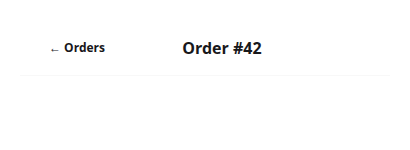

```svelte
<script lang='ts'>
  import { AppBar } from '@h-ai/ui'
</script>

<AppBar title='Order #42' fixed={false}>
  {#snippet leading()}
    <a class='btn btn-ghost btn-sm' href='/orders'>← Orders</a>
  {/snippet}
</AppBar>
```

<a id="component-bottomnav"></a>

#### BottomNav

スマートフォン画面の下部にナビゲーションを固定し、`active` で現在の項目を示します。`onchange` から選択した ID を受け取ります。


```svelte
<script lang='ts'>
  import { BottomNav } from '@h-ai/ui'

  let active = $state('orders')
  const items = [
    { id: 'home', label: 'Home', iconClass: 'icon-[tabler--home]' },
    { id: 'orders', label: 'Orders', iconClass: 'icon-[tabler--shopping-bag]', badge: 2 },
    { id: 'account', label: 'Account', iconClass: 'icon-[tabler--user]' },
  ]
</script>

<p class='text-lg font-semibold'>You are in {active}.</p>
<BottomNav {items} {active} onchange={id => active = id} />
```

<a id="component-infinitescroll"></a>

#### InfiniteScroll

ページまたはリストを末尾近くまでスクロールすると追加で読み込みます。この例ではメモリー上の注文を 1 件追加し、`hasMore` を `false` にして全件表示を知らせます。


```svelte
<script lang='ts'>
  import { InfiniteScroll } from '@h-ai/ui'

  let orders = $state([41, 42, 43, 44, 45])
  let hasMore = $state(true)
  async function loadMore() {
    orders = [...orders, 46]
    hasMore = false
  }
</script>

<InfiniteScroll {hasMore} onloadmore={loadMore} noMoreText='All orders loaded'
  class='h-40 rounded-lg border border-base-300 px-3' data-testid='orders-scroll'>
  {#each orders as order (order)}
    <p class='border-b border-base-200 py-3'>Order #{order}</p>
  {/each}
</InfiniteScroll>
```

<a id="component-pullrefresh"></a>

#### PullRefresh

しきい値まで下に引いて指を離すと、非同期の `onrefresh` を実行します。この例ではメモリー上の注文を差し替え、処理が終わると更新表示が閉じます。


```svelte
<script lang='ts'>
  import { PullRefresh } from '@h-ai/ui'

  let orders = $state([42, 41])
  async function refreshList() {
    orders = [43, 42, 41]
  }
</script>

<PullRefresh onrefresh={refreshList} data-testid='demo-refresh'>
  <div class='rounded-lg border border-base-300 p-4'>
    <strong>Recent orders</strong>
    {#each orders as order (order)}
      <p class='mt-2 text-sm'>Order #{order}</p>
    {/each}
  </div>
</PullRefresh>
```

<a id="component-safearea"></a>

#### SafeArea

画面の切り欠きやジェスチャー領域に内容が重ならないようにします。モバイル用 CSS を読み込み、`position='all'` で四辺の余白を適用します。プレビューでは余白を再現しています。


```svelte
<script lang='ts'>
  import { SafeArea } from '@h-ai/ui'
  import '@h-ai/ui/styles/mobile.css'
</script>

<SafeArea position='all' class='bg-base-200'>
  <div class='rounded-lg bg-base-100 p-4'>
    <strong>Order #42</strong>
    <p class='mt-1 text-sm'>Ready to ship</p>
  </div>
</SafeArea>
```

<a id="component-swipecell"></a>

#### SwipeCell

タッチ端末で注文行を左にスワイプすると、右側に操作が表示されます。アーカイブを押すと `onaction` が `archive` を受け取り、操作領域が閉じます。


```svelte
<script lang='ts'>
  import { SwipeCell } from '@h-ai/ui'

  let action = $state('')
  const actions = [{ id: 'archive', label: 'Archive', variant: 'warning' as const, width: 96 }]
</script>

<SwipeCell {actions} onaction={id => action = id} data-testid='demo-swipe'
  class='rounded-lg border border-base-300'>
  <div class='flex items-center gap-4 bg-base-100 p-4'>
    <span class='grid w-20 shrink-0 place-items-center' aria-hidden='true'>
      <span class='icon-[tabler--box] size-6'></span>
    </span>
    <div>
      <strong>Order #42</strong>
      <p class='text-sm'>Ready for dispatch</p>
    </div>
  </div>
</SwipeCell>
{#if action}<p class='mt-3'>Selected: {action}</p>{/if}
```


<a id="components-layouts"></a>

### テーマ・言語・ワークスペース

[LanguageSwitch](#component-languageswitch) · [SettingsLayout](#component-settingslayout) · [SettingsModal](#component-settingsmodal) · [ThemeColorPicker](#component-themecolorpicker) · [ThemeSelector](#component-themeselector) · [ThemeToggle](#component-themetoggle) · [WorkspaceLayout](#component-workspacelayout)

<a id="component-languageswitch"></a>

#### LanguageSwitch

ツールバーにアプリの言語候補を表示します。ホストが `locale` を渡し、`setLocale` でアプリの言語状態を更新します。


```svelte
<LanguageSwitch currentLanguage={locale} onchange={setLocale} />
```

<a id="component-settingslayout"></a>

#### SettingsLayout

設定ページにタイトル、項目ナビゲーション、本文を配置します。ホストの `sections` を渡し、`setSection` で `activeSection` を更新して対応する設定を表示します。


```svelte
<SettingsLayout title='Workspace settings' {sections} active={activeSection}
  onselect={setSection}>
  <p>{activeSection === 'profile' ? 'Edit your profile.' : 'Manage notifications.'}</p>
</SettingsLayout>
```

<a id="component-settingsmodal"></a>

#### SettingsModal

言語とテーマの設定を一つのダイアログにまとめます。ホストで管理する `settingsOpen` をバインドし、`setLocale` と `setTheme` で選択を反映します。


```svelte
<SettingsModal bind:open={settingsOpen} currentLanguage={locale} currentTheme={theme}
  themes={[{ value: 'light', label: 'Light' }, { value: 'dark', label: 'Dark' }]}
  onlanguagechange={setLocale} onthemechange={setTheme} />
```

<a id="component-themecolorpicker"></a>

#### ThemeColorPicker

プリセットまたはカスタムカラーを選択できます。現在の Hex 値を `accent` に保持し、`setAccent` が受け取った正規化済みの色をホストで適用します。


```svelte
<ThemeColorPicker value={accent} onchange={setAccent} />
```

<a id="component-themeselector"></a>

#### ThemeSelector

指定した組み込みテーマを色のプレビュー付きで選べます。ホストの現在の `theme` を渡し、選択された ID を `setTheme` で適用します。


```svelte
<ThemeSelector currentTheme={theme} themeIds={['light', 'dark', 'corporate']}
  showPreview onchange={setTheme} />
```

<a id="component-themetoggle"></a>

#### ThemeToggle

ツールバーでライトとダークを切り替えます。ホストの `theme` に応じて次の操作を表示し、`setTheme` で選択を適用します。


```svelte
<ThemeToggle currentTheme={theme} lightTheme='light' darkTheme='dark' onchange={setTheme} />
```

<a id="component-workspacelayout"></a>

#### WorkspaceLayout

高さを制限したコンテナで、タイトルと操作バーを表示したまま本文だけをスクロールできます。 `actions` と `footer` スニペットに操作と状態を配置します。


```svelte
<WorkspaceLayout title='Inventory'>
  {#snippet actions()}<button type='button'>Export</button>{/snippet}
  <p>Review stock totals by warehouse.</p>
  {#snippet footer()}Last updated today{/snippet}
</WorkspaceLayout>
```


<a id="components-auth"></a>

### 認証と権限

[AuthPanel](#component-authpanel) · [AuthShell](#component-authshell) · [ChangePasswordForm](#component-changepasswordform) · [ForgotPasswordForm](#component-forgotpasswordform) · [LoginForm](#component-loginform) · [PasswordInput](#component-passwordinput) · [PermGuard](#component-permguard) · [ReauthenticationDialog](#component-reauthenticationdialog) · [RegisterForm](#component-registerform) · [ResetPasswordForm](#component-resetpasswordform) · [SensitiveOperationsForm](#component-sensitiveoperationsform) · [SessionRecoveryDialog](#component-sessionrecoverydialog) · [UserProfile](#component-userprofile)

<a id="component-authpanel"></a>

#### AuthPanel

IAM の公開エンドポイントから取得した `publicConfig` と、Kit または API クライアントが作成した `actions` を使って、ログイン・登録・パスワード復旧を切り替えます。


```svelte
<AuthPanel config={publicConfig} {actions} initialMode='login' />
```

<a id="component-authshell"></a>

#### AuthShell

認証フォームをブランド付きの分割レイアウトまたは中央のカードに配置します。`submitLogin` はアプリが用意するログイン処理です。


```svelte
<AuthShell variant='split' brandTitle='Atlas' title='Sign in'>
  <LoginForm onsubmit={submitLogin} />
</AuthShell>
```

<a id="component-changepasswordform"></a>

#### ChangePasswordForm

現在のパスワード、新しいパスワード、確認入力を受け取り、アプリの `changePassword` で検証して保存します。


```svelte
<ChangePasswordForm requireOldPassword minPasswordLength={12}
  onsubmit={changePassword} />
```

<a id="component-forgotpasswordform"></a>

#### ForgotPasswordForm

メールアドレスまたは電話番号を入力し、アプリの `requestReset` にパスワード復旧の申請を渡します。


```svelte
<ForgotPasswordForm mode='email' showTitle onsubmit={requestReset} />
```

<a id="component-loginform"></a>

#### LoginForm

`methods` に対応するログイン欄を表示して入力をアプリの `submitLogin` に渡します。ワンタイムコードを使う場合は送信コールバックも指定します。


```svelte
<LoginForm methods={['password']} onsubmit={submitLogin} />
```

<a id="component-passwordinput"></a>

#### PasswordInput

表示切り替えや強度表示付きでパスワードを入力します。`password` はアプリで `$state` を使って作る値です。


```svelte
<PasswordInput bind:value={password} autocomplete='new-password'
  showToggle showStrength minLength={12} />
```

<a id="component-permguard"></a>

#### PermGuard

レイアウトが `ui.setPermissionContext` で渡した権限に応じて内容または `fallback` を表示します。認可はサーバー側でも行います。


```svelte
<PermGuard permission='reports:read'>
  {#snippet fallback()}<p>Report access is required.</p>{/snippet}
  <p>Quarterly report is available.</p>
</PermGuard>
```

<a id="component-reauthenticationdialog"></a>

#### ReauthenticationDialog

機密操作の前にアプリの `open` 状態でダイアログを開き、現在のパスワードを求めます。`verifyPassword` はサーバーでの再認証、`closeDialog` は閉じる処理です。


```svelte
<ReauthenticationDialog {open} onsubmit={verifyPassword} onclose={closeDialog} />
```

<a id="component-registerform"></a>

#### RegisterForm

`fields` に従って登録項目を入力し、パスワードの確認後にアプリの `submitRegistration` へ渡します。


```svelte
<RegisterForm fields={['username', 'email', 'password']}
  requireConfirmPassword onsubmit={submitRegistration} />
```

<a id="component-resetpasswordform"></a>

#### ResetPasswordForm

新しいパスワードと確認入力を受け取り、必要に応じてコードも表示します。アプリの `confirmReset` がトークンまたはコードを検証して再設定します。


```svelte
<ResetPasswordForm showCode minPasswordLength={12} onsubmit={confirmReset} />
```

<a id="component-sensitiveoperationsform"></a>

#### SensitiveOperationsForm

機密操作 ID を1行ずつ編集します。重複を除いた一覧をアプリの `savePolicy` に渡し、成功時だけ `closeEditor` を呼び出します。


```svelte
<SensitiveOperationsForm operations={['reports.publish', 'reports.delete']}
  onsubmit={savePolicy} ondone={closeEditor} />
```

<a id="component-sessionrecoverydialog"></a>

#### SessionRecoveryDialog

`ui.createSessionRecovery()` で作成して現在のユーザーを設定した `recovery` と、アプリの認証クライアントの `actions` を使い、元のアカウントでの再ログインを現在のページで求めます。


```svelte
<SessionRecoveryDialog {recovery} {actions} />
```

<a id="component-userprofile"></a>

#### UserProfile

アプリが取得した `account` のプロフィールを表示・編集し、`saveProfile` が `true` を返したときだけ編集を終了します。


```svelte
<UserProfile user={account} editable fields={['displayName', 'email', 'bio']}
  onsubmit={saveProfile} />
```


<a id="components-files"></a>

### ファイルと暗号化の結果

[AvatarUpload](#component-avatarupload) · [FileList](#component-filelist) · [FileUpload](#component-fileupload) · [ImageUpload](#component-imageupload) · [EncryptedInput](#component-encryptedinput) · [HashDisplay](#component-hashdisplay) · [SignatureDisplay](#component-signaturedisplay)

<a id="component-avatarupload"></a>

#### AvatarUpload

アバターを選んでプレビューします。`avatarUrl` をアプリ側でバインドし、`uploadAvatar` で保存した画像の `{ url }` を返します。


```svelte
<AvatarUpload bind:value={avatarUrl} fallback='AR' size='lg'
  uploadHandler={uploadAvatar} />
```

<a id="component-filelist"></a>

#### FileList

ファイルの一覧とプレビュー操作を表示します。例の URL はユーザーがアクセスを許可された PDF を指します。


```svelte
<FileList files={[{
  id: 'q3', name: 'Q3 report.pdf', size: 48200,
  type: 'application/pdf', url: '/reports/q3.pdf',
}]} showDownload={false} showDelete={false} />
```

<a id="component-fileupload"></a>

#### FileUpload

種類・容量・件数の上限に従ってファイルを選択します。`uploadReport` はアプリが用意し、ファイルと中断シグナルを受け取って結果を返します。


```svelte
<FileUpload accept='.csv' multiple maxFiles={3} maxSize={1048576}
  uploadHandler={uploadReport} />
```

<a id="component-imageupload"></a>

#### ImageUpload

画像を選んでプレビューします。アプリで `coverUrl` をバインドし、`uploadCover` が返す `{ url }` でローカル表示を置き換えます。


```svelte
<ImageUpload bind:value={coverUrl} accept='image/*' aspectRatio='16 / 9'
  width='320px' uploadHandler={uploadCover} />
```

<a id="component-encryptedinput"></a>

#### EncryptedInput

機密テキストを入力し、アプリの `encrypt` が返した暗号文を表示します。`text` と `ciphertext` をアプリの状態にバインドします。


```svelte
<EncryptedInput algorithm='SM4' bind:value={text}
  bind:encryptedValue={ciphertext} onencrypt={encrypt} showEncrypted />
```

<a id="component-hashdisplay"></a>

#### HashDisplay

アプリで計算済みの SM3 ダイジェスト `digest` を表示し、コピーできるようにします。


```svelte
<HashDisplay value={digest} algorithm='SM3' label='Report checksum'
  copyable truncate truncateLength={24} />
```

<a id="component-signaturedisplay"></a>

#### SignatureDisplay

アプリの署名・検証処理から受け取った `signature` と `verified` を使い、署名や公開鍵、検証結果を表示します。


```svelte
<SignatureDisplay {signature} {verified} algorithm='SM2' copyable />
```


<a id="components-business"></a>

### CRUD・グラフ・エラーページ

[CrudDeleteConfirm](#component-cruddeleteconfirm) · [CrudDetailPanel](#component-cruddetailpanel) · [CrudEditPanel](#component-crudeditpanel) · [CrudFilterBar](#component-crudfilterbar) · [CrudPage](#component-crudpage) · [Chart](#component-chart) · [DashboardGrid](#component-dashboardgrid) · [MetricCard](#component-metriccard) · [ReportCard](#component-reportcard) · [ErrorPage](#component-errorpage)

<a id="component-cruddeleteconfirm"></a>

#### CrudDeleteConfirm

削除する対象を確認します。アプリで `open` をバインドし、`removeRecord` に削除処理を渡します。`false` を返すとダイアログが開いたままになります。


```svelte
<CrudDeleteConfirm bind:open title='Delete draft?'
  message='This permanently deletes the draft.' onconfirm={removeRecord} />
```

<a id="component-cruddetailpanel"></a>

#### CrudDetailPanel

選択したレコード `report` を、リソース定義の `detailFields` に従って読み取り専用で表示します。


```svelte
<CrudDetailPanel open variant='modal' title='Report details'
  item={report} fields={detailFields} />
```

<a id="component-crudeditpanel"></a>

#### CrudEditPanel

リソース定義の `editFields` でフォームを表示し、アプリの下書き `draft` から書き込み可能な値を `saveReport` に渡します。


```svelte
<CrudEditPanel open variant='modal' mode='edit' title='Edit report'
  fields={editFields} bind:formData={draft} onsubmit={saveReport} />
```

<a id="component-crudfilterbar"></a>

#### CrudFilterBar

検索語とフィルターの下書きをまとめ、送信時にアプリの `runQuery` で検索語とバインドした `filters` を読み取ります。


```svelte
<CrudFilterBar bind:filterValues={filters}
  filterFields={[{ id: 'owner', label: 'Owner', type: 'text' }]}
  onsearch={runQuery} />
```

<a id="component-crudpage"></a>

#### CrudPage

`ui.defineCrud` で定義した `crud` から一覧、追加、編集、削除を表示します。検索とページ分割は `ui.createCrudController(crud)` で作成した `controller` が担当します。


```svelte
<CrudPage {crud} data={controller.data} nav={controller.nav}
  loading={controller.loading} loaded={controller.loaded}
  error={controller.error} onRetry={controller.reload} />
```

<a id="component-chart"></a>

#### Chart

`x` と `y` でデータの項目を座標に割り当てます。`monthlyOrders` にはアプリの `{ month, orders }` レコード配列を渡します。


```svelte
<Chart type='bar' title='Orders by month' data={monthlyOrders}
  x='month' y='orders' size='sm' />
```

<a id="component-dashboardgrid"></a>

#### DashboardGrid

指標カードやレポートカードをレスポンシブなグリッドに配置します。`columns` は広いコンテナの列数で、狭い場合は1列になります。


```svelte
<DashboardGrid label='Operations metrics' columns={3}>
  <MetricCard title='Orders' value={82} />
  <MetricCard title='Backlog' value={13} />
  <MetricCard title='On time' value='96%' />
</DashboardGrid>
```

<a id="component-metriccard"></a>

#### MetricCard

主要指標と変化率を表示します。`trend={12.8}` は `+12.8%` になり、色は業務上の意味に合わせて指定します。


```svelte
<MetricCard title='Orders' value={82} trend={12.8}
  trendLabel='vs. last month' trendTone='success' />
```

<a id="component-reportcard"></a>

#### ReportCard

アプリのチャートスニペット `orderChart` を囲い、見出しや読み込み中・空の状態を表示します。


```svelte
<ReportCard title='Order activity' description='First half of the year'>
  {@render orderChart()}
</ReportCard>
```

<a id="component-errorpage"></a>

#### ErrorPage

ルートのステータスコードに対応するエラー画面を表示し、`homeUrl` で復帰先を指定します。


```svelte
<ErrorPage status={404} homeUrl='/reports' showBack={false} />
```


<a id="components-workspaces"></a>

### AI コンテンツとツールワークスペース

[AiDocumentDownloadMenu](#component-aidocumentdownloadmenu) · [AiDocumentEditor](#component-aidocumenteditor) · [AiMindMapEditor](#component-aimindmapeditor) · [AiTableEditor](#component-aitableeditor) · [MarkdownRenderer](#component-markdownrenderer) · [ArtifactWorkspace](#component-artifactworkspace) · [CodeWorkspace](#component-codeworkspace) · [ToolWorkspace](#component-toolworkspace)

<a id="component-aidocumentdownloadmenu"></a>

#### AiDocumentDownloadMenu

Markdown 文書を Word、PDF、Markdown で書き出せます。本文とタイトルを渡し、メニューで形式を選びます。


```svelte
<AiDocumentDownloadMenu content={'# Weekly review'} title='Weekly review'
  showLabel showChevron iconOnly={false} />
```

<a id="component-aidocumenteditor"></a>

#### AiDocumentEditor

Markdown 文書を目次付きで読み、ツールバーからコピーやダウンロードができます。ホストが `markdown` を渡し、非公開文書では `remoteImages={false}` でネットワーク画像の読み込みを止めます。


```svelte
<AiDocumentEditor content={markdown} title='Weekly review' sourceKind='document'
  showOutline showToolbar remoteImages={false} />
```

<a id="component-aimindmapeditor"></a>

#### AiMindMapEditor

`mind/v1` のマインドマップを閲覧・編集します。ホストで検証済みの `mindMap` と `artifactId` を渡し、変更は `saveDraft` で保存します。ID を切り替えると前の成果物の編集履歴が消去されます。


```svelte
<AiMindMapEditor data={mindMap} artifactKey={artifactId} title='Launch plan'
  onchange={({ data }) => saveDraft(data)} />
```

<a id="component-aitableeditor"></a>

#### AiTableEditor

構造化テーブルを編集し、変更後のデータを受け取れます。ホストが `table_columns` と `table_rows` を含む `tableData` を渡し、セルや行の変更後の `nextData` を `saveDraft` で保存します。


```svelte
<AiTableEditor {tableData} title='Weekly orders' editable
  ontablechange={({ nextData }) => saveDraft(nextData)} />
```

<a id="component-markdownrenderer"></a>

#### MarkdownRenderer

メッセージ、コメント、ヘルプで Markdown を表示します。この例では見出し、太字、リストを読み取り専用で表示します。


```svelte
<MarkdownRenderer content={'## Release notes\n\n**Ready to review**\n\n- CSV export\n- Search filters'} />
```

<a id="component-artifactworkspace"></a>

#### ArtifactWorkspace

選択した成果物をプレビュー・編集します。ホストが `artifacts`、`readArtifact`、`saveArtifact` を提供し、保存時に `baseVersion` で競合を検知して未保存の下書きを保持します。


```svelte
<ArtifactWorkspace {artifacts} onread={readArtifact} onsave={saveArtifact} />
```

<a id="component-codeworkspace"></a>

#### CodeWorkspace

ホストが提供する `source` でソースコードを読み取り専用で閲覧します。`listChildren` と `readFile` でツリーとファイルを読み込み、ファイルノード `readme` を最初のタブに指定します。


```svelte
<CodeWorkspace {source} initialFile={readme} height='24rem' />
```

<a id="component-toolworkspace"></a>

#### ToolWorkspace

ホストの `tools` 一覧をツール選択と入力フォームで表示します。`runTool` は選択したツール、検証済みの入力、送信の冪等キーを受け取り、画面に表示する実行結果を返します。


```svelte
<ToolWorkspace {tools} onrun={runTool} />
```


<a id="components-support"></a>

### フィードバックとヘルプ

[FeedbackDetail](#component-feedbackdetail) · [FeedbackForm](#component-feedbackform) · [FeedbackList](#component-feedbacklist) · [FeedbackModal](#component-feedbackmodal) · [GuideHost](#component-guidehost) · [HelpCenter](#component-helpcenter)

<a id="component-feedbackdetail"></a>

#### FeedbackDetail

問題票の ID と認証済みの操作を渡して、会話、返信、添付を扱います。`canProcess` で状態変更と資料の依頼を有効にします。

```svelte
<FeedbackDetail {id} {actions} />
```

<a id="component-feedbackform"></a>

#### FeedbackForm

ページ内に本文と添付の入力欄を表示します。`onsubmit` で入力を送信します。

```svelte
<FeedbackForm onsubmit={submitFeedback} />
```

<a id="component-feedbacklist"></a>

#### FeedbackList

`actions.list` と詳細に必要な操作を渡します。`initialId` で特定の問題票を開けます。

```svelte
<FeedbackList {actions} />
```

<a id="component-feedbackmodal"></a>

#### FeedbackModal

`open` で最初の投稿を開き、`onsubmit` で送信します。ログイン中のアカウントの `captureKey` を渡すと資料を収集します。

```svelte
<FeedbackModal bind:open={open} captureKey={user.id} onsubmit={submitFeedback} />
```

<a id="component-guidehost"></a>

#### GuideHost

`ui.createGuide` で作成した `guide` を取り付け、対象ユーザーに `autoStart` のツアーを案内します。各ステップの対象名は `data-guide` と一致させます。


```svelte
<GuideHost {guide} locale='en-US' scope='atlas-user' autoStart='reports' />
<button type='button' data-guide='create-report'>New report</button>
```

<a id="component-helpcenter"></a>

#### HelpCenter

アプリが用意した `articles` の Markdown ヘルプを検索・閲覧し、関連ツアーがあれば `onstart` で開始します。


```svelte
<HelpCenter articles={[{
  id: 'reports', title: 'Create a report',
  content: 'Choose **New report** and enter a title.',
}]} selectedId='reports' locale='en-US' />
```

<a id="call-options"></a>

## 呼び出し引数

| 項目 | 既定値または必須条件 |
| --- | --- |
| `createLocaleStore: defaultLocale, supportedLocales` | 既定値は `zh-CN` と組み込み言語一覧です。対応言語には `code` と `label` を指定します。 |
| `createLocaleStore: detectBrowser, persistKey` | 既定値は `true` と `hai-locale`。`false` にするとブラウザーの言語設定を調べません。 |
| `createGuide: tours, articles, nav` | `tours` 配列は必須です。ヘルプ記事 `articles` とナビゲーション `nav` は任意です。 |
| `createGuide: persistence, persistKey, waitTimeout` | 既定値は `cookie`、`hai-guide`、対象要素ごとに 3000 ミリ秒です。`memory` では再読み込み時に進捗を失います。 |
| `createThemeBootstrapScript: storageKey, defaultThemeId, defaultThemeColor` | `storageKey` は必須。テーマの既定値は `light` です。色を省略すると初期のカスタム色は設定されません。 |
| `createThemeBootstrapScript: colorCssVar, toneDatasetKey, locale` | CSS 色と明暗属性の出力キーは任意。言語も初期化する場合は `key`、`defaultValue`、`supportedValues` を指定します。 |

<a id="form-layout-guide"></a>

## フォーム配置

詳細は[中国語ガイド](ui.md#form-layout-guide).

<a id="theme-locale-guide"></a>

## テーマと言語

詳細は[中国語ガイド](ui.md#theme-locale-guide).
