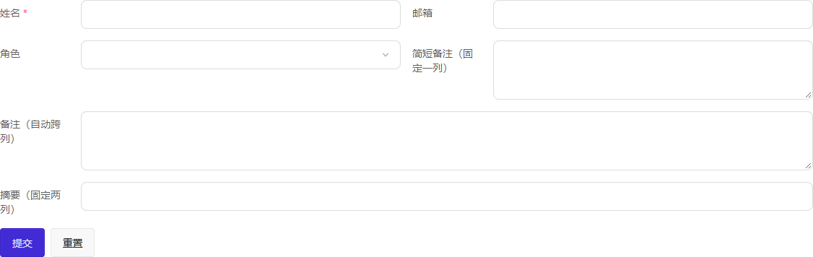
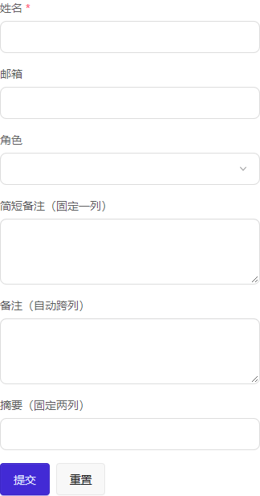
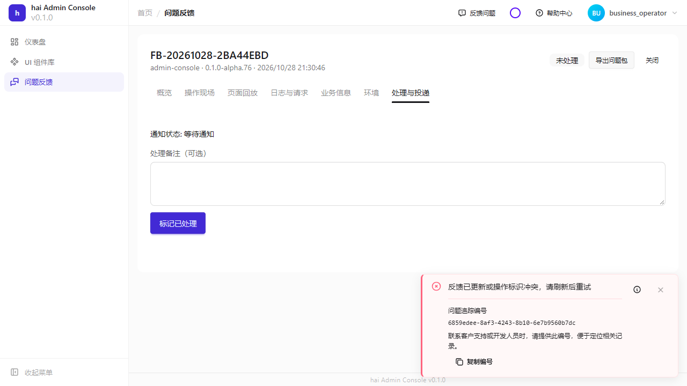
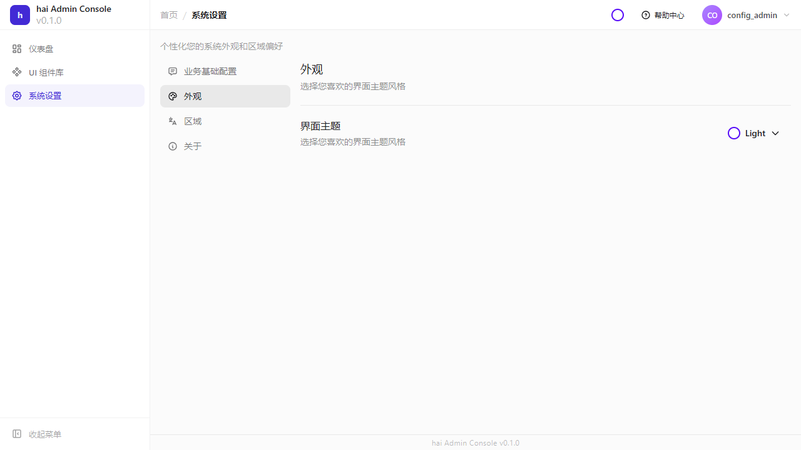
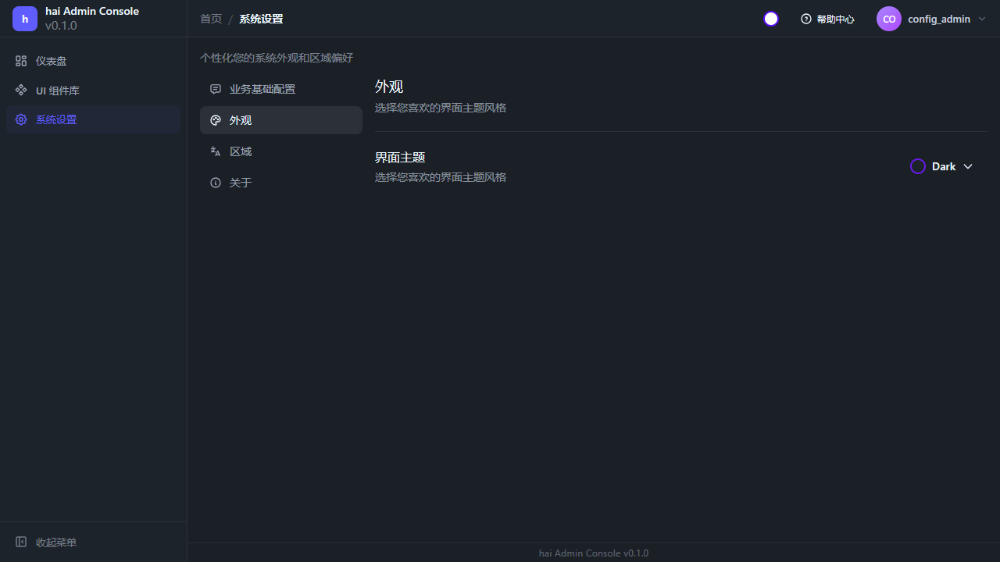
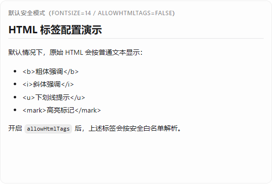
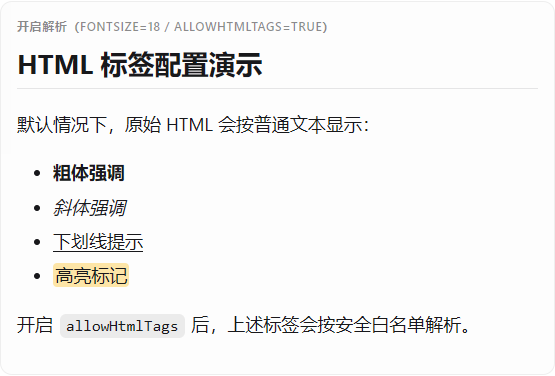
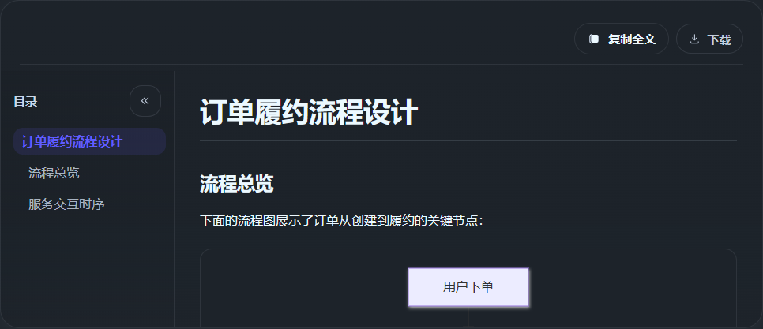

# @h-ai/ui 功能说明

[English](ui.en.md) · [日本語](ui.ja.md)

在 Svelte 5 组件里导入表单、表格和其他界面组件，通过属性和事件连接页面数据。主题、样式、语言状态和自动导入器有专用导入路径，按下文各节选用。

[模块 README](../../../packages/ui/README.md) · [配置清单](../configuration/ui.md) · [数据结构](../data/ui.md) · [UI 接入](../development/ui.md)

<a id="quick-start"></a>

## 最小接入示例

<a id="module-dependencies"></a>

### 依赖

| 依赖 | 用途 | 何时需要 | 接入顺序 |
| --- | --- | --- | --- |
| `svelte` | 编译和渲染 Svelte 5 组件 | 使用 UI 组件时必需 | 在 Svelte 5 项目中导入组件，由 Svelte 挂载 |
| `tailwindcss` 4、`daisyui` 5 | 生成组件样式和主题 | 使用预置样式时 | 构建前按[样式接入示例](#styles)配置 CSS 入口及组件扫描 |
| `@tailwindcss/vite` | 在 Vite 构建中处理 Tailwind CSS | 使用 Tailwind 的 Vite 集成时 | 构建前在 Vite 配置中注册插件 |
| `@h-ai/core` | 提供内置文案和结果类型 | 随 UI 安装 | 组件可直接导入 |

### 接入示例

把以下代码放进 Svelte 5 页面的 `+page.svelte`。

```svelte
<script lang='ts'>
  import { Button, Card, Input } from '@h-ai/ui'

  let name = $state('')
  let submittedName = $state('')
</script>

<!-- Give the greeting preview a card title. The card renders the name form and status as its contents. -->
<Card title='预览问候语'>
  <label for='greeting-name'>姓名</label>
  <!-- Bind the text input to name and associate it with the greeting-name label. Typing updates name. -->
  <Input id='greeting-name' bind:value={name} />
  <!-- Disable the primary button for blank names. An enabled click trims the name and updates the greeting below. -->
  <Button variant='primary' disabled={!name.trim()} onclick={() => { submittedName = name.trim() }}>
    预览
  </Button>
  <p role='status'>
    {#if submittedName}你好，{submittedName}。{/if}
  </p>
</Card>
```

`bind:value` 把输入框的文本写入 `name`。例如输入 `Ada` 后点击“预览”，页面会显示“你好，Ada。”。示例只更新页面状态。

启用自动导入后可直接在模板中使用，无需逐个 import：

```svelte
<!-- 无需 import { Button } from '@h-ai/ui' -->
<!-- Render a primary submit-labelled button after the preprocessor injects the import. -->
<Button variant='primary'>提交</Button>
```

> 除 `toast`、类型导入与 `Range`（会和 DOM `Range` 构造器冲突）外，其余公开 Svelte 组件都可通过 `@h-ai/ui/auto-import` 自动注入。

管理后台等只使用部分组件的页面，可直接使用公开组件目录入口；主题工具通过轻量 `@h-ai/ui/theme` 导入，避免主题消费加载根入口中的 AI、图表等组件。状态层的语言工具使用 `@h-ai/ui/i18n`，不加载组件与引导 CSS。组件路径以已安装版本的 exports 为准，不导入包内 `src/` 或 `dist/`。

自动导入器只为模板 AST 中实际使用的组件注入导入，注释、textarea 和脚本字符串中的示例不触发导入；脚本声明以及 each、await、snippet 等模板局部绑定优先。无分号、跨行及带别名的真实导入按语法树识别，已绑定的运行时组件名称不会重复注入。根入口 `@h-ai/ui` 的仅类型组件绑定按需提升为值；外部模块的同名类型无法安全合并时，构建错误会列出文件和组件名，请为类型设置别名，或用其他本地名显式导入组件。

```ts
import { Card } from '@h-ai/ui/components/compounds/index'
import { Button } from '@h-ai/ui/components/primitives/index'
import { THEMES, ui } from '@h-ai/ui/theme'
```

<a id="api-reference"></a>

## 功能说明

UI 没有 init/close。组件由 Svelte 管理挂载和销毁；函数与控制器按实际返回类型使用。接口表中的应用变量由所属场景说明，服务端继续负责授权、校验和持久化。

<a id="styles"></a>

### 接入样式与自动导入：`ui.autoImport`

样式在应用构建时引入，自动导入器只处理实际模板组件。

#### 接口清单

| API | 用途 | 参数与默认值 | 返回值或失败 | 调用示例 |
| --- | --- | --- | --- | --- |
| `ui.autoImport()` | 自动导入 | 无参数。向 Svelte 预处理器注册后处理模板源码及文件名。 | `PreprocessorGroup; synchronous { code }` | `ui.autoImport()` |

#### 场景：在构建时自动导入组件

在项目的 Svelte 配置里注册预处理器；输入是页面模板，输出是在模板实际使用 Button 等组件时补入对应 import。随后组件可直接用于模板，未使用的组件不会因自动导入而加载。

```js
import { vitePreprocess } from '@sveltejs/vite-plugin-svelte'
import { ui } from '@h-ai/ui/auto-import'

export default {
  // Install the Hai UI preprocessor before Vite's Svelte preprocessor. It supplies imports for Hai components in templates.
  preprocess: [ui.autoImport(), vitePreprocess()],
}
```

#### 场景：样式依赖

组件基于 TailwindCSS v4 + DaisyUI。应用层 `app.css` 需要以下配置：

```css
/* 必须 */
@import 'tailwindcss';
@import '@h-ai/ui/styles/global.css'; /* 基础重置、滚动条、焦点样式 */
@import '@h-ai/ui/styles/theme.css'; /* Tailwind v4 @theme Token（品牌色/阴影/动效） */
@source "../node_modules/@h-ai/ui/dist/**/*.{svelte,js,ts}";
@source "../../../node_modules/@h-ai/ui/dist/**/*.{svelte,js,ts}";

/* 移动端项目追加（可选） */
@import '@h-ai/ui/styles/design-tokens.css'; /* CSS 自定义属性 */
@import '@h-ai/ui/styles/mobile.css'; /* 安全区域/触摸优化 */

/* DaisyUI 主题 */
@plugin "daisyui" {
  themes:
    light --default,
    dark --prefersdark,
    cupcake,
    emerald,
    corporate,
    nord,
    dracula,
    night;
}
```

- `global.css`：基础 HTML 重置、滚动条美化、表单焦点环
- `theme.css`：Tailwind v4 `@theme` 块，包含品牌色、阴影层级、动效曲线、字体特性
- `design-tokens.css`：CSS 自定义属性（间距/圆角/z-index/过渡），移动端推荐
- `mobile.css`：安全区域 padding、momentum 滚动、虚拟键盘适配、移动端 App 壳布局工具（`hai-mobile-viewport` / `hai-mobile-shell` / `hai-mobile-main`）

移动端页面推荐让 `BottomNav` 与页面壳宽度一致，避免桌面预览时底栏横跨整个视口：

```svelte
<div class='hai-mobile-viewport'>
  <div class='hai-mobile-shell max-w-lg'>
    <!-- Render the Home bar inline and include the top safe-area inset. -->
    <AppBar title='Home' fixed={
;(false} safeArea />
    <main class='hai-mobile-main'>...</main>
    <!-- Render the provided destinations and mark home as active. The centered bottom bar includes the bottom safe area. -->
    <BottomNav items={items} active='home' centered maxWidth='lg' safeArea />
  </div>
</div>
```

`BottomNav` 的导航按钮与 `ThemeSelector` 的主题按钮在客户端挂载后启用，确保点击时事件已绑定。

#### 场景：图标

组件使用 Iconify (Tabler Icons)：

```bash
npm install -D @iconify/tailwind4 @iconify-json/tabler
```

```css
/* app.css 中追加 */
@plugin "@iconify/tailwind4" {
  prefixes: tabler;
}
```

<a id="detailed-workflow"></a>

<a id="forms"></a>

### 输入与提交表单：基础组件

把输入值保存在页面状态中，控件通过绑定更新它；表单提交交给应用回调。

#### 接口清单

| API | 用途 | 参数与默认值 | 返回值或失败 | 调用示例 |
| --- | --- | --- | --- | --- |
| `<Button>` | 按钮 | `variant` 选择视觉样式或状态；`size` 设置组件尺寸；`loading` 显示等待状态；`disabled` 禁用用户操作；`outline` 显示描边样式；`circle` 显示圆形按钮。 | click → count 加1 | `<Button onclick={() => count += 1}>Add</Button>` |
| `<IconButton>` | 图标按钮 | `icon` 传入可信的 SVG 字符串或用于渲染图标的 Svelte `Snippet`；`variant` 选择视觉样式或状态；`size` 设置组件尺寸；`tooltip` 设置悬停提示；`loading` 显示等待状态。 | 显示图标按钮与提示 | `<IconButton icon='<svg viewBox="0 0 24 24"></svg>' tooltip='Save' />` |
| `<BareButton>` | 无样式按钮 | `class` 添加 CSS 类；`ariaLabel` 为辅助技术设置可访问名称；`role` 指定可访问角色；`tabindex` 控制键盘聚焦顺序。 | 原生按钮及可访问名称 | `<BareButton ariaLabel='Save'>Save</BareButton>` |
| `<Input>` | 输入框 | `type` 选择组件的输入或显示类型；`value` 传入当前值，支持的场合可双向绑定；`size` 设置组件尺寸；`error` 设置错误信息或错误样式；`validationMessage` 设置字段校验不通过时的提示。 | 输入后更新 name | `<Input bind:value={name} />` |
| `<BareInput>` | 无样式输入框 | `type` 选择组件的输入或显示类型；`class` 添加 CSS 类；`accept` 限制文件选择器可选的文件类型；`multiple` 允许同时选择多项。 | 输入后更新 name | `<BareInput type='text' bind:value={name} />` |
| `<Textarea>` | 文本域 | `value` 传入当前值，支持的场合可双向绑定；`rows` 设置初始可见行数；`size` 设置组件尺寸；`autoResize` 按输入内容自动调整高度；`error` 设置错误信息或错误样式。 | 多行输入更新 notes | `<Textarea bind:value={notes} rows={3} />` |
| `<Select>` | 下拉选择 | `options` 提供用户可选的项目；`value` 传入当前值，支持的场合可双向绑定；`placeholder` 设置未输入或未选择时的提示；`size` 设置组件尺寸；`clearable` 提供清除当前值的操作；`filterable` 允许按输入文字筛选候选项；[选择项字段](#choice-options)。 | 选择后更新 status | `<Select options={[{ value: 'open', label: 'Open' }]} bind:value={status} />` |
| `<Checkbox>` | 复选框 | `checked` 设置选中状态；`label` 指定显示的标签；`size` 设置组件尺寸；`indeterminate` 显示部分选中的状态。 | 勾选后更新 enabled | `<Checkbox bind:checked={enabled} label='Enabled' />` |
| `<Switch>` | 开关 | `checked` 设置选中状态；`label` 指定显示的标签；`size` 设置组件尺寸。 | 切换后更新 enabled | `<Switch bind:checked={enabled} label='Enabled' />` |
| `<Radio>` | 单选组 | `options` 提供用户可选的项目；`value` 传入当前值，支持的场合可双向绑定；`direction` 设置横排或竖排；`size` 设置组件尺寸；[选择项字段](#choice-options)。 | 选择后更新 status | `<Radio options={[{ value: 'open', label: 'Open' }]} bind:value={status} />` |
| `<ToggleCheckbox>` | 原生开关输入 | `checked` 设置选中状态；`name` 设置用于标识或分组的名称；`onchange` 在值改变时调用。 | 原生选中状态写回 enabled | `<ToggleCheckbox bind:checked={enabled} name='enabled' />` |
| `<ToggleInput>` | 原生切换输入 | `checked` 设置选中状态；`name` 设置用于标识或分组的名称。 | 选中状态写回 enabled | `<ToggleInput bind:checked={enabled} name='enabled' />` |
| `<ToggleRadio>` | 原生单选输入 | `checked` 设置选中状态；`name` 设置用于标识或分组的名称；`onchange` 在值改变时调用。 | 显示已选单选项 | `<ToggleRadio name='choice' checked />` |
| `<Range>` | 滑块 | `value` 传入当前值，支持的场合可双向绑定；`min` 设置最小允许值；`max` 设置上限；`step` 设置相邻值之间的步长。 | 拖动更新 score | `<Range min={0} max={100} bind:value={score} />` |
| `<Rating>` | 评分 | `value` 传入当前值，支持的场合可双向绑定；`max` 设置上限。 | 点击评分更新 score | `<Rating max={5} bind:value={score} />` |
| `<Badge>` | 徽章 | `variant` 选择视觉样式或状态；`size` 设置组件尺寸；`outline` 显示描边样式。 | 显示 New 徽章 | `<Badge variant='info'>New</Badge>` |
| `<Avatar>` | 头像 | `src` 提供图片地址；`name` 为没有图片时的首字母提供名称；`size` 设置组件尺寸；`shape` 指定外形；`ring` 控制是否显示环形描边。 | 显示姓名头像占位 | `<Avatar name='Ada' />` |
| `<Tag>` | 标签 | `text` 提供可见文字；`variant` 选择视觉样式或状态；`size` 设置组件尺寸；`closable` 显示关闭操作。 | 显示标签 | `<Tag text='Release' />` |
| `<Spinner>` | 加载动画 | `size` 设置组件尺寸；`variant` 选择视觉样式或状态。 | 显示加载动画 | `<Spinner size='sm' />` |
| `<Progress>` | 进度条 | `value` 传入当前值，支持的场合可双向绑定；`max` 设置上限；`variant` 选择视觉样式或状态；`striped` 启用条纹效果；`animated` 启用进度动画。 | 显示30%进度 | `<Progress value={3} max={10} />` |
| `<Form>` | 表单容器 | `columns` 设置列数或传入列定义；`labelPosition` 设置标签相对字段的位置；`labelWidth` 设置标签栏宽度；`loading` 显示等待状态；`disabled` 禁用用户操作；`onsubmit` 收到表单提交时调用。 | 通过校验后调用 save | `<Form onsubmit={save}><Input bind:value={name} /></Form>` |
| `<FormField>` | 表单字段 | `label` 指定显示的标签；`for` 关联输入元素的 ID；`colSpan` 设置字段跨越的列数；`labelPosition` 设置标签相对字段的位置；`error` 设置错误信息或错误样式；`hint` 提供输入前可阅读的帮助；`required` 标记必填项。 | 标签关联输入控件 | `<FormField label='Name' for='name'><Input id='name' bind:value={name} /></FormField>` |
| `<FormLayout>` | 表单布局 | `columns` 设置列数或传入列定义；`labelPosition` 设置标签相对字段的位置；`labelWidth` 设置标签栏宽度。 | 宽屏两列、窄屏收拢 | `<FormLayout columns={2}><FormField label='Name'><Input bind:value={name} /></FormField></FormLayout>` |
| `<TagInput>` | 标签输入 | `tags` 提供当前标签列表；`maxTags` 限制标签数量；`allowDuplicates` 允许相同标签出现多次；`size` 设置组件尺寸。 | 编辑后更新 tags | `<TagInput bind:tags={tags} maxTags={5} />` |
| `<Combobox>` | 可搜索下拉选择（单选/多选） | `options` 提供用户可选的项目；`value` 传入当前值，支持的场合可双向绑定；`multiple` 允许同时选择多项；`placeholder` 设置未输入或未选择时的提示；`size` 设置组件尺寸。 | 搜索并写回选择值 | `<Combobox options={[{ value: 'open', label: 'Open' }]} bind:value={status} />` |
| `<Calendar>` | 独立日历 | `value` 传入当前值，支持的场合可双向绑定；`minValue` 指定最早可选日期；`maxValue` 指定最晚可选日期。 | 选择后写回 DateValue | `<Calendar bind:value={date} />` |
| `<DatePicker>` | 日期输入+弹出 | `value` 传入当前值，支持的场合可双向绑定；`minValue` 指定最早可选日期；`maxValue` 指定最晚可选日期；`error` 设置错误信息或错误样式；`size` 设置组件尺寸。 `ariaLabel` 为日期输入指定无障碍名称。 | 弹出日历并写回日期 | `<DatePicker bind:value={date} />` |
| `<ScheduleInput>` | 编辑调度时间 | `config` 传入时区、精度和 Cron 开关；`value` 双向绑定值，`valid` 双向绑定校验状态；`name` 用于提交字段，`id` 关联可见控件；`required`、`disabled` 控制必填和禁用。 | 带 UTC 偏移的 ISO 字符串或五段 Cron | `<ScheduleInput name='scheduled_at' bind:value={schedule} required />` |
| `<CronExpressionBuilder>` | 编辑五段 Cron 和手工表达式 | `value` 绑定表达式，`presets` 提供常用表达式，`labels` 和 `weekdayOptions` 自定义显示，`error` 和 `describedBy` 关联宿主校验。 | 保留不能映射到可视化模式的手工表达式 | `<CronExpressionBuilder bind:value={cron} />` |
| `ui.normalizeScheduleInputConfig(value)` | 识别调度 schema | `value` 是 `x-hai-input` 的值。需要 `kind: 'schedule'`、有效的 IANA `timezone`、`precision: 'minute'`，`allowCron` 可省略。 | 归一化的 `ScheduleInputConfig`，无效值返回 `undefined` | `ui.normalizeScheduleInputConfig(rawMetadata)` |
| `ui.createDefaultCronBuilderState()` | 创建默认编辑状态 | 无参数。 | `CronBuilderState`，默认每天 10:00 | `ui.createDefaultCronBuilderState()` |
| `ui.cronExpressionToBuilderState(expression)` | 解析为可编辑状态 | `expression` 为字符串。 | `CronBuilderState`，复杂或无效表达式保留在手工模式 | `ui.cronExpressionToBuilderState('0 10 * * *')` |
| `ui.cronBuilderStateToExpression(state)` | 序列化编辑状态 | `state` 为当前 `CronBuilderState`。 | 可视模式返回五段 Cron，手工模式返回输入文本 | `ui.cronBuilderStateToExpression(state)` |
| `ui.isCronExpressionValid(expression)` | 检查 Cron 语法 | `expression` 为待校验字符串。 | `boolean`，业务字段可另外约束为五段 | `ui.isCronExpressionValid('0 10 * * *')` |
| `CRON_BUILDER_WEEKDAY_ORDER` | 读取编辑器的星期顺序 | 无参数。 | 周一到周日的数字字符串列表，周日为 `'0'` | `[...CRON_BUILDER_WEEKDAY_ORDER]` |

<a id="choice-options"></a>

#### 选择项字段

| 字段 | 类型 | 默认值 | 作用与生效条件 |
| --- | --- | --- | --- |
| `value` | `T` | 必填 | 此选项被选中时写入绑定值。 |
| `label` | `string` | 必填 | 显示给用户的选项名称。 |
| `disabled` | `boolean` | 未设置（可选中） | 设为 `true` 时禁止选中此项。 |

```svelte
<script lang="ts">
  import { Select } from '@h-ai/ui'

  let status = $state('draft')
  const options = [
    { value: 'draft', label: 'Draft' },
    { value: 'done', label: 'Done' },
    { value: 'archived', label: 'Archived', disabled: true },
  ]
</script>

<Select {options} bind:value={status} />
<output>{status}</output>
```

选中 Done 时，页面输出 `done`。Archived 禁用，点击时 `status` 不变。

#### 场景：在日历和输入框中选择同一日期

输入 name、notes、status 是页面的 $state 字符串，enabled 为 boolean，score 为 number，tags 为 string[]。先从最小示例的 Input/按钮绑定开始，再把它们放入下文 Form。输入 Ada 后 name 为 Ada；提交只在原生校验通过后调用宿主 save。Calendar/DatePicker 的 date 使用 @internationalized/date 的 CalendarDate，而不是字符串。

```svelte
<script lang='ts'>
  import { Calendar, DatePicker } from '@h-ai/ui'
  import { CalendarDate } from '@internationalized/date'
  let date = $state(new CalendarDate(2026, 11, 17))
</script>
<!-- Display the initial November 17 date in the calendar. Selection updates the shared bound date. -->
<Calendar bind:value={date} />
<!-- Bind the picker to the same date. Picking a day updates both controls. -->
<DatePicker bind:value={date} />
```

两者共享 date，任意一处选择后另一处显示同一日期。

#### 场景：表单布局与校验

`Form` 和可嵌入原生 `<form>` 的 `FormLayout` 共用 `columns={1 | 2}`、`labelPosition="top" | "left"`、`labelWidth`（默认 `8rem`）。默认单列、标签独立成行；双列在容器不足 `36rem` 时收为单列，同行标签在容器不足 `28rem` 时改为上下排列。

`FormField.colSpan` 默认 `'auto'`：多行文本、文件/图片上传、TagInput 和多选 Combobox 自动占两列；`1` / `2` 显式覆盖。自定义宽控件标注 `data-form-wide`。标题、错误摘要、按钮及其他非 FormField 内容自动独占一行。字段可单独覆盖 `labelPosition` / `labelWidth`。

标签自动关联内部 UI 控件；已有控件 ID 或原生控件使用 `<FormField for="control-id">`。错误/提示通过 `aria-describedby` 关联，错误控件带 `aria-invalid`，只显示一份字段提示。`label` / `error` / `hint` 支持字符串或延迟翻译函数。

`Input`、`Textarea`、`Select` 和 `PasswordInput` 的原生校验使用内置中英日文提示；`validationMessage` 只覆盖失败提示，不让有效输入一直无效。应用通过 UI 的 `ui.setGlobalLocale` / `ui.createLocaleStore` 同步语言，已显示的校验错误即时更新。`Textarea` 支持 `minlength` / `maxlength`，`Select` 支持 `name`、必填校验和 FormData 序列化。

字段错误统一通过 Toast 展示。即使上一条提示已关闭或自动消失，再次提交相同的无效输入仍会重新提示；修正输入后清除过期通知。控件保留错误边框、`aria-invalid` 和读屏关联说明。

文本控件输入后失焦显示前端校验错误，修正输入时即时更新；未输入的空字段留到提交时校验，避免默认焦点离开时挤动操作。CRUD 新增/编辑同样在输入后失焦或提交时校验，支持自定义校验文案，关闭重开清空校验状态。`Select` 在焦点离开触发器和选项后校验。`PasswordInput.minLength` 同时约束长度并用于强度计算；省略时不限制登录密码长度，强度计算仍以 8 位为基准。

`UserProfile.fieldConstraints` 按字段接收 `required`、`minlength`、`maxlength`、`pattern` 和 `validationMessage`（`pattern` 用于单行输入），让应用的用户名等业务规则复用失焦校验；`validationMessage` 支持延迟翻译函数。

`UserProfile.onsubmit` 必须返回 `true` 确认保存成功，返回 `false` 时保留编辑器和草稿；抛错也保留草稿并通过统一 Toast 提示。取消编辑恢复 `user` 中已保存的值。

`CrudEditPanel.onsubmit` 只接收表单声明的可写字段，编辑时排除 `readonly` 字段；新建时仍可填写该字段。主键、关联展示值和审计时间不从整行记录自动回传，空值、`false` 和 `0` 保持原值。服务端继续使用严格 schema 校验。

`LoginForm`、`RegisterForm`、`ChangePasswordForm`、`ForgotPasswordForm`、`ResetPasswordForm`、`AuthPanel`、`UserProfile` 和 `FeedbackModal` 接受同一组布局参数。`CrudPage` 通过 `form` 传入；`CrudEditPanel` 直接接收。CRUD 字段支持 `colSpan`，`validation.message` 支持翻译函数；按钮与回车均先校验，修正后错误消失，客户端校验不能替代服务端校验。

```svelte
<script lang='ts'>
  import { Button, Form, FormField, Input, Textarea } from '@h-ai/ui'
  let name = $state('')
  let notes = $state('')
  let submitted = $state<Record<string, unknown>>({})
  const m = { name: () => '姓名', notes: () => '备注', save: () => '预览提交' }
  const save = (data: Record<string, unknown>) => { submitted = data }
</script>
<!-- Render a two-column form with fixed-width left labels. Valid submission passes the named fields to save; required validation blocks invalid submission. -->
<Form columns={2} labelPosition='left' labelWidth='6rem' onsubmit={save}>
  <!-- Render the required name caption using the app label. -->
  <FormField label={() => m.name()} required>
    <!-- Bind the required name field. Its name key appears in the submitted record. -->
    <Input name='name' bind:value={name} required />
  </FormField>
  <!-- Render the optional notes caption using the app label. -->
  <FormField label={() => m.notes()}>
    <!-- Bind the optional notes field. Its notes key is available on form submission. -->
    <Textarea name='notes' bind:value={notes} />
  </FormField>
  <!-- Render the labelled submit button, invoking form validation and submission on click. -->
  <Button type='submit'>{m.save()}</Button>
</Form>
<p role='status'>{JSON.stringify(submitted)}</p>
```
<a id="form-layout-guide"></a>

#### 场景：检查窄屏布局与保存失败

通用组件、主题和语言入口见 [UI 调用参数](ui.md#call-options)。

在页面中把选项直接传给组件。`Form` / `FormLayout` 默认一列、标签在上；`columns={2}` 适合宽容器，`labelPosition="left"` 让短标签对齐，`labelWidth` 按实际内容选择。`FormField.colSpan` 默认 `auto`，宽控件占满一行，自定义宽控件用 `data-form-wide`，也可明确指定 `1` 或 `2`。

```svelte
<script lang='ts'>
  import { FormField, FormLayout, Input } from '@h-ai/ui'
  let name = $state('')
  const m = { userName: () => '姓名' }
</script>
<!-- Arrange fields in two columns with 6rem left labels. -->
<FormLayout columns={2} labelPosition="left" labelWidth="6rem">
  <!-- Associate the app's name label with the input whose id is name. -->
  <FormField label={() => m.userName()} for="name">
    <!-- Keep the required input synchronized with name and report empty values through native validation. -->
    <Input id="name" bind:value={name} required />
  </FormField>
</FormLayout>
```

上例在页面本地声明姓名状态和演示文案；实际应用把文案换成自己的 i18n 函数。输入姓名会更新 name。配置立即改变布局，不需重启后端。






检查标签与 `for` / `id` 关联、Tab顺序、提交失败保留输入和防重复提交。校验错误统一Toast，控件保留 `aria-invalid` 和读屏说明；修正后清除旧提示，关闭提示后再次无效提交仍提示。服务端再次校验输入和权限。

保存型场景组件还要明确成功信号。`UserProfile.onsubmit` 接收表单值，返回 `boolean | Promise<boolean>`：只有 `true` 才退出编辑；`false` 或异常保留草稿。输入一个会被服务端拒绝的值时，应看到安全错误提示且仍能继续编辑；不要把“请求结束”当成“保存成功”。

<a id="schedule-input"></a>

#### 场景：选择调度时间或编辑 Cron

从业务 schema 读取 `x-hai-input` 元数据，再把归一化的配置传给控件。组件省略配置时使用北京时间和分钟精度，`allowCron` 缺省为 `false`。下面指定洛杉矶时区，接受日期时间和五段 Cron。

```svelte
<script lang='ts'>
  import { Form, FormField, ScheduleInput, ui } from '@h-ai/ui'

  let schedule = $state('')
  let result = $state('')
  const rawMetadata = {
    kind: 'schedule', timezone: 'America/Los_Angeles', precision: 'minute', allowCron: true,
  }
  // Parse the schema metadata. Invalid zones or precision return undefined.
  const config = ui.normalizeScheduleInputConfig(rawMetadata)
</script>
{#if config}
  <!-- Use the named form field to receive the selected schedule string. -->
  <Form onsubmit={fields => { result = String(fields.scheduled_at) }}>
    <!-- Associate the label with the mode's visible input. -->
    <FormField label='Scheduled time' for='when' required>
      <!-- A valid date-time includes an offset. Cron mode writes a five-field expression. -->
      <ScheduleInput id='when' name='scheduled_at' {config} bind:value={schedule} required />
    </FormField>
    <button type='submit'>Save</button>
  </Form>
  <output>{result}</output>
{/if}
```

选中 2030 年 7 月 22 日 10:05 时，提交值为 `2030-07-22T10:05:00-07:00`。遇到夏令时跳过的分钟时，表单会提示调整。重叠的分钟默认选较早的一次，已回填的合法偏移会保留。时间到期后提交会被拦截，焦点回到当前可见输入。手工 Cron 表达式的执行行为由宿主决定。

Node 端可通过 `@h-ai/ui/components/compounds/schedule-input` 导入归一化函数和类型，该入口无需加载 Svelte。

<a id="overlays"></a>

### 打开弹窗与菜单：弹层组件

用 open 状态控制弹窗、抽屉和确认操作；菜单与提示连接到同一页面中的按钮。

#### 接口清单

| API | 用途 | 参数与默认值 | 返回值或失败 | 调用示例 |
| --- | --- | --- | --- | --- |
| `<Modal>` | 模态框（语义标签、焦点约束与恢复） | `open` 控制组件是否打开；`title` 设置标题；`size` 设置组件尺寸；`radius` 设置圆角；`bodyOverflow` 控制内容超过可用空间时的行为；`showClose` 切换关闭按钮。 | 打开/关闭同步 open | `<Modal bind:open={open} title='Details'>Order 42</Modal>` |
| `<Drawer>` | 抽屉 | `open` 控制组件是否打开；`position` 设置显示位置；`title` 设置标题；`size` 设置组件尺寸；`width` 设置显示宽度；`resizable` 允许拖动调整抽屉宽度；`widthStorageKey` 设置记忆抽屉宽度的存储键。 | 显示抽屉并同步 open | `<Drawer bind:open={open} title='Details'>Order 42</Drawer>` |
| `<Confirm>` | 确认框 | `open` 控制组件是否打开；`title` 设置标题；`message` 提供显示给用户的正文；`variant` 选择视觉样式或状态；`onconfirm` 在用户确认时调用。 | 用户确认时调用 confirm | `<Confirm bind:open={open} message='Continue?' onconfirm={confirm} />` |
| `<Popover>` | 弹出层 | `open` 控制组件是否打开；`position` 设置显示位置；`trigger` 指定触发内容或触发方式；`offset` 控制弹层与触发元素间距；`ui.portal` 将弹层放在裁剪容器之外。 | 点击打开面板，Escape 关闭 | `<Popover>{#snippet trigger()}<Button>Open</Button>{/snippet}Details</Popover>` |
| `<Dropdown>` | 下拉菜单 | `items` 提供依次渲染的项目；`trigger` 指定触发内容或触发方式；`triggerClass` 为触发控件添加 CSS 类；`position` 设置显示位置。 | 显示可操作菜单 | `<Dropdown items={menuItems}><Button>Actions</Button></Dropdown>` |
| `<Tooltip>` | 提示 | `content` 提供要渲染的正文或内容片段；`position` 设置显示位置；`delay` 控制提示出现前等待的时间；`ui.portal` 将弹层放在裁剪容器之外。 | 悬停/聚焦显示说明 | `<Tooltip content='Save order'><Button>Save</Button></Tooltip>` |

#### 场景：打开订单详情并关闭弹窗

输入 open 是 $state(false)，confirm 是应用确认回调。把按钮与 Modal 放在同一个组件，点击按钮看到 Order 42，关闭后 open 还原 false。

```svelte
<script lang='ts'>
  import { Button, Modal } from '@h-ai/ui'
  let open = $state(false)
</script>
<!-- Open the details dialog when the button is clicked. -->
<Button onclick={() => open = true}>Details</Button>
<!-- Display Order 42 when open is true. Dismissing the dialog updates the bound state. -->
<Modal bind:open title='Details'>Order 42</Modal>
```

#### 场景：弹层


`Popover` 默认挂载到 `body`。在 `click` 模式下按 Enter 或空格打开后，焦点进入面板，按 Escape 关闭并返回触发控件。需要内联挂载时使用 `portal={false}`。

在 Modal/Drawer 内，Popover 的 portal 内容参与所属弹窗的 Tab 与 Shift+Tab 顺序，保持在模态边界内；关闭后撤销登记并恢复触发位置。

<a id="tables"></a>

### 展示记录与导航：数据组件

把已经加载的记录和列定义传给组件；翻页、排序、切换标签时由应用加载所需内容。

#### 接口清单

| API | 用途 | 参数与默认值 | 返回值或失败 | 调用示例 |
| --- | --- | --- | --- | --- |
| `<Card>` | 卡片容器 | `title` 设置标题；`bordered` 切换边框；`shadow` 设置阴影；`padding` 设置内容区域的内边距。 | 显示标题和内容 | `<Card title='Order'>Order 42</Card>` |
| `<JsonViewer>` | JSON 树查看器 | `value` 传入当前值，支持的场合可双向绑定；`defaultExpandedDepth` 决定 JSON 树首次展开到第几层；`maxScalarLength` 限制单个标量值的预览长度；`showCopy` 切换复制按钮；`onCopy` 处理复制动作。 | 展示可展开 JSON | `<JsonViewer value={{ status: 'pending' }} />` |
| `<DataTable>` | 数据表格 | `data` 传入组件要显示的数据；`columns` 定义每列的数据显示方式和可选排序；`keyField` 选择每条记录的唯一标识字段；`loading` 显示等待状态；`sortKey` 指定当前排序列；`sortDir` 指定当前排序方向；`onsort` 接收用户请求的排序变化；`cell` 自定义单元格的内容；`onrowclick` 接收用户点击的行。 [字段表](#datatable-options) | 按列显示 rows；业务负责加载 | `<DataTable data={rows} {columns} keyField='id' />` |
| `<Accordion>` | 手风琴 | `items` 提供依次渲染的项目。 | 展开/收起给定内容 | `<Accordion items={accordionItems} />` |
| `<Timeline>` | 时间线 | `items` 提供依次渲染的项目。 | 依输入顺序显示时间线 | `<Timeline items={timelineItems} />` |
| `<Tabs>` | 标签页 | `items` 提供依次渲染的项目；`active` 指定当前选中的项目；`type` 选择组件的输入或显示类型；`size` 设置组件尺寸；`lazy` 首次打开前延迟渲染内容；`onactivate` 首次激活页签时调用。 | 切换后更新 activeTab | `<Tabs items={tabItems} bind:active={activeTab} />` |
| `<Pagination>` | 分页（统一 table 风格） | `page` 当前页码，从 1 开始；`total` 传入匹配记录的总数；`pageSize` 设置每页记录数；`showTotal` 显示记录总数；`showJumper` 显示页码跳转输入；`showSizeChanger` 允许切换每页记录数；`showPageInfo` 显示页码信息；`showFirstLast` 显示首页和末页按钮。 [字段表](#pagination-options) | 共3页，翻页更新 page | `<Pagination total={42} pageSize={20} bind:page />` |
| `<Breadcrumb>` | 面包屑 | `items` 提供依次渲染的项目；`separator` 设置相邻项目之间的分隔符。 | 显示层级与链接 | `<Breadcrumb items={[{ label: 'Orders', href: '/orders' }, { label: '42' }]} />` |
| `<Steps>` | 步骤条 | `items` 提供依次渲染的项目；`current` 指定当前步骤；`direction` 设置横排或竖排；`clickable` 允许点击切换步骤。 | 标记当前步骤 | `<Steps items={stepItems} current={1} />` |
| `<Skeleton>` | 骨架屏 | `variant` 选择视觉样式或状态；`width` 设置显示宽度；`height` 设置高度；`count` 设置渲染数量。 | 显示3项占位 | `<Skeleton count={3} />` |
| `<Empty>` | 空状态 | `title` 设置标题；`description` 提供补充说明；`icon` 指定界面图标。 | 显示空态 | `<Empty title='No orders' />` |
| `<Result>` | 结果页 | `status` 选择要表达的结果或状态；`title` 设置标题；`description` 提供补充说明。 | 显示结果状态 | `<Result status='success' title='Saved' />` |
| `<PageHeader>` | 页面头部 | `title` 设置标题；`description` 提供补充说明；`actions` 提供可用动作或操作区内容。 | 显示页标题、说明和操作区 | `<PageHeader title='Orders' description='Current orders' />` |

<a id="datatable-options"></a>

#### 数据表列与排序字段

| 字段 | 类型 | 默认值 | 作用与生效条件 |
| --- | --- | --- | --- |
| `columns[].key` | `keyof T` / `string` | 必填 | 选择显示及排序使用的字段。 |
| `columns[].label` | `string` | 必填 | 表头显示的文案。 |
| `columns[].width` | `string` | 自动 | 设置列宽，例如 `8rem`。 |
| `columns[].align` | `left` / `center` / `right` | 继承表格样式 | 设置单元格的水平对齐方式。 |
| `columns[].sortable` | `boolean` | 未启用 | 启用后点击表头排序。没有 `onsort` 时只对当前 `data` 排序。 |
| `columns[].render` | `(item: T) => string` | 使用字段值 | 接收整行，生成单元格文字。提供 `cell` 片段时由片段渲染。 |
| `columns[].onclick` | `(item: T) => void` | 未设置 | 点击这列的单元格时接收对应行。 |
| `sortKey / sortDir` | `string` / `asc` / `desc` / `null` | 未排序 | 提供 `onsort` 时，由这两个字段控制当前排序。 |
| `onsort` | `(key, dir) => void` | 当前数据由组件排序 | 提供后由宿主读取排序请求并传入新数据，组件不再本地排序。 |

<a id="pagination-options"></a>

#### 分页控件参数

| 字段 | 类型 | 默认值 | 作用与生效条件 |
| --- | --- | --- | --- |
| `page / total` | `number` | 调用方提供 | 当前页码和匹配记录总数，页码从 1 开始。 |
| `pageSize` | `number` | `10` | 用于计算一共有几页。 |
| `showTotal / showPageInfo / showFirstLast` | `boolean` | `true` | 分别显示总条数、页码说明、首页和末页按钮。 |
| `showJumper / showSizeChanger` | `boolean` | `false` | 分别显示页码跳转输入框和每页条数选择器。 |
| `pageSizeOptions` | `number[]` | `[10, 20, 50, 100]` | 仅在显示每页条数选择器时用于生成候选项。 |
| `labels` | `PaginationProps["labels"]` | 组件当前翻译 | 覆盖分页文字。总数 `total` 使用 `{count}`，每页文案 `pageSize` 使用 `{size}`，`pageInfo` 使用 `{page}` 和 `{total}`。 |

```svelte
<script lang="ts">
  import { DataTable, Pagination } from '@h-ai/ui'

  let page = $state(1)
  const data = [{ id: 'b2', name: 'Bex' }, { id: 'a1', name: 'Ada' }]
  const columns = [{ key: 'name', label: 'Name', sortable: true }]
</script>

<DataTable {data} {columns} keyField="id" />
<Pagination bind:page total={42} pageSize={10} showJumper />
<output>{page}</output>
```

表格初次显示 Bex、Ada。首次点击 Name 表头后显示 Ada、Bex。分页有 5 页，输入页码 3 后输出 `3`。

#### 场景：导航


`Dropdown` 的 `click` 和 `hover` 模式将菜单挂载到 `body`。在 `manual` 模式下，调用方通过 `class` 切换 `dropdown-open` 来控制内联菜单。
#### 场景：data-* 属性透传

公开 Svelte 组件支持把调用方传入的 `data-*` 属性透传到组件根节点或主交互节点，便于测试选择器、埋点和自动化标记。普通未知属性不会被透传。

```svelte
<script lang='ts'>
  import { Button, Input, Modal } from '@h-ai/ui'
  let username = $state('')
  let open = $state(false)
</script>
<!-- Forward the supplied test and analytics attributes. Clicking Save opens the bound dialog. -->
<Button data-testid='save-button' data-analytics-id='settings.save' onclick={() => { open = true }}>保存</Button>
<!-- Render the identified input and sync edits to username. -->
<Input data-testid='username-input' bind:value={username} />
<!-- Use the bound open state to show confirmation for the entered username, with the given test ID. -->
<Modal data-testid='confirm-modal' bind:open>确认保存 {username}？</Modal>
```

无需再为了 `data-testid` 单独封装按钮、输入框或弹层组件。

<a id="mobile"></a>

### 适配手机操作：移动组件

为手机提供底部导航、上拉操作和刷新手势；网络请求仍由应用回调执行。

#### 接口清单

| API | 用途 | 参数与默认值 | 返回值或失败 | 调用示例 |
| --- | --- | --- | --- | --- |
| `<ActionSheet>` | 底部操作面板 | `open` 控制组件是否打开；`title` 设置标题；`items` 提供依次渲染的项目；`cancelText` 设置取消按钮文案；`onselect` 接收用户选中的项目。 | 选择操作后通知 selectAction | `<ActionSheet bind:open={open} items={sheetItems} onselect={selectAction} />` |
| `<AppBar>` | 顶部导航栏 | `title` 设置标题；`backHref` 设置返回链接的地址；`onback` 接管返回操作；`fixed` 将组件固定到视口；`safeArea` 为设备安全区留出空间。 | 显示标题和返回入口 | `<AppBar title='Orders' backHref='/orders' />` |
| `<BottomNav>` | 底部导航栏 | `items` 提供依次渲染的项目；`active` 指定当前选中的项目；`centered` 居中显示导航；`maxWidth` 限制最大宽度。 | 显示并触发导航 | `<BottomNav items={navItems} active='home' />` |
| `<InfiniteScroll>` | 无限滚动 | `loading` 显示等待状态；`finished` 没有后续数据时停止加载；`threshold` 设置触发操作的阈值；`onload` 达到滚动条件时请求更多数据。 | 触底请求 loadMore | `<InfiniteScroll loading={loading} finished={finished} onload={loadMore} />` |
| `<PullRefresh>` | 下拉刷新 | `refreshing` 表示刷新在进行中；`threshold` 设置触发操作的阈值；`onrefresh` 达到下拉条件时请求刷新。 | 下拉请求 refresh | `<PullRefresh refreshing={loading} onrefresh={refresh}>Orders</PullRefresh>` |
| `<SafeArea>` | 安全区域容器 | `top` 为上侧安全区留空；`bottom` 为下侧安全区留空；`left` 为左侧安全区留空；`right` 为右侧安全区留空。 | 为内容保留安全区域 | `<SafeArea top bottom>Orders</SafeArea>` |
| `<SwipeCell>` | 滑动操作单元 | `leftActions` 从左侧露出的操作；`rightActions` 从右侧露出的操作；`threshold` 设置触发操作的阈值；`onaction` 处理选择的滑动操作。 | 滑动展示操作并通知宿主 | `<SwipeCell rightActions={swipeActions} onaction={selectAction}>Order 42</SwipeCell>` |

#### 场景：响应手机导航、刷新与加载操作

navItems、sheetItems、swipeActions 是应用按对应 Props 提供的操作项；loading/finished 是真实请求状态。loadMore、refresh 负责受权查询，selectAction 处理用户已选的操作。滑动和触底只发出事件，不自行请求网络；不要把它们当作有业务副作用的接口。


<a id="workspace"></a>

### 组织工作区与设置：布局组件

用工作区布局安排标题、操作和内容，把查询条件保留在页面状态中。

#### 接口清单

| API | 用途 | 参数与默认值 | 返回值或失败 | 调用示例 |
| --- | --- | --- | --- | --- |
| `<SettingsModal>` | 设置模态框 | `open` 控制组件是否打开；`onclose` 处理组件关闭。 | 显示设置弹窗 | `<SettingsModal bind:open={open} />` |
| `<SettingsLayout>` | 设置页布局（分区导航 + 内容区） | `title` 设置标题；`description` 提供补充说明；`sections` 传入设置分组；`active` 指定当前选中的项目；`onselect` 接收用户选中的项目。 | 显示设置导航与内容 | `<SettingsLayout title='Settings' sections={sections} active='profile'>Profile</SettingsLayout>` |
| `<WorkspaceLayout>` | 工作区布局 | `title` 设置标题；`leading` 提供主操作前的内容片段。 | 内容占满剩余高度 | `<WorkspaceLayout title='Orders'>Orders</WorkspaceLayout>` |
| `<FilterBar>` | 可收起筛选 | `activeCount` 显示已经应用的筛选数量；`onreset` 处理清空条件；`expanded` 控制筛选区域是否展开。 | 展开/收起保留值 | `<FilterBar activeCount={0}>Filters</FilterBar>` |
| `<TableToolbar>` | 表格查询栏 | `searchValue` 设置当前搜索词；`onsearch` 接收搜索输入或发起的查询；`onclearfilters` 处理清除筛选条件。 | 提交查询时通知宿主 | `<TableToolbar bind:searchValue={search} onsearch={query} />` |

#### 场景：紧凑工作区与可收起筛选

`WorkspaceLayout` 统一导航、内容区和可选页脚：顶栏采用紧凑高度，主内容使用 12/16px 内边距；没有页脚时不预留高度。通过 `title` 提供导航中的页面标题，`leading/actions/footer` 为 snippet，`data-*` 透传内容 main。父布局需传递剩余高度及 min-height: 0。

同名 `PageHeader` 自动省略重复标题，保留说明和操作；`SettingsLayout` 复用该行为。工作区中的 `CrudPage` 默认不重复显示页面标题，操作并入工具栏；独立使用仍显示标题，可用 `showHeader` 显式覆盖。

`FilterBar` 的 leading 和 actions 保持可见，children 默认收起，`bind:expanded` 控制展开，`activeCount` 提示已启用条件，`onreset` 提供内置三语重置按钮。收起保留控件和值；应用传入的回调可以清空筛选条件并重新发起查询。`TableToolbar` 复用该布局并提供原生查询表单，`CrudFilterBar` 复用相同实现；`onsearch` 在提交时读取当前绑定的搜索和筛选草稿，`onfilterchange` 只通知草稿变化。`onreset`（TableToolbar 使用 `onclearfilters`）必须同步清空宿主已提交条件并重新查询。列表排序使用 DataTable 的 `sortKey`、`sortDir`、`onsort`。 扩展筛选按容器宽度自适应为 1/2/4/6 列，字段横向间距 20px、纵向间距 16px，标签和控件分别对齐；日期范围占两列，窄屏占整行。

下例的 m、statusOptions、clearFilters 和 loadRows 由业务应用提供；清空回调须重置搜索及全部条件。

```svelte
<script lang='ts'>
  import { Button, FilterBar, Input, Select, WorkspaceLayout } from '@h-ai/ui'

  let search = $state('')
  let status = $state('')
</script>

<div class='flex h-dvh min-h-0'>
  <!-- Render the translated workspace title and its filter toolbar. -->
  <WorkspaceLayout title={m.page_title()}>
    <!-- Show the active status count and call the app's clearFilters when reset is requested. -->
    <FilterBar activeCount={status ? 1 : 0} onreset={clearFilters}>
      <!-- Put the small search input in the leading slot and update search as the user types. -->
      {#snippet leading()}<Input size='sm' bind:value={search} placeholder={m.search()} />{/snippet}
      <!-- Put the small search button in the actions slot and invoke loadRows on click. -->
      {#snippet actions()}<Button size='sm' onclick={loadRows}>{m.search()}</Button>{/snippet}
      <!-- Offer the app's status choices and write the selected value to status. -->
      <div class='w-40'><Select size='sm' bind:value={status} options={statusOptions} /></div>
    </FilterBar>
  </WorkspaceLayout>
</div>
```

<a id="notifications"></a>

### 报告操作结果：`toast`、`messageBox`

把成功、失败和确认交给共享通知容器；可按返回 ID 移除单条提示。

#### 接口清单

| API | 用途 | 参数与默认值 | 返回值或失败 | 调用示例 |
| --- | --- | --- | --- | --- |
| `ui.useToastFeedback(message, variant?)` | 操作结果提示 | `message` 是返回本地化消息或空值的函数，`variant` 可省略，默认 `error`。 | `void; source-owned toast lifecycle` | `ui.useToastFeedback(() => ui.errorMessage(error))` |
| `ui.notifySuccess(message, duration?)` | 操作结果提示 | `message` 是显示的本地化正文；`duration` 是自动关闭前的毫秒数，默认 3000，设为 0 时持续显示。 | `toast ID string` | `ui.notifySuccess(m.saved())` |
| `ui.notifyInfo(message, duration?)` | 操作结果提示 | `message` 是显示的本地化正文；`duration` 是自动关闭前的毫秒数，默认 3000，设为 0 时持续显示。 | `toast ID string` | `ui.notifyInfo(m.loading())` |
| `ui.notifyWarning(message, duration?)` | 操作结果提示 | `message` 是要显示的本地化警告；`duration` 是关闭前的毫秒数，默认 5000，0 表示持续显示。 | `toast ID string` | `ui.notifyWarning(m.warning())` |
| `ui.notifyError(error, fallback?, duration?)` | 操作结果提示 | `error` 是用于提取安全文案及追踪编号的错误；`fallback` 是无法提取文案时显示的本地化文字；`duration` 默认 5000 毫秒，0 表示持续显示。 | `toast ID string; internal exception text hidden` | `ui.notifyError(error, m.retry())` |
| `ui.errorMessage(error, fallback?)` | 操作结果提示 | `error` 是待提取安全文案的错误；`fallback` 是无法提取时使用的本地化文字。 | `safe localized string` | `ui.errorMessage(error, m.retry())` |
| `ui.toast.add(props)` | 共享提示队列 | `props` 指定正文、类型、显示时长、位置及关闭方式。见[通知字段表](#toast-options)。 | `string item ID` | `ui.toast.add({ message: m.saved(), variant: "success" })` |
| `ui.toast.success(message, duration?)` | 共享提示队列 | `message` 是显示的本地化正文；`duration` 是自动关闭前的毫秒数，默认 3000，设为 0 时持续显示。 | `string item ID` | `ui.toast.success(m.result())` |
| `ui.toast.info(message, duration?)` | 共享提示队列 | `message` 是显示的本地化正文；`duration` 是自动关闭前的毫秒数，默认 3000，设为 0 时持续显示。 | `string item ID` | `ui.toast.info(m.result())` |
| `ui.toast.warning(message, duration?)` | 共享提示队列 | `message` 是显示的本地化正文；`duration` 是自动关闭前的毫秒数，默认 3000，设为 0 时持续显示。 | `string item ID` | `ui.toast.warning(m.result())` |
| `ui.toast.error(message, duration?)` | 共享提示队列 | `message` 是显示的本地化正文；`duration` 是自动关闭前的毫秒数，默认 3000，设为 0 时持续显示。 | `string item ID` | `ui.toast.error(m.result())` |
| `ui.toast.remove(id)` | 共享提示队列 | `id` 是创建提示时返回的编号，用于定位要操作的提示。 | `void` | `ui.toast.remove(id)` |
| `ui.toast.clear()` | 共享提示队列 | 无参数。 | `void` | `ui.toast.clear()` |
| `ui.message.add(options)` | 共享提示队列 | `options` 可传本地化正文或包含正文、类型、时长和关闭方式的对象。见[消息字段表](#message-options)。 | `string item ID` | `ui.message.add({ message: m.saved(), type: "success" })` |
| `ui.message.success(message, duration?)` | 共享提示队列 | `message` 是显示的本地化正文；`duration` 是自动关闭前的毫秒数，默认 3000，设为 0 时持续显示。 | `string item ID` | `ui.message.success(m.result())` |
| `ui.message.info(message, duration?)` | 共享提示队列 | `message` 是显示的本地化正文；`duration` 是自动关闭前的毫秒数，默认 3000，设为 0 时持续显示。 | `string item ID` | `ui.message.info(m.result())` |
| `ui.message.warning(message, duration?)` | 共享提示队列 | `message` 是显示的本地化正文；`duration` 是自动关闭前的毫秒数，默认 3000，设为 0 时持续显示。 | `string item ID` | `ui.message.warning(m.result())` |
| `ui.message.error(message, duration?)` | 共享提示队列 | `message` 是显示的本地化正文；`duration` 是自动关闭前的毫秒数，默认 3000，设为 0 时持续显示。 | `string item ID` | `ui.message.error(m.result())` |
| `ui.message.remove(id)` | 共享提示队列 | `id` 是创建提示时返回的编号，用于定位要操作的提示。 | `void` | `ui.message.remove(id)` |
| `ui.message.clear()` | 共享提示队列 | 无参数。 | `void` | `ui.message.clear()` |
| `ui.toast.pause(id)` | 提示计时 | `id` 是创建提示时返回的编号，用于定位要操作的提示。 | `void` | `ui.toast.pause(id)` |
| `ui.toast.resume(id)` | 提示计时 | `id` 是创建提示时返回的编号，用于定位要操作的提示。 | `void` | `ui.toast.resume(id)` |
| `ui.messageBox.confirm(options)` | 异步确认弹窗 | `options` 可传本地化正文或配置标题、按钮和关闭行为的对象。见[弹窗字段表](#message-box-options)。 | `Promise<boolean>; host handles confirmation/cancellation` | `ui.messageBox.confirm({ message: m.confirm() })` |
| `ui.messageBox.alert(options)` | 异步确认弹窗 | `options` 可传本地化正文或配置标题、按钮和关闭行为的对象。见[弹窗字段表](#message-box-options)。 | `Promise<boolean>; host handles confirmation/cancellation` | `ui.messageBox.alert({ message: m.confirm() })` |
| `<Alert>` | 警告框 | `variant` 选择视觉样式或状态；`title` 设置标题；`dismissible` 控制是否提供关闭按钮。 | 显示持续信息 | `<Alert variant='info' title='Saved' />` |
| `<ToastContainer>` | 通知容器 | 根布局挂载一次，由 `toast` 或 `message` 向同一个提示队列推送消息。 | 显示全局通知队列 | `<ToastContainer />` |
| `<ErrorPage>` | 通用错误页（内置 401/403/404/500/503 预设） | `status` 选择要表达的结果或状态；`code` 设置显示的错误或跟踪代码；`title` 设置标题；`description` 提供补充说明；`homeUrl` 指定回到首页的链接；`onhome` 接管返回首页操作；`onback` 接管返回操作。 | 显示503预设与返回入口 | `<ErrorPage status={503} homeUrl='/' />` |

<a id="toast-options"></a>

##### Toast 通知参数

| 字段 | 类型 | 默认值 | 作用与生效条件 |
| --- | --- | --- | --- |
| `message` | `string` | 必填 | 提示中显示的本地化正文。 |
| `variant` | `Variant` | `info` | 决定通知的视觉样式。 |
| `duration` | `number` | `3000` ms | 从显示时开始计时。设为 0 时不自动关闭。 |
| `position` | `top-right` / `top-center` / `top-left` / `bottom-right` / `bottom-center` / `bottom-left` | `bottom-right` | 提示出现的位置。上下各有左、中、右三个选项，全部共用一个队列。 |
| `dismissible` | `boolean` | `true` | 控制手动关闭按钮。 |
| `traceId` | `string` | 未设置 | 有可公开的追踪编号时显示排查入口，展开后才显示编号。 |

<a id="message-options"></a>

##### 行内消息参数

| 字段 | 类型 | 默认值 | 作用与生效条件 |
| --- | --- | --- | --- |
| `message` | `string` | 必填 | 要显示的本地化消息。若直接传字符串，它就是正文。 |
| `type` | `info` / `success` / `warning` / `error` | `info` | 决定同一提示队列中这条消息的样式。 |
| `duration` | `number` | `3000` ms | 自动关闭前的毫秒数。设为 0 时不自动关闭。 |
| `closable` | `boolean` | `true` | 是否显示手动关闭按钮。 |

<a id="message-box-options"></a>

##### 确认弹窗参数

| 字段 | 类型 | 默认值 | 作用与生效条件 |
| --- | --- | --- | --- |
| `message` | `string` | 必填 | 弹窗正文。直接传字符串等于提供此字段，HTML 标签按原样显示。 |
| `title` | `string` | 当前语言的标题 | 覆盖标题。 |
| `type` | `confirm` / `alert` | 由入口指定 | 可显式覆盖入口选择的模式。取消按钮仍由 `showCancel` 控制。 |
| `iconType` | `info` / `success` / `warning` / `error` | 确认 `warning`，提示 `info` | 覆盖正文旁的图标。 |
| `confirmText` | `string` | 当前语言的确认文案 | 覆盖确认按钮文字。 |
| `cancelText` | `string` | 当前语言的取消文案 | 显示取消按钮时使用。 |
| `confirmVariant` | `default` / `primary` / `warning` / `error` | `primary` | 决定确认按钮样式。 |
| `showCancel` | `boolean` | 确认 `true`，提示 `false` | 切换取消按钮的可见性。 |
| `closeOnClickModal` | `boolean` | `true` | 点遮罩时是否触发关闭。 |
| `showClose` | `boolean` | `true` | 是否显示右上角关闭按钮。 |
| `beforeClose` | `MessageBoxOptions["beforeClose"]` | 未设置 | 确认、取消或关闭时接收动作和可设置加载状态的实例。返回或异步解析为 `false` 时，弹窗继续打开。 |

#### 场景：Toast 通知

```svelte
<script>
  import { ToastContainer, ui } from '@h-ai/ui'

  function notify() {
    // Queue the supplied message as a success toast.
    ui.toast.success('操作成功')
    // Queue the supplied message using the error style.
    ui.toast.error('操作失败')
    // Queue the supplied caution message as a warning.
    ui.toast.warning('请注意')
    // Queue the info message with a 5,000 ms lifetime.
    ui.toast.info('提示信息', 5000) // 自定义持续时间
  }
</script>

<button onclick={notify}>通知</button>
<!-- Mount the view that renders the four notifications queued by notify. -->
<ToastContainer />
```

默认在右下角浮动显示，不占页面布局；由 UI 模块统一使用提示蓝、成功绿、警告黄、错误红等主题语义色，以浅色底、细色边和对应图标区分，并保留轻阴影，支持手工关闭。多个提示进入同一 FIFO 队列，逐条展示，每条从展示时开始计时（默认 3 秒，`duration: 0` 等待手工关闭）。根布局只挂载一次 `<ToastContainer />`。用 `ui.toast.add({ message: m.saved(), variant: 'success', position: 'bottom-center' })` 指定方位；`m.saved()` 是应用自身的翻译函数。可选 `bottom-right`（默认）、`top-right`、`bottom-center`、`top-center`、`bottom-left`、`top-left`。登录、改密、保存、删除、上传等操作成功或失败均使用 Toast；所有警告和错误（包括字段校验）统一由 ToastContainer 展示。字段保留错误标记与读屏关联，持续业务状态和恢复操作留在原位；`Alert` 只支持 info/success。

按 F8 聚焦当前提示，再按 F8 返回原控件；提示获得焦点后，Escape 关闭可关闭的提示并恢复焦点，Enter 激活关闭按钮。Modal 内同样可用，关闭提示不会关闭弹窗。不可关闭的提示仍可聚焦阅读并返回；自动消失也会恢复焦点。

> 已内置 `ui.notifySuccess` / `ui.notifyError` / `ui.notifyInfo` / `ui.notifyWarning`，无需应用自建工具：`ui.notifyError(err, fallback?)` 隐藏普通 `Error` 的内部原文，显示兜底文案并保留 traceId；字符串参数必须是已本地化的安全文案，不能传入未知 `core.err.message`。默认成功 3s / 失败 5s。

需要把 HaiResult 失败交给使用 Promise 的组件时，使用 `throw new Error(result.error.message, { cause: result.error })` 保留完整错误。`ui.errorMessage` / `ui.notifyError` 会从 Error.cause 链读取安全的业务原因和 traceId；5xx 和未知异常仍使用安全兜底。异常链有深度限制并防止循环，不能直接显示底层异常文本。

响应式组件可在初始化时调用 `ui.useToastFeedback(() => error)`，传入已完成安全映射和本地化的操作消息；队列中相同类型、相同消息合并，通知独立于来源组件生命周期。来源消息更新或清空时替换或移除该来源的旧通知；重复比较同时包含 traceId。`message` 入口也共用此队列、样式和关闭行为；`MessageContainer` 复用 `ToastContainer`，根布局只选择一个容器。

状态层可从轻量入口 `@h-ai/ui/toast` 导入 `toast`、`ui.useToastFeedback`、`ui.notifySuccess` / `ui.notifyError` / `ui.notifyInfo` / `ui.notifyWarning` 和 `ui.errorMessage`，不会连带加载组件及引导 CSS；`ToastContainer` 仍从组件入口导入并在根布局挂载。

默认不显示 traceId。可以传 `ui.toast.add({ message: m.retry(), variant: 'warning', traceId })`；已有安全文案中的 `(traceId: …)` 也会自动分离。小图标展开“问题追踪编号”、复制按钮及联系客户支持或开发人员时提供编号的说明。复制失败时可手动选择编号。悬停、聚焦或展开时暂停计时，结束后继续剩余时间；也可调用 `ui.toast.pause(id)` / `ui.toast.resume(id)`。warning/error 使用 Toast；字段的可见错误文案也由 Toast 统一展示，保留 aria-invalid、读屏描述和原位恢复操作。

#### 场景：指定提示方位

应用先取得翻译文案，再调用 `showSaved(m.saved())`。成功提示显示在右上角，普通提示显示在底部中央。两者共用一个队列，按顺序展示。

```ts
import { ui } from '@h-ai/ui/toast'

export function showSaved(message: string) {
  // Queue the caller's success message at the top right. Returns the toast ID.
  return ui.toast.add({ message, variant: 'success', position: 'top-right' })
}

export function showNotice(message: string) {
  // Queue the caller's message at the bottom center using the default variant. Returns the toast ID.
  return ui.toast.add({ message, position: 'bottom-center' })
}
```

#### 场景：全局消息框与错误页预设

在全局布局挂载一次 `MessageBoxContainer` 即可显示队列中的 `MessageBoxDialog`。从业务事件处理函数调用 `ui.messageBox.confirm`，等待用户选择。

```svelte
<script lang='ts'>
  import { Button, MessageBoxContainer, ui } from '@h-ai/ui'

  let accepted = $state<boolean | undefined>(undefined) // 保存尚未选择、确认或取消状态。

  async function ask() {
    accepted = await ui.messageBox.confirm({ message: '保存这份资料？' }) // 输入文案，得到确认 true 或取消 false。
  }
</script>

<MessageBoxContainer /> <!-- 挂载队列视图，每个条目渲染一个 MessageBoxDialog。 -->
<Button onclick={ask}>保存</Button> <!-- 用户点击后触发确认流程。 -->
{#if accepted !== undefined}
  <p>{accepted ? '已确认' : '已取消'}</p> <!-- 按交互结果展示状态。 -->
{/if}
```

自定义队列渲染器时，将队列项 `item` 分别传给 `await messageBox.handleConfirm(item)`、`await messageBox.handleCancel(item)` 或 `await messageBox.handleClose(item)`。三者返回 `Promise<void>`，在允许关闭时解决原来的交互 Promise。使用默认容器时由组件自动调用。

```ts
import { ui } from '@h-ai/ui'

const preset = ui.resolveErrorPreset(503) // 输入 HTTP 状态，返回对应预设的 code、文案键和图标。
const fallback = ui.resolveErrorPreset(undefined) // 输入缺省状态，返回通用错误预设。
```

#### 场景：Toast位置、时长和排查信息

根布局只挂载一个 `ToastContainer`。所有警告/错误均由它显示，`Alert` 仅支持 `info` / `success` 持续信息；恢复按钮留在原页面，用户能继续处理。

```ts
import { ui } from '@h-ai/ui/toast'

ui.toast.add({ message: '还有 2 项未审核', variant: 'warning', duration: 0, position: 'top-right' })
```

页面右上角显示警告，并一直保留到用户手动关闭。




编号用于联系客户支持/开发定位日志，不显示堆栈、SQL或密钥。悬停、聚焦、展开时暂停计时，交互结束按剩余时间恢复；复制拒绝时可手动选择。F8进入/返回提示，Escape关闭并恢复焦点。

#### 场景：短暂显示保存成功的提示

```ts
import { ui } from '@h-ai/ui'

const id = ui.message.add({ message: '已保存 2 条记录', type: 'success', duration: 2000 })
```

返回提示 ID。页面显示成功消息，2 秒后自动关闭。

#### 场景：请求用户确认操作

示例要求根布局已挂载 `MessageBoxContainer`。

```ts
import { ui } from '@h-ai/ui'

const accepted = await ui.messageBox.confirm({
  message: '提交 2 条草稿？',
  closeOnClickModal: false,
})
```

点击遮罩时仍显示弹窗，点击确认后 `accepted` 为 `true`，点击取消则为 `false`。

<a id="auth"></a>

### 接入登录与权限交互：认证组件

表单收集凭据并调用应用提供的认证动作；公开策略决定显示哪些入口，服务端决定能否通过。

#### 接口清单

| API | 用途 | 参数与默认值 | 返回值或失败 | 调用示例 |
| --- | --- | --- | --- | --- |
| `ui.matchPermission(required, userPermissions)` | 前端权限显示 | `required` 是界面动作所需的权限；`userPermissions` 是当前用户已获授的权限键列表。 | `boolean; not server authorization` | `ui.matchPermission("orders:read", ["orders:*"])` |
| `ui.setPermissionContext(getPermissions)` | 提供组件权限上下文 | `getPermissions` 是返回当前权限键列表的函数；在组件初始化时注册。 | `void` | `ui.setPermissionContext(() => user.permissions)` |
| `ui.usePermission()` | 消费组件权限 | `none; component initialization only` | `PermissionContext with hasPerm/hasAnyPerm/hasAllPerms` | `ui.usePermission()` |
| `ui.createSensitiveActions(options)` | 敏感操作确认 | `options` 提供处理二次验证的 `reauthenticate` 和可选的 `publicConfig`，后者读取公开安全策略。 | `SensitiveActions: configure/authorize/submit/cancel` | `ui.createSensitiveActions(actions)` |
| `ui.createSessionRecovery()` | 原地恢复会话 | `none; configure public config and current user afterward` | `SessionRecovery controller` | `ui.createSessionRecovery()` |
| `<AuthPanel>` | 配置驱动认证页 | `config` 设置认证方式和入口的公开策略；`actions` 由宿主实现登录、注册、找回和其他认证请求；`loginHeader` 自定义登录表单顶部；`registerHeader` 自定义注册表单顶部；`loginFields` 在登录表单中插入额外字段；`loginFooter` 自定义登录表单底部；`registerFields` 在注册表单中插入额外字段；`registerFooter` 自定义注册表单底部。 | 显示策略允许的认证方式并调用 actions | `<AuthPanel {config} {actions} />` |
| `<AuthShell>` | 认证页布局（居中卡片 / 左右分栏） | `variant` 选择视觉样式或状态；`title` 设置标题；`subtitle` 设置副标题；`brandTitle` 设置品牌标题；`brandText` 设置品牌说明；`illustration` 提供插图内容；`description` 提供补充说明；`highlights` 提供要强调的卖点或信息。 | 显示认证布局 | `<AuthShell title='Sign in'>Account form</AuthShell>` |
| `<LoginForm>` | 登录表单 | `loading` 显示等待状态；`errors` 提供按字段标记的服务端校验错误；`showForgotPassword` 切换忘记密码入口；`onsubmit` 收到表单提交时调用。 | 提交登录字段给 login | `<LoginForm onsubmit={login} />` |
| `<RegisterForm>` | 注册表单 | `loading` 显示等待状态；`errors` 提供按字段标记的服务端校验错误；`fields` 指定显示或收集的字段；`onsubmit` 收到表单提交时调用。 | 提交注册字段给 register | `<RegisterForm onsubmit={register} />` |
| `<ForgotPasswordForm>` | 忘记密码 | `mode` 选择组件运行模式；`loading` 显示等待状态；`errors` 提供按字段标记的服务端校验错误；`onsubmit` 收到表单提交时调用。 | 提交找回请求 | `<ForgotPasswordForm onsubmit={sendReset} />` |
| `<ResetPasswordForm>` | 重置密码 | `loading` 显示等待状态；`errors` 提供按字段标记的服务端校验错误；`showCode` 控制是否显示验证代码输入；`onsubmit` 收到表单提交时调用。 | 提交重置凭据 | `<ResetPasswordForm onsubmit={resetPassword} />` |
| `<ChangePasswordForm>` | 修改密码 | `loading` 显示等待状态；`errors` 提供按字段标记的服务端校验错误；`requireOldPassword` 决定是否要求输入原密码；`onsubmit` 收到表单提交时调用。 | 提交改密字段 | `<ChangePasswordForm onsubmit={changePassword} />` |
| `<PasswordInput>` | 密码输入框 | `value` 传入当前值，支持的场合可双向绑定；`showToggle` 控制显隐切换操作；`showStrength` 控制密码强度提示；`minLength` 设置密码强度校验所用的最低长度。 | 更新 password 并显示强度 | `<PasswordInput bind:value={password} showStrength />` |
| `<ReauthenticationDialog>` | 敏感操作再认证 | `open` 控制组件是否打开；`loading` 显示等待状态；`error` 设置错误信息或错误样式；`onsubmit` 收到表单提交时调用；`onclose` 处理组件关闭。 | 报告再认证提交/取消 | `<ReauthenticationDialog open={confirmation.open} onsubmit={confirmation.submit} onclose={confirmation.cancel} />` |
| `<PermGuard>` | 权限守卫 | `permissions` 设置显示内容前要检查的权限键；`mode` 选择需满足全部还是任一权限；`fallback` 提供默认或无法显示时的替代内容。 | 按前端权限决定显示；服务端仍须授权 | `<PermGuard permissions='orders:read'>Orders</PermGuard>` |
| `<UserProfile>` | 用户资料 | `user` 提供要展示或编辑的用户资料；`editable` 允许修改内容；`fields` 指定显示或收集的字段；`avatarAccept` 限制头像文件可选类型；`avatarHint` 设置头像输入旁的说明；`onsubmit` 收到表单提交时调用。 | 仅保存返回 true 才退出编辑 | `<UserProfile {user} editable onsubmit={saveProfile} />` |
| `<SessionRecoveryDialog>` | 原地会话恢复 | `recovery` 提供需要恢复的会话及恢复状态；`actions` 提供可用动作或操作区内容。 | 恢复原用户会话或取消 | `<SessionRecoveryDialog {recovery} {actions} />` |
| `<SensitiveOperationsForm>` | 权限敏感操作编辑 | `operations` 提供要配置的敏感操作标识；`onsubmit` 收到表单提交时调用；`ondone` 处理操作完成。 | 提交敏感操作规则 | `<SensitiveOperationsForm {operations} onsubmit={saveOperations} />` |

#### 场景：把公开策略和认证动作接入页面

下文给出实际输入及页面变化。表格中的数据和回调由应用按公开 Props 提供；组件不会隐式加载业务数据。

<a id="配置驱动认证页面"></a>

#### 场景：配置驱动认证页面

状态层通过轻量入口 `@h-ai/ui/i18n` 导入 `ui.authErrorMessage`，复用相同映射且无需加载场景组件。管理台个人改密、移动/桌面示例与生成模板均沿用此提示规则。

密码登录只提交 `identifier` 和 `password`；`AuthPanel` 将 `LoginForm` 的 `username` 映射为 `identifier`。会话有效期由服务端 `session.maxAge` / `session.refreshTokenMaxAge` 配置决定，登录表单不提供按次登录的持久会话选项。

协议支持 `agreements.userAgreementMarkdown` 与 `privacyPolicyMarkdown` 直接从配置加载；YAML 的 `|` 保留 Markdown 段落和换行。弹窗复用安全 MarkdownRenderer，关闭原始 HTML、脚本和代码复制工具。同主题同时提供正文与 URL 时优先正文，URL 可作为额外查看入口；只有 URL 时使用隔离 iframe。

```yaml
agreements:
  showOnRegister: true
  showOnLogin: false
  userAgreementMarkdown: |
    # 用户协议

    **账户使用条款**

    - 请妥善保管账户凭据。
  privacyPolicyMarkdown: |
    # 隐私政策

    注册资料用于账户管理，会话信息用于身份认证。
  # 可选 URL；同主题同时配置 Markdown 和 URL 时，弹窗优先显示 Markdown。
  # userAgreementUrl: https://example.com/terms
  # privacyPolicyUrl: https://example.com/privacy
```

AuthPanel 直接接收 IAM 白名单配置和 actions，内置登录（密码/LDAP/邮件/短信）、注册、找回、重置及协议展示。使用 `config.ui` 配置卡片/分栏、标题、品牌、Logo 和配图。`LoginForm` 提供 methods、onsendotp、otpLength、resendInterval；密码表单接受 passwordPolicy。组件只渲染与交互，网络和 Token 存储通过 actions 注入。

认证错误统一使用 `ui.authErrorMessage(error)`（从 `@h-ai/ui/components/scenes/iam/index` 导入）：按公开错误码显示当前 UI 语言，凭据错误统一为“用户名或密码不正确”，未知错误及服务异常不显示原文，保留有效 `traceId`。AuthPanel、验证码发送、敏感操作确认与 fullstack 改密共用此映射。首次改密、密码过期、当前密码复用（`hai:iam:034`）和会话上限各有操作指引；操作成功和错误均使用统一 Toast。确认密码与服务端一样逐字符比较，不归一化 Unicode 或裁剪空白，输入不一致时由 Toast 提示，并保留字段关联。Kit 和 API Client 确认的时间窗口错误会在认证提示中显示服务器 UTC 时间及校时建议。

AuthPanel 在 SSR 阶段禁用原生表单控件，客户端挂载并绑定事件后自动开放输入，避免接管时丢失早到的输入。应用无需额外的就绪适配；E2E 等待控件可编辑，并覆盖客户端脚本延迟加载的场景。

认证链接指向当前完整 URL 时，AuthPanel 只切换场景并阻止重复导航，返回登录后可立即输入。路径、查询串或 hash 不同时交给应用路由处理；Ctrl/Cmd 等修改键点击保留浏览器行为。

`ui.createSensitiveActions` 可利用标准 actions 的 `publicConfig()` 在操作前更新数据库规则。`SensitiveOperationsForm` 复用逐行输入、去重、校验与错误状态；传入 `operations`、异步 `onsubmit(operations)`（返回 HaiResult），`ondone` 只在保存成功后调用。数据库规则与文件规则取并集，表单清空不能取消文件规则。

会话过期后的重新登录使用 `ui.createSessionRecovery()` + `SessionRecoveryDialog`。根布局通过 `configure(publicConfig, { id, username })` 绑定原用户，把 `recovery.recover` 传给 Kit/API client 的 `recoverSession`；弹窗传入同一份 controller 和标准 actions，布局卸载时 `cancel()`。UI 不保存密码或业务请求，不切换页面。登录携带 `expectedUserId`，服务端在发会话前限制原主体；验证码、锁定、登录限制和改密流程仍按正常登录执行。取消保留当前输入并结束本次续接；真实网络失败不重放写入。整页刷新/关闭后的内存输入无法恢复。

`ui.createSensitiveActions(actions)` 复用 Kit/API client 的认证动作，统一管理已登录用户的二次确认、取消、错误重试、重复提交与迟到响应。每个应用根布局创建一份，用 `configure(公开策略)` 更新清单；布局卸载时 `cancel()`。`authorize(operation)` 返回 undefined 表示不需确认、null 表示取消/忙、字符串为本次操作凭据；取消时不要发业务请求。有凭据时只传给本次请求，不放全局 header 或持久存储。`ReauthenticationDialog` 绑定控制器的 `open/loading/error/submit/cancel`，不会增加权限。`Input` 支持 `datetime-local`，其值为浏览器本地时间，服务层转换为明确时间戳后提交。

```svelte
<!-- actions 为 Kit/API client 的标准认证动作；policy 为 IAM 公开再认证策略。 -->
<script lang='ts'>
  import { type SensitiveActionsOptions, ReauthenticationDialog, ui } from '@h-ai/ui'

  const { actions, policy }: { actions: SensitiveActionsOptions, policy: { enabled: boolean, operations: string[] } } = $props()
  // Create a reauthentication controller using the application's auth actions. It tracks the pending challenge and result.
  const confirmation = ui.createSensitiveActions(actions)
  $effect(() => {
    // Configure which operations require confirmation using the supplied IAM policy.
    confirmation.configure(policy)
    // Cancel the pending confirmation on effect cleanup, resolving the pending authorizer without a credential.
    return () => confirmation.cancel()
  })
// 业务动作 await confirmation.authorize(operation)；null 时中止该动作。
</script>
<!-- Show the challenge, loading state, and last error from the controller. Submit forwards the entered password and close cancels the request. -->
<ReauthenticationDialog
  open={confirmation.open}
  loading={confirmation.loading}
  error={confirmation.error}
  onsubmit={password => /* Send the entered password to the controller. Success resolves the operation credential, and failure updates the dialog error. */ confirmation.submit(password)}
  onclose={() => /* Cancel the pending request and resolve it without a credential. */ confirmation.cancel()}
/>
```

[IAM 配置清单](../configuration/iam.md)

#### 场景：PasswordInput 受控模式

```svelte
<script>
  import { PasswordInput } from '@h-ai/ui'

  let password = $state('')
</script>

<!-- Render the password from the app state with a strength indicator. The input event stores the new value. -->
<PasswordInput
  value={password}
  oninput={(e) => { password = e.currentTarget.value }}
  placeholder='请输入密码'
  showStrength
/>
```

#### 场景：可选交互挑战

AuthPanel 在 config.captcha.enabled 时通过 actions.createCaptcha 自动生成并异步求解自托管 ALTCHA，按 login/register/sendOtp/passwordReset/renewPassword 用途提交单用证明；关闭时不加载求解器。createAuthActions 已提供动作，自定义动作须保留 captcha，缺少动作时不放行。证明仅存在当前请求内存，服务端始终校验与消费。

何时要求验证、验证失败后如何处理，见 [IAM 配置](../configuration/iam.md)和 [IAM 功能说明](./iam.md)。


协议在 Modal 内显示并保留表单输入；使用 URL 时，协议页面须允许 iframe 嵌入，组件禁用其脚本，另提供新窗口查看入口。登录/注册表单使用 `header/extraFields/footer` snippet，AuthPanel 透传 `loginHeader/loginFields/loginFooter` 和 `registerHeader/registerFields/registerFooter`，底部保留内置导航。自定义字段由应用绑定状态和提交，不会隐式写入 IAM 用户模型。

```svelte
<script lang='ts'>
  import type { ComponentProps } from 'svelte'
  import { AuthPanel } from '@h-ai/ui'
  const { config, actions, loginHelp, subscribeLabel }: Pick<ComponentProps<typeof AuthPanel>, 'config' | 'actions'> & {
    loginHelp: string
    subscribeLabel: string
  } = $props()
  let subscribe = $state(false)
</script>
<!-- Render the authentication screens from the app's config and actions. The supplied slots add login help and a registration checkbox. -->
<AuthPanel {config} {actions}>
  {#snippet loginHeader()}
    <p>{loginHelp}</p>
  {/snippet}
  {#snippet registerFields()}
    <label><input type='checkbox' bind:checked={subscribe} />{subscribeLabel}</label>
  {/snippet}
</AuthPanel>
```

上例的 subscribe 为应用自身的 $state，应用包装 register 动作校验/提交扩展业务数据；如需单独组合表单，使用 `<RegisterForm> {#snippet extraFields()}...{/snippet} </RegisterForm>`。扩展里的按钮须为 `type="button"`，避免误提交。

<a id="uploads"></a>

### 选择和上传文件：存储组件

选择文件后调用 uploadHandler，图片组件在成功后更新 URL；文件保存位置由应用决定。

#### 接口清单

| API | 用途 | 参数与默认值 | 返回值或失败 | 调用示例 |
| --- | --- | --- | --- | --- |
| `<FileUpload>` | 文件上传 | `accept` 限制文件选择器可选的文件类型；`maxSize` 限制单个文件的大小；`maxFiles` 限制可选文件数量；`multiple` 允许同时选择多项；`uploadHandler` 由宿主实现实际上传，上传结果用于更新界面。 | 选中文件后调用 upload | `<FileUpload accept='.txt' uploadHandler={upload} />` |
| `<ImageUpload>` | 图片上传 | `value` 传入当前值，支持的场合可双向绑定；`accept` 限制文件选择器可选的文件类型；`maxSize` 限制单个文件的大小；`aspectRatio` 设置预览或裁剪区域的宽高比；`uploadHandler` 由宿主实现实际上传，上传结果用于更新界面。 | 成功后写回图片 URL | `<ImageUpload bind:value={imageUrl} uploadHandler={uploadImage} />` |
| `<AvatarUpload>` | 头像上传 | `value` 传入当前值，支持的场合可双向绑定；`size` 设置组件尺寸；`maxSize` 限制单个文件的大小；`fallback` 提供默认或无法显示时的替代内容；`uploadHandler` 由宿主实现实际上传，上传结果用于更新界面。 | 成功后写回头像 URL | `<AvatarUpload bind:value={imageUrl} uploadHandler={uploadImage} />` |
| `<FileList>` | 文件列表 | `files` 提供要显示的文件列表；`layout` 切换文件的排列方式；`showDelete` 显示删除入口；`showDownload` 显示下载入口。 | 显示宿主传入的文件 | `<FileList files={files} />` |

#### 场景：选择文件并交给上传服务

表格的 files 来自已授权文件列表，upload/uploadImage 是应用上传服务。上传回调输入浏览器 File 及取消/进度选项，输出 { url?, response? }；图片/头像要返回可显示 URL。失败应拒绝 Promise，组件保留可重试的选择。具体上传往返见 [Storage 浏览器示例](storage.md#browser-files)。

#### 场景：Storage 存储


上传组件不内置 presign、请求头或 PUT/POST 协议。应用层通过 `uploadHandler(file, { signal, onProgress })` 调用自己的 service，并返回 `{ url?, response? }`；图片和头像上传需要返回可展示的 `url`。未提供 handler 时，`FileUpload` 只选择文件，图片/头像组件只生成本地预览。
#### 场景：输入约束与 HTTP 能力

对象键、上传能力、批量删除及预签名地址的共同规则见[存储 API 能力](./storage.md#存储输入约束与跨端能力)。

<a id="crypto"></a>

### 显示加密结果：加密组件

显示真实计算结果；组件本身不持有密钥，也不完成签名验证。

#### 接口清单

| API | 用途 | 参数与默认值 | 返回值或失败 | 调用示例 |
| --- | --- | --- | --- | --- |
| `<EncryptedInput>` | 加密输入 | `value` 传入当前值，支持的场合可双向绑定；`encryptedValue` 提供要展示的加密结果；`algorithm` 提供界面显示的算法名；`showEncrypted` 控制是否显示加密值。 | 成功后写回当前输入的真实密文 | `<EncryptedInput bind:value={plain} bind:encryptedValue={cipher} onencrypt={encrypt} />` |
| `<HashDisplay>` | 哈希展示 | `value` 传入当前值，支持的场合可双向绑定；`algorithm` 提供界面显示的算法名；`copyable` 添加复制操作；`truncate` 控制长值的缩略显示。 | 展示摘要；不计算摘要 | `<HashDisplay value={digest} algorithm='SM3' />` |
| `<SignatureDisplay>` | 签名展示 | `signature` 提供要显示的签名；`publicKey` 提供要显示的公钥；`algorithm` 提供界面显示的算法名；`verified` 显示宿主提供的验证结果。 | 展示给定签名及验证状态 | `<SignatureDisplay {signature} {publicKey} verified />` |

#### 场景：显示实际的密文、摘要和验签结果

plain/cipher 是页面 $state 字符串；digest、signature、publicKey 为服务端或 Crypto 的成功结果。encrypt 是应用提供的真实加密回调，输入明文、输出密文；算法标签不会自动完成加密。具体生成方法见 [Crypto 加密与签名](crypto.md#asymmetric)。

#### 场景：Crypto 加密展示

输入变化立即清空 `encryptedValue`，只有当前输入的成功结果会回填；清空、回调替换和卸载均使旧请求失效。失败显示内置错误提示且密文保持为空；表单应仅在当前密文非空时提交需要加密的输入。

`EncryptedInput` 必须由调用方通过 `onencrypt` 接入真实加密服务，`algorithm` 仅用于说明该服务所用算法。未配置回调时组件明确提示不可用，不生成密文；没有 Base64 等编码回退。


默认算法与 `@h-ai/crypto` 对齐：加密输入使用 `SM4`，哈希展示使用 `SM3`，签名展示使用 `SM2`。

<a id="documents"></a>

### 阅读、编辑与下载文档：AI 内容组件

浏览器将长文档的 Markdown 解析和高亮交给 Web Worker，并合并流式更新。多页 PDF 导出保留 DOM 截图阶段，浏览器支持 OffscreenCanvas 时，用 Worker 扫描分页位置并生成每页 PNG。

把文本、Markdown、表格或文档数据传入查看器，按需要接入编辑、下载和引用操作。

#### 接口清单

| API | 用途 | 参数与默认值 | 返回值或失败 | 调用示例 |
| --- | --- | --- | --- | --- |
| `ui.parseMarkdown(content, options?)` | 安全 Markdown | `content: string` 是原始 Markdown，可省略 `options: MarkdownParseOptions`。见[解析选项](#markdown-parse-options)。 | `HTML string; raw HTML escaped or allowlisted` | `ui.parseMarkdown("# Hello", { allowHtmlTags: false })` |
| `ui.renderMarkdownDocument(content, options?)` | 编辑器文档模型 | `content: string` 是原始 Markdown，可省略 `options: MarkdownDocumentParseOptions`。见[解析选项](#markdown-parse-options)。 | `MarkdownRenderResult with outline/codeBlocks/blocks` | `ui.renderMarkdownDocument("# Report", { allowHtmlTags: false })` |
| `ui.isLanguageSupported(lang)` | 检查高亮语言 | `lang` 是要检查的语言标识，如 `typescript`。 | `boolean` | `ui.isLanguageSupported("typescript")` |
| `ui.highlightCode(text, lang)` | 同步代码高亮 | `text` 是代码原文；`lang` 选择高亮使用的语言规则。 | `escaped/highlighted HTML string` | `ui.highlightCode("const total = 1", "typescript")` |
| `ui.resolveDocumentMarkdownContent(value, kind?, language?)` | 代码内容加围栏 | `value` 是源内容；`kind` 默认 `markdown`，仅 `code` 会添加围栏；`language` 只用于 `code` 的围栏标记。 | `Markdown string with a safe fence length` | `ui.resolveDocumentMarkdownContent("const x = 1", "code", "ts")` |
| `ui.resolveDocumentDownloadActions(actions?)` | 下载动作菜单 | `actions` 选择要显示的下载菜单项；省略或传空数组时显示 Word、PDF 和 Markdown。见[下载字段表](#document-download-options)。 | `AiDocumentResolvedDownloadAction[]` | `ui.resolveDocumentDownloadActions([{ id: "markdown", label: "Markdown" }])` |
| `ui.downloadAiDocument(request)` | 下载已选格式 | `request` 指定下载动作、正文、文件名和源内容格式。见[下载字段表](#document-download-options)。 | `Promise<void>; browser failure rejects, SSR does nothing` | `ui.downloadAiDocument({ actionId: "markdown", content: "# Report", filename: "report.md" })` |
| `<MarkdownRenderer>` | Markdown 渲染器 | `content` 提供要渲染的正文或内容片段；`fontSize` 设置阅读区的文字字号；`allowHtmlTags` 指定允许保留的 HTML 标签；`showCopyButton` 控制复制控件是否出现；`enableHighlight` 控制是否按语言高亮代码。 | 渲染安全 Markdown | `<MarkdownRenderer content='# Hello' allowHtmlTags={false} />` |
| `<AiDocumentDownloadMenu>` | 文档下载菜单 | `actions` 提供可用动作或操作区内容；`ondownload` 处理用户选择的下载；[下载字段表](#document-download-options)。 | 选择后调用下载动作 | `<AiDocumentDownloadMenu {actions} ondownload={download} />` |
| `<AiDocumentEditor>` | AI 文档编辑器 | `content` 提供要渲染的正文或内容片段；`fontSize` 设置阅读区的文字字号；`allowHtmlTags` 指定允许保留的 HTML 标签；`showRunButton` 切换运行按钮；`showCodePreviewToggle` 切换代码与预览的控件；`allowUnsafeCodePreview` 允许受信任内容显式启用代码预览。 `remoteImages` 控制是否请求外部图片，`onrewrite` 可接收已核对的源码区间。 | 编辑后写回 markdown | `<AiDocumentEditor bind:content={markdown} showToolbar />` |
| `<AiTableEditor>` | AI 表格编辑器 | `columns` 定义可编辑数据的列；`rows` 传入要显示或编辑的数据行；`editable` 允许修改内容；`ondownload` 处理用户选择的下载。 | 显示单元格并报告编辑 | `<AiTableEditor {columns} {rows} editable />` |

<a id="document-download-options"></a>

#### 下载菜单和导出字段

| 字段 | 类型 | 默认值 | 作用与生效条件 |
| --- | --- | --- | --- |
| `actions[].id` | `string` | 必填 | 选择内置动作 `word`、`pdf`、`markdown`，或供宿主处理的自定义菜单动作。 |
| `actions[].label` | `string` | 内置名称或 ID | 覆盖菜单的完整名称。 |
| `actions[].badgeLabel` | `string` | 内置缩写或 ID 前四字符大写 | 覆盖短标签。 |
| `request.actionId` | `string` | 必填 | 直接下载时选择内置导出器。 |
| `request.content` | `string` | 必填 | 填要写入文件的 Markdown、文档或裸代码文本。 |
| `request.title` | `string` | 未设置 | 用于导出元信息，并在省略文件名时生成文件名。 |
| `request.filename` | `string` | 未设置 | 覆盖由标题生成的文件名。 |
| `request.sourceKind` | `MarkdownSourceKind` | `markdown` | 输入裸代码时传 `code`，导出前会加 Markdown 围栏。 |
| `request.codeLanguage` | `string` | 未设置 | 仅在 `sourceKind: "code"` 时写为代码围栏的语言标记。 |

```ts
import { ui } from '@h-ai/ui'

const menu = ui.resolveDocumentDownloadActions([{ id: 'raw', label: 'Source' }])
// [{ id: 'raw', label: 'Source', badgeLabel: 'RAW' }]

const markdown = ui.resolveDocumentMarkdownContent('const count = 42', 'code', 'typescript')
// '```typescript\nconst count = 42\n```'
```

自定义动作生成带 `RAW` 短标签的一项，裸代码在下载前包装成带语言的 Markdown 代码块。

<a id="markdown-parse-options"></a>

##### Markdown 解析选项

两种解析入口均可省略 `options`。所有字段可单独覆盖。

| 字段 | 默认值 | 效果 |
| --- | --- | --- |
| `enableHighlight` | `true` | 高亮代码块。 |
| `showCopyButton` | `true` | 在代码块上显示复制按钮。 |
| `breaks` | `true` | 将普通换行渲染成 `<br>`。传 `false` 时按 Markdown 段落规则处理。 |
| `allowHtmlTags` | `false` | 启用后仅按安全白名单处理原始 HTML。 |
| `showRunButton` | `false` | 仅文档模式。显示运行入口，实际执行由宿主授权。 |
| `showCodePreviewToggle` | `false` | 仅文档模式。为代码块显示代码与预览切换。 |
| `codeViewCodeLabel / codeViewPreviewLabel` | `Code / Preview` | 仅文档模式。切换开启时的两项标签文本。 |
| `codePreviewHint` | `''` | 仅文档模式。代码块语言标签旁的文字，默认不显示。 |

#### 场景：解析和预览文档内容

输入 Markdown '# Hello'，输出安全 HTML 和文档模型。markdown 是页面 $state 字符串；表格 columns/rows 采用 AiTableEditor 的公开类型。下载动作由 actions 和 download 宿主回调提供，拒绝 Promise 时交给页面错误边界。

```ts
import { ui } from '@h-ai/ui'
// Parse the supplied heading as HTML. Raw HTML input is escaped with this option.
const html = ui.parseMarkdown('# Hello', { allowHtmlTags: false }) // heading HTML
// Parse the heading into a Markdown document result with an outline and blocks.
const document = ui.renderMarkdownDocument('# Hello') // outline and parsed blocks
// Check support for the TypeScript grammar. It returns true here.
ui.isLanguageSupported('typescript') // true
// Highlight the supplied TypeScript statement and return its safe HTML.
ui.highlightCode('const total = 1', 'typescript') // highlighted HTML
// Convert the supplied code to a TypeScript fenced Markdown block.
ui.resolveDocumentMarkdownContent('const total = 1', 'code', 'typescript') // fenced Markdown
// Resolve the supplied Markdown option into the enabled download actions.
const actions = ui.resolveDocumentDownloadActions([{ id: 'markdown', label: 'Markdown' }])
// Export # Hello through the Markdown browser download action as hello.md. Browser or export failures reject.
await ui.downloadAiDocument({ actionId: 'markdown', content: '# Hello', filename: 'hello.md' }) // browser download
```

#### 场景：AI 文档与表格


> `AiDocumentEditor` 默认只允许 Markdown 内置预览。HTML / JS / CSS 等高风险预览需要显式设置 `allowUnsafeCodePreview`，或通过 `oncoderun` 返回受控的预览结果。
>
> Mermaid 图表开箱即用：文档（`sourceKind='document'`）里的 ` ```mermaid ` 代码块在阅读态自动渲染为图表；code 模式（`sourceKind='code'` + `showCodePreviewToggle`）下可在「代码 / 预览」间切换。Mermaid 以 `securityLevel: 'strict'` 渲染为消毒后的 SVG，无需开启 `allowUnsafeCodePreview`。
>
> `MarkdownRenderer` 与 `AiDocumentEditor` 还支持展示层配置：
>
> - `fontSize` 支持 `number`（按 px 解释）或任意 CSS 长度字符串（如 `1.125rem`）
> - `allowHtmlTags` 默认关闭；开启后会按安全白名单解析 `<b>` / `<i>` / `<u>` / `<mark>` 等 HTML 标签，危险标签与属性仍会被消毒
> - 安全 HTML 文本中的引号、比较符和 `&` 实体只保留一层含义，配置代码不会显示为实体编号；编码后的标签保持文字，不会重新作为标签执行。
> - HTML 中的 `<pre><code class="language-yaml">` 等代码块也会安全重建高亮和复制按钮，不保留输入的任意样式或事件。支持 YAML、TypeScript、Shell、PowerShell、dotenv、Nginx、Dockerfile 和 Svelte 等常用语言。
> - 原始 `` 可保留 `width` / `height`（1–99999 的正整数像素值），用于在图片延迟加载前预留空间，减少文档布局和锚点位置跳变；百分比、负数、小数、事件及任意 `style` 不保留。

```svelte
<!-- Render the supplied Markdown at 1.125rem. Supported raw HTML still goes through sanitization. -->
<MarkdownRenderer content={
;(markdown} fontSize='1.125rem' allowHtmlTags />

<!-- Render the editable proposal Markdown with tool controls and an 18px font. The outline pane is hidden. -->
<AiDocumentEditor
  title='方案文档'
  content={documentMarkdown}
  fontSize={18}
  allowHtmlTags
  showToolbar
  showOutline={false}
/>
```

<a id="private-document-media"></a>

#### 场景：受限图片与 Markdown 源码选区

在私有 Markdown 文档中设置 `remoteImages={false}`，可让正文维持排版，同时用替代文字替换需要请求网络的图片。内联数据图片可显示，HTML 运行预览和 Mermaid 显示源码。默认允许网络图片。

```svelte
<!-- 私有 Markdown 保留正文排版，网络图片显示其替代文字。 -->
<AiDocumentEditor content={
;(markdown} remoteImages={false} onrewrite={handleRewrite} />
```

改写回调的 `sourceRange` 包含当前 `content` 的 UTF-16 半开区间与原文。对 `**重复** / **重复**` 选中第二处时，区间为 `[11, 13)`，原文为 `重复`。无法核对的位置不携带 `sourceRange`。提交前应用重新比对版本及当前原文片段。

<a id="tool-workspaces"></a>

### 运行工具与编辑产物：工作台组件

应用提供工具目录、提交回调和可访问的产物，工作台展示进度与结果。

#### 接口清单

| API | 用途 | 参数与默认值 | 返回值或失败 | 调用示例 |
| --- | --- | --- | --- | --- |
| `<ArtifactWorkspace>` | 产物编辑工作台 | `artifacts` 提供工作区可用的产物；`onread` 加载用户选中的产物内容；`onsave` 保存用户编辑的内容。 | 草稿保存后版本加1；冲突保留草稿 | `<ArtifactWorkspace artifacts={[report]} onread={readArtifact} onsave={saveArtifact} />` |
| `<ToolWorkspace>` | 工具执行工作台 | `tools` 提供可在工作区运行的工具；`onrun` 提交工具运行请求；`onstatus` 按运行回执 ID 查询当前状态与进度；`oncancel` 请求取消正在执行的任务。 | 示例输入2和3，结果 total=5 | `<ToolWorkspace tools={catalog} onrun={run} />` |

#### 场景：运行工具并继续编辑产物

下文给出实际输入及页面变化。表格中的数据和回调由应用按公开 Props 提供；组件不会隐式加载业务数据。

<a id="工具与产物工作台"></a>

#### 场景：工具与产物工作台

`ArtifactWorkspace` 和 `ToolWorkspace` 通过 `@h-ai/ui/components/scenes/tools/index` 或根入口使用。组件不调用业务 HTTP、不访问数据库，也不创建工具实现；宿主通过回调提供已授权的数据和操作。异步读取、创建、保存、历史、改写、运行、查询和取消回调接收 `AbortSignal`，宿主应继续传给实际请求；`onselect/onartifact/onerror/onleaveguard/onrunchange` 等通知按各自签名调用，不额外传入信号。


提供 `oncreate({ title, kind, content }, signal)` 可启用内置新建表单，选择 Markdown、HTML、表格或图表模板；创建成功返回 `ArtifactDocument`。宿主将新产物加入列表；组件不会隐式持久化。

产物摘要包含 `id/title/kind/version`，可选 `editable/mediaType/updatedAt/downloadUrl`；读取结果增加 `content/mediaUrl`。`kind` 支持 `markdown/html/table/chart/image/audio/video/file`。`version` 是业务内容版本，不代替工程补丁的 Git `revision`。

以下示例只使用内存数据演示回调；实际应用在服务层访问接口，并在服务端校验主体、资源和基础版本。

```svelte
<script lang="ts">
  import { ArtifactWorkspace, type ArtifactDocument, type ArtifactSaveRequest, type ArtifactSaveResponse } from '@h-ai/ui/components/scenes/tools/index'

  let report: ArtifactDocument = {
    id: 'report', title: '报告', kind: 'markdown', version: 1,
    content: '# 简介\n\n产品介绍。', editable: true,
  }
  async function readArtifact() { return report }
  async function saveArtifact(request: ArtifactSaveRequest): Promise<ArtifactSaveResponse> {
    if (request.baseVersion !== report.version)
      return { status: 'conflict', currentVersion: report.version }
    report = { ...report, version: report.version + 1, content: request.content }
    return { status: 'saved', document: report }
  }
</script>

<!-- Open the supplied editable report. Reading returns its current snapshot. Saving updates the version or reports a conflict when the base version is stale. -->
<ArtifactWorkspace artifacts={[report]} onread={readArtifact} onsave={saveArtifact} />
```

Markdown 复用 `AiDocumentEditor`。普通段落和标题支持可视编辑，代码、Mermaid、表格、HTML 和无法可靠还原的扩展保留原始块，通过源码页签修改；未修改块逐字保留。结构变化无法安全回写时不覆盖原文，保留当前编辑 DOM，提供复制文字与重新读取动作。历史查看为只读；以历史版本创建草稿时先读取最新基线，保存再生成新版本。版本冲突保留本地草稿，不能自动重试覆盖。

表格 `content` 使用现成 `AiTableData` 的 JSON：`table_columns` 和 `table_rows`；单元格变更回写 JSON 草稿。图表 JSON 使用 `type/data/x/y`，仅支持既有五种基本图形，不透传未知回调或属性。图片、音频和视频使用宿主提供的授权 `mediaUrl`，视频读取由宿主支持 Range。文本下载与版本历史仍归业务服务管理。

HTML 预览允许内联脚本交互，iframe 仅开放 `allow-scripts`，不开放 `allow-same-origin`、表单、下载或顶层导航。预览先插入默认离线的资源 CSP，移除 base、刷新、嵌套框架和外链跳转。此限制不能代替服务端出口隔离：宿主仍须配置独立预览来源、适当的父页面 `frame-src` 和受控网络，宿主父页面应设置 `frame-src 'self'` 阻止子框架外部导航；浏览器可能显示被阻止的框架错误页，应用可切源码再预览恢复。不要把子框架资源 CSP 当作完整网络边界。

工具目录每项含 `name/description/inputSchema`，可选 `title/examples`。简单字段按 Schema 生成表单；`examples` 为 `{ label, input }[]`，点击后只填参数，仍需用户提交；嵌套结构放入高级参数。完整 Schema 和授权继续由服务端验证。可视改写使用选区快照精确映射普通标题、段落及完整加粗/链接，复杂或跨块选区提示切换源码选区；不近似定位替换。

工具可选传 `resources: readonly { id, title, kind?, mediaType? }[]`。Schema 的 `format: artifact-id/artifact-ids` 自动使用可搜索单选/多选；可选 `contentMediaType` 按 MIME 过滤候选（如 image/*），仍保留手填 ID。列表只用于选择，宿主读取与执行时继续授权。

```svelte
<script lang="ts">
  import { ToolWorkspace, type ToolCatalogItem, type ToolRun, type ToolRunRequest } from '@h-ai/ui/components/scenes/tools/index'
  const catalog: ToolCatalogItem[] = [{
    name: 'sum', description: '计算两个数的合计',
    inputSchema: { type: 'object', required: ['a', 'b'], properties: { a: { type: 'number' }, b: { type: 'number' } } },
    examples: [{ label: '2 + 3', input: { a: 2, b: 3 } }],
  }]
  async function run(request: ToolRunRequest): Promise<ToolRun> {
    return { id: 'demo-run', status: 'succeeded', result: { total: Number(request.input.a) + Number(request.input.b) } }
  }
</script>

<!-- Render the sum tool from the supplied catalog. Its run callback returns a successful total for valid input such as 2 and 3. -->
<ToolWorkspace tools={catalog} onrun={run} />
```

宿主可通过 `onleaveguard(guard | undefined)` 注册产物异步离开确认，所有会销毁编辑工作台的菜单、切任务、新建任务、登出及 SPA 导航都应先调用；组件为硬刷新和关闭提供 beforeunload 提示。取消确认时草稿保留，确认丢弃才离开。

工具的 `onrun` 请求还携带组件生成的 `idempotencyKey`；未知提交重试沿用同一个键。`initialRun/onrunchange` 可连接宿主持久回执，提供 `onstatus` 时挂载主动续看；`onstatus` 可返回 null，表示暂未找到受理记录，不宣称取消。宿主可在 URL 只保存 opaque receipt/key，通过授权服务找回；表单参数仍只在内存。未知提交若有原请求快照会锁定表单并原样重试；已知回执恢复期间也锁定工具选择。另开操作需确认旧任务可能继续，再生成新键。完成的工具产物按 ID 合并进最近 100 个候选资源。

恢复引用通过 `initialRun` 初始化组件挂载；它不是随 props 更新而切换任务的受控值。`onrunchange(run | undefined)` 通知宿主保存或清除当前引用。未知提交须保留 `ToolRun.idempotencyKey`，已取得真实回执时省略该字段。以下字符串仅为格式示例，实际应使用宿主已保存的原始引用和键，不生成新键：

```ts
import type { ToolRun } from '@h-ai/ui/components/scenes/tools/index'

const pendingSubmission: ToolRun = {
  id: 'opaque-pending-reference',
  status: 'unknown',
  idempotencyKey: 'saved-user-action-key',
}
const acceptedSubmission: ToolRun = {
  id: 'opaque-run-receipt',
  status: 'unknown',
}
```

将相应对象传为 `initialRun`，在 `onrunchange` 保存最新引用；`onstatus(id, signal): Promise<ToolRun | null>` 由宿主把待定引用映射到原幂等键查找、把已知回执映射到状态查询。找不到记录返回 `null`，不能伪造取消或成功。

长任务的 `onrun` 应尽快返回带 `id/status` 的回执，由 `onstatus` 读取进度和终态。`progress` 是 0..1 的完成比例；`message` 必须已脱敏。`oncancel` 返回实际取消状态，未确认停止时保留运行或待核验状态；组件卸载只停止等待和轮询，不宣称服务端任务已结束。

<a id="charts"></a>

### 展示指标和图形：图表组件

图表消费应用提供的数据与列定义；指标卡展示已计算的值，不自行查询或汇总业务。

#### 接口清单

| API | 用途 | 参数与默认值 | 返回值或失败 | 调用示例 |
| --- | --- | --- | --- | --- |
| `<Chart>` | 图形 | `type` 选择组件的输入或显示类型；`preset` 选择一组图形默认配置，显式配置优先；`data` 提供要绘制的记录；`x` 指定横轴字段或取值规则；`y` 指定纵轴字段或取值规则。 | 显示两组柱形 | `<Chart preset='grouped-bar' {data} x='month' y={['revenue', 'cost']} />` |
| `<DashboardGrid>` | 看板栅格 | `columns` 设置列数或传入列定义；`label` 设置网格的可访问名称；`children` 提供组件主体内容。 | 宽屏两列，窄屏收拢 | `<DashboardGrid columns={2} label='Metrics'><MetricCard title='Orders' value={42} /></DashboardGrid>` |
| `<MetricCard>` | 数值指标 | `title` 设置标题；`value` 显示宿主计算得到的指标值；`unit` 为指标值添加单位；`trend` 提供百分比变化量。 | 显示42与+12.8% | `<MetricCard title='Orders' value={42} trend={12.8} />` |
| `<ReportCard>` | 报表卡片 | `title` 设置标题；`loading` 显示等待状态；`children` 提供组件主体内容。 | 显示标题及内容区域 | `<ReportCard title='Revenue'>Chart content</ReportCard>` |

#### 场景：Charts 图表

轻量看板由 `MetricCard`（数值、单位、百分比变化）、`ReportCard`（标题、操作、内容、加载/空态）和 `DashboardGrid`（按容器宽度收拢为一/二/多列）组成。指标卡自身不加载图形引擎；`trend={12.8}` 表示 +12.8%，`trendTone` 独立表达业务好坏，下降也可以是 success。缺失或非有限数显示“—”，零值正常显示。

`Chart.preset` 支持：`grouped-bar`、`stacked-bar`、`stacked-area`、`donut`、`sparkline`。预设补默认图形类型和配置，显式 `type` 及原生属性优先；例如 `innerRadius={0.8}` 覆盖环形默认半径。其他 LayerChart 属性与 snippet 继续透传。

按类型动态加载渲染器；SSR 保留高度并显示加载占位，浏览器挂载后绘制。加载态和空数据不加载渲染器。只需要看板组件时优先使用公开 charts 入口。高级图形通过 `ReportCard` 的 children 使用原生 LayerChart，不受 Chart 的五种类型限制；应用需显式依赖兼容的 `layerchart`，按需使用 `layerchart/svg`、`layerchart/hierarchy` 等实际公开入口。用动态组件加载控制高级图形的加载时机，见 admin 的原生 ArcChart 示例。

```svelte
<script lang='ts'>
  import { Chart, DashboardGrid, MetricCard, ReportCard } from '@h-ai/ui/components/scenes/charts/index'

  const data = [
    { month: 'Jan', revenue: 42, cost: 24 },
    { month: 'Feb', revenue: 58, cost: 31 },
  ]
</script>

<!-- Lay out the metric cards in a labelled four-column grid. -->
<DashboardGrid label='Key metrics' columns={4}>
  <!-- Show the supplied revenue value, CNY unit, and positive 12.8 trend. -->
  <MetricCard title='Revenue' value='128,430' unit='CNY' trend={12.8} trendTone='success' trendLabel='vs previous month' />
</DashboardGrid>
<!-- Group the chart under the Revenue and cost report heading. -->
<ReportCard title='Revenue and cost'>
  <!-- Render the Jan and Feb revenue and cost values side by side using the grouped-bar preset. -->
  <Chart preset='grouped-bar' {data} x='month' y={['revenue', 'cost']} />
</ReportCard>
```

`Chart type='line'` 默认透传 LayerChart 原生折线图；需要监控看板常见的“分段线 + 圆点 + 最近点 hover + 竖向参考线”时，使用 `lineVariant='segmented-point'`：

```svelte
<!-- Plot the supplied rate-limit and circuit-break series by label. The pointer selects the nearest segmented point and shows a crosshair. -->
<Chart
  type='line'
  data={
;(trendData}
  x='label'
  y={['rateLimit', 'circuitBreak']}
  series={trendSeries}
  lineVariant='segmented-point'
  tooltipMode='nearest'
  showCrosshair
  legend
  grid
/>
```

<a id="crud"></a>

### 组织查询与编辑流程：`CrudPage`

资源定义连接查询、创建、更新与删除回调；页面控制器管理加载、导航和编辑状态。

#### 接口清单

| API | 用途 | 参数与默认值 | 返回值或失败 | 调用示例 |
| --- | --- | --- | --- | --- |
| `ui.defineCrud(resource)` | 声明列表表单 | `resource` 定义资源名称、字段及页面查询和写入用的 API 回调。 [字段表](#crud-resource-options) | `CrudDef for CrudPage` | `ui.defineCrud(resourceDefinition)` |
| `ui.createCrudController(crud, options?)` | 托管列表状态 | `crud` 是 `ui.defineCrud` 的资源定义；`options` 配置启动加载、旧数据及 URL 同步。见[列表控制器字段表](#crud-controller-options)。 | `controller data/nav/loading/loaded/error/load/reload` | `ui.createCrudController(crud, { autoLoad: false })` |
| `ui.mapPaginated(result, map)` | 映射分页条目 | `result` 是原始分页结果；`map` 接收每条数据和下标，仅转换 `items`。 | `PaginatedResult<R> retaining total/page/pageSize` | `ui.mapPaginated(page, item => ({ ...item, selected: false }))` |
| `ui.createBrowserNavAdapter()` | 接入普通浏览器导航 | 无参数。 | `NavAdapter` | `ui.createBrowserNavAdapter()` |
| `<CrudPage>` | CRUD 主页面 | `crud` 传入 `ui.defineCrud` 生成的资源定义；`data` 传入组件要显示的数据；`permissions` 提供界面判断操作权限用的信息；`form` 设置新建与编辑表单的容器和尺寸；`pagination` 配置分页栏的可用操作和信息；`density` 调整列表行和操作区的紧凑程度；`detailColumns` 限定点击哪几列可打开详情；`showHeader` 控制是否显示页面标题区；`toolbarLeading` 提供工具栏前置内容；`toolbarActions` 提供额外工具栏动作；`card` 配置卡片式列表的呈现；`tableCell` 自定义表格单元格，接收行和列键；`onrowclick` 接收用户点击的行；`sortableColumns` 指定支持排序的列；`nav` 提供列表的导航状态和处理方式；`loading` 显示等待状态；`loaded` 区分首次加载与已完成加载；`error` 设置错误信息或错误样式；`onRetry` 处理加载失败后的重试；`keepPreviousData` 决定刷新时是否继续显示旧数据。 | 列表、表单与资源回调 | `<CrudPage {crud} data={controller.data} nav={controller.nav} />` |
| `<CrudFilterBar>` | 过滤工具栏（搜索 + 多类型过滤 + 重置） | `filterFields` 指定可筛选的字段；`searchValue` 设置当前搜索词；`onsearch` 接收搜索输入或发起的查询；`onfilterchange` 接收筛选条件的变更；`onreset` 处理清空条件。 | 提交查询条件 | `<CrudFilterBar filterFields={filters} onsearch={search} />` |
| `<CrudDetailPanel>` | 详情面板（抽屉/弹窗） | `open` 控制组件是否打开；`item` 传入要显示详情的记录；`fields` 指定显示或收集的字段；`variant` 选择视觉样式或状态；`drawerWidth` 抽屉模式下指定宽度；`modalSize` 弹窗模式下指定尺寸。 | 显示指定记录详情 | `<CrudDetailPanel bind:open={open} item={selected} fields={fields} />` |
| `<CrudEditPanel>` | 编辑面板（抽屉/弹窗） | `open` 控制组件是否打开；`fields` 指定显示或收集的字段；`variant` 选择视觉样式或状态；`drawerWidth` 抽屉模式下指定宽度；`modalSize` 弹窗模式下指定尺寸；`onsubmit` 收到表单提交时调用。 | 提交声明的可写字段 | `<CrudEditPanel bind:open={open} fields={fields} onsubmit={save} />` |
| `<CrudDeleteConfirm>` | 删除确认框 | `open` 控制组件是否打开；`loading` 显示等待状态；`onconfirm` 在用户确认时调用。 | 确认后调用 remove | `<CrudDeleteConfirm bind:open={open} onconfirm={remove} />` |

<a id="crud-resource-options"></a>

#### 资源定义字段

| 字段 | 类型 | 默认值 | 作用与生效条件 |
| --- | --- | --- | --- |
| `name / label` | `string` / `CrudText` | 必填 | 标识业务资源并设置页面标题。 |
| `keyField` | `string` | `id` | 设置识别列表记录、定位详情或写入目标所用的字段。 |
| `fields` | `CrudFieldDef[]` | 必填 | 定义展示、筛选和编辑的各字段。例如 `id` 对应记录键，`label` 显示名称，`type` 选择输入类型。 |
| `defaultPageSize` | `number` | `10` | 给初次查询设置每页条数。 |
| `searchable` | `boolean` | `true` | 控制是否显示文本搜索。 |
| `searchPlaceholder` | `CrudText` | 组件当前翻译 | 显示搜索框时覆盖其占位文案。 |
| `api.list` | `CrudApi["list"]` | 必填 | 接收查询条件和可选的取消信号，返回 `items`、`total`、`page`、`pageSize`。 |
| `api.get / create / update / remove` | `CrudApi` | 未设置 | 需要读取单条、创建、更新或删除操作时提供对应回调。 |

下方示例用 `name: "jobs"` 和 `api.list` 返回一条任务 `j1`。

<a id="crud-controller-options"></a>

#### 列表控制器选项

| 字段 | 类型 | 默认值 | 作用与生效条件 |
| --- | --- | --- | --- |
| `autoLoad` | `boolean` | `true` | 创建控制器后立即调用查询。惰性页签可设为 `false`，在打开时调用 `load()`。 |
| `keepPreviousData` | `boolean` | `true` | 重新请求期间和请求失败时保留现有列表。设为 `false` 后，每次重新请求开始时清空旧数据。 |
| `syncUrl` | `boolean` | `true` | 浏览器中把控制器的查询参数同步到地址栏，并保留路径和锚点。 |

```ts
import { ui } from '@h-ai/ui'

const crud = ui.defineCrud<{ id: string }>({
  name: 'jobs',
  label: 'Jobs',
  fields: [{ id: 'id', label: 'ID', type: 'text' }],
  api: {
    list: async () => ({ items: [{ id: 'j1' }], total: 1, page: 1, pageSize: 20 }),
  },
})
const controller = ui.createCrudController(crud, { autoLoad: false, syncUrl: false })
await controller.load()
```

创建时不查询。调用 `load()` 后，`controller.data.items` 为 `[{ id: "j1" }]`，浏览器 URL 保持原样。

#### 场景：CRUD 场景

下图对应 CrudPage 配合 createCrudController 的查询场景。组件显示状态，controller 调用应用提供的数据服务。


编辑筛选值不会自动查询，点击查询/Enter 才提交；翻页与排序使用已提交条件。controller 只接受最新请求结果，迟到响应不会覆盖新列表。首次失败显示错误和重试；刷新失败默认保留旧数据，只有 loaded 且 total=0 才显示空状态。


> `CrudPage`、`FeedbackList` 统一使用卡片内的查询栏、独立滚动表格和底部分页。搜索、查询、重置始终可见，扩展筛选默认收起且保留输入；点击查询或 Enter 一次提交全部条件，修改字段不自动查询。翻页和排序沿用已提交条件；重置清空搜索、筛选和排序并回到第一页。排序按钮只在支持排序的列头显示，`sortableColumns` 应只列出后端支持的字段。`detailColumns` 配置详情入口，`toolbarLeading` / `toolbarActions` 配置卡片上方的说明和业务操作；`card` 与 `tableCell` 保留自定义内容。过滤字段支持 `select`、`boolean`、`number`、`date`、`date-range`、`text`。 未提供 `sortableColumns` 时不显示排序按钮，避免把当前页排序当成服务端排序。
>
> 页面根容器会占满父级可用高度。表格无论是否有数据都会撑满剩余空间，仅数据区域滚动；表头固定在数据区顶部，分页栏固定在列表卡片底部。
> 从视口外层容器到表格内容区之间的每层容器都需要使用可分配的剩余高度（例如 `flex flex-1 min-h-0 flex-col`），中间包装层不能仅按内容自动计算高度。空表、少量数据和长列表均沿用底部分页。
>
> 表格列会优先压缩到 7rem 并截断超长文本；列总宽度仍超过容器时才显示横向滚动条。操作列固定在右侧，横向滚动时保持可见。
> `CrudPage` 通过 `form` 配置新建/编辑的展示形式：
>
> - `form.variant`：`'drawer'`（抽屉，默认）或 `'modal'`（弹出窗口）。
> - 抽屉：`form.drawerSize` 选预设尺寸，`form.drawerWidth` 传任意 CSS 宽度（优先级更高）；默认可拖动左侧边缘调整宽度，并按资源记忆，`form.drawerResizable=false` 可关闭。
> - 弹窗：`form.modalSize` 选预设尺寸，`form.modalWidth` / `form.modalHeight` 传任意 CSS 尺寸。
>
> `pagination` 配置分页栏（始终显示）：`showSizeChanger`、`pageSizeOptions`、`showJumper`、`showTotal` 默认开启；紧凑视图可用 `showPageInfo` 关闭页码文案、`showFirstLast` 关闭首页 / 末页按钮。
>
> `density` 配置列表密度：`'normal'`（默认）或 `'compact'`（紧凑）。它只影响列表行、行内操作、分页与创建/编辑/详情表单元素，不影响页头与筛选栏。
>
> `CrudPage` 受控加载态：`loading` / `loaded` / `error` / `onRetry` / `keepPreviousData`。仅当 `loaded && total === 0` 时才展示空状态（避免首次请求未回时误显“暂无数据”）；首次查询展示“查询中”；失败且无可用数据时展示错误与重试（`onRetry`）；`keepPreviousData`（默认 true）在刷新/失败时保留旧数据。
>
> 纯客户端（无 SvelteKit SSR）可用框架级 `ui.defineCrud` + `ui.createCrudController` 托管 `data` 与 `nav`，自带 latest-wins（seq + AbortSignal）、失败保留旧数据、惰性加载与并发去重：
>
```svelte
<script lang='ts'>
  import { CrudPage, ui } from '@h-ai/ui'

  // Define the users CRUD resource and its name field. The example list callback supplies one Ada record.
  const crud = ui.defineCrud({
    name: 'users', label: 'Users',
    fields: [{ id: 'name', label: 'Name', type: 'text' }],
    api: {
      list: async () => ({ items: [{ id: 'u1', name: 'Ada' }], total: 1, page: 1, pageSize: 10 }),
    },
  })
  // Create the controller for that resource without synchronizing filters to the URL. It exposes data, loading and error state, and reload.
  const controller = ui.createCrudController(crud, { syncUrl: false })
</script>
<!-- Show the users resource and the controller's current results. A load error is shown with the supplied retry action. -->
<CrudPage
  {crud} data={controller.data} nav={controller.nav}
  loading={controller.loading} loaded={controller.loaded}
  error={controller.error} onRetry={controller.reload}
/>
```
>
> `Tabs` 支持惰性页签：`lazy` 开启后未激活过的页签内容不渲染（`children` 提供 `isActivated(key)` 判断），`onactivate(key)` 在页签首次激活时触发一次，适合配合 `ui.createCrudController(crud, { autoLoad: false })` 在首次可见时才加载。

#### 场景：声明式 CRUD 页面（CrudPage）

```svelte
<script lang='ts'>
  import { kit } from '@h-ai/kit/client'
  import { CrudPage } from '@h-ai/ui'

  const { data } = $props()
  // Create the navigation adapter for the current SvelteKit page.
  const nav = kit.client.createSvelteKitNavAdapter()
</script>

<!-- Render the supplied role CRUD data with create, update, and delete enabled. The requested modal, sorting, and page controls use the supplied adapter. -->
<CrudPage
  crud={roleCrud}
  {data}
  permissions={{ create: true, update: true, delete: true }}
  form={{
    variant: 'modal',
    modalSize: '3xl',
    columns: 2,
    labelPosition: 'top',
  }}
  pagination={{
    showSizeChanger: true,
    showJumper: true,
    pageSizeOptions: [10, 20, 50],
  }}
  density='compact'
  detailColumns={['name']}
  sortableColumns={[
    { key: 'createdAt', label: '创建时间' },
  ]}
  {nav}
/>
```

> 抽屉形式可改用 `form={{ variant: 'drawer', drawerWidth: '40rem' }}`；用户拖动后的宽度会覆盖初始宽度并按资源记忆。

<a id="code"></a>

### 浏览源代码：`CodeWorkspace`

用文件列表和按需读取回调展示源代码，读取权限与文件修改由宿主控制。

#### 接口清单

| API | 用途 | 参数与默认值 | 返回值或失败 | 调用示例 |
| --- | --- | --- | --- | --- |
| `<CodeWorkspace>` | 源码工作区 | `source` 提供工作区读取与保存代码的来源。 | 打开 README.md 显示 # Hello | `<CodeWorkspace {source} />` |

#### 场景：浏览文件并查看代码

下文给出实际输入及页面变化。表格中的数据和回调由应用按公开 Props 提供；组件不会隐式加载业务数据。

<a id="代码工作区"></a>

#### 场景：代码工作区

用 `CodeWorkspace` 浏览只读源码。最小接入只需提供目录列表和文件内容。目录回调收到 `null` 时返回根节点。打开文件即创建标签，标签按文件 ID 和版本复用，切换时恢复近期查看过的文件的光标与滚动位置。

```svelte
<script lang='ts'>
  import type { CodeWorkspaceSource } from '@h-ai/ui/components/scenes/code/index'
  import { CodeWorkspace } from '@h-ai/ui/components/scenes/code/index'

  const source: CodeWorkspaceSource = {
    listChildren: () => [
      { kind: 'file', id: 'readme', name: 'README.md' },
    ],
    readFile: () => ({ text: '# Hello', language: 'markdown' }),
  }
</script>

<!-- Load the tree through the supplied source. Opening README.md reads its Markdown text into the workspace. -->
<CodeWorkspace {source} />
```

传入 `source.search` 启用文件名和工作区内容搜索，返回 `nextCursor` 时可继续加载。文件或目录上的 `markers` 展示风险和 Git 状态，`readFile` 返回的 `annotations` 可标记行或范围。传入 `inspector` 和 `selectionActions` snippet 连接右侧检查区及选区浮动操作。更多用法见[代码工作区接入](../development/ui.md#代码工作区)。

Monaco 和同源 worker 由 Vite 在浏览器按需加载。主题默认跟随 Hai，可选预设或传自定义配色。同页 Monaco 编辑器共享主题。移动端和编辑器加载失败时提供纯文本浏览。

行前图标由 `annotationIcon` Snippet 自定义。悬停时优先显示标注的 `hoverText`，否则使用 `annotationHover` Snippet，支持交互组件。按 Enter 可进入浮层，按 Escape 关闭。

<a id="guide"></a>

### 提供导览与帮助：`ui.createGuide`

应用定义导览步骤、定位目标和帮助文章，控制器负责开始、前进、结束与完成记录。

#### 接口清单

| API | 用途 | 参数与默认值 | 返回值或失败 | 调用示例 |
| --- | --- | --- | --- | --- |
| `ui.createGuide(options)` | 引导控制器 | `options: GuideOptions` 必填，含导览列表、导航和进度保存。见[调用参数](#call-options)。 | `GuideController; no init/close` | `ui.createGuide({ tours: [], persistence: "memory" })` |
| `ui.resolveGuideText(text?)` | 延迟翻译引导文案 | `text` 是直接显示的文字或读取当前语言文案的函数；可省略。 | `string` | `ui.resolveGuideText(() => m.help())` |
| `<GuideHost>` | 显示首次邀请、页面导览与帮助弹窗 | `guide` 提供引导流程控制器；`locale` 决定当前显示的语言；`scope` 限定引导匹配的页面或工作区；`autoStart` 允许满足条件的引导自动开始。 | 显示导览与帮助界面 | `<GuideHost {guide} locale='en-US' scope='demo-user' />` |
| `<HelpCenter>` | 可独立使用的帮助中心 | `articles` 提供帮助文章列表；`tours` 提供可用引导列表；`locale` 决定当前显示的语言；`selectedId` 指定当前显示的帮助条目；`onstart` 处理启动某个引导的操作。 | 检索和阅读帮助内容 | `<HelpCenter articles={articles} tours={tours} locale='en-US' />` |

#### 场景：新手引导与帮助中心

`@h-ai/ui/guide` 提供 `ui.createGuide`、`GuideHost`、`HelpCenter` 和相关类型。无需 init/close；引擎在开始导览时按需加载，浮层复用当前主题。组件内置中英日文按钮、进度和错误提示，业务内容使用应用 i18n。

同一入口的 `ui.resolveGuideText(text?)` 可解析字符串或 i18n 回调；`GuideHost` 会自动解析文案。

下例放在应用布局中；`nav` 是应用现有 NavAdapter，`locale`、`user` 与翻译函数 `m` 来自应用，翻译 key 需在应用消息中定义。目标按钮放在 `/users` 页面。

```svelte
<script lang='ts'>
  import { GuideHost, ui } from '@h-ai/ui/guide'

  // Create a guide for the users route with a named anchor and help article, using the supplied navigation adapter and persistence key.
  const guide = ui.createGuide({
    nav,
    persistKey: 'my-app-guide',
    tours: [
      {
        id: 'users',
        version: 1,
        route: '/users',
        title: () => m.guide_users_title(),
        description: () => m.guide_users_description(),
        steps: [
          {
            target: 'users-create',
            title: () => m.guide_create_title(),
            description: () => m.guide_create_description(),
          },
        ],
      },
    ],
    articles: [
      {
        id: 'users-help',
        title: () => m.guide_users_title(),
        content: () => m.guide_users_markdown(),
        tourId: 'users',
      },
    ],
  })
</script>

<!-- Mount the guide for the active locale and user. Starting the users tour targets the configured route and step. -->
<GuideHost {guide} {locale} scope={user.id} autoStart='users' />
<!-- Open the guide's help panel when this button is clicked. -->
<Button onclick={() => guide.openHelp()}>{m.help()}</Button>
<!-- Use the users tour anchor on the existing create button. A click still calls the app's createUser handler. -->
<Button data-guide='users-create' onclick={createUser}>{m.create_user()}</Button>
```

- `start(id)` 返回 `Promise<boolean>`，允许手动重看；失败返回 false 并设置 `error`。`startIfNeeded(id)` 返回 boolean 并显示首次邀请，通常由 autoStart 处理。
- `openHelp(articleId?)` 打开帮助，`stop()` 取消导览，`reset(id)` 删除当前用户的偏好。完成、稍后和不再提醒分别记录；稍后暂缓一天，Cookie 默认保存一年。
- 关闭按钮、Escape 和遮罩点击在首帧定位期间也会取消等待、清除 `busy`；启动中的 `start()` 返回 false，不记录完成。
- `persistence` 支持 cookie（默认）、localStorage、memory；受限存储回退到实例内存。scope 使用非敏感用户标识，version 变化会重新提示。
- 通过已有 NavAdapter 接入 SvelteKit、SPA 或原生 WebView；默认完整导航使用 sessionStorage 保存短期启动记录。应用只在浏览器的组件挂载后读取记录。服务端渲染时，为每个请求创建独立实例。
- 目标等待默认 3000ms，可用 waitTimeout 调整。before(signal) 可展开页签/抽屉；必要元素缺失停止，可选步骤使用 optional 跳过。引导不会自动提交业务表单。
- 业务文案用函数延迟求值，并传入当前 locale。步骤内容按纯文本显示；帮助正文复用安全 MarkdownRenderer，原始 HTML 关闭。
- HelpCenter 可独立放入帮助页面，props 为 articles、tours（可选）、locale、selectedId 和 onstart；支持类别标签、标题/正文搜索和关联导览。

admin-console 示例和 CLI fullstack Web/App/Desktop 默认包含帮助入口、首次邀请及个人资料导览。完整配置和验证场景见 [引导指南](../../../packages/cli/templates/skills/hai-ui/guide.md)。

<a id="theme"></a>

### 切换主题：`@h-ai/ui/theme`

在 HTML 首次显示前应用受信任的默认主题，再由页面主题选择器读取和更新偏好。

#### 接口清单

| API | 用途 | 参数与默认值 | 返回值或失败 | 调用示例 |
| --- | --- | --- | --- | --- |
| `ui.getThemeInfo(themeId)` | 主题元数据 | `themeId` 选择要读取属性或明暗分类的主题。 | `ThemeInfo or undefined` | `ui.getThemeInfo("light")` |
| `ui.isDarkTheme(themeId)` | 识别暗色主题 | `themeId` 选择要读取属性或明暗分类的主题。 | `boolean` | `ui.isDarkTheme("dark")` |
| `ui.normalizeThemeId(themeId, fallbackThemeId?)` | 归一化主题 | `themeId` 是从设置或外部输入读取的候选主题；无效时用 `fallbackThemeId`（默认 `light`）。 | `supported theme ID` | `ui.normalizeThemeId("unknown", "light")` |
| `ui.normalizeHexColor(value)` | 归一化颜色 | `value` 是从主题设置读取的十六进制颜色候选值，可传空值。 | `six-digit lowercase hex string or null` | `ui.normalizeHexColor("#5765F0")` |
| `ui.resolveThemeTone(themeId)` | 主题亮暗语义 | `themeId` 选择要读取属性或明暗分类的主题。 | `light or dark` | `ui.resolveThemeTone("light")` |
| `ui.createThemeBootstrapScript(options)` | 防首屏主题闪烁 | 必须从可信的宿主配置传入 `options: ThemeBootstrapScriptOptions`。见[调用参数](#call-options)。 | `script string for the application HTML shell` | `ui.createThemeBootstrapScript({ storageKey: "theme", defaultThemeId: "light" })` |
| `ui.getThemeInitScript()` | 默认主题启动脚本 | 无参数。 | `script string` | `ui.getThemeInitScript()` |
| `ui.applyTheme(theme, persist?)` | 切换页面主题 | `theme` 选择应用到页面的主题；`persist` 默认 `true`，决定是否保存供下次打开时使用。 | `void; updates DOM/browser preference` | `ui.applyTheme("dark")` |
| `ui.getCurrentTheme()` | 读取页面主题 | 无参数。 | `theme ID string` | `ui.getCurrentTheme()` |
| `ui.getSavedTheme(fallbackTheme?)` | 读取主题偏好 | `fallbackTheme` 是读不到有效偏好时返回的主题，默认 `light`。 | `theme ID string` | `ui.getSavedTheme("light")` |
| `<ThemeColorPicker>` | 主题色选择器 | `value` 传入当前值，支持的场合可双向绑定；`presets` 提供用户可直接选用的颜色；`onchange` 在值改变时调用。 | 更新主题色选择值 | `<ThemeColorPicker bind:value={color} />` |
| `<ThemeSelector>` | 主题选择面板 | `themeIds` 限制显示的主题 ID。 | 选择内置主题，可限制候选项 | `<ThemeSelector />` |
| `<ThemeToggle>` | 明/暗主题切换 | No props | 切换亮暗主题 | `<ThemeToggle />` |

#### 场景：主题切换

使用内置的主题工具函数管理 15 个精选 DaisyUI 主题以及高对比、直角商务、护眼和液态玻璃主题。

`high-contrast` 随共享 theme.css 提供：黑底亮字、清晰边框/焦点、增强次要文字及占位符对比度。ThemeSelector 提供三语名称；示例与默认生成工程可选择，可在 fullstack 的主题配置中指定可选主题。配色按普通文字 7:1 的目标验收，不代表任意业务内容已通过整站无障碍认证。

`eye-care` 随共享 theme.css 提供暖绿色背景、深色正文、可读占位符与清晰焦点。主题选择器显示“护眼”，示例及默认模板可直接选择，刷新后保留偏好；现有默认主题及 fullstack 显式 themes 白名单不变。

`liquid-glass` 随共享 `@h-ai/ui/styles/theme.css` 提供浅色半透明表面。弹窗和抽屉打开时柔化下一层，菜单只柔化它覆盖的区域，前景保留清晰内容与边缘折光。鼠标经过控件时高光随位置移动。系统开启减少动态效果时，高光保持静态。在主题选择器中选择“液态玻璃”，刷新页面后仍使用该主题。有界面的默认 CLI 工程均提供液态玻璃选项。Fullstack 工程显式配置 `fullstack.theme.themes` 时，在名单中加入 `liquid-glass` 即可开放选择。使用 `ThemeSelector` 自建主题入口时，可通过 `themeIds` 限定显示的内置主题 ID，省略时显示所有内置主题。

`formal` 提供直角的商务外观，按钮、输入框、卡片与弹窗不使用装饰性圆角；主题选择器提供三语名称，示例和默认模板可选择。Button 的 submitHint 仅在 type=submit 时显示原生 Enter 提示，不绑定全局快捷键；LoginForm 默认在桌面首次就绪且页面无焦点时聚焦标识，autoFocus=false 可关闭。筛选 Enter 即时查询且忽略输入法确认；主题菜单支持方向键/Home/End、Enter/Space 及 Esc 恢复焦点；确认框默认聚焦取消，Esc 同步取消状态。

```ts
import { THEME_GROUPS, THEMES, ui } from '@h-ai/ui/theme'
```

简单场景可以直接使用 `ui.getThemeInitScript()`；如果应用有自定义存储 key、主题色 CSS 变量或语言偏好，推荐在服务端通过 `ui.createThemeBootstrapScript()` 生成脚本后再注入 `app.html`。

在 SvelteKit 的 `app.html` 中，可以先放一个占位符：

```html
<head>
  <script>
    %theme_bootstrap%
  </script>
</head>
```

然后在 `hooks.server.ts` 里注入：

```ts
import type { Handle } from '@sveltejs/kit/hooks'
import { DEFAULT_THEME_COLOR_CSS_VAR, ui } from '@h-ai/ui/theme'

// Generate a first-paint theme script using the supplied preference key and fallback color. The returned text replaces the page placeholder below.
const themeBootstrapScript = ui.createThemeBootstrapScript({
  storageKey: 'hai-demo-preferences',
  defaultThemeColor: '#5765f0',
  colorCssVar: DEFAULT_THEME_COLOR_CSS_VAR,
})

export const handle: Handle = ({ event, resolve }) => resolve(event, {
  transformPageChunk: ({ html }) => html.replace('%theme_bootstrap%', themeBootstrapScript),
})
```

<a id="theme-locale-guide"></a>

#### 场景：主题、语言和AI内容显示

主题偏好和语言初始化及其默认值见 [UI 调用参数](ui.md#call-options)。

每个应用在根布局选择默认主题。浏览器调用 `ui.applyTheme()` 更换主题，用 `ui.getSavedTheme()` 读出之前保存的主题。要能显示某个主题，构建产物中必须有相应 CSS。切换深色后检查长文、图表文字和错误状态是否仍清晰可读。





Markdown 的 `allowHtmlTags` 默认 `false`，`true` 只渲染允许的HTML并继续安全清理；不能把它当脚本沙箱。字号、Mermaid与编辑器参数由组件props提供，按公开类型和业务阅读需求选择。修改后同时检查代码复制、图表文字和暗色对比度。







界面文字走 `zh-CN`、`en-US`、`ja-JP` 翻译，错误使用安全消息；不要通过翻译开关泄露原始异常。

<a id="locale"></a>

### 切换语言与隔离请求：`@h-ai/ui/i18n`

浏览器维护当前页面语言；服务端为每次请求单独设置语言，避免串到其他用户。

#### 接口清单

| API | 用途 | 参数与默认值 | 返回值或失败 | 调用示例 |
| --- | --- | --- | --- | --- |
| `ui.createLocaleStore(options?)` | 组件树语言状态 | `options` 可省略，可选默认语言、支持列表、浏览器检测和存储键。见[调用参数](#call-options)。 | `locale store with current/set/isSupported` | `ui.createLocaleStore({ defaultLocale: "zh-CN", detectBrowser: false })` |
| `ui.getGlobalLocale()` | 读取当前语言 | 无参数。 | `locale string from current context` | `ui.getGlobalLocale()` |
| `ui.setGlobalLocale(locale)` | 设置浏览器或启动语言 | `locale` 是要应用到全局翻译函数的语言标识。 | `void; use request context for SSR` | `ui.setGlobalLocale("en-US")` |
| `ui.detectBrowserLocale(supportedLocales?)` | 识别浏览器语言 | `supportedLocales` 限定可接受的浏览器语言；省略时用框架支持列表。 | `supported locale or null` | `ui.detectBrowserLocale()` |
| `ui.isLocaleSupported(locale, supportedLocales?)` | 校验支持语言 | `locale` 是待检查的语言；`supportedLocales` 限定匹配范围，默认用框架支持列表。 | `boolean` | `ui.isLocaleSupported("ja-JP")` |
| `ui.resolveLocale(locale, supportedLocales?, defaultLocale?)` | 归一化语言 | `locale` 是候选语言；`supportedLocales` 是允许的语言列表；`defaultLocale` 是候选不匹配时优先尝试的语言，省略时用框架默认语言。 | `supported locale` | `ui.resolveLocale("en")` |
| `ui.interpolate(template, params?)` | 替换文案参数 | `template` 是包含占位符的模板；`params` 按键提供替换内容，省略时返回原模板。 | `string` | `ui.interpolate("Hello {name}", { name: "Ada" })` |
| `<LanguageSwitch>` | 语言切换 | No props | 更换全局 UI 语言 | `<LanguageSwitch />` |

#### 场景：国际化 (i18n)

@h-ai/ui 采用**组件内置翻译**模式：

- 场景组件（`scenes/`）内置中英日文翻译（zh-CN / en-US / ja-JP），开箱即用
- 组件自动响应全局 locale 变化（通过 `@h-ai/core` 同步）
- 应用层只需处理**页面级文本**，组件内部文本由 @h-ai/ui 统一管理
- 如需覆盖特定文本，通过 `submitText`、`labels` 等 props 传入

#### 场景：createLocaleStore

用于客户端 locale 状态管理，自动同步到 `@h-ai/core` 全局 locale 管理器：

```svelte
<script>
  import { ui } from '@h-ai/ui/i18n'
  import { setLocale } from '#lib/paraglide/runtime.js'

  // Create a reactive language store with browser and framework defaults.
  const localeStore = ui.createLocaleStore()

  function changeLocale(code) {
    // Update the UI store and the framework locale with the chosen supported code.
    localeStore.set(code) // 更新 UI store + 同步到 @h-ai/core
    // Apply the same selected code to the app's Paraglide runtime.
    setLocale(code) // 同步到 Paraglide（应用层）
  }
</script>

<select value={localeStore.current} onchange={e => changeLocale(e.currentTarget.value)}>
  {#each localeStore.supported as locale (locale.code)}
    <option value={locale.code}>{locale.label}</option>
  {/each}
</select>
```

`@h-ai/ui/i18n` 的 `ui.createLocaleStore` 按“可解析的持久化值 → 完整 navigator.languages（再检查 navigator.language）→ defaultLocale → 支持列表首项”选择语言；首个不支持的候选不触发默认回退。匹配大小写、语言简写及逐级区域/脚本回退，返回 supportedLocales 中的配置代码；同语言多个变体按列表顺序选择。detectBrowserLocale 无实际命中返回 null，不插入框架默认值；空支持列表最终保留调用方默认值。SSR 不读取浏览器候选或修改全局语言。应用若使用 Paraglide，仍需用该项目的 setLocale 同步应用翻译；内置 UI 字典的覆盖范围不因自定义 store 列表而自动增加。

#### 场景：导出的 i18n 工具

```ts
import { DEFAULT_LOCALE, DEFAULT_LOCALES, ui } from '@h-ai/ui/i18n'
```

#### 场景：请求语言隔离

多位用户的请求可能同时在一个 Node.js 进程里执行。用 `core.i18n.runWithLocale(locale, () => handleRequest())` 为本次请求和它启动的异步工作设定语言。SvelteKit 可以用 `kit.i18n.runWithLocale(locale, () => resolve(event))`，Serv 会按请求头自动设定。翻译优先使用显式传入的 `MessageOptions.locale`，其次使用本次请求的语言，最后使用进程启动时的默认语言。

设定请求语言后，`ui.setGlobalLocale()` 只改本次请求。启动时在请求之外调用它，可设置进程默认语言。服务端渲染时，UI 的语言状态对象只更新自己，翻译读取本次请求的语言。浏览器中从 `@h-ai/ui/i18n` 导入 `ui.createLocaleStore()` 管理当前页面语言，或在翻译时直接传入 `locale`。

<a id="feedback"></a>

### 展示反馈与诊断材料：反馈组件

应用提供已脱敏的材料与受权回调，组件报告用户操作。

#### 接口清单

| API | 用途 | 参数与默认值 | 返回值或失败 | 调用示例 |
| --- | --- | --- | --- | --- |
| `<FeedbackModal>` | 反馈模态框 | `open` 控制组件是否打开；`onsubmit` 收到表单提交时调用。 | 提交内容给宿主；失败保留输入 | `<FeedbackModal bind:open={open} onsubmit={submitFeedback} />` |
| `<FeedbackForm>` | 独立反馈表单 | `attachments` 提供要展示的附件或附件输入；`evidenceSummary` 显示将收集的诊断材料摘要；`onsubmit` 收到表单提交时调用；`onfileschange` 接收附件选择变化。 | 报告提交数据与附件变化 | `<FeedbackForm attachments={attachments} onsubmit={submitFeedback} />` |
| `<FeedbackList>` | 服务端分页、筛选与处理操作 | `data` 传入组件要显示的数据；`query` 传入当前列表查询条件；`permissions` 提供界面判断操作权限用的信息；`onquerychange` 接收查询条件变化；`onstatus` 接收用户请求的报告状态变更。 | 查询/操作回调；不自行请求 | `<FeedbackList data={feedbackRows} onquerychange={queryFeedback} />` |
| `<FeedbackDetail>` | 诊断材料、处理历史与导出 | `report` 传入当前反馈报告；`evidence` 提供授权可见的诊断材料；`attachments` 提供要展示的附件或附件输入；`history` 提供处理历史；`webhook` 传入用于显示的 webhook 投递状态；`onretry` 处理当前投递重试；`onexport` 处理用户导出操作。 | 显示报告和已授权证据 | `<FeedbackDetail report={report} />` |
| `FeedbackScreenshot` | 图片预览、圈选与遮挡 | `attachment`, `onannotate` | 把标注操作交给宿主 | `<FeedbackScreenshot attachment={attachment} onannotate={annotate} />` |

#### 场景：反馈现场与交付检查

反馈的 `evidence` 显示实际已脱敏材料；`oncapture(id?)` 支持隐藏弹窗后跨页补图或替换。接入 `onfileschange` 后提供浏览器原生无声短录屏，停止后作为 WebM/MP4 附件预览或删除（最多 60 秒 / 5 MiB，录屏不自动脱敏）。`FeedbackDetail.onreplay` 按需返回完整页面事件，在“页面回放”播放和定位；日志/环境仍分页读取。

反馈表单的材料内容独立滚动，底部按钮始终可见，展开内容不会穿过操作栏。`FeedbackList` 保留无障碍名称，页面标题由应用的页面组件显示，避免管理页重复标题。

<a id="utilities"></a>

### 处理样式、平台与剪贴板：UI 工具

使用纯工具合并类名、生成界面标识并选择平台样式；复制和 portal 需要相应浏览器能力。

#### 接口清单

| API | 用途 | 参数与默认值 | 返回值或失败 | 调用示例 |
| --- | --- | --- | --- | --- |
| `ui.registerClipboardHostWriter(writer)` | 注册 WebView 剪贴板 | `writer` 接收文字并异步返回宿主写入是否成功；传 `null` 取消注册。 | `void` | `ui.registerClipboardHostWriter(null)` |
| `ui.writeTextToClipboard(text)` | 复制并核对结果 | `text` 是要写入剪贴板的原始字符串。 | `Promise<boolean>; true only when write succeeds` | `ui.writeTextToClipboard("trace-001")` |
| `ui.cn(...classes)` | 合并类名 | `classes` 是依次拼接的可变数量类名，假值会被忽略。 | `string` | `ui.cn("flex", active && "text-primary")` |
| `ui.getDataAttributes(props)` | 只透传 data 属性 | `props` 是要从中选出 `data-*` 属性的组件属性集合。 | `ForwardedDataAttributes` | `ui.getDataAttributes({ "data-testid": "save" })` |
| `ui.generateId(prefix?)` | 生成 UI 标识 | `prefix` 是生成的 DOM ID 前缀，省略时使用组件库的默认前缀。 | `string` | `ui.generateId("field")` |
| `ui.portal(node, target?)` | 把节点移到目标容器 | `node` 是要移动的 DOM 元素；`target` 是目标元素或选择器，默认 `document.body`。 | `Svelte action result with cleanup` | `ui.portal(node, document.body)` |
| `ui.detectPlatform()` | 检测终端类型 | 无参数。 | `Platform` | `ui.detectPlatform()` |
| `ui.isMobile()` | 检查移动端 | 无参数。 | `boolean` | `ui.isMobile()` |
| `ui.isNativeApp()` | 检查原生壳 | 无参数。 | `boolean` | `ui.isNativeApp()` |
| `ui.usePlatform()` | 响应式终端视图 | `none; component initialization` | `{ current, isMobile, isApp }` | `ui.usePlatform()` |
| `ui.getVariantClass(variant, prefix?)` | 映射主题样式 | `variant` 选择样式变体；`prefix` 选择类名前缀，默认 `btn`。 | `string class name` | `ui.getVariantClass("primary", "btn")` |
| `ui.getSizeClass(size, prefix?)` | 映射主题样式 | `size` 选择组件尺寸；`prefix` 选择类名前缀，默认 `btn`。 | `string class name` | `ui.getSizeClass("sm", "btn")` |
| `ui.getInputSizeClass(size)` | 映射主题样式 | `size` 选择要转换为 CSS 类的组件尺寸。 | `string class name` | `ui.getInputSizeClass("sm")` |
| `ui.getBadgeVariantClass(variant)` | 映射主题样式 | `variant` 选择要转换为 CSS 类的视觉状态。 | `string class name` | `ui.getBadgeVariantClass("info")` |
| `ui.getBadgeSizeClass(size)` | 映射主题样式 | `size` 选择要转换为 CSS 类的组件尺寸。 | `string class name` | `ui.getBadgeSizeClass("sm")` |
| `ui.getAlertVariantClass(variant)` | 映射主题样式 | `variant` 选择要转换为 CSS 类的视觉状态。 | `string class name` | `ui.getAlertVariantClass("info")` |
| `ui.getProgressVariantClass(variant)` | 映射主题样式 | `variant` 选择要转换为 CSS 类的视觉状态。 | `string class name` | `ui.getProgressVariantClass("primary")` |

#### 场景：合并样式并复制诊断编号

输入类名和不敏感的演示文本；cn 合并条件类名，generateId 返回 UI 标识而不是认证令牌，writeTextToClipboard 返回是否真实写入成功。portal 只能在浏览器挂载节点后使用，销毁时调用返回的 destroy。

```ts
import { ui } from '@h-ai/ui'
// Combine the given class with the falsy conditional. The result is flex.
ui.cn('flex', false && 'hidden') // 'flex'
// Keep the data-testid attribute from this object and discard the unrelated property.
ui.getDataAttributes({ 'data-testid': 'save', secret: 'ignored' }) // only data-testid
// Combine the primary variant and btn prefix into btn-primary.
ui.getVariantClass('primary', 'btn') // 'btn-primary'
// Generate a unique field identifier with the requested prefix.
const id = ui.generateId('field') // generated field identifier
// Copy the supplied trace ID. true means the browser copied it and false means it could not.
const copied = await ui.writeTextToClipboard('trace-001') // true if copied; false on failure
```

#### 场景：其他导出

```ts
// 类型
import type { ButtonProps, InputProps, ModalProps } from '@h-ai/ui'
```

```ts
// 样式工具
import { ui } from '@h-ai/ui'
```

```ts
// Toast 单例
import { ui } from '@h-ai/ui'
```

组件子路径只开放 package.exports 明确列出的 barrel，例如 `@h-ai/ui/components/primitives/index`；不开放任意组件实现或内部存储辅助函数。原生外壳可以调用 `ui.registerClipboardHostWriter()` 提供自己的剪贴板写入方法。

<a id="call-options"></a>

## 调用参数与接入选项

### 参数归属

在 Svelte 项目中安装样式依赖，并按项目需要设置 Tailwind CSS 和 DaisyUI。组件的标题、选项和操作函数直接写在组件标签上，例如 `<Button onclick={save}>保存</Button>`。整个页面共享的主题、语言和导览进度通常在根布局中设置一次。

### 场景：在根布局共享主题、语言和导览

```ts
import { ui } from '@h-ai/ui'


// Apply the light theme to the current document and persist the preference when browser storage is available.
ui.applyTheme('light')
// Create a locale store that falls back to zh-CN and uses orders-locale for persistence.
const locale = ui.createLocaleStore({ defaultLocale: 'zh-CN', persistKey: 'orders-locale' })
// Create a guide with no tours and memory-only state.
const guide = ui.createGuide({ tours: [], persistence: 'memory' })
```

在浏览器中调用 `ui.applyTheme('light')` 后，页面切换为浅色主题。`ui.createLocaleStore()` 返回给组件树共享的语言状态，示例使用 `orders-locale` 保存语言偏好。`ui.createGuide()` 返回导览控制器。示例没有设置具体步骤，刷新页面后内存中的导览进度会丢失。可按功能使用以上三个公开导入路径。

### 参数清单

| 参数                                                     | 默认值/必填                         | 说明                                                                                                                         |
| ---------------------------------------------------------- | ----------------------------------- | ---------------------------------------------------------------------------------------------------------------------------- |
| `ui.applyTheme(theme, persist)`                               | `theme` 必填，`persist` 默认 `true` | 从支持的主题 ID 中选择。被持久化的主题写入浏览器的 `theme` 键                                                                |
| 主题色 `DEFAULT_THEME_COLOR`                               | `#5765f0`                           | 内建主题色，应用可用 CSS 自定义属性替换                                                                                      |
| `ui.createThemeBootstrapScript.storageKey`                    | 必填                                | 首屏脚本读取的浏览器偏好存储键                                                                                               |
| `ui.createThemeBootstrapScript.defaultThemeId`                | `light`                             | 浏览器还没有有效偏好时使用的主题                                                                                             |
| `ui.createThemeBootstrapScript.defaultThemeColor`             | 可省略                              | 指定时使用十六进制颜色；空值跳过默认颜色设置                                                                                 |
| `ui.createThemeBootstrapScript.colorCssVar`、`toneDatasetKey` | 可省略                              | 指定后写入主题颜色 CSS 变量、亮暗色数据属性                                                                                  |
| `ui.createThemeBootstrapScript.locale`                        | 可省略                              | 同时规范化首屏语言信息，提供 `key`、`defaultValue`、`supportedValues`                                                        |
| `ui.createLocaleStore.defaultLocale`                          | `zh-CN`                             | 没有有效候选语言时的默认值                                                                                                   |
| `ui.createLocaleStore.supportedLocales`                       | 框架内建语言列表                    | 填应用实际支持的语言，每项有 `code` 和显示名称 `label`，例如 `{ code: 'en-US', label: 'English' }`                           |
| `ui.createLocaleStore.detectBrowser`                          | `true`                              | 浏览器有多项语言偏好时依序匹配                                                                                               |
| `ui.createLocaleStore.persistKey`                             | `hai-locale`                        | 用于保存浏览器语言偏好的键                                                                                                   |
| `ui.createGuide.tours`                                        | 必填，可为 `[]`                     | 可执行的导览与步骤                                                                                                           |
| `ui.createGuide.articles`                                     | 可省略                              | 帮助中心文章                                                                                                                 |
| `ui.createGuide.persistence`                                  | `cookie`                            | 也可选 `localStorage` 或 `memory`，用于存放导览进度                                                                          |
| `ui.createGuide.persistKey`                                   | `hai-guide`                         | 导览进度键前缀。同源部署多个应用时分别配置                                                                                   |
| `ui.createGuide.nav`                                          | 可省略                              | 应用自带的路由导航适配器                                                                                                     |
| `ui.createGuide.waitTimeout`                                  | `3000`                              | 等待每个导览目标 DOM 元素的毫秒数                                                                                            |
| `AuthPanel.config`、`actions`                              | 由应用传入                          | `config` 决定页面显示哪些选项，可用 [IAM 接口返回的设置](../data/api-contract.md#public-settings)。`actions` 接收点击登录或注册时调用的函数 |
| CRUD `resource`、`controller options`                      | 资源和 API 回调由应用提供           | 配置字段展示、表单、分页和加载行为，例如 `autoLoad: false` 关闭自动加载                                                      |
| 表单、Toast、其他组件 Props                                | 由组件指定                          | 通过组件入参配置布局、回调或时长等控件表现。[页面体验配置](../configuration/experience.md)                                                    |

### 使用与核对

浏览器只保存主题和语言等外观偏好。服务端渲染时，为每次请求创建各自的语言状态。例如一个请求选择中文，另一个请求选择英文，两个页面都应显示各自的语言。手工接入时使用与 CLI 模板兼容的 Tailwind CSS 和 DaisyUI 版本。


## 设计与交互验收

页面设计使用 [hai-ui-design](../../../packages/cli/templates/skills/hai-ui-design/SKILL.md)，组件实现使用 [hai-ui](../../../packages/cli/templates/skills/hai-ui/SKILL.md)，真实界面走查使用 [hai-ui-review](../../../packages/cli/templates/skills/hai-ui-review/SKILL.md)。[设计约定](../../../.agents/instructions/ui-design.md) 说明布局、状态和示例。

Tabs 支持方向键/Home/End、禁用项跳过和单一 Tab 入口；表格提供排序与加载状态和行键盘操作；分页导航/输入名称跟随语言，外部页码同步跳页输入；筛选展开遵循文档焦点顺序，视图按钮提供选中状态。Empty/Alert 支持长内容换行。theme.css 引入共享 tokens，焦点跟随当前主题，global.css 响应减少动态效果。应用仍需接入实际筛选、排序、分页与失败恢复。


## 错误处理

应用将查询、保存或上传的进度与结果传给组件，例如设置 `loading` 或 `error`。业务接口返回 HaiResult 时，在应用适配层先检查 success，再传入安全本地化文案；UI 工具本身遵循表中的直接返回值，不统一包装 HaiResult。未知异常交给 notifyError/errorMessage 隐藏内部原文。downloadAiDocument 等异步浏览器工具会拒绝 Promise，必须由交互边界捕获并释放 loading。UserProfile.onsubmit 只有返回 true 才结束编辑。

### 错误提示与关联日志

HTTP 错误返回安全本地化文案及追踪编号；ToastContainer 默认只显示可读说明，编号由排查图标展开和复制。响应同时包含 `error.traceId` 和 `X-Trace-Id`。框架复用本次 requestId 作为 traceId，前后端日志自动关联。底层异常、堆栈和操作上下文经凭据脱敏后写入日志，不通过 cause/ext 向用户公开。字段校验只返回本地化的字段名和错误。

服务端把错误发给浏览器之前，可用 `core.error.toPublic(error, traceId)` 去除内部信息。界面需要重新显示错误时，可用 `core.error.formatMessage(error)` 格式化提示，重复调用也只附一次追踪编号。

写服务端日志时传入完整的 Error 对象，保留堆栈和错误原因。数据库操作失败时，可按驱动错误码、表和列定位问题。日志不记录 SQL 原文、参数值或数据库凭据。
