# @h-ai/vecdb API reference

[Chinese source](vecdb.md) · [Configuration](../configuration/vecdb.en.md) · [Data structures](../data/vecdb.en.md)

## Quick start

Initialize a vector backend, create a named collection with its dimension, then insert vectors and query the collection. Use the same backend and collection on each cursor scan.

```ts
import { vecdb } from '@h-ai/vecdb'

// 打开本地 LanceDB 连接。
const initialized = await vecdb.init({ type: 'lancedb', path: './data/vecdb' })
if (!initialized.success)
  throw new Error(initialized.error.message)

try {
  // 创建余弦相似度集合，每个向量有 3 个数值。
  const created = await vecdb.collection.create('docs', { dimension: 3, metric: 'cosine' })
  if (!created.success)
    throw new Error(created.error.message)

  // 写入一条文档向量，content 和 metadata 会随结果返回。
  const inserted = await vecdb.vector.insert('docs', [
    {
      id: 'doc-1',
      vector: [1, 0, 0],
      content: '安装说明',
      metadata: { source: 'wiki' }
    },
  ])
  if (!inserted.success)
    throw new Error(inserted.error.message)

  // 用接近已写入向量的查询值，返回最多 5 条命中。
  const matches = await vecdb.vector.search('docs', [0.9, 0.1, 0], { topK: 5, minScore: 0.7 })
  if (!matches.success)
    throw new Error(matches.error.message)
  // 命中项包含 id、score、content 和 metadata。
  const firstMatch = matches.data[0]
  process.stdout.write(`${JSON.stringify(firstMatch)}\n`)
}
finally {
  // 释放连接，即使创建、写入或搜索失败也执行。
  const closed = await vecdb.close()
  if (!closed.success)
    process.stderr.write(`Vecdb close failed: ${closed.error.code}\n`)
}
```

<a id="api-list"></a>

<a id="api-reference"></a>

## Features

Each section lists individual interfaces, then follows the calls through a task. Parameters and defaults describe the arguments; call examples show the invocation, and returns describe the result or successful data as noted below. Check `success` on `HaiResult` before reading `data`. Detailed parameter defaults and advanced constraints remain linked to the Chinese reference.

Import the module as in the quick start. Except for lifecycle examples, run scenarios after initialization and before closure. The value helper checks HaiResult.success and preserves the original error. Use isolated test data and explicit cleanup.

```ts
import type { HaiResult } from '@h-ai/core'

function value<T>(result: HaiResult<T>): T {
  if (!result.success)
    throw new Error(result.error.message, { cause: result.error })
  return result.data
}
```

<a id="connection"></a>

### Connect and close: `vecdb`

Connect to a vector backend before using collections; keep raw connection details within trusted server code.

#### Interface list

| API | Purpose | Parameters and defaults | Return value or failure | Call example |
| --- | --- | --- | --- | --- |
| `vecdb.init(config)` | 初始化配置指定的后端 | `config.type` 必填；后端字段和默认值见[配置清单](../configuration/vecdb.md) | `HaiResult<void>` | `await vecdb.init({ type: 'lancedb', path: './data/vecdb' })` |
| `vecdb.close()` | 等待并释放当前连接 | 无参数 | `HaiResult<void>` | `await vecdb.close()` |
| `vecdb.isInitialized` | Read whether operations can run | Read-only property | `boolean` | `vecdb.isInitialized` |
| `vecdb.config` | Read the current config with credentials removed | Read-only property | `VecdbConfig or null` | `vecdb.config` |
| `vecdb.rawConnection` | Read connection details for trusted server code, possibly including credentials | Read-only property | `VecdbConnection or null` | `vecdb.rawConnection` |

#### Scenario: Connect and close

```ts
value(await vecdb.init({ type: 'lancedb', path: './data/docs-demo' }))
vecdb.isInitialized // true
vecdb.config?.type // 'lancedb'
const connection = vecdb.rawConnection // backend-specific connection; may contain credentials
value(await vecdb.close()) // undefined
vecdb.config // null
```

Use this local backend in development. Reconnect before the next examples. Never log rawConnection or return it to a browser.

Each async operation returns a HaiResult. The table shows successful data; check success before using it.

Scores run from 0 to 1 and are not percentages. Test a threshold with the actual metric and provider. A scan returns only IDs. Pass the returned nextCursor even after an empty page, and keep using the same collection and backend.

[Detailed parameters and workflows](vecdb.md#connection)

<a id="collections"></a>

### Prepare and remove collections: `vecdb.collection`

A collection fixes the vector dimension and metric. Dropping it removes all its vectors.

#### Interface list

| API | Purpose | Parameters and defaults | Return value or failure | Call example |
| --- | --- | --- | --- | --- |
| `vecdb.collection.create(name, options)` | 创建集合 | 集合名和 `options.dimension` 必填；`metric` 默认沿用向量库配置，未设置时为 `cosine` | `void` | `await vecdb.collection.create('documents', { dimension: 3 })` |
| `vecdb.collection.drop(name)` | 删除集合和其中的文档向量 | 集合名必填 | `void` | `await vecdb.collection.drop('documents')` |
| `vecdb.collection.exists(name)` | 检查集合是否存在 | 集合名必填 | `boolean` | `await vecdb.collection.exists('documents')` |
| `vecdb.collection.info(name)` | 查询集合的维度、度量和文档数 | 集合名必填 | `CollectionInfo` | `await vecdb.collection.info('documents')` |
| `vecdb.collection.list()` | 列出集合名称 | 无参数 | `string[]` | `await vecdb.collection.list()` |

#### Scenario: Prepare and remove collections

```ts
value(await vecdb.collection.create('demo-docs', { dimension: 3, metric: 'cosine' }))
value(await vecdb.collection.exists('demo-docs')) // true
value(await vecdb.collection.list()) // includes 'demo-docs'
const info = value(await vecdb.collection.info('demo-docs')) // dimension 3, cosine, zero documents
value(await vecdb.collection.drop('demo-docs')) // undefined
value(await vecdb.collection.exists('demo-docs')) // false
```

Use a new collection name. Recreate the three-dimensional collection before the vector scenario; backend failures remain failed results.

[Detailed parameters and workflows](vecdb.md#collections)

<a id="vectors"></a>

### Write, search and clean documents: `vecdb.vector`

Workers prepare Arrow batches or SQL parameters for large LanceDB and pgvector writes. The host commits writes. Workers decode and validate large Qdrant responses and preserve full uint64 scroll cursors.

Insert and search vectors of the same dimension. Update or delete by ID; scan IDs for inventory and cleanup.

#### Interface list

| API | Purpose | Parameters and defaults | Return value or failure | Call example |
| --- | --- | --- | --- | --- |
| `vecdb.vector.insert(collection, documents)` | 写入文档向量 | 集合名与文档数组必填。每条文档要有 `id` 和与集合维度一致的 `vector` | `void` | `await vecdb.vector.insert('documents', [{ id: 'doc-1', vector: [1, 0, 0] }])` |
| `vecdb.vector.upsert(collection, documents)` | 插入文档，或按 ID 整条替换 | 集合名与文档数组必填。替换时传入完整文档 | `void` | `await vecdb.vector.upsert('documents', [{ id: 'doc-1', vector: [1, 0, 0], content: '新版' }])` |
| `vecdb.vector.delete(collection, ids)` | 按 ID 删除文档 | 集合名与 ID 数组必填 | `void` | `await vecdb.vector.delete('documents', ['doc-1'])` |
| `vecdb.vector.search(collection, vector, options?)` | 根据相似度搜索向量 | 集合名及查询向量必填。`topK` 默认 `10`，可传 `minScore` 和 `filter` | `VectorSearchResult[]` | `await vecdb.vector.search('documents', [0.9, 0.1, 0], { topK: 5 })` |
| `vecdb.vector.count(collection)` | 统计集合中的文档数 | 集合名必填 | `number` | `await vecdb.vector.count('documents')` |
| `vecdb.vector.scan(collection, options?)` | 按页列出可删除的文档 ID | 集合名必填，首页省略 `cursor`，`limit` 默认 `64` | `VectorScanPage` | `await vecdb.vector.scan('documents', { limit: 32 })` |

#### Scenario: Write, search and clean documents

VecDB stores and compares numeric vectors; it does not embed text. Writes and queries must use the same model and dimension.



The example uses dimension 3, so both write and query use [1,0,0]; identical cosine vectors score about 1. An application or AI embedding model supplies real vectors. Search returns matches and scores, not generated answers or percentages.

```ts
value(await vecdb.collection.create('demo-docs', { dimension: 3, metric: 'cosine' }))
value(await vecdb.vector.insert('demo-docs', [{ id: 'doc-1', vector: [1, 0, 0], content: 'Install' }]))
value(await vecdb.vector.count('demo-docs')) // 1
value(await vecdb.vector.upsert('demo-docs', [{ id: 'doc-1', vector: [1, 0, 0], content: 'Install v2' }]))
const matches = value(await vecdb.vector.search('demo-docs', [1, 0, 0], { topK: 1, minScore: 0.9 }))
// matches[0]: id 'doc-1', content 'Install v2', score approximately 1
const page = value(await vecdb.vector.scan('demo-docs', { limit: 32 }))
// page.items: [{ id: 'doc-1' }]; continue using nextCursor when present
value(await vecdb.vector.delete('demo-docs', ['doc-1'])) // undefined
value(await vecdb.vector.count('demo-docs')) // 0
```

The query equals the stored vector, so its normalized cosine score is about 1. Content comes from the latest full upsert. Concurrent changes affect scans; a score is not a percentage.

[Detailed parameters and workflows](vecdb.md#vectors)
