# @h-ai/vecdb API リファレンス

[原文（中国語）](vecdb.md) · [設定](../configuration/vecdb.ja.md) · [データ構造](../data/vecdb.ja.md)

<a id="quick-start"></a>

## クイックスタート

開発環境で、空の `./data/vecdb` ディレクトリを使って実行します。接続を閉じた後も `docs` コレクションは残ります。再実行には別の空のディレクトリを使います。

```ts
import { vecdb } from '@h-ai/vecdb'

// 打开本地 LanceDB 连接。
// ./data/vecdb で LanceDB を開きます。成功時の data は undefined、接続失敗時は error です。
const initialized = await vecdb.init({ type: 'lancedb', path: './data/vecdb' })
if (!initialized.success)
  throw new Error(initialized.error.message)

try {
  // 创建余弦相似度集合，每个向量有 3 个数值。
  // docs を 3 次元のコサイン集合として作成します。成功時の data は undefined、重複などの失敗時は error です。
  const created = await vecdb.collection.create('docs', { dimension: 3, metric: 'cosine' })
  if (!created.success)
    throw new Error(created.error.message)

  // 写入一条文档向量，content 和 metadata 会随结果返回。
  // ID、3 次元ベクトル、本文と出典を docs に挿入します。成功時の data は undefined、失敗時は error です。
  const inserted = await vecdb.vector.insert('docs', [
    {
      id: 'doc-1',
      vector: [1, 0, 0],
      content: '安装说明',
      metadata: { source: 'wiki' }
    },
  ])
  if (!inserted.success)
    throw new Error(inserted.error.message)

  // 用接近已写入向量的查询值，返回最多 5 条命中。
  // この 3 次元ベクトルで docs を検索し、0.7 以上の最大 5 件を取得します。結果はヒット配列か []、失敗時は error です。
  const matches = await vecdb.vector.search('docs', [0.9, 0.1, 0], { topK: 5, minScore: 0.7 })
  if (!matches.success)
    throw new Error(matches.error.message)
  // 命中项包含 id、score、content 和 metadata。
  const firstMatch = matches.data[0]
  process.stdout.write(`${JSON.stringify(firstMatch)}\n`)
}
finally {
  // 释放连接，即使创建、写入或搜索失败也执行。
  // 引数なしで接続を閉じます。成功時の data は undefined、失敗時はエラーコードを記録します。
  const closed = await vecdb.close()
  if (!closed.success)
    process.stderr.write(`Vecdb close failed: ${closed.error.code}\n`)
}
```

<a id="api-一覧"></a>

<a id="api-reference"></a>

## 機能

各節では個別のインターフェースを列挙し、その後に作業の流れを説明します。入力欄は呼び出し例、出力欄は成功時のデータです。`HaiResult` は `success` を確認してから `data` を読みます。引数の詳細な既定値と高度な制約は中国語の対応節を参照してください。

モジュールの import は入門例と同じです。開始・終了の例以外は初期化成功後、終了前に実行します。各呼び出しで HaiResult.success を確認し、失敗時は元の結果を返して、成功時だけ data を読みます。関数宣言のない例はアプリの非同期業務関数内の断片です。独立したテストデータと明示した後片付けを使います。

<a id="connection"></a>

### 接続と終了：`vecdb`

ベクトル用バックエンドに接続してから集合を操作します。生の接続情報は信頼できるサーバー内だけで扱います。

#### インターフェース一覧

| API | 用途 | 引数と既定値 | 戻り値・失敗 | 呼び出し例 |
| --- | --- | --- | --- | --- |
| `vecdb.init(config)` | 設定したバックエンドを初期化 | 必須の `config: VecdbConfigInput` の `type` で選択。[設定](../configuration/vecdb.ja.md)を参照。 | `HaiResult<void>` | `await vecdb.init({ type: 'lancedb', path: './data/vecdb' })` |
| `vecdb.close()` | 処理を待って現在の接続を解放 | なし | `HaiResult<void>` | `await vecdb.close()` |
| `vecdb.isInitialized` | 現在操作できるか確認 | 読み取り専用。初期化前は `false` | `boolean` | `vecdb.isInitialized` |
| `vecdb.config` | 認証情報を除いた設定を読む | 読み取り専用。未接続または終了中は `null` | `VecdbConfig or null` | `vecdb.config` |
| `vecdb.rawConnection` | 信頼済みのサーバーで接続情報を読む。認証情報を含む場合あり | 読み取り専用。未接続または終了中は `null` | `VecdbConnection or null` | `vecdb.rawConnection` |

#### 利用例：接続と終了

```ts
// アプリの非同期業務関数内の断片です。失敗結果は呼び出し元へ返します。
// ./data/docs-demo で LanceDB を開きます。成功時は集合を利用でき、data は undefined です。失敗は 元の失敗結果を返します。
const initResult = await vecdb.init({ type: 'lancedb', path: './data/docs-demo' })
if (!initResult.success)
  return initResult
// 準備状態を直接読みます。接続成功後は true です。
vecdb.isInitialized // true
// 接続後のマスク済み設定から type を取り出します。この例は lancedb です。
vecdb.config?.type // 'lancedb'
// 同一プロセス内の連携用の接続情報を取得します。認証情報が含まれる場合があります。
const connection = vecdb.rawConnection // backend-specific connection; may contain credentials
// 引数なしで現在の接続を閉じます。成功時の data は undefined、失敗は 元の失敗結果を返します。
const closeResult = await vecdb.close()
if (!closeResult.success)
  return closeResult
// 終了後の設定を読みます。値は null です。
vecdb.config // null
```

ローカルの例は開発用です。次の例では再接続してください。rawConnection をログやブラウザに出さないでください。

非同期操作は HaiResult を返します。表は成功時のデータです。先に success を確認してください。

スコアは割合ではなく 0〜1 の値です。実際の距離尺度とバックエンドでしきい値を確かめてください。走査の結果は ID のみです。空ページでも nextCursor があれば同じコレクションとバックエンドで続けます。

<a id="production-backends"></a>

#### 本番環境のバックエンド要件

本番環境では Qdrant、pgvector、または別途稼働する Chroma サービスを使います。`NODE_ENV=production` または `HAI_CORE_ENV=production` の場合、`init` は LanceDB と組み込み Chroma を拒否します。明示的なテストでは `HAI_E2E=1` または `HAI_E2E_MOCK=1` を設定してこの検証を省略できます。[共有状態と復旧の仕様（中国語）](../../../.agents/instructions/distributed-state.md)を参照してください。

接続済みの状態で `init` を呼び出すと、先に新しい設定と実行環境を検証します。検証に失敗した場合は `CONFIG_ERROR` が返り、既存の接続は引き続き使えます。検証に成功すると、既存の接続を閉じてから新しいバックエンドへ接続します。

<a id="connection-recovery"></a>

#### 利用例：接続の解放に失敗したときの復旧

pgvector のアイドル接続が切断されると、プールはその接続を除外し、必要に応じて新しい接続を作成します。障害発生時の操作は失敗することがあるため、各結果の `success` を確認します。

`vecdb.close()` を呼び出すと、アプリが保持している操作オブジェクトからの呼び出しを含め、新しい操作の受け付けを停止します。同時に呼び出された `close()` は同じ解放処理を待ちます。初期化や終了処理に失敗し、`error.ext.cleanupPending` が `true` の場合は、`close()` を再実行します。`init()` を呼び出した場合も、解放待ちのリソースを処理してから接続します。

```ts
// アプリの非同期関数内の断片です。解放に成功すると data は undefined です。
const closed = await vecdb.close()
if (!closed.success) {
  if (!closed.error.ext?.cleanupPending)
    return closed
  // 解放待ちのリソースを再度解放し、失敗時は呼び出し元に結果を返します。
  const retried = await vecdb.close()
  if (!retried.success)
    return retried
}
```

組み込み Chroma の終了時は、モジュールが直接起動したサービスプロセスの終了を待ちます。終了シグナルを送信して最大 1.5 秒待ち、時間内に終了しなければ強制終了を試してさらに最大 1.5 秒待ちます。終了を確認できない場合は失敗を返し、再試行のためにプロセスハンドルを保持します。

<a id="collections"></a>

### 集合の作成と削除：`vecdb.collection`

集合でベクトルの次元と距離計算方式を固定します。集合を削除すると中のベクトルも削除されます。

#### インターフェース一覧

| API | 用途 | 引数と既定値 | 戻り値・失敗 | 呼び出し例 |
| --- | --- | --- | --- | --- |
| `vecdb.collection.create(name, options)` | コレクションを作成 | `name` はコレクション名、`options.dimension` は必須の正整数。保存・検索するベクトルの次元をそろえる。`metric` は `cosine`、`euclidean`、`dot`。省略時は接続設定、未設定なら `cosine` | `void` | `await vecdb.collection.create('documents', { dimension: 3 })` |
| `vecdb.collection.drop(name)` | コレクションとベクトルを削除 | `name: string` 必須の設定済みコレクション名 | `void` | `await vecdb.collection.drop('documents')` |
| `vecdb.collection.exists(name)` | コレクションの存在を確認 | `name: string` 必須の設定済みコレクション名 | `boolean` | `await vecdb.collection.exists('documents')` |
| `vecdb.collection.info(name)` | 次元、距離尺度、文書数を取得 | `name: string` 必須の設定済みコレクション名 | `CollectionInfo` | `await vecdb.collection.info('documents')` |
| `vecdb.collection.list()` | コレクション名を一覧表示 | なし | `string[]` | `await vecdb.collection.list()` |

複数のインスタンスが Chroma、pgvector、または Qdrant で同名のコレクションを同時に作成し、別の呼び出しが先に作成した場合は `COLLECTION_ALREADY_EXISTS` が返ります。共有コレクションを使い始める前に、次元と距離尺度がアプリの設定に一致することを確認します。存在しない Qdrant コレクションを削除すると `COLLECTION_NOT_FOUND` が返ります。

Chroma のネイティブ API で作成し、ベクトルが一度も書き込まれていない集合では、`vecdb.collection.info()` の `dimension` が `0` になります。最初の書き込みで次元が決まり、その後すべてのレコードを削除しても保持されます。距離尺度は Chroma サーバーの索引設定に従います。VecDB で集合を作成する場合は `options.dimension` を指定します。

#### 利用例：集合の作成と削除

```ts
// アプリの非同期業務関数内の断片です。失敗結果は呼び出し元へ返します。
// demo-docs を 3 次元のコサイン集合として作成します。成功時の data は undefined、失敗は 元の失敗結果を返します。
const createResult = await vecdb.collection.create('demo-docs', { dimension: 3, metric: 'cosine' })
if (!createResult.success)
  return createResult
// 作成直後の demo-docs を確認すると true が返ります。バックエンドの失敗は 元の失敗結果を返します。
const existsResult = await vecdb.collection.exists('demo-docs')
if (!existsResult.success)
  return existsResult
existsResult.data // true
// 引数なしで集合名を列挙します。配列には demo-docs が含まれ、失敗は 元の失敗結果を返します。
const listResult = await vecdb.collection.list()
if (!listResult.success)
  return listResult
listResult.data // includes 'demo-docs'
// demo-docs の情報を読みます。3 次元、コサイン、文書数 0 です。失敗は 元の失敗結果を返します。
const infoResult = await vecdb.collection.info('demo-docs')
if (!infoResult.success)
  return infoResult
const info = infoResult.data // dimension 3, cosine, zero documents
// demo-docs とそのデータを削除します。成功時の data は undefined、失敗は 元の失敗結果を返します。
const dropResult = await vecdb.collection.drop('demo-docs')
if (!dropResult.success)
  return dropResult
// 削除後の demo-docs を調べると false が返ります。照会の失敗は 元の失敗結果を返します。
const existsResult2 = await vecdb.collection.exists('demo-docs')
if (!existsResult2.success)
  return existsResult2
existsResult2.data // false
```

未使用の集合名を使います。次の例では三次元の集合を再作成してください。バックエンドのエラーは失敗結果です。

[引数と手順の詳細](vecdb.md#collections)

<a id="vectors"></a>

### 文書の保存・検索・削除：`vecdb.vector`

LanceDB と pgvector の大きな書き込みバッチでは、Worker が Arrow バッチや SQL パラメーターを構築し、ホストが書き込みを実行します。Qdrant の大きな応答も Worker で復号と検証を行い、uint64 のスクロールカーソルを保持します。

同じ次元のベクトルを保存・検索します。ID ごとに更新・削除し、scan で一覧を分割取得します。

#### インターフェース一覧

| API | 用途 | 引数と既定値 | 戻り値・失敗 | 呼び出し例 |
| --- | --- | --- | --- | --- |
| `vecdb.vector.insert(collection, documents)` | 文書ベクトルを挿入 | `collection: string` 必須のコレクション名。`documents: VectorDocument[]` 必須の文書配列。[文書項目](#vecdb-vector-options)を参照 | `void` | `await vecdb.vector.insert('documents', [{ id: 'doc-1', vector: [1, 0, 0] }])` |
| `vecdb.vector.upsert(collection, documents)` | ID で文書全体を挿入または置換 | `collection: string` 必須のコレクション名。`documents: VectorDocument[]` 必須の文書配列。[文書項目](#vecdb-vector-options)を参照 | `void` | `await vecdb.vector.upsert('documents', [{ id: 'doc-1', vector: [1, 0, 0], content: '新版' }])` |
| `vecdb.vector.delete(collection, ids)` | ID で文書を削除 | `collection: string` 必須のコレクション名。`ids: string[]` 削除する文書 ID 配列 | `void` | `await vecdb.vector.delete('documents', ['doc-1'])` |
| `vecdb.vector.search(collection, vector, options?)` | ベクトルの類似度で検索 | `collection: string` 必須のコレクション名。`vector: number[]` コレクションと次元が一致する検索ベクトル。`options?: VectorSearchOptions` [検索項目](#vecdb-vector-options)を参照 | `VectorSearchResult[]` | `await vecdb.vector.search('documents', [0.9, 0.1, 0], { topK: 5 })` |
| `vecdb.vector.count(collection)` | 文書数を集計。Qdrant ではコレクション内の全ポイントを集計 | `collection: string` 必須のコレクション名 | `number` | `await vecdb.vector.count('documents')` |
| `vecdb.vector.scan(collection, options?)` | 文書 ID をページ単位で取得 | `collection: string` 必須のコレクション名。`options?: VectorScanOptions` [走査項目](#vecdb-vector-options)を参照 | `VectorScanPage` | `await vecdb.vector.scan('documents', { limit: 32 })` |

<a id="vecdb-vector-options"></a>

**文書・検索・走査のフィールド**

| フィールド | 型 | 必須と既定値 | 用途と適用条件 |
| --- | --- | --- | --- |
| `VectorDocument.id` | `string` | 必須 | 置換・削除で使うアプリの安定した文書 ID。 |
| `VectorDocument.vector` | `number[]` | 必須 | コレクションと次元が一致する浮動小数点配列。 |
| `VectorDocument.content` | `string` | 任意 | ヒット結果に含める元のテキスト。 |
| `VectorDocument.metadata` | `Record<string, unknown>` | 任意 | source など後で絞り込むための追加データ。Chroma の予約キーは[メタデータの置き換え](#chroma-metadata-replacement)を参照してください。 |
| `VectorSearchOptions.topK` | `number` | `10` | 類似度順に取得する最大件数。 |
| `VectorSearchOptions.minScore` | `number` | `0` | 0–1 の下限。下限と等しいスコアも含みます。 |
| `VectorSearchOptions.filter` | `Record<string, unknown>` | メタデータの絞り込みなし | 指定したコレクションの各文書を `VectorDocument.metadata` で絞り込みます。例は `{ tenantId: 'tenant-a' }` です。 |
| `VectorScanOptions.cursor` | `string` | 初回は省略 | 同じバックエンドとコレクションで前回の nextCursor を指定。 |
| `VectorScanOptions.limit` | `number` | `64` | 1 ページの文書 ID 数。1–128 の整数。 |

`topK` は類似度順で返す最大件数です。`minScore` は 0–1 のスコアの下限です。下限と等しいスコアも含まれます。書き込み時に `metadata: { source: 'handbook' }` を指定した文書は、検索時に `filter: { source: 'handbook' }` で絞り込めます。VecDB はバックエンドごとの[対応する保存フィールド](../data/vecdb.ja.md#document-field-mapping)を参照します。

共通の等値条件にはトップレベルの文字列フィールドを使います。複数のフィールドを指定した場合はすべての条件が一致する必要があります。数値、`null`、ネストしたフィールド、演算子の比較規則はバックエンドによります。LanceDB は文字列、有限の数値、真偽値、`null` の型と値を厳密に比較します。欠損フィールドは `null` と一致せず、未対応の値は `CONFIG_ERROR` になります。

##### 文書 ID の重複

`doc-1` に本文 `Install` が保存されている状態で、同じ ID と新しい本文 `Install v2` を `insert` で送信します。2 回目の呼び出しの結果は次のとおりです。

| バックエンド | 2 回目の `insert` の結果 |
| --- | --- |
| LanceDB | 成功し、`Install` が残ります。同じバッチ内で ID が重複するとバッチ全体が `CONFIG_ERROR` になります。 |
| pgvector | `INSERT_FAILED` が返ります。バッチ全体が拒否され、`doc-1` には `Install` が残ります。 |
| Qdrant | 成功し、本文が `Install v2` に変わります。 |
| Chroma | 成功し、`Install` が残ります。 |

既存の文書を更新する場合は `upsert` を使います。Chroma の既存 ID の扱いは [`add` の仕様](https://docs.trychroma.com/docs/collections/add-data#behaviors)を参照してください。

古い LanceDB コレクションを使う場合は保存形式を確認し、必要に応じて[コレクションを更新](../data/vecdb.ja.md#lancedb-upgrade)します。

<a id="chroma-metadata-replacement"></a>

##### Chroma メタデータの置き換え

次の例では、`doc-1` を `{ legacyTag: 'draft' }` で書き込んでから、同じ ID を `{ source: 'handbook' }` で upsert します。Chroma でも、VecDB の検索結果には新しいアプリの属性だけが含まれます。`{ legacyTag: 'draft' }` で絞り込んでもこの文書は一致しません。有効なメタデータのキー、ベクトル、本文は同じ `upsert` で送信します。古いレコードも保存済みの形式のまま読み取れます。Chroma から直接読み取ると、削除した属性が残って見えることがあります。`_hai_vecdb_metadata_keys` は VecDB の予約キーです。このキーを指定した `insert` や `upsert` は拒否されます。必要なサーバー機能は [Chroma の接続例](../configuration/vecdb.ja.md#chroma-server)を参照してください。

<a id="qdrant-document-visibility"></a>

##### Qdrant の文書とサーバー上のポイント

`search` と `scan` は VecDB の文書 ID に対応付けられるポイントだけを返します。他のポイントはコレクションに残り、`topK` の件数には含まれません。例えば、VecDB の文書と対応付けられないネイティブのポイントが 1 件ずつあるとします。ネイティブのポイントのほうが検索ベクトルに近くても、`topK: 1` は条件に合う VecDB 文書を返せます。`vector.count()` は全ポイントの正確な件数を返すため、この例では `2` になります。必要な結果を確定する前に候補数の上限に達した場合、検索は `QUERY_FAILED` を返します。

#### 利用例：文書の保存・検索・削除

VecDB は数値ベクトルを保存・比較します。テキストの変換は別の役割で、登録と検索で同じモデル・次元を使います。



例では 3 次元の集合に [1,0,0] を登録・検索し、同方向のコサイン変換スコアは約 1 です。実際の変換はアプリや AI embedding が担当します。検索結果は一致候補とスコアで、回答文や百分率ではありません。

```ts
// アプリの非同期業務関数内の断片です。失敗結果は呼び出し元へ返します。
// demo-docs を 3 次元のコサイン集合として作成します。成功時の data は undefined、失敗は 元の失敗結果を返します。
const createResult = await vecdb.collection.create('demo-docs', { dimension: 3, metric: 'cosine' })
if (!createResult.success)
  return createResult
// doc-1、3 次元ベクトル、本文 Install、下書きタグを demo-docs に挿入します。成功時の data は undefined、失敗は元の失敗結果を返します。
const insertResult = await vecdb.vector.insert('demo-docs', [{ id: 'doc-1', vector: [1, 0, 0], content: 'Install', metadata: { legacyTag: 'draft' } }])
if (!insertResult.success)
  return insertResult
// 挿入後の demo-docs の文書数は 1 です。失敗は 元の失敗結果を返します。
const countResult = await vecdb.vector.count('demo-docs')
if (!countResult.success)
  return countResult
countResult.data // 1
// doc-1 の本文とメタデータを置き換え、source に handbook を設定します。成功時の data は undefined。失敗時はその結果を返します。
const upsertResult = await vecdb.vector.upsert('demo-docs', [{ id: 'doc-1', vector: [1, 0, 0], content: 'Install v2', metadata: { source: 'handbook' } }])
if (!upsertResult.success)
  return upsertResult
// 同じベクトルで source=handbook、スコア 0.9 以上の上位 1 件を探します。成功時は更新済みの doc-1、失敗時はその結果を返します。
const matchesResult = await vecdb.vector.search('demo-docs', [1, 0, 0], { topK: 1, minScore: 0.9, filter: { source: 'handbook' } })
if (!matchesResult.success)
  return matchesResult
const matches = matchesResult.data
// 最初の結果は doc-1 です。本文は Install v2、メタデータは { source: 'handbook' }、得点は約 1 です。
// 削除した legacyTag=draft で検索します。成功時の data は [] です。失敗時はその結果を返します。
const excluded = await vecdb.vector.search('demo-docs', [1, 0, 0], { filter: { legacyTag: 'draft' } })
if (!excluded.success)
  return excluded
excluded.data // []
// demo-docs の先頭から最大 32 件の ID を取得します。結果には items と任意の nextCursor が含まれます。失敗は 元の失敗結果を返します。
const pageResult = await vecdb.vector.scan('demo-docs', { limit: 32 })
if (!pageResult.success)
  return pageResult
const page = pageResult.data
// page.items: [{ id: 'doc-1' }]; continue using nextCursor when present
// demo-docs から指定した doc-1 を削除します。成功時の data は undefined、失敗は 元の失敗結果を返します。
const deleteResult = await vecdb.vector.delete('demo-docs', ['doc-1'])
if (!deleteResult.success)
  return deleteResult
// 削除後の demo-docs の文書数は 0 です。照会の失敗は 元の失敗結果を返します。
const countResult2 = await vecdb.vector.count('demo-docs')
if (!countResult2.success)
  return countResult2
countResult2.data // 0
```

保存済みと同じベクトルを検索するため、変換後のコサイン得点は約 1 です。本文は最後の upsert の値です。並行更新は scan に影響し、得点は百分率ではありません。

<a id="tenant-filter"></a>

#### 利用例：アクセスを許可されたテナントの文書を検索する

共有コレクションに書き込む際は、サーバーで各文書の所属テナントを `metadata.tenantId` に保存します。検索リクエストを処理する際は、まず IAM で本人確認とコレクションのアクセス権確認を行い、検証済みのセッションまたは認可結果から `authorizedTenantId` を取得します。アプリは文書と同じ埋め込みモデルで `queryVector` を生成します。

```ts
// サーバーの非同期関数内の断片です。呼び出し元は共有の documents コレクションを検索できます。
const result = await vecdb.vector.search('documents', queryVector, {
  topK: 5,
  filter: { tenantId: authorizedTenantId },
})
if (!result.success)
  return result
const matches = result.data
```

コレクションに `tenant-a` と `tenant-b` の文書がある場合、`tenant-a` の検索権限で実行したリクエストは `tenant-a` の文書から最大 5 件を取得します。所有者で絞り込む場合も同様に `metadata.ownerId` を使えます。検索が失敗した場合は元のエラーを返します。書き込み、削除、走査はサーバーで個別に認可してください。

<a id="scan-pages"></a>

#### 利用例：バックエンドのカーソルで文書の確認を続ける

`scan` で文書 ID をページごとに確認します。各項目には `id` だけが含まれます。`nextCursor` がある場合は、現在のページが空でも同じバックエンドとコレクションにカーソルを渡して続けます。走査中に書き込みや削除があると結果が変わることがあります。棚卸しや削除の確認では、データが安定した後にもう一度走査できます。Qdrant の対象範囲は[コレクション内のポイント](#qdrant-document-visibility)を参照してください。

```ts
// アプリの非同期関数内の断片です。documents コレクションは作成済みです。
const firstPage = await vecdb.vector.scan('documents', { limit: 32 })
if (!firstPage.success)
  return firstPage
// 成功時の data.items に最大 32 件の ID が入ります。カーソルがある場合に続けます。
const cursor = firstPage.data.nextCursor
if (cursor !== undefined) {
  const nextPage = await vecdb.vector.scan('documents', { cursor, limit: 32 })
  if (!nextPage.success)
    return nextPage
  // data.items は次のページの ID です。data.nextCursor がなければ最終ページです。
}
```

<a id="vecdb-errors"></a>

## エラー処理

`HaiResult<T>` の `success` を確認してから、`data` または `error` を読み取ります。障害を記録するときはエラーコードと返されたトレース ID を保持します。

```ts
import { HaiVecdbError, vecdb } from '@h-ai/vecdb'

// 1536 次元の docs コレクションを作成します。成功時の data は undefined です。
const result = await vecdb.collection.create('docs', { dimension: 1536 })
if (!result.success) {
  switch (result.error.code) {
    case HaiVecdbError.NOT_INITIALIZED.code:
      // 先に vecdb.init() を完了させます。
      break
    case HaiVecdbError.COLLECTION_ALREADY_EXISTS.code:
      // 既存コレクションを再利用する前に次元と距離尺度を確認します。
      break
    case HaiVecdbError.QUERY_FAILED.code:
      // 操作のエラーとバックエンドの状態を確認します。
      break
  }
}
```
