# @h-ai/vecdb 功能说明

[English](vecdb.en.md) · [日本語](vecdb.ja.md)

通过 `vecdb` 把文档向量写入集合，按相似度搜索，或分批读取文档 ID。集合定义了每个向量有多少个数值，写入向量和检索向量必须具有同样的长度。

[模块 README](../../../packages/vecdb/README.md) · [配置清单](../configuration/vecdb.md) · [数据结构](../data/vecdb.md) · [数据服务接入](../development/data.md)

<a id="quick-start"></a>

## 最小接入示例

搜索结果的 `score` 在 0 到 1 之间，值越大越相似。例如 `minScore: 0.7` 会滤掉转换后小于 0.7 的条目。得分不是百分比，换用距离算法或数据库后，应重新用实际数据确认阈值。

余弦使用 `(1 + cosine) / 2`，内积使用 `sigmoid(dotProduct)`，欧氏距离使用 `1 / (1 + distance)`。LanceDB 和 Chroma 返回的是欧氏距离的平方，其余后端使用欧氏距离。Qdrant 同样按模块转换后的分数筛选。

```ts
import { vecdb } from '@h-ai/vecdb'

// 打开本地 LanceDB 连接。
// 用本地 ./data/vecdb 初始化 LanceDB。成功 data 为 undefined，连接失败读取 error。
const initialized = await vecdb.init({ type: 'lancedb', path: './data/vecdb' })
if (!initialized.success)
  throw new Error(initialized.error.message)

try {
  // 创建余弦相似度集合，每个向量有 3 个数值。
  // 用 docs 名称创建三维余弦集合。成功 data 为 undefined，重复名称等失败读取 error。
  const created = await vecdb.collection.create('docs', { dimension: 3, metric: 'cosine' })
  if (!created.success)
    throw new Error(created.error.message)

  // 写入一条文档向量，content 和 metadata 会随结果返回。
  // 将文档 ID、三维向量及内容和来源写入 docs。成功 data 为 undefined，插入失败读取 error。
  const inserted = await vecdb.vector.insert('docs', [
    {
      id: 'doc-1',
      vector: [1, 0, 0],
      content: '安装说明',
      metadata: { source: 'wiki' }
    },
  ])
  if (!inserted.success)
    throw new Error(inserted.error.message)

  // 用接近已写入向量的查询值，返回最多 5 条命中。
  // 用三维查询向量在 docs 中搜索分数至少 0.7 的最多 5 条记录，data 为命中数组或 []，失败读取 error。
  const matches = await vecdb.vector.search('docs', [0.9, 0.1, 0], { topK: 5, minScore: 0.7 })
  if (!matches.success)
    throw new Error(matches.error.message)
  // 命中项包含 id、score、content 和 metadata。
  const firstMatch = matches.data[0]
  process.stdout.write(`${JSON.stringify(firstMatch)}\n`)
}
finally {
  // 释放连接，即使创建、写入或搜索失败也执行。
  // 无参数释放本例连接，成功 data 为 undefined。清理失败记录错误码。
  const closed = await vecdb.close()
  if (!closed.success)
    process.stderr.write(`Vecdb close failed: ${closed.error.code}\n`)
}
```

<a id="api-reference"></a>

## 功能说明

下面的场景代码从本页最小接入中导入模块；除连接/关闭场景外，均在初始化成功后、关闭前运行。`value` 先检查 `HaiResult.success`，失败保留原错误，成功返回 data；只用于读取结果。各场景使用独立测试数据，不能把相邻片段当成无需清理的生产脚本。

```ts
import type { HaiResult } from '@h-ai/core'

function value<T>(result: HaiResult<T>): T {
  if (!result.success)
    throw new Error(result.error.message, { cause: result.error })
  return result.data
}
```

<a id="connection"></a>

### 连接与关闭：`vecdb`

先连接配置的向量后端，再创建集合和操作向量；原始连接只在可信服务端传递。

#### 接口清单

| API | 用途 | 参数与默认值 | 返回值或失败 | 调用示例 |
| --- | --- | --- | --- | --- |
| `vecdb.init(config)` | 初始化配置指定的后端 | `config.type` 必填；后端字段和默认值见[配置清单](../configuration/vecdb.md) | `HaiResult<void>` | `await vecdb.init({ type: 'lancedb', path: './data/vecdb' })` |
| `vecdb.close()` | 等待并释放当前连接 | 无参数 | `HaiResult<void>`；清理失败可重试 | `await vecdb.close()` |
| `vecdb.isInitialized` | 查询能否接收新请求 | 只读属性，启动前为 `false` | `boolean` | `const ready = vecdb.isInitialized` |
| `vecdb.config` | 读取当前脱敏配置 | 只读属性，未打开或关闭中为 `null` | `VecdbConfig` 或 `null` | `const backend = vecdb.config?.type` |
| `vecdb.rawConnection` | 供同进程内的可信集成复用连接参数 | 只读属性，未打开或关闭中为 `null` | `VecdbConnection` 或 `null`。可能含凭据 | `const connection = vecdb.rawConnection` |

#### 场景：连接与关闭

```ts
// 打开 ./data/docs-demo 中的 LanceDB，成功可访问集合且无 data，失败交给 value 处理。
value(await vecdb.init({ type: 'lancedb', path: './data/docs-demo' }))
// 直接读取就绪属性，连接成功后为 true。
vecdb.isInitialized // true
// 从连接后的脱敏配置读取 type，本例为 lancedb。
vecdb.config?.type // 'lancedb'
// 读取同进程集成需要的后端连接信息，可能含凭据。
const connection = vecdb.rawConnection // backend-specific connection; may contain credentials
// 不传参数关闭当前连接，成功 data 为 undefined，失败由 value 抛出。
value(await vecdb.close()) // undefined
// 直接读取关闭后的配置，返回 null。
vecdb.config // null
```

本地示例限开发使用。close 成功后业务连接不可用；其他示例先重新连接。不要把 rawConnection 写入日志或返回浏览器。

- 创建和管理固定向量维度的集合。
- 写入文档向量，按相似度检索并过滤元数据。
- 支持 LanceDB、pgvector、Qdrant 与 Chroma；后端准备方式见[配置清单](../configuration/vecdb.md)。

异步操作返回 `Promise<HaiResult<T>>`。下表的返回值说明成功时 `data` 的内容，失败时读取 `error`。集合和向量操作要在 `vecdb.init()` 成功后调用。

#### 生产后端要求

生产使用 Qdrant、pgvector 或远端 Chroma；LanceDB 和嵌入式 Chroma 只用于开发/明确测试。 NODE_ENV 或 HAI_CORE_ENV 为 production 时在初始化发布成功前校验；仅 HAI_E2E=1/HAI_E2E_MOCK=1 明确测试可豁免。 [状态、并发和恢复边界](../../../.agents/instructions/distributed-state.md).

#### 场景：连接清理失败后恢复

```ts
const ready = vecdb.isInitialized // 无需参数，Provider 已连接并且未在关闭时为 true。
const safeType = vecdb.config?.type // 无需参数，从脱敏配置快照中读出后端类型。
const connection = vecdb.rawConnection // 无需参数，返回同进程集成使用的后端连接参数。
```

模块未初始化或正在关闭时，`vecdb.config` 与 `vecdb.rawConnection` 均返回 `null`。`rawConnection` 可能含未脱敏凭据，仅在可信服务端同进程内传递。

调用 `vecdb.close()` 后，模块停止接收新的操作，之前保存的操作对象也不能继续提交请求。多次同时关闭共用一次清理。如果连接或关闭失败后仍有资源未释放，`error.ext.cleanupPending` 会提示应用再次调用 `vecdb.close()`。资源未清理完时，`vecdb.init()` 不会另外打开连接。

使用进程内启动的 Chroma 时，模块会等待直接启动的服务器进程退出。正常终止等待 1.5 秒，超时后尝试强制终止并再等待 1.5 秒。仍未确认退出时返回失败，并保留句柄供后续清理。这一步确认的是模块直接启动的进程。

<a id="collections"></a>

### 准备与删除集合：`vecdb.collection`

集合固定向量维度和距离算法；删除集合会删除其中所有向量。

#### 接口清单

| API | 用途 | 参数与默认值 | 返回值或失败 | 调用示例 |
| --- | --- | --- | --- | --- |
| `vecdb.collection.create(name, options)` | 创建集合 | 集合名和 `options.dimension` 必填；`metric` 默认沿用向量库配置，未设置时为 `cosine` | `void` | `await vecdb.collection.create('documents', { dimension: 3 })` |
| `vecdb.collection.drop(name)` | 删除集合和其中的文档向量 | 集合名必填 | `void` | `await vecdb.collection.drop('documents')` |
| `vecdb.collection.exists(name)` | 检查集合是否存在 | 集合名必填 | `boolean` | `await vecdb.collection.exists('documents')` |
| `vecdb.collection.info(name)` | 查询集合的维度、度量和文档数 | 集合名必填 | `CollectionInfo` | `await vecdb.collection.info('documents')` |
| `vecdb.collection.list()` | 列出集合名称 | 无参数 | `string[]` | `await vecdb.collection.list()` |

#### 场景：准备与删除集合

```ts
// 创建名为 demo-docs 的三维余弦集合。成功无 data，创建失败由 value 抛出。
value(await vecdb.collection.create('demo-docs', { dimension: 3, metric: 'cosine' }))
// 检查刚创建的 demo-docs，成功 data 为 true，后端错误由 value 抛出。
value(await vecdb.collection.exists('demo-docs')) // true
// 不传名称，读取全部集合名，data 包含 demo-docs。读取失败由 value 抛出。
value(await vecdb.collection.list()) // includes 'demo-docs'
// 按 demo-docs 读取三维余弦集合信息，此时文档数为 0，读取失败由 value 抛出。
const info = value(await vecdb.collection.info('demo-docs')) // dimension 3, cosine, zero documents
// 删除 demo-docs 及其中数据，成功无 data，删除失败由 value 抛出。
value(await vecdb.collection.drop('demo-docs')) // undefined
// 再检查已删除的 demo-docs，data 为 false，查询失败由 value 抛出。
value(await vecdb.collection.exists('demo-docs')) // false
```

输入为尚不存在的 demo-docs。后续向量场景需要再创建这个三维集合；删除不存在或无法访问的集合按后端返回失败。

<a id="vectors"></a>

### 写入、检索和清理文档：`vecdb.vector`

LanceDB 和 pgvector 的大批次使用 Worker 构造 Arrow 批次或 SQL 参数。写入仍通过宿主提交。Qdrant 的大响应在线程内解码和校验，滚动读取保留完整的 uint64 游标。

使用相同维度的向量写入和搜索，按 ID 修改或删除文档；扫描用于分页盘点。

#### 接口清单

| API | 用途 | 参数与默认值 | 返回值或失败 | 调用示例 |
| --- | --- | --- | --- | --- |
| `vecdb.vector.insert(collection, documents)` | 写入文档向量 | 集合名与文档数组必填。每条文档要有 `id` 和与集合维度一致的 `vector` | `void` | `await vecdb.vector.insert('documents', [{ id: 'doc-1', vector: [1, 0, 0] }])` |
| `vecdb.vector.upsert(collection, documents)` | 插入文档，或按 ID 整条替换 | 集合名与文档数组必填。替换时传入完整文档 | `void` | `await vecdb.vector.upsert('documents', [{ id: 'doc-1', vector: [1, 0, 0], content: '新版' }])` |
| `vecdb.vector.delete(collection, ids)` | 按 ID 删除文档 | 集合名与 ID 数组必填 | `void` | `await vecdb.vector.delete('documents', ['doc-1'])` |
| `vecdb.vector.search(collection, vector, options?)` | 根据相似度搜索向量 | 集合名及查询向量必填。`topK` 默认 `10`，可传 `minScore` 和 `filter` | 按分数从高到低排列的 `VectorSearchResult[]` | `await vecdb.vector.search('documents', [0.9, 0.1, 0], { topK: 5 })` |
| `vecdb.vector.count(collection)` | 统计集合中的文档数 | 集合名必填 | `number` | `await vecdb.vector.count('documents')` |
| `vecdb.vector.scan(collection, options?)` | 按页列出可删除的文档 ID | 集合名必填，首页省略 `cursor`，`limit` 默认 `64` | `VectorScanPage` | `await vecdb.vector.scan('documents', { limit: 32 })` |

#### 场景：写入、检索和清理文档

VecDB 保存和比较数字向量，不会自动把文本变成向量。写入端与查询端必须使用同一模型和维度。



例中的集合维度为 3，所以写入和查询都传 [1,0,0]；同向向量的余弦转换分数约为 1。真实文本由应用或 AI embedding 先转换，搜索返回匹配及 score，不自动生成回答，score 也不是百分比。

```ts
// 创建名为 demo-docs 的三维余弦集合。成功无 data，创建失败由 value 抛出。
value(await vecdb.collection.create('demo-docs', { dimension: 3, metric: 'cosine' }))
// 将 doc-1、三维向量和原文 Install 写入 demo-docs，成功无 data，插入失败由 value 抛出。
value(await vecdb.vector.insert('demo-docs', [{ id: 'doc-1', vector: [1, 0, 0], content: 'Install' }]))
// 按集合名统计插入后的文档数，data 为 1，失败由 value 抛出。
value(await vecdb.vector.count('demo-docs')) // 1
// 用相同 doc-1 替换其正文为 Install v2，成功无 data，失败由 value 抛出。
value(await vecdb.vector.upsert('demo-docs', [{ id: 'doc-1', vector: [1, 0, 0], content: 'Install v2' }]))
// 用相同向量搜索 demo-docs，要求最高 1 条且分数至少 0.9。data 是更新后的 doc-1 所在数组，失败由 value 抛出。
const matches = value(await vecdb.vector.search('demo-docs', [1, 0, 0], { topK: 1, minScore: 0.9 }))
// matches[0]: id 'doc-1', content 'Install v2', score approximately 1
// 从 demo-docs 首页读取最多 32 个文档 ID，成功 data 含 items 及可选 nextCursor，失败由 value 抛出。
const page = value(await vecdb.vector.scan('demo-docs', { limit: 32 }))
// page.items: [{ id: 'doc-1' }]; continue using nextCursor when present
// 从 demo-docs 删除列表中唯一的 doc-1，成功无 data，失败由 value 抛出。
value(await vecdb.vector.delete('demo-docs', ['doc-1'])) // undefined
// 删除后再统计 demo-docs，data 为 0，查询失败由 value 抛出。
value(await vecdb.vector.count('demo-docs')) // 0
```

输入向量 [1,0,0] 与被存储向量一致，余弦转换分数约为 1。内容来自最新的整条 upsert。并发变化时扫描可能不完整，游标规则见下文；不要把 score 当百分比。

#### 场景：按后端游标继续盘点文档

`scan` 分页返回文档 ID，可用于核对或批量清理集合。`collection` 是集合名，`options.limit` 默认为 64，取值为 1 到 128，`options.cursor` 在首页省略。每页的 `items` 只包含 `{ id }`。有 `nextCursor` 时，即使本页为空也继续读取，并将游标传给同一后端的同一集合。并发写入或删除可能改变分页结果，清理任务应重复扫描。Qdrant 只返回能映射回框架文档的记录。

```ts
// 输入集合名与页大小，输出 HaiResult<VectorScanPage>。
// 从 documents 扫描最多 32 个 ID。成功返回 items 及可选游标，失败保留 error 并停止续页。
const page = await vecdb.vector.scan('documents', { limit: 32 })
// 成功且存在下一页时，将上一页游标与页大小传入同一集合。
if (page.success && page.data.nextCursor !== undefined) {
  // 把上页游标交回同一集合，每页最多 32 条。成功返回下一批 ID，失败查看 error。
  const nextPage = await vecdb.vector.scan('documents', { cursor: page.data.nextCursor, limit: 32 })
  // nextPage 成功时 data.items 是下一页文档 ID，data.nextCursor 缺失时已到末页。
}
```

## 错误处理

收到 `HaiResult<T>` 时先检查 `result.success`。成功时读取 `result.data`，失败时查看 `result.error`。记录故障时保留错误码和追踪编号，便于从日志找到对应请求。

```ts
import { HaiVecdbError, vecdb } from '@h-ai/vecdb'

// 创建 1536 维 docs 集合，成功无 data，未连接、重名等失败由下方按 code 分流。
const result = await vecdb.collection.create('docs', { dimension: 1536 })
if (!result.success) {
  switch (result.error.code) {
    case HaiVecdbError.NOT_INITIALIZED.code:
      // 请先调用 vecdb.init()
      break
    case HaiVecdbError.COLLECTION_ALREADY_EXISTS.code:
      // 集合已存在
      break
    case HaiVecdbError.CONNECTION_FAILED.code:
      // 连接失败
      break
  }
}
```
