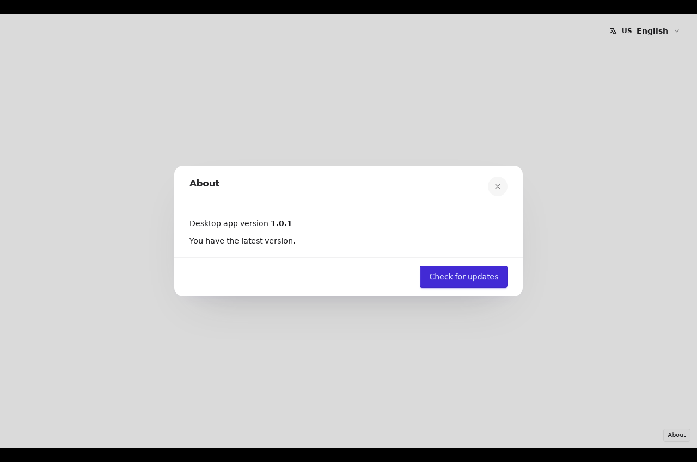

# Compile, build images and package native apps

<!-- translation: partial -->

[First delivery](workflow.en.md) · [Previous: develop](develop.en.md) · [Next: deploy](../operations/deployment.md) · [Chinese original](build.md)

Choose the target for the artifact you plan to ship. Run these commands from the generated project root.

```sh
pnpm build
pnpm build --target image --concurrency 2
pnpm build --target image --images web
pnpm build --target desktop --platform windows --arch x64
pnpm build --target app --platform android --runtime auto --debug
pnpm build --target app --platform android --runtime auto
```

The first command compiles the source. Image builds package `serv` and/or `web`. The desktop command builds a Windows x64 release. The two Android commands build a debug installer and a release installer respectively. To build one image at a time, use `--concurrency 1`. Use `cap:sync` to synchronize web assets into the native project before packaging. Build and deploy read separate sections of [`hai.json`](../configuration/delivery.md#配置入口和角色).

Choose `--image-source cn --npm-source cn` to use the configured mirrors, or set `--proxy-mode` to `inherit`, `system`, `custom`, or `none`. The initial interactive selection is saved for the project. `--yes` reuses it. [Download sources and proxies](../configuration/delivery.md#下载源和代理)

<a id="browser-startup"></a>

## Browser startup check

A standalone script in the page's HTML checks the browser before the main app loads. A browser known to be below the minimum sees a localized update page with its detected version and a link to the vendor. After updating, revisit the site. Browsers whose version cannot be detected still attempt startup.

| Browser or platform | Minimum |
| --- | --- |
| Chrome and Edge | 111 |
| Firefox | 114 |
| Safari | 16.4 |
| iOS and iPadOS browsers | OS 16.4 |

New admin, website, h5, and fullstack Web projects include the check. To add it to an existing app, copy [startup.js and its companion files](../../../packages/cli/templates/shared/browser-check/) to `static/_hai/browser-check/` for SvelteKit or `public/_hai/browser-check/` for Vite. Add the appropriate tag before the main scripts and styles.

```html
<!-- SvelteKit src/app.html -->
<script id="hai-browser-startup" src="%sveltekit.assets%/_hai/browser-check/startup.js"></script>
<!-- Vite Web index.html -->
<script id="hai-browser-startup" src="./_hai/browser-check/startup.js"></script>
```

Deploy all three files under the same site path. Test a simulated old browser while blocking the main app's JavaScript and CSS, then verify normal startup on a supported browser.

<a id="verify-artifact"></a>

## Identify and verify the artifact

The root `package.json` supplies the project name and version. An image batch goes under `.hai/build/docker/build-<project>-image-<buildId>/`. The manifest records roles, platform, the checksum, and whether the batch is partial. A successful export advances the local `latest` pointer. Rebuilding the same version creates a different build ID.

```sh
# Build the current project image and print the build result as JSON for automation.
hai build --target image --json
```

On success the CLI emits one JSON line on stdout, with `schemaVersion: 1`, absolute `artifactDir` and `manifestPath`. Progress and failures go to stderr. Use `manifest.images[].file` to locate archives within that directory. Keep each concurrent task's own result and pass its `artifactDir` to `hai deploy --artifact-dir`. Use `deploy.readDeploymentArtifact(artifactDir)` to verify archives and SHA-256 checksums.

`manifest.source` reports the observed Git commit and whether the project and build inputs had changes. A commit the CLI could not identify is `unknown`, and an incomplete dirty check gives `null`. Use a clean checkout pinned to the intended commit for traceable releases. Check `manifest.images[].platform` against the target architecture. Source builds and image builds keep runtime credentials separate. Check the target requirements before deploying a partial batch.

<a id="native-builds"></a>

## Package a native app

Use `--runtime auto`, `docker`, or `podman` to build Android in a container. A first debug build can generate an Android shell in the work copy. Release builds need the existing Android project and signing variables `HAI_ANDROID_KEYSTORE`, `HAI_ANDROID_STORE_PASSWORD`, `HAI_ANDROID_KEY_ALIAS`, and `HAI_ANDROID_KEY_PASSWORD`. Inject passwords through the build process or CI. Use macOS and Xcode to sign and export iOS, and Tauri on the appropriate system for desktop.

The default is a release. `--debug` selects a debug build. Each platform and build type writes its own batch and `latest` under `.hai/build/app/` or `.hai/build/desktop/`. Prepare base images and dependency caches before building offline.

Core's `name` sets the Capacitor display name and the Tauri product name and main window title. The build resolves `HAI_CORE_NAME` with the same precedence as other Core settings. Fullstack projects read the server workspace's `_core.yml` and project-root environment files. Existing native projects also need their platform display-name setting updated and a new installer built. Native package naming, environment selection, and per-window overrides are covered in the [Chinese original](build.md#原生应用名称).

<a id="desktop-updates"></a>

### Desktop app updates

The desktop example and newly generated Fullstack Desktop apps support optional updates for Linux x64 AppImage and Windows x64 NSIS releases. Updates are off by default. An enabled app checks once at startup and shows a notification when a newer version is available. Users can open **About** before signing in to see the current version or check manually. They can postpone the update. Download and installation start after they confirm **Download and install**. Save your work before confirming. On Linux, choose **Restart now** after installation. On Windows, the app closes during installation. Check the version after opening the app again.



This example updates a Fullstack project called `orders` from `1.2.0` to `1.3.0` on Linux x64. Run the commands from the project root. On Windows, use `pnpm.cmd` in PowerShell.

1. Generate a Tauri update signing key for this app. Replace the example path with an existing protected directory outside the project. Keep the private key and its password for future releases. The app needs the contents of the `.pub` file.

   ```sh
   # Create orders.key and orders.key.pub. Use the same private key for later releases.
   pnpm --filter orders-desktop tauri signer generate -w "$HOME/release-secrets/orders.key"
   ```

2. Merge these fields into `apps/orders-desktop/src-tauri/tauri.linux.conf.json`. On Windows, use `tauri.windows.conf.json` in the same directory. Fill `pubkey` with the contents of the `.pub` file, and set the update manifest's HTTPS URL without credentials, a query string, or a fragment. These settings ship with the release. Keep the Tauri `identifier`, feed URL, and public key consistent across versions. `requireSignedVersion` requires the signed version to match the version in the manifest. Redirects for the manifest and installer must also use HTTPS.

   ```json
   {
     "plugins": {
       "updater": {
         "endpoints": ["https://releases.example.com/orders/linux/latest.json"],
         "pubkey": "REPLACE_WITH_PUBLIC_KEY_CONTENT",
         "requireSignedVersion": true
       }
     }
   }
   ```

3. Set `package.json.version` in the project root to `1.3.0` and build on the target operating system. The CLI prints the archive paths. On Linux, copy the `.AppImage` to the release directory for signing. On Windows, use `--platform windows`, select the `*-setup.exe` file, and apply Windows code signing first if required. Keep `bundle.createUpdaterArtifacts` at its disabled default. In a separate signing step, supply the private key via `TAURI_SIGNING_PRIVATE_KEY` and its password, if set, via `TAURI_SIGNING_PRIVATE_KEY_PASSWORD`.

   ```sh
   # Build the Linux x64 package using the root package.json version. Stop if this fails.
   pnpm build --target desktop --platform linux --arch x64
   # Sign the staged AppImage. Tauri writes an .AppImage.sig file beside it.
   pnpm --filter orders-desktop tauri signer sign --app-version 1.3.0 "$HOME/release/orders-linux-x64-release-1.3.0.AppImage"
   ```

4. Upload the release file to a distinct HTTPS URL for this platform and version, then publish `latest.json` to the URL configured in step 2. Replace `signature` with the contents of the generated `.sig` file. For Windows, use a separate release directory and feed such as `https://releases.example.com/orders/windows/latest.json`. Put the NSIS URL and signature under `windows-x86_64`. To share a feed, merge both platform entries for the same version before publishing. After the user confirms, the app downloads, verifies, and installs the release. See the [Tauri update manifest format](https://v2.tauri.app/plugin/updater/#static-json-file).

   ```json
   {
     "version": "1.3.0",
     "platforms": {
       "linux-x86_64": {
         "url": "https://releases.example.com/orders/linux/1.3.0/orders-linux-x64-release-1.3.0.AppImage",
         "signature": "REPLACE_WITH_SIGNATURE_FILE_CONTENT"
       }
     }
   }
   ```

In an isolated target environment, launch `1.2.0` with the same feed and public key. On Linux, put the AppImage in a writable directory, add execute permission, and run it directly. On Windows, install the older release with NSIS. Use a test feed to verify postponement, installation, and the new version shown after reopening the app. Also check an up-to-date installation, an unreachable feed, a missing package for the target platform, and a mismatch in the signature or signed version. For the repository example, the manual [Desktop update package](../../../.github/workflows/desktop-update.yml) workflow can produce the release file, signature, and manifest.

Before delivery, check the new installer on the target device and verify the image checksums, user flow, and persistent data for a server release.
