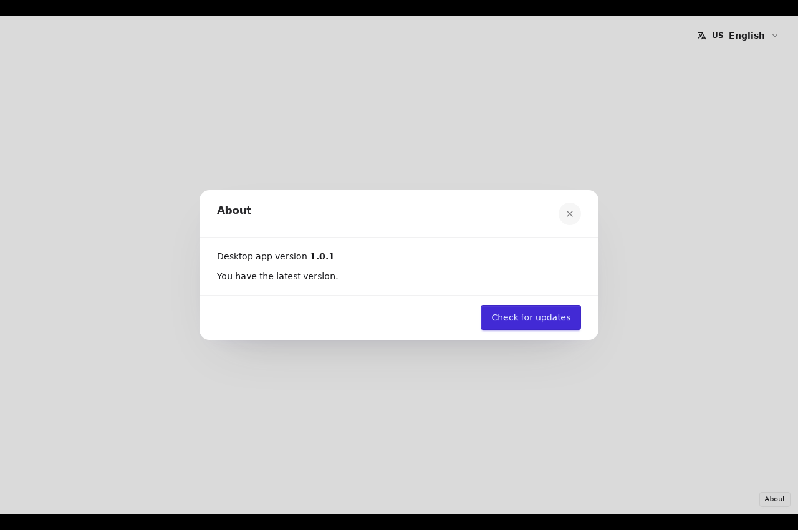

# コンパイル・イメージ作成・ネイティブパッケージ

<!-- translation: partial -->

[初回リリースの手順](workflow.ja.md) · [前へ：開発](develop.ja.md) · [次へ：デプロイ](../operations/deployment.md) · [中国語の原文](build.md)

配布する成果物に合ったターゲットを選び、生成したプロジェクトのルートでコマンドを実行します。

```sh
pnpm build
pnpm build --target image --concurrency 2
pnpm build --target image --images web
pnpm build --target desktop --platform windows --arch x64
pnpm build --target app --platform android --runtime auto --debug
pnpm build --target app --platform android --runtime auto
```

最初のコマンドはソースをコンパイルします。イメージのビルドでは `serv`、`web`、または両方を作成します。デスクトップ用の例は Windows x64 のリリースをビルドします。Android 用の二つはそれぞれデバッグ用とリリース用のインストーラーを作ります。一度に一つだけイメージを作成する場合は `--concurrency 1` を使います。`cap:sync` はパッケージ作成前に Web リソースをネイティブプロジェクトへ同期します。ビルドとデプロイは [`hai.json`](../configuration/delivery.md#配置入口和角色) の別々の項目を参照します。

設定済みのミラーを使うには `--image-source cn --npm-source cn` を指定します。プロキシは `--proxy-mode` の `inherit`、`system`、`custom`、`none` から選びます。初回の対話で選んだ値は保存され、`--yes` で再利用できます。[ダウンロード元とプロキシ](../configuration/delivery.md#下载源和代理)

<a id="browser-startup"></a>

## ブラウザの起動前チェック

ページの HTML にある独立したスクリプトが、アプリを読み込む前にブラウザを調べます。最低バージョンより古いと確認できた場合は、現在のバージョンと提供元の更新リンクを含む案内ページを表示します。更新後は元のサイトを開き直してください。バージョンを特定できない場合は通常どおり起動を試みます。

| ブラウザ・プラットフォーム | 最低バージョン |
| --- | --- |
| Chrome、Edge | 111 |
| Firefox | 114 |
| Safari | 16.4 |
| iOS・iPadOS のブラウザ | OS 16.4 |

新規の admin、website、h5、fullstack Web にはチェックが組み込まれています。既存アプリに追加する場合は [startup.js と同じディレクトリのファイル](../../../packages/cli/templates/shared/browser-check/) を、SvelteKit なら `static/_hai/browser-check/`、Vite なら `public/_hai/browser-check/` にコピーします。アプリのスクリプトとスタイルより前に対応するタグを追加します。

```html
<!-- SvelteKit src/app.html -->
<script id="hai-browser-startup" src="%sveltekit.assets%/_hai/browser-check/startup.js"></script>
<!-- Vite Web index.html -->
<script id="hai-browser-startup" src="./_hai/browser-check/startup.js"></script>
```

三つのファイルをサイトと同じパスの下に配置します。古いブラウザを模擬してアプリ本体の JavaScript と CSS を遮断しても案内が表示されること、対応ブラウザでは通常起動することを確認します。

<a id="verify-artifact"></a>

## 成果物の識別と確認

ルートの `package.json` がプロジェクト名とバージョンの取得元です。イメージのビルド結果は `.hai/build/docker/build-<project>-image-<buildId>/` に保存されます。マニフェストにはサービスの種類、プラットフォーム、チェックサム、部分ビルドかどうかが記録されます。すべての出力に成功するとローカルの `latest` が更新されます。同じバージョンを再ビルドすると異なるビルド ID が割り当てられます。

```sh
# 現在のプロジェクトのイメージをビルドし、自動処理用の JSON 結果を出力する。
hai build --target image --json
```

成功時の標準出力は、`schemaVersion: 1` と絶対パスの `artifactDir`、`manifestPath` を含む JSON 一行です。進捗とエラーは標準エラーに出力します。アーカイブは `manifest.images[].file` を使って成果物ディレクトリから探します。並行実行では各タスクの結果を保存し、その `artifactDir` を `hai deploy --artifact-dir` に渡します。`deploy.readDeploymentArtifact(artifactDir)` でアーカイブと SHA-256 を検証できます。

`manifest.source` は認識した Git コミットと、プロジェクトおよび対象のビルド入力に変更があるかを記録します。コミットが判定できない場合は `unknown`、変更を完全に確認できない場合は `null` です。リリースを追跡できるように、対象コミットを固定し、未コミットの変更がない状態でビルドします。`manifest.images[].platform` と対象アーキテクチャも比較してください。ソースとイメージは実行時の認証情報を含めずにビルドします。部分ビルドを配布する前に対象環境の条件を確認します。

<a id="native-builds"></a>

## ネイティブアプリをパッケージ化する

Android をコンテナでビルドするには `--runtime auto`、`docker`、`podman` のいずれかを指定します。初回のデバッグビルドでは作業用コピーに Android プロジェクトを生成できます。リリースには既存の Android プロジェクトと署名用の `HAI_ANDROID_KEYSTORE`、`HAI_ANDROID_STORE_PASSWORD`、`HAI_ANDROID_KEY_ALIAS`、`HAI_ANDROID_KEY_PASSWORD` が必要です。パスワードはビルドプロセスや CI から渡します。iOS の署名と出力には macOS と Xcode、デスクトップには対象 OS 上の Tauri を使います。

既定はリリースビルドです。`--debug` でデバッグ版を選びます。プラットフォームとビルド種別ごとに、`.hai/build/app/` または `.hai/build/desktop/` の下に成果物と `latest` が作られます。オフラインでビルドする場合はベースイメージと依存関係のキャッシュを前もって用意します。

Core の `name` は Capacitor の表示名と Tauri の製品名・メインウィンドウのタイトルに使われます。`HAI_CORE_NAME` には他の Core 設定と同じ上書き順序が適用されます。fullstack ではサーバーワークスペースの `_core.yml` とプロジェクトルートの環境ファイルを参照します。既存のネイティブプロジェクトではプラットフォーム側の表示名も更新してインストーラーを作り直します。命名規則、環境の選択、ウィンドウごとの上書きは [中国語の原文](build.md#原生应用名称) にあります。

<a id="desktop-updates"></a>

### デスクトップアプリの更新

デスクトップサンプルと新規生成した Fullstack Desktop アプリでは、Linux x64 AppImage と Windows x64 NSIS のリリース版でアプリ内更新を有効にできます。既定は無効です。有効なアプリは起動時に一度だけ確認し、新しいバージョンが見つかると通知します。サインイン前でも「アプリについて」を開いて現在のバージョンを確認し、手動で「更新を確認」を選べます。更新は後回しにでき、「ダウンロードしてインストール」を確定すると開始します。先に作業を保存してください。Linux ではインストール後に「今すぐ再起動」を選びます。Windows ではインストール時にアプリが終了します。再度開いたらバージョンを確認します。



以下は Linux x64 で Fullstack プロジェクト `orders` を `1.2.0` から `1.3.0` へ更新する例です。プロジェクトルートで実行します。Windows の PowerShell では `pnpm.cmd` を使います。

1. このアプリ専用の Tauri 更新署名鍵を生成します。例のパスは、プロジェクト外に用意した保護ディレクトリに置き換えてください。秘密鍵とパスワードは後続リリースのために保管します。アプリには `.pub` ファイルの内容を渡します。

   ```sh
   # orders.key と orders.key.pub を生成する。次回以降も同じ秘密鍵で署名する。
   pnpm --filter orders-desktop tauri signer generate -w "$HOME/release-secrets/orders.key"
   ```

2. `apps/orders-desktop/src-tauri/tauri.linux.conf.json` に以下の項目を追加します。Windows では同じディレクトリの `tauri.windows.conf.json` を使います。`pubkey` には `.pub` ファイルの内容、`endpoints` には更新マニフェストを公開する HTTPS URL を入れます。URL には認証情報、クエリ、フラグメントを含めません。この設定は配布物に含まれます。Tauri の `identifier`、更新先、公開鍵は後続バージョンでも引き継ぎます。`requireSignedVersion` を有効にすると、署名に含まれるバージョンとマニフェストのバージョンの一致が必要になります。 更新マニフェストやインストーラーのリダイレクトにも HTTPS が必要です。

   ```json
   {
     "plugins": {
       "updater": {
         "endpoints": ["https://releases.example.com/orders/linux/latest.json"],
         "pubkey": "REPLACE_WITH_PUBLIC_KEY_CONTENT",
         "requireSignedVersion": true
       }
     }
   }
   ```

3. ルートの `package.json.version` を `1.3.0` に変更し、対象 OS でビルドします。CLI が今回の成果物のパスを表示します。Linux では `.AppImage` を配布用ディレクトリにコピーして署名します。Windows では `--platform windows` を指定し、`*-setup.exe` を選んで必要な Windows コード署名を先に済ませます。`bundle.createUpdaterArtifacts` は既定の無効のままにします。別の署名ステップで秘密鍵を `TAURI_SIGNING_PRIVATE_KEY`、設定済みの場合はパスワードを `TAURI_SIGNING_PRIVATE_KEY_PASSWORD` で渡します。

   ```sh
   # ルートの package.json のバージョンで Linux x64 の配布物を作成する。失敗したら配布を中止する。
   pnpm build --target desktop --platform linux --arch x64
   # 配布用ディレクトリの AppImage に署名する。Tauri が隣に .AppImage.sig を出力する。
   pnpm --filter orders-desktop tauri signer sign --app-version 1.3.0 "$HOME/release/orders-linux-x64-release-1.3.0.AppImage"
   ```

4. プラットフォームとバージョンごとに固有の HTTPS URL に配布ファイルをアップロードしてから、手順 2 の URL に `latest.json` を公開します。`signature` は今回生成した `.sig` の内容に置き換えます。Windows では、`https://releases.example.com/orders/windows/latest.json` のように配布ディレクトリと更新先を分け、`windows-x86_64` に NSIS の URL と署名を指定します。更新先を共有する場合は、同じバージョンの両プラットフォームの項目を統合してから公開します。ユーザーの確定後、アプリが配布ファイルを取得し、署名を検証してインストールします。[Tauri の更新マニフェスト形式](https://v2.tauri.app/plugin/updater/#static-json-file)

   ```json
   {
     "version": "1.3.0",
     "platforms": {
       "linux-x86_64": {
         "url": "https://releases.example.com/orders/linux/1.3.0/orders-linux-x64-release-1.3.0.AppImage",
         "signature": "REPLACE_WITH_SIGNATURE_FILE_CONTENT"
       }
     }
   }
   ```

隔離した対象環境で、同じ更新先と公開鍵を設定した `1.2.0` を起動します。Linux では、書き込み可能なディレクトリに AppImage を置き、実行権限を付けて直接起動します。Windows では、先に NSIS で旧バージョンをインストールします。テスト用マニフェストを使い、後回し、インストール、再度開いた後のバージョン表示を確認します。すでに最新版の場合、更新先に接続できない場合、対象プラットフォーム用の配布物がない場合、署名や署名に含まれるバージョンが一致しない場合も確認します。リポジトリのサンプルでは手動実行の [Desktop update package](../../../.github/workflows/desktop-update.yml) で配布ファイル、署名、マニフェストを生成できます。

配布前にインストーラーを実機で確認します。サーバーのリリースではイメージのチェックサム、ユーザー操作、永続データを確認します。
