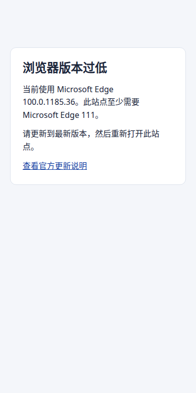

# 编译源码、镜像与原生打包

[首次交付](README.md) · [上一步：开发](develop.md) · [下一步：部署](../operations/deployment.md)

先决定交付什么，再选target。compile编译源码，`image`生成serv/web镜像，app/desktop生成对应原生包；cap:sync只同步资源，不是安装包。

```sh
pnpm build
pnpm build --target image --concurrency 2
pnpm build --target image --images web
pnpm build --target desktop --platform windows --arch x64
pnpm build --target app --platform android --runtime auto --debug
pnpm build --target app --platform android --runtime auto
```

命令在生成工程根运行。镜像默认并行两项，资源紧张时设置 `--concurrency 1`。所需参数、`hai.json`完整例子和真实默认值见[构建部署配置](../configuration/delivery.md#配置入口和角色)，避免在不同流程重复维护。

下载慢时可加 `--image-source cn --npm-source cn`；需要代理时选择 `--proxy-mode inherit|system|custom|none`。首次交互选择保存为项目默认，`--yes` 复用已保存值。自定义源、代理地址及引擎侧设置见[下载源和代理](../configuration/delivery.md#下载源和代理)。

## 浏览器启动检测

Web 入口在 HTML 解析时执行一段独立的经典脚本。检测到低版本后，浏览器进入本站的静态升级页，查看当前版本、最低要求和厂商的更新说明。升级后重新打开原站点即可。升级页使用中、英、日文案，主应用脚本和样式无法加载时也能显示。



| 浏览器或系统 | 最低版本 |
| --- | --- |
| Chrome | 111 |
| Edge | 111 |
| Firefox | 114 |
| Safari | 16.4 |
| iOS / iPadOS 上的浏览器 | 系统 16.4 |

门槛沿用 Vite 8 的默认构建基线。已知低版本触发升级页，无法确定版本的浏览器继续尝试启动。原生 App 和 Desktop 由其宿主处理更新。[Vite 构建目标](https://vite.dev/config/build-options.html#build-target)

新生成的 admin、website、h5 和 Fullstack Web 已接入。迁移现有工程时，将 [startup.js](../../../packages/cli/templates/shared/browser-check/startup.js) 及同目录的升级 HTML 和样式复制到 SvelteKit 的 `static/_hai/browser-check/` 或 Vite 的 `public/_hai/browser-check/`，然后将对应标签放在入口 HTML 的 head 中，位于应用脚本和样式前。

```html
<!-- SvelteKit src/app.html -->
<script id="hai-browser-startup" src="%sveltekit.assets%/_hai/browser-check/startup.js"></script>
<!-- Vite Web index.html -->
<script id="hai-browser-startup" src="./_hai/browser-check/startup.js"></script>
```

发布子目录时一起部署这三个同源资源。验收时可模拟低版本，并暂时阻断主应用 JS 和 CSS。确认升级页仍可打开，再用当前版本访问站点检查正常启动。

## 核对身份和产物

`package.json.name`是资源身份，`version`是应用版本。镜像批次保存在 `.hai/build/docker/build-<工程>-image-<构建ID>/`，manifest记录版本、构建ID、镜像角色、partial、`hasWeb`和SHA-256。网站挂载目录由构建工具记录；发布到子目录时按[网站子目录配置](../configuration/delivery.md#网站部署在子目录)。相同版本允许重建，由`buildId`与镜像引用区分；只有全部导出成功才推进本机构建入口。

### 在自动化中使用本次结果

```sh
hai build --target image --json
```

直接调用已安装的 `hai`，命令在成功时向 stdout 写一行 JSON，构建进度和失败信息写到 stderr。机器调用读取 `schemaVersion: 1`、绝对路径 `artifactDir` 和 `manifestPath`，并用 `manifest.images[].file` 定位该目录内的归档。并发任务各自保存返回的结果。交付时将 `artifactDir` 传给 `hai deploy --artifact-dir`，或调用 `readDeploymentArtifact(artifactDir)` 校验归档和 SHA-256。

`manifest.source` 记录启动时观察到的 Git 提交，以及工程目录、所选镜像构建上下文和 Dockerfile 是否有未提交改动。例如应用使用仓库根作为 context 时，兄弟包的修改也会令 `dirty` 为 true。无法识别提交时为 `unknown`；输入跨越所属仓库或无法完整检查时，`dirty` 为 `null`。检查沿用 Git 对未忽略文件的状态，不是构建输入的内容证明。`manifest.images[].platform` 来自实际镜像，例如 `linux/arm64`。需要可追溯的发布时，构建 Worker 应从固定提交的干净检出启动。旧镜像清单可以省略来源和平台。

### 统一命名

构建 ID 使用 `YYYYMMDD-HHmmss-<6位随机串>-<版本>`，与 deploy 共用 Core 的本地日期格式；时间取构建机本地时区，当前示例为 `Asia/Shanghai`。随机串区分同秒构建。工程标识取工程根 `package.json.name`，归一化规则与部署一致：去掉 scope、转小写、将不合法字符替换为连字符。应用显示名继续使用 Core `name`。

| 产物 | 示例 |
| --- | --- |
| 镜像批次 | `build-todo-image-20261105-171924-62e4f1-0.1.0` |
| Android 批次 | `build-todo-app-android-debug-20261105-171924-62e4f1-0.1.0` |
| Windows 批次 | `build-todo-desktop-windows-x64-release-20261105-171924-62e4f1-0.1.0` |
| Android 安装包 | `todo-android-debug-0.1.0.apk` |
| Windows 安装包 | `todo-windows-x64-release-0.1.0-setup.exe` |
| 部署交付包 | `bundle-todo-prod-20261105-171924-62e4f1-0.1.0`，保持现有格式 |

原生文件名包含平台、架构（Desktop）、debug/release 和版本，Android ABI/flavor 等输出差异继续保留；其他原生格式沿用 `.ipa`、`.dmg`、`.app`、`.deb`、`.AppImage`。只调整 `.hai/build` 中的归档名称，Gradle/Tauri 自身的工作目录和文件名仍由原生工具管理。`latest` 存批次相对目录名，manifest 中的 `buildId` 保持短标识；旧构建目录、旧 `latest` 和旧镜像清单仍可读取，无须改写历史产物。

源码与镜像构建不选择生产环境、不注入运行密钥；镜像可跨环境复用。部分镜像制品不等于首次完整安装，部署模式由manifest和所选服务判断。旧格式/旧角色名需要重新构建，不只改文件名。

## 原生和离线条件

Android 指定 `--runtime auto|docker|podman` 后在容器内准备依赖、编译并打包。首次调试构建可在工作副本生成 Android 壳，发布需要项目已有的原生工程。设置 `HAI_ANDROID_KEYSTORE`（密钥库路径）、`HAI_ANDROID_STORE_PASSWORD`、`HAI_ANDROID_KEY_ALIAS` 和 `HAI_ANDROID_KEY_PASSWORD` 后执行发布命令，密码从构建进程或 CI 注入。iOS 在 macOS/Xcode 上签名导出 IPA，桌面在对应系统调用 Tauri。

原生包默认 release，加 `--debug` 选择调试构建。产物归档在 `.hai/build/app/<android|ios>/<debug|release>/<批次目录>/` 或 `.hai/build/desktop/<windows|macos|linux>/<debug|release>/<批次目录>/`。每种构建类型各有 `latest`，成功后打印新产物路径。完全离线构建需提前准备基础镜像与依赖缓存。

### 原生应用名称

App 的 Capacitor `appName`、Desktop 的 Tauri `productName` 和主窗口初始标题共用 Core 名称。独立应用读取本目录 `config/_core.yml`；Fullstack 读取 `packages/<项目名>-serv/config/_core.yml`，环境文件位于工程根。

```yaml
# config/_core.yml；Fullstack 放在服务 workspace 的 config/ 下
name: ${HAI_CORE_NAME:订单工作台}
```

在 `.env.prod` 设置 `HAI_CORE_NAME=订单工作台正式版` 后，`pnpm build --target app --platform android` 的 Capacitor 配置名称，以及 `pnpm build --target desktop --platform windows --arch x64` 的产品名和主窗口标题都会解析为“订单工作台正式版”。完整优先级为进程 > `.env.<mode>.local` > `.env.local` > `.env.<mode>` > `.env` > YAML。

父级 `HAI_CORE` 接收 JSON 对象并整段替换 YAML。若进程只设置 `HAI_CORE='{"env":"production"}'`，且同级没有 `HAI_CORE_NAME`，直接使用 Capacitor 或 Tauri 与通过 `hai build` 打包都会得到 Core 默认名 `hai Admin`。需要保留指定名称时，在父 JSON 中填写 `name`，或在同级设置 `HAI_CORE_NAME`。

正式原生打包默认使用 `prod`，Tauri `tauri:dev` 使用 `dev`。Capacitor 直接命令优先使用 `NODE_ENV`，未设置时使用 `prod`；进程 `HAI_CORE_ENV=development|test|production|staging` 可显式选择模式，development/production 映射为 dev/prod。这是原生名称的构建输入：解析后只把名称交给原生配置，环境文件中的服务端秘密不会进入该配置；源码编译和 serv/web 镜像仍不加载部署环境文件。

Desktop 使用生成的 `pnpm tauri dev|build|bundle` 或 `tauri:dev` / `tauri:build` 入口，通过 Tauri `--config` 覆盖名称，保留安装包版本和窗口设置，不回写 `tauri.conf.json`。直接调用 `pnpm exec tauri` / `cargo tauri` 会绕过此入口；调用方显式追加的 `--config` 仍有最终覆盖权。

窗口覆盖先读取当前桌面平台的 `tauri.windows.conf.json`、`tauri.macos.conf.json` 或 `tauri.linux.conf.json`，保留平台窗口数组及删除设置。多窗口时优先更新 `label: main`（省略 label 也表示 main），没有该标签才使用第一个窗口；辅助窗口标题保持原值。平台配置与数组替换规则沿用 [Tauri 配置合并](https://v2.tauri.app/develop/configuration-files/)。

Android 容器构建先在宿主按同一优先级解析名称和所选模式，再通过环境变量传给构建容器；工作副本继续排除 `.env*` 与签名材料，签名仍在独立步骤进行。

名称属于原生产物，修改后需重新打包。Capacitor 已有 Android/iOS 工程不会因为修改 `appName` 自动重命名：Android 同步 `android/app/src/main/res/values/strings.xml` 的 `app_name` / `title_activity_main`，iOS 同步 Xcode 的 Display Name（`CFBundleDisplayName`），再构建。应用标识 `appId` / `identifier` 仍单独配置。

发布仍排除开发热更新地址并核对实际新产物；Windows 依赖目录不能代替 Linux 镜像输入。

交付前检查目标架构、镜像校验和、用户流程与持久数据；原生需真实设备验收。准备好制品后进入[发布运行章节](../operations/README.md)。
