# Build an Orders Console with Serv

[中文](serv.md) · [日本語](serv.ja.md) · [Serv API reference](../function/serv.en.md) · [Configuration](../configuration/serv.en.md) · [Data structures](../data/serv.en.md)

Build the HTTP API for one Node-based Orders Console. Continue from the previous application as you add permissions and media operations.

<a id="quick-start"></a>

## 1. Start with a status endpoint

The first requirement for `orders-console` is to let the frontend check whether the order service is ready. The status endpoint returns `{ success: true, data: { status: "ready" } }`. Install these dependencies in an empty project and use a Node version supported by the package manifest.

```sh
pnpm add @h-ai/serv @h-ai/core @h-ai/api-contract zod
```

Create `status-contract.mts`. The Node service and browser client will share this contract.

```ts
import { apiContract } from '@h-ai/api-contract'
import { z } from 'zod'

// Declare GET /status. Serv mounts it at /api/v1/status under the default business prefix.
export const contract = {
  status: apiContract.route({ method: 'GET', path: '/status' })
    .output(apiContract.haiResultSchema(z.object({ status: z.literal('ready') }))),
}
```

Create `app.mts` and mount the contract and implementation in the same application.

```ts
import { core } from '@h-ai/core'
import { type ServContext, serv } from '@h-ai/serv'
import { contract } from './status-contract.mts'

export { contract }

// Bind the status operation and return ready on success.
export const procedures = serv.implement(contract).context<ServContext>()
  .route('status', () => core.ok({ status: 'ready' as const }))
  .build()
// Assemble the contract and its handlers. Invalid options throw during app creation.
export const app = serv.createApp({ contract, procedures })
```

Create `check.mts` and run `node check.mts`. It makes in-process requests and exits after checking the results.

```ts
import assert from 'node:assert/strict'
import { app } from './app.mts'

// Send an in-process status request to the assembled application. A failed assertion stops the check.
const response = await app.request('/api/v1/status')
assert.equal(response.status, 200)
assert.deepEqual(await response.json(), { success: true, data: { status: 'ready' } })
assert.equal((await app.request('/api/v1/missing')).status, 404)
```

To give a gateway or browser a real HTTP port, add `start.mts`. Run `node start.mts` and run `curl -i http://127.0.0.1:3000/api/v1/status` in another terminal. Expect HTTP 200 and the same JSON. Press Ctrl+C to stop the listener.

```ts
import { serv } from '@h-ai/serv'
import { app } from './app.mts'

// Bind locally. onClose runs after the listener stops and will release application dependencies later.
serv.listen(app, { host: '127.0.0.1', port: 3000, onClose: async () => {} })
```

Kit starts with the same requirement and response. [Kit quick start](kit.en.md#quick-start)

<a id="orders-console-walkthrough"></a>

## Extend the same orders console

Continue editing the same `app.mts` and `start.mts` in the following steps. Keep the existing contracts, handlers, and options. Replace identity wiring where a step says to do so. Verify each step before continuing. The links at the end of each step cover defaults, fields, and signatures. [All app options](../function/serv.en.md#host-options)

<a id="orders-console-validation"></a>

### 2. Preview an order and explain invalid input

An order operator submits a title. The API trims it and returns it in the preview. Implement input validation first, then restrict previews and reports in the next step.

Add `orders.mts`. The operation key `preview` selects a handler. The contract’s `path` and the app’s `http.apiPrefix` determine the HTTP address.

```ts
import { apiContract } from '@h-ai/api-contract'
import { core } from '@h-ai/core'
import { type ServContext, serv } from '@h-ai/serv'
import { z } from 'zod'

const OrderTitleSchema = z.object({ title: z.string().trim().min(1) })

// Declare the required title field. A missing field returns HTTP 400 before the handler runs.
export const orderContract = {
  preview: apiContract.route({ method: 'POST', path: '/orders/preview' })
    .input(z.object({ title: z.string() }))
    .output(apiContract.haiResultSchema(z.object({ preview: OrderTitleSchema }))),
}

export const orderProcedures = serv.implement(orderContract).context<ServContext>()
  .route('preview', ({ input, context }) => {
    // Select the request locale and trim the title. Return field errors in the failure result and normalized data on success.
    const locale = serv.resolveRequestLocale(context.request.headers)
    const checked = serv.validateInputOrFail(OrderTitleSchema, input, locale)
    if (!checked.success)
      return checked
    return core.ok({ preview: checked.data })
  })
  .build()
```

Import `orders.mts` in `app.mts`. Keep the original `contract` and `procedures` and replace the final app creation with this code:

```ts
import { orderContract, orderProcedures } from './orders.mts'

// Preserve the status route and add the order preview contract and implementation.
export const app = serv.createApp({
  contract: { ...contract, ...orderContract },
  procedures: { ...procedures, ...orderProcedures },
})
```

Restart `node start.mts` and verify:

```sh
curl -i http://127.0.0.1:3000/api/v1/orders/preview \
  -H 'Content-Type: application/json' --data '{"title":"  Office supplies  "}'
```

A valid request returns HTTP 200 with `data.preview.title: "Office supplies"`. Omitting `title` returns HTTP 400. A whitespace-only string passes contract parsing, then returns `success: false` from the handler at HTTP 200 with field details in `error.cause`. [Validation API](../function/serv.en.md#validation-example) · [The same step in Kit](kit.en.md#orders-console-validation)

<a id="orders-console-auth"></a>

### 3. Give operators and auditors different access

The preview now uses internal order data. In `orders.mts`, change `.route('preview', ({ input, context }) => {` to `.route('preview').permission('orders:write').handle(({ input, context }) => {` and keep the validation code. Then add a current report that only auditors can read.

Add `reports.mts`. The response’s `owner` comes from the verified request identity.

```ts
import { apiContract } from '@h-ai/api-contract'
import { core } from '@h-ai/core'
import { type ServContext, serv } from '@h-ai/serv'
import { z } from 'zod'

export const reportContract = {
  currentReport: apiContract.route({ method: 'GET', path: '/reports/current' })
    .output(apiContract.haiResultSchema(z.object({ owner: z.string(), summary: z.string() }))),
}
export const reportSummary = 'Quarterly summary'
// Require the audit role and report permission on the current report.
export const reportProcedures = serv.implement(reportContract).context<ServContext>()
  .route('currentReport').role('auditor').permission('reports:read')
  .handle(({ context }) => core.ok({ owner: context.session.userId, summary: reportSummary }))
  .build()
```

Use `orders-test-identity.mts` to test the guards locally. These Bearer values are fixture identifiers. IAM will supply real identities, roles, and permissions in the next step.

```ts
import { core, HaiCommonError } from '@h-ai/core'

// Map fixture identities to sessions and reject unknown values.
export async function verifyToken(token: string) {
  if (token === 'local-operator')
    return core.ok({ userId: 'operator-1', roles: [], permissions: ['orders:write'] })
  if (token === 'local-auditor')
    return core.ok({ userId: 'auditor-1', roles: ['auditor'], permissions: ['reports:read'] })
  return core.err(HaiCommonError.UNAUTHORIZED)
}
```

Import both files in `app.mts` and replace the app creation code with the following. The status and preview routes stay in the app.

```ts
import { verifyToken } from './orders-test-identity.mts'
import { reportContract, reportProcedures } from './reports.mts'

// Keep existing routes and add the current report and verifier.
export const app = serv.createApp({
  contract: { ...contract, ...orderContract, ...reportContract },
  procedures: { ...procedures, ...orderProcedures, ...reportProcedures },
  auth: { verifyToken },
})
```

Run `node start.mts`. Request `GET /api/v1/reports/current` with `Authorization: Bearer local-auditor` to get `data.owner: "auditor-1"`. With `local-operator`, HTTP 200 contains `error.httpStatus: 403`. Without a Bearer value, the field is 401. Repeat the preview request with `local-operator` to get the trimmed title.

In both Serv and Kit, `auth.verifyToken` returns `HaiResult<HttpSession>`. On success, the host reads the verified identity from `data`. A missing token or a definitive 4xx rejection leaves the request unauthenticated. If an identity service failure returns 503, the HTTP response is 503 and the report handler never runs.

To use another identity provider, keep `auth.verifyToken` and call that provider’s token verifier. To add a trusted tenant field on all routes, replace the option with `createContext` below. Because this callback handles session creation, call `serv.buildAuthContextFactory(verifyToken)` first and then add the scope. The next step uses IAM instead.

To switch to `createContext`, replace the previous app creation with the following code.

```ts
const authenticateOrders = serv.buildAuthContextFactory(verifyToken)

export const app = serv.createApp({
  contract: { ...contract, ...orderContract, ...reportContract },
  procedures: { ...procedures, ...orderProcedures, ...reportProcedures },
  // Add the application’s scopeId to the verified context.
  createContext: async input => ({ ...await authenticateOrders(input), scopeId: 'orders-console' }),
})
```

The response also contains `data.summary: "Quarterly summary"`, which the export and voice stages reuse.

[Guards and input types](../function/serv.en.md#authorization-example) · [Context precedence](../function/serv.en.md#auth-context-api) · [The same step in Kit](kit.en.md#orders-console-auth)

<a id="orders-console-iam"></a>

### 4. Connect IAM and browser sessions

Colleagues can now use the console. With real identity verification in place, the browser can renew a short-lived access token using an HttpOnly cookie. Install the direct dependencies and open a development SQLite database and cache in this order.

```sh
pnpm add @h-ai/iam @h-ai/cache @h-ai/reldb @h-ai/api-client @h-ai/crypto
```

Add `identity.mts`. The host supplies an open database and cache to IAM and closes dependencies if setup fails.

```ts
import { cache } from '@h-ai/cache'
import { crypto } from '@h-ai/crypto'
import { iam } from '@h-ai/iam'
import { reldb } from '@h-ai/reldb'

export async function startIdentity() {
  // Open SQLite, the development cache, and Crypto before starting IAM.
  const database = await reldb.init({ type: 'sqlite', database: './orders-console.sqlite' })
  if (!database.success)
    throw new Error(database.error.message)
  try {
    const cached = await cache.init({ type: 'memory' })
    if (!cached.success)
      throw new Error(cached.error.message)
    const cryptography = await crypto.init()
    if (!cryptography.success)
      throw new Error(cryptography.error.message)
    const identity = await iam.init({ seedDefaultData: false })
    if (!identity.success)
      throw new Error(identity.error.message)
  }
  catch (error) {
    await closeIdentity()
    throw error
  }
}

// Release IAM, Crypto, Cache, and the database in reverse order.
export async function closeIdentity() {
  await iam.close()
  await crypto.close()
  await cache.close()
  await reldb.close()
}
```

Update `app.mts`. Remove the previous `auth.verifyToken` or `createContext` and the test verifier import. Keep the business route imports, run `startIdentity()` before app creation, and add standard sign-in, current user, and sign-out routes to the same contract tree.

```ts
import { apiContract } from '@h-ai/api-contract'
import { iam } from '@h-ai/iam'
import { startIdentity } from './identity.mts'

await startIdentity()

// Mount only standard account operations used by the console.
const { login, currentUser, logout } = apiContract.iam.auth
const accountContract = { iam: { auth: { login, currentUser, logout } } }
const account = serv.createIamProcedures({ iam }).auth
const accountProcedures = {
  iam: { auth: { login: account.login, currentUser: account.currentUser, logout: account.logout } },
}

export const app = serv.createApp({
  contract: { ...contract, ...orderContract, ...reportContract, ...accountContract },
  procedures: { ...procedures, ...orderProcedures, ...reportProcedures, ...accountProcedures },
  auth: { iam },
  refreshCookie: {},
})
```

Import `closeIdentity` in `start.mts` and use it as `onClose`. Create two development accounts in IAM. Assign `orders:write` to the operator and the `auditor` role with `reports:read` to the auditor. Use internal IDs to assign roles and permissions. Guards check their codes.

Initialize [API Client](../function/api-client.en.md#request-authorization) in the browser layout with `{ baseUrl: "/api/v1", auth: {} }`. Use `apiClient.createAuthActions(apiClient).login(form)` to sign in and save the access token. Once the token expires, visit the account page again and look for the business request, `POST /api/v1/auth/refresh`, and its retry in the browser network panel. The refresh sends a cookie and updates both credentials on success. Call `apiClient.close()` when the browser app unmounts.

[Full browser refresh example](../function/serv.en.md#refresh-browser-session-example) · [Initialize IAM and register](../function/iam.en.md#quick-start) · [Assign permissions](../function/iam.en.md#authorization-arguments)

For a fresh local database, run `provision-accounts.mts` once. Set `ORDERS_DEMO_PASSWORD` in the terminal to a test password accepted by the IAM policy before running it. Use the script on a new development database.

```ts
import type { HaiResult } from '@h-ai/core'
import { iam } from '@h-ai/iam'
import { closeIdentity, startIdentity } from './identity.mts'

function checked<T>(result: HaiResult<T>): T {
  if (!result.success)
    throw new Error(result.error.message)
  return result.data
}

const password = process.env.ORDERS_DEMO_PASSWORD
if (!password)
  throw new Error('Set ORDERS_DEMO_PASSWORD')
await startIdentity()
try {
  // Create two local accounts and assign the preview and report permissions. Stop on the first failure.
  checked(await iam.authz.createRole({ code: 'user', name: 'User' }))
  const operator = checked(await iam.user.register({ username: 'orders-operator', password })).user
  const auditor = checked(await iam.user.register({ username: 'orders-auditor', password })).user
  const preview = checked(await iam.authz.createPermission({ code: 'orders:write', name: 'Preview orders' }))
  const read = checked(await iam.authz.createPermission({ code: 'reports:read', name: 'Read reports' }))
  const orderRole = checked(await iam.authz.createRole({ code: 'order-operator', name: 'Order operator', permissionIds: [preview.id] }))
  const auditRole = checked(await iam.authz.createRole({ code: 'auditor', name: 'Report auditor', permissionIds: [read.id] }))
  checked(await iam.authz.assignRole(operator.id, orderRole.id))
  checked(await iam.authz.assignRole(auditor.id, auditRole.id))
}
finally {
  await closeIdentity()
}
```

This is `account-client.mts` for the same account page. The server uses the `iam` and `refreshCookie` wiring from step 4.

```ts
import { type IamAuthLoginInput, apiClient } from '@h-ai/api-client'

export async function startAccountApi() {
  // Use /api/v1 on the page’s origin. auth selects the in-memory access token and browser HttpOnly refresh cookie.
  const started = await apiClient.init({ baseUrl: '/api/v1', auth: {} })
  if (!started.success)
    throw new Error(started.error.message)
}

export async function signIn(form: IamAuthLoginInput) {
  // Use credentials from the form. The successful login action stores the access token and the browser receives the refresh cookie.
  const signedIn = await apiClient.createAuthActions(apiClient).login(form)
  if (!signedIn.success)
    return signedIn
  return readAccount()
}

export function readAccount() {
  // Read the profile. API Client tries a refresh after an eligible 401 and retries the profile request once if refresh succeeds.
  return apiClient.iam.auth.currentUser()
}
```

For shared workstations, use a shorter cookie such as `refreshCookie: { cookieName: "orders_refresh", maxAge: 3600, secure: true }`. The browser uses the max age in seconds. IAM still verifies credential validity. A custom identity service can use `refreshCookie.onRefresh` to rotate the old refresh token and return the verified new token pair. For trusted native clients, use the JSON body channel only when `nativeTokenTransport.isRequest` approves the request origin and terminal type. [Cookie and native options](../function/serv.en.md#refresh-cookie) · [Deployment policy](../function/serv.en.md#runtime-security-api)

<a id="orders-console-access"></a>

### 5. Deploy behind a gateway

Add a partner-only report while keeping the internal report and preview. Add `partner.mts` to the same app. The report fixture remains a quarterly summary.

```ts
import { apiContract } from '@h-ai/api-contract'
import { core } from '@h-ai/core'
import { type ServContext, serv } from '@h-ai/serv'
import { z } from 'zod'

export const partnerContract = {
  partnerReport: apiContract.route({ method: 'GET', path: '/external/reports' })
    .output(apiContract.haiResultSchema(z.object({ report: z.string() }))),
}
export const partnerProcedures = serv.implement(partnerContract).context<ServContext>()
  .route('partnerReport', () => core.ok({ report: 'Quarterly summary' }))
  .build()
```

Create `config/_serv.yml` with the business prefix, listener, probes, API docs, trusted proxies, access rules, and rate limit. Replace the proxy address and partner CIDR at deployment. The internal docs and OpenAPI JSON are reachable only from the local test host.

```yaml schema=@h-ai/serv:ServConfigSchema
server:
  host: 127.0.0.1
  port: 3000
http:
  apiPrefix: /api/v1
  health: { path: /healthz, readyPath: /readyz }
  docs: { path: /internal/api-docs, requireAuth: true }
  openapi: { path: /internal/openapi.json }
  trustedProxies: [192.0.2.10]
  access:
    rules:
      - id: partner-reports
        paths: [/api/v1/external/reports]
        allowIps: [203.0.113.0/24]
      - id: local-spec
        paths: [/internal/**]
        allowIps: [127.0.0.1/32]
  rateLimit: { windowMs: 10000, maxRequests: 2 }
cors:
  origin: https://app.example.com
  credentials: true
  allowedHeaders: [Content-Type, Authorization]
  exposedHeaders: [Retry-After, X-RateLimit-Remaining]
```

Add `config.mts`. Pass the parsed listener settings to `serv.listen` and the HTTP settings with the runtime counter to `serv.createApp`. Pass the parsed YAML’s `cors` to the factory’s `cors` option so the host handles preflight and response headers.

```ts
import { core } from '@h-ai/core'
import { ServConfigSchema } from '@h-ai/serv'

// Load validated settings and stop startup if parsing fails.
const loaded = core.config.load('serv', './config/_serv.yml', ServConfigSchema)
if (!loaded.success)
  throw new Error(loaded.error.message)

export const settings = loaded.data
```

Import `partnerContract`, `partnerProcedures`, and `settings` in `app.mts`. Keep `auth` and `refreshCookie` and update the contract, `http`, and `cors`.

```ts
contract: { ...contract, ...orderContract, ...reportContract, ...accountContract, ...partnerContract },
procedures: { ...procedures, ...orderProcedures, ...reportProcedures, ...accountProcedures, ...partnerProcedures },
http: {
  ...settings.http,
  rateLimit: settings.http.rateLimit && {
    ...settings.http.rateLimit,
    store: core.access.createMemoryRateLimitStore(),
  },
},
cors: settings.cors,
```

In `start.mts`, import `settings` from `./config.mts` and call `serv.listen(app, { ...settings.server, onClose: closeIdentity })`. Valid `HOST` and `PORT` values override the file through the schema.

Restart and verify the same console:

- GET `/healthz` returns `{ "status": "ok" }` and `/readyz` returns `{ "status": "ready" }`. These probes show that the listener and app accept requests. The custom `/api/v1/status` still returns the business JSON.
- Send an OPTIONS request to `/api/v1/status` with `Origin: https://app.example.com` and `Access-Control-Request-Method: GET`. The preflight returns 204 and `Access-Control-Allow-Origin: https://app.example.com`.
- From an allowed connection peer, `/internal/api-docs` returns HTTP 401 without a verified session and 200 with a valid Bearer token. `/internal/openapi.json` returns the spec separately, with reachability controlled by the path rule.
- A request from partner client `203.0.113.42` through proxy `192.0.2.10` to `/api/v1/external/reports` returns 200. Other sources get 403. Two requests from the same real client IP to `/api/v1/status` succeed in one window. The next gets 429 and the client can retry after `Retry-After`.

To move Serv’s business prefix to `/internal/v2`, also update the path rules, test URLs, API base URL, and any handshake or voice URLs that follow the business prefix. `/healthz`, `/readyz`, the docs page, and OpenAPI use their own configured paths. Use a shared Redis counter for replicas. [Rate limiting example](../function/serv.en.md#rate-limit-example)

[Deployment listener](../function/serv.en.md#listen-options) · [Verify access rules](../function/serv.en.md#request-access-example) · [The same step in Kit](kit.en.md#orders-console-access)

Save this as `check-access.mts` and run `node check-access.mts`. The script supplies fixture peers. A deployed service continues to use the socket peer from Node.

```ts
import assert from 'node:assert/strict'
import { app } from './app.mts'
import { closeIdentity } from './identity.mts'

function send(path: string, peer: string, forwarded: string) {
  return app.fetch(new Request('http://service.test' + path, {
    headers: { 'x-forwarded-for': forwarded },
  }), { remoteAddress: peer })
}

try {
  const partner = '/api/v1/external/reports'
  assert.equal((await send(partner, '192.0.2.10', '203.0.113.42')).status, 200)
  assert.equal((await send(partner, '192.0.2.10', '198.51.100.42')).status, 403)
  assert.equal((await send(partner, '198.51.100.42', '203.0.113.42')).status, 403)

  for (const status of [200, 200, 429])
    assert.equal((await send('/api/v1/status', '192.0.2.10', '203.0.113.99')).status, status)
}
finally {
  await closeIdentity()
}
```

Check the probes and internal docs first. Wait for their window to expire, then test the two-request quota on its own. Before the next stage, set `http.rateLimit.maxRequests` to 60 and restart. The key exchange POST, encrypted business request, and later speech requests each use one request.

To check over HTTP afterwards, use the same client address within the same counter window. The third response’s `Retry-After` gives the seconds to wait. The next request after waiting should return HTTP 200.

Opening the docs page in a browser does not add the app’s Bearer header. Use an authenticated client or a controlled terminal with your own valid Bearer for testing. At deployment, replace the `local-spec` address range with the approved internal client network.

<a id="orders-console-transport"></a>

### 6. Encrypt the same console API

Now that the frontend and API share one HTTPS gateway, encrypt the preview, private report, and status JSON after a handshake. Keep the trusted proxy settings. Production uses shared Redis and the same managed key ring from a server secret. A single local process can keep its development memory cache. Add these transport settings to the same file.

```yaml schema=@h-ai/serv:ServConfigSchema
transport:
  keyExchangePath: /api/v1/_hai/key-exchange
  maxPlaintextBytes: 1048576
  excludePaths: [/healthz, /readyz]
```

For a local run, reuse Kit’s key generation script and launch `spawnSync('node', ['start.mts'], …)`. [Generate a local key ring](kit.en.md#orders-console-transport)

Step 4 already initialized Crypto. Import `crypto` and `cache` in `app.mts`, read the key ring from a secret, and add `transport` to the existing app. Locally, register keys in the development cache and keep step 5’s memory rate counter.

```ts
import { cache } from '@h-ai/cache'
import { crypto } from '@h-ai/crypto'

const ring = crypto.transport.parseServerKeyRing(process.env.HAI_CRYPTO_TRANSPORT_SERVERKEYRING)
if (!ring.success)
  throw new Error(ring.error.message)
if (!settings.transport)
  throw new Error('Enable transport in config/_serv.yml')

const transport = {
  ...settings.transport,
  crypto,
  serverKeyRing: ring.data,
  keyStore: crypto.transport.createKeyStore({ cache }),
}
```

```ts
transport,
```

Use the shared `status-contract.mts` with the [encrypted client check](../function/serv.en.md#transport-example). Set the API base URL to `https://api.example.com/api/v1` and use `/api/v1/_hai/key-exchange` on both sides. In the browser, the first encrypted call sends a handshake POST followed by an encrypted `GET /api/v1/status`. The client decrypts `status: "ready"`. A separately hosted frontend also needs the transport headers in CORS, as shown in the full configuration.

The `closeIdentity` callback from step 4 runs after the listener stops and releases IAM, Crypto, Cache, and RelDB in that order. After adding voice, close AI first.

For a separately hosted account page, append `X-Client-Id`, `X-Encrypted`, `X-Hai-Transport`, and `X-Request-Id` to step 5’s `cors.allowedHeaders`. Append `X-Encrypted` and `X-Hai-Transport` to `cors.exposedHeaders` and keep the auth and rate limit headers.

For multiple Node instances, first point `cache.init` in `identity.mts` at the common Redis instance with `{ type: "redis", url: process.env.ORDERS_REDIS_URL }` so they share key records. Then replace only `store` in the existing `http.rateLimit`, keeping the configured window and quota.

```ts
store: core.access.createCacheRateLimitStore(cache, { namespace: 'orders-console' }),
```

[Full verification](../function/serv.en.md#transport-example) · [The same step in Kit](kit.en.md#orders-console-transport)

For production, replace `cache.init({ type: "memory" })` in `identity.mts` with the configured shared Redis. Close the listener before releasing shared dependencies. [Redis configuration](../configuration/cache.en.md)

Save this as the browser’s `status-client.mts`. Call `startConsoleCrypto()` when the page starts and then `readEncryptedStatus()`. A same-origin browser bundle can use `/api/v1`, while a separate origin supplies the full service URL. In the account page’s `apiClient.init`, add `transport: { crypto, keyExchangePath }` so it uses the same browser Crypto. Close Crypto when the browser app unmounts.

```ts
import { apiClient } from '@h-ai/api-client'
import { crypto } from '@h-ai/crypto'
import { contract } from './status-contract.mts'

export const keyExchangePath = '/api/v1/_hai/key-exchange'

export async function startConsoleCrypto() {
  // Initialize Crypto for the browser page. Stop if initialization fails.
  const ready = await crypto.init()
  if (!ready.success)
    throw new Error(ready.error.message)
}

export async function readEncryptedStatus(baseUrl = '/api/v1') {
  // Create the status client from the shared contract and the same exchange path.
  const client = apiClient.create(contract)
  try {
    const initialized = await client.init({ baseUrl, transport: { crypto, keyExchangePath } })
    if (!initialized.success)
      return initialized
    // The first call exchanges keys. Read the decrypted status on success.
    return await client.status()
  }
  finally {
    // Release this client’s transport session. The browser app still owns Crypto.
    await client.close()
  }
}
```



The diagram starts once a request enters encrypted transport. With `http.rateLimit` enabled, Serv first counts requests that pass its access checks. An over-limit business request with a valid transport envelope still receives an authenticated error response. The handler does not run.

Ordinary JSON routes default to a 1 MiB plaintext limit in both directions. If the app uses feedback, merge `apiContract.feedbackTransportRoutes(apiPrefix, maxTotalFileBytes)` into `routePlaintextBytes`. Use the feedback setting `limits.maxTotalFileBytes` to reserve encoding space for submissions and replies. Attachment reads use 16 MiB. `*` matches one complete path segment. Oversized requests return 413, oversized responses produce an encrypted 500 capacity error, and a busy transport returns 503. Time-window errors return an authenticated 400; the client can read server UTC time from `TransportTimeError`. See the [Crypto transport protocol](../function/crypto.en.md#transport-protocol) for capacity, time windows, and deployment prerequisites.

<a id="orders-console-files"></a>

### 7. Download a protected report file

An auditor needs to download the current report. Mount the file in the same app as the JSON routes. Render the same fixture summary as a text file. A real deployment renders only data this session is allowed to export.

Save the next code as `report-export.mts`. Import the same `reportSummary` exported in step 3.

```ts
import { apiContract } from '@h-ai/api-contract'
import { type ServContext, serv } from '@h-ai/serv'
import { z } from 'zod'
import { reportSummary } from './reports.mts'

export const exportContract = {
  downloadReport: apiContract.route({ method: 'GET', path: '/reports/export' }).output(z.file()),
}
// Return a report attachment for an authorized session.
export const exportProcedures = serv.implement(exportContract).context<ServContext>()
  .route('downloadReport').role('auditor').permission('reports:read')
  .handleTransport(() => new File([reportSummary], 'orders-report.txt', { type: 'text/plain' }))
  .build()
```

In `app.mts`, import and spread `exportContract` and `exportProcedures` into the assembled contract and procedures. Register the file transport. This GET has no body, so the maximum request size is zero.

```ts
// Register the file contract and input limit.
transportRoutes: [{ procedure: exportContract.downloadReport, maxRequestBytes: 0 }],
```

If transport encryption is on, merge the following rule into `http.access.rules`. Only this path and method use ordinary HTTPS. The role and permission guards still run.

```yaml
- id: report-export
  paths: [/api/v1/reports/export]
  methods: [GET]
  encryption: disabled
```

Request `GET /api/v1/reports/export` over HTTPS. A valid auditor Bearer token gets HTTP 200 and the attachment `orders-report.txt`. A signed-out request gets HTTP 401 and a signed-in user without permission gets HTTP 403. Upload and SSE routes also need an explicit mount for each endpoint. [Files and events](../function/serv.en.md#http-contract-extensions)

<a id="orders-console-audio"></a>

### 8. Read reports aloud and transcribe recordings

When an auditor clicks Read Aloud, the page sends the authorized report summary for text-to-speech (TTS) and plays the resulting MP3. When the auditor uploads a recorded note, automatic speech recognition (ASR) returns editable text for review before the page saves the note. Each operation sends one HTTP request with the access token from step 4.

#### Configure the models

Run `pnpm add @h-ai/ai` and merge the following into `config/_ai.yml`. Supply `ORDERS_SPEECH_API_KEY` in the server process environment. The server uses the local IDs `report-tts` and `report-asr` to select the models.

```yaml schema=@h-ai/ai:AIConfigSchema
audio:
  models:
    - id: report-tts
      provider: openai
      model: tts-1
      operations: [synthesize]
      apiKey: ${ORDERS_SPEECH_API_KEY}
    - id: report-asr
      provider: openai
      model: whisper-1
      operations: [transcribe]
      apiKey: ${ORDERS_SPEECH_API_KEY}
```

Merge these two imports into `start.mts`. Keep the imports for `app`, `serv`, `settings`, and `closeIdentity`. Replace the previous listen call with the initialization and listener below so requests only reach initialized models.

```ts
import { AIConfigSchema, ai } from '@h-ai/ai'
import { core } from '@h-ai/core'

try {
  // Load the model configuration before listening for requests.
  const loaded = core.config.load('ai', './config/_ai.yml', AIConfigSchema)
  if (!loaded.success)
    throw new Error(loaded.error.message)
  const ready = await ai.init(loaded.data)
  if (!ready.success)
    throw new Error(ready.error.message)
}
catch (error) {
  await closeIdentity()
  throw error
}

serv.listen(app, {
  ...settings.server,
  async onClose() {
    // Release AI before shutting down identity and its dependencies.
    try {
      await ai.close()
    }
    finally {
      await closeIdentity()
    }
  },
})
```

#### Add two endpoints to the existing application

Save the following as `report-audio.mts`. The factory reads files, validates requests, calls the models, and formats the results. Mount only synthesis and transcription. Both operations require the same `auditor` role and `reports:read` permission as the report. The server selects the configured model and voice for each request.

```ts
import { ai } from '@h-ai/ai'
import { apiContract } from '@h-ai/api-contract'
import { core, HaiCommonError } from '@h-ai/core'
import { type ServSession, serv } from '@h-ai/serv'

const { synthesize, transcribe } = apiContract.extensions.ai.audio
export const audioContract = { ai: { audio: { synthesize, transcribe } } }

export function canReadReport(session: Pick<ServSession, 'roles' | 'permissions'>) {
  // Apply the same report role, permission, and wildcard rules.
  return (session.roles.includes('auditor') || session.roles.includes(serv.WILDCARD_ROLE))
    && (session.permissions.includes('reports:read')
      || session.permissions.includes('reports:*')
      || session.permissions.includes(serv.WILDCARD_PERMISSION))
}

// Reuse the factory’s file handling and model calls. The authorization callback selects configured models.
const { audio } = serv.createAiMediaProcedures({
  ai,
  authorizeMedia: ({ context, operation }) => {
    if (!canReadReport(context.session))
      return core.err(HaiCommonError.FORBIDDEN)
    if (operation === 'synthesize')
      return core.ok({ model: 'report-tts', voice: 'alloy' })
    if (operation === 'transcribe')
      return core.ok({ model: 'report-asr' })
    return core.err(HaiCommonError.FORBIDDEN)
  },
})

// Mount the two HTTP operations for synthesis and transcription.
export const audioProcedures = { ai: { audio: { synthesize: audio.synthesize, transcribe: audio.transcribe } } }
export const audioTransports = [
  { procedure: synthesize, maxRequestBytes: 64 * 1024 },
  { procedure: transcribe, maxRequestBytes: 9 * 1024 * 1024 },
]
```

Add the import to `app.mts` and update the three options in the existing `serv.createApp` call. Keep the other settings from the previous step. If the app already has AI routes, merge the new `audio` node into the existing `ai` subtree. Register both operations in `transportRoutes`. The transcription contract accepts WAV or MP3 files up to 8 MiB, and its 9 MiB request limit leaves room for multipart form overhead.

```ts
import { audioContract, audioProcedures, audioTransports } from './report-audio.mts'

// Add the import at the top. Put the three entries below in the existing serv.createApp options.
contract: { ...contract, ...orderContract, ...reportContract, ...accountContract, ...partnerContract, ...exportContract, ...audioContract },
procedures: { ...procedures, ...orderProcedures, ...reportProcedures, ...accountProcedures, ...partnerProcedures, ...exportProcedures, ...audioProcedures },
transportRoutes: [
  { procedure: exportContract.downloadReport, maxRequestBytes: 0 },
  ...audioTransports,
],
```

If you enabled application-layer encryption in step 6, append this rule under `http.access.rules` in `_serv.yml`. Keep the other rules and the role and permission checks. HTTPS protects the file bodies in production. Update the rule and test URLs together if you change the API prefix.

```yaml
- id: report-audio-http
  paths: [/api/v1/ai/audio/speech, /api/v1/ai/audio/transcriptions]
  methods: [POST]
  encryption: disabled
```

#### Check playback and the transcript

Restart the server and set `ORDERS_ACCESS_TOKEN` in a trusted terminal to the access token returned by the auditor login in step 4. To exercise both operations with the same example, the second command transcribes the MP3 produced by the first. In the console, use the WAV or MP3 file selected by the auditor.

```sh
curl --fail -sS -o orders-report.mp3 http://127.0.0.1:3000/api/v1/ai/audio/speech \
  -H "Authorization: Bearer $ORDERS_ACCESS_TOKEN" -H 'Content-Type: application/json' \
  --data '{"text":"Quarterly summary","format":"mp3"}'

curl --fail-with-body -sS http://127.0.0.1:3000/api/v1/ai/audio/transcriptions \
  -H "Authorization: Bearer $ORDERS_ACCESS_TOKEN" \
  -F 'audio=@orders-report.mp3;type=audio/mpeg' -F 'language=en'
```

The first request saves `orders-report.mp3`, which you can open in a local player. On the web page, read the successful response as a Blob, assign a Blob URL to `<audio controls>`, and revoke it when replacing the audio or leaving the page. The second request returns `success: true` and places the transcript in `data.text`. You should see “Quarterly summary” or similar text. Omit the token to get HTTP 401 or use the operator token to get HTTP 403. A request exceeding the body size limit returns HTTP 413.

Server-side callers can use the initialized `ai.audio.synthesize()` and `ai.audio.transcribe()` directly. Consider WebSocket and single-use tickets when the browser needs to send live microphone audio, display partial transcripts, or start playback during generation with a model that supports streaming. [Calling the AI module on the server](../function/ai.en.md#audio) · [Real-time audio and single-use tickets](../function/serv.en.md#audio-ticket-example)

A partner’s automation can ask the orders assistant for a backlog summary. Use the same A2A handler in Serv or Kit to publish the Agent Card and JSON-RPC. Read the public capabilities first, then send the request with an API key. [Publish the orders assistant](../function/serv.en.md#shared-a2a-http)
