# Serv で注文運用コンソールを作る

[中文](serv.md) · [English](serv.en.md) · [Serv API リファレンス](../function/serv.ja.md) · [設定](../configuration/serv.ja.md) · [データ構造](../data/serv.ja.md)

Node 上の同じ注文運用コンソールに、HTTP API、認可、音声処理を順に追加します。各手順は前の手順で作ったアプリを引き継ぎます。

<a id="quick-start"></a>

## 1. 状態確認エンドポイントから始める

注文運用コンソール `orders-console` の最初の要件は、フロントエンドが注文サービスの稼働状態を確認できることです。状態確認は `{ success: true, data: { status: "ready" } }` を返します。空のプロジェクトに次の依存を追加し、パッケージ指定の Node バージョンを使います。

```sh
pnpm add @h-ai/serv @h-ai/core @h-ai/api-contract zod
```

`status-contract.mts` を作ります。ここで定義した契約を後の Node サービスとブラウザークライアントで共有します。

```ts
import { apiContract } from '@h-ai/api-contract'
import { z } from 'zod'

// GET /status を宣言します。Serv の既定の業務プレフィックスにより、公開 URL は /api/v1/status です。
export const contract = {
  status: apiContract.route({ method: 'GET', path: '/status' })
    .output(apiContract.haiResultSchema(z.object({ status: z.literal('ready') }))),
}
```

`app.mts` を作成し、契約と処理を同じアプリに登録します。

```ts
import { core } from '@h-ai/core'
import { type ServContext, serv } from '@h-ai/serv'
import { contract } from './status-contract.mts'

export { contract }

// status 操作にハンドラーを割り当て、成功時に ready を返します。
export const procedures = serv.implement(contract).context<ServContext>()
  .route('status', () => core.ok({ status: 'ready' as const }))
  .build()
// 契約と対応するハンドラーを登録します。無効な設定はアプリ作成時に例外になります。
export const app = serv.createApp({ contract, procedures })
```

`check.mts` を作成し、`node check.mts` を実行します。同じプロセスでアプリにリクエストし、結果を確認して終了します。

```ts
import assert from 'node:assert/strict'
import { app } from './app.mts'

// 構成済みのアプリに状態確認を送ります。失敗時はアサーションで終了します。
const response = await app.request('/api/v1/status')
assert.equal(response.status, 200)
assert.deepEqual(await response.json(), { success: true, data: { status: 'ready' } })
assert.equal((await app.request('/api/v1/missing')).status, 404)
```

ゲートウェイやブラウザーから実際の HTTP ポートにアクセスするには `start.mts` を追加します。`node start.mts` を起動し、別の端末で `curl -i http://127.0.0.1:3000/api/v1/status` を実行します。HTTP 200 と同じ JSON が返ります。Ctrl+C で停止します。

```ts
import { serv } from '@h-ai/serv'
import { app } from './app.mts'

// ローカルだけで待ち受けます。停止後に onClose が実行され、後の手順ではここで依存を解放します。
serv.listen(app, { host: '127.0.0.1', port: 3000, onClose: async () => {} })
```

Kit も同じ要件とレスポンスから始めます。 [Kit クイックスタート](kit.ja.md#quick-start)

<a id="orders-console-walkthrough"></a>

## 同じ注文運用コンソールを段階的に拡張する

以降は同じ `app.mts` と `start.mts` を更新します。既存の契約、ハンドラー、設定を保持し、手順で指定した箇所の認証方式を差し替えます。各手順を確認してから進みます。既定値、設定項目、API シグネチャは各手順末尾で確認できます。 [アプリ設定の一覧](../function/serv.ja.md#host-options)

<a id="orders-console-validation"></a>

### 2. 注文をプレビューし入力エラーを返す

受注担当者が注文名を送ると、API は前後の空白を除いてプレビューに返します。ここでは入力検証を実装し、次の手順でプレビューとレポートを権限で保護します。

`orders.mts` を追加します。操作キー `preview` はハンドラーを選び、HTTP の URL は契約の `path` とアプリの `http.apiPrefix` から決まります。

```ts
import { apiContract } from '@h-ai/api-contract'
import { core } from '@h-ai/core'
import { type ServContext, serv } from '@h-ai/serv'
import { z } from 'zod'

const OrderTitleSchema = z.object({ title: z.string().trim().min(1) })

// 必須のタイトル項目を宣言します。項目がなければハンドラー実行前に HTTP 400 を返します。
export const orderContract = {
  preview: apiContract.route({ method: 'POST', path: '/orders/preview' })
    .input(z.object({ title: z.string() }))
    .output(apiContract.haiResultSchema(z.object({ preview: OrderTitleSchema }))),
}

export const orderProcedures = serv.implement(orderContract).context<ServContext>()
  .route('preview', ({ input, context }) => {
    // リクエスト言語を選び、タイトルの前後の空白を除きます。失敗時は項目エラー、成功時は正規化したデータを返します。
    const locale = serv.resolveRequestLocale(context.request.headers)
    const checked = serv.validateInputOrFail(OrderTitleSchema, input, locale)
    if (!checked.success)
      return checked
    return core.ok({ preview: checked.data })
  })
  .build()
```

`app.mts` で `orders.mts` をインポートします。元の `contract` と `procedures` を残し、アプリを作る最後の行を次のコードで置き換えます。

```ts
import { orderContract, orderProcedures } from './orders.mts'

// 状態確認ルートを残し、注文プレビューの契約と実装を追加します。
export const app = serv.createApp({
  contract: { ...contract, ...orderContract },
  procedures: { ...procedures, ...orderProcedures },
})
```

`node start.mts` を再起動して確認します。

```sh
curl -i http://127.0.0.1:3000/api/v1/orders/preview \
  -H 'Content-Type: application/json' --data '{"title":"  Office supplies  "}'
```

有効なリクエストは HTTP 200 と `data.preview.title: "Office supplies"` を返します。`title` を省略すると HTTP 400 です。空白だけの文字列は契約検証を通りますが、ハンドラーから HTTP 200 の `success: false` が返り、項目エラーは `error.cause` に入ります。 [入力検証 API](../function/serv.ja.md#validation-example) · [Kit の同じ手順](kit.ja.md#orders-console-validation)

<a id="orders-console-auth"></a>

### 3. 受注担当と監査担当の権限を分ける

プレビューが内部の注文を扱うようになりました。`orders.mts` の `.route('preview', ({ input, context }) => {` を `.route('preview').permission('orders:write').handle(({ input, context }) => {` に変更し、入力検証を残します。続いて監査担当だけが読める現在のレポートを追加します。

`reports.mts` を追加します。レスポンスの `owner` は検証済みのリクエスト主体です。

```ts
import { apiContract } from '@h-ai/api-contract'
import { core } from '@h-ai/core'
import { type ServContext, serv } from '@h-ai/serv'
import { z } from 'zod'

export const reportContract = {
  currentReport: apiContract.route({ method: 'GET', path: '/reports/current' })
    .output(apiContract.haiResultSchema(z.object({ owner: z.string(), summary: z.string() }))),
}
export const reportSummary = 'Quarterly summary'
// 現在のレポートには監査ロールと閲覧権限を要求します。
export const reportProcedures = serv.implement(reportContract).context<ServContext>()
  .route('currentReport').role('auditor').permission('reports:read')
  .handle(({ context }) => core.ok({ owner: context.session.userId, summary: reportSummary }))
  .build()
```

`orders-test-identity.mts` でローカルのガードを確認します。ここでの Bearer 値はテスト用の識別子です。実際のユーザー・ロール・権限は次の手順で IAM から取得します。

```ts
import { core, HaiCommonError } from '@h-ai/core'

// テスト用識別子をセッションに変換し、未知の値は未認証とします。
export async function verifyToken(token: string) {
  if (token === 'local-operator')
    return core.ok({ userId: 'operator-1', roles: [], permissions: ['orders:write'] })
  if (token === 'local-auditor')
    return core.ok({ userId: 'auditor-1', roles: ['auditor'], permissions: ['reports:read'] })
  return core.err(HaiCommonError.UNAUTHORIZED)
}
```

`app.mts` で両ファイルをインポートし、アプリの作成部分を次のコードに置き換えます。状態確認とプレビューは残ります。

```ts
import { verifyToken } from './orders-test-identity.mts'
import { reportContract, reportProcedures } from './reports.mts'

// 既存の契約と処理にレポートと検証を加えます。
export const app = serv.createApp({
  contract: { ...contract, ...orderContract, ...reportContract },
  procedures: { ...procedures, ...orderProcedures, ...reportProcedures },
  auth: { verifyToken },
})
```

`node start.mts` を実行します。`GET /api/v1/reports/current` に `Authorization: Bearer local-auditor` を付けると `data.owner: "auditor-1"` が返ります。`local-operator` の場合、HTTP 200 の本文に `error.httpStatus: 403` が入ります。Bearer がなければ 401 になります。`local-operator` でプレビューをやり直すと、空白を除いたタイトルが返ります。

Serv と Kit の `auth.verifyToken` はどちらも `HaiResult<HttpSession>` を返します。成功時は `data` の検証済みの利用者情報を使います。トークンがない場合や検証で明示的に 4xx が返る場合は未認証になります。認証基盤の障害が 503 を返した場合は、HTTP 503 となり、レポートのハンドラーは実行されません。

別の認証基盤を使う場合は `auth.verifyToken` をその検証処理につなぎます。信頼できるテナント情報を全ルートのコンテキストに追加する場合は、次の `createContext` に置き換えます。この方式はセッションの設定も受け持つため、まず `serv.buildAuthContextFactory(verifyToken)` を使い、後からスコープを付けます。次の手順では IAM に切り替えます。

`createContext` に切り替える場合は、前の `app` 作成部分を次のコードで置き換えます。

```ts
const authenticateOrders = serv.buildAuthContextFactory(verifyToken)

export const app = serv.createApp({
  contract: { ...contract, ...orderContract, ...reportContract },
  procedures: { ...procedures, ...orderProcedures, ...reportProcedures },
  // 検証済みのコンテキストにアプリ側の scopeId を追加します。
  createContext: async input => ({ ...await authenticateOrders(input), scopeId: 'orders-console' }),
})
```

レスポンスには `data.summary: "Quarterly summary"` も含まれます。ダウンロードと読み上げで同じ値を使います。

[ガードと入力型](../function/serv.ja.md#authorization-example) · [コンテキストの優先順位](../function/serv.ja.md#auth-context-api) · [Kit の同じ手順](kit.ja.md#orders-console-auth)

<a id="orders-console-iam"></a>

### 4. IAM とブラウザーセッションを接続する

コンソールを同僚にも提供します。実際の本人確認を構成すると、短時間で失効するアクセストークンをブラウザーが HttpOnly Cookie で更新できます。依存を追加し、この順に開発用 SQLite とキャッシュを開きます。

```sh
pnpm add @h-ai/iam @h-ai/cache @h-ai/reldb @h-ai/api-client @h-ai/crypto
```

`identity.mts` を追加します。開いたデータベースとキャッシュを IAM に提供し、起動に失敗した場合は確立済みの接続を解放します。

```ts
import { cache } from '@h-ai/cache'
import { crypto } from '@h-ai/crypto'
import { iam } from '@h-ai/iam'
import { reldb } from '@h-ai/reldb'

export async function startIdentity() {
  // SQLite、開発用キャッシュ、Crypto の順に開き、続いて IAM を起動します。
  const database = await reldb.init({ type: 'sqlite', database: './orders-console.sqlite' })
  if (!database.success)
    throw new Error(database.error.message)
  try {
    const cached = await cache.init({ type: 'memory' })
    if (!cached.success)
      throw new Error(cached.error.message)
    const cryptography = await crypto.init()
    if (!cryptography.success)
      throw new Error(cryptography.error.message)
    const identity = await iam.init({ seedDefaultData: false })
    if (!identity.success)
      throw new Error(identity.error.message)
  }
  catch (error) {
    await closeIdentity()
    throw error
  }
}

// IAM、Crypto、キャッシュ、データベースの順で解放します。
export async function closeIdentity() {
  await iam.close()
  await crypto.close()
  await cache.close()
  await reldb.close()
}
```

`app.mts` を更新します。前の手順の `auth.verifyToken` または `createContext` とテスト検証処理のインポートを削除します。業務ルートは残し、アプリ作成前に `startIdentity()` を実行し、ログイン、アカウント取得、ログアウトの標準ルートを同じ契約ツリーに加えます。

```ts
import { apiContract } from '@h-ai/api-contract'
import { iam } from '@h-ai/iam'
import { startIdentity } from './identity.mts'

await startIdentity()

// コンソールで使用する標準アカウント操作だけを登録します。
const { login, currentUser, logout } = apiContract.iam.auth
const accountContract = { iam: { auth: { login, currentUser, logout } } }
const account = serv.createIamProcedures({ iam }).auth
const accountProcedures = {
  iam: { auth: { login: account.login, currentUser: account.currentUser, logout: account.logout } },
}

export const app = serv.createApp({
  contract: { ...contract, ...orderContract, ...reportContract, ...accountContract },
  procedures: { ...procedures, ...orderProcedures, ...reportProcedures, ...accountProcedures },
  auth: { iam },
  refreshCookie: {},
})
```

`start.mts` へ `closeIdentity` をインポートし、`onClose` に設定します。IAM で開発用アカウントを二つ作り、受注担当に `orders:write`、監査担当に `auditor` と `reports:read` を割り当てます。割り当てには内部 ID を使い、ガードは code を照合します。

ブラウザーのレイアウトで [API Client](../function/api-client.ja.md#request-authorization) を `{ baseUrl: "/api/v1", auth: {} }` で初期化し、`apiClient.createAuthActions(apiClient).login(form)` でログインしてアクセストークンを保存します。トークン失効後にアカウント画面を表示すると、開発者ツールで業務リクエスト、`POST /api/v1/auth/refresh`、再試行を確認できます。更新は Cookie を送信し、成功時は両方の資格情報を更新します。画面の終了時に `apiClient.close()` を呼びます。

[ブラウザーでの更新例](../function/serv.ja.md#refresh-browser-session-example) · [IAM の初期化と登録](../function/iam.ja.md#quick-start) · [権限の付与](../function/iam.ja.md#authorization-arguments)

新しいローカルデータベースに対して `provision-accounts.mts` を一度実行します。実行前に IAM のパスワード方針を満たすテスト用の値を端末の `ORDERS_DEMO_PASSWORD` に設定してください。未使用の開発データベースを対象にします。

```ts
import type { HaiResult } from '@h-ai/core'
import { iam } from '@h-ai/iam'
import { closeIdentity, startIdentity } from './identity.mts'

function checked<T>(result: HaiResult<T>): T {
  if (!result.success)
    throw new Error(result.error.message)
  return result.data
}

const password = process.env.ORDERS_DEMO_PASSWORD
if (!password)
  throw new Error('Set ORDERS_DEMO_PASSWORD')
await startIdentity()
try {
  // ローカルに 2 人のユーザーを作成し、プレビューとレポートの権限を割り当てます。失敗した時点で残りの処理を中止します。
  checked(await iam.authz.createRole({ code: 'user', name: 'User' }))
  const operator = checked(await iam.user.register({ username: 'orders-operator', password })).user
  const auditor = checked(await iam.user.register({ username: 'orders-auditor', password })).user
  const preview = checked(await iam.authz.createPermission({ code: 'orders:write', name: 'Preview orders' }))
  const read = checked(await iam.authz.createPermission({ code: 'reports:read', name: 'Read reports' }))
  const orderRole = checked(await iam.authz.createRole({ code: 'order-operator', name: 'Order operator', permissionIds: [preview.id] }))
  const auditRole = checked(await iam.authz.createRole({ code: 'auditor', name: 'Report auditor', permissionIds: [read.id] }))
  checked(await iam.authz.assignRole(operator.id, orderRole.id))
  checked(await iam.authz.assignRole(auditor.id, auditRole.id))
}
finally {
  await closeIdentity()
}
```

同じアカウント画面の `account-client.mts` です。サーバーは手順 4 の `iam` と `refreshCookie` を使います。

```ts
import { type IamAuthLoginInput, apiClient } from '@h-ai/api-client'

export async function startAccountApi() {
  // 同一オリジンの /api/v1 を指定します。auth でメモリ内のアクセストークンと HttpOnly 更新 Cookie が使われます。
  const started = await apiClient.init({ baseUrl: '/api/v1', auth: {} })
  if (!started.success)
    throw new Error(started.error.message)
}

export async function signIn(form: IamAuthLoginInput) {
  // フォームの認証情報を使います。ログインが成功するとアクセストークンを保存し、ブラウザーが更新 Cookie を受け取ります。
  const signedIn = await apiClient.createAuthActions(apiClient).login(form)
  if (!signedIn.success)
    return signedIn
  return readAccount()
}

export function readAccount() {
  // プロフィールを取得します。対象となる 401 では API Client が更新し、成功時に一度だけ再試行します。
  return apiClient.iam.auth.currentUser()
}
```

共用端末では `refreshCookie: { cookieName: "orders_refresh", maxAge: 3600, secure: true }` のように Cookie の期限を短くできます。ブラウザーの期限は秒数で指定し、認証情報の有効性は IAM が別に検証します。独自の認証基盤では `refreshCookie.onRefresh` が旧更新トークンを更新し、確認済みの新しい組を返します。信頼するネイティブクライアントでは `nativeTokenTransport.isRequest` がオリジンと端末種別を認めたリクエストだけに JSON 本文の方式を使います。 [Cookie とネイティブ接続](../function/serv.ja.md#refresh-cookie) · [デプロイ方針](../function/serv.ja.md#runtime-security-api)

<a id="orders-console-access"></a>

### 5. ゲートウェイの背後にデプロイする

内部レポートとプレビューを残し、取引先だけが読めるレポートを追加します。`partner.mts` を同じアプリに加え、四半期のサンプルを返します。

```ts
import { apiContract } from '@h-ai/api-contract'
import { core } from '@h-ai/core'
import { type ServContext, serv } from '@h-ai/serv'
import { z } from 'zod'

export const partnerContract = {
  partnerReport: apiContract.route({ method: 'GET', path: '/external/reports' })
    .output(apiContract.haiResultSchema(z.object({ report: z.string() }))),
}
export const partnerProcedures = serv.implement(partnerContract).context<ServContext>()
  .route('partnerReport', () => core.ok({ report: 'Quarterly summary' }))
  .build()
```

`config/_serv.yml` に業務プレフィックス、待ち受け、プローブ、仕様書、信頼済みプロキシ、アクセス制御、レート制限を設定します。本番ではプロキシのアドレスと取引先 CIDR を置き換えます。この例の内部ドキュメントと OpenAPI JSON はローカルのテスト端末に限定します。

```yaml schema=@h-ai/serv:ServConfigSchema
server:
  host: 127.0.0.1
  port: 3000
http:
  apiPrefix: /api/v1
  health: { path: /healthz, readyPath: /readyz }
  docs: { path: /internal/api-docs, requireAuth: true }
  openapi: { path: /internal/openapi.json }
  trustedProxies: [192.0.2.10]
  access:
    rules:
      - id: partner-reports
        paths: [/api/v1/external/reports]
        allowIps: [203.0.113.0/24]
      - id: local-spec
        paths: [/internal/**]
        allowIps: [127.0.0.1/32]
  rateLimit: { windowMs: 10000, maxRequests: 2 }
cors:
  origin: https://app.example.com
  credentials: true
  allowedHeaders: [Content-Type, Authorization]
  exposedHeaders: [Retry-After, X-RateLimit-Remaining]
```

`config.mts` を追加します。解析した待ち受け設定を `serv.listen`、HTTP 設定と実行時カウンターを `serv.createApp` に渡します。YAML の `cors` をファクトリーの `cors` に渡すと、ホストがプリフライトとレスポンスヘッダーを処理します。

```ts
import { core } from '@h-ai/core'
import { ServConfigSchema } from '@h-ai/serv'

// 検証済みの設定を読み込み、失敗時は起動を止めます。
const loaded = core.config.load('serv', './config/_serv.yml', ServConfigSchema)
if (!loaded.success)
  throw new Error(loaded.error.message)

export const settings = loaded.data
```

`app.mts` に `partnerContract`、`partnerProcedures`、`settings` を読み込みます。`auth` と `refreshCookie` を残して、契約、`http`、`cors` を更新します。

```ts
contract: { ...contract, ...orderContract, ...reportContract, ...accountContract, ...partnerContract },
procedures: { ...procedures, ...orderProcedures, ...reportProcedures, ...accountProcedures, ...partnerProcedures },
http: {
  ...settings.http,
  rateLimit: settings.http.rateLimit && {
    ...settings.http.rateLimit,
    store: core.access.createMemoryRateLimitStore(),
  },
},
cors: settings.cors,
```

`start.mts` で `./config.mts` から `settings` をインポートし、`serv.listen(app, { ...settings.server, onClose: closeIdentity })` とします。有効な `HOST` と `PORT` はスキーマの規則に従ってファイル設定を上書きします。

再起動して同じコンソールを確認します。

- GET `/healthz` は `{ "status": "ok" }`、`/readyz` は `{ "status": "ready" }` を返します。待ち受けとアプリがリクエストを受け付けるかどうかのプローブです。独自の `/api/v1/status` は業務 JSON を返します。
- `/api/v1/status` に `Origin: https://app.example.com` と `Access-Control-Request-Method: GET` を付けて OPTIONS を送信します。プリフライトは HTTP 204 と `Access-Control-Allow-Origin: https://app.example.com` を返します。
- 許可された接続元から `/internal/api-docs` を開くと、検証済みセッションがなければ HTTP 401、正しい Bearer があれば 200 になります。`/internal/openapi.json` は仕様を別に返し、到達範囲はパスの規則で管理します。
- 取引先 `203.0.113.42` がプロキシ `192.0.2.10` 経由で `/api/v1/external/reports` を呼ぶと 200、それ以外のアクセス元は 403 を受け取ります。同じ実クライアント IP からの `/api/v1/status` は同一ウィンドウ内で二度成功し、次は 429 です。`Retry-After` を過ぎると再試行できます。

業務プレフィックスを `/internal/v2` に変える場合は、パス規則、確認 URL、API ベース URL と、そのプレフィックスをもとにした鍵交換や音声 URL も更新します。`/healthz`、`/readyz`、ドキュメント画面、OpenAPI はそれぞれの設定パスを使います。複数のサービスでは Redis のアトミックなカウンターを共有します。 [レート制限の例](../function/serv.ja.md#rate-limit-example)

[待ち受け設定](../function/serv.ja.md#listen-options) · [アクセス規則の確認](../function/serv.ja.md#request-access-example) · [Kit の同じ手順](kit.ja.md#orders-console-access)

`check-access.mts` として保存し、`node check-access.mts` を実行します。このスクリプトはテスト用の接続元を指定します。本番は Node がソケットから取得した接続元を使います。

```ts
import assert from 'node:assert/strict'
import { app } from './app.mts'
import { closeIdentity } from './identity.mts'

function send(path: string, peer: string, forwarded: string) {
  return app.fetch(new Request('http://service.test' + path, {
    headers: { 'x-forwarded-for': forwarded },
  }), { remoteAddress: peer })
}

try {
  const partner = '/api/v1/external/reports'
  assert.equal((await send(partner, '192.0.2.10', '203.0.113.42')).status, 200)
  assert.equal((await send(partner, '192.0.2.10', '198.51.100.42')).status, 403)
  assert.equal((await send(partner, '198.51.100.42', '203.0.113.42')).status, 403)

  for (const status of [200, 200, 429])
    assert.equal((await send('/api/v1/status', '192.0.2.10', '203.0.113.99')).status, status)
}
finally {
  await closeIdentity()
}
```

プローブと社内仕様書を先に確認し、現在のウィンドウが切れてから 2 回の上限だけを試します。次の手順に進む前に `http.rateLimit.maxRequests` を 60 にし、再起動します。鍵交換 POST、暗号化した業務リクエスト、後で追加する音声 HTTP リクエスト はそれぞれ 1 回として数えます。

スクリプトの終了後に HTTP から確認する場合は、同じ計測ウィンドウ内に同じクライアントアドレスから送ります。3 回目の `Retry-After` に待機秒数が入ります。待った後のリクエストは HTTP 200 に戻ります。

ブラウザーで仕様書を直接開くと、アプリ側の Bearer ヘッダーは付きません。テストは認証済みクライアントから送り、端末で試す場合は自分の有効な Bearer を使います。デプロイ先では `local-spec` のアドレス範囲を許可する社内ネットワークに変更します。

<a id="orders-console-transport"></a>

### 6. 同じコンソール API の通信を暗号化する

フロントエンドと API を同じ HTTPS ゲートウェイに配置し、注文プレビュー、内部レポート、状態確認の JSON を鍵交換の後で暗号化します。信頼済みプロキシは保持します。本番は共有 Redis と、各サービスで同じ管理対象鍵リングを使います。単一プロセスの開発では一時的なメモリキャッシュを保持できます。同じ設定ファイルに次の項目を追加します。

```yaml schema=@h-ai/serv:ServConfigSchema
transport:
  keyExchangePath: /api/v1/_hai/key-exchange
  maxPlaintextBytes: 1048576
  excludePaths: [/healthz, /readyz]
```

ローカルでは Kit の鍵リング生成スクリプトを流用し、子プロセスを `spawnSync('node', ['start.mts'], …)` で起動できます。 [ローカル鍵リングの生成](kit.ja.md#orders-console-transport)

Crypto は手順 4 で初期化済みです。`app.mts` で `crypto` と `cache` をインポートし、シークレットから鍵リングを読み込んで現在のアプリに `transport` を追加します。ローカルでは開発用キャッシュに鍵を登録し、手順 5 のメモリレート制限を引き続き使います。

```ts
import { cache } from '@h-ai/cache'
import { crypto } from '@h-ai/crypto'

const ring = crypto.transport.parseServerKeyRing(process.env.HAI_CRYPTO_TRANSPORT_SERVERKEYRING)
if (!ring.success)
  throw new Error(ring.error.message)
if (!settings.transport)
  throw new Error('Enable transport in config/_serv.yml')

const transport = {
  ...settings.transport,
  crypto,
  serverKeyRing: ring.data,
  keyStore: crypto.transport.createKeyStore({ cache }),
}
```

```ts
transport,
```

共有 `status-contract.mts` と[暗号化クライアントの確認方法](../function/serv.ja.md#transport-example)を使います。API ベース URL を `https://api.example.com/api/v1` とし、両側で `/api/v1/_hai/key-exchange` を使います。ブラウザーの最初の暗号化呼び出しは鍵交換 POST の後、暗号化した `GET /api/v1/status` を送ります。復号結果は `status: "ready"` です。別オリジンのフロントエンドでは、同章の設定を参考に CORS に通信ヘッダーを追加します。

手順 4 の `closeIdentity` は待ち受け終了後に IAM、Crypto、Cache、RelDB の順で解放します。音声を追加した後はまず AI を終了します。

アカウント画面と API のオリジンが異なる場合は、手順 5 の `cors.allowedHeaders` に `X-Client-Id`、`X-Encrypted`、`X-Hai-Transport`、`X-Request-Id` を追加します。`cors.exposedHeaders` には `X-Encrypted` と `X-Hai-Transport` を追加し、認証とレート制限のヘッダーも残します。

複数の Node インスタンスを使う場合は、`identity.mts` の `cache.init` の引数を `{ type: "redis", url: process.env.ORDERS_REDIS_URL }` にし、鍵の記録を同じ Redis で共有します。その後、既存の `http.rateLimit` で `store` だけを変更し、設定ファイルにあるウィンドウと上限を保持します。

```ts
store: core.access.createCacheRateLimitStore(cache, { namespace: 'orders-console' }),
```

[詳しい確認方法](../function/serv.ja.md#transport-example) · [Kit の同じ手順](kit.ja.md#orders-console-transport)

本番では `identity.mts` の `cache.init({ type: "memory" })` を設定した共有 Redis に変更します。共有依存の解放は待ち受け終了後に行います。 [Redis の設定](../configuration/cache.ja.md)

このコードをブラウザーの `status-client.mts` に保存します。画面起動時に `startConsoleCrypto()` を呼び、次に `readEncryptedStatus()` を実行します。同一オリジンなら `/api/v1`、別のオリジンならサービス URL 全体を渡します。アカウント画面の `apiClient.init` にも `transport: { crypto, keyExchangePath }` を渡します。ブラウザーアプリの終了時に `crypto.close()` を呼びます。

```ts
import { apiClient } from '@h-ai/api-client'
import { crypto } from '@h-ai/crypto'
import { contract } from './status-contract.mts'

export const keyExchangePath = '/api/v1/_hai/key-exchange'

export async function startConsoleCrypto() {
  // ブラウザーで Crypto を初期化し、失敗時は起動を中止します。
  const ready = await crypto.init()
  if (!ready.success)
    throw new Error(ready.error.message)
}

export async function readEncryptedStatus(baseUrl = '/api/v1') {
  // 共有した状態確認の契約と同じ鍵交換パスからクライアントを作ります。
  const client = apiClient.create(contract)
  try {
    const initialized = await client.init({ baseUrl, transport: { crypto, keyExchangePath } })
    if (!initialized.success)
      return initialized
    // 最初の呼び出しで鍵交換を行い、成功時は復号済みの状態を読み取ります。
    return await client.status()
  }
  finally {
    // このクライアントの暗号化セッションを解放します。Crypto はブラウザーアプリ全体で引き続き使います。
    await client.close()
  }
}
```



通常の JSON ルートは双方向 1 MiB の平文上限が既定です。フィードバックを使う場合は、`apiContract.feedbackTransportRoutes(apiPrefix, maxTotalFileBytes)` を `routePlaintextBytes` に追加します。第二引数にはフィードバックの `limits.maxTotalFileBytes` を指定し、提出と返信にエンコード分の容量を確保します。添付の取得は 16 MiB です。`*` はパスの一セグメント全体に一致します。リクエスト超過は 413、レスポンス超過は暗号化された 500、混雑時は 503 です。時刻の許容範囲外は認証済みの 400 となり、クライアントは `TransportTimeError` からサーバーの UTC 時刻を取得できます。容量・時刻・デプロイ前提は [Crypto のトランスポートプロトコル](../function/crypto.ja.md#transport-protocol) を参照してください。

<a id="orders-console-files"></a>

### 7. 保護されたレポートファイルをダウンロードする

監査担当が現在のレポートを保存できるようにします。JSON と同じアプリにファイル用ルートを登録し、同じサンプルの概要をテキストファイルにします。実際のサービスでは今回のセッションが閲覧できるデータだけを出力します。

次のコードを `report-export.mts` に保存し、手順 3 でエクスポートした同じ `reportSummary` をインポートします。

```ts
import { apiContract } from '@h-ai/api-contract'
import { type ServContext, serv } from '@h-ai/serv'
import { z } from 'zod'
import { reportSummary } from './reports.mts'

export const exportContract = {
  downloadReport: apiContract.route({ method: 'GET', path: '/reports/export' }).output(z.file()),
}
// 権限のあるセッションにレポートを添付で返します。
export const exportProcedures = serv.implement(exportContract).context<ServContext>()
  .route('downloadReport').role('auditor').permission('reports:read')
  .handleTransport(() => new File([reportSummary], 'orders-report.txt', { type: 'text/plain' }))
  .build()
```

`app.mts` で `exportContract` と `exportProcedures` をインポートし、アプリの契約と処理に展開します。ファイルの転送を登録します。GET にはリクエスト本文がないため上限は 0 バイトです。

```ts
// ファイル用契約と入力の上限を登録します。
transportRoutes: [{ procedure: exportContract.downloadReport, maxRequestBytes: 0 }],
```

前の手順で通信暗号化を有効にした場合、次の規則を `http.access.rules` に加えます。このパスとメソッドだけが標準 HTTPS を使います。ロールと権限のガードは引き続き実行されます。

```yaml
- id: report-export
  paths: [/api/v1/reports/export]
  methods: [GET]
  encryption: disabled
```

HTTPS で `GET /api/v1/reports/export` を要求します。監査担当の Bearer は HTTP 200 と添付 `orders-report.txt`、未ログインは 401、権限不足は 403 になります。アップロードや SSE もエンドポイントごとの登録が必要です。 [ファイルとイベント](../function/serv.ja.md#http-contract-extensions)

<a id="orders-console-audio"></a>

### 8. レポートを読み上げ、録音を書き起こす

監査担当が読み上げボタンを押したら、閲覧権限のあるレポートの要約を音声合成（TTS）に渡して MP3 を再生します。録音済みの監査メモをアップロードしたら、音声認識（ASR）で編集可能なテキストを取得し、内容の確認後に画面で保存します。どちらもステップ 4 で取得したアクセストークンを使い、1 回の HTTP リクエストで実行します。

#### モデルを設定する

`pnpm add @h-ai/ai` を実行し、次の設定を `config/_ai.yml` にマージします。サーバープロセスの環境変数 `ORDERS_SPEECH_API_KEY` にキーを設定します。`report-tts` と `report-asr` はサーバーでモデルを選ぶためのローカル ID です。

```yaml schema=@h-ai/ai:AIConfigSchema
audio:
  models:
    - id: report-tts
      provider: openai
      model: tts-1
      operations: [synthesize]
      apiKey: ${ORDERS_SPEECH_API_KEY}
    - id: report-asr
      provider: openai
      model: whisper-1
      operations: [transcribe]
      apiKey: ${ORDERS_SPEECH_API_KEY}
```

`start.mts` に以下の 2 行のインポートを追加します。`app`、`serv`、`settings`、`closeIdentity` のインポートは残します。以前の待ち受け処理を以下に置き換え、モデルを初期化してからリクエストを受け付けます。

```ts
import { AIConfigSchema, ai } from '@h-ai/ai'
import { core } from '@h-ai/core'

try {
  // モデル設定を読み込んでからリクエストの待ち受けを開始する。
  const loaded = core.config.load('ai', './config/_ai.yml', AIConfigSchema)
  if (!loaded.success)
    throw new Error(loaded.error.message)
  const ready = await ai.init(loaded.data)
  if (!ready.success)
    throw new Error(ready.error.message)
}
catch (error) {
  await closeIdentity()
  throw error
}

serv.listen(app, {
  ...settings.server,
  async onClose() {
    // 待ち受け停止後、AI を先に解放し、次に認証とその依存を停止する。
    try {
      await ai.close()
    }
    finally {
      await closeIdentity()
    }
  },
})
```

#### 同じアプリにエンドポイントを 2 つ追加する

以下を `report-audio.mts` として保存します。ファイルの読み取り、リクエストの検証、モデルの呼び出し、結果の整形はファクトリーが行います。音声合成と書き起こしだけを登録し、レポートと同じ `auditor` ロールと `reports:read` 権限を要求します。モデルと音声はサーバーで設定した値を使います。

```ts
import { ai } from '@h-ai/ai'
import { apiContract } from '@h-ai/api-contract'
import { core, HaiCommonError } from '@h-ai/core'
import { type ServSession, serv } from '@h-ai/serv'

const { synthesize, transcribe } = apiContract.extensions.ai.audio
export const audioContract = { ai: { audio: { synthesize, transcribe } } }

export function canReadReport(session: Pick<ServSession, 'roles' | 'permissions'>) {
  // レポートと同じロール・権限とワイルドカードの規則を適用する。
  return (session.roles.includes('auditor') || session.roles.includes(serv.WILDCARD_ROLE))
    && (session.permissions.includes('reports:read')
      || session.permissions.includes('reports:*')
      || session.permissions.includes(serv.WILDCARD_PERMISSION))
}

// ファクトリーのファイル処理とモデル呼び出しを使う。認可コールバックは設定済みモデルを選ぶ。
const { audio } = serv.createAiMediaProcedures({
  ai,
  authorizeMedia: ({ context, operation }) => {
    if (!canReadReport(context.session))
      return core.err(HaiCommonError.FORBIDDEN)
    if (operation === 'synthesize')
      return core.ok({ model: 'report-tts', voice: 'alloy' })
    if (operation === 'transcribe')
      return core.ok({ model: 'report-asr' })
    return core.err(HaiCommonError.FORBIDDEN)
  },
})

// 合成と書き起こしの HTTP 操作だけを登録する。
export const audioProcedures = { ai: { audio: { synthesize: audio.synthesize, transcribe: audio.transcribe } } }
export const audioTransports = [
  { procedure: synthesize, maxRequestBytes: 64 * 1024 },
  { procedure: transcribe, maxRequestBytes: 9 * 1024 * 1024 },
]
```

`app.mts` にインポートを追加し、既存の `serv.createApp` 呼び出しの 3 項目を更新します。前のステップのほかの設定はそのまま使います。AI のルートがある場合は、新しい `audio` ノードを既存の `ai` ツリーにマージします。両方の操作を `transportRoutes` に登録します。書き起こしの契約は最大 8 MiB の WAV または MP3 を受け付けます。フォームの付加情報を含め、リクエスト全体の上限は 9 MiB にします。

```ts
import { audioContract, audioProcedures, audioTransports } from './report-audio.mts'

// インポートを先頭に加え、下記 3 項目を既存の serv.createApp の設定に入れる。
contract: { ...contract, ...orderContract, ...reportContract, ...accountContract, ...partnerContract, ...exportContract, ...audioContract },
procedures: { ...procedures, ...orderProcedures, ...reportProcedures, ...accountProcedures, ...partnerProcedures, ...exportProcedures, ...audioProcedures },
transportRoutes: [
  { procedure: exportContract.downloadReport, maxRequestBytes: 0 },
  ...audioTransports,
],
```

ステップ 6 のアプリケーション層の暗号化を有効にした場合は、`_serv.yml` の `http.access.rules` の末尾に以下を追加します。ほかのルールとロール・権限チェックは維持します。本番では HTTPS でファイルを保護します。API の接頭辞を変える場合は、ルールと検証 URL をあわせて更新します。

```yaml
- id: report-audio-http
  paths: [/api/v1/ai/audio/speech, /api/v1/ai/audio/transcriptions]
  methods: [POST]
  encryption: disabled
```

#### 音声と書き起こしを確認する

再起動後、信頼できる端末で、ステップ 4 の監査担当のログイン応答から取得したアクセストークンを `ORDERS_ACCESS_TOKEN` に設定します。同じ例で両方を確認できるように、2 番目のコマンドには最初に生成した MP3 を渡します。実際の画面では、監査担当が選択した WAV または MP3 を使います。

```sh
curl --fail -sS -o orders-report.mp3 http://127.0.0.1:3000/api/v1/ai/audio/speech \
  -H "Authorization: Bearer $ORDERS_ACCESS_TOKEN" -H 'Content-Type: application/json' \
  --data '{"text":"Quarterly summary","format":"mp3"}'

curl --fail-with-body -sS http://127.0.0.1:3000/api/v1/ai/audio/transcriptions \
  -H "Authorization: Bearer $ORDERS_ACCESS_TOKEN" \
  -F 'audio=@orders-report.mp3;type=audio/mpeg' -F 'language=en'
```

最初のリクエストが成功すると `orders-report.mp3` が保存され、手元のプレイヤーで聞けます。画面では成功レスポンスを Blob として読み取り、Blob URL を `<audio controls>` に設定します。音声の入れ替え時と画面を離れる際にその URL を破棄します。2 番目のリクエストは `success: true` を返し、`data.text` に “Quarterly summary” に近い文字列が入ります。トークンを省くと HTTP 401、受注担当のトークンでは HTTP 403 になります。リクエスト本体が上限を超えると HTTP 413 です。

サーバーで完結する処理では、初期化済みの `ai.audio.synthesize()` や `ai.audio.transcribe()` を直接呼べます。マイク音声を継続的に送り、途中結果を表示したり、対応モデルで生成しながら再生したりする場合は、WebSocket と使い捨てチケットを検討します。 [サーバーで AI を呼び出す](../function/ai.ja.md#audio) · [リアルタイム音声と使い捨てチケット](../function/serv.ja.md#audio-ticket-example)

取引先の自動処理も注文アシスタントに未処理注文の要約を依頼できます。同じ A2A ハンドラーを Serv または Kit で使い、Agent Card と JSON-RPC を公開します。公開機能を読み取ってから API キーを付けて問い合わせます。 [注文アシスタントを公開する](../function/serv.ja.md#shared-a2a-http)
