# 用 Serv 构建订单运营台

[English](serv.en.md) · [日本語](serv.ja.md) · [Serv 功能说明](../function/serv.md) · [配置](../configuration/serv.md) · [数据结构](../data/serv.md)

在 Node 中为同一个订单运营台逐步接入 HTTP 接口、权限控制和媒体处理。每一步都在上一步的应用上继续。

<a id="quick-start"></a>

## 1. 从一条状态接口开始

订单运营台 `orders-console` 的第一项需求是让前端确认订单服务已就绪。状态接口只返回 `{ success: true, data: { status: "ready" } }`。在空工程安装下列依赖，使用包清单支持的 Node 版本。

```sh
pnpm add @h-ai/serv @h-ai/core @h-ai/api-contract zod
```

创建 `status-contract.mts`。后面的 Node 服务与浏览器客户端都会导入这份契约。

```ts
import { apiContract } from '@h-ai/api-contract'
import { z } from 'zod'

// 声明 GET /status。Serv 默认业务前缀 /api/v1，实际 URL 是 /api/v1/status。
export const contract = {
  status: apiContract.route({ method: 'GET', path: '/status' })
    .output(apiContract.haiResultSchema(z.object({ status: z.literal('ready') }))),
}
```

创建 `app.mts`，将契约和处理函数绑定在同一个应用里。

```ts
import { core } from '@h-ai/core'
import { type ServContext, serv } from '@h-ai/serv'
import { contract } from './status-contract.mts'

export { contract }

// 绑定 status 操作。处理成功时返回 ready。
export const procedures = serv.implement(contract).context<ServContext>()
  .route('status', () => core.ok({ status: 'ready' as const }))
  .build()
// 装配契约及对应的处理函数。无效配置会在创建应用时抛出异常。
export const app = serv.createApp({ contract, procedures })
```

创建 `check.mts` 并运行 `node check.mts`。这个检查在进程内向应用发请求，验证结果后退出。

```ts
import assert from 'node:assert/strict'
import { app } from './app.mts'

// 使用已组装的应用发送状态请求。失败时断言会让检查退出。
const response = await app.request('/api/v1/status')
assert.equal(response.status, 200)
assert.deepEqual(await response.json(), { success: true, data: { status: 'ready' } })
assert.equal((await app.request('/api/v1/missing')).status, 404)
```

网关和浏览器要访问真实 HTTP 端口时，再创建 `start.mts`。运行 `node start.mts`，从另一个终端运行 `curl -i http://127.0.0.1:3000/api/v1/status`。应收到 HTTP 200 和同样的 JSON。按 Ctrl+C 可结束监听。

```ts
import { serv } from '@h-ai/serv'
import { app } from './app.mts'

// 仅监听本地。监听终止后执行 onClose，后面会在这里释放应用依赖。
serv.listen(app, { host: '127.0.0.1', port: 3000, onClose: async () => {} })
```

Kit 使用同一需求和响应格式。 [Kit 最小接入](kit.md#quick-start)

<a id="orders-console-walkthrough"></a>

## 逐步扩展订单运营台

以下步骤在同一个 `app.mts`、`start.mts` 上继续。每步保留上一阶段的契约、处理函数和选项，按说明明确替换身份实现。上一步验证通过后再继续。需要查默认值、字段与 API 签名时，使用每步末尾的入口。 [完整应用选项](../function/serv.md#host-options)

<a id="orders-console-validation"></a>

### 2. 预览订单并解释输入错误

录单员提交订单标题。API 去掉首尾空格，在预览中回显。先实现输入校验，下一步再给预览和报表加入权限。

新增 `orders.mts`。别把操作键 `preview` 当成 HTTP 地址，地址由契约的 `path` 和应用的 `http.apiPrefix` 共同确定。

```ts
import { apiContract } from '@h-ai/api-contract'
import { core } from '@h-ai/core'
import { type ServContext, serv } from '@h-ai/serv'
import { z } from 'zod'

const OrderTitleSchema = z.object({ title: z.string().trim().min(1) })

// 声明订单表单需要的标题字段。缺字段时请求在进入处理函数前返回 HTTP 400。
export const orderContract = {
  preview: apiContract.route({ method: 'POST', path: '/orders/preview' })
    .input(z.object({ title: z.string() }))
    .output(apiContract.haiResultSchema(z.object({ preview: OrderTitleSchema }))),
}

export const orderProcedures = serv.implement(orderContract).context<ServContext>()
  .route('preview', ({ input, context }) => {
    // 先从请求选择语言，再清理表单标题。字段错误在失败结果中返回，成功时只返回规范化的数据。
    const locale = serv.resolveRequestLocale(context.request.headers)
    const checked = serv.validateInputOrFail(OrderTitleSchema, input, locale)
    if (!checked.success)
      return checked
    return core.ok({ preview: checked.data })
  })
  .build()
```

在 `app.mts` 新增 `orders.mts` 的导入。把原先的契约和处理函数保留为 `contract` 和 `procedures`，将最后一行创建应用的代码替换为：

```ts
import { orderContract, orderProcedures } from './orders.mts'

// 保留状态路由，再添加订单预览的契约和实现。
export const app = serv.createApp({
  contract: { ...contract, ...orderContract },
  procedures: { ...procedures, ...orderProcedures },
})
```

重启 `node start.mts` 后验证：

```sh
curl -i http://127.0.0.1:3000/api/v1/orders/preview \
  -H 'Content-Type: application/json' --data '{"title":"  Office supplies  "}'
```

合法请求返回 HTTP 200，并得到 `data.preview.title: "Office supplies"`。请求体省略 `title` 时是 HTTP 400。传入仅有空格的字符串时契约能解析，处理函数返回 `success: false`，HTTP 状态仍为 200，字段说明在 `error.cause` 中。 [输入校验 API](../function/serv.md#validation-example) · [Kit 同一阶段](kit.md#orders-console-validation)

<a id="orders-console-auth"></a>

### 3. 让录单员和审计员分别访问自己的操作

预览会访问内部订单数据。将 `orders.mts` 中的 `.route('preview', ({ input, context }) => {` 改为 `.route('preview').permission('orders:write').handle(({ input, context }) => {`，其余校验代码保留。再添加只有审计员能读取的当前报表。

新增 `reports.mts`。返回的 `owner` 是通过验证的请求身份。

```ts
import { apiContract } from '@h-ai/api-contract'
import { core } from '@h-ai/core'
import { type ServContext, serv } from '@h-ai/serv'
import { z } from 'zod'

export const reportContract = {
  currentReport: apiContract.route({ method: 'GET', path: '/reports/current' })
    .output(apiContract.haiResultSchema(z.object({ owner: z.string(), summary: z.string() }))),
}
export const reportSummary = 'Quarterly summary'
// 当前报表要求审计角色与报表读取权限。
export const reportProcedures = serv.implement(reportContract).context<ServContext>()
  .route('currentReport').role('auditor').permission('reports:read')
  .handle(({ context }) => core.ok({ owner: context.session.userId, summary: reportSummary }))
  .build()
```

先用 `orders-test-identity.mts` 在本地验证守卫。这里的 Bearer 值只是测试标识，真实用户名、角色和权限在下一步由 IAM 确定。

```ts
import { core, HaiCommonError } from '@h-ai/core'

// 把测试身份转换为会话，未知标识返回未认证。
export async function verifyToken(token: string) {
  if (token === 'local-operator')
    return core.ok({ userId: 'operator-1', roles: [], permissions: ['orders:write'] })
  if (token === 'local-auditor')
    return core.ok({ userId: 'auditor-1', roles: ['auditor'], permissions: ['reports:read'] })
  return core.err(HaiCommonError.UNAUTHORIZED)
}
```

在 `app.mts` 加入两个文件的导入，并将创建应用的代码替换为以下版本。原来的状态和预览仍留在应用。

```ts
import { verifyToken } from './orders-test-identity.mts'
import { reportContract, reportProcedures } from './reports.mts'

// 保留已有契约及处理器，添加报表与身份检查。
export const app = serv.createApp({
  contract: { ...contract, ...orderContract, ...reportContract },
  procedures: { ...procedures, ...orderProcedures, ...reportProcedures },
  auth: { verifyToken },
})
```

运行 `node start.mts`。向 `GET /api/v1/reports/current` 发送 `Authorization: Bearer local-auditor`，应得到 `data.owner: "auditor-1"`。同一请求使用 `local-operator` 时，HTTP 200 中的 `error.httpStatus` 是 403。省略 Bearer 时，响应体中的值为 401。预览用 `local-operator` 重试上一步，应返回修剪后的标题。

Serv 和 Kit 的 `auth.verifyToken` 都返回 `HaiResult<HttpSession>`。成功时使用 `data` 中的可信身份。令牌缺失或验证明确返回 4xx 时，按未认证处理。若身份服务故障返回 503，HTTP 响应也应是 503，报表处理函数不会执行。

如果另有身份系统，保留 `auth.verifyToken` 并将它接到自己的令牌验证函数。需要在所有路由上下文追加可信租户时，把这个选项替换成下面的 `createContext`。该选项接管会话填充，因而先调用 `serv.buildAuthContextFactory(verifyToken)`，再附加应用范围。两者是不同接入方式，下一步统一用 IAM。

若改用自定义 `createContext`，用下面的代码替换原先创建 `app` 的部分。

```ts
const authenticateOrders = serv.buildAuthContextFactory(verifyToken)

export const app = serv.createApp({
  contract: { ...contract, ...orderContract, ...reportContract },
  procedures: { ...procedures, ...orderProcedures, ...reportProcedures },
  // 把已验证的上下文与应用设定的 scopeId 合并。
  createContext: async input => ({ ...await authenticateOrders(input), scopeId: 'orders-console' }),
})
```

`data.summary` 为 `"Quarterly summary"`，后面用同一个字段生成附件和语音。

[守卫与输入类型](../function/serv.md#authorization-example) · [上下文优先级](../function/serv.md#auth-context-api) · [Kit 同一阶段](kit.md#orders-console-auth)

<a id="orders-console-iam"></a>

### 4. 接入 IAM 和浏览器会话

运营台开始发给同事使用。采用真实身份验证后，短期访问令牌过期时，浏览器仍可用 HttpOnly Cookie 续期。安装直接依赖，按下面的启动顺序打开开发用 SQLite 和 Cache。

```sh
pnpm add @h-ai/iam @h-ai/cache @h-ai/reldb @h-ai/api-client @h-ai/crypto
```

新增 `identity.mts`。应用将已打开的数据库和缓存交给 IAM；任一步失败就释放已初始化的依赖。

```ts
import { cache } from '@h-ai/cache'
import { crypto } from '@h-ai/crypto'
import { iam } from '@h-ai/iam'
import { reldb } from '@h-ai/reldb'

export async function startIdentity() {
  // 在本地依次打开 SQLite、开发用 Cache 和 Crypto，再启动 IAM。
  const database = await reldb.init({ type: 'sqlite', database: './orders-console.sqlite' })
  if (!database.success)
    throw new Error(database.error.message)
  try {
    const cached = await cache.init({ type: 'memory' })
    if (!cached.success)
      throw new Error(cached.error.message)
    const cryptography = await crypto.init()
    if (!cryptography.success)
      throw new Error(cryptography.error.message)
    const identity = await iam.init({ seedDefaultData: false })
    if (!identity.success)
      throw new Error(identity.error.message)
  }
  catch (error) {
    await closeIdentity()
    throw error
  }
}

// 逆序释放 IAM、Crypto、Cache 和数据库。
export async function closeIdentity() {
  await iam.close()
  await crypto.close()
  await cache.close()
  await reldb.close()
}
```

更新 `app.mts`。删去上一阶段的 `auth.verifyToken` 或自定义 `createContext`以及测试验证器的导入。保留各业务路由的导入，在创建应用之前调用 `startIdentity()`，再将标准登录、读取账号和退出端点加入同一契约树。

```ts
import { apiContract } from '@h-ai/api-contract'
import { iam } from '@h-ai/iam'
import { startIdentity } from './identity.mts'

await startIdentity()

// 只挂运营台实际使用的标准账号操作。
const { login, currentUser, logout } = apiContract.iam.auth
const accountContract = { iam: { auth: { login, currentUser, logout } } }
const account = serv.createIamProcedures({ iam }).auth
const accountProcedures = {
  iam: { auth: { login: account.login, currentUser: account.currentUser, logout: account.logout } },
}

export const app = serv.createApp({
  contract: { ...contract, ...orderContract, ...reportContract, ...accountContract },
  procedures: { ...procedures, ...orderProcedures, ...reportProcedures, ...accountProcedures },
  auth: { iam },
  refreshCookie: {},
})
```

在 `start.mts` 导入 `closeIdentity`，将 `onClose` 改为 `closeIdentity`。先在开发环境创建两个账号，并按同一份 IAM 数据分别给操作员 `orders:write`、审计员角色 `auditor` 与权限 `reports:read`。角色或权限的内部 ID 用于分配，路由守卫读取的是 code。

从浏览器根布局初始化 [API Client](../function/api-client.md#request-authorization)，使用 `{ baseUrl: "/api/v1", auth: {} }`，让 `apiClient.createAuthActions(apiClient).login(form)` 接管登录并保存访问令牌。访问令牌过期后再次访问账号页，浏览器网络面板显示业务请求、`POST /api/v1/auth/refresh` 以及重试。该请求使用刷新 Cookie，成功后同时更新 Cookie 和访问令牌。关闭应用时调用 `apiClient.close()`。

[浏览器刷新完整调用](../function/serv.md#refresh-browser-session-example) · [IAM 启动与注册](../function/iam.md#quick-start) · [权限分配](../function/iam.md#authorization-arguments)

本地首次执行一次 `provision-accounts.mts`。运行前将符合 IAM 密码策略的测试密码置于当前终端的 `ORDERS_DEMO_PASSWORD`。本脚本仅用于新建的开发数据库。

```ts
import type { HaiResult } from '@h-ai/core'
import { iam } from '@h-ai/iam'
import { closeIdentity, startIdentity } from './identity.mts'

function checked<T>(result: HaiResult<T>): T {
  if (!result.success)
    throw new Error(result.error.message)
  return result.data
}

const password = process.env.ORDERS_DEMO_PASSWORD
if (!password)
  throw new Error('Set ORDERS_DEMO_PASSWORD')
await startIdentity()
try {
  // 创建两个本地用户并绑定预览与报告权限。任何失败都会中止后续操作。
  checked(await iam.authz.createRole({ code: 'user', name: 'User' }))
  const operator = checked(await iam.user.register({ username: 'orders-operator', password })).user
  const auditor = checked(await iam.user.register({ username: 'orders-auditor', password })).user
  const preview = checked(await iam.authz.createPermission({ code: 'orders:write', name: 'Preview orders' }))
  const read = checked(await iam.authz.createPermission({ code: 'reports:read', name: 'Read reports' }))
  const orderRole = checked(await iam.authz.createRole({ code: 'order-operator', name: 'Order operator', permissionIds: [preview.id] }))
  const auditRole = checked(await iam.authz.createRole({ code: 'auditor', name: 'Report auditor', permissionIds: [read.id] }))
  checked(await iam.authz.assignRole(operator.id, orderRole.id))
  checked(await iam.authz.assignRole(auditor.id, auditRole.id))
}
finally {
  await closeIdentity()
}
```

这是前面同一账号页的 `account-client.mts`。创建时沿用第 4 步的 `iam` 和 `refreshCookie`。

```ts
import { type IamAuthLoginInput, apiClient } from '@h-ai/api-client'

export async function startAccountApi() {
  // 同源前缀是 /api/v1。auth 启用内存访问令牌和浏览器 HttpOnly 刷新 Cookie。
  const started = await apiClient.init({ baseUrl: '/api/v1', auth: {} })
  if (!started.success)
    throw new Error(started.error.message)
}

export async function signIn(form: IamAuthLoginInput) {
  // 由登录表单提供凭据。登录动作成功时会保存访问令牌，浏览器接收服务端刷新 Cookie。
  const signedIn = await apiClient.createAuthActions(apiClient).login(form)
  if (!signedIn.success)
    return signedIn
  return readAccount()
}

export function readAccount() {
  // 读取账号资料。首次收到明确的 401 后，API Client 会尝试刷新；成功才重试一次账号请求。
  return apiClient.iam.auth.currentUser()
}
```

共享终端使用短期 Cookie 时，可以设置 `refreshCookie: { cookieName: "orders_refresh", maxAge: 3600, secure: true }`。这里的 `maxAge` 是浏览器 Cookie 的秒数，IAM 会另行校验凭据有效期。自有身份服务使用 `refreshCookie.onRefresh` 轮换原刷新令牌，并返回服务端确认的新令牌对。若同时支持受信原生客户端，仅在 `nativeTokenTransport.isRequest` 认可请求来源和终端类型时走 JSON 正文通道。 [Cookie 与原生接入](../function/serv.md#refresh-cookie) · [部署安全策略](../function/serv.md#runtime-security-api)

<a id="orders-console-access"></a>

### 5. 部署到有入口网关的环境

增加合作方专用报表，同时保留上一阶段的内部报表和预览。将这段 `partner.mts` 加入同一应用，报表样例仍使用季度摘要。

```ts
import { apiContract } from '@h-ai/api-contract'
import { core } from '@h-ai/core'
import { type ServContext, serv } from '@h-ai/serv'
import { z } from 'zod'

export const partnerContract = {
  partnerReport: apiContract.route({ method: 'GET', path: '/external/reports' })
    .output(apiContract.haiResultSchema(z.object({ report: z.string() }))),
}
export const partnerProcedures = serv.implement(partnerContract).context<ServContext>()
  .route('partnerReport', () => core.ok({ report: 'Quarterly summary' }))
  .build()
```

创建 `config/_serv.yml`，合并业务前缀、监听、探针、文档、可信代理、访问和限流配置。代理的对端地址和合作方 CIDR 在部署时换成真实值。这里只把内部文档和 OpenAPI JSON 暴露给本机测试。

```yaml schema=@h-ai/serv:ServConfigSchema
server:
  host: 127.0.0.1
  port: 3000
http:
  apiPrefix: /api/v1
  health: { path: /healthz, readyPath: /readyz }
  docs: { path: /internal/api-docs, requireAuth: true }
  openapi: { path: /internal/openapi.json }
  trustedProxies: [192.0.2.10]
  access:
    rules:
      - id: partner-reports
        paths: [/api/v1/external/reports]
        allowIps: [203.0.113.0/24]
      - id: local-spec
        paths: [/internal/**]
        allowIps: [127.0.0.1/32]
  rateLimit: { windowMs: 10000, maxRequests: 2 }
cors:
  origin: https://app.example.com
  credentials: true
  allowedHeaders: [Content-Type, Authorization]
  exposedHeaders: [Retry-After, X-RateLimit-Remaining]
```

新增 `config.mts`。把解析后的监听配置交给 `serv.listen`、把 HTTP 配置与运行时计数器交给 `serv.createApp`。把 YAML 的 `cors` 交给应用工厂的同名选项，由宿主设置跨域响应头和处理预检。

```ts
import { core } from '@h-ai/core'
import { ServConfigSchema } from '@h-ai/serv'

// 把值得信任的配置传给工厂，读取失败时终止启动。
const loaded = core.config.load('serv', './config/_serv.yml', ServConfigSchema)
if (!loaded.success)
  throw new Error(loaded.error.message)

export const settings = loaded.data
```

在 `app.mts` 导入 `partnerContract`、`partnerProcedures` 和 `settings`。保留已有的 `auth` 及 `refreshCookie`，更新业务契约、`http` 与 `cors`。

```ts
contract: { ...contract, ...orderContract, ...reportContract, ...accountContract, ...partnerContract },
procedures: { ...procedures, ...orderProcedures, ...reportProcedures, ...accountProcedures, ...partnerProcedures },
http: {
  ...settings.http,
  rateLimit: settings.http.rateLimit && {
    ...settings.http.rateLimit,
    store: core.access.createMemoryRateLimitStore(),
  },
},
cors: settings.cors,
```

在 `start.mts` 从 `./config.mts` 导入 `settings`，让 `serv.listen(app, { ...settings.server, onClose: closeIdentity })` 使用监听配置。有效的 `HOST`、`PORT` 按 Schema 规则覆盖文件值。

重启后用相同的运营台检查：

- GET `/healthz` 返回 `{ "status": "ok" }`，`/readyz` 返回 `{ "status": "ready" }`。这是监听与应用已接收请求的探针；自定义 `/api/v1/status` 仍返回业务 JSON。
- 向 `/api/v1/status` 发送 OPTIONS，令 `Origin: https://app.example.com`、`Access-Control-Request-Method: GET`。预检返回 204，并带 `Access-Control-Allow-Origin: https://app.example.com`。
- 从允许的连接对端访问 `/internal/api-docs`，没有已验证会话是 HTTP 401，带有效 Bearer 后为 200。`/internal/openapi.json` 独立返回规范，访问范围由路径规则决定。
- 合作方的 `203.0.113.42` 经 `192.0.2.10` 请求 `/api/v1/external/reports` 返回 200；其他来源为 403。通过同一真实客户端 IP 重复请求 `/api/v1/status`，同一窗口前两次成功、再请求为 429。等待 `Retry-After` 指定的时长后恢复。

只改 `http.apiPrefix` 就能更换 Serv 的业务前缀。以 `/internal/v2` 为例，必须同时更新路径规则、测试 URL、客户端 API 基址与需要随业务前缀变化的握手或语音 URL。 `/healthz`、`/readyz`、`/internal/api-docs` 和 OpenAPI 使用配置中的独立路径。生产多副本改用共享 Redis 原子计数，见[限流示例](../function/serv.md#rate-limit-example)。

[部署绑定](../function/serv.md#listen-options) · [验证访问策略](../function/serv.md#request-access-example) · [Kit 同一阶段](kit.md#orders-console-access)

保存为 `check-access.mts` 并运行 `node check-access.mts`。此脚本只模拟测试连接对端，生产部署继续使用 Node 从 socket 读取的地址。令牌和文档由服务自身配置。

```ts
import assert from 'node:assert/strict'
import { app } from './app.mts'
import { closeIdentity } from './identity.mts'

function send(path: string, peer: string, forwarded: string) {
  return app.fetch(new Request('http://service.test' + path, {
    headers: { 'x-forwarded-for': forwarded },
  }), { remoteAddress: peer })
}

try {
  const partner = '/api/v1/external/reports'
  assert.equal((await send(partner, '192.0.2.10', '203.0.113.42')).status, 200)
  assert.equal((await send(partner, '192.0.2.10', '198.51.100.42')).status, 403)
  assert.equal((await send(partner, '198.51.100.42', '203.0.113.42')).status, 403)

  for (const status of [200, 200, 429])
    assert.equal((await send('/api/v1/status', '192.0.2.10', '203.0.113.99')).status, status)
}
finally {
  await closeIdentity()
}
```

先核对探针和内部文档，再等已有窗口到期，单独验证 2 次额度。下一阶段开始前，把 `http.rateLimit.maxRequests` 改为 60 并重启。密钥交换 POST、加密业务请求和后续语音 HTTP 请求 各计一次。

脚本退出后，如需通过 HTTP 再次确认，沿用同一窗口计数与客户端地址。第三次响应的 `Retry-After` 指示要等待的秒数。等待后再请求，应恢复为 HTTP 200。

浏览器直接打开文档页面时没有应用附加的 Bearer 头。测试带凭据的访问时，通过已认证的客户端发请求，或在受控终端使用自己的有效 Bearer。实际部署将 `local-spec` 的地址范围换成内部允许访问的客户端网段。

<a id="orders-console-transport"></a>

### 6. 加密同一个运营台的 API

前端和 API 经同一个 HTTPS 网关发布后，让浏览器对订单预览、内部报表及状态 JSON 先握手、再加密。先按上一阶段保持可信代理配置。生产使用共享 Redis，从服务端机密注入同一受管密钥环。开发单进程可保留临时 Memory Cache。添加下列 transport 设置到同一文件。

```yaml schema=@h-ai/serv:ServConfigSchema
transport:
  keyExchangePath: /api/v1/_hai/key-exchange
  maxPlaintextBytes: 1048576
  excludePaths: [/healthz, /readyz]
```

本地可复用 Kit 的密钥环生成脚本，把子进程改为 `spawnSync('node', ['start.mts'], …)`。 [生成本地密钥环](kit.md#orders-console-transport)

Crypto 已由第 4 步初始化。在 `app.mts` 导入 `crypto` 和 `cache`，从机密读取密钥环并给现有 `createApp` 新增 `transport`。本地由当前的开发缓存登记密钥，并保留第 5 步的内存限流计数器。

```ts
import { cache } from '@h-ai/cache'
import { crypto } from '@h-ai/crypto'

const ring = crypto.transport.parseServerKeyRing(process.env.HAI_CRYPTO_TRANSPORT_SERVERKEYRING)
if (!ring.success)
  throw new Error(ring.error.message)
if (!settings.transport)
  throw new Error('Enable transport in config/_serv.yml')

const transport = {
  ...settings.transport,
  crypto,
  serverKeyRing: ring.data,
  keyStore: crypto.transport.createKeyStore({ cache }),
}
```

```ts
transport,
```

在共享 `status-contract.mts` 下使用[加密客户端验证](../function/serv.md#transport-example)。API 基址为 `https://api.example.com/api/v1`，客户端与服务端都传入 `/api/v1/_hai/key-exchange`。浏览器首次加密调用时应先看到一次握手 POST，再看到加密的 `GET /api/v1/status`，客户端解密得到 `status: "ready"`。独立域名的前端在现有 CORS 字段内加入传输头，见同章完整配置。

第 4 步的 `closeIdentity` 会在监听停止后，按 IAM、Crypto、Cache、RelDB 的顺序释放共享依赖。加上语音后，先关闭 AI。

如果账号页与 API 部署在不同来源，在第 5 步的 `cors.allowedHeaders` 追加 `X-Client-Id`、`X-Encrypted`、`X-Hai-Transport` 和 `X-Request-Id`，在 `cors.exposedHeaders` 追加 `X-Encrypted` 和 `X-Hai-Transport`，保留原来的认证和限流头。

如果部署多个 Node 实例，先在 `identity.mts` 把 `cache.init` 的参数换成 `{ type: "redis", url: process.env.ORDERS_REDIS_URL }`，让密钥记录共享同一个 Redis。然后在现有 `http.rateLimit` 中只替换 `store`，保留配置文件里的窗口与次数。

```ts
store: core.access.createCacheRateLimitStore(cache, { namespace: 'orders-console' }),
```

[完整验证](../function/serv.md#transport-example) · [Kit 同一阶段](kit.md#orders-console-transport)

生产环境把 `identity.mts` 中的 `cache.init({ type: "memory" })` 替换成已配置的 Redis。关闭监听后再释放共享依赖。 [Redis 配置](../configuration/cache.md)

保存为浏览器的 `status-client.mts`。页面启动时调用 `startConsoleCrypto()`，再调用 `readEncryptedStatus()`。生产浏览器打包入口可以使用同源 `/api/v1`，独立来源使用 API 实际完整地址。账号页的 `apiClient.init` 同时加入 `transport: { crypto, keyExchangePath }`，继续使用同一个浏览器 Crypto。页面应用销毁时调用 `crypto.close()`。

```ts
import { apiClient } from '@h-ai/api-client'
import { crypto } from '@h-ai/crypto'
import { contract } from './status-contract.mts'

export const keyExchangePath = '/api/v1/_hai/key-exchange'

export async function startConsoleCrypto() {
  // 在浏览器页面初始化 Crypto。初始化失败时停止。
  const ready = await crypto.init()
  if (!ready.success)
    throw new Error(ready.error.message)
}

export async function readEncryptedStatus(baseUrl = '/api/v1') {
  // 状态客户端共享同一份契约，并使用同一个密钥交换路径。
  const client = apiClient.create(contract)
  try {
    const initialized = await client.init({ baseUrl, transport: { crypto, keyExchangePath } })
    if (!initialized.success)
      return initialized
    // 首次调用先交换密钥。收到成功结果时保留解密后的状态。
    return await client.status()
  }
  finally {
    // 释放客户端加密会话。这里的 Crypto 由页面应用继续使用。
    await client.close()
  }
}
```



图从请求进入加密传输开始。启用 `http.rateLimit` 时，Serv 先为通过访问检查的请求计数。有有效传输信封的业务请求超限时仍收到可认证的错误响应，处理函数不执行。

普通 JSON 路由默认双向明文上限为 1 MiB。应用启用反馈时，将 `apiContract.feedbackTransportRoutes(apiPrefix, maxTotalFileBytes)` 合并到 `routePlaintextBytes`。第二项传入反馈的 `limits.maxTotalFileBytes`，为提交报告和追加消息预留编码开销。附件读取使用 16 MiB。`*` 匹配一个完整路径段。超限请求返回 413，超限响应返回加密的 500 容量错误，传输繁忙返回 503。时间窗口错误返回已认证的 400，客户端可从 `TransportTimeError` 读取服务端 UTC 时间。具体容量、窗口和前置部署条件见 [Crypto 的传输协议](../function/crypto.md#transport-protocol)。

<a id="orders-console-files"></a>

### 7. 把报表导出为受保护的文件

审计员想下载当前报表。把文件端点和普通 JSON 路由一起挂在同一应用。以同一个示例摘要生成文本文件，真实部署时替换为本次会话获准访问的导出内容。

以下内容保存为 `report-export.mts`。使用第 3 步导出的同一份 `reportSummary`。

```ts
import { apiContract } from '@h-ai/api-contract'
import { type ServContext, serv } from '@h-ai/serv'
import { z } from 'zod'
import { reportSummary } from './reports.mts'

export const exportContract = {
  downloadReport: apiContract.route({ method: 'GET', path: '/reports/export' }).output(z.file()),
}
// 只在允许的会话下返回报表附件。
export const exportProcedures = serv.implement(exportContract).context<ServContext>()
  .route('downloadReport').role('auditor').permission('reports:read')
  .handleTransport(() => new File([reportSummary], 'orders-report.txt', { type: 'text/plain' }))
  .build()
```

在 `app.mts` 导入 `exportContract`、`exportProcedures`，分别展开到已合并的契约和处理函数。新增文件级传输注册。GET 没有请求正文，最大请求字节数为 0。

```ts
// 注册文件契约及输入限制。
transportRoutes: [{ procedure: exportContract.downloadReport, maxRequestBytes: 0 }],
```

如果上一阶段已启用传输加密，将下面的项合并到 `http.access.rules`。规则按完整路径和方法仅让此文件端点走普通 HTTPS，角色与权限守卫仍然执行。

```yaml
- id: report-export
  paths: [/api/v1/reports/export]
  methods: [GET]
  encryption: disabled
```

通过 HTTPS 请求 `GET /api/v1/reports/export`。带审计员 Bearer 时是 HTTP 200 和附件 `orders-report.txt`，匿名时是 HTTP 401，登录后缺权限返回 HTTP 403。上传或 SSE 同样需要显式注册各自的端点。 [文件与事件流](../function/serv.md#http-contract-extensions)

<a id="orders-console-audio"></a>

### 8. 朗读报表并把录音转成文字

审计员在报表页点击朗读时，把已授权读取的报表摘要交给语音合成（TTS）。收到完整 MP3 后就可以播放。上传已经录好的审计备注时，用语音识别（ASR）得到可编辑的文字，审核通过再由业务页面保存。两项操作各用一次普通 HTTP 请求，沿用第 4 步的访问令牌。

#### 配置模型

运行 `pnpm add @h-ai/ai`，将下列内容合入 `config/_ai.yml`。把 `ORDERS_SPEECH_API_KEY` 注入启动服务的环境。配置里的 `report-tts` 和 `report-asr` 是服务端用于选型的本地名称。

```yaml schema=@h-ai/ai:AIConfigSchema
audio:
  models:
    - id: report-tts
      provider: openai
      model: tts-1
      operations: [synthesize]
      apiKey: ${ORDERS_SPEECH_API_KEY}
    - id: report-asr
      provider: openai
      model: whisper-1
      operations: [transcribe]
      apiKey: ${ORDERS_SPEECH_API_KEY}
```

在 `start.mts` 合并这两条导入。保留 `app`、`serv`、`settings` 与 `closeIdentity` 的导入，将原先的监听调用替换为以下初始化及监听代码。这样所有请求都在模型可用后才会进入。

```ts
import { AIConfigSchema, ai } from '@h-ai/ai'
import { core } from '@h-ai/core'

try {
  // 读取模型配置，成功后再监听，避免请求进入未初始化的模型。
  const loaded = core.config.load('ai', './config/_ai.yml', AIConfigSchema)
  if (!loaded.success)
    throw new Error(loaded.error.message)
  const ready = await ai.init(loaded.data)
  if (!ready.success)
    throw new Error(ready.error.message)
}
catch (error) {
  await closeIdentity()
  throw error
}

serv.listen(app, {
  ...settings.server,
  async onClose() {
    // 监听停止后，先释放语音模块，再关闭身份及其依赖。
    try {
      await ai.close()
    }
    finally {
      await closeIdentity()
    }
  },
})
```

#### 在现有应用开放两个接口

将下列代码保存为 `report-audio.mts`。工厂处理文件读取、请求校验、模型调用和返回值。应用只选用合成和转写，并保留现有报表的 `auditor` 和 `reports:read` 要求。调用者传入的模型或音色由服务端审核并使用下面固定的配置。

```ts
import { ai } from '@h-ai/ai'
import { apiContract } from '@h-ai/api-contract'
import { core, HaiCommonError } from '@h-ai/core'
import { type ServSession, serv } from '@h-ai/serv'

const { synthesize, transcribe } = apiContract.extensions.ai.audio
export const audioContract = { ai: { audio: { synthesize, transcribe } } }

export function canReadReport(session: Pick<ServSession, 'roles' | 'permissions'>) {
  // 沿用报表守卫的角色和权限规则，包括对应的通配符。
  return (session.roles.includes('auditor') || session.roles.includes(serv.WILDCARD_ROLE))
    && (session.permissions.includes('reports:read')
      || session.permissions.includes('reports:*')
      || session.permissions.includes(serv.WILDCARD_PERMISSION))
}

// 复用框架的文件处理和模型调用。授权回调只选择服务端已配置的模型。
const { audio } = serv.createAiMediaProcedures({
  ai,
  authorizeMedia: ({ context, operation }) => {
    if (!canReadReport(context.session))
      return core.err(HaiCommonError.FORBIDDEN)
    if (operation === 'synthesize')
      return core.ok({ model: 'report-tts', voice: 'alloy' })
    if (operation === 'transcribe')
      return core.ok({ model: 'report-asr' })
    return core.err(HaiCommonError.FORBIDDEN)
  },
})

// 只公开普通 HTTP 合成和转写。
export const audioProcedures = { ai: { audio: { synthesize: audio.synthesize, transcribe: audio.transcribe } } }
export const audioTransports = [
  { procedure: synthesize, maxRequestBytes: 64 * 1024 },
  { procedure: transcribe, maxRequestBytes: 9 * 1024 * 1024 },
]
```

在 `app.mts` 加入导入，更新现有 `serv.createApp` 调用中的三个选项。其余设置沿用上一步。若应用已有 `ai` 路由，将新的 `audio` 节点合入原有 `ai` 子树。两个端点通过 `transportRoutes` 注册。转写契约允许至多 8 MiB 的 WAV 或 MP3，9 MiB 的请求上限留出 multipart 表单开销。

```ts
import { audioContract, audioProcedures, audioTransports } from './report-audio.mts'

// 导入加到文件顶部。以下三项放入现有 serv.createApp 的选项。
contract: { ...contract, ...orderContract, ...reportContract, ...accountContract, ...partnerContract, ...exportContract, ...audioContract },
procedures: { ...procedures, ...orderProcedures, ...reportProcedures, ...accountProcedures, ...partnerProcedures, ...exportProcedures, ...audioProcedures },
transportRoutes: [
  { procedure: exportContract.downloadReport, maxRequestBytes: 0 },
  ...audioTransports,
],
```

若已开启第 6 步的应用层加密，在 `_serv.yml` 的 `http.access.rules` 末尾增加下列配置，保留其它规则及角色权限检查。线上由 HTTPS 保护文件正文。改变业务前缀时同步改规则和测试 URL。

```yaml
- id: report-audio-http
  paths: [/api/v1/ai/audio/speech, /api/v1/ai/audio/transcriptions]
  methods: [POST]
  encryption: disabled
```

#### 听到音频并拿到文字

重启后，在受控终端将第 4 步审计员登录结果中的访问令牌设为 `ORDERS_ACCESS_TOKEN`，再运行下面两条命令。为了复用同一份样例，第二条把刚生成的 MP3 当作待识别的录音。实际页面用用户选择的 WAV 或 MP3 文件。

```sh
curl --fail -sS -o orders-report.mp3 http://127.0.0.1:3000/api/v1/ai/audio/speech \
  -H "Authorization: Bearer $ORDERS_ACCESS_TOKEN" -H 'Content-Type: application/json' \
  --data '{"text":"Quarterly summary","format":"mp3"}'

curl --fail-with-body -sS http://127.0.0.1:3000/api/v1/ai/audio/transcriptions \
  -H "Authorization: Bearer $ORDERS_ACCESS_TOKEN" \
  -F 'audio=@orders-report.mp3;type=audio/mpeg' -F 'language=en'
```

第一条请求成功时保存 `orders-report.mp3`，可用本地播放器打开。页面中则把成功响应读成 Blob，赋给 `<audio controls>` 的 Blob URL，在替换音频或离开页面时回收 URL。第二条请求返回 `success: true`，文字在 `data.text`，预期能辨认出 “Quarterly summary”。无令牌时为 HTTP 401，换成录单员的令牌时为 HTTP 403。超出请求大小限制会返回 HTTP 413。

如果调用方就是服务端，可以用已初始化的 `ai.audio.synthesize()` 和 `ai.audio.transcribe()` 直接处理。只有需要浏览器持续发送麦克风音频、边说边显示转写，或在模型支持时边生成边播放时，才需要考虑 WebSocket 和一次性票据。 [AI 服务端调用](../function/ai.md#audio) · [实时语音与一次性票据](../function/serv.md#audio-ticket-example)

合作方的程序也可以直接请求订单助手。使用同一个 A2A 处理器在 Serv 或 Kit 发布 Agent Card 与 JSON-RPC，先读取公开能力，再携带 API Key 请求积压订单摘要。 [发布订单助手](../function/serv.md#shared-a2a-http)
