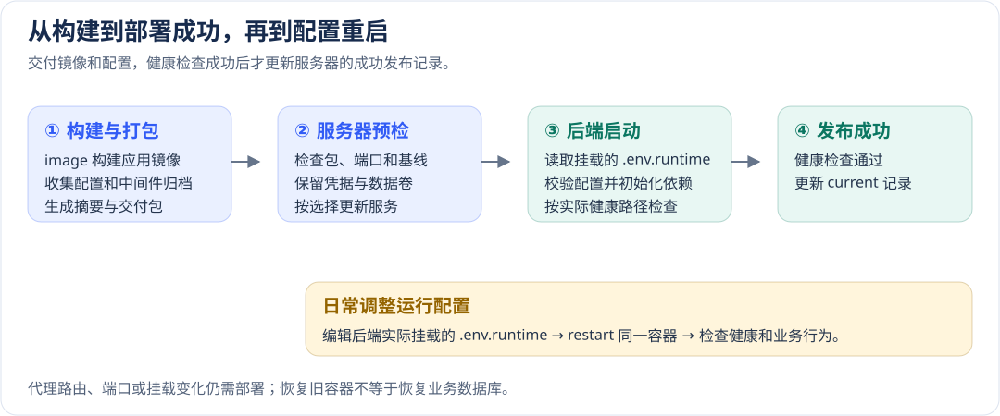
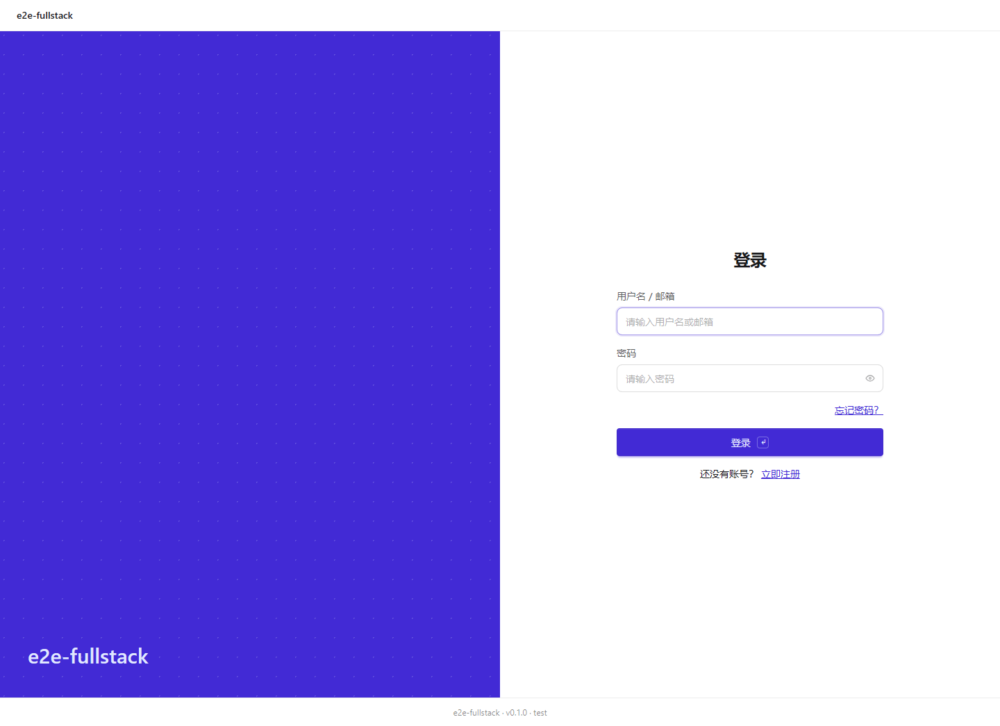

# 应用部署与恢复操作指南

[使用指南](../README.md) · [构建和部署配置手册](../configuration/delivery.md)

先确认交付哪些服务、属于哪个环境、更新后怎样确认业务可用，再执行发布。配置字段、默认值、覆盖关系和生产条件集中在[部署手册](../configuration/delivery.md)，本页按操作顺序说明。

## 先检查计划中的目标

在已配置`hai.json`的应用根执行：

```sh
pnpm run deploy --env test --plan
pnpm run deploy --env test --plan --inspect-remote
```

第一条只读核对本地制品、项目/环境、选中/保留范围；`root` 表示工程根，`serviceDir` 表示部署服务源码与配置目录；第二条再用SSH读取真实成功基线。not-inspected、missing和unavailable不能当验证通过，失败不得退成真实部署。

该图没有连接目标。目标服务器、凭据、端口、HTTPS和实际依赖还需按[环境配置](../configuration/delivery.md#环境和秘密的来源)及[服务器条件](../configuration/delivery.md#离线交付与服务器条件)准备。

## 区分编译、镜像和安装包

compile编译源码，`image`生成服务镜像，app/desktop生成原生包。核对根`name`/`version`和`hai.json.build`路径；serv/web是容器角色，app/desktop不是Compose服务。旧命名或旧格式须重新完整构建，不只改归档名。

```sh
pnpm build --target image
pnpm run deploy --env test --artifact-dir .hai/build/docker/<buildId>
```

第二条实际修改目标。先在隔离环境验证，不能把打包成功当远端更新成功。

## SSH 与环境配置

按[SSH配置](../configuration/delivery.md#ssh端口中间件与云服务)检查身份、主机指纹、目标目录和暴露端口；私钥只存路径，密码走操作机私有环境/隐藏输入，target仅记录变量名。换操作系统后重新核对路径。

新连接与中间件私密值放`.env`.<环境>.local或Secret Manager，公开差异放`.env`.<环境>。部署来源与普通Core不同，先看[优先级](../configuration/delivery.md#环境和秘密的来源)，不要用打印完整环境排查。

## 可选 HTTPS

部署可选择已有 PEM 证书和私钥（复制至发布包），或由官方 Certbot 申请、续期。首次启用和证书布局变更使用全量；`--yes` 复用保存设置。自动申请需确认条款、公网域名、80 端口和 CA 网络，隔离环境使用已有证书。详见[HTTPS 配置](../configuration/delivery.md#可选https证书)。

## 完整包、增量包与生效检查



```sh
pnpm run deploy --env test --build --bundle-only
pnpm run deploy --env test --build --services web
```

第一条生成默认 `.tar.gz` 完整交付，不连接SSH；复制整个目录，在Windows用`deploy.ps1`、Linux/`macOS`用`deploy.sh`上传，完全隔离Linux运行sh `deploy-local.sh`。第二条基于目标成功完整基线只更新web，实际修改目标。

检查manifest.partial/`selectedServices`、版本/构建ID、校验和、端口和保留范围。首次安装或拓扑改变用全量；增量不能改任意布局。已有后端不能原地换引擎复用旧卷，要独立目标和迁移。详见[全量/增量选择](../configuration/delivery.md#全量和增量怎样选择)。

成功后清理本次 incoming 归档与解包目录，release 保留恢复配置和结果，镜像由引擎保存；失败保留诊断。部署后核对`health`/ready、公开版本、登录、列表刷新和持久数据。只有服务器本地HTTP成功才推进current；操作机公开地址复核失败时，远端可能已经complete，先查防火墙/DNS/网络，不自动重发。

从对外入口打开应用，先确认登录页面可用，再用当前部署环境的账号检查业务操作。下面展示生成的 Fullstack 应用启动后的登录入口：



## 修改运行配置后重启

Node 后端（Serv / SvelteKit SSR）默认在每次启动时重读发布目录的 `.env.runtime`，修改后 `docker restart <容器名>` 或 `podman restart <容器名>` 即可，无需重建镜像或额外 override。旧部署先用新版 CLI 发布一次。删除的字段不会从旧 Compose 注入中复活；服务器托管连接的 `middleware.env` 保持原有更高优先级，私有代理标记和 Node 启动参数仍由部署装配管理。静态 Web、中间件、端口/挂载和 Nginx 限额不在该重载范围。手工修改需备份；下一次后端发布会从工程环境重新生成，需要长期保留的配置同步回源环境。

当前文件位于 `releases/<current 中的部署ID>/.env.runtime`。修改前备份，重启后检查健康与受影响业务；失败时恢复文件再重启。详见[运行配置](../configuration/runtime.md#部署后重启加载运行配置)。

## 凭据、数据卷与未知结果

服务器`managed-secrets.env`、persistent-backends和数据卷成套保护与备份。长期账本记录实际卷的后端家族，移除服务或首次安装失败都不会清掉；不能删除/编辑账本强行把旧PostgreSQL卷交给MySQL。活动卷缺失会停止发布，不自动建空库。旧active只有成功基线与唯一真实容器的挂载、镜像家族一致才能补证；未知遗留卷须先核实并迁移。有可信旧凭据可走[只读预检后显式导入](../../../packages/deploy/docs/credential-import.md)，该独立功能需要服务器Node，导入密码不替代后端证据。

受控导入后，未认领卷还须合法v2的准确项目/组/卷与唯一运行原容器的角色标签、挂载、镜像家族完全吻合，已知账本或运行环境冲突仍拒绝。导入不创建成功基线：无current时必须当前CLI生成新ID完整全量包首次接管，成功后再增量；不能把这一步当作数据库数据恢复。

这些校验发生在SSH目标Linux服务器：固定SSH用户、默认本地Docker或实际本地Podman及存储，生产固定`remote.runtime`；Windows/`macOS`操作机的Docker Desktop/Podman VM构建打包不受限。auto因新装Podman切换引擎时，先恢复原`runtime`/用户/store再重试。有意迁移则另做数据方案，不改账本绕过；详见[服务器引擎身份](../configuration/delivery.md#目标服务器的引擎身份)。

失败时查result-<部署ID>.json/current/实际容器及`remoteRecovery`。passed表示旧端口和路径健康已验，failed表示恢复仍失败，unknown需新连接只读核对。固定flock不能删除/替换；强杀和断电不执行恢复trap，锁释放不证明业务回滚。

成功后回退，用**当前CLI**、旧应用制品和匹配配置生成**新全量部署ID**，不加`--build`/`--services`；不改current指针，不运行旧包或旧工具绕过保护。旧应用制品通常不包含全部中间件历史版本，重打包仍用当前CLI固定中间件，需单独核实主版本、数据格式和Schema兼容。数据需兼容或从备份恢复；容器回退不撤销已发通知/支付。完整步骤见[失败恢复与发布后回滚](../configuration/delivery.md#失败恢复与发布后回滚)。

此部署方式替换所选容器，可能短暂停机；生产安排维护窗口，准备旧制品、卷/数据库/凭据备份和恢复演练。零停机、滚动/蓝绿与自动数据库回退不在当前Compose承诺范围。
