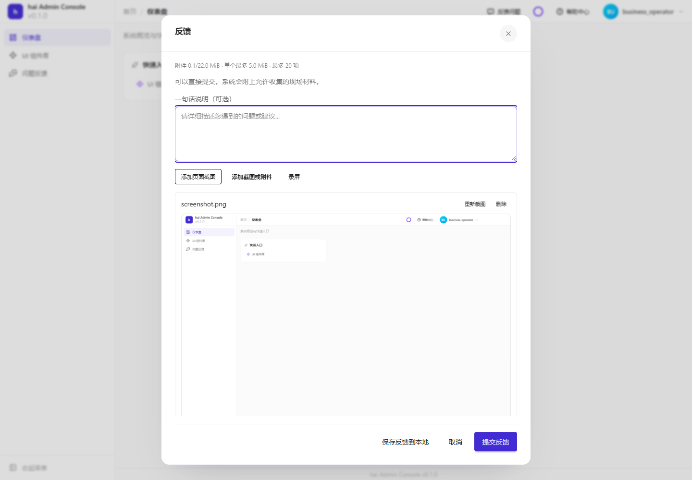
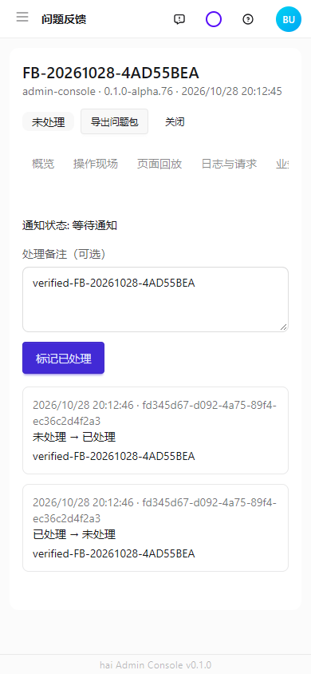
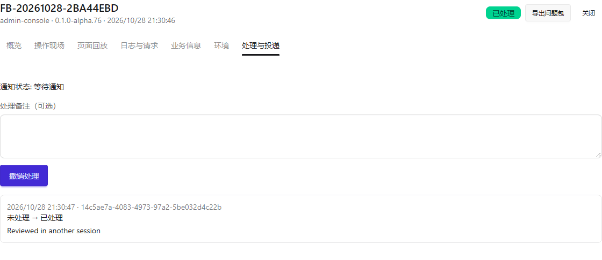

# 运行维护、反馈处理与错误排查

[使用指南](../README.md) · [运维配置手册](../configuration/operations.md) · [日志配置](../configuration/runtime.md#日志采集与隐私)

本页按日常工作组织：用户保留现场，管理员找到原因并处理，维护人员确认业务和后台任务各自结果。配置默认值、预算、通道与保留策略集中在[配置手册](../configuration/operations.md)，不在各操作页重复维护。

## 先走通一次反馈流程

用具有`feedback:create`的专用测试账号，点击右上角“反馈问题”。检查截图、说明和附件，删除不适合上传的材料；生产页面为业务隐私区标记`data-feedback-private`。

提交后记下受理编号。受理表示记录已保存，补传、业务补采和通知可能仍在进行；不要因为未通知再次新建反馈。

用具有`feedback`:`read`的账号进入管理页，按编号查找并打开。处理和撤销分别需要`feedback`:process/`feedback`:reopen，服务端仍检查权限和资源范围。

在“处理与投递”填写备注并标记处理。处理、通知及历史分别展示；撤销追加历史，不删除旧记录。

上述页面来自真实浏览器、隔离SQLite和私有本地附件。已核对受理、处理与撤销后的版本/历史，不表示真实邮箱或Webhook已收到。

## 用户提示与诊断关联

可恢复错误说明下一步。两人同时处理一条记录，后一次409应提示刷新，刷新后读取最新版本再决定操作；网络超时先查真实结果，不能假定已回滚。

点击“查看排查信息”，复制“问题追踪编号”，连同页面和时间交给客户支持/开发；展开期间暂停关闭。编号用于关联日志，不公开堆栈、SQL、密钥。

开发人员以同一`traceId`查询脱敏服务日志，再看错误码、操作阶段和异常链；修复后复测业务状态。HTTP/UI边界用`core.error.toPublic`、`errorMessage`/`notifyError`，必须抛Error的服务用cause保留HaiError；未知异常和5xx继续安全隐藏。不要传未知`Error.message`字符串绕过边界。

日志级别、格式和额外业务隐私字段的遮盖方式，见[日志手册](../configuration/runtime.md#日志采集与隐私)。

## Feedback：受理、采集、通知分开判断

先RelDB/私有Storage，再Feedback。按[采集和通知配置](../configuration/operations.md#feedback通知采集和保留)先用console走通，随后接真实Reach或Webhook；这样能区分业务受理与通道故障。

提交专用反馈后查看get().jobs：`collection`/notification/webhook各自判断。业务`collectEvidence`异步回调必须被等待；采集终态后投递固定载荷。失败只retry对应任务，接收端按`eventId`持久去重。离线导出和录屏回放不重新执行业务。

附件超限时按[预算章节](../configuration/operations.md#预算与附件限制)核对总量/单附件/路由/代理/加密，不只扩大上传控件。到期清理完成和存储预留释放都要确认。

### 页面闲置后出现错误，先查什么

没有未完成受理任务时，Feedback不会因闲置自行补传。已有草稿的失败采用[客户端退避与退出边界](../configuration/operations.md#页面闲置退出和重试)，认证或网络恢复后显式重试；不要业务每秒flush绕过后台预算。

退出先`await client.close({ discard: true })`再切换身份。已经发出的请求不能据此承诺撤销。pause仅暂停截图/DOM，不能代替退出清理。

只有“内部错误”而无日志时不能直接认定Feedback根因。记录`traceId`、时间、页面，确认失败请求是否/`feedback`/，此前是否会话过期、断网或服务重启。代码和受控时钟能验证请求边界，不能代替业务现场关联。

## Reach：通知与未知结果恢复

按[通知配置](../configuration/operations.md#reach通道免打扰与失败队列)准备测试收件箱/受控端点，发送无敏感材料，核对Provider回执和接收端记录。console只说明本地输出，不说明真实送达。

免打扰delay需RelDB持久入队成功才能称deferred。非幂等请求unknown先核对接收端，不盲目requeue；真正支持原子持久去重才声明`idempotent`。敏感消息用sensitive/`expiresAt`/`idempotencyKey`并限制保留。

## Audit：保留、隐私、归档与告警

按[审计手册](../configuration/operations.md#audit采集保留保护归档与告警)先准备依赖和备份，再触发测试动作，检查操作者、`resource`、outcome和`traceId`。测试保护期内删除/修改/覆盖拒绝，归档对象保持私有。

移除`retention`配置不解除已有保护；归档不是原子数据库快照，也不删除源记录。计划必须由宿主接入`schedulerPlan`，不能仅填cron就认为任务在运行。真实告警还需接收端验证。

## Scheduler：租约、日志与安全重试

先注册无外部副作用任务，按[调度配置](../configuration/operations.md#scheduler租约时间与未知执行)触发并检查执行记录。执行成功与结果持久化分别确认，落库失败可`repairLog`；unknown先停止旧runner、核对副作用，再按版本`resolveUnknown`。

获取/续租成功不等于业务只执行一次，任务仍需幂等键。时区、夏令时、多节点行锁和节点时钟偏差需实际环境验证，不能以单元时钟替代全部部署验收。

## 按现象定位

| 现象 | 先确认 | 恢复动作 |
| --- | --- | --- |
| 配置改了没生效 | 文件名/父覆盖/宿主是否传值 | 修正来源、校验并重启模块，不打印私密配置 |
| 登录立即掉线 | Cookie/跨域/共享Cache/持久ring/时钟 | 以`traceId`核对节点、刷新与撤销结果 |
| 保存超时 | 是否到达、事务是否提交、外部是否unknown | 用业务ID查事实后再试，防重复副作用 |
| 反馈受理未通知 | 各job状态和通道回执 | 只恢复失败任务，不重复创建反馈 |
| 部署失败 | result/current/`remoteRecovery`/实际容器 | 按[部署恢复](../configuration/delivery.md#失败恢复与发布后回滚)核对，不能看到SSH退出就重发 |
| E2E前置失败 | 容器后端、端口和fixture日志 | 定向UI可排除无关LDAP，完整LDAP验收仍要真实容器 |

排查记录以“发生什么、影响什么、下一步是什么”开头，附脱敏证据。HTTP200、日志条数和本地打包成功均不能代替业务完成。
